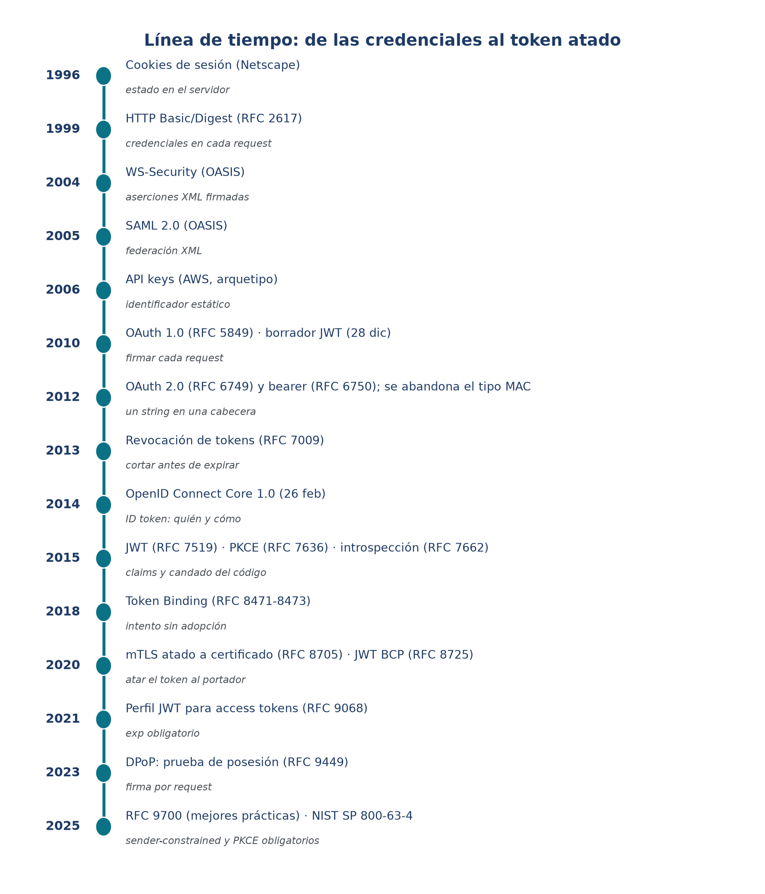

# 3. Historia: de las credenciales al token atado

Esta sección cuenta **cómo llegamos hasta acá**. No es un dato de color: cada decisión de diseño
que hoy damos por sentada nació como respuesta a un problema concreto, y casi todos los incidentes
modernos son consecuencias no previstas de esas decisiones. Si entendés **por qué** apareció cada
mecanismo, entendés **dónde** va a fallar.

> Nota de método: las fechas son las de **primera aparición pública** del mecanismo (RFC, estándar o
> producto de referencia). Los incidentes se citan como **divulgaciones públicas** y se analizan como
> **fallas de modelo**, nunca como críticas a organizaciones o personas.

## 3.1 Era 1 — La credencial viaja en cada request (1993–1999)

Cuando la web empezó a necesitar "áreas privadas", la solución más simple fue **mandar usuario y
contraseña en cada petición**. Eso es lo que hicieron **HTTP Basic** (concepto de 1993; RFC 1945 en
1996) y su primo **Digest**, que al menos no mandaba la contraseña en claro sino un hash con un
*nonce* (estandarizado en el RFC 2069, 1997, y luego en el RFC 2617, 1999).

- **Qué resolvía:** autenticación mínima, sin estado, sin base de sesiones.
- **Qué no resolvía:** la credencial **viaja una y otra vez**. Si la línea no está cifrada, se lee;
  si está cifrada, igual queda expuesta en el cliente, en los logs y en el servidor. Y no hay forma
  limpia de **delegar** permisos: o sos vos, o no sos nadie.
- **Qué queda hoy:** Basic sobrevive dentro de sistemas internos y como **autenticación de cliente**
  en OAuth (`client_secret_basic`). Digest quedó prácticamente en desuso.

Casi al mismo tiempo —de hecho **antes** de que Digest se estandarizara en 1997—, Netscape inventó la
**cookie** (idea de 1994; especificación pública hacia 1996): un pedacito de estado que el navegador
guarda y reenvía. Con eso nació la **sesión**. La cookie resolvió el problema de "recordar quién sos"
sin repetir la contraseña… y creó dos problemas nuevos para siempre: **CSRF** y **robo de sesión**
(XSS, sniffing). Recién en 2011 se estandarizó (RFC 6265) con los atributos `HttpOnly`, `Secure` y,
más tarde, `SameSite`.

## 3.2 Era 2 — La federación en XML (2002–2005)

Las empresas necesitaban que un empleado autenticado en el directorio corporativo entrara a varias
aplicaciones sin repetir la contraseña. Nació **WS-Security** (OASIS, 2004) y, sobre todo, **SAML 2.0**
(OASIS, 2005): aserciones firmadas digitalmente que viajaban entre el proveedor de identidad y la
aplicación.

- **Qué aportó:** identidad **federada**, **SSO** (una sola sesión para muchas apps) y **firmas** para
  probar que la aserción venía del IdP.
- **Por qué no conquistó el mundo de las APIs:** SAML es **XML**, verboso y pesado para el navegador;
  la gente empezó a usar el navegador entero como transporte de mensajes (el *web SSO profile*), y las
  firmas XML (XML-DSig) tienen una **canonicalización** famosa por ser una fuente inagotable de bugs.
- **Qué queda hoy:** SAML 2.0 vive y es enorme en el mundo **empresarial** (banca, gobierno, SaaS
  corporativo). En APIs de consumo y móviles, su lugar lo ocupó OIDC.

## 3.3 Era 3 — La clave estática (2006 en adelante)

Para que un programa hablara con una API, lo más simple era darle una **API key**: un string largo y
secreto que identifica al cliente. AWS y decenas de proveedores lo popularizaron.

- **Qué resolvió:** identificar **aplicaciones** (no personas) sin montar todo un servidor de identidad.
- **Dónde vive la falla:** la clave **no expira sola**, **no distingue permisos finos** y, si se filtra
  (un repo público, un log, una app móvil descompilada), es **impersonación directa**. Millones de claves
  han aparecido en GitHub, en artículos y en capturas de pantalla.

## 3.4 Era 4 — Firmar cada request (2007–2010)

OAuth 1.0 (borrador de diciembre de 2007; RFC 5849 en 2010) eligió un camino elegante: **no mandar un
token usable**, sino **firmar criptográficamente cada petición** con la clave compartida (HMAC-SHA1),
incluyendo un *nonce* y un *timestamp* para evitar reenvíos.

- **Qué aportó:** un request robado **no se podía reutilizar** sin la clave; no había "bearer" que
  robar.
- **Por qué se abandonó el firmar-por-request:** era **muy difícil de implementar bien** (orden de
  parámetros, canonicalización, relojes), **dependía de la criptografía en el cliente**, y era un
  **calvario para móviles y SPAs**, donde el secreto del cliente no se puede guardar. La comunidad pidió
  algo más simple.

## 3.5 El giro (octubre de 2012): bearer sí, MAC no

OAuth 2.0 (RFC 6749) y el **bearer token** (RFC 6750) llegaron en octubre de 2012 con una consigna:
**simplicidad**. El token pasa a ser una **credencial portadora** —"billete al portador"— que se pone
en la cabecera `Authorization: Bearer …` y listo.

El propio OAuth 2.0 **había definido además el tipo `mac`** (token con prueba de posesión), y hasta
salió un borrador en febrero de 2012. Pero se **abandonó**: exigía canonicalización, era difícil de
interoperar y el mundo prefirió la simplicidad. La consecuencia quedó escrita en la norma:

> **RFC 6749, §10.3:** el servidor de recursos... *no puede* confirmar que el token fue emitido al
> cliente que lo presenta.

Es decir: **por diseño**, quien tiene el token, lo usa. Esa es la frase que resume toda la charla.

## 3.6 La consolidación (2014–2025): ponerle cinturón al bearer

La historia de los últimos diez años es la historia de **atenuar** la propiedad portadora, sin perder la
simplicidad:

| Año | Aporte | Qué agrega |
|---|---|---|
| 2013 | Revocación de tokens (RFC 7009) | cortar antes de la expiración |
| 2014 | OpenID Connect Core 1.0 | identidad (ID token: quién y cómo) sobre OAuth |
| 2015 | JWT (RFC 7519) · PKCE (RFC 7636) · Introspección (RFC 7662) | claims; candado al código; validar tokens opacos |
| 2018 | Token Binding (RFC 8471-8473) | atar el token al canal TLS (sin adopción masiva) |
| 2020 | mTLS atado a certificado (RFC 8705) · JWT BCP (RFC 8725) | tokens *sender-constrained*; reglas de validación JWT |
| 2021 | Perfil JWT para access tokens (RFC 9068) | interoperabilidad; `exp` obligatorio |
| 2023 | DPoP (RFC 9449) | prueba de posesión por request, sin PKI |
| 2025 | RFC 9700 · NIST SP 800-63-4 | mejores prácticas y sender-constrained/PKCE recomendados |

## 3.7 Lo que enseña la historia (cinco moralejas)

1. **Todo token portador es una contraseña portátil.** Si no está atado a su portador, quien lo roba
   entra.
2. **La simplicidad gana primero y cobra después.** El `mac` se descartó por complejo; DPoP volvió a
   traer la prueba de posesión 11 años más tarde.
3. **Cada capa de esta historia sigue viva.** Basic en clientes OAuth, SAML en empresas, API keys en
   servicios internos, cookies en el navegador. No reemplazamos: **apilamos**.
4. **La vida del token importa más que su creación.** La MFA protege la emisión; el daño ocurre durante
   los días o meses en que el token vive.
5. **El token es una sola pieza.** La mayoría de los incidentes no fueron "token roto", sino
   **autorización, validación, configuración o inventario**. De eso trata la sección 6.
