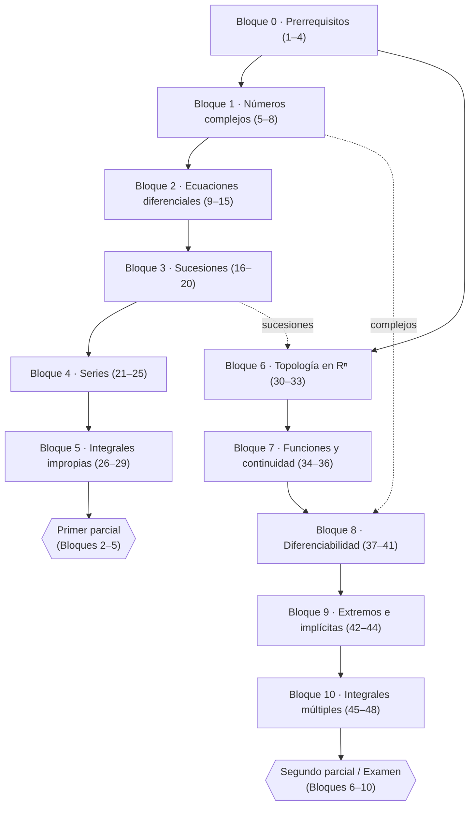

# Curso de Cálculo Diferencial e Integral en Varias Variables (FING – UdelaR)

> **Curso de preparación para el examen, armado en 48 clases digeribles.**
> Basado en el curso oficial **CDIVV** (Cálculo Diferencial e Integral en Varias Variables) de la Facultad de Ingeniería, UdelaR: notas de teórico de Marcelo Fiori (2024), videos de OpenFING y los repartidos de práctico, parciales y exámenes publicados en el EVA.

---

## ¿Qué es este curso y para quién es?

Este material está pensado para quien **ya cursó (o está cursando) Cálculo en Varias Variables y le costó**, y necesita:

- Volver a ver **desde cero** los conceptos básicos que se dan por sabidos (límites, derivadas, integración, sucesiones, vectores).
- Ver **muchos ejemplos**, todos **resueltos paso a paso**, sin saltear cuentas.
- **Diagramas** que ayuden a *ver* lo que dice la fórmula.
- Tener resueltos **los prácticos oficiales** y **los ejercicios de parciales y exámenes viejos** que se relacionan con cada tema.

El curso original dura **16 semanas**. Acá lo partimos en **48 clases** para que cada una sea corta y autosuficiente: podés hacer **una clase por día**, o tres por semana, y en ~16 semanas tenés todo el programa cubierto con ejercitación de examen incluida.

---

## Cómo está armada cada clase

Todas las clases siguen la misma estructura, para que sepas siempre qué esperar:

| Sección | Qué vas a encontrar |
|---|---|
| 🎯 **Objetivos** | Qué tenés que poder hacer al terminar la clase. |
| 🗺️ **Mapa de la clase** | Un diagrama (Mermaid) con las ideas principales y cómo se conectan. |
| 🧱 **Repaso / ideas previas** | Los conceptos anteriores que se usan, explicados de nuevo si hace falta. |
| 📘 **Teoría** | Definiciones, teoremas, fórmulas, con explicaciones y ejemplos. |
| 🖼️ **Figuras** | Gráficos (PNG) que acompañan las ideas geométricas. |
| ✏️ **Ejercicios resueltos** | Los del **práctico oficial** que corresponden, **paso a paso**. |
| 🏛️ **Ejercicios de parcial/examen** | Ejercicios reales de pruebas anteriores, resueltos y explicados. |
| ⚠️ **Errores comunes** | Las trampas típicas y cómo evitarlas. |
| 🔗 **Conexiones** | Para qué sirve esto en las clases siguientes y en el examen. |
| ✅ **Autoevaluación** | Ejercicios para que te pruebes solo, con respuestas al final. |

> **Convención de notación:** usamos $\mathbb{N}$ para los naturales, $\mathbb{R}$ para los reales, $\|x\|$ para la norma euclídea, $B(p,r)$ para la bola de centro $p$ y radio $r$, y $B^*(p,r)$ para la bola "reducida" (sin el centro). Los conjuntos se anotan con mayúsculas y los vectores con $\vec v$ o en negrita cuando conviene.

---

## Mapa general del curso

---

## Las 48 clases

### Bloque 0 — Prerrequisitos (clases 1 a 4)
> Nivel: repaso. Estas clases no son "perder el tiempo": casi todos los errores en el parcial vienen de acá.

| # | Clase | Práctico / prueba asociada |
|---|---|---|
| 1 | Números reales, funciones, límite y continuidad de una variable | Base para todo |
| 2 | Derivadas e integrales de una variable y técnicas de integración | Base para todo |
| 3 | Sucesiones de números reales, lógica y cuantificadores | Práctico 2 (definiciones), Parcial 1 2022-2S |
| 4 | Vectores, rectas, planos, cónicas y cuádricas | Práctico 5 y 6 (gráficas) |

### Bloque 1 — Números complejos (clases 5 a 8)

| # | Clase | Práctico / prueba asociada |
|---|---|---|
| 5 | Forma binómica: operaciones, conjugado, módulo | Complejos |
| 6 | Forma polar, argumento, producto y potencias (De Moivre) | Complejos |
| 7 | Raíces n-ésimas y raíces de la unidad | Examen dic. 2022 (ejercicio 4) |
| 8 | Exponencial compleja y fórmula de Euler | OpenFING clases 1–3 |

### Bloque 2 — Ecuaciones diferenciales (clases 9 a 15)

| # | Clase | Práctico / prueba asociada |
|---|---|---|
| 9 | Variables separables | Práctico 1, ej. 1 y 2 |
| 10 | Aplicaciones (caída, poblaciones, represa) | Práctico 1, aplicaciones 1–3 |
| 11 | Lineales de 1.er orden: homogénea y factor integrante | Práctico 1, ej. 4a |
| 12 | 1.er orden no homogénea y cambio $u=y/x$ | Práctico 1, ej. 3 y 4b |
| 13 | 2.º orden homogénea (3 casos) | Práctico 1, ej. 5 |
| 14 | 2.º orden no homogénea (coeficientes indeterminados) | Práctico 1, ej. 9 |
| 15 | Repaso de EDOs y problemas de parcial/examen | Práctico 1 (evaluaciones) |

### Bloque 3 — Sucesiones (clases 16 a 20)

| # | Clase | Práctico / prueba asociada |
|---|---|---|
| 16 | Definición, límite ε–N y acotación | Práctico 2, ej. 2 y evaluaciones 2022/2020 |
| 17 | Sucesiones monótonas, recurrencias y PSMC | Práctico 2, ej. 1 y complementarios |
| 18 | Cálculo de límites, subsucesiones y puntos de aglomeración | Práctico 2, ej. 3–5 y parcial 2024 |
| 19 | Bolzano–Weierstrass, Cauchy y sucesiones en Rⁿ | Práctico 2, ej. 6–7 y 9–10 |
| 20 | Repaso de sucesiones y problemas de parcial/examen | Evaluaciones del Práctico 2 y exámenes 2018–2022 |

### Bloque 4 — Series (clases 21 a 25)

| # | Clase | Práctico / prueba asociada |
|---|---|---|
| 21 | Series: definición, geométrica y telescópica | Práctico 3, ej. 1 |
| 22 | Términos positivos: comparación y equivalente | Práctico 3, ej. 2 y 3 |
| 23 | Cociente, raíz y criterio serie-integral | Práctico 3, ej. 4–5; Práctico 4, ej. 8 |
| 24 | Series alternadas y convergencia absoluta | Práctico 3, ej. 6–8 |
| 25 | Repaso de series y pruebas | Parciales 2018–2022 |

### Bloque 5 — Integrales impropias (clases 26 a 29)

| # | Clase | Práctico / prueba asociada |
|---|---|---|
| 26 | Integrales impropias de primera especie | Práctico 4, ej. 1–4 |
| 27 | De segunda especie y mixtas; criterios | Práctico 4, ej. 5–7 |
| 28 | Criterio serie-integral, Torricelli y función Gamma | Práctico 4, ej. 8–10 y complementarios |
| 29 | Repaso de impropias y pruebas | Parciales y exámenes |

### Bloque 6 — Topología en Rⁿ (clases 30 a 33)

| # | Clase | Práctico / prueba asociada |
|---|---|---|
| 30 | Bolas, conjuntos abiertos y cerrados | Práctico 5, ej. 1–2 |
| 31 | Interior, frontera, clausura y puntos de acumulación | Práctico 5, ej. 3–6 |
| 32 | Compactos, conexos y sucesiones en Rⁿ | Práctico 5, ej. 7–8 y opcionales |
| 33 | Repaso de topología y pruebas | Parcial 1 2022-2S, examen feb. 2022 |

### Bloque 7 — Funciones y continuidad (clases 34 a 36)

| # | Clase | Práctico / prueba asociada |
|---|---|---|
| 34 | Dominio, gráfica y conjuntos de nivel | Práctico 6, ej. 1–3 |
| 35 | Límites: direccionales, iterados y coordenadas polares | Práctico 6, ej. 4–10 |
| 36 | Continuidad, teorema de Weierstrass y extensiones | Práctico 6, ej. 11–15 |

### Bloque 8 — Diferenciabilidad (clases 37 a 41)

| # | Clase | Práctico / prueba asociada |
|---|---|---|
| 37 | Derivadas parciales y direccionales; gradiente | Práctico 7 |
| 38 | Diferenciabilidad, plano tangente y condición suficiente | Parcial 2 2025-1S, ej. 3 |
| 39 | Regla de la cadena y matriz jacobiana | Parcial 2 2025-1S, ej. 4 |
| 40 | Derivadas de orden superior, Clairaut y Hessiana | Segundo parcial |
| 41 | Taylor de orden 2 y formas cuadráticas | Segundo parcial |

### Bloque 9 — Extremos e implícitas (clases 42 a 44)

| # | Clase | Práctico / prueba asociada |
|---|---|---|
| 42 | Extremos relativos y criterio de la Hessiana | Segundo parcial |
| 43 | Extremos absolutos y convexidad | Segundo parcial |
| 44 | Función implícita, inversa y multiplicadores de Lagrange | Segundo parcial |

### Bloque 10 — Integrales múltiples (clases 45 a 48)

| # | Clase | Práctico / prueba asociada |
|---|---|---|
| 45 | Integrales dobles, Teorema de Fubini e inversión del orden | Parcial 2 2025-1S, ej. 5; Parcial 2 2021-1S |
| 46 | Cambio de variable y coordenadas polares | Parcial 2 2025-1S, ej. 5 |
| 47 | Integrales triples; cilíndricas y esféricas | Parcial 2 2021-1S, D2 |
| 48 | Impropias múltiples y simulacro de examen final | Exámenes 2018–2022 |

---

## Plan de estudio sugerido (16 semanas)

| Semana | Clases | Foco |
|---|---|---|
| 1 | 1–4 | Prerrequisitos |
| 2 | 5–8 | Complejos |
| 3 | 9–12 | EDOs (parte I) |
| 4 | 13–15 | EDOs (parte II) + repaso |
| 5 | 16–18 | Sucesiones |
| 6 | 19–20 | Sucesiones (cierre) |
| 7 | 21–23 | Series |
| 8 | 24–25 | Series (cierre) |
| 9 | 26–27 | Impropias |
| 10 | 28–29 | Impropias (cierre) + **simulacro del primer parcial** |
| 11 | 30–31 | Topología |
| 12 | 32–33 | Topología (cierre) |
| 13 | 34–36 | Funciones y continuidad |
| 14 | 37–39 | Diferenciabilidad |
| 15 | 40–42 | Taylor y extremos |
| 16 | 43–48 | Implícitas, Lagrange e integrales + **simulacro final** |

---

## Fuentes, créditos y aviso legal

Este material es un **resumen y una reelaboración didáctica** de material público del curso:

- **Notas de teórico** "Cálculo Diferencial e Integral en Varias Variables", Marcelo Fiori, IMERL–FING (2019, con capítulo nuevo en 2024).
- **Videos de teórico OpenFING** (Cálculo 2 / CDIVV). Contenido de OpenFING bajo licencia **Creative Commons BY-NC-ND 4.0**.
- **Repartidos de práctico, parciales, exámenes y soluciones** publicados en el EVA de FING (acceso como invitado).

Los enunciados de ejercicios y exámenes se reproducen con **fines de estudio**. Se citan las fuentes. No se reclama autoría sobre el material original.

> ⚠️ **Revisá siempre la letra oficial** antes de rendir: las fechas, la modalidad y el puntaje cambian cada semestre.

---

## Índice de archivos

- `00_indice.md` ← estás acá
- `01_reales_funciones_limites.md`
- `02_derivadas_integrales_1var.md`
- `03_sucesiones_logica.md`
- `04_vectores_geometria.md`
- `05_complejos_binomica.md`
- `06_polar_demoivre.md`
- `07_raices_n_esimas.md`
- `08_exponencial_euler.md`
- `09_edo_separables.md`
- `10_edo_aplicaciones.md`
- `11_edo_lineal_1er_orden_homogenea.md`
- `12_edo_no_homogenea_u_yx.md`
- `13_edo_2do_orden_homogeneas.md`
- `14_edo_2do_orden_no_homogeneas.md`
- `15_edo_repaso_parciales.md`
- `16_sucesiones_definicion.md`
- `17_sucesiones_monotonas.md`
- `18_limites_subsucesiones.md`
- `19_bw_cauchy_rn.md`
- `20_sucesiones_repaso.md`
- `21_series_definicion.md`
- `22_series_positivos.md`
- `23_series_cociente_raiz.md`
- `24_series_alternadas.md`
- `25_series_repaso.md`
- `26_impropias_primera_especie.md`
- `27_impropias_segunda_especie.md`
- `28_serie_integral_gamma.md`
- `29_impropias_repaso.md`
- `30_bolas_abiertos_cerrados.md`
- `31_interior_frontera_clausura.md`
- `32_compactos_conexos.md`
- `33_topologia_repaso.md`
- `34_dominio_nivel_graficas.md`
- `35_limites_direccionales_polares.md`
- `36_continuidad_weierstrass.md`
- `37_derivadas_parciales_direccionales.md`
- `38_diferenciabilidad_plano_tangente.md`
- `39_regla_cadena_jacobiano.md`
- `40_orden_superior_clairaut_hessiana.md`
- `41_taylor_formas_cuadraticas.md`
- `42_extremos_relativos_hessiana.md`
- `43_extremos_absolutos_convexidad.md`
- `44_implicita_inversa_lagrange.md`
- `45_integrales_dobles_fubini.md`
- `46_cambio_variable_polares.md`
- `47_integrales_triples_cilindricas_esfericas.md`
- `48_impropias_multiples_simulacro.md`

> Las imágenes están en `img/`. Los scripts que las generan están en `figuras/` (`_bloque0.py` … `_bloque10.py`, más `_bloque2b.py` con figuras extra del Bloque 2) y el verificador de calidad del curso es `figuras/_qa.py`.

---

## Estado de avance

| Bloque | Clases | Estado |
|---|---|---|
| Bloque 0 — Prerrequisitos | 1–4 | ✅ completo |
| Bloque 1 — Números complejos | 5–8 | ✅ completo |
| Bloque 2 — Ecuaciones diferenciales | 9–15 | ✅ completo |
| Bloque 3 — Sucesiones | 16–20 | ✅ completo |
| Bloque 4 — Series | 21–25 | ✅ completo |
| Bloque 5 — Integrales impropias | 26–29 | ✅ completo |
| Bloque 6 — Topología en Rⁿ | 30–33 | ✅ completo |
| Bloque 7 — Funciones y continuidad | 34–36 | ✅ completo |
| Bloque 8 — Diferenciabilidad | 37–41 | ✅ completo |
| Bloque 9 — Extremos e implícitas | 42–44 | ✅ completo |
| Bloque 10 — Integrales múltiples | 45–48 | ✅ completo |

🎉 **Los 48 cursos están escritos.** Cada clase es un archivo Markdown autocontenido con teoría, figuras, ejercicios del práctico y de parcial/examen resueltos paso a paso, y autoevaluación con respuestas.
