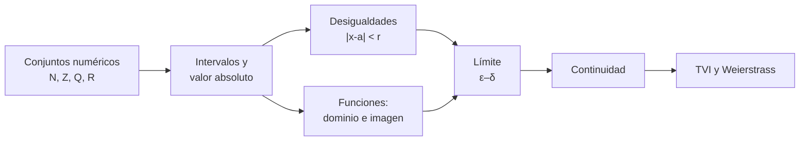
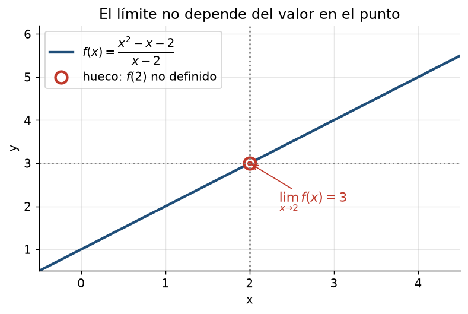
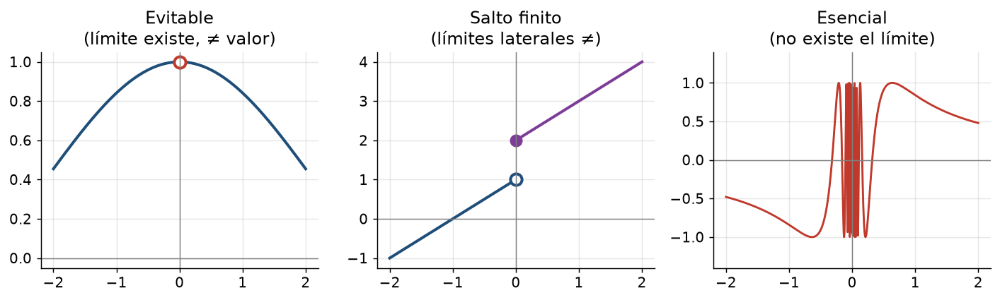

# Clase 1 — Números reales, funciones, límite y continuidad de una variable

> **Bloque 0 · Prerrequisitos · Dificultad: baja-media · Tiempo estimado: 90 min**

---

## 🎯 Objetivos

Al terminar esta clase vas a poder:

1. Operar con **intervalos**, **valor absoluto** y **desigualdades** (la base de todos los "$\varepsilon$" del curso).
2. Reconocer el **dominio** y la **imagen** de una función y componer funciones.
3. Entender qué significa un **límite** y calcularlo en los casos típicos (indeterminaciones, raíces, trigonométricos).
4. Decidir si una función es **continua** y clasificar **discontinuidades**.
5. Enunciar y usar el **Teorema del Valor Intermedio** y el **Teorema de Weierstrass** (versión 1D).

---

## 🗺️ Mapa de la clase

**Idea central:** casi todo el curso se apoya en la idea de *"estar cerca de"*, y eso se escribe con **valor absoluto** y **desigualdades**. Si manejás bien esto, los $\varepsilon$ y $\delta$ dejan de dar miedo.

---

## 🧱 0. Conjuntos numéricos e intervalos

Recordemos los conjuntos de números, porque en el curso aparecen todo el tiempo:

$$
\mathbb{N}=\{1,2,3,\dots\},\quad
\mathbb{Z}=\{\dots,-2,-1,0,1,2,\dots\},\quad
\mathbb{Q}=\left\{\tfrac{p}{q}:p,q\in\mathbb{Z},\ q\ne 0\right\},\quad
\mathbb{R}.
$$

- $\mathbb{R}$ "completa" a $\mathbb{Q}$: todo punto de la recta es un número real. Esto se llama **completitud** y es la razón de que $\sqrt 2$, $\pi$, $e$ existan como números de verdad.
- En $\mathbb{R}^2$ (el plano) los elementos son **pares** $(x,y)$; en $\mathbb{R}^n$, **$n$-uplas** $(x_1,\dots,x_n)$.

**Intervalos** (muy usados para describir dominios):

$$
(a,b),\quad [a,b],\quad [a,b),\quad (a,+\infty),\quad (-\infty,b].
$$

El paréntesis indica que el extremo **no** está incluido; el corchete, que **sí**.

### Valor absoluto

$$
|x|=\begin{cases} x, & x\ge 0,\\ -x, & x<0.\end{cases}
$$

Geométricamente, $|x|$ es la **distancia** de $x$ al $0$, y $|x-a|$ es la **distancia** entre $x$ y $a$.

> **Regla de oro de las distancias:**
> $$|x-a|<\delta \quad\Longleftrightarrow\quad a-\delta<x<a+\delta \quad\Longleftrightarrow\quad x\in(a-\delta,\ a+\delta).$$
> Es decir: *"$x$ está a menos de $\delta$ de $a$"*. Esta equivalencia se usa en **cada** demostración de límite.

---

## 📘 1. Funciones

Una **función** $f:A\to B$ asigna a cada $x\in A$ (el **dominio**) **un único** valor $f(x)\in B$.

- La **imagen** (o recorrido) es $\operatorname{Im}(f)=\{f(x):x\in A\}$.
- El **gráfico** es $\{(x,f(x)):x\in A\}$.

**Operaciones y composición.** Si $f$ y $g$ son funciones, $(g\circ f)(x)=g(f(x))$. Para que tenga sentido hay que respetar los dominios: primero $x$ debe poder entrar a $f$, y luego $f(x)$ debe poder entrar a $g$.

**Ejemplo 1.1.** Hallar el dominio de $f(x)=\dfrac{\sqrt{x+2}}{x-3}$.

- La raíz pide $x+2\ge 0 \Rightarrow x\ge -2$.
- El denominador pide $x-3\ne 0 \Rightarrow x\ne 3$.
- Dominio: $[-2,3)\cup(3,+\infty)$.

**Ejemplo 1.2.** Si $f(x)=\sqrt x$ y $g(x)=1-x^2$, hallar $g\circ f$ y su dominio.

$g(f(x))=1-(\sqrt x)^2=1-x$. Pero cuidado: el dominio **no** es todo $\mathbb{R}$, porque $f$ exige $x\ge 0$. Entonces el dominio de $g\circ f$ es $[0,+\infty)$. *(Este es el error típico: simplificar la expresión y olvidar el dominio original.)*

---

## 📘 2. Límite de una función

### 2.1 La idea

Decir que $\displaystyle\lim_{x\to a} f(x)=L$ significa: *"si $x$ se acerca a $a$ (sin tocarlo), $f(x)$ se acerca a $L$"*.

En la figura, $f(x)=\dfrac{x^2-x-2}{x-2}=\dfrac{(x-2)(x+1)}{x-2}=x+1$ para $x\ne 2$. En $x=2$ hay un **hueco**, pero nos da igual: el límite es $3$ porque *miramos alrededor*, no *en* el punto.

### 2.2 Definición formal (ε–δ)

$$
\lim_{x\to a} f(x)=L
\iff
\forall \varepsilon>0\ \ \exists \delta>0 \ \text{ tal que }\ 0<|x-a|<\delta \Rightarrow |f(x)-L|<\varepsilon.
$$

Traducción: *"sin importar cuán exigente seas con la tolerancia $\varepsilon$ alrededor de $L$, puedo encontrar un entorno $\delta$ alrededor de $a$ donde todo $f(x)$ cae dentro de la tolerancia."*

### 2.3 Propiedades

Si $\lim_{x\to a}f(x)=L_1$ y $\lim_{x\to a}g(x)=L_2$, entonces:

$$
\lim (f+g)=L_1+L_2,\quad \lim(fg)=L_1L_2,\quad \lim\frac fg=\frac{L_1}{L_2}\ (L_2\ne0).
$$

**Límites laterales:** $\lim_{x\to a^-}$ (por izquierda) y $\lim_{x\to a^+}$ (por derecha). El límite **existe** si y solo si existen los dos laterales y **coinciden**.

### 2.4 Los tres límites trigonométricos que hay que saber

$$
\lim_{x\to0}\frac{\sin x}{x}=1,\qquad
\lim_{x\to0}\frac{\cos x-1}{x}=0,\qquad
\lim_{x\to0}\frac{1-\cos x}{x^2}=\frac12.
$$

De ahí salen los **equivalentes** en $0$ que usarás muchísimo:
$$
\sin x\sim x,\quad 1-\cos x\sim \frac{x^2}{2},\quad e^x-1\sim x,\quad \ln(1+x)\sim x,\quad (1+x)^\alpha-1\sim \alpha x.
$$
El símbolo $\sim$ significa $\lim \frac{f(x)}{g(x)}=1$.

---

## 📘 3. Continuidad y discontinuidades

$f$ es **continua en $a$** si y solo si se cumplen las tres cosas:

1. $f(a)$ está definida;
2. $\lim_{x\to a}f(x)$ existe;
3. $\lim_{x\to a}f(x)=f(a)$.

- **Evitable:** el límite existe pero no coincide con $f(a)$ (o $f(a)$ no existe). Se "arregla" redefiniendo el valor.
- **De salto:** existen los laterales pero son distintos.
- **Esencial:** al menos un lateral no existe.

**Teoremas clave (los generalizaremos en varias variables, clases 34–36):**

- **Teorema del Valor Intermedio (TVI):** si $f$ es continua en $[a,b]$ y $\mu$ está entre $f(a)$ y $f(b)$, existe $c\in(a,b)$ con $f(c)=\mu$.
- **Teorema de Weierstrass (1D):** si $f$ es continua en $[a,b]$ (cerrado y acotado), entonces $f$ alcanza su **máximo** y su **mínimo**, y está **acotada**.

---

## ✏️ 4. Ejercicios resueltos paso a paso

### Ejercicio 1. Resolver $|2x-3|\le 5$

**Paso 1.** Desigualdad con valor absoluto $\le$ se abre en dos:

$$
-5\le 2x-3\le 5.
$$

**Paso 2.** Sumamos $3$ en las tres partes: $-2\le 2x\le 8$.

**Paso 3.** Dividimos entre $2$: $-1\le x\le 4$.

**Respuesta:** $x\in[-1,4]$.

---

### Ejercicio 2. Resolver $|x-1|>3$

**Paso 1.** Desigualdad con $>$ se abre en **unión**:

$$
x-1>3 \quad\text{o}\quad x-1<-3.
$$

**Paso 2.** Resolvemos: $x>4$ o $x<-2$.

**Respuesta:** $x\in(-\infty,-2)\cup(4,+\infty)$.

> 💡 **Truco mnemotécnico.** $\le$ y $<$ (boca cerrada hacia el chico) dan **intervalo** (intersección entre dos cotas). $>$ y $\ge$ dan **unión** (dos rayos hacia afuera).

---

### Ejercicio 3. Calcular $\displaystyle\lim_{x\to 2}\frac{x^2-4}{x^2-3x+2}$

**Paso 1.** Evaluamos directo: $\frac{4-4}{4-6+2}=\frac{0}{0}$. **Indeterminación.**

**Paso 2.** Factorizamos. Numerador: $x^2-4=(x-2)(x+2)$. Denominador: $x^2-3x+2=(x-1)(x-2)$.

**Paso 3.** Simplificamos el factor común $(x-2)$ (válido porque $x\ne2$ cerca del límite):

$$
\frac{(x-2)(x+2)}{(x-1)(x-2)}=\frac{x+2}{x-1}.
$$

**Paso 4.** Ahora sí evaluamos: $\dfrac{2+2}{2-1}=4$.

**Respuesta:** el límite vale $4$.

---

### Ejercicio 4. Calcular $\displaystyle\lim_{x\to 0}\frac{\sqrt{1+x}-1}{x}$

**Paso 1.** Evaluamos: $\frac{0}{0}$. Indeterminación.

**Paso 2.** Multiplicamos por el **conjugado** $\sqrt{1+x}+1$ arriba y abajo:

$$
\frac{\sqrt{1+x}-1}{x}\cdot\frac{\sqrt{1+x}+1}{\sqrt{1+x}+1}
=\frac{(1+x)-1}{x(\sqrt{1+x}+1)}=\frac{x}{x(\sqrt{1+x}+1)}.
$$

**Paso 3.** Simplificamos la $x$: $\dfrac{1}{\sqrt{1+x}+1}$.

**Paso 4.** Evaluamos: $\dfrac{1}{1+1}=\dfrac12$.

**Respuesta:** $\dfrac12$. *(Observá que coincide con $(1+x)^{1/2}-1\sim \frac12 x$.)*

---

### Ejercicio 5. Calcular $\displaystyle\lim_{x\to 0}x\sin\!\left(\frac1x\right)$

**Paso 1.** No podemos usar $\frac{\sin u}{u}\to1$ porque el argumento $\frac1x\to\infty$.

**Paso 2.** Usamos **acotación**: $\left|\sin(1/x)\right|\le 1$ para todo $x\ne0$.

**Paso 3.** Entonces $0\le\left|x\sin(1/x)\right|\le |x|\to 0$.

**Paso 4.** Por el **Teorema del Sandwich**, el límite es $0$.

**Respuesta:** $0$. *(Este es el patrón "función que tiende a 0 × función acotada". Lo reusaremos en varias variables, clase 35.)*

---

### Ejercicio 6. Estudiar $\displaystyle\lim_{x\to 1} f(x)$ si $f(x)=\begin{cases}x+1,&x<1\\ 3x-1,&x\ge1.\end{cases}$

**Paso 1.** Límite por izquierda: $\lim_{x\to1^-}(x+1)=2$.

**Paso 2.** Límite por derecha: $\lim_{x\to1^+}(3x-1)=2$.

**Paso 3.** Coinciden, entonces el límite existe y vale $2$.

**Paso 4.** Además $f(1)=3\cdot1-1=2$, así que $f$ es **continua** en $x=1$.

---

### Ejercicio 7. Hallar $a$ para que $f$ sea continua en $x=2$, con $f(x)=\begin{cases}\dfrac{x^2-4}{x-2},&x\ne2\\[6pt] a,&x=2.\end{cases}$

**Paso 1.** Para $x\ne2$, $\dfrac{x^2-4}{x-2}=x+2\to4$. Es una **discontinuidad evitable**.

**Paso 2.** Para que sea continua, hay que definir $a=\lim_{x\to2}f(x)=4$.

**Respuesta:** $a=4$.

---

### Ejercicio 8 (demostración ε–δ). Probar que $\displaystyle\lim_{x\to 2}(3x-1)=5$.

**Paso 1. Análisis previo.** Dado $\varepsilon>0$, queremos
$$|(3x-1)-5|<\varepsilon \iff |3x-6|<\varepsilon \iff 3|x-2|<\varepsilon \iff |x-2|<\frac{\varepsilon}{3}.$$

**Paso 2. Elección.** Elegimos $\delta=\dfrac{\varepsilon}{3}$.

**Paso 3. Verificación.** Si $0<|x-2|<\delta$, entonces
$$|(3x-1)-5|=3|x-2|<3\cdot\frac{\varepsilon}{3}=\varepsilon. \qquad\blacksquare$$

> 💡 En la práctica, para demostrar un límite ε–δ el procedimiento es siempre: **despejá $|x-a|$ en función de $\varepsilon$** y tomá ese $\delta$.

---

## 🏛️ 5. Conexión con pruebas anteriores

En el **Primer parcial 2022 (2S)** se pedía:

> **Ej. 1a)** Definir límite finito de una sucesión: $\left(\lim_{n\to\infty}a_n=L\in\mathbb{R}\ \text{sii}\ \dots\right)$.

Fijate que es **exactamente** la misma estructura ε–δ que acabás de usar, pero con $n\to\infty$ en lugar de $x\to a$. Lo veremos en detalle en la **clase 16**. La moraleja: si entendiste la definición de límite de función, la de sucesión es "lo mismo con $n$ natural".

---

## ⚠️ 6. Errores comunes

| Error | Por qué está mal | Cómo evitarlo |
|---|---|---|
| Simplificar $\frac{(x-2)(x+2)}{(x-1)(x-2)}=\frac{x+2}{x-1}$ y luego evaluar en $x=2$ "directo" | está bien **solo** porque $x\ne2$ en el límite; la función original no está definida en $2$ | recordá que el límite **ignora** el punto |
| $\sqrt{x^2}=x$ | falso si $x<0$; es $|x|$ | usá $|x|$ |
| $\lim(\sin x/x)$ con $x\to\infty$ igual a $1$ | ese límite es $0$ (acotado / creciente) | revisá a qué tiende el argumento |
| Concluir continuidad sin verificar los 3 puntos | puede existir el límite pero $f(a)\ne$ límite | verificá $f(a)$ |
| $\frac{0}{0}=1$ o $=0$ | es **indeterminado**, hay que trabajar | factorizá, conjugado o equivalentes |

---

## 🔗 7. Conexión con el resto del curso

- Las **desigualdades con $\varepsilon$** reaparecen en *sucesiones* (clase 16), *límites en $\mathbb{R}^n$* (clase 35) y *diferenciabilidad* (clase 38).
- La idea "**$0$ × acotado $=0$**" (Ej. 5) es el patrón estrella para límites en varias variables.
- Los **TVI y Weierstrass** se generalizan a funciones continuas en compactos (clase 36).
- El manejo de **dominios** es la base para dibujar dominios en el plano (clase 34) y regiones de integración (clase 45).

---

## ✅ 8. Autoevaluación

1. Hallar el dominio de $f(x)=\dfrac{\ln(x-1)}{\sqrt{4-x}}$.
2. Resolver $|3x+1|\ge 4$.
3. Calcular $\displaystyle\lim_{x\to3}\frac{x^2-9}{x-3}$.
4. Calcular $\displaystyle\lim_{x\to0}\frac{\sqrt{4+x}-2}{x}$.
5. Calcular $\displaystyle\lim_{x\to0}\frac{\sin(3x)}{x}$.
6. Estudiar la continuidad de $f(x)=\dfrac{x^2-1}{x-1}$ y decir cómo extenderla.
7. Dar un $\delta$ explícito para probar $\lim_{x\to1}(2x+3)=5$ con $\varepsilon=0{,}1$.

Respuestas

1. Se necesita $x-1>0$ (logaritmo) y $4-x>0$ (raíz). Dominio: $(1,4)$.
2. $3x+1\ge4 \Rightarrow x\ge1$, o $3x+1\le-4 \Rightarrow x\le-\tfrac53$. Solución: $(-\infty,-\tfrac53]\cup[1,+\infty)$.
3. $\frac{(x-3)(x+3)}{x-3}=x+3\to6$.
4. Conjugado: $\frac{4+x-4}{x(\sqrt{4+x}+2)}=\frac{1}{\sqrt{4+x}+2}\to\frac14$.
5. $\frac{\sin(3x)}{x}=3\cdot\frac{\sin(3x)}{3x}\to3$.
6. Para $x\ne1$, $f=x+1\to2$; discontinuidad evitable en $x=1$; se extiende con $f(1)=2$.
7. $|2x+3-5|=2|x-1|$, se necesita $<\varepsilon$; con $\varepsilon=0{,}1$, $\delta=0{,}05$ sirve.

---

**➡️ Siguiente clase:** [Clase 2 — Derivadas e integrales de una variable](02_derivadas_integrales_1var.md)
