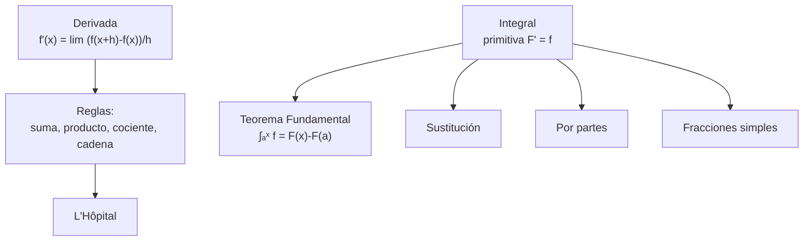
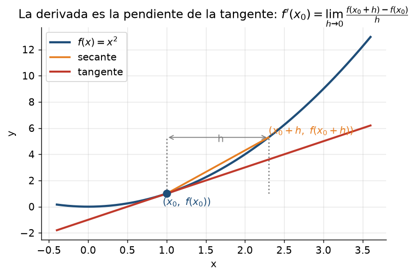
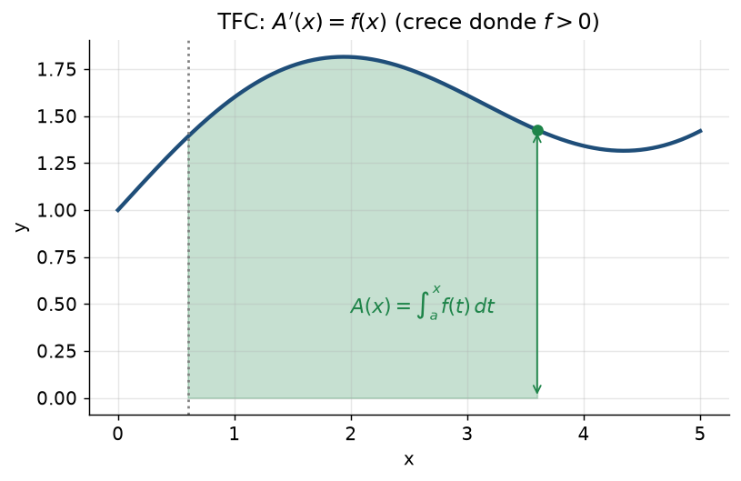
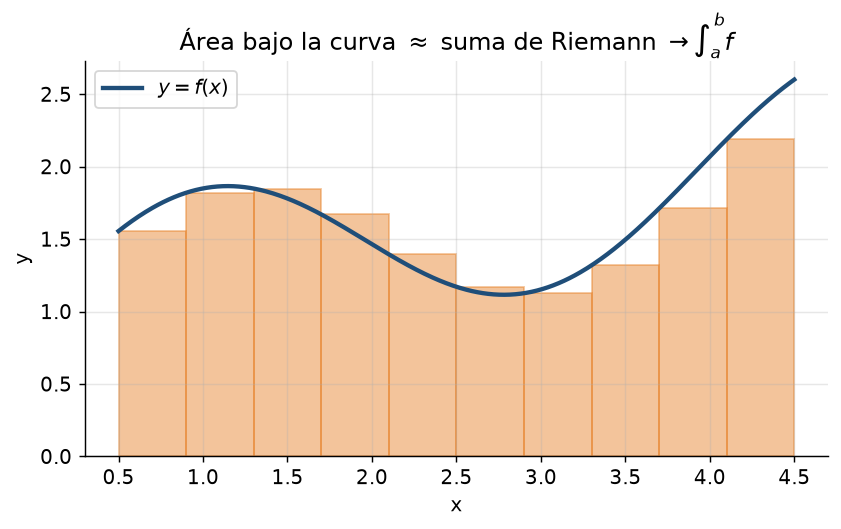

# Clase 2 — Derivadas e integrales de una variable: técnicas

> **Bloque 0 · Prerrequisitos · Dificultad: media · Tiempo estimado: 120 min**

---

## 🎯 Objetivos

1. Calcular **derivadas** con todas las reglas (producto, cociente, **cadena**).
2. Usar la regla de **L'Hôpital** para indeterminaciones.
3. Calcular **primitivas** por **sustitución** y por **partes**.
4. Integrar funciones **racionales** (fracciones simples).
5. Entender el **Teorema Fundamental del Cálculo** y usarlo.

> Estas técnicas no se aprenden "de nuevo" en varias variables, pero se **usan todo el tiempo** (para derivar parcialmente, integrar de a una variable, resolver EDOs, etc.). Sin esto fluido, el resto del curso es cuesta arriba.

---

## 🗺️ Mapa de la clase

---

## 📘 1. Derivada

### 1.1 Definición

$$
f'(x)=\lim_{h\to0}\frac{f(x+h)-f(x)}{h}.
$$

Interpretación geométrica: $f'(x_0)$ es la **pendiente de la recta tangente** a la gráfica en $x_0$.

**Interpretación física:** si $s(t)$ es la posición, $s'(t)$ es la velocidad.

### 1.2 Reglas de derivación

| Regla | Fórmula |
|---|---|
| Suma | $(f+g)'=f'+g'$ |
| Producto | $(fg)'=f'g+fg'$ |
| Cociente | $\left(\dfrac fg\right)'=\dfrac{f'g-fg'}{g^2}$ |
| **Cadena** | $(g\circ f)'(x)=g'(f(x))\cdot f'(x)$ |

### 1.3 Tabla de derivadas

| $f(x)$ | $f'(x)$ |
|---|---|
| $x^n$ | $nx^{n-1}$ |
| $\sqrt x$ | $\dfrac{1}{2\sqrt x}$ |
| $e^x$ | $e^x$ |
| $a^x$ | $a^x\ln a$ |
| $\ln x$ | $\dfrac1x$ |
| $\sin x$ | $\cos x$ |
| $\cos x$ | $-\sin x$ |
| $\tan x$ | $\sec^2 x=\dfrac{1}{\cos^2x}$ |
| $\arcsin x$ | $\dfrac{1}{\sqrt{1-x^2}}$ |
| $\arctan x$ | $\dfrac{1}{1+x^2}$ |
| $\cosh x$ | $\sinh x$ |
| $\sinh x$ | $\cosh x$ |

### 1.4 L'Hôpital

Si $\lim\dfrac{f}{g}$ es del tipo $\dfrac00$ o $\dfrac{\infty}{\infty}$, entonces
$$
\lim_{x\to a}\frac{f(x)}{g(x)}=\lim_{x\to a}\frac{f'(x)}{g'(x)},
$$
siempre que el límite de la derecha exista.

> ⚠️ Solo se aplica a $\frac00$ o $\frac\infty\infty$. ¡No lo uses para $\frac10$ o $\frac{\infty}{0}$!

---

## 📘 2. Integral

### 2.1 Primitiva e integral indefinida

$F$ es una **primitiva** de $f$ si $F'=f$. Escribimos $\int f(x)\,dx=F(x)+C$ (la constante $C$ porque las primitivas difieren en una constante).

### 2.2 Tabla de integrales

| $f(x)$ | $\int f(x)\,dx$ |
|---|---|
| $x^n\ (n\ne-1)$ | $\dfrac{x^{n+1}}{n+1}+C$ |
| $\dfrac1x$ | $\ln|x|+C$ |
| $e^x$ | $e^x+C$ |
| $\sin x$ | $-\cos x+C$ |
| $\cos x$ | $\sin x+C$ |
| $\dfrac{1}{1+x^2}$ | $\arctan x+C$ |
| $\dfrac{1}{\sqrt{1-x^2}}$ | $\arcsin x+C$ |
| $\dfrac{f'(x)}{f(x)}$ | $\ln|f(x)|+C$ |

### 2.3 Teorema Fundamental del Cálculo (TFC)

Si $f$ es continua y $A(x)=\displaystyle\int_a^x f(t)\,dt$, entonces
$$
A'(x)=f(x).
$$

Y la **regla de Barrow**: $\displaystyle\int_a^b f(t)\,dt=F(b)-F(a)$, con $F$ cualquier primitiva de $f$.

### 2.4 Las tres técnicas que hay que dominar

**(a) Sustitución (cambio de variable).** Si $u=\varphi(x)$, entonces $du=\varphi'(x)\,dx$ y
$$
\int f(\varphi(x))\varphi'(x)\,dx=\int f(u)\,du.
$$

**(b) Por partes.** De $(uv)'=u'v+uv'$ sale
$$
\int u\,dv=uv-\int v\,du.
$$
Se elige $u$ como lo que "se simplifica al derivar" (típicamente $\ln$, polinomios, $\arcsin$).

**(c) Fracciones simples.** Para integrar $\dfrac{P(x)}{Q(x)}$ (grado de $P$ menor que el de $Q$), se factoriza $Q$ y se descompone en fracciones del tipo $\dfrac{A}{x-r}$ o $\dfrac{Ax+B}{x^2+px+q}$.

---

## ✏️ 3. Ejercicios resueltos paso a paso

### Ejercicio 1. Derivar $f(x)=\dfrac{x^2+1}{x-1}$

**Paso 1.** Regla del cociente con $u=x^2+1$, $v=x-1$: $u'=2x$, $v'=1$.

**Paso 2.**
$$
f'(x)=\frac{u'v-uv'}{v^2}=\frac{2x(x-1)-(x^2+1)(1)}{(x-1)^2}.
$$

**Paso 3.** Simplificamos el numerador: $2x^2-2x-x^2-1=x^2-2x-1$.

**Respuesta:** $f'(x)=\dfrac{x^2-2x-1}{(x-1)^2}$.

---

### Ejercicio 2. Derivar $f(x)=\sin(x^2)\cdot e^{3x}$

**Paso 1.** Regla del producto: $f'=(\sin(x^2))'\cdot e^{3x}+\sin(x^2)\cdot(e^{3x})'$.

**Paso 2.** Cadena en $\sin(x^2)$: $(\sin(x^2))'=\cos(x^2)\cdot 2x$.

**Paso 3.** Cadena en $e^{3x}$: $(e^{3x})'=e^{3x}\cdot 3$.

**Paso 4.**
$$
f'(x)=2x\cos(x^2)e^{3x}+3\sin(x^2)e^{3x}=e^{3x}\bigl(2x\cos(x^2)+3\sin(x^2)\bigr).
$$

---

### Ejercicio 3. Calcular $\displaystyle\lim_{x\to 0}\frac{e^x-1-x}{x^2}$

**Paso 1.** Es $\frac00$. Aplicamos L'Hôpital una vez:
$$
\lim_{x\to0}\frac{e^x-1}{2x}.
$$

**Paso 2.** Sigue siendo $\frac00$. Otra vez L'Hôpital: $\displaystyle\lim_{x\to0}\frac{e^x}{2}=\frac12$.

**Respuesta:** $\dfrac12$. *(Coincide con el Taylor $e^x=1+x+\frac{x^2}{2}+\cdots$.)*

---

### Ejercicio 4 (sustitución). Calcular $\displaystyle\int x\,e^{x^2}\,dx$

**Paso 1.** Elegimos $u=x^2$, entonces $du=2x\,dx$, es decir $x\,dx=\frac12 du$.

**Paso 2.** Reemplazamos:
$$
\int x e^{x^2}dx=\int e^u\cdot\frac12 du=\frac12 e^u+C.
$$

**Paso 3.** Volvemos a $x$: $\dfrac12 e^{x^2}+C$.

---

### Ejercicio 5 (sustitución). Calcular $\displaystyle\int \frac{\cos x}{1+\sin x}\,dx$

**Paso 1.** $u=1+\sin x \Rightarrow du=\cos x\,dx$.

**Paso 2.** $\displaystyle\int\frac{du}{u}=\ln|u|+C$.

**Respuesta:** $\ln|1+\sin x|+C$.

---

### Ejercicio 6 (por partes). Calcular $\displaystyle\int x\ln x\,dx$

**Paso 1.** Elegimos $u=\ln x$ (se simplifica al derivar) y $dv=x\,dx$.

**Paso 2.** $du=\frac1x dx$ y $v=\frac{x^2}{2}$.

**Paso 3.** Por partes:
$$
\int x\ln x\,dx=\frac{x^2}{2}\ln x-\int \frac{x^2}{2}\cdot\frac1x\,dx
=\frac{x^2}{2}\ln x-\frac12\int x\,dx.
$$

**Paso 4.** $=\dfrac{x^2}{2}\ln x-\dfrac{x^2}{4}+C$.

---

### Ejercicio 7 (por partes, cíclica). Calcular $\displaystyle\int e^x\sin x\,dx$

**Paso 1.** Tomamos $u=\sin x$, $dv=e^x dx$: $du=\cos x\,dx$, $v=e^x$.
$$
I=\int e^x\sin x\,dx=e^x\sin x-\int e^x\cos x\,dx.
$$

**Paso 2.** Aplicamos partes a $\int e^x\cos x\,dx$ con $u=\cos x$: $du=-\sin x\,dx$, $v=e^x$:
$$
\int e^x\cos x\,dx=e^x\cos x+\int e^x\sin x\,dx=e^x\cos x+I.
$$

**Paso 3.** Reemplazando: $I=e^x\sin x-(e^x\cos x+I)$.

**Paso 4.** Despejamos $I$:
$$
2I=e^x(\sin x-\cos x)\ \Longrightarrow\ I=\frac{e^x(\sin x-\cos x)}{2}+C.
$$

---

### Ejercicio 8 (fracciones simples). Calcular $\displaystyle\int \frac{dx}{x^2-1}$

**Paso 1.** Factorizamos: $x^2-1=(x-1)(x+1)$.

**Paso 2.** Descomponemos:
$$
\frac{1}{(x-1)(x+1)}=\frac{A}{x-1}+\frac{B}{x+1}.
$$

**Paso 3.** Multiplicando: $1=A(x+1)+B(x-1)$.

**Paso 4.** Evaluamos en $x=1$: $1=2A\Rightarrow A=\tfrac12$. En $x=-1$: $1=-2B\Rightarrow B=-\tfrac12$.

**Paso 5.**
$$
\int\left(\frac{1/2}{x-1}-\frac{1/2}{x+1}\right)dx=\frac12\ln|x-1|-\frac12\ln|x+1|+C
=\frac12\ln\left|\frac{x-1}{x+1}\right|+C.
$$

---

### Ejercicio 9 (TFC). Sea $F(x)=\displaystyle\int_0^{x^2} e^{-t^2}\,dt$. Calcular $F'(x)$.

**Paso 1.** Es una composición: $F(x)=A(x^2)$ donde $A(u)=\int_0^u e^{-t^2}dt$.

**Paso 2.** Por cadena: $F'(x)=A'(x^2)\cdot 2x$.

**Paso 3.** Por TFC, $A'(u)=e^{-u^2}$. Entonces $A'(x^2)=e^{-x^4}$.

**Respuesta:** $F'(x)=2x\,e^{-x^4}$.

---

## ⚠️ 4. Errores comunes

| Error | Corrección |
|---|---|
| $\int \frac{1}{x}dx=\ln x$ | es $\ln\vert x\vert$ |
| $\int f(x)g(x)dx=\int f\int g$ | **falso**: no hay regla así; usá partes |
| Olvidar la regla de la cadena al derivar $e^{g(x)}$ | $(e^{g})'=g'e^{g}$ |
| Aplicar L'Hôpital cuando no es $\frac00,\frac\infty\infty$ | primero verificá el tipo |
| En fracciones simples, olvidar el caso de raíz doble (va $\frac{A}{x-r}+\frac{B}{(x-r)^2}$) | revisá la multiplicidad |

---

## 🔗 5. Conexión con el resto del curso

- **Derivadas parciales** (clase 37): derivar respecto de una variable "congelando" las otras.
- **Regla de la cadena** (clase 39): la versión matricial de lo de hoy.
- **EDOs** (clases 9–15): resolver $\int$ y $\int$ por partes aparece en cada ecuación.
- **Integrales dobles/triples** (clases 45–47): se calculan **integrando de a una variable**, iterando lo de hoy.
- **Límites en $\mathbb{R}^n$** (clase 35): los equivalentes ($\sin u\sim u$, etc.) son la herramienta estrella.

---

## ✅ 6. Autoevaluación

1. Derivar $f(x)=\ln(\cos x)$.
2. Derivar $f(x)=\dfrac{e^x}{x^2+1}$.
3. Calcular $\displaystyle\lim_{x\to0}\frac{\ln(1+x)}{x}$.
4. Calcular $\displaystyle\int (3x+1)^5\,dx$.
5. Calcular $\displaystyle\int x\cos x\,dx$.
6. Calcular $\displaystyle\int \frac{2x+1}{x^2+x}\,dx$.
7. Sea $F(x)=\displaystyle\int_1^{e^x}\frac{dt}{t}$. Calcular $F'(x)$ y simplificar.

Respuestas

1. $-\tan x$ (cadena: $\frac{1}{\cos x}\cdot(-\sin x)$).
2. $\dfrac{e^x(x^2+1)-e^x(2x)}{(x^2+1)^2}=\dfrac{e^x(x-1)^2}{(x^2+1)^2}$.
3. $1$ (L'Hôpital o equivalente).
4. $\dfrac{(3x+1)^6}{18}+C$.
5. $x\sin x+\cos x+C$.
6. $\ln|x^2+x|+C$ (numerador $= $ derivada del denominador).
7. $F'(x)=\frac{1}{e^x}\cdot e^x=1$.

---

**⬅️ Anterior:** [Clase 1](01_reales_funciones_limites.md) · 🏠 [Índice](00_indice.md) · **➡️ Siguiente:** [Clase 3 — Sucesiones y lógica](03_sucesiones_logica.md)
