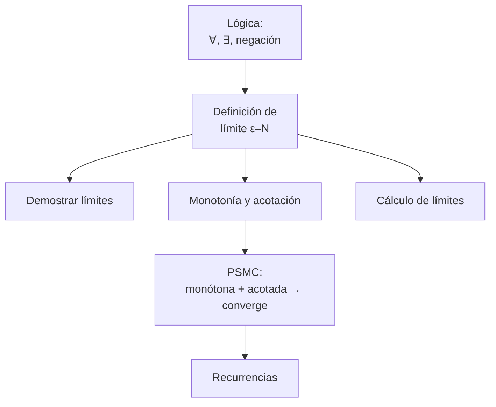
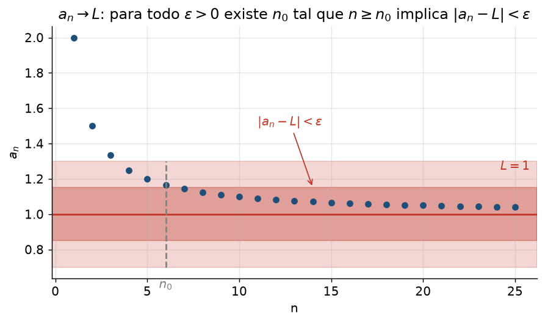
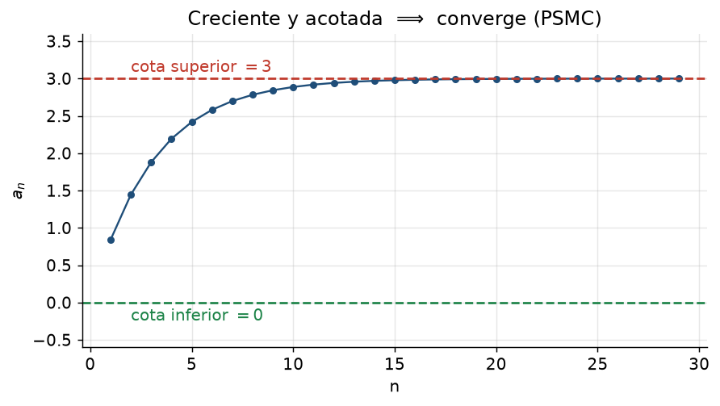

# Clase 3 — Sucesiones de números reales, lógica y cuantificadores

> **Bloque 0 · Prerrequisitos · Dificultad: media · Tiempo estimado: 120 min**

---

## 🎯 Objetivos

1. Manejar los **cuantificadores** $\forall$ y $\exists$, y saber **negar** una afirmación.
2. Definir **sucesión**, **convergencia** y **acotación**.
3. **Demostrar** límites de sucesiones usando $\varepsilon$–$N$.
4. Reconocer **monotonía** y **acotación**, y aplicar el **PSMC**.
5. Resolver **recurrencias** sencillas (aritméticas, geométricas y del tipo $a_{n+1}=1+1/a_n$).

> Esta clase es la puerta de entrada al **Práctico 2** (Sucesiones) y a los primeros parciales. Es también donde se aprende a **escribir matemática con rigor**, algo que se evalúa mucho.

---

## 🗺️ Mapa de la clase

---

## ⚙️ 1. Lógica mínima indispensable

### 1.1 Cuantificadores

- $\forall$ = "para todo" (universal).
- $\exists$ = "existe al menos un" (existencial).

El **orden importa**:

$$
\forall x\ \exists y:\ y>x \quad(\text{cierto en }\mathbb{R}: \text{tomás }y=x+1)
$$
$$
\exists y\ \forall x:\ y>x \quad(\text{falso: no hay un }y\text{ mayor que todo }x).
$$

### 1.2 Negación

Las reglas de negación (clave para entender "no converge"):

$$
\neg(\forall x,\ P(x))\ \equiv\ \exists x,\ \neg P(x),\qquad
\neg(\exists x,\ P(x))\ \equiv\ \forall x,\ \neg P(x).
$$

**Ejemplo.** La afirmación "$a_n\to L$" es
$$
\forall\varepsilon>0\ \exists N\in\mathbb{N}:\ n\ge N \Rightarrow |a_n-L|<\varepsilon.
$$
Su **negación** ("$a_n$ **no** converge a $L$") es
$$
\exists\varepsilon>0\ \forall N\in\mathbb{N}\ \exists n\ge N:\ |a_n-L|\ge\varepsilon.
$$
En palabras: *"existe una tolerancia que se rompe infinitas veces"*.

### 1.3 Implicación

$P\Rightarrow Q$ es falsa **solo** cuando $P$ es verdadera y $Q$ falsa (la tabla de verdad). "Si llueve, hay nubes" es verdadera incluso los días sin lluvia: no dice que **toda** nube produzca lluvia.

---

## 📘 2. Sucesiones

Una **sucesión** de números reales es una función $a:\mathbb{N}\to\mathbb{R}$. Escribimos $(a_n)_{n\in\mathbb{N}}$ o simplemente $a_n$. Ejemplos: $a_n=\frac1n$, $b_n=(-1)^n$, $c_n=n^2$.

### 2.1 Definición de límite (ε–N)

$$
\lim_{n\to\infty}a_n=L
\iff
\forall\varepsilon>0\ \exists N\in\mathbb{N}\ \text{tal que}\ n\ge N\Rightarrow|a_n-L|<\varepsilon.
$$

> **Comparación con funciones.** Es la misma idea de la clase 1, pero el "acercarse" es por números **enteros** $n\to\infty$. Por eso se usa $N$ (un natural) en lugar de $\delta$.

**Propiedad clave:** si el límite existe, es **único**.

### 2.2 Definición de acotación

$(a_n)$ está **acotada** si $\exists M>0$ tal que $|a_n|\le M$ para todo $n$. Equivalentemente, el conjunto $\{a_n\}$ está contenido en algún intervalo $[-M,M]$.

> ⚠️ Toda sucesión **convergente** está **acotada**. El recíproco es **falso**: $a_n=(-1)^n$ está acotada pero no converge.

### 2.3 Monotonía

- **Creciente:** $a_{n+1}\ge a_n$ para todo $n$.
- **Decreciente:** $a_{n+1}\le a_n$ para todo $n$.
- **Monótona:** es creciente o decreciente.

Para chequear monotonía se estudia el signo de $a_{n+1}-a_n$, o (si todo es positivo) se compara $\dfrac{a_{n+1}}{a_n}$ con $1$.

### 2.4 PSMC (Principio de la Sucesión Monótona y Convergente)

> **Teorema.** Toda sucesión **monótona y acotada** es **convergente**.

Es la herramienta más usada para **probar** que un límite existe sin calcularlo. Luego, a veces, se halla el límite pasando al límite en la recurrencia.

---

## ✏️ 3. Ejercicios resueltos paso a paso

### Ejercicio 1 (definiciones — Parcial 1 2022 2S). Definir límite finito y sucesión acotada

**Límite finito:**
$$
\lim_{n\to\infty}a_n=L\in\mathbb{R}
\iff
\forall\varepsilon>0\ \exists N\in\mathbb{N}:\ n\ge N\Rightarrow|a_n-L|<\varepsilon.
$$

**Sucesión acotada:** $(a_n)$ es acotada sii $\exists M>0$ tal que $|a_n|\le M$ para todo $n\in\mathbb{N}$.

*(Saber escribir esto "de memoria" vale puntos fijos en el parcial.)*

---

### Ejercicio 2. Probar que $\displaystyle\lim_{n\to\infty}\frac1n=0$

**Paso 1.** Dado $\varepsilon>0$, queremos $\left|\frac1n-0\right|=\frac1n<\varepsilon$.

**Paso 2.** Despejamos: $\frac1n<\varepsilon \iff n>\frac1\varepsilon$.

**Paso 3.** Elegimos $N$ cualquier natural con $N>\frac1\varepsilon$, por ejemplo $N=\left\lfloor\frac1\varepsilon\right\rfloor+1$.

**Paso 4.** Si $n\ge N>\frac1\varepsilon$, entonces $\frac1n\le\frac1N<\varepsilon$. $\blacksquare$

**Corolario:** $\displaystyle\lim_{n\to\infty}\frac{c}{n}=0$ para cualquier constante $c$ (basta tomar $N>\frac{|c|}{\varepsilon}$).

---

### Ejercicio 3. Probar que $\displaystyle\lim_{n\to\infty}\frac{n}{n+1}=1$

**Paso 1.** Calculamos $|a_n-1|$:
$$
\left|\frac{n}{n+1}-1\right|=\left|\frac{n-(n+1)}{n+1}\right|=\frac{1}{n+1}.
$$

**Paso 2.** Queremos $\frac{1}{n+1}<\varepsilon \iff n+1>\frac1\varepsilon \iff n>\frac1\varepsilon-1$.

**Paso 3.** Elegimos $N=\left\lfloor\frac1\varepsilon\right\rfloor+1$ (sirve, porque $N\ge\frac1\varepsilon>\frac1\varepsilon-1$).

**Paso 4.** Para $n\ge N$: $\frac{1}{n+1}\le\frac{1}{N+1}<\varepsilon$. $\blacksquare$

---

### Ejercicio 4. Hallar los primeros $n_0$ para $\varepsilon=1;\ 0{,}1;\ 0{,}01$ con $a_n=\dfrac1n$, $L=0$

**Paso 1.** Necesitamos $\frac1n<\varepsilon \iff n>\frac1\varepsilon$.

**Paso 2.** Completamos la tabla:

| $\varepsilon$ | $n>\frac1\varepsilon$ | primer $n_0$ |
|---|---|---|
| $1$ | $n>1$ | $2$ |
| $0{,}1$ | $n>10$ | $11$ |
| $0{,}01$ | $n>100$ | $101$ |

*(Si se acepta $\le$ en lugar de $<$ en la definición, $n_0=1,10,100$ respectivamente. Ambos criterios son válidos según la convención.)*

---

### Ejercicio 5. Calcular $\displaystyle\lim_{n\to\infty}\left(\sqrt{n+1}-\sqrt n\right)$

**Paso 1.** Es una indeterminación $\infty-\infty$. Multiplicamos por el **conjugado**:
$$
\sqrt{n+1}-\sqrt n=\frac{(\sqrt{n+1}-\sqrt n)(\sqrt{n+1}+\sqrt n)}{\sqrt{n+1}+\sqrt n}
=\frac{(n+1)-n}{\sqrt{n+1}+\sqrt n}.
$$

**Paso 2.** $=\dfrac{1}{\sqrt{n+1}+\sqrt n}$.

**Paso 3.** El denominador $\to\infty$, así que el cociente $\to0$.

**Respuesta:** $0$.

---

### Ejercicio 6. Calcular $\displaystyle\lim_{n\to\infty}\left(1+\frac1n\right)^n$ (número $e$)

**Paso 1.** Desarrollamos por el binomio de Newton:
$$
\left(1+\frac1n\right)^n=\sum_{k=0}^n\binom{n}{k}\frac{1}{n^k}.
$$

**Paso 2.** Se puede probar que $(1+\frac1n)^n$ es **creciente** y **acotada** (por ejemplo por 3). Por el **PSMC**, converge.

**Paso 3.** Su límite **se define** como $e\approx2{,}71828$.

**Respuesta:** el límite es $e$. *(Este es el origen del número $e$; aparece en la fórmula de Euler, clase 8.)*

---

### Ejercicio 7 (Parcial 1 2021 2S). La sucesión $a_{n+1}=2a_n+5$, $a_0=0$. ¿Qué pasa?

**Paso 1.** Calculamos los primeros términos para "ver" el patrón:
$$
a_0=0,\quad a_1=5,\quad a_2=15,\quad a_3=35,\quad a_4=75,\dots
$$

**Paso 2.** Claramente **creciente** y **no acotada** (crece sin freno). Veámoslo:
$a_{n+1}-a_n=2a_n+5-a_n=a_n+5>0$, así que es **estrictamente creciente**.

**Paso 3.** Pero además, si fuera acotada y creciente, por PSMC tendría límite $L$, y pasando al límite en $a_{n+1}=2a_n+5$:
$$
L=2L+5\Rightarrow L=-5,
$$
absurdo porque la sucesión es creciente con $a_0=0\ge-5$ (una sucesión creciente no puede tender a $-5$).

**Paso 4.** Conclusión: **no es acotada** (tiende a $+\infty$).

**Respuesta correcta:** (A) es creciente y **no** es acotada.

> 💡 **Estrategia general para recurrencias:** (1) mirá los primeros términos; (2) probá monotonía; (3) probá acotación; (4) si PSMC aplica, pasá al límite en la recurrencia; (5) si no es acotada, mostralo.

---

### Ejercicio 8 (Examen dic. 2019). $x_{n+1}=1+\dfrac{1}{x_n}$, $x_0=1$. ¿Es monótona/acotada?

**Paso 1.** Términos: $x_0=1$, $x_1=2$, $x_2=1{,}5$, $x_3=1{,}\overline{6}$, $x_4=1{,}6$, $x_5=1{,}625,\dots$

**Paso 2.** **No es monótona**: sube ($1\to2$), baja ($2\to1{,}5$), sube... alterna alrededor de un valor.

**Paso 3.** ¿Está acotada? Todos los términos están entre $1$ y $2$: por inducción, si $x_n\ge1$, entonces $x_{n+1}=1+\frac{1}{x_n}\le 2$ y $\ge1$. Así que $1\le x_n\le2$ para todo $n$. **Acotada.**

**Respuesta correcta:** (B) no es monótona pero está acotada.

*(De hecho converge a la "proporción áurea" $\varphi=\frac{1+\sqrt5}{2}$, ¡pero la opción (B) no requiere ese cálculo!)*

---

### Ejercicio 9 (Parcial 1 2020 2S, matutino). Probar que $a_n=1+\dfrac{\log n}{n^3}$ es decreciente, acotada y convergente

**Paso 1. Acotación.** Para $n\ge1$, $\dfrac{\log n}{n^3}\ge0$, y la función $g(x)=\dfrac{\log x}{x^3}$ (para $x>0$) tiene un máximo en $x=e^{1/3}$, donde vale $g(e^{1/3})=\dfrac{1/3}{e}=\dfrac{1}{3e}\approx0{,}12$. Por lo tanto $1\le a_n\le 1+\dfrac{1}{3e}\approx1{,}13$ para todo $n$. **Acotada.**

**Paso 2. Monotonía.** Estudiamos $g(x)=\dfrac{\log x}{x^3}$ para $x$ real:
$$
g'(x)=\frac{\frac1x\cdot x^3-\log x\cdot 3x^2}{x^6}=\frac{x^2-3x^2\log x}{x^6}=\frac{1-3\log x}{x^4}.
$$
$g'(x)\le0 \iff 1-3\log x\le0\iff \log x\ge\frac13\iff x\ge e^{1/3}\approx1{,}4$.

**Paso 3.** Para $n\ge2$ (es decir $x\ge2>e^{1/3}$), $g$ decrece, así que $a_n$ es decreciente a partir de $n=2$.

**Paso 4.** $a_n$ es decreciente (salvo el primer término) y acotada inferiormente por $1$ $\Rightarrow$ por PSMC **converge**. Su límite es $1$ (porque $\log n/n^3\to0$).

---

## 🏛️ 4. Ejercicios de parcial/examen

**(Parcial 1 2022 2S, Ej. 2).** Sean $a_n\to0$ y $b_n$ acotada. Probar que $a_nb_n\to0$.

**Demostración.**
**Paso 1.** $b_n$ acotada $\Rightarrow \exists M>0$ con $|b_n|\le M$ para todo $n$.
**Paso 2.** Dado $\varepsilon>0$, como $a_n\to0$, existe $N$ tal que $|a_n|<\frac{\varepsilon}{M}$ para todo $n\ge N$ (si $M>0$; si $M=0$ es trivial).
**Paso 3.** Para $n\ge N$:
$$
|a_nb_n|=|a_n||b_n|\le |a_n|\,M < \frac{\varepsilon}{M}\cdot M=\varepsilon.
$$
Por lo tanto $a_nb_n\to0$. $\blacksquare$

> Este resultado es el **"$0\times$acotado $=0$"**, y se usa constantemente en límites de varias variables (clase 35).

**(Parcial 1 2022 2S, Ej. 3).** Dar ejemplos con $a_n\to0$ y $b_n$ no acotada:
- **a)** con $a_nb_n\to0$: $a_n=\frac1n$, $b_n=n$. Entonces $a_nb_n=1$, que **no** tiende a $0$... Cuidado, busquemos bien: $a_n=\frac{1}{n^2}$, $b_n=n$ da $a_nb_n=\frac1n\to0$. ✔
- **b)** con $a_nb_n$ sin límite $0$: $a_n=\frac1n$, $b_n=n$ da $a_nb_n=1\to1\ne0$. ✔ (También sirve $b_n=n^2$, con $a_nb_n=n\to\infty$.)

---

## ⚠️ 5. Errores comunes

| Error | Corrección |
|---|---|
| Confundir "acotada" con "convergente" | $(-1)^n$ es acotada y no converge |
| Creer que "no acotada $\Rightarrow$ no tiene subsucesiones convergentes" | $\{n\text{ si }n\text{ par},\ 1/n\text{ si }n\text{ impar}\}$ no es acotada pero tiene subsucesión $\to0$ |
| Calcular $\lim\left(1+\frac1n\right)^n$ como $1^\infty=1$ | es **indeterminado**, vale $e$ |
| Para probar "no converge" intentar calcular el límite | mejor usá la **negación** o mostrá dos subsucesiones con límites distintos |
| Olvidar justificar que la operación "pasar al límite" es válida | primero probá existencia (PSMC), después pasá al límite |

---

## 🔗 6. Conexión con el resto del curso

- **Series** (clase 21): una serie es el límite de la sucesión de **sumas parciales**. Sin sucesiones, no hay series.
- **Topología en $\mathbb{R}^n$** (clases 30–33): las sucesiones pasan a vectores, y "límite" se mide con **norma**.
- **Continuidad** (clase 36): "$\lim f(x_n)=f(\lim x_n)$".
- **Complejos** (clase 7): las raíces $n$-ésimas usan sucesiones y trigonometría.

---

## ✅ 7. Autoevaluación

1. Negar: "$\exists M>0\ \forall n:\ |a_n|\le M$".
2. Probar que $\displaystyle\lim_{n\to\infty}\frac{2n+1}{n}=2$.
3. Calcular $\displaystyle\lim_{n\to\infty}\frac{n^2+3n}{2n^2-1}$.
4. ¿Es $a_n=(-1)^n+\frac1n$ convergente? ¿Acotada? ¿Monótona?
5. Con $a_1=1$, $a_{n+1}=\frac{a_n+2}{2}$. Probar que $1\le a_n\le2$, mostrar monotonía y hallar el límite.
6. Dar un ejemplo de dos subsucesiones de $a_n=(-1)^n$ que converjan a límites distintos.

Respuestas

1. "$\forall M>0\ \exists n:\ |a_n|>M$" (no es acotada).
2. $\left|\frac{2n+1}{n}-2\right|=\frac1n<\varepsilon$ si $n>\frac1\varepsilon$; $N>\frac1\varepsilon$.
3. Dividiendo por $n^2$: $\frac{1+3/n}{2-1/n^2}\to\frac12$.
4. No converge (subsucesiones pares $\to1$, impares $\to-1$); está acotada; no es monótona.
5. Por inducción $1\le a_n\le2$ (si $1\le a_n\le2$, entonces $\frac{3}{2}\le a_{n+1}\le2$). $a_{n+1}-a_n=\frac{2-a_n}{2}\ge0$, creciente. Límite $L$: $L=\frac{L+2}{2}\Rightarrow L=2$.
6. $a_{2n}\to1$ y $a_{2n+1}\to-1$.

---

**⬅️ Anterior:** [Clase 2](02_derivadas_integrales_1var.md) · **➡️ Siguiente:** [Clase 4 — Vectores y geometría](04_vectores_geometria.md)
