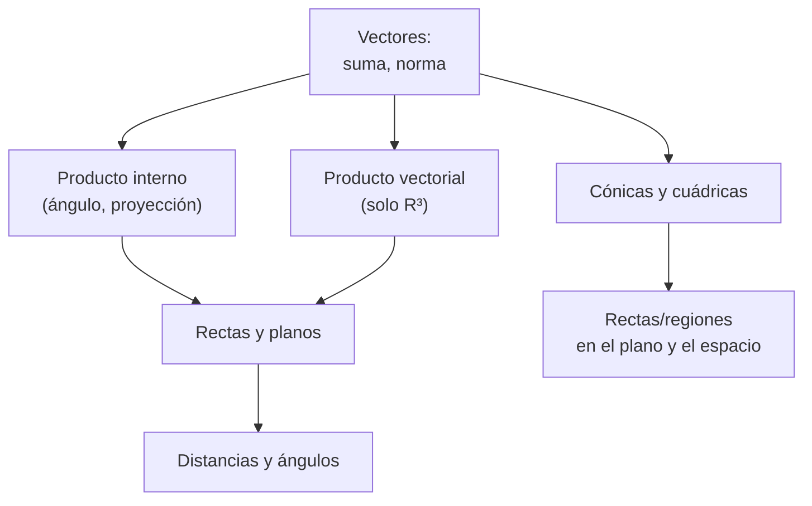
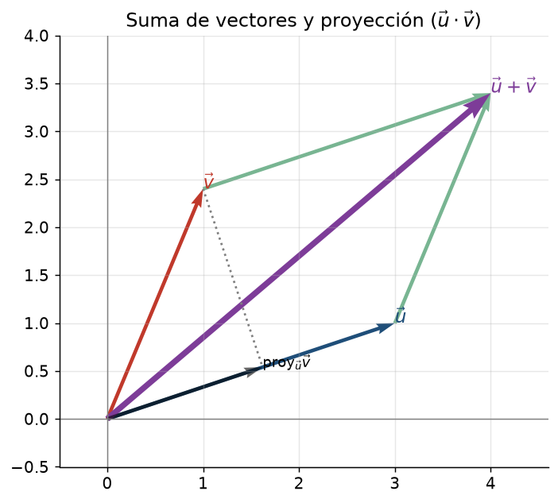
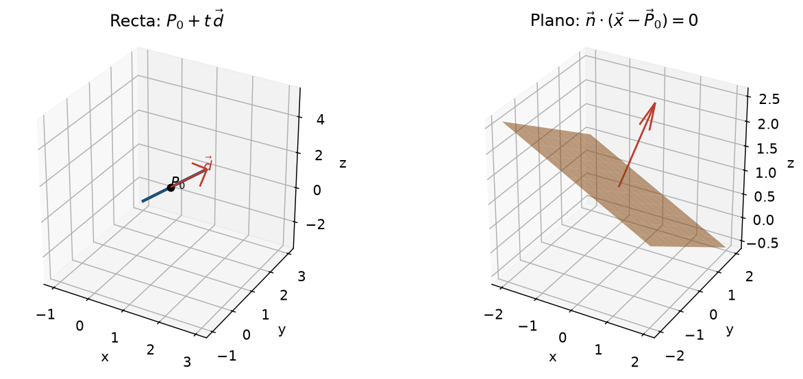
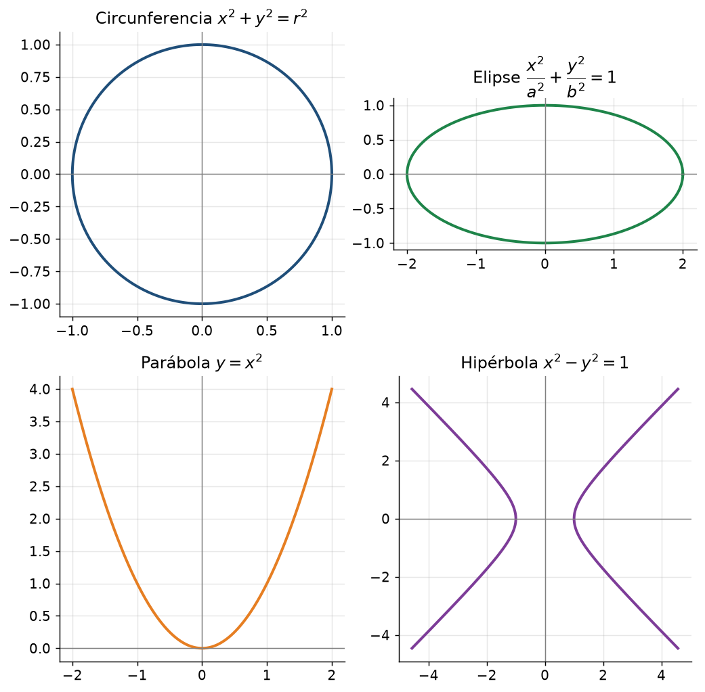
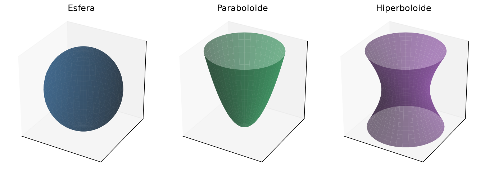

# Clase 4 — Vectores, rectas, planos, cónicas y cuádricas

> **Bloque 0 · Prerrequisitos · Dificultad: media · Tiempo estimado: 120 min**

---

## 🎯 Objetivos

1. Operar con **vectores en $\mathbb{R}^2$ y $\mathbb{R}^3$**: suma, producto por escalar, **norma**.
2. Usar el **producto interno** (ángulo, perpendicularidad, proyección).
3. Escribir ecuaciones de **rectas y planos** en $\mathbb{R}^3$; medir **distancias**.
4. Reconocer **cónicas** (circunferencia, elipse, parábola, hipérbola) y **cuádricas** (esfera, paraboloide, hiperboloide, cono, cilindro).
5. Traducir **desigualdades en el plano** a **regiones** dibujables (la antesala de la topología y las integrales).

> Todo el curso usa geometría: interpretar dominios (clase 34), dibujar conjuntos de nivel (clase 34), decidir si un conjunto es convexo (clase 43) y describir regiones de integración (clases 45–47).

---

## 🗺️ Mapa de la clase

---

## 📘 1. Vectores en $\mathbb{R}^n$

Un **vector** es una $n$-upla $\vec v=(v_1,\dots,v_n)$. Se representa como una **flecha** desde el origen.

- **Suma:** $\vec u+\vec v=(u_1+v_1,\dots,u_n+v_n)$ (regla del paralelogramo).
- **Producto por escalar:** $\lambda\vec v=(\lambda v_1,\dots,\lambda v_n)$ (estira o encoge).
- **Norma (longitud):** $\|\vec v\|=\sqrt{v_1^2+\cdots+v_n^2}$ (¡Pitágoras!).
- **Distancia:** $d(\vec u,\vec v)=\|\vec u-\vec v\|$.

### 1.1 Producto interno (punto)

$$
\vec u\cdot\vec v=u_1v_1+\cdots+u_nv_n=\|\vec u\|\,\|\vec v\|\cos\theta,
$$
donde $\theta$ es el ángulo entre los vectores.

Consecuencias fundamentales:

- $\vec u\perp\vec v \iff \vec u\cdot\vec v=0$ (**perpendicularidad**).
- $\cos\theta=\dfrac{\vec u\cdot\vec v}{\|\vec u\|\|\vec v\|}$ (**ángulo**).
- **Desigualdad de Cauchy–Schwarz:** $|\vec u\cdot\vec v|\le\|\vec u\|\|\vec v\|$.
- **Desigualdad triangular:** $\|\vec u+\vec v\|\le\|\vec u\|+\|\vec v\|$.
- **Proyección de $\vec v$ sobre $\vec u$:** $\ \operatorname{proy}_{\vec u}\vec v=\dfrac{\vec u\cdot\vec v}{\|\vec u\|^2}\,\vec u$.

### 1.2 Producto vectorial (solo en $\mathbb{R}^3$)

$$
\vec u\times\vec v=
\begin{vmatrix}
\vec i&\vec j&\vec k\\
u_1&u_2&u_3\\
v_1&v_2&v_3
\end{vmatrix}.
$$

El resultado es un vector **perpendicular** a $\vec u$ y a $\vec v$, con norma $\|\vec u\|\|\vec v\|\sin\theta$ (área del paralelogramo).

---

## 📘 2. Rectas y planos en $\mathbb{R}^3$

**Recta** por $P_0$ con dirección $\vec d$:
$$
\vec x(t)=P_0+t\,\vec d,\quad t\in\mathbb{R}.
$$

**Plano** por $P_0$ con vector **normal** $\vec n$:
$$
\vec n\cdot(\vec x-P_0)=0
\quad\Longleftrightarrow\quad
n_1(x-x_0)+n_2(y-y_0)+n_3(z-z_0)=0.
$$
En la forma $ax+by+cz=d$, el vector $\vec n=(a,b,c)$ es normal al plano.

**Distancia de un punto $Q$ a un plano** $\vec n\cdot\vec x=d$:
$$
\operatorname{dist}(Q,\pi)=\frac{|\vec n\cdot Q-d|}{\|\vec n\|}.
$$

---

## 📘 3. Cónicas en el plano

| Curva | Ecuación | Idea |
|---|---|---|
| Circunferencia | $(x-a)^2+(y-b)^2=r^2$ | puntos a distancia $r$ del centro |
| Elipse | $\dfrac{x^2}{a^2}+\dfrac{y^2}{b^2}=1$ | "circunferencia estirada" |
| Parábola | $y=ax^2+bx+c$ | distancia punto = distancia a recta |
| Hipérbola | $\dfrac{x^2}{a^2}-\dfrac{y^2}{b^2}=1$ | dos ramas |

**Completar cuadrados** permite reconocerlas. Ejemplo: $x^2+y^2-4x+2y-4=0$.
Agrupamos: $(x^2-4x)+(y^2+2y)=4$, y sumando lo que falta para completar cuadrados:
$$
(x-2)^2-4+(y+1)^2-1=4\Rightarrow (x-2)^2+(y+1)^2=9.
$$
Es una **circunferencia** de centro $(2,-1)$ y radio $3$.

---

## 📘 4. Cuádricas en el espacio

| Superficie | Ecuación típica |
|---|---|
| Esfera | $x^2+y^2+z^2=r^2$ |
| Elipsoide | $\dfrac{x^2}{a^2}+\dfrac{y^2}{b^2}+\dfrac{z^2}{c^2}=1$ |
| Paraboloide | $z=x^2+y^2$ |
| Hiperboloide de una hoja | $x^2+y^2-z^2=1$ |
| Cono | $z^2=x^2+y^2$ |
| Cilindro | $x^2+y^2=1$ (sin $z$) |

**Truco para reconocerlas:** mirá en cuántas variables aparece como **suma de cuadrados** y en cuántas con **signo menos**.

---

## ✏️ 5. Ejercicios resueltos paso a paso

### Ejercicio 1. Con $\vec u=(1,2,2)$ y $\vec v=(2,-1,1)$, calcular $\vec u\cdot\vec v$, $\|\vec u\|$, $\|\vec v\|$, el ángulo y $\vec u\times\vec v$.

**Paso 1. Producto interno:** $\vec u\cdot\vec v=1\cdot2+2\cdot(-1)+2\cdot1=2-2+2=2$.

**Paso 2. Normas:** $\|\vec u\|=\sqrt{1+4+4}=3$, $\|\vec v\|=\sqrt{4+1+1}=\sqrt6$.

**Paso 3. Ángulo:**
$$
\cos\theta=\frac{2}{3\sqrt6}\approx\frac{2}{7{,}348}\approx0{,}272\ \Rightarrow\ \theta\approx74{,}2^\circ.
$$

**Paso 4. Producto vectorial:**
$$
\vec u\times\vec v=
\begin{vmatrix}\vec i&\vec j&\vec k\\ 1&2&2\\ 2&-1&1\end{vmatrix}
=\vec i(2\cdot1-2\cdot(-1))-\vec j(1\cdot1-2\cdot2)+\vec k(1\cdot(-1)-2\cdot2)
$$
$$
=(4)\,\vec i-(1-4)\,\vec j+(-1-4)\,\vec k=4\vec i+3\vec j-5\vec k=(4,3,-5).
$$

**Verificación:** $\vec u\cdot(\vec u\times\vec v)=1\cdot4+2\cdot3+2\cdot(-5)=0$. ✔

---

### Ejercicio 2. Hallar la recta que pasa por $P=(1,0,2)$ y $Q=(3,1,1)$.

**Paso 1.** Dirección: $\vec d=Q-P=(2,1,-1)$.

**Paso 2.** Ecuación paramétrica:
$$
(x,y,z)=(1,0,2)+t(2,1,-1),\quad t\in\mathbb{R}.
$$

**Paso 3.** Forma paramétrica explícita: $x=1+2t,\ y=t,\ z=2-t$.

---

### Ejercicio 3. Hallar el plano que pasa por $(1,1,1),(0,0,1)$ y $(2,0,0)$.

**Paso 1.** Vectores directores: $\vec u=(0,0,1)-(1,1,1)=(-1,-1,0)$, $\vec v=(2,0,0)-(1,1,1)=(1,-1,-1)$.

**Paso 2.** Normal: $\vec n=\vec u\times\vec v=(-1,-1,0)\times(1,-1,-1)$.
$$
\vec n=\big((-1)(-1)-0(-1),\ 0\cdot1-(-1)(-1),\ (-1)(-1)-(-1)(1)\big)
=(1,-1,2).
$$

**Paso 3.** Plano: $\vec n\cdot((x,y,z)-(1,1,1))=0$:
$$
1(x-1)-1(y-1)+2(z-1)=0\ \Rightarrow\ x-y+2z=2.
$$

---

### Ejercicio 4. Distancia del punto $Q=(1,1,1)$ al plano $x+2y+2z=0$.

**Paso 1.** Reconocemos $\vec n=(1,2,2)$, $d=0$, $\|\vec n\|=3$.

**Paso 2.**
$$
\operatorname{dist}=\frac{|1\cdot1+2\cdot1+2\cdot1-0|}{3}=\frac{5}{3}\approx1{,}67.
$$

---

### Ejercicio 5 (Práctico 5, inspirado). Describir y dibujar $A=\{(x,y):\ 1\le x\le 2,\ 1<y<3\}$.

**Paso 1.** Es un **rectángulo** en el plano. La condición $x\in[1,2]$ da una franja vertical; $y\in(1,3)$ una franja horizontal; la intersección es un rectángulo.

**Paso 2. Bordes:**
- $x=1$ y $x=2$: **incluidos** (corchetes).
- $y=1$ y $y=3$: **excluidos** (paréntesis).

**Paso 3.** ¿Es **acotado**? Sí: está dentro de la caja $[1,2]\times[1,3]$.

**Paso 4.** ¿Es **abierto**? No: contiene puntos de frontera como $(1,2)$ (el borde izquierdo está incluido). Esto lo formalizaremos en la clase 30.

---

### Ejercicio 6 (Práctico 5, inspirado). Describir $A_3=\{(x,y)\in\mathbb{R}^2:\ x^2+y^2<1,\ (x,y)\ne(0,0)\}$.

**Paso 1.** $x^2+y^2<1$ es el **disco abierto** de centro $(0,0)$ y radio $1$.

**Paso 2.** Se le quita el origen. Es un disco **pinchado**.

**Paso 3.** Es **acotado** (está dentro de $[-1,1]^2$). Y es **abierto**: dado cualquier $(x,y)\in A_3$, como $r_0=\|(x,y)\|>0$ y $\|(x,y)\|<1$, la bola de centro $(x,y)$ y radio $r=\min\{r_0,\ 1-\|(x,y)\|\}/2$ es positiva y queda íntegramente dentro de $A_3$ (no toca el origen ni la circunferencia). Lo formalizaremos en la clase 30.

---

### Ejercicio 7. Identificar la superficie $z=x^2+y^2$.

**Paso 1.** Es una superficie en $\mathbb{R}^3$ donde $z$ depende de $x^2+y^2$ (solo de la distancia al eje $z$). Es **simétrica** respecto al eje $z$.

**Paso 2.** Sus "curvas de nivel" $z=c$ son circunferencias $x^2+y^2=c$ (para $c\ge0$).

**Paso 3.** Al crecer $z$, los radios crecen $\Rightarrow$ es un **paraboloide** (como un cuenco). Mínimo en el origen.

---

## ⚠️ 6. Errores comunes

| Error | Corrección |
|---|---|
| Confundir $\vec u\cdot\vec v$ (escalar) con $\vec u\times\vec v$ (vector) | $\cdot$ da número; $\times$ da vector (solo en $\mathbb{R}^3$) |
| Poner $\|\vec u\|=\vec u\cdot\vec u$ | es $\|\vec u\|^2=\vec u\cdot\vec u$ |
| Olvidar el valor absoluto en la distancia a un plano | la distancia es $\ge0$ |
| No completar cuadrados al reconocer una cónica | completá para ver centro/radios |
| Dibujar mal el signo de una desigualdad ($<$ vs $\le$) | el borde punteado/línea depende de si es estricto |

---

## 🔗 7. Conexión con el resto del curso

- **Norma** y **distancia** definen las **bolas** y toda la topología (clases 30–33).
- Las **desigualdades del plano** son los **dominios** de funciones de dos variables (clase 34).
- El **plano tangente** (clase 38) usa el vector normal $\vec n=(f_x,f_y,-1)$.
- Las **regiones de integración** (clases 45–47) son intersecciones de las regiones que aprendiste a dibujar acá.
- La **convexidad** (clase 43) se define con segmentos entre vectores, como en la figura de proyección.

---

## ✅ 8. Autoevaluación

1. Con $\vec u=(2,-1,3)$, $\vec v=(1,1,2)$: calcular $\vec u\cdot\vec v$ y $\|\vec u-\vec v\|$.
2. Hallar todos los $\lambda$ tales que $(1,\lambda,2)\perp(2,1,-1)$.
3. Dar la ecuación del plano por $(0,1,2)$ con normal $(1,-1,1)$.
4. Hallar la distancia de $(2,0,1)$ al plano $2x-y+2z=3$.
5. Reconocer: $x^2+y^2-2x+4y+1=0$.
6. Reconocer: $4x^2+y^2+z^2=4$.
7. Dibujar $\{(x,y):\ x+y\le2,\ x\ge0,\ y\ge0\}$.

Respuestas

1. $\vec u\cdot\vec v=2-1+6=7$; $\vec u-\vec v=(1,-2,1)$, norma $\sqrt6$.
2. $2+\lambda-2=0\Rightarrow\lambda=0$ para cualquier... en realidad $1\cdot2+\lambda\cdot1+2\cdot(-1)=\lambda=0$.
3. $(x-0)-(y-1)+(z-2)=0\Rightarrow x-y+z=1$.
4. $\frac{|4-0+2-3|}{\sqrt{4+1+4}}=\frac{3}{3}=1$.
5. $(x-1)^2+(y+2)^2=4$: circunferencia centro $(1,-2)$, radio $2$.
6. $\frac{x^2}{1}+\frac{y^2}{4}+\frac{z^2}{4}=1$: elipsoide.
7. Triángulo con vértices $(0,0),(2,0),(0,2)$, bordes incluidos.

---

## 🏁 Cierre del Bloque 0

Ya tenés las herramientas base: límites y continuidad (clase 1), derivación e integración (clase 2), sucesiones y lógica (clase 3) y geometría (clase 4). A partir de la **clase 5** empezamos con el contenido del curso, arrancando por los **números complejos**, que es el tema del primer tramo del programa.

**⬅️ Anterior:** [Clase 3](03_sucesiones_logica.md) · 🏠 [Índice](00_indice.md) · **➡️ Siguiente bloque:** Clase 5 — Números complejos (forma binómica)
