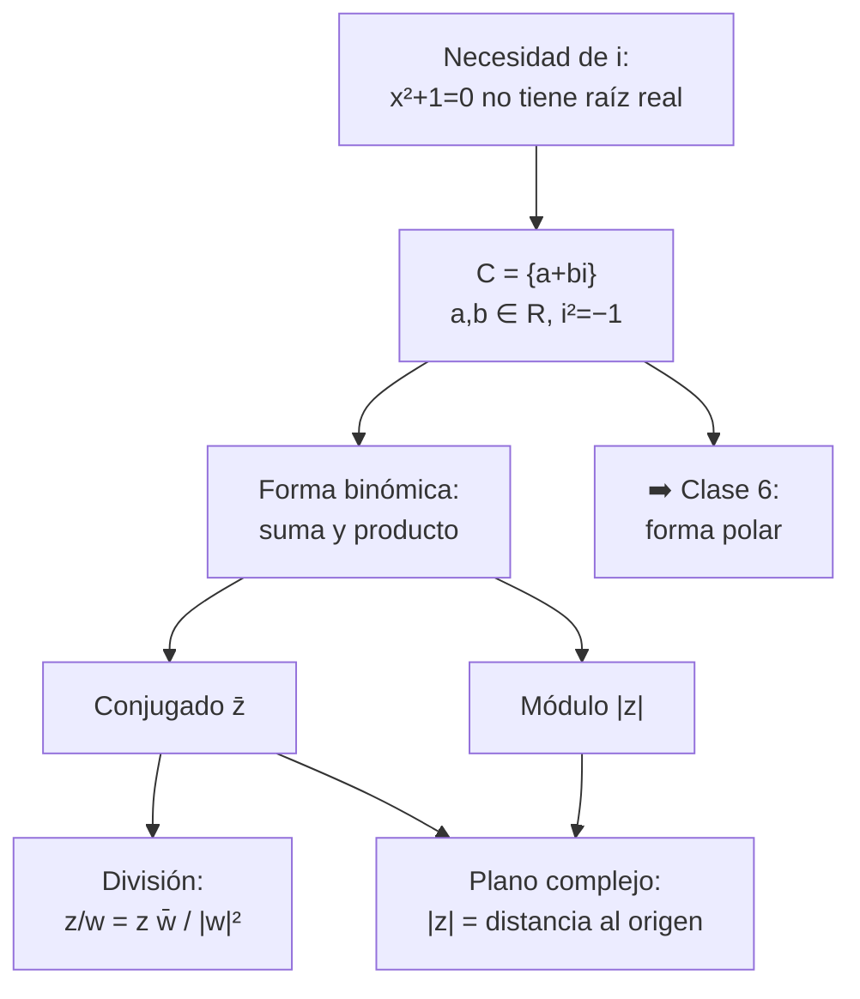
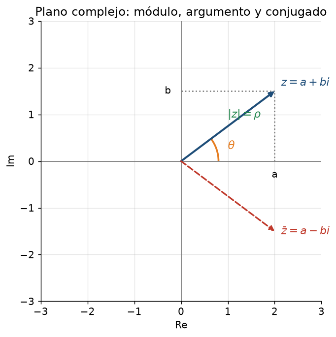

# Clase 5 — Forma binómica: operaciones, conjugado y módulo

> **Bloque 1 · Números complejos · Dificultad: media · Tiempo estimado: 100 min**

---

## 🎯 Objetivos

Al terminar esta clase tenés que poder:

1. **Definir** el conjunto $\mathbb{C}$ y escribir un complejo en **forma binómica** $z=a+bi$.
2. **Sumar, restar y multiplicar** complejos sin dudar, y calcular **potencias de $i$**.
3. Calcular el **conjugado** $\bar z$ y el **módulo** $|z|$, y usar sus propiedades.
4. **Dividir** dos complejos (racionalizando con el conjugado).
5. **Interpretar** todo esto en el **plano complejo** (el plano de Argand).
6. Resolver una **ecuación cuadrática** con raíces complejas.

> Los complejos aparecen en el curso en tres lugares: el estudio de **raíces $n$-ésimas**, la **fórmula de Euler** (que resuelve las EDOs de la clase 13) y como ejemplo de **topología** (el plano complejo es "el mismo" $\mathbb{R}^2$ de las clases 30–33).

---

## 🗺️ Mapa de la clase

---

## 🧱 1. Repaso: ¿por qué hacen falta?

Veníamos trabajando con los **números reales** $\mathbb{R}$, que representamos sobre una **recta**. Ahí:
- $x^2=4$ tiene solución: $x=\pm2$.
- $x^2=0$ tiene solución: $x=0$.
- **$x^2=-1$ no tiene solución**, porque el cuadrado de cualquier real es $\ge0$.

La idea es **inventar** un número cuyo cuadrado sea $-1$ y llamarlo $i$ (la *unidad imaginaria*):
$$
i^2=-1.
$$
No es que $i$ "exista" en la recta real: vamos a construir un conjunto **nuevo**, más grande, que **contiene** a $\mathbb{R}$ y en el que esa ecuación sí se resuelve.

> 💡 Pensá en la historia: primero vinieron los naturales $\mathbb{N}$, después los enteros $\mathbb{Z}$ (para poder restar), después los racionales $\mathbb{Q}$ (para poder dividir) y los reales $\mathbb{R}$ (para completar la recta). Los complejos $\mathbb{C}$ son el **último** de estos "agrandamientos", hechos para poder sacar raíces de números negativos.

---

## 📘 2. Definición y forma binómica

### 2.1 El conjunto $\mathbb{C}$

> **Definición 5.1.** Un **número complejo** es una expresión de la forma
> $$
> z=a+bi,\qquad a,b\in\mathbb{R},
> $$
> donde $i$ es un símbolo con la regla $i^2=-1$.
> El **conjunto de todos** los complejos se anota $\mathbb{C}$.

En $z=a+bi$:
- $a$ es la **parte real**: $a=\operatorname{Re}(z)$.
- $b$ es la **parte imaginaria**: $b=\operatorname{Im}(z)$.

> ⚠️ **Cuidado con el idioma:** $\operatorname{Im}(z)$ es un **número real** ($b$), no "$bi$". Por ejemplo $\operatorname{Im}(3-5i)=-5$.

Casos particulares:
- Si $b=0$: $z=a$ es un **real** ($\mathbb{R}\subset\mathbb{C}$).
- Si $a=0$ y $b\ne0$: $z=bi$ se dice **imaginario puro**.

### 2.2 Igualdad

Dos complejos son iguales sii coinciden **parte real y parte imaginaria**:
$$
a+bi=c+di \iff a=c\ \text{ y }\ b=d.
$$
Esto es clave: **una ecuación compleja son dos ecuaciones reales**. Lo vamos a usar todo el tiempo (por ejemplo, en la fórmula de Euler).

### 2.3 Suma y producto

Se opera "como con polinomios", usando $i^2=-1$:

$$
(a+bi)+(c+di)=(a+c)+(b+d)i,
$$
$$
(a+bi)(c+di)=ac+ad\,i+bc\,i+bd\,i^2=\underbrace{(ac-bd)}_{}\ +\ \underbrace{(ad+bc)}_{}\,i.
$$

**Ejemplo.** $(2+3i)(1-4i)=2-8i+3i-12i^2=2-8i+3i+12=14-5i$.

La **resta** es igual que la suma con signos cambiados. El **neutro** para la suma es $0$ y para el producto es $1$.

### 2.4 Potencias de $i$

Como $i^2=-1$, las potencias se **repiten cada 4**:
$$
i^0=1,\quad i^1=i,\quad i^2=-1,\quad i^3=-i,\quad i^4=1,\quad i^5=i,\dots
$$
En general $i^n$ depende solo del **resto de $n$ entre 4**.

**Ejemplos:** $i^{2023}$: dividimos $2023=4\cdot505+3$, así que $i^{2023}=i^3=-i$. $\quad$ $i^{-1}=\dfrac1i=\dfrac{i}{i^2}=-i$.

---

## 📐 3. Conjugado y módulo

### 3.1 Conjugado

> **Definición 5.2.** El **conjugado** de $z=a+bi$ es
> $$
> \bar z=a-bi.
> $$
> Geométricamente, es su **reflejo respecto del eje real**.

**Propiedades** (todas se prueban escribiendo $a+bi$ y $c+di$):
$$
\overline{z+w}=\bar z+\bar w,\qquad
\overline{z\,w}=\bar z\,\bar w,\qquad
\overline{\bar z}=z,
$$
$$
z+\bar z=2\operatorname{Re}(z),\qquad
z-\bar z=2\operatorname{Im}(z)\,i,\qquad
z\bar z=a^2+b^2\in\mathbb{R}.
$$

La última es la más importante: **$z\bar z$ siempre es un real $\ge0$**. Es la que permite dividir.

### 3.2 Módulo

> **Definición 5.3.** El **módulo** de $z=a+bi$ es
> $$
> |z|=\sqrt{a^2+b^2}=\sqrt{z\bar z}.
> $$
> Geométricamente, es la **distancia del punto $z$ al origen** (teorema de Pitágoras).

**Propiedades:**
$$
|z|\ge0,\qquad |z|=0\iff z=0,\qquad |\bar z|=|z|,
$$
$$
|z\,w|=|z|\,|w|,\qquad \left|\frac zw\right|=\frac{|z|}{|w|}\ (w\ne0),
$$
$$
\boxed{|z+w|\le|z|+|w|}\quad\text{(desigualdad triangular).}
$$

> 💡 **Desigualdad triangular:** dice que "un camino recto nunca es más largo que uno con escala". Pensá en vectores: la diagonal de un paralelogramo no supera la suma de los lados.

Una consecuencia muy usada: **$|z-z_0|$ es la distancia de $z$ a $z_0$**. Por eso $|z-z_0|=r$ es la circunferencia de centro $z_0$ y radio $r$.

### 3.3 División

Para dividir, **multiplicamos arriba y abajo por el conjugado** del denominador, así el denominador se vuelve un real:
$$
\frac{z}{w}=\frac{z\,\bar w}{w\,\bar w}=\frac{z\,\bar w}{|w|^2}.
$$

**Ejemplo.** $\dfrac{1+i}{2-i}=\dfrac{(1+i)(2+i)}{(2-i)(2+i)}=\dfrac{2+i+2i+i^2}{4+1}=\dfrac{1+3i}{5}=\dfrac15+\dfrac35 i$.

---

## ✏️ 4. Ejercicios resueltos paso a paso

### Ejercicio 1. Operar: $\;(3+2i)+(1-4i)\;$ y $\;(3+2i)(1-4i)$

**Suma (Paso a paso).** Sumamos parte real con parte real y parte imaginaria con parte imaginaria:
$$
(3+2i)+(1-4i)=(3+1)+(2-4)i=4-2i.
$$

**Producto.** Distribuimos:
$$
(3+2i)(1-4i)=3-12i+2i-8i^2.
$$
Como $i^2=-1$, el último término es $-8(-1)=+8$:
$$
=3-12i+2i+8=11-10i.
$$

**Respuesta:** $4-2i$ y $11-10i$.

---

### Ejercicio 2. Simplificar $\dfrac{1}{i}$, $\;i^{2023}\;$ y $\;(1+i)^2$

**a)** $\dfrac1i$. Multiplicamos por $\bar i=-i$:
$$
\frac1i=\frac{1\cdot(-i)}{i\cdot(-i)}=\frac{-i}{-i^2}=\frac{-i}{1}=-i.
$$

**b)** $i^{2023}$. Dividimos $2023$ entre $4$: $2023=4\cdot505+3$, así que
$$
i^{2023}=i^{4\cdot505+3}=(i^4)^{505}\cdot i^3=1\cdot(-i)=-i.
$$

**c)** $(1+i)^2$. Desarrollamos: $(1+i)^2=1+2i+i^2=1+2i-1=2i$.

> 💡 **Regla práctica:** $i^n$ solo necesita el **resto de $n$ módulo 4**.

---

### Ejercicio 3. Calcular $\dfrac{3+4i}{1-2i}$

**Paso 1.** Multiplicamos por el conjugado del denominador, $\overline{1-2i}=1+2i$:
$$
\frac{3+4i}{1-2i}=\frac{(3+4i)(1+2i)}{(1-2i)(1+2i)}.
$$

**Paso 2.** Numerador:
$$
(3+4i)(1+2i)=3+6i+4i+8i^2=3+10i-8=-5+10i.
$$

**Paso 3.** Denominador (¡es un real!):
$$
(1-2i)(1+2i)=1^2+2^2=5.
$$

**Paso 4.** Dividimos término a término:
$$
\frac{-5+10i}{5}=-1+2i.
$$

**Verificación rápida:** $(-1+2i)(1-2i)=-1+2i+2i-4i^2=-1+4i+4=3+4i$. ✔

---

### Ejercicio 4 (propiedades). Probar $z\bar z=|z|^2$ y $|zw|=|z||w|$

**Parte a): $z\bar z=|z|^2$.** Con $z=a+bi$, $\bar z=a-bi$:
$$
z\bar z=(a+bi)(a-bi)=a^2-ab\,i+ab\,i-b^2i^2=a^2-b^2(-1)=a^2+b^2=|z|^2.\ \blacksquare
$$

**Parte b): $|zw|=|z||w|$.** Primero notamos que $|u|^2=u\bar u$ (parte a). Entonces
$$
|zw|^2=(zw)\overline{(zw)}=(zw)(\bar z\bar w)=(z\bar z)(w\bar w)=|z|^2|w|^2.
$$
Como los módulos son $\ge0$, sacando raíz cuadrada queda $|zw|=|z||w|$. $\blacksquare$

> 💡 Este truco ("elevar al cuadrado y usar $u\bar u=|u|^2$") sirve para casi todas las propiedades del módulo.

---

### Ejercicio 5. Resolver $z^2+2z+5=0$ en $\mathbb{C}$

**Paso 1.** Usamos la **fórmula cuadrática** (sin el discriminante negativo nos asusta):
$$
z=\frac{-2\pm\sqrt{2^2-4\cdot1\cdot5}}{2}=\frac{-2\pm\sqrt{-16}}{2}.
$$

**Paso 2.** Escribimos $\sqrt{-16}=\sqrt{16}\sqrt{-1}=4i$. Entonces
$$
z=\frac{-2\pm4i}{2}=-1\pm2i.
$$

**Paso 3. Verificación.** Para $z=-1+2i$:
$$
z^2=(-1+2i)^2=1-4i+4i^2=1-4i-4=-3-4i,
$$
y $2z=2(-1+2i)=-2+4i$. Sumando: $-3-4i-2+4i+5=0$. ✔

**Respuesta:** $z=-1+2i$ y $z=-1-2i$ (**conjugadas**, como era de esperar).

> 💡 **Observación importante (raíces conjugadas).** Si los coeficientes de la cuadrática (o de cualquier polinomio) son **reales**, las raíces complejas vienen **de a pares conjugados**. Lo vamos a usar en el examen.

---

### Ejercicio 6 (notas, ejercicio 1.8). ¿Qué representa $|z-i|=1$?

**Paso 1.** Interpretamos el módulo como **distancia**: $|z-i|$ es la distancia entre $z$ y el complejo $z_0=i$.

**Paso 2.** Entonces $|z-i|=1$ es el conjunto de puntos que **distan exactamente 1 de $i$**: una **circunferencia** de centro $i$ (o sea, $(0,1)$) y radio $1$.

**Paso 3. Verificación con forma binómica.** Escribimos $z=a+bi$:
$$
|z-i|=|a+(b-1)i|=\sqrt{a^2+(b-1)^2}=1\implies a^2+(b-1)^2=1.
$$
¡Es la ecuación de la circunferencia de centro $(0,1)$ y radio $1$! ✔

> 💡 **Moraleja:** en el plano complejo conviene **pensar en distancias**. $|z-z_0|=r$ es siempre una circunferencia.

---

## 🏛️ 5. Ejercicios de parcial/examen

### Ejercicio 7 (Parcial 1 2022-1S, MO 1). Hallar la forma binómica de
$$
z_0=\frac{1}{\,i+\dfrac{1}{\,i+\dfrac{1}{1+i}\,}\,}
$$

**Paso 1. Resolvemos desde adentro.** Calculamos la fracción más interna:
$$
\frac{1}{1+i}=\frac{1\cdot(1-i)}{(1+i)(1-i)}=\frac{1-i}{2}.
$$

**Paso 2.** Luego
$$
i+\frac{1}{1+i}=i+\frac{1-i}{2}=\frac{2i+1-i}{2}=\frac{1+i}{2}.
$$

**Paso 3.** El recíproco de eso:
$$
\frac{1}{\frac{1+i}{2}}=\frac{2}{1+i}=\frac{2(1-i)}{(1+i)(1-i)}=\frac{2-2i}{2}=1-i.
$$

**Paso 4.** Volvemos a sumar $i$:
$$
i+(1-i)=1.
$$

**Paso 5.** Y finalmente
$$
z_0=\frac{1}{1}=1.
$$

**Respuesta: (A) $1$.** ✔

> 💡 **Estrategia:** en una **fracción continua** siempre se resuelve **de adentro hacia afuera**. Nunca intentes simplificar primero la de afuera.

---

### Ejercicio 8 (Parcial 1 2022-1S, V/F 2). ¿Es cierto que $z\bar z=\operatorname{Re}(z)+\operatorname{Im}(z)$?

**Contraejemplo.** Tomamos $z=i$. Entonces
$$
z\bar z=i\cdot(-i)=-i^2=1,
$$
pero $\operatorname{Re}(i)+\operatorname{Im}(i)=0+1=1$... ¡acá coincide! Probemos otro, $z=1+i$:
$$
z\bar z=|z|^2=1^2+1^2=2,
$$
mientras que $\operatorname{Re}(z)+\operatorname{Im}(z)=1+1=2$. ¡También coincide! Cuidado: hay que buscar bien.

**Analizamos.** La fórmula correcta es $z\bar z=a^2+b^2=|z|^2$. Necesitamos un $z$ con $a^2+b^2\ne a+b$. Tomamos $z=2$ (real):
$$
z\bar z=4,\qquad \operatorname{Re}(z)+\operatorname{Im}(z)=2+0=2.
$$
¡Son distintos! Entonces la afirmación es **FALSA**.

**Respuesta: F.** La identidad correcta es $z\bar z=\bigl(\operatorname{Re}(z)\bigr)^2+\bigl(\operatorname{Im}(z)\bigr)^2$.

> ⚠️ Ojo: al buscar un contraejemplo hay que **asegurarse** de que de verdad falla. En este ejercicio casi todas las opciones "lindas" ($i$, $1+i$) coincidían por casualidad; el contraejemplo más simple ($z=2$) era el bueno.

---

### Ejercicio 9 (Parcial 1 2022-1S, V/F 3). ¿$f(z)=az$ ($a\ne0$) transforma el cuadrado unitario en otro cuadrado?

El cuadrado tiene vértices $0,\,1,\,i,\,1+i$.

**Paso 1.** Aplicamos $f(z)=az$ a cada vértice:
$$
0\mapsto0,\quad 1\mapsto a,\quad i\mapsto ai,\quad 1+i\mapsto a+ai=a(1+i).
$$

**Paso 2.** Multiplicar por $a$ hace dos cosas: **escala** los módulos por $|a|$ y **rota** los ángulos en $\arg a$. Ambas son **isometrías por semejanza**: no cambian ángulos ni proporciones.

**Paso 3.** Los cuatro vértices de partida eran un cuadrado (lados $=1$, ángulos $=90^\circ$). Al escalar y rotar, siguen siendo un cuadrado (de lado $|a|$).

**Respuesta: V (verdadero).**

> 💡 Multiplicar por un complejo fijo = **rotación + homotecia**. Esto lo formalizamos en la clase 6 (¡es la interpretación polar del producto!).

---

## ⚠️ 6. Errores comunes

| Error | Corrección |
|---|---|
| Escribir $\operatorname{Im}(3-5i)=5i$ o $-5i$ | $\operatorname{Im}$ es real: vale $-5$ |
| "$\sqrt{-9}=3$" | $\sqrt{-9}=\sqrt9\sqrt{-1}=3i$ |
| Sumar módulos de un vector: $\|z+w\|=\|z\|+\|w\|$ | Solo vale $\le$ (desigualdad triangular) |
| Dividir sin racionalizar y dejar $i$ en el denominador | Siempre multiplicá por el conjugado para que el denominador sea real |
| Creer que $z\bar z$ puede ser negativo | $z\bar z=a^2+b^2\ge0$ |
| Buscar un contraejemplo "al azar" en un V/F | Verificá de verdad con un caso simple ($z=2$) antes de decidir |

---

## 🔗 7. Conexión con el resto del curso

- **Clase 6 (forma polar):** escribimos $z$ con su módulo y su ángulo, y así el **producto** se vuelve multiplicar módulos y sumar ángulos.
- **Clase 7 (raíces):** resolver $z^n=w$ es el corazón del Bloque 1 y aparece en exámenes.
- **Clase 8 (Euler):** la exponencial compleja $e^{z}$ unifica todo y es la que aparece en las **EDOs** (clase 13).
- **Clases 30–33 (topología):** identificando $\mathbb{C}$ con $\mathbb{R}^2$ (un complejo = un par de reales), las bolas, abiertos y cerrados del plano complejo son exactamente los de $\mathbb{R}^2$.

---

## ✅ 8. Autoevaluación

1. Calcula $(4-i)(2+i)$ y $\dfrac{2+3i}{1-i}$.
2. Simplifica $i^{100}$, $i^{101}$, $i^{-3}$.
3. Halla $z$ tal que $z+\bar z=6$ y $z-\bar z=4i$.
4. Resuelve $z^2-4z+13=0$.
5. ¿Qué figura describe $|z+2i|=3$?
6. ¿Es cierto que si $|z|=|w|$ entonces $z=\pm w$?

Respuestas

1. $(4-i)(2+i)=8+4i-2i-i^2=8+2i+1=9+2i$; $\dfrac{2+3i}{1-i}=\dfrac{(2+3i)(1+i)}{2}=\dfrac{2+2i+3i+3i^2}{2}=\dfrac{-1+5i}{2}=-\tfrac12+\tfrac52 i$.
2. $i^{100}=(i^4)^{25}=1$; $i^{101}=i$; $i^{-3}=\dfrac{1}{i^3}=\dfrac{1}{-i}=i$.
3. Sumando: $2z=6+4i\Rightarrow z=3+2i$ (y $\bar z=3-2i$, que verifica).
4. Discriminante $16-52=-36=36i^2$, raíces $\dfrac{4\pm6i}{2}=2\pm3i$.
5. Circunferencia de centro $-2i$ (o sea $(0,-2)$) y radio $3$.
6. **Falso:** $z=1$ y $w=i$ tienen $|z|=|w|=1$ pero $w\ne\pm z$.

---

**⬅️ Anterior:** [Clase 4 — Vectores y geometría](04_vectores_geometria.md) · **➡️ Siguiente:** [Clase 6 — Forma polar y De Moivre](06_polar_demoivre.md)
