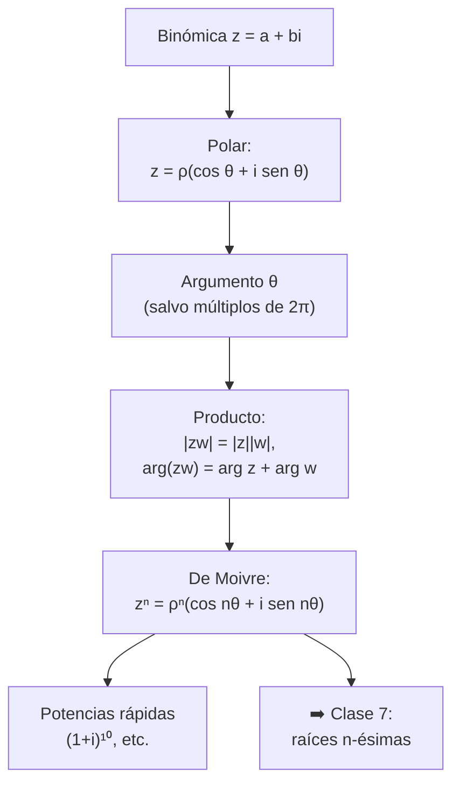
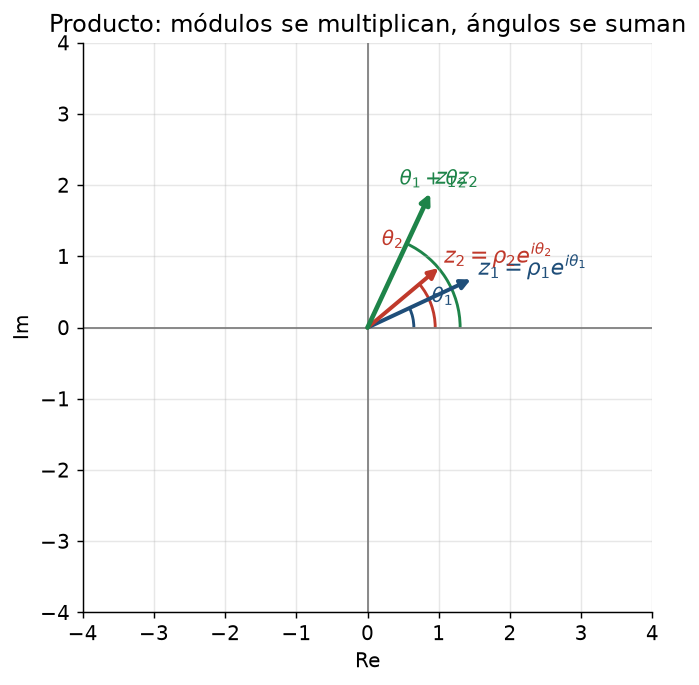
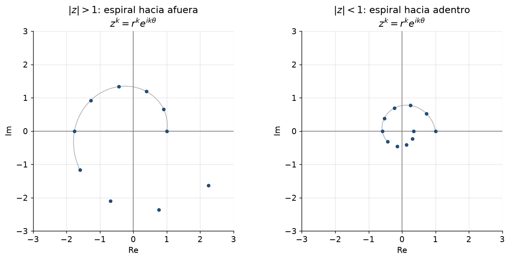

# Clase 6 — Forma polar, argumento, producto y potencias (De Moivre)

> **Bloque 1 · Números complejos · Dificultad: media-alta · Tiempo estimado: 110 min**

---

## 🎯 Objetivos

1. Pasar de **forma binómica a polar** y viceversa (módulo + argumento).
2. Entender por qué el **argumento no es único** (definirlo salvo $2\pi$).
3. Usar la regla del producto: **los módulos se multiplican y los ángulos se suman**.
4. Calcular **potencias** $z^n$ con la **fórmula de De Moivre**.
5. Resolver ecuaciones simples del tipo $z^n=c$ (las raíces las completamos en la clase 7).

> En la práctica, "polar" es lo que vuelve **fáciles** los productos, potencias y raíces. Todo examen de complejos se resuelve pasando a polar.

---

## 🗺️ Mapa de la clase

---

## 🧱 1. Repaso: coordenadas polares y trigonometría

Un punto $(a,b)$ del plano también se puede ubicar con dos datos: su **distancia al origen** $\rho$ y el **ángulo** $\theta$ que forma con el eje horizontal positivo (medido en radianes, en sentido antihorario).

De la figura (proyección del vector sobre los ejes):

$$
a=\rho\cos\theta,\qquad b=\rho\sin\theta,
$$
$$
\rho=\sqrt{a^2+b^2},\qquad \tan\theta=\frac{b}{a}\ \text{(con cuidado del cuadrante!).}
$$

Recuerdos que se usan **muchísimo** en este bloque:

| Ángulo | $\cos$ | $\sin$ |
|---|---|---|
| $0$ | $1$ | $0$ |
| $\pi/6=30^\circ$ | $\sqrt3/2$ | $1/2$ |
| $\pi/4=45^\circ$ | $\sqrt2/2$ | $\sqrt2/2$ |
| $\pi/3=60^\circ$ | $1/2$ | $\sqrt3/2$ |
| $\pi/2=90^\circ$ | $0$ | $1$ |

> ⚠️ La fórmula $\tan\theta=b/a$ **no alcanza**: dice el ángulo salvo $+\pi$. Hay que mirar en qué **cuadrante** está el punto para elegir bien. El método más seguro: dibujar el punto.

---

## 📘 2. Argumento y forma polar

### 2.1 Argumento

> **Definición 6.1.** Si $z\ne0$, un **argumento** de $z$ es cualquier número real $\theta$ tal que
> $$
> z=\rho(\cos\theta+i\sin\theta),\qquad \rho=|z|.
> $$
> El conjunto de todos los argumentos es
> $$
> \arg(z)=\{\theta_0+2k\pi : k\in\mathbb{Z}\}.
> $$
> Entre ellos se elige el **argumento principal** $\operatorname{Arg}(z)\in(-\pi,\pi]$.

En palabras: el argumento **no es único**; si $\theta$ sirve, también sirven $\theta\pm2\pi$, $\theta\pm4\pi$, … (girar una vuelta completa devuelve el mismo punto).

**Casos conocidos** (las notas, Ejemplos 1.9):
- $1$ tiene módulo $1$ y argumento $0$.
- $-1$ tiene módulo $1$ y argumento $\pi$.
- $i$ tiene módulo $1$ y argumento $\pi/2$.
- $-i$ tiene módulo $1$ y argumento $-\pi/2$.
- $1-i$ tiene módulo $\sqrt2$ y argumento $-\pi/4$.

> 💡 **Regla:** reales positivos → argumento $0$; reales negativos → $\pi$; imaginarios puros positivos → $\pi/2$; negativos → $-\pi/2$.

### 2.2 Forma polar (o trigonométrica)

Para $z\ne0$, escribimos:

$$
\boxed{\,z=\rho(\cos\theta+i\sin\theta),\qquad \rho=|z|,\ \theta\in\arg(z)\,}
$$

que a veces se abrevia $z=\rho\,\mathrm{cis}(\theta)$. Si además $w=\sigma(\cos\phi+i\sin\phi)$, entonces:

$$
\boxed{zw=\rho\sigma\bigl(\cos(\theta+\phi)+i\sin(\theta+\phi)\bigr)}
$$

**Los módulos se multiplican, los ángulos se suman.** Se demuestra con las fórmulas del coseno y seno de la suma:

$$
\cos(\theta+\phi)=\cos\theta\cos\phi-\sin\theta\sin\phi,
$$
$$
\sin(\theta+\phi)=\sin\theta\cos\phi+\cos\theta\sin\phi.
$$

> 💡 **Interpretación geométrica:** multiplicar por $w$ es **rotar** el vector $z$ un ángulo $\arg w$ y **escalarlo** por $|w|$. Esto explica el V/F de la clase 5 ($f(z)=az$ manda cuadrados a cuadrados: solo rota y escala).

### 2.3 División en polar

Igual que el producto pero "al revés":

$$
\frac{z}{w}=\frac{\rho}{\sigma}\bigl(\cos(\theta-\phi)+i\sin(\theta-\phi)\bigr).
$$

Los módulos se dividen, los ángulos se restan.

### 2.4 Fórmula de De Moivre (potencias)

Aplicando el producto $n$ veces a $z=\rho(\cos\theta+i\sin\theta)$:

$$
\boxed{\,z^n=\rho^n\bigl(\cos(n\theta)+i\sin(n\theta)\bigr)}\,,\qquad n\in\mathbb{Z}.
$$

> Para $n$ negativo también vale (porque $1/z$ da ángulo $-\theta$ y módulo $1/\rho$).

La figura muestra $z^k$ para $k=0,1,2,\dots,10$ con $z=re^{i\pi/5}$: cada potencia **rota $\pi/5$** y **multiplica el módulo por $r$**. Si $|z|>1$ la espiral crece; si $|z|<1$ se contrae.

---

## ✏️ 3. Ejercicios resueltos paso a paso

### Ejercicio 1. Pasar a forma polar: $1,\ -1,\ i,\ -i,\ 1-i$

| $z$ | $\rho=|z|$ | cuadrante | $\operatorname{Arg}$ | forma polar |
|---|---|---|---|---|
| $1$ | $1$ | eje real + | $0$ | $1\cdot(\cos0+i\sin0)$ |
| $-1$ | $1$ | eje real − | $\pi$ | $\cos\pi+i\sin\pi$ |
| $i$ | $1$ | eje imag. + | $\pi/2$ | $\cos\frac\pi2+i\sin\frac\pi2$ |
| $-i$ | $1$ | eje imag. − | $-\pi/2$ | $\cos(-\frac\pi2)+i\sin(-\frac\pi2)$ |
| $1-i$ | $\sqrt2$ | **IV** | $-\pi/4$ | $\sqrt2(\cos(-\tfrac\pi4)+i\sin(-\tfrac\pi4))$ |

> ⚠️ En $1-i$, $\tan\theta=\frac{-1}{1}=-1$ daría $-\pi/4$ **o** $3\pi/4$. Como el punto está en el **cuarto cuadrante** (real positiva, imaginaria negativa), el correcto es $-\pi/4$.

---

### Ejercicio 2. Calcular $(1+i)(1-i\sqrt3)$ (producto en polar)

**Paso 1.** Pasamos a polar cada factor:
$$
1+i=\sqrt2\left(\cos\frac\pi4+i\sin\frac\pi4\right),\qquad
1-i\sqrt3=2\left(\cos\left(-\frac\pi3\right)+i\sin\left(-\frac\pi3\right)\right).
$$

**Paso 2.** Se multiplican los módulos y se suman los ángulos:
$$
\rho=\sqrt2\cdot2=2\sqrt2,\qquad \theta=\frac\pi4-\frac\pi3=-\frac{\pi}{12}.
$$

**Paso 3.** Resultado:
$$
(1+i)(1-i\sqrt3)=2\sqrt2\left(\cos\left(-\frac\pi{12}\right)+i\sin\left(-\frac\pi{12}\right)\right).
$$

**Verificación (binómica, para confiar):**
$$
(1+i)(1-i\sqrt3)=1-i\sqrt3+i-i^2\sqrt3=1-i\sqrt3+i+\sqrt3=(1+\sqrt3)+i(1-\sqrt3).
$$
Calculemos el módulo de eso: $(1+\sqrt3)^2+(1-\sqrt3)^2=(1+2\sqrt3+3)+(1-2\sqrt3+3)=8$, así que $\rho=\sqrt8=2\sqrt2$. ✔

**Respuesta:** $2\sqrt2\,e^{-i\pi/12}\ \bigl(=2\sqrt2(\cos\frac{\pi}{12}-i\sin\frac{\pi}{12})\bigr)$. *(Ya verás en la clase 8 que $e^{-i\pi/12}=\cos\frac\pi{12}-i\sin\frac\pi{12}$.)*

---

### Ejercicio 3. Calcular $(1+i)^{10}$ con De Moivre

**Paso 1.** Polar de $1+i$: $\rho=\sqrt2$, $\theta=\pi/4$.

**Paso 2.** De Moivre con $n=10$:
$$
(1+i)^{10}=(\sqrt2)^{10}\left(\cos\left(10\cdot\frac\pi4\right)+i\sin\left(10\cdot\frac\pi4\right)\right).
$$

**Paso 3.** $(\sqrt2)^{10}=(2^{1/2})^{10}=2^5=32$. Y $10\cdot\frac\pi4=\frac{5\pi}{2}$, que es lo mismo que $\frac\pi2$ (restamos $2\pi$).

**Paso 4.**
$$
(1+i)^{10}=32\left(\cos\frac\pi2+i\sin\frac\pi2\right)=32(0+i)=32i.
$$

**Respuesta:** $32i$. *(Hacelo "a mano" multiplicando y vas a ver por qué polar es mejor.)*

---

### Ejercicio 4. Calcular $(1-\sqrt3\,i)^6$

**Paso 1.** Polar: $\rho=\sqrt{1+3}=2$; el punto $(1,-\sqrt3)$ está en el cuarto cuadrante, $\tan\theta=-\sqrt3\Rightarrow\theta=-\pi/3$.

**Paso 2.** De Moivre:
$$
(1-\sqrt3\,i)^6=2^6\left(\cos\left(6\cdot\left(-\frac\pi3\right)\right)+i\sin\left(6\cdot\left(-\frac\pi3\right)\right)\right).
$$

**Paso 3.** $6\cdot(-\pi/3)=-2\pi$. Como $\cos$ y $\sin$ son periódicos con período $2\pi$, eso es lo mismo que $0$:
$$
=64(\cos0+i\sin0)=64.
$$

**Respuesta:** $64$ (¡un número real!).

> 💡 Cuando el **ángulo acumulado** sea grande, **restá/ sumá $2\pi$** las veces necesarias antes de evaluar seno y coseno.

---

### Ejercicio 5. Probar De Moivre por inducción

**Base ($n=1$):** trivial: $z^1=\rho(\cos\theta+i\sin\theta)$. ✔

**Paso inductivo:** supongamos que vale para $n$. Multiplicamos por $z$:

$$
z^{n+1}=z^n z=\rho^{n+1}\bigl(\cos(n\theta)+i\sin(n\theta)\bigr)\bigl(\cos\theta+i\sin\theta\bigr).
$$

Usando la regla del producto de polar:
$$
=\rho^{n+1}\bigl(\cos(n\theta+\theta)+i\sin(n\theta+\theta)\bigr)=\rho^{n+1}\bigl(\cos((n+1)\theta)+i\sin((n+1)\theta)\bigr).
$$
$\blacksquare$

---

## 🏛️ 4. Ejercicios de parcial/examen

### Ejercicio 6 (Examen jul. 2019, MO 2). Resolver $\bar z=2z^2$

**Paso 1.** Tomamos módulos en ambos miembros:
$$
|\bar z|=|z|,\qquad |2z^2|=2|z|^2.
$$
Entonces $|z|=2|z|^2\Rightarrow |z|\,(1-2|z|)=0\Rightarrow |z|=0$ **o** $|z|=\frac12$.

**Paso 2.** Caso $|z|=0$: $z=0$ es solución (se verifica: $\bar 0=0=2\cdot0$). ✔

**Paso 3.** Caso $|z|=\frac12$: escribimos $z=\frac12 e^{i\theta}$. Entonces
$$
\bar z=\frac12 e^{-i\theta},\qquad 2z^2=2\cdot\frac14 e^{2i\theta}=\frac12e^{2i\theta}.
$$
Igualando: $e^{-i\theta}=e^{2i\theta}\Rightarrow e^{3i\theta}=1$.

**Paso 4.** Usamos la definición de exponencial compleja (vista en la clase 8, pero acá alcanza con pensar en polar): $e^{3i\theta}=\cos(3\theta)+i\sin(3\theta)=1$ se da cuando $3\theta=2k\pi$, es decir
$$
\theta=\frac{2k\pi}{3},\qquad k=0,1,2.
$$

**Paso 5.** Las soluciones con $|z|=1/2$ son
$$
\frac12,\quad \frac12 e^{2\pi i/3}=-\frac14+\frac{\sqrt3}{4}i,\quad \frac12 e^{4\pi i/3}=-\frac14-\frac{\sqrt3}{4}i.
$$

**Paso 6.** Vemos las opciones:
- (A) todos con módulo $1/2$ → **falso** ($z=0$ tiene módulo $0$).
- (B) cuatro elementos y dos con parte imaginaria igual → $-\frac14\pm\frac{\sqrt3}{4}i$ tienen partes imaginarias **opuestas**, no iguales. Falso.
- (C) cuatro elementos y una dupla con partes imaginarias **opuestas y no nulas** → **verdadero**.
- (D) dos elementos cuya suma es cero → $-\frac14+\frac{\sqrt3}{4}i+(-\frac14-\frac{\sqrt3}{4}i)=-\frac12\ne0$. Falso.

**Respuesta: (C).**

> 💡 **Técnica estrella:** ante una ecuación con módulos, **tomar módulo a ambos lados** te separa la información del módulo y la del ángulo. Luego se compara el **ángulo**.

---

### Ejercicio 7 (Parcial 1 2019-1S, MO 1). Si $z_1,z_2,z_3$ son las raíces de $z^3=1$, calcular $z_1z_2z_3$

**Paso 1.** Como $|z_i|^3=1$, cada raíz tiene módulo $1$: $z_j=e^{i\theta_j}$ con $3\theta_j=2k_j\pi$.

**Paso 2.** Las tres raíces son $z_k=e^{2\pi i k/3}$ con $k=0,1,2$:
$$
z_0=1,\qquad z_1=e^{2\pi i/3},\qquad z_2=e^{4\pi i/3}.
$$

**Paso 3.** Producto (¡se suman los argumentos!):
$$
z_0z_1z_2=e^{0}\cdot e^{2\pi i/3}\cdot e^{4\pi i/3}=e^{2\pi i}=1.
$$

**Respuesta: (A) $z_1z_2z_3=1$.**

> 💡 Es más rápido todavía: para una ecuación $z^n-w=0$, el **producto de todas las raíces** es $(-1)^{n+1}w$… pero mejor resolver directo como acá, que es lo que pide el parcial.

---

## ⚠️ 5. Errores comunes

| Error | Corrección |
|---|---|
| Usar $\theta=\arctan(b/a)$ sin mirar el cuadrante | dibujá el punto; $1-i$ da $-\pi/4$, no $3\pi/4$ |
| Decir "el argumento de $z$ es $\theta$" (como si fuera único) | todos los $\theta+2k\pi$; el **principal** sí es único |
| Escribir $(\rho\cos\theta+i\sin\theta)^n=\rho^n\cos(n\theta)+i\rho^n\sin(n\theta)$… sin los paréntesis | la potencia afecta **todo**: $\rho^n(\cos(n\theta)+i\sin(n\theta))$ |
| Multiplicar módulos pero **restar** ángulos, o al revés | producto: sumar; división: restar |
| Dejar el resultado en ángulo grande ($10\pi/4$) | reducí a $[0,2\pi)$ antes de evaluar sen/cos |
| Confundir $e^{i\theta}=1$ cuando $\theta=0$ solamente | $e^{i\theta}=1$ sii $\theta=2k\pi$ |

---

## 🔗 6. Conexión con el resto del curso

- **Clase 7 (raíces):** De Moivre "al revés": si $z^n=w$, entonces $|z|^n=|w|$ y $n\theta=\arg w + 2k\pi$.
- **Clase 8 (Euler):** la notación $z=\rho e^{i\theta}$ es la polar compacta, y es la que se usa en las EDOs (clase 13) y en la transformada de Fourier (si seguís por el lado de señales).
- **Integrales** (clase 46): las coordenadas polares reales $(x,y)=\rho(\cos\theta,\sin\theta)$ son la misma idea, y el determinante jacobiano es $\rho$.

---

## ✅ 7. Autoevaluación

1. Pasar a polar: $2+2i$, $-\sqrt3+i$, $-4$.
2. Calcular $\dfrac{(1+i)(1+i\sqrt3)}{2i}$.
3. Calcular $(\sqrt3-i)^8$.
4. Hallar todos los $\theta$ tales que $e^{i\theta}=-1$.
5. Si $z_1z_2$ tiene argumento $\pi/3$ y $z_1$ argumento $-\pi/6$, ¿cuál es un argumento de $z_2$?
6. (V/F) Si $|z|=|w|$ entonces $\operatorname{Arg}(zw)=\operatorname{Arg}(z)+\operatorname{Arg}(w)$.

Respuestas

1. $2\sqrt2\,\mathrm{cis}(\pi/4)$; $2\,\mathrm{cis}(5\pi/6)$; $4\,\mathrm{cis}(\pi)$.
2. $(1+i)=\sqrt2\,\mathrm{cis}(\pi/4)$, $(1+i\sqrt3)=2\,\mathrm{cis}(\pi/3)$, $2i=2\,\mathrm{cis}(\pi/2)$; el cociente da $\dfrac{\sqrt2\cdot2}{2}\mathrm{cis}(\pi/4+\pi/3-\pi/2)=\sqrt2\,\mathrm{cis}(\pi/12)$.
3. $\sqrt3-i=2\,\mathrm{cis}(-\pi/6)$; potencia: $2^8\,\mathrm{cis}(-8\pi/6)=256\,\mathrm{cis}(-4\pi/3)=256\,\mathrm{cis}(2\pi/3)=-128+128\sqrt3\,i$.
4. $e^{i\theta}=-1\iff\theta=\pi+2k\pi$.
5. $\theta_2=\pi/3-(-\pi/6)=\pi/2$ (salvo $2\pi$).
6. **Falso** en general por el "salto" del argumento principal: $z=-1$, $w=-1$ da $\operatorname{Arg}(zw)=\operatorname{Arg}(1)=0$ pero $\operatorname{Arg}(z)+\operatorname{Arg}(w)=2\pi$. La igualdad vale **salvo $2\pi$**.

---

**⬅️ Anterior:** [Clase 5 — Forma binómica](05_complejos_binomica.md) · **➡️ Siguiente:** [Clase 7 — Raíces n-ésimas](07_raices_n_esimas.md)