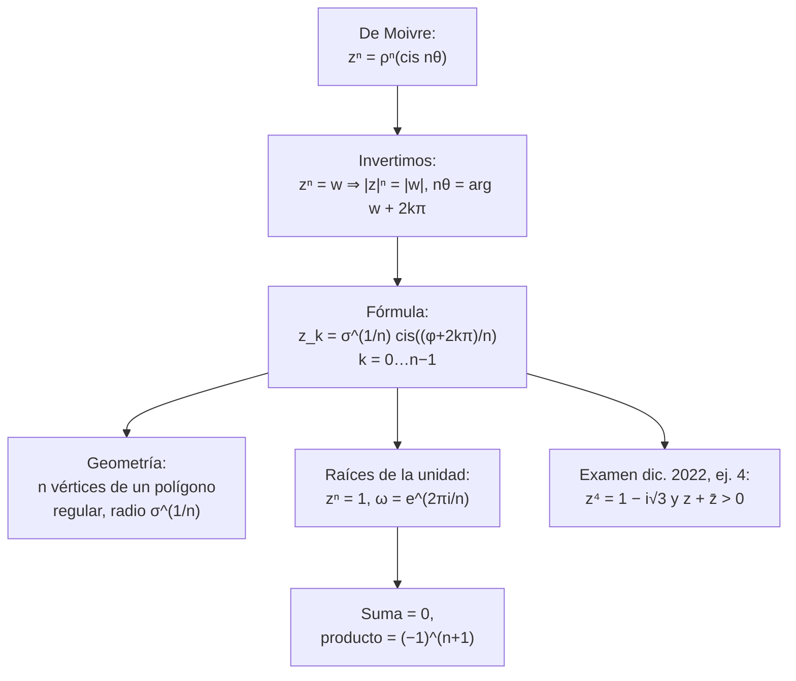
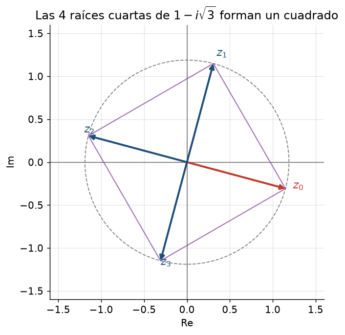
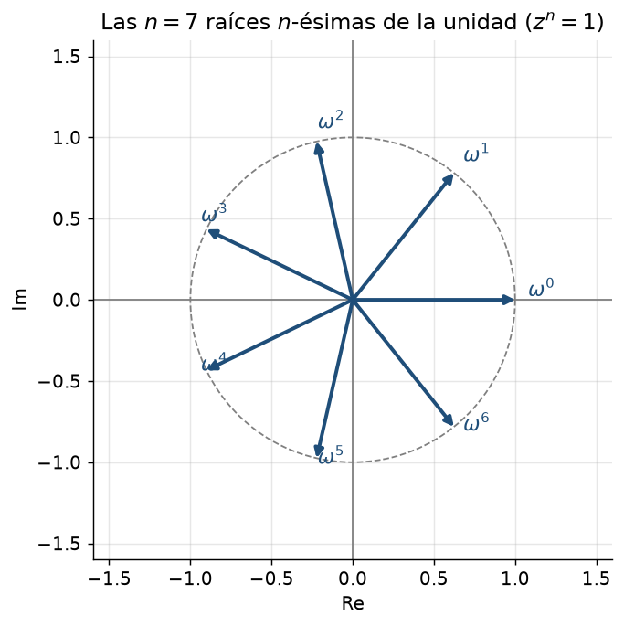

# Clase 7 — Raíces n-ésimas y raíces de la unidad

> **Bloque 1 · Números complejos · Dificultad: media-alta · Tiempo estimado: 120 min**

---

## 🎯 Objetivos

1. **Calcular las $n$ raíces $n$-ésimas** de un complejo cualquiera con la fórmula cerrada.
2. Ver que **siempre hay exactamente $n$ raíces** y que **forman un polígono regular**.
3. Manejar las **raíces de la unidad** (raíces de $z^n=1$): cuántas son, cómo se suman y cómo se multiplican.
4. Resolver **ecuaciones polinómicas** del tipo $z^n=w$ y combinar con condiciones extra (como $z+\bar z>0$).

> Es la clase que más aparece en exámenes: **Examen dic. 2022 (ej. 4)**, **Examen jul. 2019**, **Parcial 1 2020-2S**, **Parcial 1 2022-1S**, **Examen feb. 2021**… todos tienen raíces.

---

## 🗺️ Mapa de la clase

---

## 🧱 1. Repaso: qué significa "raíz" acá

En $\mathbb{R}$:

- $\sqrt[2]{4}=\pm2$ (dos raíces).
- $\sqrt[3]{8}=2$ (una sola).

En $\mathbb{C}$ **la situación cambia y se vuelve uniforme**:

> **Teorema (fundamental del álgebra, versión práctica).** Para todo $w\ne0$ y todo $n\ge1$, la ecuación
> $$
> z^n=w
> $$
> tiene **exactamente $n$ soluciones complejas distintas**.

*("*exactly $n$*" porque $z=0$ queda fuera: $0^n=0$.)*

El método viene de la clase anterior: **si $z^n=w$, entonces los módulos se potencian y los ángulos se suman**, así que

- $|z|^n=|w|$ → **$|z|$ queda determinado**: $|z|=\sqrt[n]{|w|}$.
- $n\theta=\varphi+2k\pi$ → **los ángulos son** $\theta_k=\dfrac{\varphi+2k\pi}{n}$ con $k=0,1,\dots,n-1$.

---

## 📘 2. Fórmula de las raíces $n$-ésimas

> **Teorema 7.1.** Sea $w=\sigma(\cos\varphi+i\sin\varphi)\ne0$. Las $n$ raíces de $z^n=w$ son
> $$
> \boxed{\,z_k=\sqrt[n]{\sigma}\left(\cos\frac{\varphi+2k\pi}{n}+i\sin\frac{\varphi+2k\pi}{n}\right),\qquad k=0,1,\dots,n-1\,}
> $$
> Todas tienen el **mismo módulo** $\sqrt[n]{\sigma}$, y sus ángulos están **igual de espaciados**, cada $\dfrac{2\pi}{n}$.

**Por qué $2k\pi$:** si $z_k^n=w$ y $z_k$ tiene ángulo $\theta_k$, entonces $n\theta_k=\varphi+2k\pi$. Con $k=0,\dots,n-1$ recorremos ángulos **distintos**; con $k=n$ volvemos al de $k=0$ (sumar $2\pi$ a un ángulo da el mismo punto).

### 2.1 Geometría: polígono regular

Las $n$ raíces están **sobre la circunferencia de radio $\sqrt[n]{\sigma}$**, separadas por ángulos iguales $2\pi/n$:

- **$n=2$:** dos puntos opuestos (diámetro).
- **$n=3$:** un triángulo equilátero.
- **$n=4$:** un cuadrado (como en la figura de arriba).
- **$n=5$:** un pentágono regular, etc.

> Se llama a esto la **interpretación "al revés" de De Moivre**: potenciar rota y escala; sacar raíz "reparte" la rotación en $n$ partes iguales.

### 2.2 Raíces de la unidad

El caso $w=1$ (es decir, $z^n=1$) es el más importante. Escribiendo $1=\cos0+i\sin0$:

$$
\omega_k=e^{2\pi i k/n}=\cos\frac{2k\pi}{n}+i\sin\frac{2k\pi}{n},\qquad k=0,1,\dots,n-1.
$$

**Propiedades útiles para parciales:**

1. Son $n$ números de módulo $1$, sobre la circunferencia unidad, formando un $n$-ágono regular con un vértice en $1=\omega_0$.
2. Si $\omega=e^{2\pi i/n}$ es la primera, todas son $\omega^k$ ($k=0,\dots,n-1$) y además $\omega^n=1$.
3. **Suma de todas las raíces = 0** (porque el centro de masa de un polígono regular es el centro).
4. **Producto de todas las raíces = $(-1)^{n+1}$** (para $n$ impar da $1$; para $n$ par da $-1$). Se ve porque $\omega^{0+1+\cdots+(n-1)}=\omega^{n(n-1)/2}$.

> 💡 La propiedad 3 se demuestra con la fórmula de la **serie geométrica** (clase 21): $\sum_{k=0}^{n-1}\omega^k=\dfrac{\omega^n-1}{\omega-1}=\dfrac{1-1}{\omega-1}=0$.

---

## ✏️ 3. Ejercicios resueltos paso a paso

### Ejercicio 1. Raíces cuadradas de $-1$: resolver $z^2=-1$

**Paso 1.** $w=-1$: módulo $\sigma=1$, argumento $\varphi=\pi$ (o $-\pi$, da igual).

**Paso 2.** $n=2$, radio $\sqrt[2]{1}=1$, ángulos $\theta_k=\frac{\pi+2k\pi}{2}$:
$$
\theta_0=\frac\pi2,\qquad \theta_1=\frac{\pi+2\pi}{2}=\frac{3\pi}{2}.
$$

**Paso 3.**
$$
z_0=\cos\frac\pi2+i\sin\frac\pi2=i,\qquad
z_1=\cos\frac{3\pi}2+i\sin\frac{3\pi}2=-i.
$$

**Respuesta:** $z=\pm i$. ✔ *(¡Ahí está $i$: la raíz de $-1$ que no existía en $\mathbb{R}$!)*

---

### Ejercicio 2. Raíces cúbicas de $-8$: resolver $z^3=-8$

**Paso 1.** $-8$: módulo $8$, argumento $\pi$.

**Paso 2.** Radio: $\sqrt[3]{8}=2$. Ángulos: $\theta_k=\frac{\pi+2k\pi}{3}$:
$$
\theta_0=\frac\pi3,\qquad\theta_1=\pi,\qquad\theta_2=\frac{5\pi}{3}.
$$

**Paso 3.**
$$
z_0=2\left(\frac12+i\frac{\sqrt3}{2}\right)=1+i\sqrt3,
$$
$$
z_1=2(\cos\pi+i\sin\pi)=-2,
$$
$$
z_2=2\left(\cos\frac{5\pi}3+i\sin\frac{5\pi}3\right)=2\left(\frac12-i\frac{\sqrt3}{2}\right)=1-i\sqrt3.
$$

**Verificación:** $(-2)^3=-8$ ✔; $(1\pm i\sqrt3)^3$: módulo $|1\pm i\sqrt3|^3=2^3=8$ ✔, ángulo $3\cdot(\pm\pi/3)=\pm\pi$ (da $-1$ en el plano) ✔.

**Respuesta:** $1+i\sqrt3,\ -2,\ 1-i\sqrt3$. Forman un **triángulo equilátero** de radio $2$.

---

### Ejercicio 3. Raíces cuartas de $i$: resolver $z^4=i$

$i$: módulo $1$, argumento $\pi/2$. Radio $\sqrt[4]{1}=1$; ángulos $\theta_k=\frac{\pi/2+2k\pi}{4}=\frac\pi8+\frac{k\pi}{2}$:
$$
z_0=\cos\frac\pi8+i\sin\frac\pi8,\quad
z_1=\cos\frac{5\pi}8+i\sin\frac{5\pi}8,
$$
$$
z_2=\cos\frac{9\pi}8+i\sin\frac{9\pi}8,\quad
z_3=\cos\frac{13\pi}8+i\sin\frac{13\pi}8.
$$

Son los vértices de un **cuadrado** sobre la circunferencia unidad, el primero con ángulo $\pi/8=22{,}5^\circ$, y los demás sumando $90^\circ$.

> Este ejercicio es el *primer bloque* del **Examen feb. 2021, Problema 1**: el dato $z^4=i$ con $\theta\in(-\pi/4,\pi/4)$ selecciona $z_0=\cos(\pi/8)+i\sin(\pi/8)$. Lo completamos en la clase 8.

---

### Ejercicio 4. Raíces de la unidad: $z^5=1$, suma y producto

**Paso 1.** $\omega=e^{2\pi i/5}$. Las raíces:
$$
1,\ \omega,\ \omega^2,\ \omega^3,\ \omega^4.
$$

**Paso 2. Suma:**
$$
1+\omega+\omega^2+\omega^3+\omega^4=\frac{\omega^5-1}{\omega-1}=\frac{1-1}{\omega-1}=0.
$$

**Paso 3. Producto:**
$$
1\cdot\omega\cdot\omega^2\cdot\omega^3\cdot\omega^4=\omega^{10}=\left(\omega^5\right)^2=1^2=1.
$$
*(También coincide con $(-1)^{5+1}=1$.)*

**Respuesta:** suma $0$, producto $1$.

---

### Ejercicio 5. Resolver $z^6=64$

**Paso 1.** $64=2^6$ es real positivo: módulo $64$, argumento $0$.

**Paso 2.** Radio $\sqrt[6]{64}=2$. Ángulos $\theta_k=\frac{0+2k\pi}{6}=\frac{k\pi}{3}$:
$$
\theta_0=0,\ \theta_1=\frac\pi3,\ \theta_2=\frac{2\pi}3,\ \theta_3=\pi,\ \theta_4=\frac{4\pi}3,\ \theta_5=\frac{5\pi}3.
$$

**Paso 3.**
$$
z\in\{2,\ 1+i\sqrt3,\ -1+i\sqrt3,\ -2,\ -1-i\sqrt3,\ 1-i\sqrt3\}.
$$

**Respuesta:** esas 6, sobre la circunferencia de radio $2$, formando un **hexágono regular**. Notá que solo dos son reales ($\pm2$).

> 💡 Las soluciones reales de $z^6=64$ son solo $\pm2$, pero en $\mathbb{C}$ son **6**. "Cuántas raíces" depende del cuerpo en el que trabajás.

---

## 🏛️ 4. Ejercicios de parcial/examen

### Ejercicio 6 (Examen dic. 2022, MO 4). El conjunto
$$
A=\{z\in\mathbb{C}:\ z^4=1-i\sqrt3\ \text{ y }\ z+\bar z>0\}
$$

**Paso 1.** Pasamos $w=1-i\sqrt3$ a polar:
$$
|w|=\sqrt{1+3}=2,
$$
y el punto $(1,-\sqrt3)$ está en el cuarto cuadrante, así que $\varphi=-\pi/3$.

**Paso 2.** Las 4 raíces de $z^4=w$ tienen radio
$$
\rho=\sqrt[4]{2}
$$
y ángulos
$$
\theta_k=\frac{-\pi/3+2k\pi}{4}=-\frac{\pi}{12}+\frac{k\pi}{2},\qquad k=0,1,2,3.
$$

| $k$ | $\theta_k$ | cuadrante | $\operatorname{Re}(z_k)>0$? |
|---|---|---|---|
| $0$ | $-\pi/12$ | IV | ✓ sí |
| $1$ | $-\pi/12+\pi/2=5\pi/12$ | II | ✗ no |
| $2$ | $-\pi/12+\pi=11\pi/12$ | II | ✗ no |
| $3$ | $-\pi/12+3\pi/2=17\pi/12=-7\pi/12$ | IV | ✓ sí |

**Paso 3.** Ahora la segunda condición: $z+\bar z=2\operatorname{Re}(z)>0$, o sea **$\operatorname{Re}(z)>0$**. Solo las raíces en los cuadrantes IV (y I) cumplen: las de $k=0$ y $k=3$.

**Paso 4.** Entonces $A$ tiene **exactamente 2 elementos**.

**Respuesta: (C) A tiene exactamente dos elementos distintos.**

> 💡 **Reflexión para examen:** cuentan las **dos condiciones por separado**. La primera fija 4 candidatas (polígono regular, figura `b1_raices.png`); la segunda **descarta por cuadrante**. Dibujar el polígono hace el ejercicio en 30 segundos.

---

### Ejercicio 7 (Parcial 1 2022-1S, MO 2). Si $z=\dfrac{\sqrt3}{2}+\dfrac12 i$ es una raíz sexta de cierto complejo, ¿cuáles son las otras cinco?

**Paso 1.** Identificamos el ángulo: $\cos\theta=\sqrt3/2$ y $\sin\theta=1/2$ → $\theta=\pi/6$. Y $|z|=\sqrt{3/4+1/4}=1$.

**Paso 2.** Las 6 raíces sextas de un mismo complejo comparten **módulo 1** (todas en la circunferencia unidad) y están separadas $2\pi/6=\pi/3$ en ángulo. Partiendo de $\pi/6$:
$$
\frac\pi6,\quad \frac\pi6+\frac\pi3=\frac\pi2,\quad \frac{5\pi}6,\quad \frac{7\pi}6,\quad \frac{3\pi}2,\quad \frac{11\pi}6.
$$

**Paso 3.** Las traducimos: $i$, $-\frac{\sqrt3}{2}+\frac12 i$, $-\frac{\sqrt3}{2}-\frac12 i$, $-i$, $\frac{\sqrt3}{2}-\frac12 i$.

**Respuesta: (A)** $i,\ -i,\ \dfrac{\sqrt3}{2}-\dfrac12 i,\ -\dfrac{\sqrt3}{2}+\dfrac12 i,\ -\dfrac{\sqrt3}{2}-\dfrac12 i$ ✔ (son las otras cinco; la de $k=0$ es la dada).

---

### Ejercicio 8 (Parcial 1 2020-2S, MO 1). Sea $P(z)=(z^4-1)(z^4-i)$. ¿Cuáles afirmaciones son correctas?
> (I) $P$ tiene 8 raíces en $\mathbb{C}$. (II) Existe un par de raíces $z_i,z_j$ con $z_i=\bar z_j$. (III) El conjunto de raíces es invariante al rotarlo $\pi/2$.

**(I) Paso 1.** $z^4=1$ tiene 4 raíces (las cuartas de la unidad: $1,i,-1,-i$) y $z^4=i$ tiene otras 4 (las del Ejercicio 3). ¿Se repiten? Las de $z^4=i$ tienen ángulos $\pi/8+k\pi/2$; ninguna es múltiplo de $\pi/2$, así que **no coinciden**. → **(I) es verdadera.**

**(II) Paso 2.** $z^4=1$ tiene coeficientes reales, así que sus raíces vienen en pares conjugados: $i$ y $-i=\bar i$ están entre ellas. → **(II) es verdadera.**

**(III) Paso 3.** Rotar $\pi/2$ = multiplicar por $i$. El conjunto de raíces de $z^4=1$ es invariante (girar el cuadrado). El de $z^4=i$: girar $\pi/8+k\pi/2$ en $\pi/2$ da $\pi/8+(k+1)\pi/2$, el mismo conjunto. Entonces el total es invariante. → **(III) es verdadera.**

**Respuesta: (B) Todas las afirmaciones son correctas.**

---

### Ejercicio 9 (Parcial 1 2021-2S, V/F). ¿"Todo complejo no nulo tiene exactamente tres raíces cúbicas"? ¿Y si $P$ tiene coeficientes complejos y $\lambda$ es raíz, entonces $\bar\lambda$ también?

**Primera: VERDADERA.** Es el teorema: $z^3=w$ con $w\ne0$ tiene exactamente 3 soluciones. *(En $\mathbb{R}$, en cambio, solo $1$: por eso la afirmación "parece rara".)*

**Segunda: FALSA.** El hecho de que las raíces vengan conjugadas (`Ejercicio 6` de la clase 5) exige que **los coeficientes sean reales**. Contraejemplo: $P(z)=z-i$ tiene raíz $\lambda=i$, pero $\bar\lambda=-i$ **no** es raíz: $P(-i)=-i-i=-2i\ne0$.

**Respuestas: V y F.**

> ⚠️ Esta es una trampa clásica de los V/F: la afirmación de las raíces conjugadas siempre asume coeficientes reales; si el polinomio es complejo, no vale.

---

## ⚠️ 5. Errores comunes

| Error | Corrección |
|---|---|
| Sacar solo una raíz ("$z=\sqrt[4]{w}$") | son **$n$ raíces**, con $k=0,\dots,n-1$ |
| Usar $k=1,\dots,n$ o empezar con $k$ que no corresponde | $k=0$ da el ángulo base $\varphi/n$ |
| Mezclar "dividir el módulo" con "sacar raíz": $|z|=\sqrt[n]{|w|}$ | el módulo se **potencia**, así que se saca raíz $n$-ésima, no se divide |
| Olvidar la condición extra (ej.: $z+\bar z>0$) | leela dos veces; la respuesta suele ser un **subconjunto** de las raíces |
| Creer que las raíces de $z^n=1$ incluyen todas las de módulo 1 | no: son **exactamente $n$**, las equiespaciadas |
| Rotar con signo equivocado | ángulos crecen en sentido **antihorario**, sumando $+2\pi/n$ |

---

## 🔗 6. Conexión con el resto del curso

- **Clase 8 (Euler):** las raíces se escriben lindísimo como $\sqrt[n]{\sigma}\,e^{i(\varphi+2k\pi)/n}$.
- **EDOs (clase 13):** las raíces complejas del polinomio característico dan soluciones reales mediante senos y cosenos; ahí aparecen otra vez raíces de la unidad y exponenciales complejas.
- **Series de Fourier (invisible pero real):** las raíces de la unidad son la base del análisis de señales.

---

## ✅ 7. Autoevaluación

1. Resolver $z^3=i$.
2. Resolver $z^4=-16$.
3. Calcular el producto de las 6 raíces de $z^6=3$.
4. ¿Cuántas raíces tiene $z^8=1$ en la circunferencia unidad? ¿Y cuántas tienen parte imaginaria positiva?
5. Si $z^5=2\sqrt2(1+i)$, ¿qué radio tiene cada raíz?
6. (V/F) Las raíces de $z^3=\bar z^3$.

Respuestas

1. $i=\mathrm{cis}(\pi/2)$: raíces $2^{0}=1$ de radio $1$ con ángulos $\pi/6,\ 5\pi/6,\ 3\pi/2$: $\frac{\sqrt3}{2}+\frac12 i$, $-\frac{\sqrt3}{2}+\frac12 i$, $-i$.
2. $-16=16\,\mathrm{cis}(\pi)$: radio $\sqrt[4]{16}=2$, ángulos $\pi/4+k\pi/2$: $\pm\sqrt2\pm\sqrt2\,i$ (las 4 combinaciones).
3. Producto $=(-1)^{6+1}\cdot3=-3$.
4. 8 raíces; las de $\arg\in(0,\pi)$: $k=1,2,3$ → 3 raíces con $\operatorname{Im}>0$ (más $k=0$ ó $4$ tienen $\operatorname{Im}=0$).
5. $|w|=2\sqrt2\cdot|1+i|=2\sqrt2\cdot\sqrt2=4$, radio $=\sqrt[5]{4}$.
6. Tomando módulo: $|z|^3=|z|^3$ (sin info). De $z^3=\bar z^3$ sale $z^3$ real, o sea $z\in\mathbb{R}$ o $\bar z=z$… en realidad si $z\ne0$, $z^3$ real implica $\arg z\in\{0,\pi,\frac\pi3,\dots\}$… la afirmación tal cual es **FALSA** en general: $z=i$ da $z^3=-i$ y $\bar z^3=(-i)^3=i$, distintos. Toda $z$ real cumple, pero no solo esas: $z=e^{i\pi/3}$ da $z^3=-1$ real = $\bar z^3$. Toda $z$ con $z^3\in\mathbb{R}$ (3 "direcciones": ángulos $0,\pi/3\cdot$… o sea $\arg z=k\pi/3$) sirve. (F en general.)

---

**⬅️ Anterior:** [Clase 6 — Forma polar y De Moivre](06_polar_demoivre.md) · **➡️ Siguiente:** [Clase 8 — Exponencial compleja y Euler](08_exponencial_euler.md)