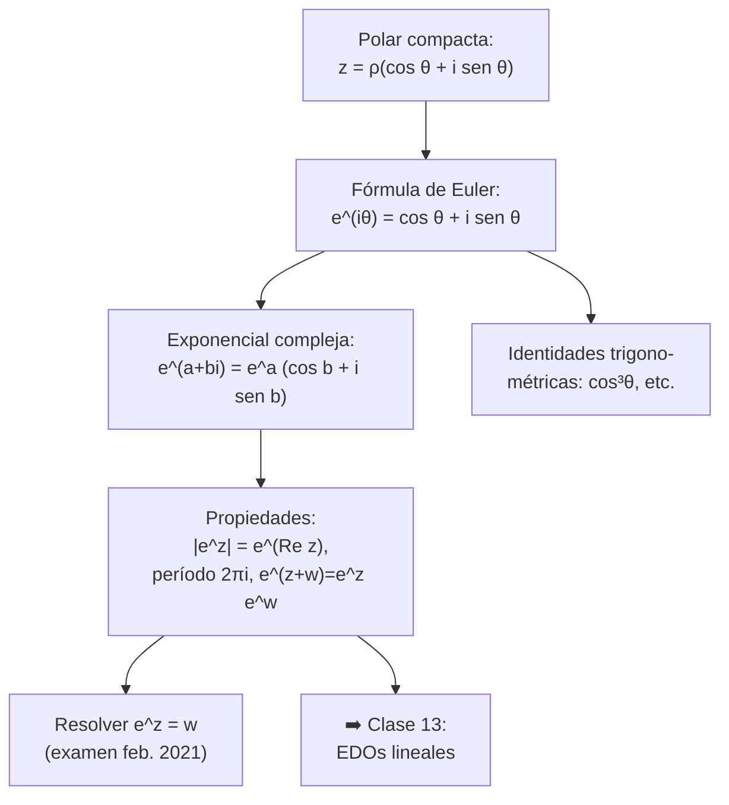
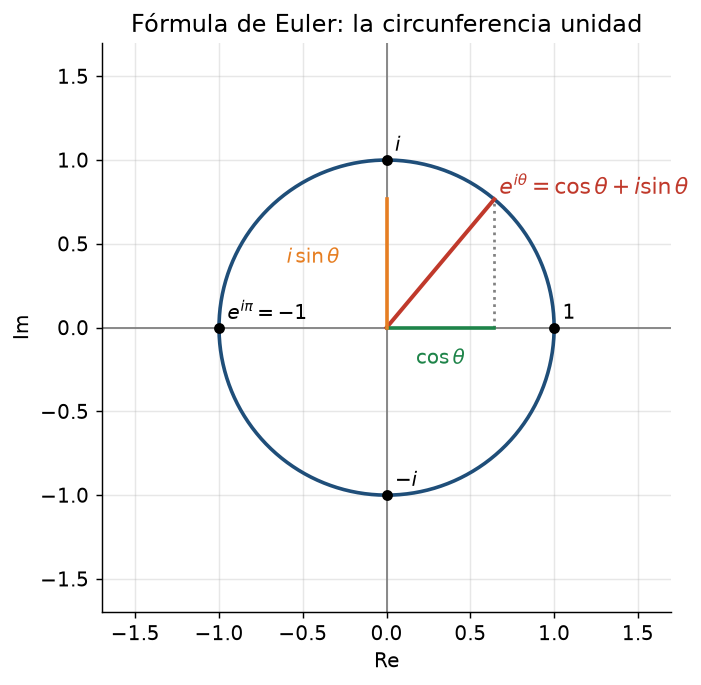
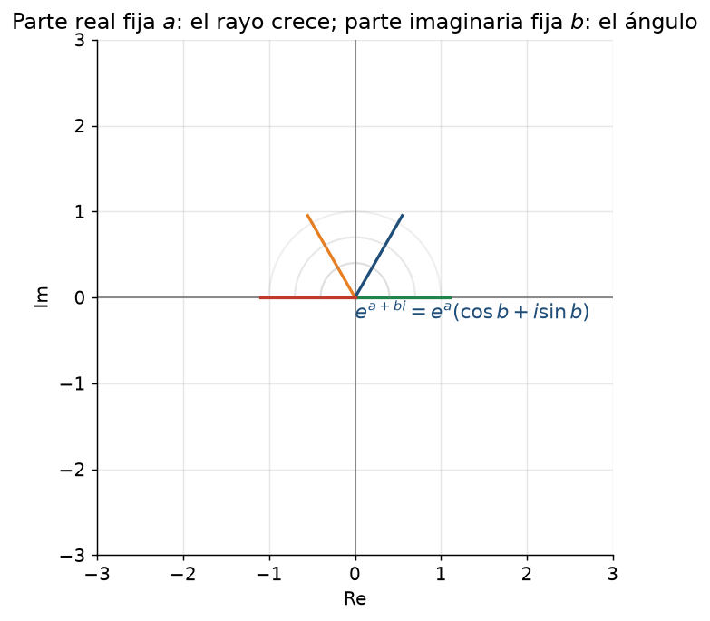

# Clase 8 — Exponencial compleja y fórmula de Euler

> **Bloque 1 · Números complejos · Cierre · Dificultad: media-alta · Tiempo estimado: 110 min**

---

## 🎯 Objetivos

1. Manejar la **fórmula de Euler**: $e^{i\theta}=\cos\theta+i\sin\theta$, y su perla $e^{i\pi}+1=0$.
2. Definir la **exponencial compleja** $e^z$ con $z=a+bi$, y conocer sus propiedades (período $2\pi i$, módulo $e^a$, etc.).
3. **Resolver ecuaciones** del tipo $e^z=w$ (salen ángulos "escondidos").
4. Deducir **identidades trigonométricas** con Euler (¡se usa en integrales!).
5. Resolver ejercicios de examen que mezclan $e^z$ con raíces y condiciones.

> Cierre del Bloque 1. Con la exponencial compleja terminamos de unificar binómica, polar y raíces, y aparece como llave en las **EDOs lineales** (clase 13).

---

## 🗺️ Mapa de la clase

---

## 🧱 1. Repaso: la exponencial real y el número $e$

El número $e=2{,}71828\dots$ nació en la clase 3 como
$$
e=\lim_{n\to\infty}\left(1+\frac1n\right)^n.
$$
La **función exponencial real** $f(x)=e^x$ cumple:
- $e^0=1$, $e^x>0$ para todo $x$ real,
- $e^{x+y}=e^x e^y$,
- $(e^x)^n=e^{nx}$,
- crece más rápido que cualquier polinomio.

El problema: con $x$ real, $e^x$ **siempre es positiva**, así que $e^x=-1$ no tiene solución. La exponencial compleja arregla eso.

---

## 📘 2. Fórmula de Euler

> **Fórmula de Euler.** Para todo $\theta\in\mathbb{R}$,
> $$
> \boxed{\,e^{i\theta}=\cos\theta+i\sin\theta\,}
> $$

Se "ve" en el círculo: $e^{i\theta}$ es el punto de la circunferencia unidad con ángulo $\theta$; su proyección en el eje real es $\cos\theta$ y en el imaginario $\sin\theta$.

**Consecuencias inmediatas:**

- $e^{i\pi}=-1$, que reordenada da la famosa **identidad de Euler** $e^{i\pi}+1=0$ (une a $e$, $\pi$, $i$, $1$ y $0$).
- $e^{i\pi/2}=i$, $e^{i\pi}=-1$, $e^{3i\pi/2}=-i$, $e^{2\pi i}=1$.
- $e^{i\theta}$ es **periódica**: $e^{i(\theta+2\pi)}=e^{i\theta}$ para todo $\theta$.

**Forma polar compacta.** Combinando con la clase 6, todo complejo no nulo se escribe como
$$
\boxed{\,z=\rho e^{i\theta}\,,\qquad \rho=|z|,\ \theta\in\arg(z)\,}
$$
Y el producto queda obvio: $(\rho_1 e^{i\theta_1})(\rho_2 e^{i\theta_2})=\rho_1\rho_2\,e^{i(\theta_1+\theta_2)}$, porque las reglas de la exponencial "funcionan".

---

## 📘 3. La función exponencial compleja

> **Definición 8.1.** Para $z=a+bi$,
> $$
> e^z=e^{a+bi}=e^a(\cos b+i\sin b).
> $$

**Propiedades esenciales:**

| Propiedad | Fórmula | Por qué |
|---|---|---|
| Módulo | $|e^z|=e^{\operatorname{Re}(z)}$ | $|e^a|=e^a$ y $|\cos b+i\sin b|=1$ |
| Argumento | $\arg(e^z)\equiv\operatorname{Im}(z)\pmod{2\pi}$ | $e^{bi}$ tiene ángulo $b$ |
| Suma | $e^{z+w}=e^z e^w$ | sale de sen/cos de la suma |
| Cero | $e^z\ne0$ para todo $z$ | el módulo $e^a$ nunca es $0$ |
| Unidad | $e^z=1\iff z=2k\pi i$ | módulo $1\Rightarrow a=0$; ángulo $0$: $b=2k\pi$ |
| Período | $e^{z+2\pi i}=e^z$ | es periódica **imaginaria** |

> ⚠️ **No es inyectiva**: $e^z=1$ tiene infinitas soluciones ($2k\pi i$). Por eso "$\ln e^z = z$" **no vale**: la exponencial compleja no tiene inversa global (solo ramas del logaritmo, que el curso no usa).

**Imagen de rectas.** La figura muestra qué le pasa al plano bajo $e^z$:

- Si $a=\operatorname{Re}(z)$ es fijo ($z=a+bi$ con $b$ variable) → $e^z=e^a e^{bi}$: una **circunferencia** de radio $e^a$.
- Si $b=\operatorname{Im}(z)$ es fijo → un **rayo** con ángulo $b$.
- En particular, el eje imaginario ($a=0$) va a la **circunferencia unidad** (¡Euler de nuevo!), y el eje real ($b=0$) a los reales positivos.

---

## ✏️ 4. Ejercicios resueltos paso a paso

### Ejercicio 1. Calcular $e^{i\pi}$, $e^{2\pi i}$, $e^{i\pi/4}$, $e^{1+i\pi}$

**a)** $e^{i\pi}=\cos\pi+i\sin\pi=-1+0i=-1$. ✔

**b)** $e^{2\pi i}=\cos(2\pi)+i\sin(2\pi)=1+0i=1$. ✔

**c)** $e^{i\pi/4}=\cos\frac\pi4+i\sin\frac\pi4=\frac{\sqrt2}{2}+i\frac{\sqrt2}{2}=\frac{\sqrt2}{2}(1+i)$. ✔

**d)** $e^{1+i\pi}=e^1(\cos\pi+i\sin\pi)=e(-1+0i)=-e$. ✔

> 💡 **Truco:** con exponencial compleja, todas las "potencias de $e$" de $i$ se vuelven puntos del círculo; las de $1$ son el factor real.

---

### Ejercicio 2. Hallar $|e^z|$ y $\operatorname{Arg}(e^z)$ para $z=3+4i$

**Paso 1.** $|e^z|=e^{\operatorname{Re}(z)}=e^3$.

**Paso 2.** $\arg(e^z)\equiv\operatorname{Im}(z)\equiv4\pmod{2\pi}$. Como $4\approx229{,}2^\circ$ y $4-2\pi\approx-2{,}283$, el argumento principal es $4-2\pi\approx-2{,}28\ \text{rad}$.

**Paso 3.** Entonces
$$
e^{3+4i}=e^3(\cos4+i\sin4)\approx20{,}09(\cos4+i\sin4).
$$

**Respuesta:** módulo $e^3$, argumento principal $4-2\pi$ (o, más simple, "ángulo $4$ radianes").

> ⚠️ **Ojo:** $\operatorname{Arg}(e^z)$ no siempre es $\operatorname{Im}(z)$: es $\operatorname{Im}(z)$ **reducido** a $(-\pi,\pi]$.

---

### Ejercicio 3. Resolver $e^z=2i$

**Paso 1.** Escrito en forma polar, $2i=2e^{i\pi/2}$.

**Paso 2.** Queremos $e^{a+bi}=2e^{i\pi/2}$. Igualamos **módulos** y **argumentos** (son dos ecuaciones reales):
$$
e^a=2\Rightarrow a=\ln2,\qquad
b=\frac\pi2+2k\pi.
$$

**Paso 3.**
$$
z=\ln2+i\left(\frac\pi2+2k\pi\right),\qquad k\in\mathbb{Z}.
$$

**Respuesta:** infinitas soluciones, todas con parte real $\ln2$, separadas $2\pi$ en la parte imaginaria. *(No inyectiva, como dijimos.)*

---

### Ejercicio 4. Resolver $e^z=-1$

$e^z=-1=e^{i\pi}$. Módulos: $e^a=1\Rightarrow a=0$. Argumentos: $b\equiv\pi\pmod{2\pi}$.

**Respuesta:** $z=(2k+1)\pi i$. En particular $z=i\pi$ es solución: $e^{i\pi}=-1$. ✔

> 💡 **Concepto clave:** en $\mathbb{R}$, $e^x=-1$ no tiene solución; en $\mathbb{C}$, tiene **infinitas**. Este es el "poder" de la exponencial compleja.

---

### Ejercicio 5. Trigonometría con Euler. Probar $\cos(2\theta)=\cos^2\theta-\sin^2\theta$

**Paso 1.** Escribimos $\cos$ como "parte real de $e^{i\theta}$":
$$
e^{i\theta}=\cos\theta+i\sin\theta\quad\Longrightarrow\quad
\cos\theta=\frac{e^{i\theta}+e^{-i\theta}}{2}.
$$

**Paso 2.** Y a la vez $e^{i2\theta}=\cos(2\theta)+i\sin(2\theta)$, así que $\cos(2\theta)=\operatorname{Re}(e^{i2\theta})$. Pero también $e^{i2\theta}=(e^{i\theta})^2$:
$$
e^{i2\theta}=(\cos\theta+i\sin\theta)^2=(\cos^2\theta-\sin^2\theta)+i(2\sin\theta\cos\theta).
$$

**Paso 3.** Tomando parte real:
$$
\cos(2\theta)=\cos^2\theta-\sin^2\theta. \blacksquare
$$
*(Y de paso: $\sin(2\theta)=2\sin\theta\cos\theta$, la parte imaginaria.)*

> 💡 Esta técnica se usa en **integrales** (clase 2 y 46): expresar $\cos^2\theta=\frac{1+\cos2\theta}{2}$, $\cos^3\theta=\frac{\cos3\theta+3\cos\theta}{4}$, etc., sale solo con Euler.

---

### Ejercicio 6. Expresar $\cos^3\theta$ como combinación de cosenos de múltiplos de $\theta$

**Paso 1.** Con $\cos\theta=\frac{e^{i\theta}+e^{-i\theta}}2$:
$$
\cos^3\theta=\left(\frac{e^{i\theta}+e^{-i\theta}}2\right)^3
=\frac{1}{8}\left(e^{3i\theta}+3e^{i\theta}+3e^{-i\theta}+e^{-3i\theta}\right).
$$

**Paso 2.** Agrupamos pares conjugados:
$$
=\frac18\left[(e^{3i\theta}+e^{-3i\theta})+3(e^{i\theta}+e^{-i\theta})\right]
=\frac18\left[2\cos3\theta+6\cos\theta\right].
$$

**Paso 3.**
$$
\boxed{\cos^3\theta=\frac{\cos3\theta+3\cos\theta}{4}}
$$

**Uso inmediato:** $\int\cos^3\theta\,d\theta=\frac14\left(\frac{\sin3\theta}{3}+3\sin\theta\right)+C$. (Este tipo de integral aparece en los prácticos de integrales múltiples.)

---

## 🏛️ 5. Ejercicios de parcial/examen

### Ejercicio 7 (Examen feb. 2021, Problema 1). Sean $z=r(\cos\theta+i\sin\theta)$, $r>0$, y $w$ con:
$$
z^4=i,\qquad \theta\in\left(-\frac\pi4,\frac\pi4\right),\qquad e^{z-w}=1,\qquad 5<\operatorname{Im}(w)<7.
$$
Hallar $z+w$.

**Paso 1.** Resolvemos $z^4=i$ (vértices de un cuadrado, módulo 1, ángulos $\frac\pi8+\frac{k\pi}2$, clase 7). Los cuatro ángulos: $\frac\pi8,\ \frac{5\pi}8,\ \frac{9\pi}8,\ \frac{13\pi}8\equiv-\frac{3\pi}8$.

**Paso 2.** La condición $\theta\in(-\pi/4,\pi/4)$ deja **uno solo**: la raíz del primer cuadrante,
$$
z=\cos\frac\pi8+i\sin\frac\pi8.
$$

**Paso 3.** Escribimos $w=c+di$. Calculamos $z-w$ y su exponencial (Sección 3):
$$
z-w=(a-c)+i(b-d)\quad\Longrightarrow\quad e^{z-w}=e^{a-c}\bigl(\cos(b-d)+i\sin(b-d)\bigr).
$$

**Paso 4.** La condición $e^{z-w}=1=1+0i$. Igualamos módulo y argumento:
$$
e^{a-c}=1 \Rightarrow c=a=\cos\frac\pi8,
$$
$$
\cos(b-d)=1\ \text{ y }\ \sin(b-d)=0 \Rightarrow b-d=2k\pi \Rightarrow d=b-2k\pi=\sin\frac\pi8+2n\pi.
$$

**Paso 5.** La última condición pincha el valor de $k$: $5<\operatorname{Im}(w)<7$. Con $n=0$: $d=\sin(\pi/8)\approx0{,}38$ (no está entre 5 y 7). Con $n=1$: $d\approx0{,}38+2\pi\approx6{,}67\in(5,7)$. ✔ La anterior ($n=2$) ya pasa de 7.

**Paso 6.**
$$
w=\cos\frac\pi8+i\left(\sin\frac\pi8+2\pi\right),
$$
$$
\boxed{z+w=2\cos\frac\pi8+2i\left(\sin\frac\pi8+\pi\right)}
$$

> 💡 **Receta del ejercicio:** (1) raíces + condición de ángulo para fijar $z$; (2) $e^{z-w}=1$ se lee **por módulo y argumento** (¡nunca "saco logaritmo"!); (3) la condición sobre $\operatorname{Im}(w)$ elige el período correcto $k$.

---

### Ejercicio 8 (Parcial 1 2021-2S, MO 4). Si $z\bar z=4$, $\operatorname{Re}(z)^4=1$ y $|e^z|>1$, hallar el producto de todos los $z$ que cumplen

**Paso 1.** $z\bar z=|z|^2=4\Rightarrow |z|=2$.

**Paso 2.** $\operatorname{Re}(z)^4=1\Rightarrow\operatorname{Re}(z)=\pm1$. Como $|z|=2$, las partes imaginarias posibles son $b=\pm\sqrt{4-1}=\pm\sqrt3$.

**Paso 3.** La condición $|e^z|>1$ es **$e^{\operatorname{Re}(z)}>1$**, o sea $\operatorname{Re}(z)>0$. Descartamos $\operatorname{Re}(z)=-1$.

**Paso 4.** Los candidatos: $z=1\pm i\sqrt3$. Su producto:
$$
(1+i\sqrt3)(1-i\sqrt3)=1^2+(\sqrt3)^2=4.
$$

**Respuesta: (D) $4$.**

> 💡 Notá cómo la condición $|e^z|>1$ "lee" el exponente complejo sin calcularlo: **$|e^z|=e^{\operatorname{Re}(z)}$** es lo único que necesitás.

---

### Ejercicio 9 (Parcial 1 2022-1S, V/F 8). Si $\operatorname{Re}(z_0)=0$, ¿es cierto que $e^{z_0}=e^{\operatorname{Im}(z_0)}$?

**Paso 1.** Si $\operatorname{Re}(z_0)=0$, $z_0=bi$, y por definición
$$
e^{z_0}=e^{bi}=\cos b+i\sin b\qquad\text{(¡y tiene módulo 1!).}
$$

**Paso 2.** En cambio
$$
e^{\operatorname{Im}(z_0)}=e^{b}\qquad\text{(¡real positivo, generalmente $\ne1$!).}
$$

**Paso 3.** Para que coincidan haría falta $\cos b+i\sin b=e^b$, lo que falla casi siempre. **Contraejemplo:** $z_0=i\pi$: $e^{i\pi}=-1$ pero $e^{\pi}\approx23{,}1$. 

**Respuesta: FALSO.** La identidad correcta sería $e^{z_0}=e^{i\,\operatorname{Im}(z_0)}$ (con la $i$ adentro).

> ⚠️ Los V/F de exponencial casi siempre juegan con (a) olvidar la $i$ de Euler, (b) confundir módulo con argumento, o (c) creer que $e^z$ es inyectiva.

---

## ⚠️ 6. Errores comunes

| Error | Corrección |
|---|---|
| "$\ln(e^z)=z$ siempre" | $e^z=e^{z+2\pi i}$; hay infinitas opciones para el "logaritmo" |
| $|e^z|=e^{|z|}$ | **no**: $|e^z|=e^{\operatorname{Re}(z)}$ |
| $\operatorname{Arg}(e^z)=\operatorname{Im}(z)$ tal cual | es $\operatorname{Im}(z)$ salvo $2\pi$, reducido a $(-\pi,\pi]$ |
| Confundir $e^{i\pi}$ con $1$ o con $0$ | $e^{i\pi}=-1$, $e^{2\pi i}=1$, $e^0=1$ |
| "$\sin\theta$ y $\cos\theta$ con $e$": usar $e^{\theta i}$ y $e^{-\theta i}$ con signos mezclados | $\cos\theta=\frac{e^{i\theta}+e^{-i\theta}}2$, $\sin\theta=\frac{e^{i\theta}-e^{-i\theta}}{2i}$ |
| Resolver $e^{z-w}=1$ dividiendo exponentes como si fuera una ecuación real | separá **módulo y argumento**, o recordá que $e^u=1\iff u=2k\pi i$ |

---

## 🔗 7. Conexión con el resto del curso

- **EDOs lineales (clases 13–14):** la solución "característica" usa $e^{\lambda t}$ con $\lambda$ complejo: $e^{(a+bi)t}=e^{at}(\cos bt+i\sin bt)$ produce oscilaciones (resortes, circuitos).
- **Series (clases 21–25):** la serie de $e^x=\sum x^n/n!$ "define" a la exponencial; la fórmula de Euler se puede *probar* con series, y $e^{i\pi}+1=0$ aparece como ejemplo famoso.
- **Topología (clases 30–33):** $\mathbb{C}$ **es** $\mathbb{R}^2$ con producto extra: las bolas de $\mathbb{C}$ son las de $\mathbb{R}^2$.
- **Integrales (clase 28):** la función Gamma $\Gamma(a)=\int_0^\infty t^{a-1}e^{-t}dt$ rete usa a $e$, y con Euler se calculan integrales de senos/cosenos encadenados.

---

## ✅ 8. Autoevaluación

1. Calcular $e^{i\pi/3}$, $e^{-i\pi/2}$, $e^{2+i\pi}$.
2. Hallar $|e^{2-3i}|$ y $\operatorname{Arg}(e^{2-3i})$.
3. Resolver $e^z=e^{i\pi/4}$.
4. Resolver $e^z=1+i$.
5. Probar $\sin(a+b)=\sin a\cos b+\cos a\sin b$ con Euler.
6. (V/F) Si $e^z$ es real, entonces $z$ es real.

Respuestas

1. $\frac12+\frac{\sqrt3}{2}i$; $-i$; $e^2(\cos\pi+i\sin\pi)=-e^2$.
2. $|e^{2-3i}|=e^2$; $\arg\equiv-3$, y $-3+2\pi\approx3{,}283$, así que $\operatorname{Arg}= -3$ ya está en $(-\pi,\pi]$. Respuesta: $-3$ rad.
3. $e^z=e^{i\pi/4}\iff z=i\pi/4+2k\pi i=i(\pi/4+2k\pi)$.
4. $1+i=\sqrt2 e^{i\pi/4}$: $e^a=\sqrt2\Rightarrow a=\frac12\ln2$; $b=\pi/4+2k\pi$. $z=\frac12\ln2+i(\pi/4+2k\pi)$.
5. $e^{i(a+b)}=e^{ia}e^{ib}=(\cos a+i\sin a)(\cos b+i\sin b)$; parte imaginaria: $\sin(a+b)=\sin a\cos b+\cos a\sin b$.
6. **Falso**: $z=i\pi/2$ da $e^z=i$… no, $i$ no es real; el contraejemplo correcto: $z=i\pi$ da $e^{i\pi}=-1$, real, y $z$ no es real. (Vale si además $|e^z|=e^a\ge1$ o si piden $e^{z}\in\mathbb{R}_{>0}$… en ese caso $z\in\mathbb{R}$. Versión tal cual: F.)

---

**⬅️ Anterior:** [Clase 7 — Raíces n-ésimas](07_raices_n_esimas.md) · **➡️ Siguiente:** [Clase 9 — EDOs: variables separables](09_edo_separables.md)

---

## 🎉 Fin del Bloque 1

Con la clase 8 terminás el Bloque 1 (Números complejos). Resumen exprés de lo que ya sabés hacer:

1. **Binómica:** sumar, multiplicar, dividir, conjugado, módulo ✔ (clase 5)
2. **Polar:** pasar de binómica a $\rho e^{i\theta}$, producto y potencias con De Moivre ✔ (clase 6)
3. **Raíces:** las $n$ raíces de $z^n=w$, el polígono regular, raíces de la unidad ✔ (clase 7)
4. **Euler:** $e^{a+bi}=e^a(\cos b+i\sin b)$ y su uso en ecuaciones e identidades ✔ (clase 8)

**Próximo bloque:** Ecuaciones diferenciales (clases 9–15), donde la exponencial vuelve a ser protagonista.