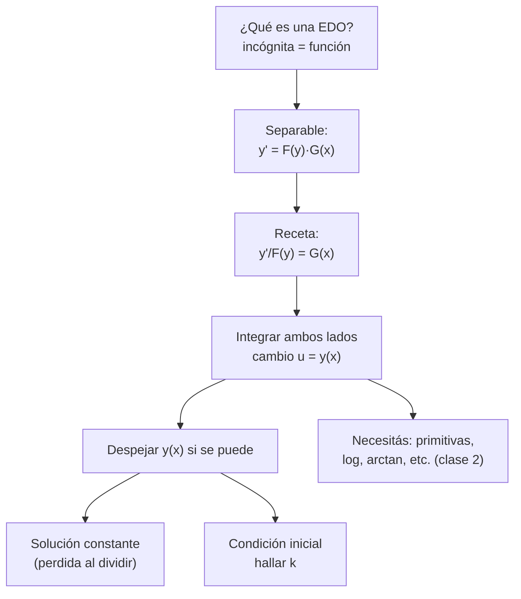
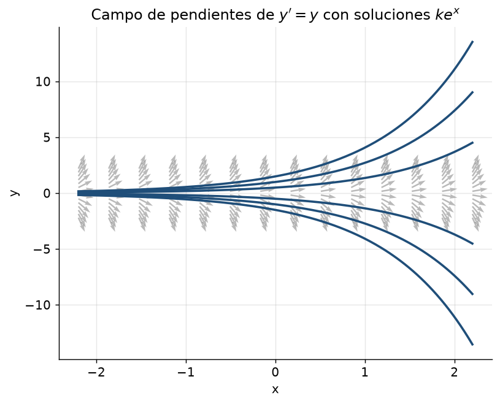

# Clase 9 — EDOs: variables separables

> **Bloque 2 · Ecuaciones diferenciales · Dificultad: media · Tiempo estimado: 100 min**

---

## 🎯 Objetivos

1. **Reconocer** una ecuación diferencial (EDO) y su **orden**.
2. Identificar cuándo una EDO es de **variables separables**: $y'=F(y)\,G(x)$.
3. Resolverlas con la receta **separar → integrar → despejar**.
4. No perder la **solución constante** (la "solución perdida" al dividir).
5. Usar la **condición inicial** para fijar la constante (problema de Cauchy).

> Las separables son las "amigas" del parcial: aparecen casi todos los semestres, y son la base de la logística, el decaimiento radiactivo y las aplicaciones de la clase 10.

---

## 🗺️ Mapa de la clase

---

## 🧱 1. Repaso: ¿qué es una ecuación diferencial?

Una **ecuación diferencial ordinaria (EDO)** es una ecuación donde la incógnita es una **función** $y(x)$ y en la ecuación aparecen sus **derivadas**. Ejemplos:

- $y'(x)=\cos x$ → se resuelve **integrando**: $y(x)=\sin x+C$.
- $y'(x)=y(x)$ → se resuelve **viendo** que la derivada es la función: $y(x)=ke^x$.
- $y''-5y'+6y=0$ → de segundo orden (clases 13–14).

> **Orden** = derivada más alta que aparece. **Solución general** = familia de infinitas soluciones (una constante libre, $k$, $C$, $A$, $B$…). **Problema de Cauchy** = solución general + condición inicial $y(x_0)=y_0$ → queda una sola solución.

Del capítulo 2 de las notas:

> **Geometría.** Si una solución pasa por $(1,2)$, la EDO $y'=f(x,y)$ te dice **con qué pendiente** pasa: $y'(1)=f(1,2)$. Todo el plano queda lleno de "pendientitas" (campo de direcciones); las soluciones son curvas que las respetan.

---

## 📘 2. La receta de variables separables

> **Definición 9.1.** Una EDO de primer orden es de **variables separables** si se puede escribir como
> $$
> y'=F(y)\,G(x)
> $$
> (el lado derecho es un **producto** de una función de $y$ por una de $x$).

**Receta (siempre igual):**

1. **Separar**: $\dfrac{y'}{F(y)}=G(x)$.
2. **Integrar** respecto de $x$ en ambos lados.
3. En la izquierda, hacer el **cambio de variable $u=y(x)$**: como $du=y'(x)dx$, queda $\displaystyle\int\frac{du}{F(u)}$.
4. **Despejar $y(x)$** (si se puede) y agregar la solución general.
5. Buscar **soluciones constantes** que hayamos perdido al dividir.

**Ejemplo (de las notas, Ejemplo 2.1):** $y'=xy$.

$y'=xy$ → (suponiendo $y\ne0$) $\dfrac{y'}{y}=x$ → $\displaystyle\int\frac{y'}{y}dx=\int x\,dx$ → con $u=y(x)$:
$$
\ln|y|=\frac{x^2}{2}+C \Rightarrow |y|=e^{x^2/2}e^C \Rightarrow y=ke^{x^2/2}.
$$
¿Y $y\equiv0$? Hacer $y=0$ en $y'=xy$ da $0=0$ ✔, así que la incluimos con $k=0$:
$$
\boxed{y=ke^{x^2/2},\ k\in\mathbb{R}}
$$

> 💡 **Los dos mensajes de este ejemplo (Observación 2.2 de las notas):** (1) verificar que una función es solución es **fácil** (derivar y sustituir); (2) con condición inicial el valor de $k$ queda **único**.

---

## ✏️ 3. Ejercicios resueltos paso a paso

### Ejercicio 1 (Práctico 1, ej. 1a–1e). Resolver:
$$
\text{a) }y'=2y\qquad \text{b) }y'=xy\qquad \text{c) }y'=y^2\qquad \text{d) }y'=x(1+y^2)\qquad \text{e) }y'=x\sqrt y
$$

**a) $y'=2y$.**
Paso 1: $\dfrac{y'}{y}=2$. Paso 2: $\ln|y|=2x+C$. Paso 3: $y=ke^{2x}$, $k\in\mathbb{R}$. ✔ (incluye $y\equiv0$)

**b) $y'=xy.$** Es el ejemplo de arriba: $\boxed{y=ke^{x^2/2}}$.

**c) $y'=y^2.$**
Paso 1: $\dfrac{y'}{y^2}=1$. Paso 2: $\displaystyle\int y^{-2}dy=\int dx\Rightarrow -y^{-1}=x+C$. Paso 3:
$$
y=-\frac{1}{x+C}.
$$
**Solución constante:** $y\equiv0$ también es solución ✔ (se perdió al dividir por $y^2$). La solución general es $\boxed{y=-\dfrac{1}{x+C}\ \text{ o }\ y\equiv0}$.

**d) $y'=x(1+y^2).$**
Paso 1: $\dfrac{y'}{1+y^2}=x$. Paso 2: $\arctan y=\dfrac{x^2}{2}+C$. Paso 3:
$$
\boxed{y=\tan\left(\frac{x^2}{2}+C\right)}
$$
(Acá no hay solución constante que se pierda: $1+y^2$ nunca se anula.)

**e) $y'=x\sqrt y.$**
Paso 1: $\dfrac{y'}{\sqrt y}=x$, supongamos $y>0$. Paso 2: $\displaystyle\int y^{-1/2}dy=\int x\,dx\Rightarrow 2\sqrt y=\frac{x^2}{2}+C$. Paso 3:
$$
\sqrt y=\frac{x^2}{4}+\frac C2 \Rightarrow \boxed{y=\left(\frac{x^2}{4}+C\right)^2}
$$
**Solución constante:** $y\equiv0$ ✔ (la perdimos al dividir por $\sqrt y$).

> ⚠️ **En cada separación preguntate: "¿dividí por algo que pudiera ser cero?"** Las soluciones constantes que se pierden suelen ser `evaluadas en parciales`. La regla de oro: si dividiste por $F(y)$, chequeá $F(y)=0$ como posible solución constante.

---

### Ejercicio 2 (Práctico 1, ej. 2a–2c). Solución general de:
$$
\text{a) }y'=y^2-1\qquad \text{b) }yy'+1=0\qquad \text{c) }xe^{2y}y'-(1+e^{2y})=0
$$

**a) $y'=y^2-1.$**
Paso 1: separamos $\dfrac{y'}{y^2-1}=1$. Paso 2: por fracciones simples $\dfrac{1}{y^2-1}=\dfrac12\left(\dfrac{1}{y-1}-\dfrac{1}{y+1}\right)$:
$$
\frac12\left(\ln|y-1|-\ln|y+1|\right)=x+C\Rightarrow \ln\left|\frac{y-1}{y+1}\right|=2x+C'.
$$
Paso 3: $\dfrac{y-1}{y+1}=ke^{2x}$ y despejamos $y$:
$$
y-1=ke^{2x}(y+1)\Rightarrow y(1-ke^{2x})=ke^{2x}+1\Rightarrow \boxed{y=\frac{1+ke^{2x}}{1-ke^{2x}}}
$$
**Constantes:** $y=\pm1$ son soluciones ($y'=0$ y $y^2-1=0$ ✔). Se cubren con… $y\equiv1$: de la fórmula con $k=0$ sale $y=1$ ✔; $y=-1$ no sale de la fórmula (hay que mencionarla aparte, o decir que sale como límite $k\to\mp\infty$).

**b) $yy'+1=0.$**
Paso 1: $y\,dy=-dx$. Paso 2: $\dfrac{y^2}{2}=-x+C$. Paso 3:
$$
\boxed{y^2=C-2x\qquad (y=\pm\sqrt{C-2x})}
$$

**c) $xe^{2y}y'-(1+e^{2y})=0.$**
Paso 1: reagrupamos $xe^{2y}y'=1+e^{2y}$ → $\dfrac{e^{2y}y'}{1+e^{2y}}=\dfrac1x$. Paso 2: lado izquierdo con $u=e^{2y}+1$:
$$
\frac12\ln(1+e^{2y})=\ln|x|+C.
$$
Paso 3: $\ln(1+e^{2y})=2\ln|x|+C'$ → $1+e^{2y}=Kx^2$ → 
$$
\boxed{y=\frac12\ln(Kx^2-1)}
$$

---

### Ejercicio 3 (Verificar es más fácil que resolver). Comprobar que $y(x)=ke^{x^2/2}$ es solución de $y'=xy$

**Paso 1.** Derivamos: $y'(x)=k\cdot x\,e^{x^2/2}=x\,y(x)$.

**Paso 2.** La ecuación pedía $y'=xy$ ✔. Listo: cualquier $k$ sirve.

> 💡 Esta "verificación" es la herramienta de los **V/F de examen**: no hace falta resolver, basta derivar y sustituir (lo usamos en las clases 13–15).

---

## 🏛️ 4. Ejercicios de parcial/examen

### Ejercicio 4 (Parcial 1 2020-2S, MO 2). Sea $y(t)$ la solución de $y'=(y+1)t$ con $y(0)=0$. Calcular $y(1)$

**Paso 1.** Separo: $\dfrac{y'}{y+1}=t$.

**Paso 2.** Integro: $\ln|y+1|=\dfrac{t^2}{2}+C$.

**Paso 3.** Despejo: $y+1=ke^{t^2/2}$, o sea
$$
y=ke^{t^2/2}-1.
$$

**Paso 4.** Uso $y(0)=0$: $0=k\cdot e^0-1=k-1\Rightarrow k=1$.

**Paso 5.**
$$
y(t)=e^{t^2/2}-1\Rightarrow y(1)=e^{1/2}-1.
$$

**Respuesta: (A) $y(1)=e^{1/2}-1$. ✔**

---

### Ejercicio 5 (Primer parcial 2022-2S, en el Práctico 1). Sea $y(x)$ la solución de
$$
\frac{y'(x)e^{x^2}}{x}=-2(1+y^2(x)),\qquad y(0)=0.
$$
Calcular $y(\sqrt2)$

**Paso 1.** Despejamos la derivada:
$$
y'=-\frac{2x}{e^{x^2}}(1+y^2)=-2xe^{-x^2}(1+y^2).
$$

**Paso 2.** Separo: $\dfrac{y'}{1+y^2}=-2xe^{-x^2}$.

**Paso 3.** Integro:
$$
\arctan y=e^{-x^2}+C,
$$
porque $\dfrac{d}{dx}e^{-x^2}=-2xe^{-x^2}$.

**Paso 4.** Condición inicial: $y(0)=0\Rightarrow \arctan0=1+C\Rightarrow C=-1$.

**Paso 5.** $y(x)=\tan(e^{-x^2}-1)$, y entonces
$$
y(\sqrt2)=\tan(e^{-2}-1).
$$

**Respuesta: (E) $y(\sqrt2)=\tan(e^{-2}-1)$. ✔**

> 💡 **Truco de exámenes:** cuando la EDO tiene forma rara ($y'e^{x^2}/x=\dots$), **siempre despejá primero $y'$**. Después separar es mecánico.

---

## ⚠️ 5. Errores comunes

| Error | Corrección |
|---|---|
| "Integrar $y'/y\,dx$" escribiendo $\int dy/y$ sin justificar el cambio de variable | siempre hacé el cambio $u=y(x)$, $du=y'\,dx$ |
| Olvidar la solución constante al dividir | chequeá $F(y)=0$ (o $\sqrt y=0$, etc.) |
| Sumar dos constantes distintas | agruparlas en una sola $C$ |
| Poner $k>0$ porque "el log es $>$" | al sacar el módulo la constante puede ser **negativa**; y $k=0$ cubre la solución nula |
| No usar la condición inicial | sin ella te queda la solución general (familia); el parcial siempre pide una sola |
| Resolver $y'=x\sqrt y$ y olvidar que $y\ge0$ por definición | tené en cuenta el dominio de la solución |

---

## 🔗 6. Conexión con el resto del curso

- **Clase 10 (aplicaciones):** caída, poblaciones y represa son **separables disfrazadas**.
- **Clase 11 (lineales homogéneas):** $y'+a(x)y=0$ **es** separable: se resuelve con la misma receta.
- **Clase 12:** el cambio $u=y/x$ convierte ciertas ecuaciones en separables.
- **Clases 13–15:** las EDOs lineales de segundo orden usan las mismas ideas (homogénea + particular).
- **Clase 35 (límites):** $y'=f(x,y)$ con $f$ de dos variables es lo que vamos a estudiar después de topología.

---

## ✅ 7. Autoevaluación

1. Resolver $y'=3y$ con $y(0)=2$.
2. Resolver $y'=y\sin x$.
3. Resolver $y'=\dfrac{x}{y}$ con $y(1)=2$. ¿Dónde está definida la solución?
4. Resolver $y'=xy^2$. ¿Hay solución constante?
5. Mostrar que $y_C(x)=\dfrac{1}{1-Cx}$ es solución de $y'=y^2$.
6. (V/F) Toda solución de $y'=y^2+1$ tiene $\arctan y = x+C$.

Respuestas

1. $y=ke^{3x}$, $k=2\Rightarrow y=2e^{3x}$.
2. $y=ke^{-\cos x}$.
3. $y\,dy=x\,dx\Rightarrow y^2=x^2+C$; con $y(1)=2$: $4=1+C\Rightarrow C=3$, $y=\sqrt{x^2+3}$ (definida en todo $\mathbb{R}$, siempre $>0$).
4. $-\frac1y=\frac{x^2}2+C\Rightarrow y=-\frac{2}{x^2+C}$, más la constante $y\equiv0$.
5. $y'=\frac{C}{(1-Cx)^2}=y^2$ ✔ (derivar y sustituir).
6. **Verdadero**: $\frac{y'}{1+y^2}=1\Rightarrow\arctan y=x+C$ (aquí no hay soluciones constantes que perder).

---

**⬅️ Anterior:** [Clase 8 — Exponencial compleja y Euler](08_exponencial_euler.md) · 🏠 [Índice](00_indice.md) · **➡️ Siguiente:** [Clase 10 — Aplicaciones de las EDOs](10_edo_aplicaciones.md)