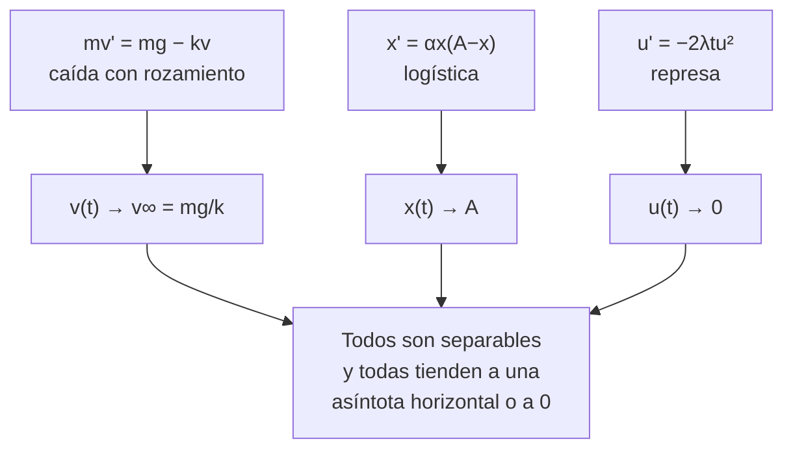
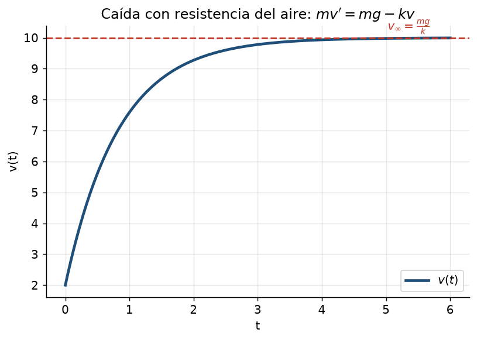
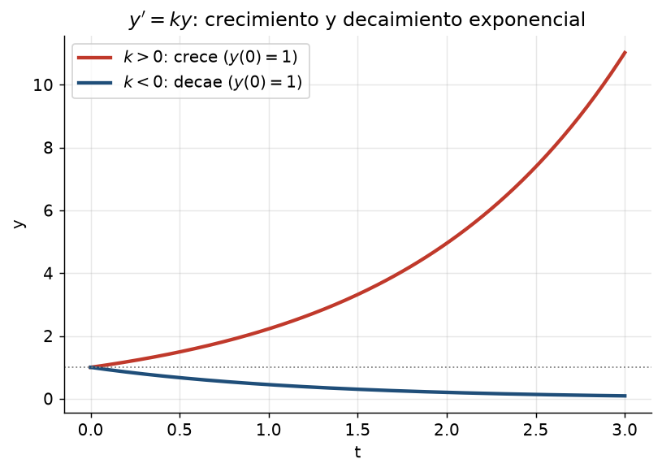
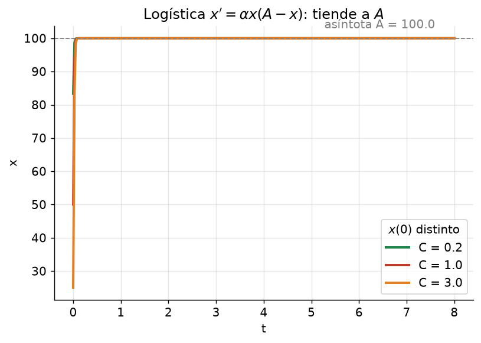
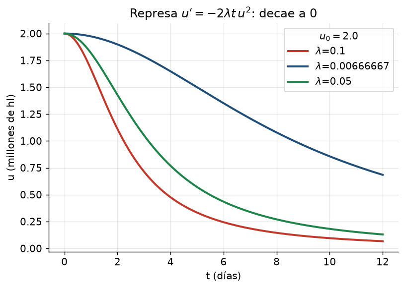

# Clase 10 — Aplicaciones de las EDOs: caída, poblaciones y represa

> **Bloque 2 · Ecuaciones diferenciales · Dificultad: media · Tiempo estimado: 110 min**

---

## 🎯 Objetivos

1. **Modelar** situaciones reales con EDOs (ley de Newton, logística, vaciado de una represa).
2. Resolver los tres problemas clásicos de las **Aplicaciones del Práctico 1**.
3. Calcular **límites** de soluciones ($v_\infty$, población a largo plazo, represa vacía).
4. Interpretar el **papel de cada constante** (masa, $k$, $\alpha$, $\lambda$, $g$) en la solución.

> Este bloque aparece tal cual en parciales: "caída con fricción", "crecimiento de población" y "vaciado de represa" son los tres modelos fijos del Práctico 1. Vale la pena resolverlos **de memoria**, porque la cuenta es corta y los puntos son seguros.

---

## 🗺️ Mapa de la clase

---

## 📘 1. Método general de modelado

Todo problema de aplicación se ataca igual:

1. **Identificar la variable dependiente** (velocidad $v$, población $x$, agua $u$) y la **independiente** (tiempo $t$).
2. **Escribir la EDO** que expresa "la tasa de cambio es igual a …" (acá es donde está el 90% del puntaje).
3. **Resolver** (casi siempre separable o lineal de primer orden).
4. **Usar la condición inicial** y responder las preguntas (límites, tiempos, valores).

> 💡 Los tres modelos de esta clase son la misma familia: **$y'=$ (término que empuja) − (término que frena)**. De ahí salen soluciones que tienden a un **equilibrio** (asíntota).

---

## 🪂 2. Aplicación 1: caída con resistencia del aire (Práctico 1, Aplicación 1)

**Modelo.** Un cuerpo de masa $m$ cae con velocidad $v(t)$. La gravedad empuja con fuerza $mg$; el aire frena con fuerza $kv$ ($k>0$, constante de rozamiento). Por la segunda ley de Newton, **$F=mv'$**, de modo que

$$
mv'=mg-kv.
$$

### a) Hallar $v(t)$ con velocidad inicial $v_0$

**Paso 1.** Despejamos: $v'=g-\dfrac{k}{m}v$. Es separable (y también lineal, clase 11). Escribámosla separando:
$$
\frac{v'}{g-\frac{k}{m}v}=1.
$$

**Paso 2.** Integramos con $u=g-\frac{k}{m}v$, $du=-\frac{k}{m}v'\,dt$:
$$
\int\frac{du}{-k/m}\cdot\frac1u=\int dt\Rightarrow -\frac{m}{k}\ln|g-\frac{k}{m}v|=t+C.
$$

**Paso 3.** Despejamos:
$$
g-\frac{k}{m}v=Ce^{-kt/m}\Rightarrow v=\frac{mg}{k}+Ce^{-kt/m}.
$$

**Paso 4.** Llamamos $v_\infty=\dfrac{mg}{k}$ (¡la velocidad terminal!) y usamos $v(0)=v_0$:
$$
v_0=v_\infty+C\Rightarrow C=v_0-v_\infty.
$$

$$
\boxed{v(t)=v_\infty+(v_0-v_\infty)e^{-kt/m}}
$$

### b) Límite cuando $t\to+\infty$

Como $e^{-kt/m}\to0$ (con $k>0$, $m>0$):
$$
\lim_{t\to+\infty}v(t)=v_\infty=\frac{mg}{k}.
$$

> 💡 **Interpretación física:** cuando la fricción equilibra la gravedad ($kv=mg$), la velocidad se estabiliza en $v_\infty$. Es la **asíntota horizontal** de la solución.

### c) Tiempo hasta alcanzar $\dfrac{v_\infty+v_0}{2}$

Queremos $v(t)=\frac{v_\infty+v_0}{2}$. Sustituimos:
$$
v_\infty+(v_0-v_\infty)e^{-kt/m}=\frac{v_\infty+v_0}{2}\Rightarrow (v_0-v_\infty)e^{-kt/m}=\frac{v_\infty-v_0}{2}
$$
$$
\Rightarrow e^{-kt/m}=\frac12\Rightarrow -\frac{k}{m}t=\ln\frac12\Rightarrow \boxed{t=\frac{m}{k}\ln2}
$$

> 💡 El tiempo de "media distancia al equilibrio" **no depende** de $v_0$ ni de $v_\infty$: es una propiedad del sistema ($m/k$). Estructura típica en estos modelos.

### d) Si $v_0=0$, ¿qué distancia recorre hasta alcanzar $v_\infty/2$?

**Paso 1.** Con $v_0=0$: $v(t)=v_\infty(1-e^{-kt/m})$. Queremos $v=\frac{v_\infty}{2}$:
$$
1-e^{-kt/m}=\frac12\Rightarrow e^{-kt/m}=\frac12\Rightarrow t=\frac{m}{k}\ln2.
$$

**Paso 2.** Distancia = integral de la velocidad:
$$
d=\int_0^{t}v(s)\,ds=\int_0^{t}v_\infty(1-e^{-ks/m})\,ds
=v_\infty\left[t+\frac{m}{k}\left(e^{-kt/m}-1\right)\right].
$$

**Paso 3.** Con $t=\frac{m}{k}\ln2$:
$$
d=v_\infty\left[\frac{m}{k}\ln2+\frac{m}{k}\left(\frac12-1\right)\right]
=\boxed{\frac{m}{k}v_\infty\left(\ln2-\frac12\right)}
$$

---

## 🦠 3. Aplicación 2: evolución de una población (Práctico 1, Aplicación 2)

**Modelo (logística).** Si una población crece a tasa proporcional a su tamaño **pero** el ambiente impone un tope $A$ (capacidad de carga), el modelo clásico es
$$
x'=\alpha x(A-x),\qquad \alpha>0,\ A>0.
$$

> Si falta el tope ($x'=\alpha x$) tenemos **crecimiento exponencial** (figura `b2_crecimiento.png`): $x(t)=x_0e^{\alpha t}$. La logística es la versión **realista** que se satura en $A$.

### a) Probar que ninguna solución tiene extremos relativos

**Paso 1.** Los **equilibrios** (donde $x'=0$): $x=0$ y $x=A$.

**Paso 2.** El signo de $x'=\alpha x(A-x)$ **no cambia** entre equilibrios:
- si $0<x<A$: $x'>0$ (creciente);
- si $x>A$: $x'<0$ (decreciente);
- si $x<0$: $x'<0$.

**Paso 3.** Una solución no cruza los equilibrios (unicidad), así que **el signo de $x'$ es constante** a lo largo de cada solución: o crece siempre o decrece siempre. Por lo tanto **no tiene extremos relativos** (un extremo exigiría que $x'$ cambie de signo). $\blacksquare$

### b) Límite de la solución con $x(0)=A/2$

**Paso 1.** Resolvemos (es separable): $\dfrac{x'}{x(A-x)}=\alpha$, y con fracciones simples $\dfrac1{x(A-x)}=\dfrac1A\left(\dfrac1x+\dfrac1{A-x}\right)$:
$$
\frac1A\left(\ln x-\ln(A-x)\right)=\alpha t+C\Rightarrow \ln\frac{x}{A-x}=\alpha A\,t+C'.
$$
$$
\frac{x}{A-x}=Ke^{\alpha A t}\Rightarrow x= \frac{AK e^{\alpha A t}}{1+Ke^{\alpha A t}}=\frac{A}{1+Ce^{-\alpha A t}}.
$$

**Paso 2.** Con $x(0)=A/2$:
$$
\frac{A}{1+C}=\frac{A}{2}\Rightarrow C=1\Rightarrow x(t)=\frac{A}{1+e^{-\alpha A t}}.
$$

**Paso 3.** $\lim_{t\to+\infty}x(t)=\dfrac{A}{1+0}=A$. ✔

### c) Tiempo para que la población $\dfrac{A}{2}$ crezca un 50 %

Partiendo de $A/2$, crecer 50 % significa llegar a $\frac32\cdot\frac A2=\frac{3A}{4}$. Queremos $t$ con
$$
\frac{A}{1+e^{-\alpha A t}}=\frac{3A}{4}\Rightarrow 1+e^{-\alpha A t}=\frac43\Rightarrow e^{-\alpha A t}=\frac13\Rightarrow \boxed{t=\frac{\ln3}{\alpha A}}
$$

---

## 💧 4. Aplicación 3: vaciado de una represa (Práctico 1, Aplicación 3)

**Modelo.** Con los diques abiertos, la cantidad de agua $u(t)$ evoluciona según
$$
u'=-2\lambda t\,u^2,\qquad \lambda>0.
$$
(El agua sale más rápido cuanta más hay, y la apertura modifica $\lambda$.)

### a) Solución con $u(0)=u_0>0$

Separamos: $\dfrac{u'}{u^2}=-2\lambda t$:
$$
-\frac1u=-\lambda t^2+C\Rightarrow u=\frac{1}{\lambda t^2+C'}.
$$
Con $u(0)=u_0$: $\frac1{C'}=u_0\Rightarrow C'=\frac1{u_0}$. Entonces
$$
\boxed{u(t)=\frac{u_0}{1+\lambda u_0\,t^2}}
$$

### b) Límite

$$
\lim_{t\to+\infty}\frac{u_0}{1+\lambda u_0 t^2}=0.
$$
La represa se vacía (a "velocidad de cola": como $1/t^2$, lento al final).

### c) Valor de $\lambda$ para que $u(T)=u_1$

$$
u_1=\frac{u_0}{1+\lambda u_0T^2}\Rightarrow 1+\lambda u_0 T^2=\frac{u_0}{u_1}\Rightarrow \boxed{\lambda=\frac{u_0-u_1}{u_0\,u_1\,T^2}}
$$

### d) Caso concreto: $u_0=2$, $u_1=1{,}5$, $T=5$

$$
\lambda=\frac{2-1{,}5}{2\cdot1{,}5\cdot25}=\frac{0{,}5}{75}=\frac1{150}.
$$

**Respuesta: $\lambda=\dfrac1{150}$** ✔ (coincide con la del Práctico 1).

---

## 🏛️ 5. Preguntas típicas de examen sobre estos modelos

### Pregunta 1 (modelo): se da $mv'=mg-kv$ y $v(0)=v_0$. ¿Cuál es $v_\infty$?

**Respuesta rápida:** el equilibrio se halla con $v'=0$: $mg-kv_\infty=0\Rightarrow v_\infty=\frac{mg}{k}$. La solución general siempre es
$$
v(t)=v_\infty+(v_0-v_\infty)e^{-kt/m}.
$$

### Pregunta 2 (modelo): en la logística $x'=\alpha x(A-x)$ con $x(0)=x_0$, ¿converge a qué si $0<x_0<A$?

A $A$ (creciendo), porque $x'>0$ en $(0,A)$ y la única asíntota estable es $x=A$. Si $x_0>A$, decrece a $A$ también.

### Pregunta 3 (modelo): en la represa, ¿qué pasa si $\lambda\to0$?

$u(t)\to u_0$ (no se vacía): la cota cerrada. Con $\lambda$ chico el vaciado es lentísimo.

> 💡 **Para el parcial:** memorizá las **tres soluciones** (caja con $\boxed{}$) y las **tres asíntotas**: $v\to mg/k$, $x\to A$, $u\to 0$.

---

## ⚠️ 6. Errores comunes

| Error | Corrección |
|---|---|
| Escribir $mv'=mg+kv$ (suma en vez de resta) | la fricción **frena**: menos |
| Confundir $v_\infty$ con $v_0$ al despejar | primero hallá el equilibrio $v'=0$ |
| Decir "la población tiende a infinito" | la logística tiende a $A$ (capacidad de carga) |
| Olvidar que $u(t)>0$ siempre | en $u$ se divide por $1+\lambda u_0t^2>0$ |
| Integrar $u'/u^2$ como si fuera $\ln$ | $\int u^{-2}du=-u^{-1}$ |
| No usar las unidades ($\lambda$ en $1/$[días·hl]) | chequeá que el resultado tenga sentido físico |

---

## 🔗 7. Conexión con el resto del curso

- **Clase 9:** todas estas EDOs son **separables**; la receta es la misma.
- **Clase 11 (lineales):** $mv'=mg-kv$ también se puede resolver como lineal de primer orden (la clase 12 lo aprovecha).
- **Clase 13:** las oscilaciones (resorte, circuito) son EDOs de segundo orden con las **mismas** estructuras de equilibrio.
- **Límites de sucesiones (clase 16)** y **series (clase 21):** la forma $1/(1+\lambda u_0t^2)$ y las asíntotas se justifican con límites.

---

## ✅ 8. Autoevaluación

1. En $mv'=mg-kv$, con $m=1$, $g=10$, $k=2$, $v(0)=0$: hallar $v_\infty$, $v(t)$ y el tiempo para llegar a $v_\infty/2$.
2. Logística $x'=2x(5-x)$ con $x(0)=1$: hallar $\lim x(t)$ y el tiempo para duplicar la población inicial.
3. Represa con $u_0=3$, $\lambda=0{,}2$: hallar $u(10)$.
4. Si en la caída $v_0=v_\infty$, ¿qué pasa?
5. En la logística, si $x(0)=2A$, ¿la población crece o decrece? ¿A qué tiende?

Respuestas

1. $v_\infty=10\cdot1/2=5$; $v(t)=5(1-e^{-2t})$; $t=\frac12\ln2$.
2. $\lim_{t\to\infty}x(t)=A=5$; solución $x(t)=\dfrac{5}{1+C e^{-10t}}$ con $x(0)=1\Rightarrow C=4$: $x(t)=\dfrac{5}{1+4e^{-10t}}$. Duplicar de $1$ a $2$: $\dfrac{5}{1+4e^{-10t}}=2\Rightarrow 4e^{-10t}=\dfrac32\Rightarrow t=\dfrac1{10}\ln\dfrac83$.
3. $u(10)=\dfrac{3}{1+0{,}2\cdot3\cdot100}=\dfrac{3}{61}\approx0{,}049$.
4. $v(t)=v_\infty$ constante: fricción y gravedad ya se equilibran desde el inicio.
5. Decrece (porque $x'>0$ solo en $(0,A)$; con $x>A$, $x'<0$) y tiende a $A$ desde arriba.

---

**⬅️ Anterior:** [Clase 9 — Variables separables](09_edo_separables.md) · **➡️ Siguiente:** [Clase 11 — Lineales de 1er orden: homogénea](11_edo_lineal_1er_orden_homogenea.md)