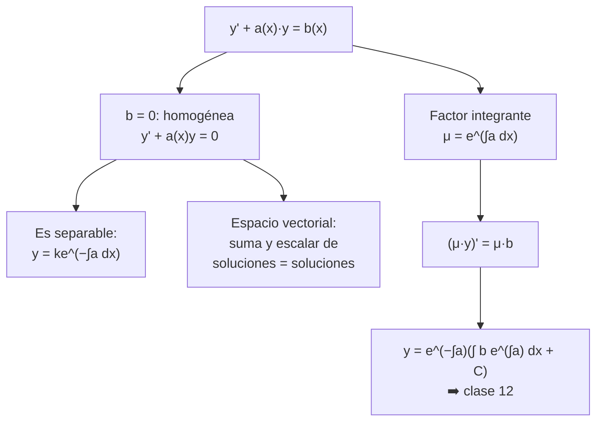
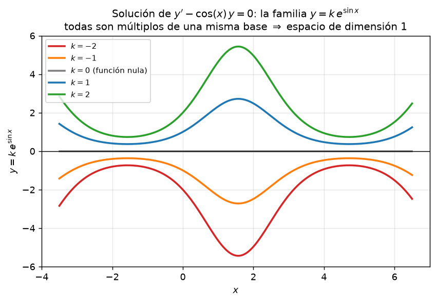

# Clase 11 — EDOs lineales de primer orden: homogénea y factor integrante

> **Bloque 2 · Ecuaciones diferenciales · Dificultad: media · Tiempo estimado: 100 min**

---

## 🎯 Objetivos

1. Reconocer la forma general **$y'+a(x)y=b(x)$** y distinguir homogénea ($b=0$) de no homogénea.
2. Resolver la **homogénea** como ecuación separable: $y=ke^{-\int a(x)\,dx}$.
3. Entender el **espacio vectorial de soluciones** de la homogénea (suma y múltiplos siguen siendo soluciones).
4. Aprender el **factor integrante** $\mu(x)=e^{\int a(x)\,dx}$, que convierte la ecuación en una derivada de un producto.
5. Obtener la **fórmula general** $y=e^{-\int a}\left(\int b\,e^{\int a}dx+C\right)$.

> La no homogénea completa la resolvemos en la clase 12 (variación de constantes + la fórmula de acá). Acá construimos la herramienta.

---

## 🗺️ Mapa de la clase

---

## 🧱 1. Repaso: ¿qué es "lineal"?

**Lineal** en este contexto significa que $y$ y sus derivadas aparecen **combinadas linealmente** (ni $y^2$, ni $e^y$, ni $y\,y'$). Las notas lo dicen con un ejemplo:

- $y'+a(x)y=b(x)$ es **lineal**.
- $y'+(y)^2=x$ **no** es lineal (el $y^2$).

La **homogénea** es cuando el lado derecho es cero:
$$
y'(x)+a(x)y(x)=0.
$$
La **no homogénea** es cuando $b(x)\ne0$ (la resolvemos en la clase 12).

> Nota de las notas: para estas ecuaciones supondremos que **existen soluciones y son únicas** dado un dato inicial (condición de Cauchy). El curso no demuestra existencia/unicidad; eso es del curso de EDOs posterior.

---

## 📘 2. Homogénea: es separable

La ecuación $y'+a(x)y=0$ se reescribe
$$
y'=-a(x)y,
$$
que es de **variables separables** (clase 9). Separando e integrando:

$$
\frac{y'}{y}=-a(x)\Rightarrow \ln|y|=-\int a(x)\,dx+C\Rightarrow \boxed{\,y(x)=ke^{-\int a(x)\,dx}\,}
$$

**Ojo con el caso $y\equiv0$:** es solución y queda cubierta con $k=0$.

**Ejemplo (notas).** $y'-\cos(x)y=0$: aquí $a(x)=-\cos x$, o sea $y'=y\cos x$, y separando:
$$
\frac{y'}{y}=\cos x\Rightarrow \ln|y|=\sin x+C\Rightarrow y=ke^{\sin x}.
$$
**Verificación:** $y'=k\cos x\,e^{\sin x}=\cos x\cdot y$ ✔.

---

## 📐 3. Espacio vectorial de soluciones

> **Propiedad (importante para V/F).** El conjunto de soluciones de $y'+a(x)y=0$ es un **espacio vectorial** de dimensión 1:
> - la función nula es solución;
> - si $y_1$ e $y_2$ son soluciones, entonces **$y_1+y_2$** es solución;
> - si $y$ es solución, **$\lambda y$** es solución para todo $\lambda\in\mathbb{R}$.

**Demostración de la parte de la suma** (copiando las notas, por si preguntan):
Si $y_1'\raisebox{0.7ex}{$\,$}+a y_1=0$ e $y_2'+a y_2=0$, entonces para $y=y_1+y_2$:
$$
y'+ay=(y_1'+y_2')+a(y_1+y_2)=(y_1'+ay_1)+(y_2'+ay_2)=0+0=0.\ \blacksquare
$$

> 💡 Por eso todas las soluciones son $k\cdot e^{-\int a}$: es un espacio de **dimensión 1**, con base $\{e^{-\int a}\}$.

---

## 📘 4. Factor integrante (y la fórmula general de una vez)

Queremos resolver $y'+a(x)y=b(x)$ **con $b$ cualquiera**. La idea mágica:

1. Buscamos una función $\mu(x)$ tal que
   $$
   \mu\,y'+\mu\,a\,y=(\mu\,y)'.
   $$
2. Eso ocurre si $\mu'=\mu a$, es decir $\mu=e^{\int a(x)\,dx}$. (Este $\mu$ se llama **factor integrante**.)
3. Multiplicamos la ecuación por $\mu$:
   $$
   e^{\int a}y'+a\,e^{\int a}y=b\,e^{\int a}\Rightarrow \left(e^{\int a}y\right)'=b\,e^{\int a}.
   $$
4. Integramos y despejamos:

$$
\boxed{\,y(x)=e^{-\int a(x)\,dx}\left(\int b(x)\,e^{\int a(x)\,dx}\,dx+C\right)\,}
$$

> Para la **homogénea** ($b=0$) la integral se anula y queda $y=Ce^{-\int a}$, lo de la sección 2. La fórmula generaliza todo.

**Ejemplo (notas, Ej. 2.7).** $y'-\cos(x)y=\cos(x)$.
- Homogénea: $y_H=ke^{\sin x}$.
- Factor integrante: $\mu=e^{\int(-\cos x)dx}=e^{-\sin x}$.
- Aplicamos la fórmula:
$$
y=e^{\sin x}\!\left(\int e^{-\sin x}\cos x\,dx+C\right)=e^{\sin x}\!\left(e^{-\sin x}+C\right)=1+Ce^{\sin x}.
$$
- Las notas la escriben como $y=2e^{\sin x}-1$ cuando exigen $y(0)=1$ ($C=2$).

> ⚠️ Notá: las notas resuelven la no homogénea con **variación de constantes** (clase 12) y obtienen exactamente lo mismo: **homogénea + particular** (Teorema 2.6). El factor integrante es el atajo que da la misma respuesta.

---

## ✏️ 5. Ejercicios resueltos paso a paso

### Ejercicio 1 (Práctico 1, ej. 4a-1). Resolver $y'+y\cos x=0$

**Paso 1.** Es homogénea con $a(x)=\cos x$.

**Paso 2.** $y=ke^{-\int\cos x\,dx}=ke^{-\sin x}$.

**Respuesta:** $\boxed{y=ke^{-\sin x}}$

---

### Ejercicio 2 (Práctico 1, ej. 4a-2). Resolver $x(x-1)y'+(1-2x)y=0$, $x\ne0,1$

**Paso 1.** Pasamos a la forma estándar dividiendo por $x(x-1)$:
$$
y'+\frac{1-2x}{x(x-1)}\,y=0.
$$

**Paso 2.** Descomponemos en fracciones simples:
$$
\frac{1-2x}{x(x-1)}=-\frac{1}{x}-\frac{1}{x-1},
$$
porque $-\dfrac1x-\dfrac1{x-1}=\dfrac{-(x-1)-x}{x(x-1)}=\dfrac{1-2x}{x(x-1)}$ ✔.

**Paso 3.** Con $a(x)=-\frac1x-\frac1{x-1}$:
$$
\int a\,dx=-\ln|x|-\ln|x-1|=-\ln|x(x-1)|\Rightarrow y=ke^{-(-\ln|x(x-1)|)}=ke^{\ln|x(x-1)|}=\boxed{k\,x(x-1)}
$$

**Verificación:** $y=k\,x(x-1)\Rightarrow y'=k(2x-1)$; sustituyendo:
$$
x(x-1)\cdot k(2x-1)+(1-2x)\cdot k\,x(x-1)=k\,x(x-1)\big[(2x-1)-(2x-1)\big]=0\ \checkmark
$$

---

### Ejercicio 3 (Práctico 1, ej. 4a-3). Resolver $y'-\dfrac{2}{x}y=0$

**Paso 1.** $a(x)=-\frac2x$, $\int a\,dx=-2\ln|x|=\ln(x^{-2})$.

**Paso 2.**
$$
y=ke^{-\ln(x^{-2})}=k\,x^2.
$$

**Respuesta:** $\boxed{y=kx^2}$ (dominio natural $x>0$ o $x<0$).

---

### Ejercicio 4 (fórmula general en acción). Resolver $y'+y=x$ con factor integrante simple

**Paso 1.** $a=1$, $\mu=e^{x}$.

**Paso 2.** Multiplicamos: $(e^xy)'=xe^x$.

**Paso 3.** Integramos (por partes): $\int xe^xdx=(x-1)e^x+C$.

**Paso 4.**
$$
y=e^{-x}\left((x-1)e^x+C\right)=\boxed{x-1+Ce^{-x}}
$$

> 💡 Patrón de toda la teoría: **no homogénea = homogénea + particular**. Acá $Ce^{-x}$ es la homogénea y $x-1$ la particular.

---

## 🏛️ 6. Ejercicio de parcial

### Ejercicio 5 (Parcial 1 2021-2S, V/F 4). $y'-\cos(x)y=0$: si $y_1$ e $y_2$ son soluciones, ¿$y_1+y_2$ es solución?

**Paso 1.** Es la ecuación **homogénea** con $a(x)=-\cos x$. Su conjunto de soluciones es un **espacio vectorial** (sección 3).

**Paso 2.** Por lo tanto sí: $y_1+y_2$ es solución.

**Verificación directa (sin teoría):**
$$
(y_1+y_2)'-\cos x\,(y_1+y_2)=(y_1'-\cos x y_1)+(y_2'-\cos x y_2)=0+0=0.\ \blacksquare
$$

**Respuesta: VERDADERO.**

> ⚠️ La trampa clásica es preguntarlo para **$y''+5y'+6y=6x$ por ejemplo** (no homogénea): ahí $y_1+y_2$ **no** es solución (la suma de dos particulares no lo es). Siempre aclarar si la ecuación es homogénea o no.

---

## ⚠️ 7. Errores comunes

| Error | Corrección |
|---|---|
| Resolver $y'+a y=b$ como separable "integrando $y$ aparte" | solo la **homogénea** es separable; la no homogénea necesita factor integrante o variación de constantes |
| Olvidar el signo: escribir $e^{\int a}$ en lugar de $e^{-\int a}$ en la homogénea | homogénea \(y'=-ay\): exponente **$-\int a$** |
| Multiplicar por el factor integrante pero olvidar multiplicar **también** el lado derecho | la ecuación se multiplica **toda** |
| Ignorar constantes en $\int a\,dx$ | la $C$ global ya absorbe todo; pero no mezclar exponentes que dependan de los límites |
| Aplicar la fórmula cuando $a(x)$ no está "suelta" | primero dejar la ecuación en la forma $y'+a(x)y=b(x)$ (dividir si hace falta) |

---

## 🔗 8. Conexión con el resto del curso

- **Clase 12:** no homogéneas con **variación de constantes** y el **cambio $u=y/x$**.
- **Clase 13:** las de segundo orden tienen la misma estructura (homogénea = espacio de dimensión 2 + particular).
- **Clase 10:** $mv'=mg-kv$ es lineal de primer orden: se puede resolver con la fórmula de esta clase.
- **Clase 21 (series):** la exponencial $e^{\int a}$ y las primitivas aparecen también al resolver EDOs por series (fuera del programa, pero conecta).

---

## ✅ 9. Autoevaluación

1. Resolver $y'+2xy=0$.
2. Resolver $y'+y=0$ con $y(0)=3$.
3. Resolver $y'-\dfrac{y}{x}=0$ (¿cuál es el dominio?).
4. Con la fórmula general, resolver $y'+y=e^{-x}\cos x$.
5. (V/F) Si $y_1,y_2$ son soluciones de $y'-xy=0$, entonces $2y_1-3y_2$ también es solución. ¿Se puede afirmar lo mismo para $y'-xy=x$?

Respuestas

1. $y=ke^{-x^2}$.
2. $y=3e^{-x}$.
3. $y=kx$ (con $x\ne0$ o en un intervalo que no contenga 0).
4. Con $a=1$, $\mu=e^x$: $(e^x y)'=\cos x\Rightarrow e^x y=\sin x+C\Rightarrow y=e^{-x}(\sin x+C)$.
5. **Verdadero** para la homogénea (espacio vectorial); para $y'-xy=x$ (no homogénea) **no** se puede: $y_1+y_2$ daría $2x$ en el lado derecho.

---

**⬅️ Anterior:** [Clase 10 — Aplicaciones de las EDOs](10_edo_aplicaciones.md) · 🏠 [Índice](00_indice.md) · **➡️ Siguiente:** [Clase 12 — No homogénea y cambio u=y/x](12_edo_no_homogenea_u_yx.md)