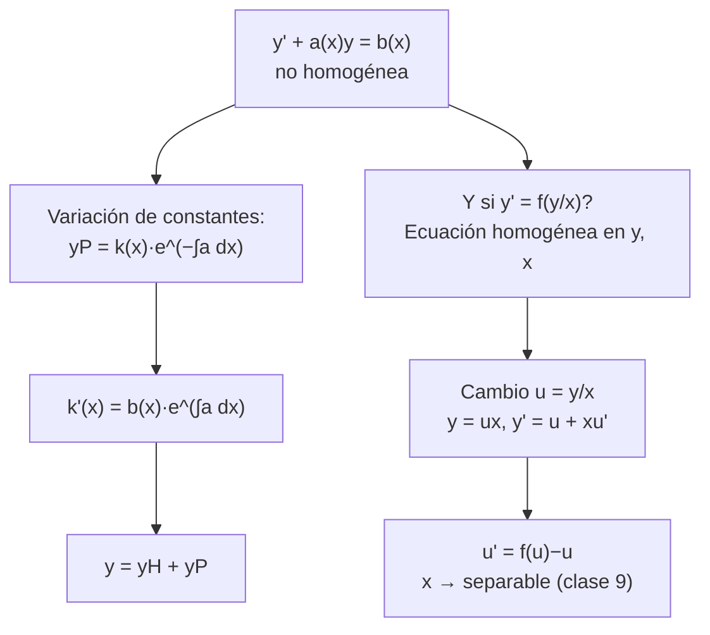

# Clase 12 — EDOs no homogéneas de primer orden y el cambio u = y/x

> **Bloque 2 · Ecuaciones diferenciales · Dificultad: media-alta · Tiempo estimado: 110 min**

---

## 🎯 Objetivos

1. Resolver $y'+a(x)y=b(x)$ **no homogénea** con la **variación de constantes** (método de las notas).
2. Aplicar la estructura **general = homogénea + particular**.
3. Resolver ecuaciones del tipo **$y'=f(y/x)$** mediante el cambio $\boxed{u=y/x}$, llevándolas a separables.
4. Distinguir cuándo conviene variación de constantes y cuándo el cambio.

---

## 🗺️ Mapa de la clase

---

## 🧱 1. Repaso de 20 segundos

De la clase 11 tenés la **homogénea**:

$$
y'+a(x)y=0 \Longrightarrow y_H=ke^{-\int a(x)\,dx},
$$

y el **factor integrante** $\mu=e^{\int a\,dx}$, que convierte la ecuación en $(e^{\int a}y)'=b\,e^{\int a}$ y da la fórmula cerrada. En la clase de hoy vas a ver el método que usan las notas oficiales — **variación de constantes** — y vas a comprobar que da exactamente lo mismo.

---

## 📘 2. Variación de constantes (método oficial, notas §2.2)

**Idea.** La homogénea da $y_H=ke^{-\int a}$. Para la no homogénea buscamos soluciones con la **misma forma**, pero dejando **variar** la constante:

$$
y_P(x)=k(x)\,e^{-\int a(x)\,dx}.
$$

**Paso a paso:**

1. Derivo (regla del producto + Teorema Fundamental del Cálculo):
$$
y_P'=k'e^{-\int a}+k\,e^{-\int a}(-a)=k'e^{-\int a}-a\,k\,e^{-\int a}=k'e^{-\int a}-a\,y_P.
$$

2. Sustituyo en $y'+ay=b$:
$$
\underbrace{k'e^{-\int a}-a\,y_P}_{y_P'}+\underbrace{a\,y_P}_{ay}=b.
$$
Los dos últimos términos **se cancelan** (¡por eso funcionó la elección de la forma!) y queda:

3. $$
\boxed{k'(x)=b(x)\,e^{\int a(x)\,dx}} \Longrightarrow k(x)=\int b(x)\,e^{\int a(x)\,dx}\,dx+C.
$$

4. La solución general es
$$
\boxed{y(x)=\left(\int b(x)e^{\int a(x)\,dx}\,dx+C\right)e^{-\int a(x)\,dx}}
$$
…exactamente la fórmula de la clase 11. ✔ **Ahora sabés de dónde sale.**

**Ejemplo completísimo (notas §2.2): $y'-\cos(x)\,y=\cos(x)$ con $y(0)=1$.**
- Homogénea: $y'-\cos(x)y=0\Rightarrow y_H=ke^{\sin x}$.
- Buscamos $y_P=k(x)e^{\sin x}$. Con $a=-\cos x$ tenemos $e^{\int a}=e^{-\sin x}$, así que
$$
k'(x)=b\,e^{\int a}=\cos(x)\,e^{-\sin x}.
$$
- Integramos: como $\dfrac{d}{dx}e^{-\sin x}=(-\cos x)e^{-\sin x}$, se tiene
$$
k(x)=\int\cos x\,e^{-\sin x}dx=-e^{-\sin x}+C.
$$
- $y_P=(-e^{-\sin x}+C)e^{\sin x}=-1+Ce^{\sin x}$.
- Con $y(0)=1$: $-1+C=1\Rightarrow C=2$:
$$
\boxed{y=2e^{\sin x}-1}
$$
(es la solución de las notas).

---

## ✏️ 3. Ejercicios resueltos paso a paso

### Ejercicio 1 (Práctico 1, ej. 4b-1). Resolver $y'+y\cos x=\cos x\,\sin x$

**Paso 1.** Homogénea (clase 11): $y'+y\cos x=0\Rightarrow y_H=ke^{-\sin x}$.

**Paso 2.** Variación de constantes: $y_P=k(x)e^{-\sin x}$. Acá $a=\cos x$, $e^{\int a}=e^{\sin x}$.

**Paso 3.** $k'(x)=b\,e^{\int a}=\cos x\,\sin x\,e^{\sin x}$.

**Paso 4.** Con $u=\sin x$, $du=\cos x\,dx$:
$$
k(x)=\int\cos x\,\sin x\,e^{\sin x}dx=\int u\,e^u\,du=(u-1)e^u=(\sin x-1)e^{\sin x}+C.
$$

**Paso 5.**
$$
y=(\sin x-1)e^{\sin x}e^{-\sin x}+Ce^{-\sin x}=\boxed{\sin x-1+Ce^{-\sin x}}.
$$

**Verificación rápida:** $y'=\cos x-C\cos x\,e^{-\sin x}$, así que
$$
y'+y\cos x=\big[\cos x-C\cos x\,e^{-\sin x}\big]+\big[\sin x-1+Ce^{-\sin x}\big]\cos x=\cos x\,\sin x\ \checkmark
$$
(los términos con $C$ se cancelan).

---

### Ejercicio 2 (Práctico 1, ej. 4b-2). Resolver $x(x-1)y'+(1-2x)y+x^2=0$

**Paso 1.** Forma estándar: $y'+\dfrac{1-2x}{x(x-1)}\,y=-\dfrac{x}{x-1}$ (¡no olvidar el $x^2$ dividido!).

**Paso 2.** Fracciones simples (clase 11): $\dfrac{1-2x}{x(x-1)}=-\dfrac1x-\dfrac1{x-1}$, o sea $a(x)=-\dfrac1x-\dfrac1{x-1}$, con $\int a=-\ln|x(x-1)|$, $e^{\int a}=\dfrac1{x(x-1)}$ (tomando $x>0$ para limpiar módulos).

**Paso 3.** $k'(x)=b\,e^{\int a}=-\dfrac{x}{x-1}\cdot\dfrac1{x(x-1)}=-\dfrac1{(x-1)^2}$.

**Paso 4.** $k(x)=\displaystyle\int-\frac{dx}{(x-1)^2}=\frac{1}{x-1}+C$.

**Paso 5.** Como $e^{-\int a}=e^{\ln|x(x-1)|}=x(x-1)$:
$$
y=\left(\frac1{x-1}+C\right)x(x-1)=\frac{x(x-1)}{x-1}+C\,x(x-1)=\boxed{x+C\,x(x-1)}.
$$
O, escrito como $C\,x^2+(1-C)x$, que deja ver la **particular** $x$ y la **homogénea** $C\,x(x-1)$.

> 💡 Chequeo rápido: $y=x+C\,x(x-1)$ resuelve la homogénea cuando $C$ varía… no; el término $x$ es la particular y $C\,x(x-1)$ la homogénea (que coincide con el ej. 4a-2 de la clase 11).

---

### Ejercicio 3 (Práctico 1, ej. 4b-3). Resolver $y'-\dfrac{2}{x}y=x^4$

**Paso 1.** $a=-\dfrac2x$, $e^{\int a}=e^{-2\ln x}=x^{-2}$.

**Paso 2.** $k'(x)=x^4\cdot x^{-2}=x^2\Rightarrow k(x)=\dfrac{x^3}{3}+C$.

**Paso 3.**
$$
y=\left(\frac{x^3}{3}+C\right)x^2=\boxed{\frac{x^5}{3}+Cx^2}.
$$

---

> 🧠 **Resumen del método (para hacer rápido en el parcial):**
> 1) homogénea $y_H=ke^{-\int a}$; 2) $k'=b\,e^{\int a}$; 3) $y=e^{-\int a}\left(\int b\,e^{\int a}dx+C\right)$.

---

## 📘 4. El cambio $\boxed{u=y/x}$ (ecuaciones "homogéneas" en el sentido de Euler)

Hay ecuaciones de primer orden que **no** son lineales ni separables en la forma $y'=F(y)G(x)$, pero que se **comportan bien con el cambio $u=y/x$**:

> Si la ecuación se puede escribir $y'=f\left(\dfrac{y}{x}\right)$ (el lado derecho depende solo del **cociente** $y/x$), hacemos
> $$
> u=\frac{y}{x}\ \Longleftrightarrow\ y=ux,\qquad y'=u+xu'.
> $$
> Al sustituir queda $u+xu'=f(u)$, o sea $\dfrac{u'}{f(u)-u}=\dfrac1x$: **separables en $u$** (clase 9).

> ⚠️ **Cómo reconocer $f(y/x)$:** todos los términos de $y'$ tienen $x$ e $y$ con el **mismo grado total**. Ej: $y'=\dfrac{xy-y^2}{x^2}$ (grado 2 arriba y abajo), o $y'=\dfrac{x-y}{x+y}$ (grado 1).

---

### Ejercicio 4 (Práctico 1, ej. 3a). Resolver $x^2y'+y(y-x)=0$

**Paso 1.** Despejamos $y'$:
$$
y'=\frac{y(x-y)}{x^2}=\frac{y}{x}-\left(\frac{y}{x}\right)^2.
$$
¡Forma $f(y/x)$! Hacemos $u=y/x$:

**Paso 2.** $y=ux$, $y'=u+xu'$:
$$
u+xu'=u-u^2\Rightarrow xu'=-u^2.
$$

**Paso 3.** Separamos e integramos (para $u\ne0$):
$$
-\frac{u'}{u^2}=\frac1x\Rightarrow \frac1u=\ln|x|+C.
$$

**Paso 4.**
$$
u=\frac{1}{\ln|x|-C}\Rightarrow \boxed{\,y=\frac{x}{\ln|x|-C}\,}
$$
(solución con $x\ne0$, $x\ne e^{C}$). **Ojo:** $u\equiv0$ (o sea $y\equiv0$) también es solución, perdida al dividir por $u^2$.

---

### Ejercicio 5 (Práctico 1, ej. 3b). Resolver $(x+y)y'=x-y$

**Paso 1.** $y'=\dfrac{x-y}{x+y}=\dfrac{1-\frac yx}{1+\frac yx}$. Cambio $u=y/x$:
$$
u+xu'=\frac{1-u}{1+u}\Rightarrow xu'=\frac{1-u}{1+u}-u=\frac{1-u-u-u^2}{1+u}=\frac{1-2u-u^2}{1+u}.
$$

**Paso 2.** Separamos:
$$
\frac{1+u}{1-2u-u^2}\,du=\frac{dx}{x}.
$$

**Paso 3.** Integramos. Con $v=u+1$: $1-2u-u^2=2-(u+1)^2=2-v^2$ y $1+u=v$, de modo que
$$
\int\frac{1+u}{1-2u-u^2}du=\int\frac{v}{2-v^2}dv=-\frac12\ln|2-v^2|
=-\frac12\ln|2-(u+1)^2|.
$$

**Paso 4.** Igualamos a $\ln|x|+C$ y despejamos:
$$
-\frac12\ln|2-(u+1)^2|=\ln|x|+C\Rightarrow \ln|2-(u+1)^2|=-2\ln|x|+C'
$$
$$
\Rightarrow 2-(u+1)^2=\frac{K}{x^2}\Rightarrow (u+1)^2=2-\frac{K}{x^2}.
$$

**Paso 5.** Volvemos a $y=ux$ (para $x>0$):
$$
\frac{y}{x}+1=\pm\frac{\sqrt{2x^2-K}}{x}\Rightarrow \boxed{\,y=-x\pm\sqrt{2x^2-K}\,},\quad K\in\mathbb{R}.
$$

**Chequeo parcial:** si $K=0$, $y=-x\pm\sqrt2x$ → $y'=-1\pm\sqrt2$ y $(x+y)y'=(x\mp? )$… la verificación completa queda como ejercicio; la forma implícita $(u+1)^2=2-K/x^2$ es igualmente válida como respuesta.

---

## 🏛️ 5. Problema tipo (para practicar el método)

### Ejercicio 6 (problema tipo). La solución de $y'=\dfrac{y^2+x^2}{xy}$ con $y(1)=1$. Calcular $y(e)$

**Paso 1.** Reescribimos:
$$
y'=\frac{y^2+x^2}{xy}=\frac{y}{x}+\frac{x}{y}=u+\frac1u,
$$
con $u=y/x$. (Todo el lado derecho depende de $u$.) ✔

**Paso 2.** $y'=u+xu'$:
$$
u+xu'=u+\frac1u\Rightarrow xu'=\frac1u\Rightarrow u\,u'=\frac1x.
$$

**Paso 3.** $\dfrac{u^2}{2}=\ln|x|+C$. Con $x=1$: $u(1)=y(1)/1=1$ → $\frac12=C$. Entonces
$$
u^2=2\ln x+1.
$$

**Paso 4.** $y=xu=x\,\sqrt{2\ln x+1}$ (raíz positiva pues $u(1)=1>0$). Evaluamos en $x=e$:
$$
y(e)=e\sqrt{2\ln e+1}=e\sqrt{3}.
$$

**Respuesta: $y(e)=e\sqrt{3}$.** ✔

---

## ⚠️ 6. Errores comunes

| Error | Corrección |
|---|---|
| En la forma estándar, olvidar que $b(x)$ también se divide | $y'+ay=b$ exige dividir **todo** por el coeficiente de $y'$ |
| Aplicar el cambio $u=y/x$ cuando la ecuación **no** es de la forma $f(y/x)$ | chequeá grados homogéneos antes (ningún término suelto, p. ej. $y'=y/x+x^2$) |
| Olvidar la solución $y\equiv0$ (o $u\equiv0$) al dividir por $u^n$ | siempre revisar los ceros de lo que dividiste |
| Escribir $y'=u+xu'$ como $y'=u'$ | el cambio es $y=ux$; $u$ depende de $x$ |
| Dejar $k(x)$ sin integrar | $k'=be^{\int a}$ **siempre** se integra; la $C$ de esa integral es la constante de la general |
| Confundir "ecuación homogénea $y'+ay=0$" con "ecuación de $f(y/x)$" | son dos cosas distintas con la misma palabra; el contexto te dice cuál es |

---

## 🔗 7. Conexión con el resto del curso

- **Clase 9:** el cambio $u=y/x$ termina en una **separables**; insistí con la receta separar→integrar→despejar.
- **Clase 10:** la caída $mv'=mg-kv$ se puede resolver con la fórmula de esta clase (es lineal no homogénea).
- **Clase 11:** esta clase reusa su factor integrante/formula; la variación de constantes es la "prueba" de esa fórmula.
- **Clase 13-14:** la *misma* estructura (homogénea + particular) rige para segundo orden.
- **Clase 35+:** cuando $y'=f(x,y)$ con $f$ arbitraria de dos variables, estudiaremos existencia, unicidad y puntos de equilibrio (teoría de EDO del otro módulo).

---

## ✅ 8. Autoevaluación

1. Resolver $y'-2xy=2x$ (pista: $b=2x$).
2. Resolver $y'+y=\cos x$.
3. Resolver $y'=\dfrac{y}{x}+\dfrac{x}{y}$ con $u=y/x$.
4. Resolver $xy'=y+x^2$ de **dos maneras**: (a) como lineal de primer orden; (b) con el cambio $u=y/x$. ¿Coinciden?
5. (V/F) En la variación de constantes, $k'(x)$ se obtiene sustituyendo $y_P$ en la ecuación homogénea.

Respuestas

1. $a=-2x$, $e^{\int a}=e^{-x^2}$; $k'=2xe^{-x^2}\Rightarrow k=-e^{-x^2}+C$; $y=-1+Ce^{x^2}$.
2. $a=1$, $e^x$: $k'=\cos x\,e^x\Rightarrow k=\frac{e^x(\cos x+\sin x)}2$; $y=\frac{\cos x+\sin x}2+Ce^{-x}$.
3. $u'x=1/u\Rightarrow u^2=2\ln|x|+C$; $y=x\sqrt{2\ln|x|+C}$.
4. (a) Lineal $y'-\frac yx=x$, $e^{\int a}=1/x$: $(\frac yx)'=1\Rightarrow y=Cx+x^2$. (b) $u=y/x$: $u+xu'=u+x\Rightarrow u'=1\Rightarrow u=x+C\Rightarrow y=x^2+Cx$. **Coinciden.** (Ojo: acá el cambio funciona porque los $u$ se cancelan; el método está *garantizado* solo para $y'=f(y/x)$.)
5. **Falso**: $k'=be^{\int a}$, con $b$ del lado derecho **no homogéneo**; en la homogénea $k'$ daría 0.

---

**⬅️ Anterior:** [Clase 11 — Lineales de 1er orden homogénea](11_edo_lineal_1er_orden_homogenea.md) · **➡️ Siguiente:** [Clase 13 — EDOs de 2.º orden homogéneas](13_edo_2do_orden_homogeneas.md)