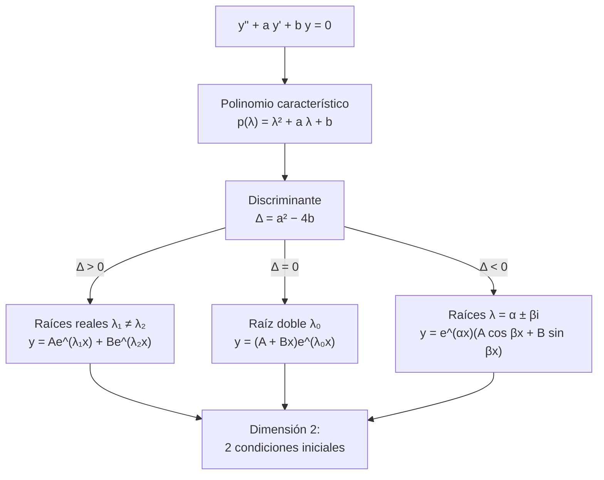
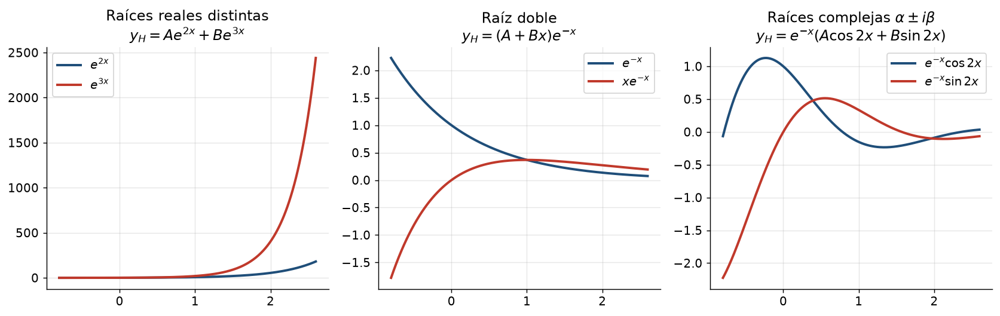
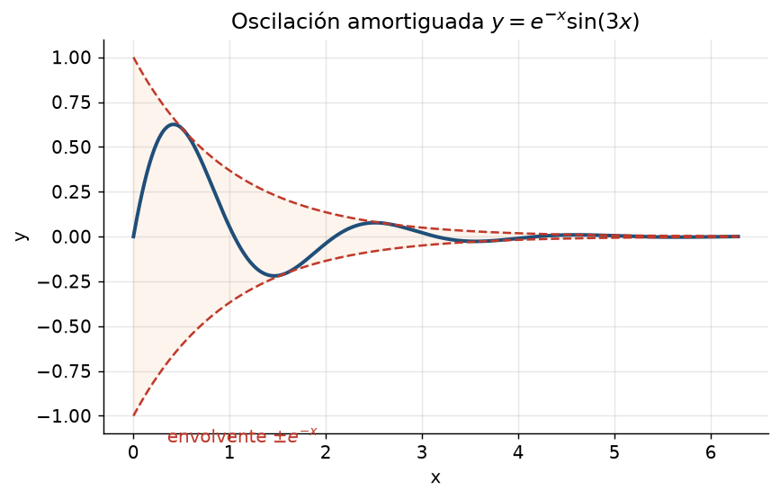

# Clase 13 — EDOs de 2.º orden homogéneas: los tres casos

> **Bloque 2 · Ecuaciones diferenciales · Dificultad: media · Tiempo estimado: 110 min**

---

## 🎯 Objetivos

1. Reconocer la EDO lineal de **segundo orden a coeficientes constantes**: $y''+ay'+by=0$.
2. Construir el **polinomio característico** $p(\lambda)=\lambda^2+a\lambda+b$ y ver que sus raíces **clasifican** la solución.
3. Escribir la solución general en los **tres casos**: raíces reales distintas, raíz doble, raíces complejas.
4. Resolver **problemas de valores iniciales** (PVI) con dos condiciones $y(x_0)=p$, $y'(x_0)=q$.
5. Entender por qué el espacio de soluciones tiene **dimensión 2** (base de dos funciones).

---

## 🗺️ Mapa de la clase

---

## 🧱 1. Repaso: de dónde viene el "polinomio característico"

Una EDO **lineal de segundo orden a coeficientes constantes** tiene la forma
$$
y''(x)+a\,y'(x)+b\,y(x)=h(x),
$$
con $a,b\in\mathbb{R}$. La **homogénea** es cuando $h\equiv0$:
$$
y''+a y'+b y=0. \tag{$\star$}
$$

**La idea genial (notas §2.3.1):** inspirados en la homogénea de primer orden (donde la solución era $e^{\lambda x}$), **probamos** $y=e^{\lambda x}$. Derivamos: $y'=\lambda e^{\lambda x}$, $y''=\lambda^2 e^{\lambda x}$. Sustituimos en $(\star)$:
$$
\lambda^2e^{\lambda x}+a\lambda e^{\lambda x}+be^{\lambda x}=e^{\lambda x}\underbrace{(\lambda^2+a\lambda+b)}_{p(\lambda)}=0.
$$
Como $e^{\lambda x}\neq0$ **siempre**, lo que se anula es el paréntesis:

> **Definición 13.1 (polinomio característico).** $p(\lambda)=\lambda^2+a\lambda+b$.

Las raíces de $p$ **clasifican** las soluciones. Como $p$ tiene coeficientes reales, sus dos raíces (contando multiplicidad) son reales o complejas conjugadas: de ahí salen los **tres casos**.

---

## 📘 2. Los tres casos (con la justificación)

### Caso 1 — Dos raíces reales distintas ($\Delta=a^2-4b>0$)

Si $p(\lambda_1)=p(\lambda_2)=0$ con $\lambda_1\neq\lambda_2$, entonces $y_1=e^{\lambda_1x}$ e $y_2=e^{\lambda_2x}$ son **dos** soluciones y son **linealmente independientes** (no son múltiplos una de la otra). Como el espacio de soluciones tiene dimensión 2:
$$
\boxed{\,y_H(x)=Ae^{\lambda_1x}+Be^{\lambda_2x}\,}
$$

### Caso 2 — Una raíz real doble ($\Delta=0$)

Si $\lambda_0=-a/2$ es raíz doble, $y_1=e^{\lambda_0x}$ es solución, pero necesitamos **otra** independiente. Se verifica (derivando y sustituyendo) que
$$
y_2(x)=x\,e^{\lambda_0x}
$$
también es solución e independiente de $y_1$. Entonces
$$
\boxed{\,y_H(x)=Ae^{\lambda_0x}+Bx\,e^{\lambda_0x}=(A+Bx)e^{\lambda_0x}\,}
$$

### Caso 3 — Raíces complejas conjugadas ($\Delta<0$)

Si $\lambda=\alpha\pm\beta i$, la exponencial compleja (clase 8) da
$$
e^{(\alpha+\beta i)x}=e^{\alpha x}\big(\cos(\beta x)+i\sin(\beta x)\big).
$$
Su **parte real** y su **parte imaginaria** son soluciones reales, y son independientes:
$$
y_1=e^{\alpha x}\cos(\beta x),\qquad y_2=e^{\alpha x}\sin(\beta x).
$$
Entonces
$$
\boxed{\,y_H(x)=e^{\alpha x}\big(A\cos(\beta x)+B\sin(\beta x)\big)\,}
$$

> 💡 **Por qué aparecen cos y sin:** el "descartes" de Euler (complejos) nos deja dos soluciones reales. Este es el puente directo con el **Bloque 1**.

> 💡 En el caso 3 la solución **oscila** (cos y sen) dentro de una **envolvente** $e^{\alpha x}$. Si $\alpha<0$, oscila y se apaga: eso es una **oscilación amortiguada** (resortes, circuitos RLC).

---

## ✏️ 3. Ejercicios resueltos paso a paso

### Ejercicio 1 (Práctico 1, ej. 5a). Hallar la solución general

**a) $y''-5y'+6y=0.$**

Paso 1: $p(\lambda)=\lambda^2-5\lambda+6=(\lambda-2)(\lambda-3)$, raíces $\lambda_1=2$, $\lambda_2=3$ (caso 1).

Paso 2:
$$
\boxed{y=Ae^{2x}+Be^{3x}}
$$

**b) $y''+y'=0.$**

Paso 1: $p(\lambda)=\lambda^2+\lambda=\lambda(\lambda+1)$, raíces $\lambda_1=0$, $\lambda_2=-1$ (caso 1; ojo, una raíz es 0 → aparece $e^{0x}=1$).

Paso 2:
$$
\boxed{y=A+Be^{-x}}
$$

**c) $y''+4y'+5y=0.$**

Paso 1: $p(\lambda)=\lambda^2+4\lambda+5$. Discriminante $16-20=-4<0$, raíces
$$
\lambda=\frac{-4\pm\sqrt{-4}}2=-2\pm i\Rightarrow \alpha=-2,\ \beta=1\ (\text{caso 3}).
$$

Paso 2:
$$
\boxed{y=e^{-2x}(A\cos x+B\sin x)}
$$

**d) $y''+2y'+y=0.$**

Paso 1: $p(\lambda)=\lambda^2+2\lambda+1=(\lambda+1)^2$, raíz doble $\lambda_0=-1$ (caso 2).

Paso 2:
$$
\boxed{y=(A+Bx)e^{-x}}
$$

---

### Ejercicio 2 (Práctico 1, ej. 5b). Resolver los PVI

**Paso general:** escribir la solución general (2 constantes), derivar, imponer las dos condiciones y resolver el sistema lineal $2\times2$.

**1) $y''-5y'+6y=0,\quad y(1)=e^2,\quad y'(1)=3e^2.$**

Paso 1: solución general $y=Ae^{2x}+Be^{3x}$ (ej. 1a).

Paso 2: condiciones:
$$
y(1)=Ae^2+Be^3=e^2,\qquad y'(1)=2Ae^2+3Be^3=3e^2.
$$
Dividiendo por $e^2$: $A+Be=1$ y $2A+3Be=3$. De la primera $A=1-Be$; sustituyo: $2-2Be+3Be=3\Rightarrow Be=1\Rightarrow B=e^{-1}$, $A=0$.

Paso 3:
$$
\boxed{y=e^{3x-1}}
$$

**2) $y''-6y'+5y=0,\quad y(0)=3,\quad y'(0)=11.$**

Paso 1: $p=\lambda^2-6\lambda+5=(\lambda-1)(\lambda-5)\Rightarrow y=Ae^{x}+Be^{5x}$.

Paso 2: $y(0)=A+B=3$; $y'(0)=A+5B=11$. Restando: $4B=8\Rightarrow B=2$, $A=1$.

Paso 3:
$$
\boxed{y=e^{x}+2e^{5x}}
$$

**3) $y''+4y'+5y=0,\quad y(0)=1,\quad y'(0)=0.$**

Paso 1: del ej. 1c, $y=e^{-2x}(A\cos x+B\sin x)$.

Paso 2: derivamos (regla del producto):
$$
y'=e^{-2x}\big[(-2A+B)\cos x+(-2B-A)\sin x\big].
$$
En $x=0$: $y(0)=A=1$ y $y'(0)=-2A+B=B-2=0\Rightarrow B=2$.

Paso 3:
$$
\boxed{y=e^{-2x}(\cos x+2\sin x)}
$$

**4) $y''+8y'-9y=0,\quad y(1)=2,\quad y'(1)=0.$**

Paso 1: $p=\lambda^2+8\lambda-9=(\lambda+9)(\lambda-1)\Rightarrow y=Ae^{-9x}+Be^{x}$.

Paso 2:
$$
y(1)=Ae^{-9}+Be=2,\qquad y'(1)=-9Ae^{-9}+Be=0.
$$
De la segunda, $Be=9Ae^{-9}$. Sustituyo en la primera: $Ae^{-9}+9Ae^{-9}=10Ae^{-9}=2\Rightarrow A=\dfrac{e^9}{5}$, y $B=\dfrac{9Ae^{-9}}{e}=\dfrac{9}{5e}$.

Paso 3:
$$
\boxed{y=\frac{e^{9-9x}}{5}+\frac{9e^{x-1}}{5}=\frac{e^9}{5}e^{-9x}+\frac{9}{5e}e^{x}}
$$

---

## 🏛️ 4. Ejercicios de parcial/examen

### Ejercicio 3 (Examen julio 2022, V/F 5). ¿La función $y=e^{3x}\sin(2x)$ es solución de $y''-6y'+13y=0$?

**Método 1 (rápido, con la teoría).** El polinomio característico es $\lambda^2-6\lambda+13$. Discriminante $36-52=-16<0$, raíces
$$
\lambda=\frac{6\pm4i}2=3\pm2i\Rightarrow \alpha=3,\ \beta=2.
$$
Por el caso 3, **todas** las soluciones son $e^{3x}(A\cos2x+B\sin2x)$. La función dada es $e^{3x}\sin(2x)$, que corresponde a $A=0,B=1$: **es solución**.

**Método 2 (verificación directa, a prueba de dudas).** De $y=e^{3x}\sin2x$:
$$
y'=3e^{3x}\sin2x+2e^{3x}\cos2x=e^{3x}(3\sin2x+2\cos2x),
$$
$$
y''=e^{3x}\big[(3\sin2x+2\cos2x)\cdot3+(3\cdot2\cos2x-2\cdot2\sin2x)\big]
=e^{3x}(5\sin2x+12\cos2x).
$$
Entonces
$$
y''-6y'+13y=e^{3x}\big[(5\sin2x+12\cos2x)-6(3\sin2x+2\cos2x)+13\sin2x\big]
$$
$$
=e^{3x}\big[(5-18+13)\sin2x+(12-12)\cos2x\big]=0.\ \checkmark
$$

**Respuesta: VERDADERO.** ✔

---

### Ejercicio 4 (Examen febrero 2020, ej. 2). Resolver $y''=-ky$ con $k>0$

**Paso 1.** Reescribimos como $y''+ky=0$ ($a=0$, $b=k$).

**Paso 2.** $p(\lambda)=\lambda^2+k=0\Rightarrow\lambda=\pm i\sqrt k$: raíces complejas puras $\alpha=0$, $\beta=\sqrt k$ (caso 3).

**Paso 3.**
$$
\boxed{y(x)=c_1\cos(\sqrt k\,x)+c_2\sin(\sqrt k\,x)}
$$

**Respuesta:** es la del examen, con $\beta=\sqrt k$. (Físicamente: el **oscilador armónico** sin amortiguamiento: oscila para siempre.)

---

### Ejercicio 5 (estructura, para pensar). Si $y_1$ e $y_2$ son soluciones de $y''+ay'+by=0$, ¿$y_1+y_2$ lo es? ¿$2y_1-3y_2$?

**Sí a ambas.** El operador $L[y]=y''+ay'+by$ es **lineal**, así que
$$
L[y_1+y_2]=L[y_1]+L[y_2]=0,\qquad L[2y_1-3y_2]=2L[y_1]-3L[y_2]=0.
$$
El conjunto de soluciones es un **espacio vectorial de dimensión 2**; de ahí que hagan falta exactamente **dos** condiciones iniciales. ✔

---

## ⚠️ 5. Errores comunes

| Error | Corrección |
|---|---|
| Escribir $\lambda=\dfrac{-a\pm\sqrt{a^2-4b}}{2}$ con signo cambiado en $b$ | el polinomio es $\lambda^2+a\lambda+b$; discriminante $a^2-4b$ |
| En el caso de raíz doble, escribir $Ae^{\lambda_0x}+Be^{\lambda_0x}$ | falta la $x$: $\;(A+Bx)e^{\lambda_0x}$ |
| En el caso complejo, olvidar la exponencial real $e^{\alpha x}$ | la solución lleva $e^{\alpha x}(\dots)$, no solo cos y sen |
| Poner $\cos(\beta x)$ con $\beta$ mal calculado | $\beta$ es la **parte imaginaria** (con su signo), no $\sqrt{|\Delta|}/2$ a secas (es lo mismo, ¡pero cuidado con $i$!) |
| Usar la solución general (2 constantes) con una sola condición inicial | hacen falta **dos** datos (típicamente $y$ e $y'$) |
| Confundir raíz $\lambda=0$ con "no hay solución" | $e^{0x}=1$ es la solución constante; el término va como constante $A$ |
| Derivar mal el producto $e^{-2x}(A\cos x+B\sin x)$ | regla del producto + agrupación de cos y sen |

---

## 🔗 6. Conexión con el resto del curso

- **Clase 8 (Euler):** el caso complejo **es** la exponencial compleja aplicada; sin Bloque 1, no se entiende.
- **Clase 14:** la no homogénea es "esta solución + una particular"; primero hay que dominar **estos tres casos**.
- **Clase 15:** repaso consolidado con ejercicios de parcial.
- **Clase 2 (derivadas):** regla del producto y de la cadena son la herramienta de los PVI.
- **Física:** $y''+ay'+by$ modela resortes ($m x''+ c x'+kx=0$), amortiguamiento (caso complejo con $\alpha<0$), y circuitos. El **oscilador armónico** es $y''+\omega^2 y=0$.

---

## ✅ 7. Autoevaluación

1. Resolver $y''-9y=0$.
2. Resolver $y''-6y'+9y=0$ con $y(0)=2$, $y'(0)=0$.
3. Resolver $y''+4y=0$.
4. Resolver $y''+2y'+10y=0$ (¿oscila? ¿se apaga?).
5. Hallar $a$ para que $y''+ay'+(a-1)y=0$ tenga raíz doble y resolver.
6. (V/F) La función $y=e^{-x}\cos(2x)$ resuelve $y''+2y'+5y=0$.

Respuestas

1. $\lambda=\pm3$: $y=Ae^{3x}+Be^{-3x}$.
2. $\lambda=3$ doble, $y=(A+Bx)e^{3x}$; $y(0)=A=2$, $y'(0)=B+3A=0\Rightarrow B=-6$: $y=(2-6x)e^{3x}$.
3. $\lambda=\pm2i$: $y=A\cos2x+B\sin2x$.
4. $\lambda=-1\pm3i$: $y=e^{-x}(A\cos3x+B\sin3x)$: **oscila y se apaga** (envolvente $e^{-x}$).
5. Disco nulo: $a^2-4(a-1)=a^2-4a+4=(a-2)^2=0\Rightarrow a=2$; entonces $\lambda_0=-1$ y $y=(A+Bx)e^{-x}$.
6. $\lambda^2+2\lambda+5=0\Rightarrow\lambda=-1\pm2i$, así que las soluciones son $e^{-x}(A\cos2x+B\sin2x)$: **verdadero**.

---

**⬅️ Anterior:** [Clase 12 — No homogénea de 1.er orden y cambio u=y/x](12_edo_no_homogenea_u_yx.md) · 🏠 [Índice](00_indice.md) · **➡️ Siguiente:** [Clase 14 — EDOs de 2.º orden no homogéneas](14_edo_2do_orden_no_homogeneas.md)