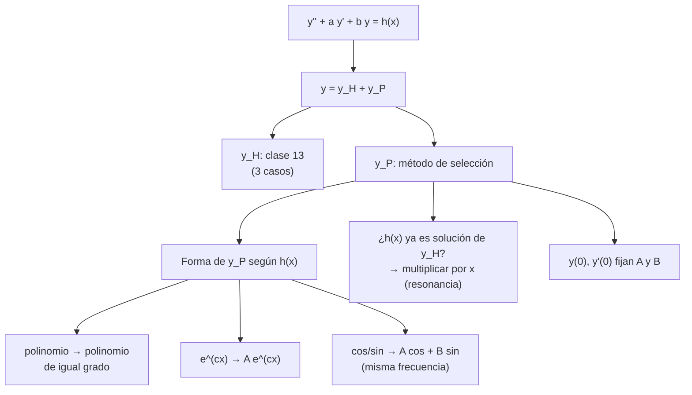

# Clase 14 — EDOs de 2.º orden no homogéneas: coeficientes indeterminados

> **Bloque 2 · Ecuaciones diferenciales · Dificultad: alta · Tiempo estimado: 130 min**

---

## 🎯 Objetivos

1. Aplicar la **estructura** de la solución general de $y''+ay'+by=h(x)$: **general de la homogénea + una particular**.
2. Encontrar una **solución particular** por el **método de selección** (coeficientes indeterminados) según la forma de $h(x)$.
3. Manejar el **caso de resonancia** (cuando la "adivinanza" ya es solución de la homogénea): multiplicar por $x$.
4. Resolver los PVI del Práctico 1, ej. 9.
5. Resolver los problemas de elección múltiple con $y''+ay'+by=r(x)$.

> Es la clase más larga del bloque. La buena noticia: el método es **una tabla** + resolver un sistemita. La clave está en elegir bien la forma de $y_P$.

---

## 🗺️ Mapa de la clase

---

## 📘 1. Estructura de la solución (Teorema)

El resultado central de las notas (§2.3, §2.3.2):

> **Teorema 14.1.** La solución general de $y''+ay'+by=h(x)$ es
> $$
> \boxed{\,y(x)=y_H(x)+y_P(x)\,}
> $$
> donde $y_H$ es la solución **general de la homogénea** (clase 13, con $A$ y $B$ libres) e $y_P$ es **una** solución particular cualquiera.

**Por qué:** si $y$ e $y_P$ resuelven la misma no homogénea, entonces $y-y_P$ resuelve la homogénea (por linealidad), así que $y=y_H+y_P$. ✔

**Ejemplo del curso (notas §2.3.2):**
$$
y''-5y'+6y=6x^2-4x+3.
$$
La homogénea (ejemplo 2.10) es $y_H=Ae^{2x}+Be^{3x}$. Para la particular **probamos un polinomio cuadrático** $y_P=ax^2+bx+c$, con
$$
y_P'=2ax+b,\qquad y_P''=2a.
$$
Sustituyendo:
$$
2a-5(2ax+b)+6(ax^2+bx+c)=6x^2-4x+3.
$$
Agrupando:
$$
6ax^2+(6b-10a)x+(6c-5b+2a)=6x^2-4x+3,
$$
de donde $a=1$, $b=1$, $c=1$. Así
$$
y=Ae^{2x}+Be^{3x}+x^2+x+1.
$$

---

## 📊 2. La tabla del método de selección

El lado derecho $h(x)$ dice **qué forma** darle a $y_P$:

| Si $h(x)$ es… | se propone $y_P$ de la forma… |
|---|---|
| un polinomio de grado $n$ | un polinomio de grado $n$: $a_nx^n+\dots+a_1x+a_0$ |
| $Ce^{cx}$ | $Ae^{cx}$ |
| $C\cos(\omega x)$ o $C\sin(\omega x)$ | $A\cos(\omega x)+B\sin(\omega x)$ (¡siempre **ambos**!) |
| suma de los anteriores | suma de las formas correspondientes |

> ⚠️ **Regla de oro (resonancia).** Si la forma propuesta ya es **solución de la homogénea**, multiplicá por $x$ (y si sigue siéndolo, por $x^2$). Ejemplo: $y''+y=\cos x$; como $\cos x$ resuelve la homogénea, hay que probar $y_P=x(A\cos x+B\sin x)$.

**Razonamiento de la tabla (por qué funciona):** derivar un polinomio da un polinomio; derivar $e^{cx}$ da $e^{cx}$; derivar senos/cosenos da senos/cosenos. Como el operador es una combinación lineal, **la familia de $h$ se "reproduce"**. Por eso se prueba dentro de esa misma familia.

---

## ✏️ 3. Ejercicios resueltos paso a paso (Práctico 1, ej. 9)

### Ejercicio 1 (ej. 9d). $y''+y=3x^2-5x,\quad y(0)=1,\ y'(0)=0$

**Paso 1 — homogénea.** $p(\lambda)=\lambda^2+1=0\Rightarrow\lambda=\pm i$ (caso 3 con $\alpha=0,\beta=1$):
$$
y_H=A\cos x+B\sin x.
$$

**Paso 2 — particular.** $h$ es un polinomio de grado 2, proponemos $y_P=ax^2+bx+c$. Entonces $y_P''=2a$ y
$$
y_P''+y_P=2a+ax^2+bx+c=ax^2+bx+(2a+c)=3x^2-5x+0.
$$
Comparando coeficientes: $a=3$, $b=-5$, $2a+c=0\Rightarrow c=-6$. Así
$$
y_P=3x^2-5x-6.
$$

**Paso 3 — general.**
$$
y=3x^2-5x-6+A\cos x+B\sin x.
$$

**Paso 4 — condiciones iniciales.** $y(0)=-6+A=1\Rightarrow A=7$. Derivando $y'=6x-5-A\sin x+B\cos x$, y $y'(0)=-5+B=0\Rightarrow B=5$.

$$
\boxed{y=7\cos x+5\sin x+3x^2-5x-6}
$$

---

### Ejercicio 2 (ej. 9g). $y''+2y'+y=x,\quad y(0)=0,\ y'(0)=0$

**Paso 1 — homogénea.** $p=(\lambda+1)^2$, raíz doble: $y_H=(A+Bx)e^{-x}$.

**Paso 2 — particular.** Polinomio de grado 1: $y_P=ax+b$, con $y_P'=a$, $y_P''=0$:
$$
0+2a+(ax+b)=ax+(2a+b)=x\Rightarrow a=1,\ 2+b=0\Rightarrow b=-2.
$$
$y_P=x-2$.

**Paso 3 — general.** $y=(A+Bx)e^{-x}+x-2$.

**Paso 4 — PVI.** $y(0)=A-2=0\Rightarrow A=2$. Derivando:
$$
y'=Be^{-x}-(A+Bx)e^{-x}+1,
$$
$y'(0)=B-A+1=0\Rightarrow B=A-1=1$.

$$
\boxed{y=(2+x)e^{-x}+x-2}
$$

---

### Ejercicio 3 (ej. 9a). $y''+2y'+2y=\cos(2x),\quad y(0)=1,\ y'(0)=0$

**Paso 1 — homogénea.** $p=\lambda^2+2\lambda+2=0\Rightarrow\lambda=-1\pm i$:
$$
y_H=e^{-x}(A\cos x+B\sin x).
$$

**Paso 2 — particular.** $h=\cos(2x)$ (frecuencia 2, **distinta** de la homogénea): probamos $y_P=a\cos2x+b\sin2x$. Con
$$
y_P'=-2a\sin2x+2b\cos2x,\qquad y_P''=-4a\cos2x-4b\sin2x,
$$
sustituimos:
$$
y_P''+2y_P'+2y_P=(-4a+4b+2a)\cos2x+(-4b-4a+2b)\sin2x
$$
$$
=(-2a+4b)\cos2x+(-4a-2b)\sin2x.
$$
Queremos que esto sea $\cos2x$:
$$
\begin{cases}-2a+4b=1\\ -4a-2b=0\end{cases}
$$
De la segunda $b=-2a$. En la primera: $-2a-8a=1\Rightarrow a=-\tfrac1{10}$, $b=\tfrac15$. Entonces
$$
y_P=-\tfrac1{10}\cos2x+\tfrac15\sin2x.
$$

**Paso 3 — general.**
$$
y=e^{-x}(A\cos x+B\sin x)-\tfrac1{10}\cos2x+\tfrac15\sin2x.
$$

**Paso 4 — PVI.** $y(0)=A-\tfrac1{10}=1\Rightarrow A=\tfrac{11}{10}$. Derivando y evaluando en 0:
$$
y'=e^{-x}[(-A+B)\cos x+(-A-B)\sin x]+\tfrac25\sin2x+\tfrac25\cos2x,
$$
$$
y'(0)=-A+B+\tfrac25=0\Rightarrow B=A-\tfrac25=\tfrac{11}{10}-\tfrac4{10}=\tfrac7{10}.
$$

$$
\boxed{y=e^{-x}\!\left(\tfrac{11}{10}\cos x+\tfrac7{10}\sin x\right)-\tfrac1{10}\cos2x+\tfrac15\sin2x}
$$

---

### Ejercicio 4 (ej. 9h). $y''+y=\cos x$ — ¡resonancia! $\quad y(0)=0,\ y'(0)=1$

**Paso 1 — homogénea.** $y_H=A\cos x+B\sin x$.

**Paso 2 — particular (aquí está la trampa).** La "adivinanza" natural $a\cos x+b\sin x$ **ya es homogénea** → no puede funcionar. Aplicamos la **regla de resonancia**: multiplicamos por $x$:
$$
y_P=x(a\cos x+b\sin x).
$$
Derivamos (regla del producto):
$$
y_P'=(a\cos x+b\sin x)+x(-a\sin x+b\cos x),
$$
$$
y_P''=(-a\sin x+b\cos x)+(-a\sin x+b\cos x)+x(-a\cos x-b\sin x)
=2(-a\sin x+b\cos x)-x(a\cos x+b\sin x).
$$
Entonces
$$
y_P''+y_P=2(-a\sin x+b\cos x)-x(a\cos x+b\sin x)+x(a\cos x+b\sin x)=2(-a\sin x+b\cos x).
$$
Queremos $\cos x$: $-2a\sin x+2b\cos x=\cos x\Rightarrow a=0,\ b=\tfrac12$. Así
$$
y_P=\tfrac{x}{2}\sin x.
$$

**Paso 3 — general.**
$$
y=A\cos x+B\sin x+\tfrac{x}{2}\sin x.
$$

**Paso 4 — PVI.** $y(0)=A=0$. Derivando:
$$
y'=-A\sin x+B\cos x+\tfrac12(\sin x+x\cos x),
$$
$y'(0)=B=1$. Entonces
$$
\boxed{y=\left(1+\tfrac{x}{2}\right)\sin x}
$$

> 💡 **Reconocé la resonancia:** siempre que $h(x)$ sea de la **misma familia** que las soluciones de la homogénea (misma frecuencia, o mismo exponencial), hay que multiplicar por $x$. Sin la $x$, el sistema de coeficientes no tiene solución.

---

### Ejercicio 5 (ej. 9e, superposición — guiado). $y''+4y'+3y=3e^{x}+x,\quad y(0)=1,\ y'(0)=0$

**Paso 1.** $p=\lambda^2+4\lambda+3=(\lambda+1)(\lambda+3)$: $y_H=Ae^{-x}+Be^{-3x}$.

**Paso 2.** $h$ es suma ($3e^x+x$). Por **superposición**, buscamos particular para cada término:
- $3e^x$: $y_{P1}=Ce^{x}$; $(1+4+3)C=3\Rightarrow C=\tfrac38$.
- $x$: $y_{P2}=ax+b$; $0+4a+3(ax+b)=3ax+(4a+3b)=x\Rightarrow a=\tfrac13$, $b=-\tfrac49$.

$$
y_P=\tfrac38e^{x}+\tfrac13x-\tfrac49.
$$

**Paso 3.** $y=Ae^{-x}+Be^{-3x}+\tfrac38e^{x}+\tfrac13x-\tfrac49$.

**Paso 4.** $y(0)=A+B+\tfrac38-\tfrac49=A+B-\tfrac5{72}=1\Rightarrow A+B=\tfrac{77}{72}$.
$y'(0)=-A-3B+\tfrac38+\tfrac13=-A-3B+\tfrac{17}{24}=0\Rightarrow A+3B=\tfrac{17}{24}=\tfrac{51}{72}$.
Restando: $2B=\tfrac{51-77}{72}=-\tfrac{26}{72}=-\tfrac{13}{36}\Rightarrow B=-\tfrac{13}{72}$, $A=\tfrac{77}{72}+\tfrac{13}{72}=\tfrac{90}{72}=\tfrac54$.

$$
\boxed{y=\tfrac54e^{-x}-\tfrac{13}{72}e^{-3x}+\tfrac38e^{x}+\tfrac13x-\tfrac49}
$$

---

## 🏛️ 4. Ejercicios de parcial/examen

### Ejercicio 6 (Examen diciembre 2022, MO 1). Sea $y$ la solución de
$$
y''-y'-2y=1-2x,\qquad y(0)=-1,\ y'(0)=4.
$$
Calcular $y(2)$.

**Paso 1 — homogénea.** $p=\lambda^2-\lambda-2=(\lambda-2)(\lambda+1)\Rightarrow y_H=Ae^{2x}+Be^{-x}$.

**Paso 2 — particular.** $h$ lineal: $y_P=ax+b$ con $y_P'=a$, $y_P''=0$:
$$
0-a-2(ax+b)=-2ax+(-a-2b)=1-2x.
$$
$-2a=-2\Rightarrow a=1$; $-1-2b=1\Rightarrow b=-1$. $y_P=x-1$.

**Paso 3 — PVI.** $y=Ae^{2x}+Be^{-x}+x-1$.
- $y(0)=A+B-1=-1\Rightarrow A+B=0\Rightarrow B=-A$.
- $y'=2Ae^{2x}-Be^{-x}+1$, $y'(0)=2A-B+1=4\Rightarrow 2A+A=3\Rightarrow A=1$, $B=-1$.

$$
y=e^{2x}-e^{-x}+x-1\Rightarrow y(2)=e^{4}-e^{-2}+2-1=e^{4}-e^{-2}+1.
$$

**Respuesta: (B) $y(2)=e^{4}-e^{-2}+1$.** ✔ (coincide con la respuesta oficial)

---

### Ejercicio 7 (Parcial 1 2021-2S, MO 5). $y''+5y'+6y=6x-1,\quad y(0)=y'(0)=0$. Calcular $y(1)$

**Paso 1 — homogénea.** $p=\lambda^2+5\lambda+6=(\lambda+2)(\lambda+3)\Rightarrow y_H=Ae^{-2x}+Be^{-3x}$.

**Paso 2 — particular.** $y_P=ax+b$:
$$
0+5a+6(ax+b)=6ax+(5a+6b)=6x-1.
$$
$6a=6\Rightarrow a=1$; $5+6b=-1\Rightarrow b=-1$. $y_P=x-1$.

**Paso 3 — PVI.** $y=Ae^{-2x}+Be^{-3x}+x-1$.
- $y(0)=A+B-1=0\Rightarrow A+B=1$.
- $y'=-2Ae^{-2x}-3Be^{-3x}+1$, $y'(0)=-2A-3B+1=0\Rightarrow 2A+3B=1$.

De $A=1-B$: $2-2B+3B=1\Rightarrow B=-1$, $A=2$. Entonces
$$
y=2e^{-2x}-e^{-3x}+x-1\Rightarrow y(1)=2e^{-2}-e^{-3}+0.
$$

**Respuesta: (C) $y(1)=2e^{-2}-e^{-3}$.** ✔

---

### Ejercicio 8 (estructura del examen dic. 2022, repaso). Si $y_P$ es una particular de $y''-y'-2y=1-2x$ y $y_H$ la general de la homogénea, ¿por qué $y_H+y_P$ es **toda** la familia?

Porque el operador $L[y]=y''-y'-2y$ es lineal: si $y$ es otra solución, entonces $L[y-y_P]=L[y]-L[y_P]=(1-2x)-(1-2x)=0$, o sea $y-y_P$ es solución de la homogénea, es decir $y=y_H+y_P$. ✔

---

## ⚠️ 5. Errores comunes

| Error | Corrección |
|---|---|
| Proponer $y_P$ de grado menor que $h$ | el polinomio de prueba tiene **el mismo grado** que $h$ |
| Proponer solo $\cos$ cuando $h$ es $\cos$ | hay que proponer $A\cos+B\sin$ **siempre** (al derivar aparece el seno) |
| No detectar la **resonancia** | si $h$ pertenece a la familia de $y_H$, multiplicá por $x$ |
| Olvidar sumar $y_H$ | $y=y_H+y_P$; nunca resolver olvidando las constantes $A,B$ |
| Resolver el PVI **antes** de tener la general | primero general (con $A,B$), después las dos condiciones |
| En superposición, mezclar los coeficientes de cada término | mejor hallar una particular por término y sumar |
| Poner mal el signo al reemplazar $y_P'$ en la ecuación | escribí todo entre paréntesis y agrupá por tipo de término |

---

## 🔗 6. Conexión con el resto del curso

- **Clase 13:** el método **necesita** $y_H$ (los 3 casos). Es la base de esta clase.
- **Clase 11-12:** la misma estructura "homogénea + particular" para primer orden; en la clase 12 la particular se hallaba por variación de constantes.
- **Clase 15:** repaso y consolidación con más exámenes.
- **Clase 8 (Euler):** las soluciones complejas del Bloque 1 sostienen el caso trigonométrico de $y_H$.
- **Física (resortes, circuitos):** $h(x)$ es una "fuerza externa"; la **resonancia** explica por qué oscilar a la frecuencia natural produce amplitudes que crecen ($x\sen x$).

---

## ✅ 7. Autoevaluación

1. Resolver $y''-y=2x$ con $y(0)=y'(0)=0$.
2. Resolver $y''+y=x^2$ (¡no hay resonancia!).
3. Resolver $y''+y=\sin x$ con $y(0)=0,\ y'(0)=0$ (¡resonancia!).
4. Resolver $y''-3y'+2y=e^{x}$ (¡resonancia! ¿por qué?).
5. (V/F) Si $y_1$ es particular de $y''+y=x$ e $y_2$ de $y''+y=x^2$, entonces $y_1+y_2$ es particular de $y''+y=x+x^2$.
6. Hallar la forma de $y_P$ (sin calcular coeficientes) para $y''+4y=3\cos(2x)+5$ (¡resonancia!).

Respuestas

1. $y_H=Ae^{x}+Be^{-x}$; $y_P=-2x$; con PVI: $A+B=0$, $A-B=2\Rightarrow A=1,B=-1$: $y=e^{x}-e^{-x}-2x$.
2. $y=A\cos x+B\sin x+x^2-2$.
3. Resonancia: $y_P=-\tfrac{x}{2}\cos x$; $y=A\cos x+B\sin x-\tfrac{x}{2}\cos x$; $y(0)=A=0$, $y'(0)=B=0$: $y=-\tfrac{x}{2}\cos x$.
4. $y_H=Ae^{x}+Be^{2x}$; $e^{x}$ ya está en $y_H$ → $y_P=Cxe^{x}$; $y=Cxe^{x}+Ae^{x}+Be^{2x}$ (con $C=-1$).
5. **Verdadero** (linealidad/superposición): $L[y_1+y_2]=x+x^2$.
6. $\cos2x$ resuelve $y''+4y=0$ (raíces $\pm2i$) → resonancia; y el $5$ es constante (no resonante): $y_P=x(A\cos2x+B\sin2x)+C$.

---

**⬅️ Anterior:** [Clase 13 — EDOs de 2.º orden homogéneas](13_edo_2do_orden_homogeneas.md) · **➡️ Siguiente:** [Clase 15 — Repaso de EDOs y parciales](15_edo_repaso_parciales.md)