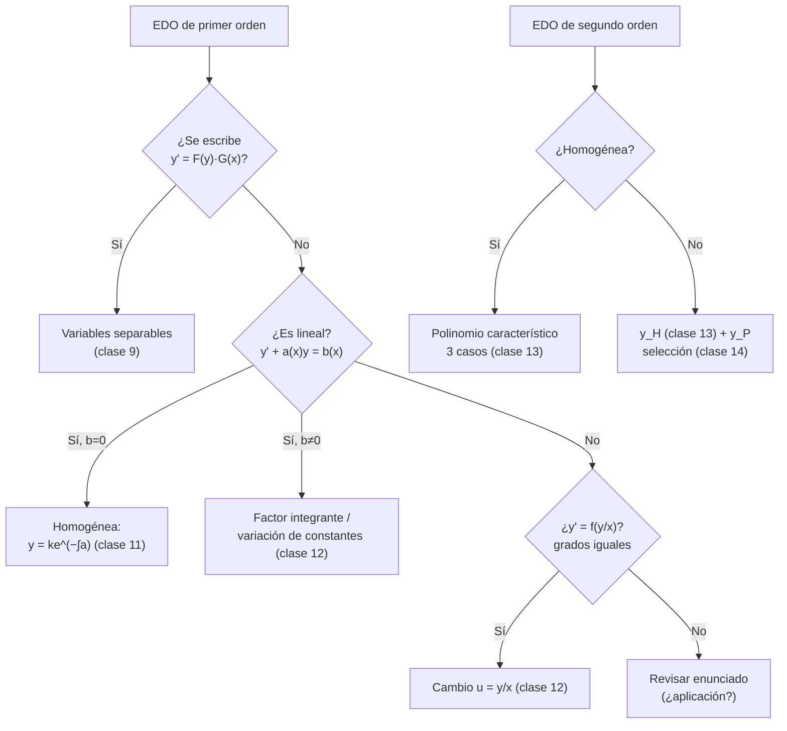
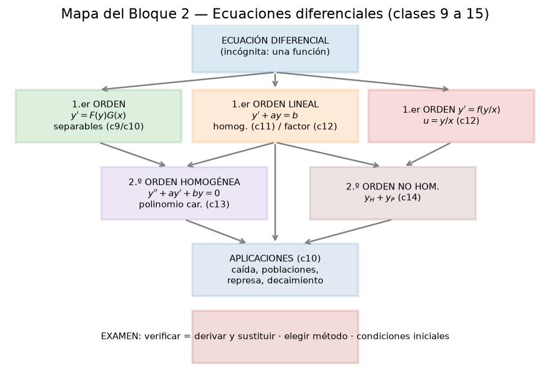

# Clase 15 — Repaso de EDOs y problemas de parcial/examen

> **Bloque 2 · Ecuaciones diferenciales · Dificultad: repaso · Tiempo estimado: 130 min**

---

## 🎯 Objetivos

1. **Clasificar** cualquier EDO del programa y elegir el método correcto en segundos.
2. Consolidar la **hoja de ruta**: separables → lineales 1.º → cambio $u=y/x$ → 2.º homogéneas → 2.º no homogéneas.
3. Resolver los **5 ejercicios de evaluaciones anteriores** del Práctico 1 y otros problemas de parcial/examen.
4. Practicar la **verificación** y el **descarte de opciones** (habilidad de múltiple opción).

---

## 🗺️ 1. Árbol de decisión: ¿qué método uso?

---

## 📋 2. Hoja de ruta: todo el Bloque 2 en una tabla

| Tipo | Forma | Solución |
|---|---|---|
| **Separable** | $y'=F(y)G(x)$ | $\int\!\frac{dy}{F(y)}=\int G\,dx$ (+ soluciones constantes) |
| **Lineal homogénea** | $y'+a(x)y=0$ | $y=ke^{-\int a\,dx}$ |
| **Lineal no homogénea** | $y'+a(x)y=b(x)$ | $y=e^{-\int a}\!\left(\int b\,e^{\int a}dx+C\right)$ |
| **Cambio $u=y/x$** | $y'=f(y/x)$ | $u+xu'=f(u)$ → separable |
| **2.º orden, reales $\lambda_1\ne\lambda_2$** | $y''+ay'+by=0$ | $Ae^{\lambda_1x}+Be^{\lambda_2x}$ |
| **2.º orden, raíz doble $\lambda_0$** | $y''+ay'+by=0$ | $(A+Bx)e^{\lambda_0x}$ |
| **2.º orden, complejas $\alpha\pm\beta i$** | $y''+ay'+by=0$ | $e^{\alpha x}(A\cos\beta x+B\sin\beta x)$ |
| **2.º orden no homogénea** | $y''+ay'+by=h(x)$ | $y_H+y_P$ (particular por selección) |

**Aplicaciones (clase 10):** caída → $v_\infty=\frac{mg}{k}$; logística → $x\to A$; represa → $u\to0$.

---

## ✏️ 3. Evaluaciones anteriores (Práctico 1) resueltas

### Ejercicio 1 (Primer parcial 2023-2S). Sea $y$ la solución de
$$
y''-y'-2y=-2x^2+3,\qquad y(0)=0,\ y'(0)=2.
$$
Calcular $y(1)$.

**Paso 1 — homogénea.** $p=\lambda^2-\lambda-2=(\lambda-2)(\lambda+1)\Rightarrow y_H=Ae^{2x}+Be^{-x}$.

**Paso 2 — particular.** $h=-2x^2+3$ (cuadrática): $y_P=ax^2+bx+c$, $y_P'=2ax+b$, $y_P''=2a$:
$$
2a-(2ax+b)-2(ax^2+bx+c)=-2ax^2+(-2a-2b)x+(2a-b-2c)=-2x^2+3.
$$
$-2a=-2\Rightarrow a=1$; $-2-2b=0\Rightarrow b=-1$; $2+1-2c=3\Rightarrow c=0$. $y_P=x^2-x$.

**Paso 3 — general.** $y=Ae^{2x}+Be^{-x}+x^2-x$.

**Paso 4 — PVI.**
- $y(0)=A+B=0$.
- $y'=2Ae^{2x}-Be^{-x}+2x-1$, $y'(0)=2A-B-1=2\Rightarrow 2A-B=3$.

Con $A=-B$: $-2B-B=3\Rightarrow B=-1$, $A=1$.

**Paso 5.** $y=e^{2x}-e^{-x}+x^2-x$, y en $x=1$:
$$
y(1)=e^{2}-e^{-1}+1-1=e^{2}-e^{-1}.
$$

**Respuesta: (A) $y(1)=e^{2}-e^{-1}$.** ✔

> ⚠️ Ojo con las opciones (A) y (D): $(D)$ es $\frac{e^2-e^{-1}}{e^2+e^{-1}}$. Nuestro resultado es (A).

---

### Ejercicio 2 (Examen febrero 2023). Se considera $(E):\ y''+4y'+4y=r(x)$ y tres afirmaciones. Decidir cuáles son verdaderas.

Redactado en palabras: **(I)** si $e^{-2x}+x^2$ es solución de $(E)$ entonces $r(x)=4x^2+8x+2$; **(II)** si $r(x)=x^2$ entonces $y=e^{-2x}+3xe^{-2x}+x^2$ es la única solución con $y(0)=y'(0)=1$; **(III)** si $r(x)=0$ todas las soluciones son $y=ae^{-2x}+bxe^{-2x}$.

**Preparación.** El polinomio característico es $p=\lambda^2+4\lambda+4=(\lambda+2)^2$: **raíz doble** $-2$, así que $y_H=(a+bx)e^{-2x}$.

**Afirmación (I).** Calculamos el lado izquierdo para $y=e^{-2x}+x^2$:
$$
y'=-2e^{-2x}+2x,\qquad y''=4e^{-2x}+2.
$$
$$
y''+4y'+4y=(4e^{-2x}+2)+4(-2e^{-2x}+2x)+4(e^{-2x}+x^2)
=\underbrace{(4-8+4)}_{0}e^{-2x}+4x^2+8x+2.
$$
O sea $r(x)=4x^2+8x+2$: **(I) VERDADERA.** ✔

**Afirmación (II).** Evaluamos el lado izquierdo para $y=e^{-2x}+3xe^{-2x}+x^2=(1+3x)e^{-2x}+x^2$:
$$
y'=(1-6x)e^{-2x}+2x,\qquad y''=(12x-8)e^{-2x}+2.
$$
$$
y''+4y'+4y=(12x-8)e^{-2x}+2+4(1-6x)e^{-2x}+8x+4(1+3x)e^{-2x}+4x^2
$$
$$
=\underbrace{(12x-8+4-24x+4+12x)}_{0}e^{-2x}+4x^2+8x+2=4x^2+8x+2\neq x^2.
$$
Es decir, la función propuesta **resuelve** $r(x)=4x^2+8x+2$, **no** $r=x^2$: **(II) FALSA.** ✘

**Afirmación (III).** Con $r=0$ queda la homogénea $y''+4y'+4y=0$, cuya solución general es $y=(a+bx)e^{-2x}=ae^{-2x}+bxe^{-2x}$: **(III) VERDADERA.** ✔

**Respuesta: (D) solamente (I) y (III) son verdaderas.** ✔

> 💡 **Moraleja:** el método "verificar (derivar y sustituir)" es el que resuelve estos ejercicios; no hace falta resolver la EDO entera.

---

### Ejercicio 3 (Examen julio 2021). $y''+\alpha y'+\beta y=2e^{3x}$ y $y(x)=x^2e^{3x}$ es solución. Hallar $\alpha+\beta$.

**Paso 1.** Derivamos $y=x^2e^{3x}$:
$$
y'=(2x+3x^2)e^{3x},\qquad y''=(2+12x+9x^2)e^{3x}.
$$

**Paso 2.** Sustituimos:
$$
y''+\alpha y'+\beta y=e^{3x}\big[(2+12x+9x^2)+\alpha(2x+3x^2)+\beta x^2\big]
$$
$$
=e^{3x}\big[2+(12+2\alpha)x+(9+3\alpha+\beta)x^2\big].
$$

**Paso 3.** Debe ser igual a $2e^{3x}$ para **todo** $x$, así que los coeficientes de $x$ y $x^2$ se anulan:
$$
12+2\alpha=0\Rightarrow\alpha=-6,\qquad 9+3\alpha+\beta=0\Rightarrow9-18+\beta=0\Rightarrow\beta=9.
$$

**Paso 4.** $\alpha+\beta=-6+9=3$.

**Respuesta: (A) 3.** ✔

---

### Ejercicio 4 (Primer parcial 2018-2S).
$$
y'=\frac{(y-2)^2}{(x+1)^2},\qquad y(0)=\frac52.
$$
Calcular $y(1)$.

**Paso 1 — separable:**
$$
\frac{y'}{(y-2)^2}=\frac{1}{(x+1)^2}\Rightarrow-\frac{1}{y-2}=-\frac{1}{x+1}+C.
$$

**Paso 2 — despejamos con el PVI.** $y(0)=\frac52$:
$$
-\frac{1}{1/2}=-\frac{1}{1}+C\Rightarrow-2=-1+C\Rightarrow C=-1.
$$
Entonces $-\dfrac{1}{y-2}=-\dfrac1{x+1}-1$, o $\dfrac1{y-2}=\dfrac1{x+1}+1=\dfrac{x+2}{x+1}$, de donde
$$
y=2+\frac{x+1}{x+2}.
$$

**Paso 3.** $y(1)=2+\dfrac{2}{3}=\dfrac{8}{3}$.

**Respuesta: (D) $8/3$.** ✔

---

### Ejercicio 5 (recordatorio, ya visto). Primer parcial 2022-2S: $y'e^{x^2}/x=-2(1+y^2)$, $y(0)=0$ → $y(\sqrt2)=\tan(e^{-2}-1)$ (opción E). Lo resolvimos en la **clase 9**.

---

## 🏛️ 4. Más problemas de parcial/examen

### Ejercicio 6 (Parcial 1 2019-1S, MO 2). Sea $x(t)$ la solución de $x''+2x'+x=e^{t}$ con $x(1)=\frac e4+\frac1e$, $x'(1)=\frac e4-\frac1e$. Calcular $x(0)$

**Paso 1 — homogénea.** $p=\lambda^2+2\lambda+1=(\lambda+1)^2$: $x_H=(A+Bt)e^{-t}$.

**Paso 2 — particular.** $e^t$ (no resonante, $1$ no es raíz): $x_P=Ce^t$; $C+2C+C=4C=1\Rightarrow C=\frac14$.

**Paso 3 — general.** $x(t)=(A+Bt)e^{-t}+\frac14e^t$.

**Paso 4 — derivada.** $x'(t)=Be^{-t}-(A+Bt)e^{-t}+\frac14e^t$.

**Paso 5 — datos en $t=1$:**
$$
x(1)=(A+B)e^{-1}+\frac e4=\frac e4+\frac1e\Rightarrow (A+B)e^{-1}=e^{-1}\Rightarrow A+B=1.
$$
$$
x'(1)=Be^{-1}-(A+B)e^{-1}+\frac e4=\frac e4-\frac1e\Rightarrow Be^{-1}-(A+B)e^{-1}=-e^{-1}\Rightarrow B-(A+B)=-1\Rightarrow A=1.
$$
Entonces $B=0$.

**Paso 6.** $x(0)=(1+0)e^{0}+\frac14e^{0}=1+\frac14=\frac54$.

**Respuesta: (A) $x(0)=\frac54$.** ✔

---

### Ejercicio 7 (Examen agosto 2020, ej. 2). Sea
$$
y''-y=-\frac{\sin(\ln x)}{x^2}-\frac{\cos(\ln x)}{x^2}-\sin(\ln x),
$$
y se sabe que $y_p(x)=e^{x}+e^{-x}+\sin(\ln x)$ es una solución particular. Hallar la solución general.

**Paso 1 — homogénea.** $p=\lambda^2-1=0\Rightarrow\lambda=\pm1$, así que
$$
y_H=c_1e^{x}+c_2e^{-x}.
$$

**Paso 2 — estructura.** Por el Teorema 14.1:
$$
y=y_H+y_p=c_1e^{x}+c_2e^{-x}+e^{x}+e^{-x}+\sin(\ln x).
$$

**Paso 3 — reabsorbemos constantes.** $(c_1+1)e^{x}+(c_2+1)e^{-x}+\sin(\ln x)=b_1e^{x}+b_2e^{-x}+\sin(\ln x)$.

**Paso 4 — chequeo de $y_p$ (opcional, deseable).** Para $y=\sin(\ln x)$:
$$
y'=\frac{\cos(\ln x)}{x},\qquad y''=-\frac{\sin(\ln x)}{x^2}-\frac{\cos(\ln x)}{x^2}.
$$
Entonces $y''-y=-\frac{\sin(\ln x)}{x^2}-\frac{\cos(\ln x)}{x^2}-\sin(\ln x)$ ✔ (y $e^{\pm x}$ resuelven la homogénea).

$$
\boxed{y(x)=b_1e^{x}+b_2e^{-x}+\sin(\ln x),\quad b_1,b_2\in\mathbb{R}}
$$

---

## 🎲 5. Estrategias para la multiple opción

1. **Si te dan una función candidata, verificá** (derivá y sustituí): muchas veces es más rápido que resolver.
2. **Si te piden un valor puntual** ($y(1)$, $y(\sqrt2)$, $x(0)$): resolvés el PVI completo y evaluás; **cuidado con los distractores algebráicos** (fracciones tipo $\frac{e^2-e^{-1}}{e^2+e^{-1}}$).
3. **Chequeá la homogénea primero:** las raíces te dicen la "forma" y descartan opciones (p. ej. si hay $\cos x$ y $\sin x$ debe haber raíces complejas).
4. **Verificá el signo de la exponencial** y el coeficiente: un factor 2 te cambia la opción.
5. En V/F, la **linealidad** decide rápido: suma de soluciones de la **homogénea** es solución; para la no homogénea, no.

---

## ⚠️ 6. Errores comunes (recopilación del bloque)

| Error | Corrección |
|---|---|
| Elegir mal el método | usá el **árbol de decisión** de la sección 1 |
| Olvidar las soluciones constantes al separar | revisá los ceros de $F(y)$ |
| En 2.º orden, confundir raíz doble con reales distintas | raíz doble → término $Bx\,e^{\lambda_0x}$ |
| No detectar resonancia en $y_P$ | si $h$ está en la familia de $y_H$, multiplicá por $x$ |
| Poner mal la constante en la fórmula no homogénea | $y=e^{-\int a}\!\left(\int b\,e^{\int a}dx+C\right)$ |
| Confundir "homogénea de 1.er orden" con "ecuación $f(y/x)$" | son nombres distintos para cosas distintas |
| Resolver el PVI sin la solución general completa | primero general, después las condiciones |
| No verificar | en un examen, 20 segundos de verificación salvan puntos |

---

## 🔗 7. Conexión con el resto del curso

- **Bloque 2 completo (clases 9-15):** cierra las ecuaciones diferenciales. Lo que sigue es el **Bloque 3 — Sucesiones (clases 16-20)**.
- **Clase 16-20:** las **sucesiones** y el paso al límite son la antesala de las **series** (clases 21-25) y de la **topología en $\mathbb{R}^n$**.
- **Clase 8 (Euler):** reaparece en todas las soluciones oscilatorias de segundo orden.
- **Clases 11-14:** el patrón "homogénea + particular" que viste acá es también la estructura de las soluciones de **series de Fourier** y de los sistemas lineales (fuera del programa, pero misma idea).

---

## ✅ 8. Autoevaluación final del bloque

1. Clasificá y resolvé: $y'=y\tan x$.
2. Resolvé: $y'+2xy=xe^{-x^2}$.
3. Resolvé: $y'=\dfrac{x^2+y^2}{xy}$ (con $u=y/x$).
4. Resolvé: $y''-4y=e^{2x}$ (¡cuidado con la resonancia!).
5. Resolvé el PVI $y''+3y'+2y=0$, $y(0)=1$, $y'(0)=0$.
6. (V/F) La función $y=e^{-2x}+x^2$ resuelve $y''+4y'+4y=4x^2+8x+2$.
7. Un cuerpo cae con $mv'=mg-kv$ y $v(0)=0$. ¿Cuánto vale $\lim_{t\to\infty}v(t)$?

Respuestas

1. Separable: $\frac{y'}{y}=\tan x\Rightarrow\ln|y|=-\ln|\cos x|+C\Rightarrow y=\frac{k}{\cos x}$ (más $y\equiv0$).
2. Lineal con $a=2x$, $\mu=e^{x^2}$: $(e^{x^2}y)'=x\Rightarrow e^{x^2}y=\frac{x^2}{2}+C\Rightarrow y=e^{-x^2}\!\left(\frac{x^2}{2}+C\right)$.
3. $u+xu'=u+\frac1u\Rightarrow u^2=2\ln|x|+C\Rightarrow y=x\sqrt{2\ln|x|+C}$.
4. $y_H=Ae^{2x}+Be^{-2x}$; $e^{2x}$ resuena → $y_P=Cxe^{2x}$, $C=\frac14$: $y=Ae^{2x}+Be^{-2x}+\frac{x}{4}e^{2x}$.
5. $\lambda=-1,-2$: $y=Ae^{-x}+Be^{-2x}$; $A+B=1$, $-A-2B=0\Rightarrow B=-1$, $A=2$: $y=2e^{-x}-e^{-2x}$.
6. **Verdadero** (calculado en el ej. 2 de la sección 3).
7. $v_\infty=mg/k$.

---

**⬅️ Anterior:** [Clase 14 — EDOs de 2.º orden no homogéneas](14_edo_2do_orden_no_homogeneas.md) · 🏠 [Índice](00_indice.md) · **➡️ Siguiente:** [Clase 16 — Sucesiones: definición y límite](16_sucesiones_definicion.md) (Bloque 3)