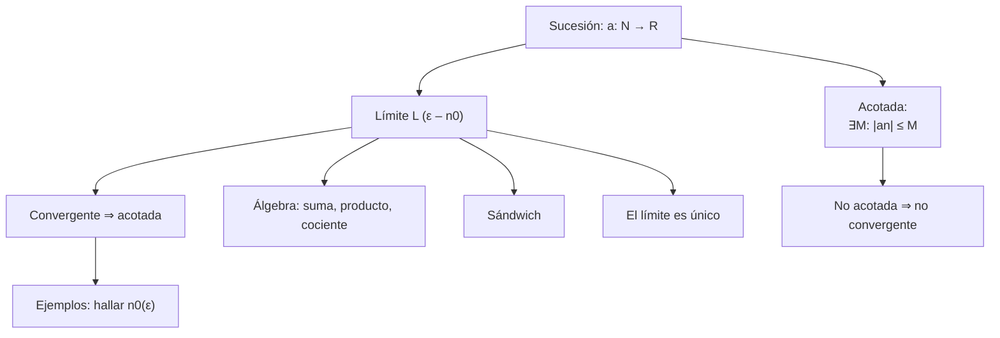
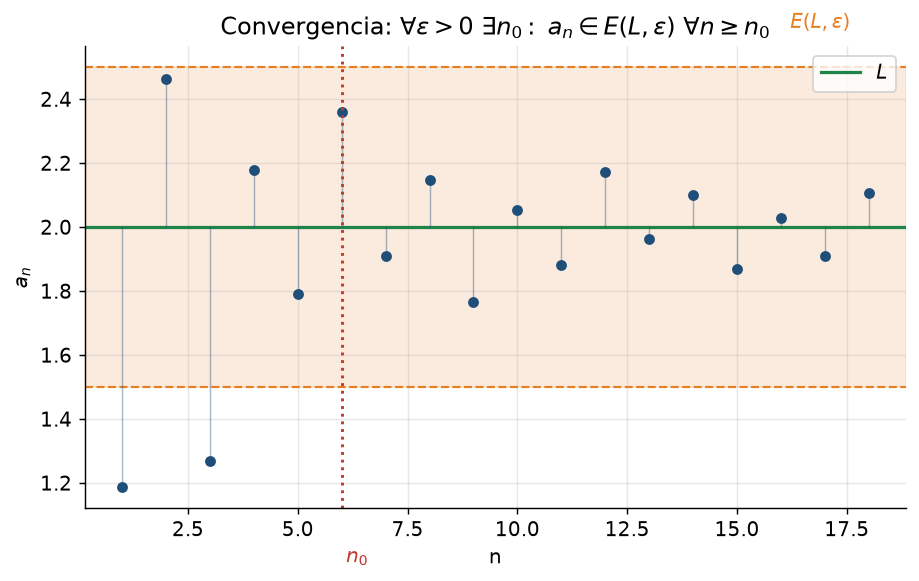
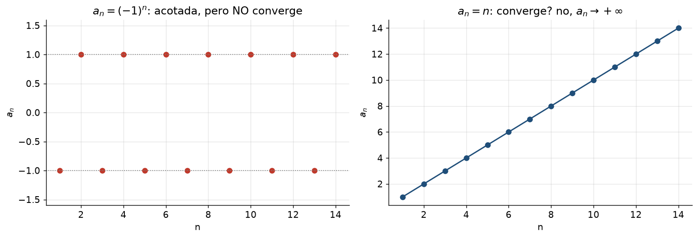

# Clase 16 — Sucesiones: definición, límite ε–N y acotación

> **Bloque 3 · Sucesiones y series · Dificultad: media · Tiempo estimado: 110 min**

---

## 🎯 Objetivos

1. Saber que una **sucesión** es una función $a:\mathbb{N}\to\mathbb{R}$, y manejar la notación $(a_n)_{n\in\mathbb{N}}$.
2. Entender y **usar** la definición formal de límite: el juego $\varepsilon$–$n_0$.
3. Distinguir **sucesión** de su **recorrido** (imagen).
4. Definir **sucesión acotada** (superior e inferiormente).
5. Probar que **convergente $\Rightarrow$ acotada**, y usar el **álgebra de límites** y la **regla del sándwich**.
6. Aplicar la definición a ejemplos: encontrar $n_0$ para un $\varepsilon$ dado.

---

## 🗺️ Mapa de la clase

---

## 🧱 1. Repaso: ¿qué es una sucesión?

> **Definición 16.1 (sucesión, notas Def. 3.1).** Una **sucesión** es una función de los naturales en los reales,
> $$
> a:\mathbb{N}\to\mathbb{R}.
> $$
> Al elemento $a(n)$ se lo escribe $a_n$ (el **término enésimo**), y a la sucesión entera $(a_n)_{n\in\mathbb{N}}$ —o, por abuso de notación, simplemente $a_n$.

**Ejemplos (notas, Ej. 3.2):**

1. $a_n=\dfrac1n$: $\big(1,\tfrac12,\tfrac13,\tfrac14,\dots\big)$.
2. $a_n=1$: $(1,1,1,\dots)$.
3. $a_n=(-1)^n$: $(-1,1,-1,1,\dots)$.
4. $a_n=n$: $(1,2,3,4,\dots)$.

> ⚠️ **Sucesión ≠ recorrido.** La sucesión es la **lista ordenada e infinita**; el **recorrido** es la imagen como función. Para $(-1)^n$ la sucesión es $(-1,1,-1,1,\dots)$ y el recorrido es $\{-1,1\}$. Para $a_n=1$ el recorrido es $\{1\}$.

Lo que más nos interesa es el **comportamiento "en el infinito"**: hacia dónde van los términos cuando $n$ crece.

---

## 📘 2. Límite de una sucesión (definición $\varepsilon$–$n_0$)

> **Definición 16.2 (límite, notas Def. 3.3).** Decimos que $(a_n)$ tiene **límite** $L\in\mathbb{R}$ —y escribimos $\lim_{n\to\infty}a_n=L$, o $a_n\to L$— sii
> $$
> \boxed{\ \forall\varepsilon>0,\ \exists n_0\in\mathbb{N}\ \text{tal que}\ \forall n\geq n_0\ \text{se tiene}\ |a_n-L|<\varepsilon\ }
> $$
> O, con entornos: $a_n\in E(L,\varepsilon)$ para todo $n\geq n_0$.

**Cómo pensarlo (notas):** es un **juego**. El primer jugador elige $\varepsilon>0$ (tan chiquito como quiera). El segundo debe responder con un **momento** $n_0$ a partir del cual **todos** los términos caen cerca de $L$. Para **demostrar** un límite, nos ponemos en el papel del segundo jugador: dado $\varepsilon$, hay que **fabricar** el $n_0$.

> 💡 Es igual que la definición de continuidad con $\varepsilon$–$\delta$, pero acá el $\delta$ se llama $n_0$ y solo nos importa "a partir de un momento".

**Ejemplo 0 (el más importante): $\displaystyle\lim_{n\to\infty}\frac1n=0$.**

Dado $\varepsilon>0$, quiero $\big|\frac1n-0\big|=\frac1n<\varepsilon$, o sea $n>\frac1\varepsilon$. Basta tomar
$$
n_0=\left\lfloor \frac1\varepsilon\right\rfloor+1.
$$
Entonces $\forall n\geq n_0$ se cumple $\frac1n<\varepsilon$. ✔ (Es la **arquimedianidad** de $\mathbb{R}$ en acción.)

**Propiedad clave (unicidad).** Si $a_n\to L$ y $a_n\to L'$, entonces $L=L'$. (Si no, tomá $\varepsilon=\frac{|L-L'|}{2}$: no pueden estar ambos a distancia $<\varepsilon$.) Escribimos $\lim a_n$ sin ambigüedad.

---

## 📘 3. Sucesiones acotadas

> **Definición 16.3 (acotada).** $(a_n)$ está **acotada superiormente** si $\exists M$ con $a_n\leq M$ para todo $n$; **inferiormente** si $\exists m$ con $a_n\geq m$ para todo $n$; y **acotada** si lo está de ambos lados, o sea si
> $$
> \exists M>0:\ |a_n|\leq M\quad\forall n.
> $$

> **Teorema 16.4 (convergente $\Rightarrow$ acotada).** Si $a_n\to L$, entonces $(a_n)$ es acotada.
>
> *Demostración.* Tomá $\varepsilon=1$: existe $n_0$ tal que $|a_n-L|<1$ para $n\geq n_0$, así que $|a_n|<|L|+1$ para $n\geq n_0$. Los primeros $n_0-1$ términos son finitos, así que
> $$
> M=\max\{|a_1|,\dots,|a_{n_0-1}|,\ |L|+1\}
> $$
> acota a toda la sucesión. ✔

> ⚠️ **El recíproco es FALSO.** $a_n=(-1)^n$ está acotada pero **no** converge. "Acotada" y "convergente" no son lo mismo: la convergencia es más exigente.

---

## 📘 4. Álgebra de límites y sándwich

Si $a_n\to A$ y $b_n\to B$ (ambos finitos), entonces:

| Operación | Límite |
|---|---|
| suma | $a_n+b_n\to A+B$ |
| producto | $a_nb_n\to A\,B$ |
| producto por escalar | $c\,a_n\to cA$ |
| cociente (si $B\neq0$) | $\dfrac{a_n}{b_n}\to\dfrac{A}{B}$ |
| potencia | $a_n^k\to A^k$ |

> **Teorema 16.5 (sándwich / encaje).** Si $b_n\leq a_n\leq c_n$ para todo $n\geq N$ y $\lim b_n=\lim c_n=L$, entonces $\lim a_n=L$.

> **Corolario útil (producto 0 × acotada).** Si $a_n\to0$ y $(b_n)$ es **acotada**, entonces $a_nb_n\to0$.
>
> *Demostración.* Sea $M$ tal que $|b_n|\leq M$. Dado $\varepsilon>0$, como $a_n\to0$ existe $n_0$ con $|a_n|<\varepsilon/M$ para $n\geq n_0$; entonces $|a_nb_n|\leq M|a_n|<\varepsilon$. ✔

> 💡 **No confundir:** "acotada" no dice nada sobre el **signo** ni sobre oscilaciones. $b_n=(-1)^n$ es acotada, y $a_n\cdot b_n\to0$ igual.

---

## ✏️ 5. Ejercicios resueltos paso a paso

### Ejercicio 1 (Práctico 2, ej. 2). Hallar el primer $n_0$ para $\varepsilon=1;\ 0{,}1;\ 0{,}01$

**a) $a_n=\dfrac1n$ (límite $L=0$).**

Necesitamos $\dfrac1n<\varepsilon\Leftrightarrow n>\dfrac1\varepsilon$:

| $\varepsilon$ | $n>\dfrac1\varepsilon$ | primer $n_0$ |
|---|---|---|
| $1$ | $n>1$ | $2$ |
| $0{,}1$ | $n>10$ | $11$ |
| $0{,}01$ | $n>100$ | $101$ |

**b) $a_n=\dfrac{n}{n+1}$ (límite $L=1$).**

$\left|\dfrac{n}{n+1}-1\right|=\dfrac{1}{n+1}<\varepsilon\Leftrightarrow n+1>\dfrac1\varepsilon$:

| $\varepsilon$ | $n+1>\dfrac1\varepsilon$ | $n_0$ |
|---|---|---|
| $1$ | $n>0$ | $1$ |
| $0{,}1$ | $n>9$ | $10$ |
| $0{,}01$ | $n>99$ | $100$ |

**c) $a_n=\dfrac{(-1)^n}{n}$ (límite $0$).** $\left|\dfrac{(-1)^n}{n}\right|=\dfrac1n$: **los mismos** $n_0$ que en (a): $2;\ 11;\ 101$.

**d) $a_n=\dfrac1{n!}$ (límite $0$).** Hay que $n!>\dfrac1\varepsilon$:

| $\varepsilon$ | $n!>\dfrac1\varepsilon$ | $n_0$ |
|---|---|---|
| $1$ | $n!>1$ | $2$ (pues $2!=2>1$) |
| $0{,}1$ | $n!>10$ | $4$ (pues $3!=6<10<24=4!$) |
| $0{,}01$ | $n!>100$ | $5$ (pues $4!=24<100<120=5!$) |

**e) $a_n=\dfrac{2n}{n^3+1}$ (límite $0$).** No hace falta resolver exacto: **acotamos** usando $n^3+1>n^3$:
$$
0<\frac{2n}{n^3+1}<\frac{2n}{n^3}=\frac{2}{n^2}.
$$
Si $\dfrac{2}{n^2}<\varepsilon$, o sea $n>\sqrt{\dfrac2\varepsilon}$, listo. Con $n_0=\left\lfloor\sqrt{2/\varepsilon}\right\rfloor+1$:

| $\varepsilon$ | $n>\sqrt{2/\varepsilon}$ | $n_0$ (verificado) |
|---|---|---|
| $1$ | $n>\sqrt2\approx1{,}41$ | $2$ ($a_1=1$, $a_2=\tfrac4{9}\approx0{,}44<1$) |
| $0{,}1$ | $n>\sqrt{20}\approx4{,}47$ | $5$ ($a_4\approx0{,}123$, $a_5\approx0{,}079<0{,}1$) |
| $0{,}01$ | $n>\sqrt{200}\approx14{,}1$ | $15$ ($a_{14}\approx0{,}0102$, $a_{15}\approx0{,}0089<0{,}01$) |

> 💡 **Truco de examen:** para acotar un cociente, reemplazá el numerador por una cota **superior** y el denominador por una **inferior** (siempre que todo sea positivo). Así $\frac{2n}{n^3+1}<\frac{2n}{n^3}$.

---

## 🏛️ 6. Ejercicios de parcial/examen

### Ejercicio 2 (Primer parcial 2022-2S, ej. 1). Definir

**a) Límite finito de una sucesión.** $\lim_{n\to\infty}a_n=L\in\mathbb{R}$ sii
$$
\forall\varepsilon>0,\ \exists n_0\in\mathbb{N}:\ \forall n\geq n_0,\ |a_n-L|<\varepsilon.
$$

**b) Sucesión acotada.** $(a_n)$ es acotada sii existe $M>0$ tal que $|a_n|\leq M$ para todo $n\in\mathbb{N}$.

### Ejercicio 3 (Primer parcial 2022-2S, ej. 2). Si $a_n\to0$ y $(b_n)$ es acotada, probar $a_nb_n\to0$

Es exactamente el **Corolario** de la sección 4. Redacción para el parcial:

Sea $M>0$ con $|b_n|\leq M\ \forall n$. Dado $\varepsilon>0$, como $a_n\to0$ existe $n_0$ tal que $|a_n|<\varepsilon/M$ para $n\geq n_0$. Entonces, para $n\geq n_0$,
$$
|a_nb_n-0|=|a_n|\,|b_n|\leq M\cdot\frac{\varepsilon}{M}=\varepsilon.
$$
Por lo tanto $a_nb_n\to0$. ✔

### Ejercicio 4 (Primer parcial 2022-2S, ej. 3). Ejemplos de $0\times\infty$

**a) $a_n\to0$, $b_n$ no acotada, y $a_nb_n\to0$:** $a_n=\dfrac1n$, $b_n=\sqrt n$. Aquí $a_nb_n=\dfrac1{\sqrt n}\to0$. ✔

**b) $a_n\to0$, $b_n$ no acotada, y $a_nb_n\not\to0$:** $a_n=\dfrac1n$, $b_n=n^2$. Aquí $a_nb_n=n\to+\infty$. (También sirve $b_n=n$ y $a_nb_n=1\to1\neq0$.) ✔

> 💡 **Moraleja:** $0\times\infty$ es una **indeterminación**: el resultado depende de *cuán rápido* vaya cada factor a su destino.

### Ejercicio 5 (Primer parcial 2020-2S, ej. 1). Completar definiciones

**a)** $(a_n)$ es convergente si $\exists L\in\mathbb{R}$ tal que $\forall\varepsilon>0\ \exists n_0:\ \forall n\geq n_0,\ |a_n-L|<\varepsilon$.

**b)** $(a_n)$ es **monótona creciente** si $a_{n+1}\geq a_n$ para todo $n$ (decreciente si $a_{n+1}\leq a_n$).

**c)** $(a_n)$ es acotada si $\exists M>0:\ |a_n|\leq M\ \forall n$.

### Ejercicio 6 (Primer parcial 2020-2S, ej. 2). Ejemplos

**a) Convergente pero no monótona:** $a_n=\dfrac{(-1)^n}{n}\to0$ (oscila cambiando de signo, pero tiende a 0).

**b) Acotada pero no convergente:** $a_n=(-1)^n$ (acotada por $1$, pero no tiene límite).

---

## ⚠️ 7. Errores comunes

| Error | Corrección |
|---|---|
| Decir "converge porque está acotada" | acotada **no** implica convergente ($(-1)^n$) |
| Confundir $n_0$ (un número natural) con $\varepsilon$ (un real positivo) | $n_0$ **depende** de $\varepsilon$; el $\forall n\geq n_0$ debe valer para **todos** los siguientes |
| En $(-1)^n/n$ dividir mal el signo | $|(-1)^n/n|=1/n$, el signo no cambia la convergencia a 0 |
| Acotar con denominador superior | para acotar $\frac{A}{B}$ **superiormente**, el denominador va por **debajo** |
| Confundir sucesión con su recorrido | recorrido es el conjunto imagen; la sucesión es la lista |
| Suponer que $\lim(a_nb_n)$ es producto/infinito "de los límites" con $0\cdot\infty$ | es indeterminado |
| Olvidar que el límite es **único** | si dos valores cumplen, son iguales |

---

## 🔗 8. Conexión con el resto del curso

- **Clase 17:** agregamos **monotonía** y el **teorema de la convergencia monótona**, la herramienta más usada en la práctica.
- **Clase 18:** **cálculo** de límites y **subsucesiones**.
- **Clase 19:** **Bolzano–Weierstrass**, **Cauchy** y sucesiones en $\mathbb{R}^n$.
- **Bloque 4 (series, clases 21–25):** una serie es el límite de una sucesión de **sumas parciales**; sin esta clase no se entiende nada.
- **Continuidad (clases 34–36):** las sucesiones **caracterizan** la continuidad y los conjuntos cerrados (vía $f(a_n)\to f(a)$). Es el puente a la topología.

---

## ✅ 9. Autoevaluación

1. Escribir la definición de $a_n\to L$ y su **negación** (que $a_n$ **no** tienda a $L$).
2. ¿Es cierto que $a_n=\dfrac{n}{n+2}$ es acotada? ¿Y convergente? Hallar su límite.
3. Para $a_n=\dfrac{1}{n^2}$, hallar $n_0$ para $\varepsilon=0{,}1$.
4. Dar una sucesión acotada pero no convergente **distinta** de $(-1)^n$.
5. (V/F) Si $(a_n)$ es convergente y $(b_n)$ también, entonces $(a_nb_n)$ converge.
6. Calcular $\displaystyle\lim_{n\to\infty}\frac{2n^2+3n}{5n^2-1}$.

Respuestas

1. Sí: $\forall\varepsilon>0\ \exists n_0:\ \forall n\geq n_0,\ |a_n-L|<\varepsilon$. Negación: $\exists\varepsilon>0$ tal que $\forall n_0\ \exists n\geq n_0$ con $|a_n-L|\geq\varepsilon$.
2. Sí, acotada ($0<a_n<1$) y convergente, límite $1$.
3. $\frac1{n^2}<0{,}1\Leftrightarrow n^2>10\Leftrightarrow n>3{,}16$, luego $n_0=4$.
4. Por ejemplo $a_n=\sin n$ (acotada, no converge) o $a_n=(-1)^n+1/n$.
5. **Verdadero** (álgebra de límites).
6. Dividiendo por $n^2$: $\dfrac{2+3/n}{5-1/n^2}\to\dfrac25$.

---

**⬅️ Anterior:** [Clase 15 — Repaso de EDOs y parciales](15_edo_repaso_parciales.md) · 🏠 [Índice](00_indice.md) · **➡️ Siguiente:** [Clase 17 — Sucesiones monótonas y recurrencias](17_sucesiones_monotonas.md)
