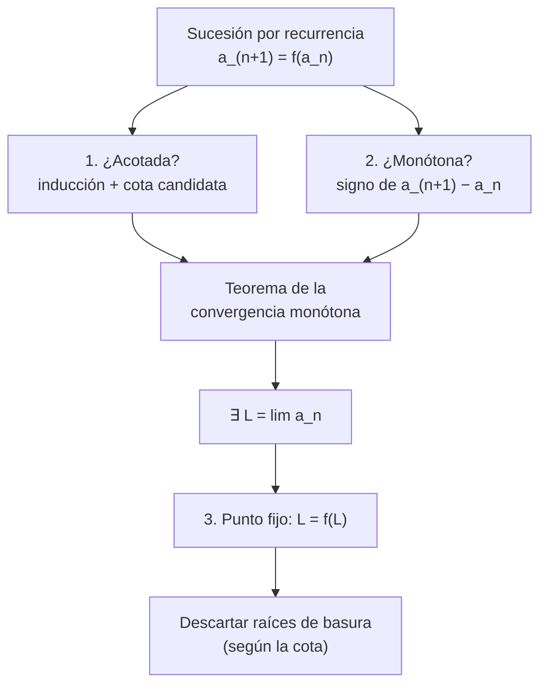
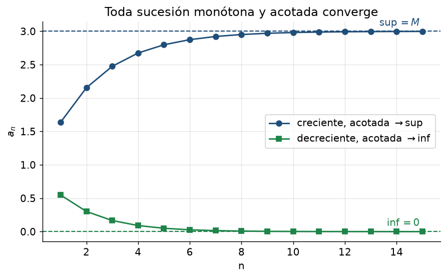
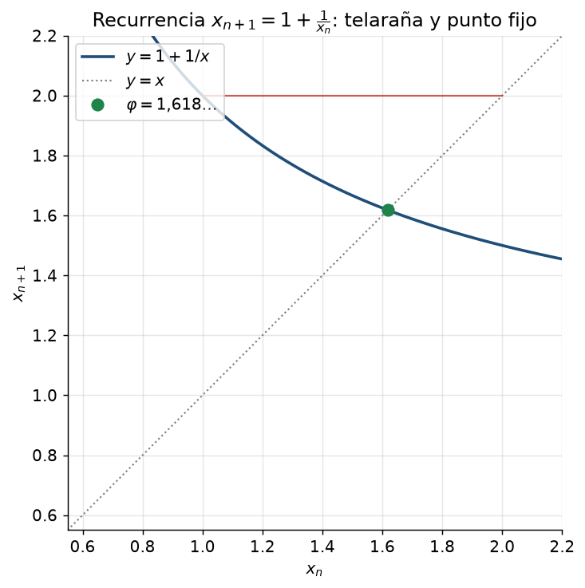

# Clase 17 — Sucesiones monótonas y sucesiones por recurrencia

> **Bloque 3 · Sucesiones y series · Dificultad: media-alta · Tiempo estimado: 120 min**

---

## 🎯 Objetivos

1. Definir **monotonía** (creciente / decreciente, estricta o no).
2. Enunciar y **aplicar el teorema de la convergencia monótona**: monótona + acotada $\Rightarrow$ convergente, y el límite es el **supremo** (o el **ínfimo**).
3. Aplicar el **método estándar** a sucesiones definidas por **recurrencia** $a_{n+1}=f(a_n)$:
   1. probar acotación por inducción, 2. probar monotonía por inducción, 3. concluir convergencia (PSMC), 4. hallar el límite por **punto fijo** $L=f(L)$.
4. Estudiar **convergencia** de recurrencias típicas de parcial/examen.

---

## 🗺️ Mapa de la clase

---

## 🧱 1. Monotonía

> **Definición 17.1.** $(a_n)$ es **creciente** si $a_{n+1}\geq a_n$ para todo $n$; **decreciente** si $a_{n+1}\leq a_n$ para todo $n$. Si las desigualdades son estrictas, se dice **estrictamente** creciente/decreciente. Es **monótona** si es creciente o decreciente.

**Cómo estudiar la monotonía:**
- Directo: calcular el signo de $a_{n+1}-a_n$.
- Con cocientes (si $a_n>0$): comparar $a_{n+1}/a_n$ con $1$.
- Con recurrencias: **inducción** (si $a_n$ cumple cierta cota, probar que $a_{n+1}$ la mantiene y que $a_{n+1}\geq a_n$).

> ⚠️ **"Monótona" ≠ "convergente".** $a_n=n$ es creciente y **no** converge; $a_n=(-1)^n$ no es monótona y **tampoco** converge. La combinación ganadora es monotonía **+** acotación.

---

## 📘 2. Teorema de la convergencia monótona (PSMC)

> **Teorema 17.2 (convergencia monótona).**
> - Si $(a_n)$ es **creciente** y **acotada superiormente**, entonces converge y
> $$
> \lim_{n\to\infty}a_n=\sup\{a_n:n\in\mathbb{N}\}.
> $$
> - Si $(a_n)$ es **decreciente** y **acotada inferiormente**, entonces converge y
> $$
> \lim_{n\to\infty}a_n=\inf\{a_n:n\in\mathbb{N}\}.
> $$

**Idea de la demostración.** El conjunto de valores $\{a_n\}$ es no vacío y acotado superiormente: tiene **supremo** $S$ en $\mathbb{R}$ (¡propiedad fundamental de los reales!). Para cualquier $\varepsilon>0$, $S-\varepsilon$ **no** es cota superior, así que existe $a_{n_0}>S-\varepsilon$. Como la sucesión es creciente, para $n\geq n_0$ resulta $S-\varepsilon<a_{n_0}\leq a_n\leq S$, o sea $|a_n-S|<\varepsilon$. Entonces $a_n\to S$. ✔

> 💡 **Este teorema es la herramienta #1** del capítulo: casi siempre **no** se calcula el límite directamente, sino que se **prueba primero que existe** (por PSMC) y **después** se calcula con el punto fijo.

---

## 📘 3. Sucesiones definidas por recurrencia: el método

Para $a_{n+1}=f(a_n)$ con $a_1$ (o $a_0$) dado:

| Paso | Qué hacer | Cómo |
|---|---|---|
| **1. Acotar** | Proponer una cota $[\,m,M\,]$ y probarla por **inducción** | si $m\leq a_n\leq M$ (y $f$ creciente), verificar $f(m)\geq m$ y $f(M)\leq M$ |
| **2. Monotonía** | Probar $a_{n+1}\geq a_n$ (o $\leq$) | muchas veces sale de la **cota** del paso 1 |
| **3. Existencia** | Por PSMC, existe $L=\lim a_n$ | $L$ queda en $[m,M]$ |
| **4. Calcular** | Pasar al límite en $a_{n+1}=f(a_n)$: $L=f(L)$ | resolver; **descartar** raíces fuera de $[m,M]$ |

> ⚠️ **Siempre justificá el paso al límite.** Si $a_n\to L$ y $f$ es continua, $f(a_n)\to f(L)$. Por eso $L=f(L)$.

---

## ✏️ 4. Ejercicios resueltos paso a paso

### Ejercicio 1 (Práctico 2, ej. 1). Monotonía, acotación y convergencia

**a) $a_n=1+\dfrac1n$.** Es $a_n=1+\frac1n$: **decreciente** (al crecer $n$, $\frac1n$ baja) y acotada ($1<a_n\leq2$). Por PSMC, converge, y $a_n\to1$.

**b) $a_n=1+\dfrac{(-1)^n}{n}$.** **No es monótona**: $a_1=0$, $a_2=\tfrac32$, $a_3=\tfrac23$, $a_4=\tfrac54,\dots$ (sube y baja). Pero está **acotada** ($\frac12\leq a_n\leq\frac32$) y, por el sándwich ($-\frac1n\leq\frac{(-1)^n}{n}\leq\frac1n$), $a_n\to1$. *(Ejemplo de convergente no monótona.)*

**c) $a_n=\dfrac{n+1}{n}=1+\dfrac1n$.** Igual a (a): decreciente, acotada, $\to1$.

**d) $a_n=\dfrac{n}{\sqrt{n^2+1}}$.** Notemos $a_n=\dfrac{1}{\sqrt{1+1/n^2}}$, que **crece** con $n$ (el denominador baja) y está acotada ($0<a_n<1$). Por PSMC, $a_n\to1$. *(También: $a_n^2=\frac{n^2}{n^2+1}\to1$.)*

**e) $a_n=\dfrac{n^2}{2^n}$.** Comparando términos $\dfrac{a_{n+1}}{a_n}=\dfrac{(n+1)^2}{2n^2}$: es $<1$ sii $(n+1)^2<2n^2$, que vale para $n\geq3$. Entonces **decrece a partir de $n=3$**, y es positiva: está acotada inferiormente por $0$. Por PSMC (a partir de $n\geq3$) converge; el límite es $0$ (el crecimiento polinomial pierde frente al exponencial). *(No monótona "desde el principio", pero sí eventualmente.)*

---

### Ejercicio 2 (Práctico 2, complementario 1). $a_1=3,\ a_{n+1}=\dfrac{3(1+a_n)}{3+a_n}$

**Paso a — acotación ($0\leq a_n\leq3$).** $a_1=3$ cumple. Si $0\leq a_n\leq3$, entonces $1+a_n\geq1>0$ y $3+a_n>0$, así que $a_{n+1}\geq0$. Además
$$
a_{n+1}=\frac{3(1+a_n)}{3+a_n}\leq 3\ \Longleftrightarrow\ 3+3a_n\leq 9+3a_n\ \Longleftrightarrow\ 0\leq6\ \checkmark
$$
(los $3a_n$ se cancelan). Así $0\leq a_n\leq3$ para todo $n$. ✔

**Paso b — monotonía (decreciente).** Como el denominador $3+a_n>0$:
$$
a_{n+1}\leq a_n\ \Longleftrightarrow\ \frac{3(1+a_n)}{3+a_n}\leq a_n\ \Longleftrightarrow\ 3+3a_n\leq a_n(3+a_n)=3a_n+a_n^2,
$$
$$
\Longleftrightarrow\ 3\leq a_n^2\ \Longleftrightarrow\ a_n\geq\sqrt3.
$$

**Invariante por inducción: $a_n\geq\sqrt3$ para todo $n$.** Es cierto para $a_1=3$. Notemos que $g(x)=\dfrac{3(1+x)}{3+x}$ es **creciente** ($g'(x)=\dfrac{9}{(3+x)^2}>0$) y además $g(\sqrt3)=\dfrac{3(1+\sqrt3)}{3+\sqrt3}=\sqrt3$ (se verifica racionalizando el denominador). Luego, si $a_n\geq\sqrt3$, entonces $a_{n+1}=g(a_n)\geq g(\sqrt3)=\sqrt3$. ✔

Por la invariante $a_n\geq\sqrt3$, la condición $a_{n+1}\leq a_n$ se cumple siempre: la sucesión es **decreciente**. ✔

**Paso c — límite.** Es decreciente y acotada inferiormente ($\geq0$) $\Rightarrow$ converge a $L$. Pasando al límite en la recurrencia:
$$
L=\frac{3(1+L)}{3+L}\ \Longrightarrow\ L(3+L)=3+3L\ \Longrightarrow\ 3L+L^2=3+3L\ \Longrightarrow\ L^2=3.
$$
Como $L\geq0$, descartamos $-\sqrt3$:
$$
\boxed{\lim a_n=\sqrt3\approx1{,}732}
$$

---

### Ejercicio 3 (Práctico 2, complementario 2). $\sqrt2,\ \sqrt{2+\sqrt2},\ \sqrt{2+\sqrt{2+\sqrt2}},\dots$

**Paso a — recurrencia.** La sucesión es $x_1=\sqrt2$ y
$$
x_{n+1}=\sqrt{2+x_n}.
$$

**Paso b — acotación ($0<x_n<2$).** $x_1=\sqrt2<2$. Si $x_n<2$, entonces $x_{n+1}=\sqrt{2+x_n}<\sqrt4=2$, y claramente $x_{n+1}>0$. Por inducción, $0<x_n<2$ para todo $n$. ✔

**Paso c — monotonía (creciente).** Con $x_n<2$:
$$
x_{n+1}\geq x_n\ \Longleftrightarrow\ \sqrt{2+x_n}\geq x_n\ \Longleftrightarrow\ 2+x_n\geq x_n^2\ \Longleftrightarrow\ x_n^2-x_n-2\leq0
$$
$$
\Longleftrightarrow\ (x_n-2)(x_n+1)\leq0,
$$
lo cual es cierto porque $x_n<2$ y $x_n+1>0$. Entonces $x_n$ es **creciente**. ✔

**Paso d — límite.** Creciente y acotada $\Rightarrow$ converge a $L$. Elevando al cuadrado el paso al límite:
$$
L=\sqrt{2+L}\ \Longrightarrow\ L^2=2+L\ \Longrightarrow\ L^2-L-2=0\ \Longrightarrow\ (L-2)(L+1)=0.
$$
Como $0<L\leq2$, descartamos $-1$:
$$
\boxed{\lim x_n=2}
$$

> 💡 Esta sucesión es la que "reconstruye" el 2 con raíces anidadas: $\sqrt{2+\sqrt{2+\sqrt{2+\cdots}}}=2$.

---

## 🏛️ 5. Ejercicios de parcial/examen

### Ejercicio 4 (Examen diciembre 2018, MO 2). $x_0=1,\ x_{n+1}=1+\dfrac1{x_n}$. ¿Monótona? ¿Acotada?

**Calculemos los primeros términos:**
$$
x_0=1,\quad x_1=1+\tfrac11=2,\quad x_2=1+\tfrac12=\tfrac32=1{,}5,\quad x_3=1+\tfrac{2}{3}=\tfrac53\approx1{,}667,\quad x_4=1+\tfrac35=1{,}6,\dots
$$
La sucesión **sube y baja**: no es monótona. En cambio, **todas** las $x_n$ están entre $1$ y $2$: es **acotada**.

**Respuesta: (B) la sucesión NO es monótona pero SÍ está acotada.** ✔

**Para verlo fino (subsucesiones):** los **pares** $x_0=1,\ x_2=1{,}5,\ x_4=1{,}6,\dots$ son **crecientes**; los **impares** $x_1=2,\ x_3=1{,}667,\ x_5=1{,}625,\dots$ son **decrecientes**; ambas tienden al **número de oro** $\varphi=\frac{1+\sqrt5}{2}\approx1{,}618$ (punto fijo de $L=1+\frac1L$). Es un ejemplo de que **monótona + acotada es suficiente pero no necesario** para converger.

---

### Ejercicio 5 (Primer parcial 2018-2S, MO 2). $a_0=k,\ a_{n+1}=\sqrt{\dfrac{a_n}{2+a_n}}$

**Punto fijo.** Si $a_n\to L$, entonces $L=\sqrt{\dfrac{L}{2+L}}$, o sea $L^2=\dfrac{L}{2+L}$. Suponiendo $L\neq0$, $L^2(2+L)=L\Rightarrow L(2+L)=1\Rightarrow L^2+2L-1=0\Rightarrow L=-1\pm\sqrt2$. La raíz **positiva** es $L=\sqrt2-1\approx0{,}414$.

**Caso $k=1$.** $a_0=1$, $a_1=\sqrt{1/3}\approx0{,}577$, $a_2=\sqrt{0{,}577/2{,}577}\approx0{,}473$, $a_3\approx0{,}437,\dots$: **decreciente**, tiende a $\sqrt2-1$ (finita).

**Caso $k=\tfrac14$.** $a_0=\tfrac14$, $a_1=\sqrt{\tfrac{1/4}{9/4}}=\sqrt{\tfrac19}=\tfrac13\approx0{,}333$, $a_2=\sqrt{\tfrac{1/3}{7/3}}=\sqrt{\tfrac17}\approx0{,}378$, $a_3\approx0{,}397,\dots$: **creciente**, tiende a $\sqrt2-1$.

**Cuál opción es cierta:**
- (A) $k=1$: creciente y $\to+\infty$. **Falso** (es decreciente, límite finito).
- (B) $k=\tfrac14$: decreciente y $\to0$. **Falso** (es creciente, límite $\sqrt2-1$).
- (C) $k=1$: no monótona y $\to-1+\sqrt2$. **Falso** (sí es monótona decreciente).
- (D) $k=\tfrac14$: creciente y $\to-1+\sqrt2$. **VERDADERO.** ✔

**Respuesta: (D).**

---

### Ejercicio 6 (Primer parcial 2022-1S, MO 3). $a_1=7,\ a_{n+1}=\sqrt{\dfrac{a_n^2+2}{a_n+2}}$. ¿Qué se puede decir?

**Punto fijo.** $L^2=\dfrac{L^2+2}{L+2}\Rightarrow L^2(L+2)=L^2+2\Rightarrow L^3+2L^2=L^2+2\Rightarrow L^3+L^2-2=0$. Tanteando $L=1$: $1+1-2=0$ ✔. Factorizando: $L^3+L^2-2=(L-1)(L^2+2L+2)$, y el segundo factor no tiene raíces reales. Así el **único** punto fijo real es $L=1$.

**Comportamiento.** $a_1=7$, $a_2=\sqrt{51/9}=\sqrt{17/3}\approx2{,}381$, $a_3=\sqrt{7{,}667/4{,}381}\approx1{,}323$, $a_4\approx1{,}062,\dots$: **decreciente**, tiende a $1$.

**Respuesta: (B) es monótona decreciente y tiene límite $1$.** ✔ (No hay ambigüedad de raíz: el punto fijo real es único.)

---

### Ejercicio 7 (Examen diciembre 2021, ej. 2). $a_0=\tfrac12,\ a_{n+1}=2a_n-1$. ¿Monótona? ¿Convergente?

**Diferencia:** $a_{n+1}-a_n=(2a_n-1)-a_n=a_n-1$. Como $a_0=\tfrac12<1$ y la sucesión baja, todos los $a_n\leq\tfrac12<1$, así que $a_{n+1}-a_n=a_n-1<0$: es **decreciente**.

**Primeros términos:** $a_0=0{,}5,\ a_1=0,\ a_2=-1,\ a_3=-3,\ a_4=-7,\dots$ (cada vez "más negativa", se duplica la distancia). La expresión cerrada es $a_n=1-2^{n-1}$ para $n\geq1$, que **diverge a $-\infty$**.

**Respuesta: (A) es monótona decreciente y diverge.** ✔

---

## ⚠️ 6. Errores comunes

| Error | Corrección |
|---|---|
| "Es acotada, entonces converge" | falta **monotonía** (o Cauchy/otro argumento) |
| Probar monotonía sin usar la cota | en recurrencias, la cota del paso 1 es la que permite el signo del paso 2 |
| Al pasar al límite, no justificar que $f$ es continua | $a_{n+1}=f(a_n)$ con $f$ continua da $L=f(L)$ |
| Quedarse con la raíz incorrecta del punto fijo | descartar según la **cota** ($a_n\in[m,M]$) |
| Confundir recursión con término general | la recurrencia da los términos **uno a uno**; el término general se busca aparte |
| Decir que $x_{n+1}=1+1/x_n$ es monótona "porque crece el $n$" | ¡no lo es! hay que mirar los términos |
| Olvidar que PSMC necesita cota del **lado correcto** | creciente necesita cota **superior**; decreciente, **inferior** |

---

## 🔗 7. Conexión con el resto del curso

- **Clase 16:** definición de límite y acotación (base de todo).
- **Clase 18:** cálculo de límites y **subsucesiones** (los pares/impares del ej. 4).
- **Clase 19:** **Bolzano–Weierstrass** generaliza PSMC: toda sucesión acotada (no necesariamente monótona) tiene subsucesión convergente.
- **Bloque 4 (series, 21–25):** el **criterio de la raíz** y las series de términos positivos usan PSMC sobre las **sumas parciales**.
- **Cálculo numérico:** las recurrencias tipo $a_{n+1}=f(a_n)$ son la base de los **métodos iterativos** (punto fijo, Newton).

---

## ✅ 8. Autoevaluación

1. Estudiar monotonía, acotación y límite de $a_n=\dfrac{3n}{n+2}$.
2. $a_1=2,\ a_{n+1}=\dfrac{a_n+3}{2}$: probar que es monótona y acotada, y hallar el límite.
3. $x_1=1,\ x_{n+1}=\sqrt{x_n+6}$: acotar por 3, probar monotonía, hallar el límite.
4. (V/F) Toda sucesión convergente es monótona.
5. (V/F) Toda sucesión monótona y acotada es convergente.
6. Dar una sucesión creciente y **no** acotada.

Respuestas

1. $a_n=3-\frac6{n+2}$: creciente, acotada ($1{,}5\leq a_n<3$), $a_n\to3$.
2. $a_1=2<a_2=2{,}5$, creciente; acotada por arriba por $3$ (punto fijo $L=\frac{L+3}{2}\Rightarrow L=3$); $a_n\to3$.
3. $x_1=1$, $x_2=\sqrt7\approx2{,}65<\dots$; cota $0<x_n<3$ (si $x_n<3$, $\sqrt{x_n+6}<\sqrt9=3$); creciente; $L=\sqrt{L+6}\Rightarrow L^2-L-6=0\Rightarrow L=3$.
4. **Falso** ($a_n=(-1)^n/n$ converge y no es monótona).
5. **Verdadero** (PSMC).
6. $a_n=n$, o $a_n=2^n$.

---

**⬅️ Anterior:** [Clase 16 — Sucesiones: definición y límite](16_sucesiones_definicion.md) · 🏠 [Índice](00_indice.md) · **➡️ Siguiente:** [Clase 18 — Cálculo de límites y subsucesiones](18_limites_subsucesiones.md)
