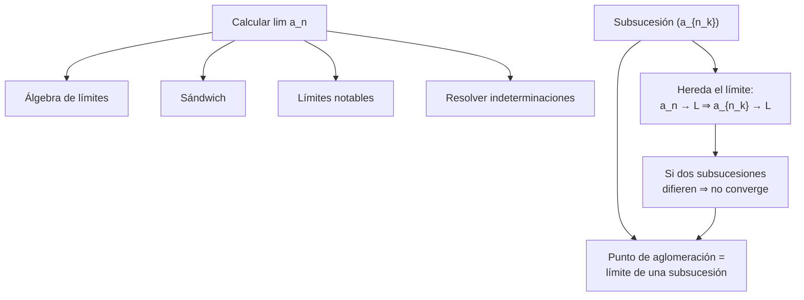
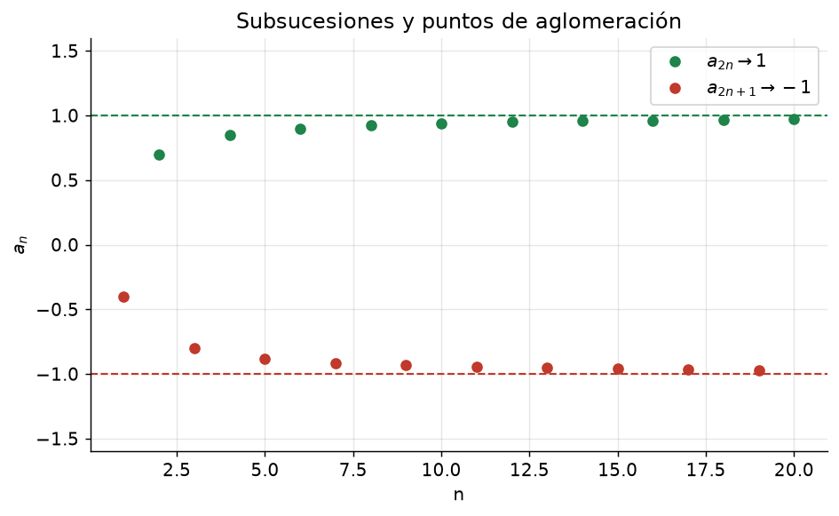

# Clase 18 — Cálculo de límites, subsucesiones y puntos de aglomeración

> **Bloque 3 · Sucesiones y series · Dificultad: media · Tiempo estimado: 115 min**

---

## 🎯 Objetivos

1. **Calcular** límites de sucesiones combinando álgebra, sándwich y **límites notables**.
2. Identificar y resolver las formas **indeterminadas** típicas ($\infty-\infty$, $0\cdot\infty$, $\frac\infty\infty$, $1^\infty$).
3. Definir **subsucesión** y saber que **heredan el límite** de la sucesión.
4. Definir **punto de aglomeración** de una sucesión (límite de una subsucesión) y **encontrarlos**.
5. Usar el criterio "**dos subsucesiones con límites distintos $\Rightarrow$ la sucesión no converge**".

---

## 🗺️ Mapa de la clase

---

## 📘 1. Herramientas para calcular límites

Ya tenemos el **álgebra de límites** y el **sándwich** (clase 16). Agregamos los **límites notables** y las técnicas estándar.

### Límites notables (memorizar)

| Límite | Resultado |
|---|---|
| $\displaystyle\lim_{n\to\infty}\left(1+\frac1n\right)^n$ | $e$ |
| $\displaystyle\lim_{n\to\infty}\left(1+\frac an\right)^n$ | $e^{a}$ |
| $\displaystyle\lim_{n\to\infty}\left(1+\frac xn\right)^n$ | $e^{x}$ |
| $\displaystyle\lim_{n\to\infty} a^{1/n}$ | $1\quad(a>0)$ |
| $\displaystyle\lim_{n\to\infty} n^{1/n}$ | $1$ |
| $\displaystyle\lim_{n\to\infty}\frac{(\log n)^\beta}{n^p}$ | $0\quad(p>0)$ |
| $\displaystyle\lim_{n\to\infty}\frac{n^k}{a^n}$ | $0\quad(a>1)$ |
| $\displaystyle\lim_{n\to\infty}\frac{a^n}{n!}$ | $0$ |
| $\displaystyle\lim_{n\to\infty}\sqrt[n]{n!}$ | $+\infty$ |

**Regla mnemotécnica de jerarquías** (de menor a mayor crecimiento, cuando $n\to\infty$):
$$
\log n \ \ll\ n^p\ (p>0) \ \ll\ a^n\ (a>1) \ \ll\ n! \ \ll\ n^n.
$$

### Formas indeterminadas típicas

- **$\frac\infty\infty$ o $\frac00$:** dividir numerador y denominador por la potencia dominante; o usar L'Hôpital vía $f(n)$ continua.
- **$\infty-\infty$:** multiplicar por el conjugado o reescribir con denominador común.
- **$0\cdot\infty$:** reescribir como cociente $\frac{0}{1/\infty}$.
- **$1^\infty$:** usar $(1+\frac an)^n\to e^a$ (o logaritmo).

---

## 📘 2. Subsucesiones

> **Definición 18.1 (subsucesión).** Dada $(a_n)$, una **subsucesión** es $(a_{n_k})_{k\in\mathbb{N}}$, donde $n_1<n_2<n_3<\cdots$ es una sucesión estrictamente creciente de índices naturales. Es decir: elegimos **algunos** términos, **respetando el orden**.

**Ejemplos.** De $(a_n)$:
- índices **pares** $a_{2},a_{4},a_{6},\dots$: la subsucesión $(a_{2k})$.
- índices **impares** $(a_{2k+1})$.
- los que cumplen $n\equiv0\pmod 3$: $(a_{3k})$.

> **Teorema 18.2 (notas, Teorema 3.21).** Si $a_n\to L$, **toda** subsucesión $(a_{n_k})$ converge a $L$.
>
> *Demostración.* Sea $\varepsilon>0$. Existe $n_0$ tal que $|a_n-L|<\varepsilon$ para $n\geq n_0$. Como $n_k\to+\infty$, existe $k_0$ con $n_k\geq n_0$ para $k\geq k_0$; entonces $|a_{n_k}-L|<\varepsilon$. ✔

> 💡 **Contrarrecíproco (¡muy útil en múltiple opción!).** Si encontrás **dos** subsucesiones con límites **distintos**, la sucesión **no** converge. Y si encontrás **una** subsucesión divergente ($\to\pm\infty$), tampoco converge.

---

## 📘 3. Puntos de aglomeración de una sucesión

> **Definición 18.3 (notas).** Un punto $p\in\mathbb{R}$ es **punto de aglomeración** (o de acumulación) de la sucesión $(a_n)$ si existe una **subsucesión** que converge a $p$.

**Ejemplos (notas).**
- $a_n=(-1)^n$: $a_{2k}=1\to1$ y $a_{2k+1}=-1\to-1$. Puntos de aglomeración: $\{1,-1\}$. La sucesión **no** converge.
- $a_n=n+(-1)^n n$: $a_{2k+1}=0\to0$; $a_{2k}=4k\to+\infty$. Puntos de aglomeración: $\{0\}$ (¡aunque diverja!).

> ⚠️ **Diferencia clave.** "$a_n\to L$" (converge) es **más fuerte** que "tiene un punto de aglomeración": puede haber muchos puntos de aglomeración y ningún límite. Si hay **un solo** punto de aglomeración y la sucesión además está acotada, entonces **converge** (relación con Bolzano–Weierstrass, clase 19).

> 💡 **Ojo con los conjuntos finitos/infinitos:** el conjunto de puntos de aglomeración es **cerrado**. Por eso $\{1/n:n\in\mathbb{N}\}$ **no** puede ser *todo* el conjunto de puntos de aglomeración: el 0 también lo sería.

---

## ✏️ 4. Ejercicios resueltos paso a paso

### Ejercicio 1 (Práctico 2, ej. 3). Calcular los límites

**a) $a_n=\dfrac{\cos n}{n}\to0$.** $\cos n$ es acotada y $\frac1n\to0$; por "producto 0 × acotada" (clase 16), el límite es $0$.

**b) $a_n=\sqrt{n+1}-\sqrt n$.** Indeterminación $\infty-\infty$: multiplicamos por el **conjugado**:
$$
\sqrt{n+1}-\sqrt n=\frac{(\sqrt{n+1}-\sqrt n)(\sqrt{n+1}+\sqrt n)}{\sqrt{n+1}+\sqrt n}=\frac{1}{\sqrt{n+1}+\sqrt n}\to0.
$$

**c) $a_n=\dfrac{2n-5}{n+3}-5^{1/n}$.** Primer término: dividimos por $n$: $\dfrac{2-5/n}{1+3/n}\to2$. Segundo: $5^{1/n}\to1$ (límite notable $a^{1/n}\to1$). Entonces $a_n\to2-1=1$.

**d) $a_n=\dfrac{n^{p}}{\alpha^n+\beta^n}$ con $\alpha,\beta>0$.** Sea $\gamma=\max(\alpha,\beta)$. Factorizando $\gamma^n$:
$$
a_n=\frac{n^p}{\gamma^n\left[(\alpha/\gamma)^n+(\beta/\gamma)^n\right]}.
$$
Como $(\alpha/\gamma)^n$ y $(\beta/\gamma)^n$ están acotados entre $0$ y $1$ (y al menos uno $\to1$), el corchete está acotado; y $\dfrac{n^p}{\gamma^n}\to0$ si $\gamma>1$. **Si $\gamma>1$: $a_n\to0$.** Si $\gamma=1$ ($\alpha=\beta=1$), $a_n=\frac{n^p}{2}\to+\infty$ para $p>0$.

**e) $a_n=\sin\!\left(\dfrac1n\right)\cos n\to0$.** $\sin(1/n)\to0$ y $\cos n$ acotada: producto $0\times$ acotada.

**f) $a_n=\dfrac{n^\alpha}{e^n}$, $\alpha\in\mathbb{R}$.** Jerarquía: exponencial $\gg$ potencia $\Rightarrow a_n\to0$ para **todo** $\alpha\in\mathbb{R}$.

**g) $a_n=\dfrac{3^n+(-2)^n}{3^{n+1}+(-2)^{n+1}}$.** Dividimos todo por $3^n$:
$$
a_n=\frac{1+(-2/3)^n}{3+(-2)(-2/3)^n}\to\frac{1+0}{3+0}=\frac13,
$$
porque $(-2/3)^n\to0$ (base en valor absoluto $<1$).

---

### Ejercicio 2 (Práctico 2, ej. 4). ¿Existen subsucesiones convergentes? ¿A qué?

En todos: buscamos las **subsucesiones** mirando $n$ **pares/impares** o módulo un período.

**a) $a_n=\dfrac{1+(-1)^n}{2}$.** $a_n=1$ si $n$ par, $a_n=0$ si $n$ impar. Los pares dan la subsucesión constante $1$; los impares, $0$. **Subsucesiones convergentes: sí**, a $1$ y a $0$. (La sucesión **no** converge.)

**b) $a_n=(-1)^n n$.** $a_{2k}=2k\to+\infty$, $a_{2k+1}=-(2k+1)\to-\infty$. **No** hay subsucesión convergente: $|a_n|\to+\infty$ (no está acotada).

**c) $a_n=3\cos(n\pi)$.** $\cos(n\pi)=(-1)^n$, así que $a_{2k}=3\to3$ y $a_{2k+1}=-3\to-3$. **Subsucesiones convergentes: sí**, a $3$ y $-3$.

**d) $a_n=\dfrac{n-1}{n+1}\cos\!\left(\dfrac{2n\pi}{3}\right)$.** $\dfrac{n-1}{n+1}\to1$. El coseno tiene **período 3**:
$$
n\equiv0\!\!\pmod3:\ \cos0=1;\qquad n\equiv1:\ \cos\tfrac{2\pi}{3}=-\tfrac12;\qquad n\equiv2:\ \cos\tfrac{4\pi}{3}=-\tfrac12.
$$
Entonces $a_{3k}\to1$ y $a_{3k+1},\,a_{3k+2}\to-\tfrac12$. **Subsucesiones convergentes: sí**, a $1$ y $-\tfrac12$.

**e) $a_n=n^2(1+(-1)^n)$.** $n$ par: $2n^2\to+\infty$; $n$ impar: $0$. La subsucesión **impar** es constante $0$. **Subsucesiones convergentes: sí** (a $0$; la par diverge).

**f) $a_n=n^{(-1)^n}$.** $n$ par: $n\to+\infty$; $n$ impar: $1/n\to0$. **Subsucesiones convergentes: sí** (la impar $\to0$).

**g) $a_n=\dfrac{(-1)^n}{n}+\dfrac{1+(-1)^n}{2}$.** $n$ par: $\frac1n+1\to1$; $n$ impar: $-\frac1n+0\to0$. **Subsucesiones convergentes: sí**, a $1$ y a $0$.

---

### Ejercicio 3 (Práctico 2, ej. 5). Sucesiones con puntos de aglomeración dados

**a) Puntos de aglomeración exactamente $\{1,2,3,4\}$.** Tomamos la sucesión que **recorre** $1,2,3,4$ una y otra vez:
$$
(a_n)=(1,2,3,4,1,2,3,4,1,2,3,4,\dots).
$$
Cada valor aparece **infinitas veces**; las subsucesiones constantes convergen a cada uno, y no hay otros. ✔

**b) Puntos de aglomeración: **todos** los naturales.** Listamos, bloque a bloque, más y más naturales:
$$
(1;\ 1,2;\ 1,2,3;\ 1,2,3,4;\ \dots).
$$
Cada $k\in\mathbb{N}$ aparece infinitas veces, así que es punto de aglomeración; y no aparece ningún no-natural. ✔

**c) ¿Puede el conjunto de puntos de aglomeración ser exactamente $A=\{1/n:n\in\mathbb{N}\}$?** **No.** Si cada $1/n$ es punto de aglomeración, hay subsucesiones que tienden a $1, \frac12, \frac13,\dots$; pero entonces también podemos construir una subsucesión que tienda a $0$ (tomando términos cada vez más cerca de $1/k$ con $k\to\infty$). Como $0\notin A$, el conjunto real de puntos de aglomeración es $A\cup\{0\}$, que es **cerrado** ($A$ solo no lo es). ✔

---

## 🏛️ 5. Ejercicios de parcial/examen

### Ejercicio 4 (Primer parcial 2024-1S, MO 5). $a_n=\dfrac{n}{2n+1}\sin\!\left(\dfrac{n\pi}{2}\right)$. ¿Puntos de aglomeración?

**Separamos por $\bmod 4$** (período del seno) y usamos $\dfrac{n}{2n+1}\to\dfrac12$:

| $n\bmod4$ | $\sin(n\pi/2)$ | $a_n\to$ |
|---|---|---|
| $0$ | $0$ | $0$ |
| $1$ | $1$ | $\tfrac12$ |
| $2$ | $0$ | $0$ |
| $3$ | $-1$ | $-\tfrac12$ |

Puntos de aglomeración: $\big\{\tfrac12,-\tfrac12,0\big\}$: **tres**. Como hay más de uno, la sucesión **no** tiene límite.

**Respuesta: (A) exactamente 3 puntos de aglomeración, pero no tiene límite.** ✔

---

### Ejercicio 5 (Primer parcial 2021-2S, V/F 3). Si $a_n\to0$ y $a_n\geq0$, ¿$\sum a_n$ converge? (F)

*(Ejercicio puente hacia series, clase 21.)* **Falso:** $a_n=\dfrac1n\to0$ y $a_n\geq0$, pero $\sum\frac1n$ **diverge**. Es la **condición necesaria** ($a_n\to0$) que **no** es suficiente.

---

## ⚠️ 6. Errores comunes

| Error | Corrección |
|---|---|
| Concluir "no converge" porque una **subsucesión** no converge | hay que hallar dos límites distintos (o una divergente) |
| Confundir sub **sucesión** con sub **conjunto** | se conserva el **orden** de los índices |
| Olvidar multiplicar por el conjugado en $\infty-\infty$ con raíces | $\sqrt{n+1}-\sqrt n=\frac{1}{\sqrt{n+1}+\sqrt n}$ |
| Aplicar $(1+1/n)^n\to e$ mal | es $e^{a}$ para $(1+a/n)^n$; y ojo con el exponente |
| Decir que $n^\alpha/e^n\to\infty$ | la exponencial **gana**: $\to0$ para todo $\alpha$ |
| Creer que un punto de aglomeración es un límite | puede haber varios; la sucesión puede no converger |
| Ignorar el período de $\sin$/$\cos$ al partir en subsucesiones | usar $\bmod$ del período |

---

## 🔗 7. Conexión con el resto del curso

- **Clase 17 (PSMC):** para recurrencias; acá calculamos el límite ya sabiendo que existe.
- **Clase 19:** **Bolzano–Weierstrass** garantiza que toda sucesión acotada tiene subsucesión convergente (¡existencia de puntos de aglomeración!).
- **Clase 20:** repaso del bloque.
- **Bloque 4 (series):** el **criterio del término general** ($a_n\to0$) es la primera herramienta.
- **Topología (bloque 6):** el conjunto de puntos de aglomeración es **cerrado**, y las sucesiones serán la forma de testear abiertos/cerrados.

---

## ✅ 8. Autoevaluación

1. Calcular $\displaystyle\lim_{n\to\infty}\frac{3n^3-2n}{4n^3+n^2+1}$.
2. Calcular $\displaystyle\lim_{n\to\infty}\left(\sqrt{n^2+n}-n\right)$.
3. Hallar los puntos de aglomeración de $a_n=(-1)^n+\dfrac1n$.
4. Hallar los puntos de aglomeración de $a_n=\cos\!\left(\dfrac{n\pi}{2}\right)$.
5. Calcular $\displaystyle\lim_{n\to\infty}\left(1+\frac{3}{n}\right)^n$.
6. (V/F) Si dos subsucesiones de $(a_n)$ convergen al mismo $L$, entonces $a_n\to L$.

Respuestas

1. $\dfrac34$ (dividir por $n^3$).
2. $\sqrt{n^2+n}-n=\dfrac{n}{\sqrt{n^2+n}+n}\to\dfrac12$.
3. Pares: $1+\frac1n\to1$; impares: $-1+\frac1n\to-1$. Puntos: $\{1,-1\}$.
4. $\cos(n\pi/2)$ toma $1,0,-1,0$ según $n\bmod4$. Puntos: $\{1,0,-1\}$.
5. $e^3$.
6. **Falso.** Que **dos** subsucesiones coincidan no alcanza: hay que controlar **todas**. Contraejemplo: $a_n=(-1)^n$; las subsucesiones $(a_{2n})$ y $(a_{4n})$ convergen **ambas** a $1$, pero $a_n$ no converge (los impares van a $-1$).

---

**⬅️ Anterior:** [Clase 17 — Sucesiones monótonas y recurrencias](17_sucesiones_monotonas.md) · 🏠 [Índice](00_indice.md) · **➡️ Siguiente:** [Clase 19 — Bolzano–Weierstrass, Cauchy y sucesiones en Rⁿ](19_bw_cauchy_rn.md)
