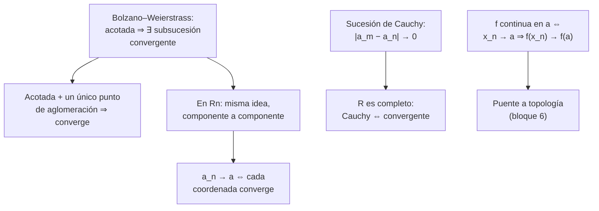
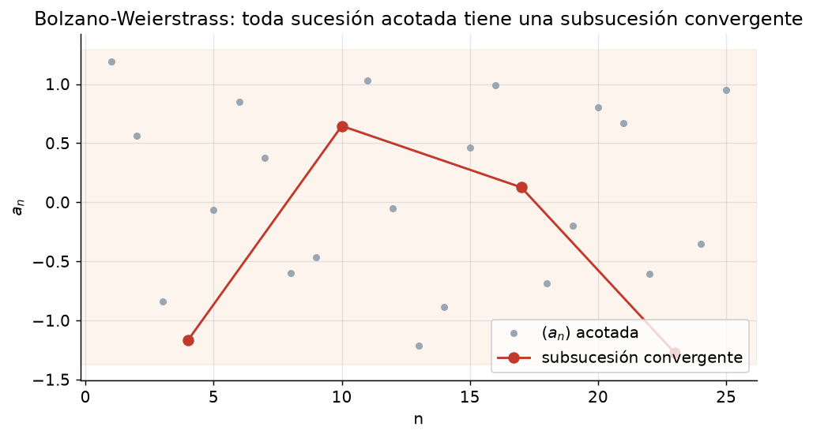
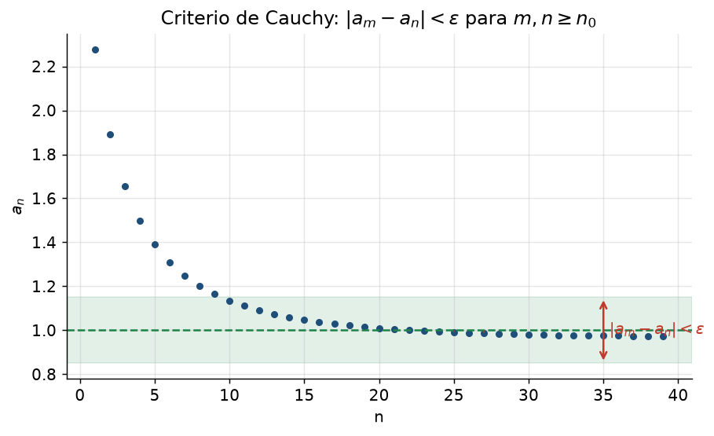

# Clase 19 — Bolzano–Weierstrass, sucesiones de Cauchy y sucesiones en $\mathbb{R}^n$

> **Bloque 3 · Sucesiones y series · Dificultad: alta · Tiempo estimado: 130 min**

---

## 🎯 Objetivos

1. Enunciar y usar el **teorema de Bolzano–Weierstrass** (BW): toda sucesión **acotada** tiene subsucesión convergente.
2. Deducir el **criterio de convergencia**: acotada + **único** punto de aglomeración $\Rightarrow$ converge.
3. Definir **sucesión de Cauchy** y saber que en $\mathbb{R}$ (y en $\mathbb{R}^n$): **Cauchy $\Leftrightarrow$ convergente**.
4. Manejar **sucesiones en $\mathbb{R}^n$**: convergencia **coordenada a coordenada**, norma, BW en $\mathbb{R}^n$.
5. Usar sucesiones para caracterizar **continuidad** y **conjuntos cerrados**.

---

## 🗺️ Mapa de la clase

---

## 📘 1. Teorema de Bolzano–Weierstrass

> **Teorema 19.1 (Bolzano–Weierstrass).** Toda sucesión **acotada** de números reales tiene **alguna** subsucesión convergente.

**Idea de la demostración (subsucesión monótona).** Toda sucesión admite una subsucesión **monótona** (esto se prueba aparte). Si la sucesión es acotada, esa subsucesión monótona es monótona **y acotada**, así que por **PSMC** (clase 17) converge. ✔

**Relectura con puntos de aglomeración:** toda sucesión acotada tiene **al menos un** punto de aglomeración. (No garantiza unicidad.)

> **Corolario 19.2 (criterio de convergencia).** Si $(a_n)$ es **acotada** y tiene **un único** punto de aglomeración $L$, entonces $a_n\to L$.
>
> *Demostración.* Supongamos que $a_n\not\to L$. Entonces existe $\varepsilon>0$ tal que **infinitos** términos quedan fuera de $E(L,\varepsilon)$; con esos índices formamos una subsucesión, que sigue siendo **acotada**, así que por BW tiene una subsucesión convergente a algún $p\notin E(L,\varepsilon)$, es decir $p\neq L$. Ese $p$ sería **otro** punto de aglomeración, contradiciendo la unicidad. ✔

> 💡 **Uso práctico:** "acotada + un solo punto de aglomeración" es una forma muy cómoda de probar convergencia, sobre todo en $\mathbb{R}^n$ y cuando la monotonía no es evidente.

---

## 📘 2. Sucesiones de Cauchy

> **Definición 19.3 (Cauchy).** $(a_n)$ es de **Cauchy** si
> $$
> \forall\varepsilon>0,\ \exists n_0:\ \forall m,n\geq n_0,\ |a_m-a_n|<\varepsilon.
> $$
> Es decir: los términos se acercan **entre sí** (no a un límite prefijado).

> **Teorema 19.4 (completitud de $\mathbb{R}$).** Una sucesión de números reales es **convergente si y solo si** es de **Cauchy**.

**Idea.** ($\Rightarrow$) Si $a_n\to L$, $|a_m-a_n|\leq|a_m-L|+|L-a_n|<2\varepsilon$. ($\Leftarrow$) Una sucesión de Cauchy es **acotada** (los términos lejanos se apiñan, los primeros son finitos); por **BW** tiene subsucesión convergente a $L$; y como los términos se apiñan, **toda** la sucesión va a $L$. ✔ Esta propiedad se llama **completitud** y es lo que distingue a $\mathbb{R}$ de $\mathbb{Q}$.

> 💡 **Para qué sirve Cauchy en la práctica:** para probar convergencia **sin conocer el límite** (típico en series: el criterio de Cauchy). Equivalentemente: $\sum a_n$ converge sii las sumas parciales son de Cauchy.

---

## 📘 3. Sucesiones en $\mathbb{R}^n$

Una **sucesión en $\mathbb{R}^n$** es $a:\mathbb{N}\to\mathbb{R}^n$, o sea $a_k=(x_k^{(1)},\dots,x_k^{(n)})$. Se dice que $a_k\to a=(a_1,\dots,a_n)$ si
$$
\|a_k-a\|=\sqrt{(x_k^{(1)}-a_1)^2+\cdots+(x_k^{(n)}-a_n)^2}\ \longrightarrow\ 0.
$$

> **Propiedad 19.5 (convergencia por coordenadas).** En $\mathbb{R}^n$,
> $$
> a_k\to a\ \Longleftrightarrow\ x_k^{(j)}\to a_j\quad\text{para cada coordenada }j=1,\dots,n.
> $$

**Por qué:** $\|a_k-a\|\geq|x_k^{(j)}-a_j|$ da ($\Rightarrow$); y $\|a_k-a\|^2=\sum_j(x_k^{(j)}-a_j)^2$ da ($\Leftarrow$) (finita suma de términos que tienden a 0).

> **BW en $\mathbb{R}^n$.** Toda sucesión **acotada** en $\mathbb{R}^n$ (o sea, $\|a_k\|\leq M$) tiene una subsucesión convergente. (Se aplica BW coordenada a coordenada, pasando a subsucesiones sucesivamente.) Es la versión "multivariada" del teorema.

> 💡 **Cuidado:** "$a_k$ acotada" significa que **todas** las coordenadas están acotadas. Si **una** sola coordenada diverge, la sucesión no converge (opción típica de examen).

---

## ✏️ 4. Ejercicios resueltos paso a paso

### Ejercicio 1 (Práctico 2, ej. 6). Si $a_{2n}$, $a_{2n+1}$ y $a_{3n}$ convergen, probar que $a_n$ converge

Sean
$$
L_1=\lim a_{2n},\qquad L_2=\lim a_{2n+1},\qquad L_3=\lim a_{3n}.
$$

**Paso 1 — comparamos.** La subsucesión $a_{6n}$ es, a la vez, subsucesión de $a_{2n}$ ($6n$ es par) y de $a_{3n}$ ($6n$ es múltiplo de 3). Por el **Teorema 18.2**, ambas comparten el límite:
$$
L_1=\lim a_{6n}=L_3.
$$
Análogamente $a_{6n+3}$ es impar y múltiplo de 3, luego es subsucesión de $a_{2n+1}$ y de $a_{3n}$:
$$
L_2=\lim a_{6n+3}=L_3.
$$
Así $L_1=L_2=L_3=:L$.

**Paso 2 — probamos $a_n\to L$.** Dado $\varepsilon>0$: de $a_{2n}\to L$ existe $N_1$ con $|a_{2n}-L|<\varepsilon$ para $n\geq N_1$, o sea para **índices pares** $\geq 2N_1$. De $a_{2n+1}\to L$ existe $N_2$ con $|a_{2n+1}-L|<\varepsilon$ para **índices impares** $\geq 2N_2+1$. Tomando $n_0=\max(2N_1,\ 2N_2+1)$, **cualquier** $n\geq n_0$ es par o impar y cumple $|a_n-L|<\varepsilon$. Por lo tanto $a_n\to L$. ✔

---

### Ejercicio 2 (Práctico 2, ej. 7). $L=\sup(A)$ sii es cota superior y hay una sucesión de $A$ que tiende a $L$

**($\Rightarrow$) Supongamos $L=\sup(A)$.** Por definición de supremo, $L$ es **cota superior**: $L\geq x\ \forall x\in A$ (es el punto (a)).

Para (b), en cada paso $m\in\mathbb{N}$, el número $L-\frac1m$ **no** es cota superior (porque $L$ es la **menor**), así que existe $x_m\in A$ con
$$
L-\frac1m<x_m\leq L.
$$
Entonces $|x_m-L|<\frac1m\to0$, o sea $x_m\to L$. ✔

**($\Leftarrow$) Supongamos (a) y (b).** Por (a), $L$ es cota superior de $A$. Sea $M$ **cualquier** cota superior de $A$. Como $x_m\in A$, $x_m\leq M$ para todo $m$; tomando límite, $L=\lim x_m\leq M$. Así $L$ es $\leq$ **toda** cota superior, es decir $L=\sup(A)$. ✔

> 💡 Este ejercicio justifica que, para hallar el supremo, alcanza con **construir una sucesión dentro del conjunto que se acerque**.

---

### Ejercicio 3 (Práctico 2, ej. 9). Si $a_n\to0$, probar que $a_n^2\leq|a_n|$ salvo finitos

Como $a_n\to0$, con $\varepsilon=1$ existe $n_0$ tal que $|a_n|<1$ para todo $n\geq n_0$. Entonces, para $n\geq n_0$:
$$
a_n^2=|a_n|^2=|a_n|\cdot|a_n|\leq|a_n|\cdot1=|a_n|.\ \checkmark
$$

> 💡 Se usa cuando querés controlar $a_n^2$ por $|a_n|$ (por ejemplo, en comparación de series).

---

### Ejercicio 4 (Práctico 2, ej. 10). Si $a_n\to\alpha$ y $f$ es continua en $\alpha$, entonces $f(a_n)\to f(\alpha)$

**Paso 1 — continuidad.** Por ser $f$ continua en $\alpha$, dado $\varepsilon>0$ existe $\delta>0$ tal que
$$
|x-\alpha|<\delta\ \Longrightarrow\ |f(x)-f(\alpha)|<\varepsilon.
$$

**Paso 2 — convergencia de $a_n$.** Como $a_n\to\alpha$, con **ese** $\delta$ existe $n_0$ tal que $|a_n-\alpha|<\delta$ para $n\geq n_0$.

**Paso 3 — combinamos.** Para $n\geq n_0$, $|a_n-\alpha|<\delta$, luego $|f(a_n)-f(\alpha)|<\varepsilon$. Por lo tanto $f(a_n)\to f(\alpha)$. ✔

> 💡 Este resultado es **clave** para la topología y la continuidad del bloque 7: es la definición secuencial de continuidad.

---

## 🏛️ 5. Ejercicios de parcial/examen

### Ejercicio 5 (Primer parcial 2022-1S, MO 8). Datos: $(a_{2n})$ creciente y acotada; $(a_{2n+1})$ no converge y es acotada

Analizamos cada afirmación.

- **(I) $(a_n)$ no puede converger.** Cierto: si $a_n\to L$, **toda** subsucesión iría a $L$, en particular $(a_{2n+1})$ convergería, contradicción. **VERDADERA.**
- **(II) $(a_{2n+1})$ tiene una subsucesión convergente.** Cierto por **Bolzano–Weierstrass**: es **acotada**. **VERDADERA.**
- **(III) $(a_{4n})$ es convergente.** $a_{4n}$ es subsucesión de $a_{2n}$, que converge; luego $a_{4n}$ converge al mismo límite. **VERDADERA.**
- **(IV) $(a_{3n})$ no puede converger.** Falso: no está forzado. $a_{3n}$ mezcla índices pares ($n$ par) e impares ($n$ impar); **podría** converger o no según la sucesión. **FALSA.**

**Respuesta: (A) I, II y III son verdaderas y IV es falsa.** ✔

---

### Ejercicio 6 (Examen julio 2022, MO 8). $(a_n,b_n)$ sucesión en $\mathbb{R}^2$. ¿Qué afirmación es cierta?

- **(A)** "Si $(a_n)$ y $(b_n)$ no convergen entonces $(a_n,b_n)$ no tiene subsucesión convergente." **Falso:** $a_n=(-1)^n$, $b_n=(-1)^{n+1}$; la subsucesión de $n$ par da $(1,-1)$, que converge.
- **(B)** "Si $(a_n,b_n)$ converge entonces $c_n=a_nb_n$ converge." **Verdadero:** si la sucesión de $\mathbb{R}^2$ converge, cada coordenada converge (Prop. 19.5); el producto de dos convergentes converge.
- **(C)** "$d_n=a_n+b_n$ diverge." **Falso:** si ambas convergen, la suma converge.
- **(D)** "Si tiene una subsucesión convergente entonces $(a_n,b_n)$ converge." **Falso:** $((-1)^n,0)$ tiene subsucesión convergente pero no converge.

**Respuesta: (B).** ✔

---

### Ejercicio 7 (Primer parcial 2021-2S, MO 7). Sucesión en $\mathbb{R}^2$ con segunda coordenada oscilante

$$
a_n=\left(\frac{n^2\big(1-e^{1/n^2}\big)}{3},\ (-1)^n\frac{\log n}{\log(2n+1)}\right),\quad n\geq1.
$$

**Primera coordenada.** Con $u=\frac1{n^2}\to0$ y $e^u-1\sim u$:
$$
n^2(1-e^{1/n^2})=-n^2(e^{1/n^2}-1)\ \longrightarrow\ -1,\qquad\text{así que}\quad \frac{\cdot}{3}\to-\frac13.
$$

**Segunda coordenada.** $\dfrac{\log n}{\log(2n+1)}=\dfrac{\log n}{\log n+\log(2+1/n)}\to1$, por lo que
$$
(-1)^n\frac{\log n}{\log(2n+1)}\ \longrightarrow\ +1\ (\text{n par})\quad\text{o}\quad -1\ (\text{n impar}).
$$
No converge: oscila entre $1$ y $-1$ (está acotada por $1$).

**Conclusión.** La sucesión de $\mathbb{R}^2$ está **acotada** y **no** converge; tiene exactamente dos puntos de aglomeración:
$$
\left(-\tfrac13,\ 1\right)\quad\text{y}\quad\left(-\tfrac13,\ -1\right).
$$

**Respuesta: (C).** ✔ *(Ojo: el primer componente converge, pero el segundo no; la convergencia en $\mathbb{R}^n$ exige que converjan **todas** las coordenadas.)*

---

### Ejercicio 8 (Examen julio 2019, ej. 7). Definiciones y continuidad secuencial

**(a) Límite de una sucesión en $\mathbb{R}^n$.** $x_k\to a$ (con $a\in\mathbb{R}^n$) sii
$$
\forall\varepsilon>0,\ \exists k_0\in\mathbb{N}:\ \forall k\geq k_0,\ \|x_k-a\|<\varepsilon.
$$

**(b) $f:\mathbb{R}^n\to\mathbb{R}$ continua en $a$.** Si para todo $\varepsilon>0$ existe $\delta>0$ tal que $\|x-a\|<\delta\Rightarrow|f(x)-f(a)|<\varepsilon$.

**(c) Continuidad $\Rightarrow$ continuidad secuencial.** Es el **Ejercicio 4** con $\mathbb{R}^n$ en lugar de $\mathbb{R}$: dado $\varepsilon>0$, tomamos el $\delta>0$ de la continuidad; como $x_k\to a$, para $k\geq k_0$ se tiene $\|x_k-a\|<\delta$, y entonces $|f(x_k)-f(a)|<\varepsilon$. Por lo tanto $f(x_k)\to f(a)$. ✔

---

## ⚠️ 6. Errores comunes

| Error | Corrección |
|---|---|
| Confundir Cauchy con convergente **fuera** de $\mathbb{R}$ | en $\mathbb{Q}$ hay Cauchy no convergentes; en $\mathbb{R}$ (y $\mathbb{R}^n$) son equivalentes |
| Creer que "una" subsucesión convergente implica convergencia | hace falta **unicidad** del punto de aglomeración (o que **todas** converjan a lo mismo) |
| En $\mathbb{R}^n$, chequear una sola coordenada | hay que chequear **todas** (Prop. 19.5) |
| Decir que una sucesión en $\mathbb{R}^2$ converge si una componente oscila | no converge |
| Aplicar BW a una sucesión **no acotada** | BW exige acotación |
| Usar continuidad secuencial al revés | es $x_n\to a\Rightarrow f(x_n)\to f(a)$ |
| Olvidar que $\|a_k-a\|\geq|x_k^{(j)}-a_j|$ | sirve para la dirección ($\Rightarrow$) |

---

## 🔗 7. Conexión con el resto del curso

- **Clase 17 (PSMC) y 18 (subsucesiones):** BW y Cauchy cierran la teoría de sucesiones en $\mathbb{R}$.
- **Bloque 4 (series, 21–25):** el **criterio de Cauchy** para series, y la convergencia absoluta, usan estos resultados.
- **Bloque 6–7 (topología y continuidad):** las sucesiones **caracterizan** continuidad y conjuntos **cerrados/compactos** (clase 20 da el puntapié; bloque 6 lo desarrolla).
- **Compacidad (bloque 6):** "toda sucesión en $K$ compacto tiene subsucesión convergente **en** $K$" es BW + cerrado.

---

## ✅ 8. Autoevaluación

1. Enunciar Bolzano–Weierstrass y decir por qué necesita "acotada".
2. Dar una sucesión acotada de $\mathbb{R}$ con **dos** puntos de aglomeración.
3. Probar que toda sucesión de Cauchy es acotada.
4. $a_n=\left(\sin\frac1n,\ \cos\frac1n\right)$ en $\mathbb{R}^2$: ¿converge? ¿a qué?
5. (V/F) Si $(a_n,b_n)$ es acotada en $\mathbb{R}^2$, entonces tiene una subsucesión convergente.
6. Usar el Ejercicio 4 para calcular $\displaystyle\lim_{n\to\infty}\sin\!\left(\frac1n\right)$ si se sabe que $\frac1n\to0$.

Respuestas

1. Toda sucesión **acotada** de $\mathbb{R}$ tiene subsucesión convergente. Necesita acotada: $a_n=n$ no tiene subsucesión convergente.
2. $a_n=(-1)^n$: puntos de aglomeración $\{1,-1\}$.
3. Con $\varepsilon=1$, hay $n_0$ con $|a_n-a_{n_0}|<1$ para $n\geq n_0$; luego $|a_n|<|a_{n_0}|+1$ y $M=\max\{|a_1|,\dots,|a_{n_0}|+1\}$ acota.
4. Sí: $\sin\frac1n\to\sin0=0$ y $\cos\frac1n\to\cos0=1$; converge a $(0,1)$.
5. **Verdadero** (BW en $\mathbb{R}^n$).
6. Como $\sin$ es continua en $0$ y $\frac1n\to0$, $\sin(1/n)\to\sin0=0$.

---

**⬅️ Anterior:** [Clase 18 — Límites y subsucesiones](18_limites_subsucesiones.md) · **➡️ Siguiente:** [Clase 20 — Repaso de sucesiones y parciales](20_sucesiones_repaso.md)
