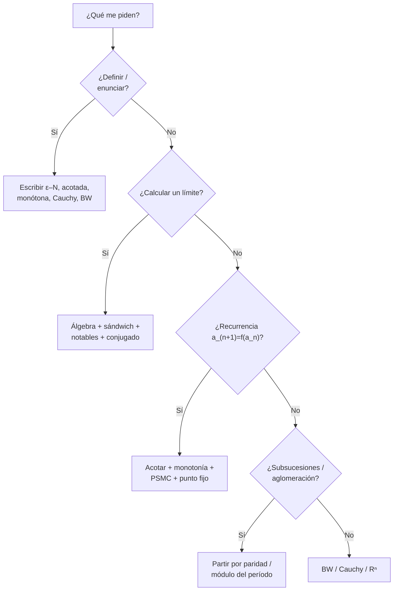
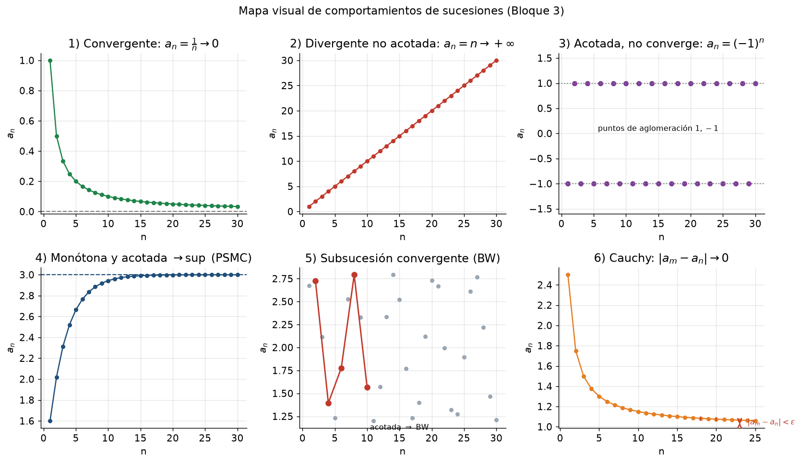

# Clase 20 — Repaso de sucesiones y problemas de parcial/examen

> **Bloque 3 · Sucesiones y series · Dificultad: repaso · Tiempo estimado: 130 min**

---

## 🎯 Objetivos

1. **Clasificar** cualquier problema de sucesiones y elegir la herramienta en segundos.
2. Consolidar definiciones, teoremas y criterios del bloque.
3. Resolver los ejercicios de **evaluaciones anteriores** del Práctico 2 y problemas de parcial/examen.
4. Practicar el **descarte de opciones** y la **verificación**.

---

## 🗺️ 1. Árbol de decisión

---

## 📋 2. Hoja de ruta del Bloque 3

| Concepto | Definición / resultado |
|---|---|
| **Límite** | $\forall\varepsilon>0\ \exists n_0:\ \forall n\geq n_0,\ |a_n-L|<\varepsilon$ |
| **Acotada** | $\exists M>0:\ |a_n|\leq M\ \forall n$ |
| **Monótona** | $a_{n+1}\geq a_n$ (crec.) o $a_{n+1}\leq a_n$ (decrec.) |
| **PSMC** | monótona + acotada $\Rightarrow$ converge (al $\sup$/$\inf$) |
| **Subsucesión** | $a_n\to L\Rightarrow a_{n_k}\to L$ |
| **Aglomeración** | límite de una subsucesión; el conjunto es **cerrado** |
| **BW** | acotada $\Rightarrow$ ∃ subsucesión convergente |
| **Criterio** | acotada + único punto de aglomeración $\Rightarrow$ converge |
| **Cauchy** | $\forall\varepsilon>0\ \exists n_0:\ m,n\geq n_0\Rightarrow|a_m-a_n|<\varepsilon$ |
| **Completitud** | en $\mathbb{R}$ (y $\mathbb{R}^n$): Cauchy $\Leftrightarrow$ convergente |
| **$\mathbb{R}^n$** | $a_k\to a\Leftrightarrow$ cada coordenada converge |

**Límites notables:** $\left(1+\frac an\right)^n\to e^a$, $a^{1/n}\to1$, $n^{1/n}\to1$, $\dfrac{n^k}{a^n}\to0\ (a>1)$, $\dfrac{\log n}{n^p}\to0$.

**Cómo leer la figura:** cualquier problema de sucesiones se encaja en uno de estos seis casos. (1) y (4) **convergen** con existencia garantizada (álgebra o PSMC); (2) diverge por no estar **acotada**; (3) está **acotada** pero oscila (necesitás subsucesiones para demostrar que no tiene límite); (5) usa **Bolzano–Weierstrass** para extraer una subsucesión buena; (6) es el **criterio de Cauchy**, que no te obliga a conocer el límite.

---

## ✏️ 3. Evaluaciones anteriores (Práctico 2) resueltas

### Ejercicio 1 (Primer parcial 2022-2S). Definiciones + producto por acotada + ejemplos $0\times\infty$

Visto en detalle en la **clase 16** (Ejercicios 2, 3 y 4). En resumen:
- (1) Definición de límite finito y de sucesión acotada (**clase 16, §2 y §3**).
- (2) $a_n\to0$, $(b_n)$ acotada $\Rightarrow a_nb_n\to0$ (**clase 16, Corolario**).
- (3) Ejemplos: $a_n=\frac1n,\ b_n=\sqrt n\Rightarrow a_nb_n\to0$; $a_n=\frac1n,\ b_n=n\Rightarrow a_nb_n\to1$.

---

### Ejercicio 2 (Examen febrero 2022). $a_n=\dfrac{\sqrt n}{n+2}$, $b_n=\dfrac{1}{n\ln n\,(\ln\ln n)^2}$

**a) $(a_n)$.** Estudiamos $a_{n+1}/a_n$:
$$
\frac{a_{n+1}}{a_n}=\frac{\sqrt{n+1}}{n+3}\cdot\frac{n+2}{\sqrt n}=\sqrt{1+\frac1n}\cdot\frac{n+2}{n+3}.
$$
Para $n\geq2$ este cociente es $<1$: en efecto, $\sqrt{1+\frac1n}<\frac{n+3}{n+2}$ equivale (elevando al cuadrado) a $n(n+3)^2>(n+1)(n+2)^2$, o sea $n^2+n-4>0$, cierto para $n\geq2$. Entonces $a_n$ es **decreciente**; es positiva (acotada inferiormente por $0$), luego **converge**, y
$$
a_n=\frac{\sqrt n}{n+2}\sim\frac1{\sqrt n}\ \longrightarrow\ 0.
$$

**b) $(b_n)$.** El denominador $n\ln n(\ln\ln n)^2\to+\infty$, así que $b_n\to0^+$. Es **decreciente** (cada factor del denominador crece) y acotada, luego **converge a $0$**.

> 💡 Estas dos sucesiones aparecen como **términos generales** de series: $\sum a_n$ **converge** (comportamiento $n^{-1/2}$… ojo, en realidad $\sum n^{-1/2}$ diverge; el énfasis acá es solo **la sucesión**); $b_n$ es el término del ejemplo clásico que hace **divergir** $\sum b_n$ pese a ir a 0. Lo veremos en el bloque 4.

---

### Ejercicio 3 (Primer parcial 2021-2S, MO 6). $a_{n+1}=2a_n+5,\ a_0=0$

**Primeros términos:** $a_0=0,\ a_1=5,\ a_2=15,\ a_3=35,\dots$
**Término general:** $a_n=5(2^n-1)$ (se verifica por inducción).
Es **creciente** ($a_{n+1}-a_n=5\cdot2^n>0$) y **no acotada** ($2^n\to\infty$, con $5$ de factor).

**Respuesta: (A) es creciente y no es acotada.** ✔

---

### Ejercicio 4 (Primer parcial 2020-2S matutino, ej. 3). $a_n=1+\dfrac{\log n}{n^3}$

**Monotonía.** Consideramos $f(x)=1+\dfrac{\ln x}{x^3}$ (continua, derivable). Entonces
$$
f'(x)=\frac{1-3\ln x}{x^4}<0\quad\text{para }x>e^{1/3}\approx1{,}40.
$$
Así que $a_n$ es **decreciente para $n\geq2$**.

**Acotación.** Para todo $n\geq1$, $\dfrac{\ln n}{n^3}\geq0$, así que $a_n\geq1$; y como es decreciente desde $n=2$, $a_n\leq a_2=1+\dfrac{\ln2}{8}\approx1{,}09$. Está **acotada**.

**Convergencia.** Decreciente + acotada inferiormente $\Rightarrow$ converge (PSMC). Como $\dfrac{\log n}{n^3}\to0$ (jerarquía log $\ll$ potencia), $\displaystyle\lim a_n=1$. ✔

---

### Ejercicio 5 (Examen diciembre 2018/2019). $x_{n+1}=1+\dfrac1{x_n},\ x_0=1$

Resuelto en detalle en la **clase 17 (Ejercicio 4)**.

**Respuesta: (B) la sucesión NO es monótona pero SÍ está acotada.** ✔
(Subsucesiones par/impar monótonas, ambas tienden al número de oro $\varphi=\frac{1+\sqrt5}{2}$.)

---

## 🏛️ 4. Más problemas de parcial/examen

### Ejercicio 6 (Examen diciembre 2021, MO 2). $a_0=\tfrac12,\ a_{n+1}=2a_n-1$

Resuelto en la **clase 17 (Ejercicio 7)**.

**Respuesta: (A) es monótona decreciente y diverge.** ✔

---

### Ejercicio 7 (Examen julio 2022, MO 6). $a_0=\tfrac52,\ a_{n+1}=\dfrac{a_n^2}{a_n-2}$

**Diferencia.**
$$
a_{n+1}-a_n=\frac{a_n^2}{a_n-2}-a_n=\frac{a_n^2-a_n(a_n-2)}{a_n-2}=\frac{2a_n}{a_n-2}.
$$
**Por inducción, $a_n>2$.** $a_0=\tfrac52>2$. Si $a_n>2$, entonces $a_{n+1}=\dfrac{a_n^2}{a_n-2}>0$; más aún, como $a_n-2>0$ y $a_n^2>2(a_n-2)$ (pues $a_n^2-2a_n+4=(a_n-1)^2+3>0$), resulta $a_{n+1}>2$. Entonces $a_{n+1}-a_n=\dfrac{2a_n}{a_n-2}>0$: la sucesión es **creciente**.

**¿Converge?** Si convergiera a $L$, sería $L=\dfrac{L^2}{L-2}$, o $L(L-2)=L^2\Rightarrow -2L=0\Rightarrow L=0$. Pero $L=0<2$ es imposible (todos los términos $>2$). Por lo tanto **no** converge: $a_n\to+\infty$.

**Respuesta: (C) es monótona creciente y no convergente.** ✔

---

### Ejercicio 8 (Examen julio 2021, V/F). $a_n=\dfrac{\cos(2\pi/n)}{n^2}$ y $a_n=\sin\!\left(\frac{2\pi}{n}\right)+\dfrac1n$

- **V1:** $a_n=\dfrac{\cos(2\pi/n)}{n^2}$ **¿es monótona y convergente?** Primeros términos: $a_1=1$, $a_2=-\tfrac14$, $a_3=-\tfrac1{18}$, $a_4=0$, $a_5>0,\dots$: **no es monótona** (sube y baja por el coseno). **FALSO.**
- **V2:** $a_n=\dfrac{\cos(2\pi/n)}{n^2}$: **¿la sucesión y la serie $\sum a_n$ convergen?** La sucesión $\to0$; y $\sum a_n$ converge **absolutamente** pues $|a_n|\leq\frac1{n^2}$. **VERDADERO.**
- **V3:** $a_n=\sin\!\left(\frac{2\pi}{n}\right)+\dfrac1n$ **¿es monótona y convergente?** $a_1=0+1=1$, $a_2=0+\tfrac12$, $a_3=\tfrac{\sqrt3}{2}+\tfrac13\approx1{,}20$, $a_4=1+\tfrac14=1{,}25,\dots$: **no es monótona**. **FALSO.**
- **V4:** $a_n=\sin\!\left(\frac{2\pi}{n}\right)+\dfrac1n$: **¿$a_n$ converge y $\sum a_n$ diverge?** $a_n\to0$; y $\sum a_n=\sum\sin(2\pi/n)+\sum\frac1n$ **diverge** (ambas partes divergen: $\sin(2\pi/n)\sim\frac{2\pi}{n}$). **VERDADERO.**

---

### Ejercicio 9 (Examen febrero 2021, Problema 3). La pelota que rebota

Una pelota cae desde $10$ m y rebota alcanzando, cada vez, $\tfrac23$ de la altura anterior. Sean $N$ el primer rebote con altura $\leq1$ m y $H$ la suma de las alturas de los rebotes $1,\dots,N$.

**Paso 1 — las alturas.** Forman la sucesión $h_k=10\left(\tfrac23\right)^k$.

**Paso 2 — hallar $N$.** Queremos el primer $N$ con $10\left(\tfrac23\right)^N\leq1$, o sea $\left(\tfrac23\right)^N\leq\tfrac1{10}$. Tomando logaritmos (base $e$, y **atención**: $\log\tfrac23<0$, la desigualdad **se da vuelta**):
$$
N\geq\frac{\log(1/10)}{\log(2/3)}=\frac{-2{,}3026}{-0{,}4055}\approx5{,}68.
$$
El primer entero es $\boxed{N=6}$.

**Paso 3 — la suma $H$.** Es una **suma geométrica** de razón $p=\tfrac23$:
$$
H=10\sum_{k=1}^{6}\left(\tfrac23\right)^k=10\cdot\left(\tfrac23\right)\frac{1-\left(\tfrac23\right)^{6}}{1-\tfrac23}
=10\cdot2\left[1-\left(\tfrac23\right)^6\right].
$$
Como $\left(\tfrac23\right)^6=\dfrac{64}{729}$:
$$
H=20\left(1-\frac{64}{729}\right)=20\cdot\frac{665}{729}=\frac{13300}{729}\approx18{,}24\ \text{m}.
$$

> 💡 **Puente al bloque 4:** si en vez de cortar en $N$ sumamos **infinitos** rebotes, $H_\infty=20\left(1-0\right)=20$ m. La **serie geométrica** y su fórmula son el tema de la próxima clase.

---

## 🎲 5. Estrategias para la múltiple opción

1. **Recurrencias:** calculá $a_0,a_1,a_2,a_3$. Casi siempre la opción correcta salta a la vista.
2. **Si hay $\sin/\cos$ con $n$:** partí en **subsucesiones** por paridad o por el **período** (módulo $2\pi$).
3. **Si aparece $(-1)^n$:** pensá en **dos** puntos de aglomeración.
4. **Acotación:** mostrá una cota superior **e** inferior; "$>0$" o "$<3$" suele ser suficiente.
5. **Punto fijo para descartar:** si la opción afirma "límite $L$", resolvé $L=f(L)$ y verificá que $L$ esté dentro de la cota.
6. **Cauchy/BW:** "acotada" $\Rightarrow$ hay subsucesión convergente; para converger falta **unicidad** del punto de aglomeración.
7. **$\mathbb{R}^n$:** chequeá **cada** coordenada por separado.

---

## ⚠️ 6. Errores comunes (recopilación del bloque)

| Error | Corrección |
|---|---|
| "Acotada $\Rightarrow$ convergente" | falta monotonía o unicidad de aglomeración |
| "No monótona $\Rightarrow$ no convergente" | $1+\frac{(-1)^n}{n}$ converge sin ser monótona |
| Al despejar $N$ con base $<1$, olvidar invertir la desigualdad | $\log(2/3)<0$: al multiplicar, cambia el sentido |
| Creer que $\sum a_n$ converge si $a_n\to0$ | falso: $\sum\frac1n$ diverge |
| Confundir término con reducida | la serie es el límite de las **sumas parciales** |
| Perder el signo en el punto fijo | descartar raíces fuera de la cota |
| En $\mathbb{R}^n$, chequear 1 coordenada | hay que chequear **todas** |

---

## 🔗 7. Conexión con el resto del curso

- **Bloque 3 completo (clases 16-20):** base sólida de sucesiones.
- **Bloque 4 (series, clases 21-25):** una **serie** es el límite de la sucesión de **sumas parciales**; todo lo de este bloque se aplica.
- **Bloque 6 (topología):** las sucesiones **caracterizan** conjuntos cerrados, compactos y continuidad.
- **Cálculo numérico e ingeniería:** recurrencias, convergencia y criterios de corte (como el $N$ de la pelota) aparecen todo el tiempo.

---

## ✅ 8. Autoevaluación final del bloque

1. Definir: límite, acotada, monótona, Cauchy.
2. Enunciar PSMC y BW y explicar en qué se diferencian.
3. Calcular $\displaystyle\lim_{n\to\infty}\frac{2^n+n^5}{3\cdot2^n+n^2}$.
4. $a_1=1,\ a_{n+1}=\dfrac{a_n+2}{2}$: monotonía, cota y límite.
5. Hallar los puntos de aglomeración de $a_n=(-1)^n+\dfrac{(-1)^n}{n}$.
6. (V/F) Si $(a_n)$ es de Cauchy entonces es acotada.
7. La pelota del Ejercicio 9: ¿cuánto suman **todas** las alturas si rebota infinitas veces?

Respuestas

1. Ver §2 (hoja de ruta).
2. PSMC: **monótona** + acotada ⇒ converge. BW: **acotada** (no necesita monotonía) ⇒ ∃ subsucesión convergente. BW es más general para subsucesiones; PSMC da la convergencia de toda la sucesión.
3. Dividiendo por $2^n$: $\dfrac{1+n^5/2^n}{3+n^2/2^n}\to\dfrac13$.
4. $a_1=1<a_2=1{,}5$: creciente; acotada por $2$ (punto fijo $L=\frac{L+2}{2}\Rightarrow L=2$); $a_n\to2$.
5. Pares: $1+\frac1n\to1$; impares: $-1-\frac1n\to-1$. Puntos: $\{1,-1\}$.
6. **Verdadero** (se prueba con $\varepsilon=1$).
7. $H_\infty=20$ m.

---

**⬅️ Anterior:** [Clase 19 — BW, Cauchy y Rⁿ](19_bw_cauchy_rn.md) · **➡️ Siguiente:** [Clase 21 — Series: definición y primeras propiedades](21_series_definicion.md) (Bloque 4)
