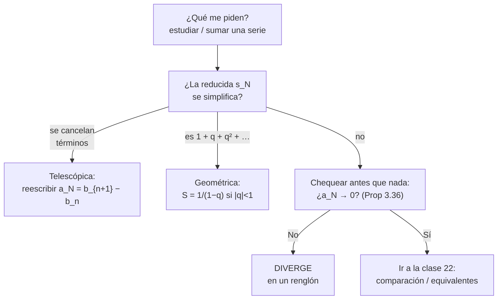
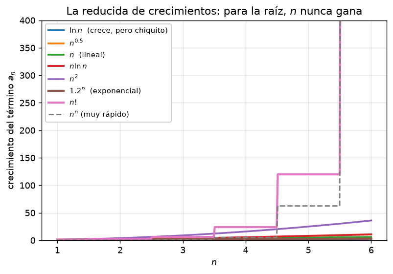
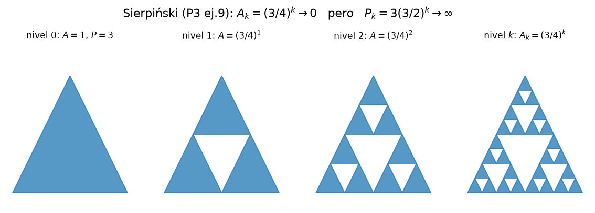

# Clase 21 — Series: definición, serie geométrica y series telescópicas

> **Bloque 4 · Series · Dificultad: inicial · Tiempo estimado: 115 min**

---

## 🎯 Objetivos

1. **Definir** sumas parciales (reducidas) y convergencia de una serie (**Definición 3.34**).
2. Enunciar y demostrar la **condición necesaria** de convergencia (**Proposición 3.36**) y usarla para descartar series en segundos.
3. **Sumar** series geométricas con la fórmula $\dfrac{1}{1-q}$ y series **telescópicas**.
4. Resolver el **Ejercicio 1 completo del Práctico 3** y problemas de parcial/examen paso a paso.

---

## 🗺️ Mapa de la clase

---

## 📘 1. De sucesiones a series (repaso-puente)

Ya sabemos (Bloque 3) que una **serie** $\sum_{n\geq1} a_n$ es, en realidad, una **sucesión** armada con los sumandos: la de las **sumas parciales**.

| Nombre | Definición | Ejemplo: $a_n=\frac1n$ |
|---|---|---|
| Término general | $a_n$ | $1,\ \frac12,\ \frac13,\ \dots$ |
| **Suma parcial / reducida** $n$-ésima | $s_n=a_1+\cdots+a_n$ | $1,\ \frac32,\ \frac{11}{6},\ \frac{25}{12},\ \dots$ |
| Serie | $\lim_{n\to\infty}s_n$ | ¿existe? (va a dar que no: es la **armónica**) |

> 💡 **Regla de oro:** *el término general describe a los sumandos; la serie es el límite de lo acumulado.* Que $a_n\to0$ no alcanza: la armónica lo cumple y su serie diverge.

Recuperamos dos herramientas del Bloque 3 para estudir $(s_n)$:

- **PSMC:** si $(s_n)$ es monótona y acotada, converge. Con $a_n\geq0$, las $s_n$ son **crecientes**, así que basta demostrar que están **acotadas arriba**.
- **Álgebra de límites:** si existen $\lim s_n$ y $\lim t_n$, entonces $\lim(s_n+t_n)$ y $\lim(\lambda s_n)$: la suma y el múltiplo por escalar de series convergentes **se estudian término a término**.

---

## 📘 2. Definición formal y condición necesaria

> **Definición 21.1 (notas, Definición 3.34).** Dada una sucesión real $(a_n)$, se llama **suma parcial o reducida $n$-ésima** a
> $$s_n=\sum_{i=1}^{n}a_i,$$
> y **serie de término general** $a_n$ a la suma infinita $\sum a_n$. Se dice que la serie **converge, diverge u oscila** cuando lo hace la sucesión $(s_n)$. Si converge, su límite $S=\lim s_n$ se llama **suma de la serie** y se escribe $S=\sum a_n$.

> **Proposición 21.2 (notas, Proposición 3.36 — condición necesaria).** Si $\sum a_n$ es convergente, entonces $\displaystyle\lim_{n\to\infty}a_n=0$.

**Demostración.** Sea $s_n$ la reducida. Para $n\geq2$,
$$a_n=s_n-s_{n-1}.$$
Si $\sum a_n=S$, entonces $s_n\to S$ y $s_{n-1}\to S$, de modo que
$$\lim a_n=\lim s_n-\lim s_{n-1}=S-S=0.\qquad\blacksquare$$

⚠️ **Recíproco falso (la trampa clásica):** $\sum\frac1n$ cumple $a_n\to0$ y diverge. La condición sirve para **descartar rápido** (si $a_n$ no tiende a 0, la serie diverge), nunca para afirmar convergencia.

**Descarte inmediato:** $a_n\to L\neq0$ (o no existe) $\Rightarrow$ **diverge**. Por ejemplo $\sum 5^{n+1}$ (Práctico 3, ej. 1c): $5^{n+1}\to\infty$, ni siquiera hace falta mirar más.

---

## 📘 3. Serie geométrica

> **Definición 21.3 (notas, Ejemplos 3.35).** La serie $\displaystyle\sum_{n=0}^{\infty}q^{n}=1+q+q^{2}+q^{3}+\cdots$ se llama **serie geométrica** de razón $q$.

**Suma de la reducida.** Para $q\neq1$:
$$s_N=1+q+\cdots+q^{N},\qquad q\,s_N=q+q^{2}+\cdots+q^{N+1}.$$
Restando: $s_N(1-q)=1-q^{N+1}$, es decir
$$s_N=\frac{1-q^{N+1}}{1-q}.$$

Como $q^{N+1}\to0$ **si y solo si** $|q|<1$:

$$\boxed{\ \sum_{n=0}^{\infty}q^{n}=\frac{1}{1-q}\quad\text{si }|q|<1;\qquad \text{si }|q|\geq1,\ \text{la serie diverge (salvo el caso trivial).}\ }$$

Casos borde: $q=1$: $s_N=N+1\to\infty$. $q=-1$: $s_N$ oscila entre $1$ y $0$ → **oscila** (no converge).

**Variantes de índice** (muy pedidas): si la suma arranca en $n=k$,
$$\sum_{n=k}^{\infty}q^{n}=\frac{q^{k}}{1-q}\quad (|q|<1),$$
y si el término es $c\,q^{n}$ se saca el factor $c$ afuera. La clave práctica es **reescribir el término como constante por $q^{n}$** y decidir $q$ leyendo la base, no el exponente.

---

## 📘 4. Series telescópicas

> **Definición 21.4 (notas, Ejemplos 3.37).** Una serie es **telescópica** si su término general se escribe como **diferencia** $a_n=b_{n+1}-b_n$ (o $b_n-b_{n+1}$). Entonces la reducida se **colapsa**:
> $$s_N=\sum_{n=1}^{N}(b_{n+1}-b_n)=b_{N+1}-b_1,$$
> y la serie converge **si y solo si** $\lim_{N\to\infty}b_{N+1}$ existe finito, con suma $L-b_1$.

**Ejemplo base (notas):** $\dfrac{1}{n(n+1)}=\dfrac1n-\dfrac1{n+1}$, luego $s_N=1-\dfrac1{N+1}\to1$.

**Tres trucos de reescritura:**

1. **Fracciones parciales** con polinomios en $n$ (descomposición $\frac{A}{n}+\frac{B}{n+1}+\cdots$).
2. **Logaritmos:** $\log(b_{n+1})-\log(b_n)$ convierte productos en sumas.
3. **"Desfase $k$":** si $a_n=b_n-b_{n+k}$, sobreviven **$k$** sumandos al principio y $k$ al final (¡el caso $k=2$ aparece en un parcial!).

---

## 🖼️ 3. Figuras del bloque

**Cómo leer la figura:** las reducidas de $\sum(1/2)^n$ se aplanan contra $2$ (geometría: cada sumaandito aporta menos y menos). Las de $\sum 1/n$ siguen subiendo, muy despacio: **$a_n\to0$ no salva a la serie**. Todas las decisiones del Bloque 4 se leen en este gráfico: o las reducidas tienen techo, o no.

**Cómo leer la figura:** en cada paso se pintan $8^{k-1}$ cuadrados de área $9^{-k}$. La imagen anticipa el resultado del Ejercicio 9: el área pintada satura en $1$ (todo el cuadrado, en medida), mientras que el perímetro pintado crece sin límite ($12$).

---

## ✏️ 5. Ejercicios resueltos paso a paso — Práctico 3, Ejercicio 1

> **(Práctico 3, ej. 1)** Indicar si las siguientes series son convergentes o no, hallando su suma en caso de serlo.

### Ejercicio 1a. $\displaystyle\sum_{n=0}^{\infty}\left(\frac13\right)^{n}$

Geométrica con $q=\frac13<1$ (arranca en $n=0$):
$$\sum_{n=0}^{\infty}\left(\frac13\right)^{n}=\frac{1}{1-\frac13}=\frac{1}{\frac23}=\boxed{\dfrac32}.$$

**Chequeo numérico:** $1+0{,}3333+0{,}1111+0{,}0370+\cdots\approx1{,}4815$ con 4 términos, y $\frac32=1{,}5$: va encaminado. ✔

### Ejercicio 1b. $\displaystyle\sum_{n=1}^{\infty}\left(\dfrac{1}{\sqrt3}\right)^{n+3}$

Reescribimos con $q=\frac{1}{\sqrt3}\approx0{,}577$ (¡$|q|<1$!):
$$\sum_{n=1}^{\infty}q^{\,n+3}=q^{4}+q^{5}+q^{6}+\cdots$$
Es una geométrica que **arranca en el exponente 4**: factorizamos los tres primeros factores:
$$=q^{4}\sum_{m=0}^{\infty}q^{m}=\frac{q^{4}}{1-q}.$$
Con $q^{4}=\dfrac{1}{9}$ y $1-q=\dfrac{\sqrt3-1}{\sqrt3}$:
$$\frac{1/9}{\frac{\sqrt3-1}{\sqrt3}}=\frac{\sqrt3}{9(\sqrt3-1)}=\frac{\sqrt3(\sqrt3+1)}{9\cdot2}=\boxed{\dfrac{3+\sqrt3}{18}}\approx0{,}263.$$

**Chequeo numérico:** $q^4=0{,}1111$, $q^5=0{,}0642$, $q^6=0{,}0370$, $q^7=0{,}0214$ → $\approx0{,}234$ con 4 términos y $\frac{3+\sqrt3}{18}=0{,}2629$. ✔

### Ejercicio 1c. $\displaystyle\sum_{n=1}^{\infty}5^{\,n+1}$

**Paso 1 — condición necesaria (Prop 3.36):** $a_n=5^{n+1}\to+\infty$, en particular **no** tiende a $0$.
$$\Rightarrow\ \textbf{diverge}.$$
(No hace falta ningún criterio más: ya está clasificada. La serie es geométrica con $q=5>1$, lo que confirma que sus reducidas se disparan.)

### Ejercicio 1d. $\displaystyle\sum_{n=1}^{\infty}\dfrac{3}{n(n+3)}$

**Paso 1:** $a_n\to0$ ✔ (no sirve para descartar).

**Paso 2 — fracciones parciales.** Buscamos $\dfrac{3}{n(n+3)}=\dfrac{A}{n}+\dfrac{B}{n+3}$, o sea $3=A(n+3)+Bn$. Con $n=0$: $A=1$; con $n=-3$: $B=-1$. Luego
$$a_n=\frac1n-\frac1{n+3}.$$

**Paso 3 — colapso con desfase 3.**
$$s_N=\sum_{n=1}^{N}\left(\frac1n-\frac1{n+3}\right)=\left(1+\frac12+\frac13\right)-\left(\frac1{N+1}+\frac1{N+2}+\frac1{N+3}\right).$$
(Sobreviven **3** sumandos al principio y 3 al final.) Haciendo $N\to\infty$:
$$\sum_{n=1}^{\infty}\frac{3}{n(n+3)}=1+\frac12+\frac13=\boxed{\dfrac{11}{6}}.$$

> 💡 De paso: $\sum\frac{1}{n(n+3)}$ converge y es $11/18$; el factor $3$ del numerador es el que da $11/6$.

### Ejercicio 1e. $\displaystyle\sum_{n=1}^{\infty}\log\!\left(\dfrac{n^{2}+2n+1}{n^{2}}\right)$

**Paso 1 — simplificar.** $n^2+2n+1=(n+1)^2$, así que
$$a_n=\log\frac{(n+1)^2}{n^2}=\log\left(\frac{n+1}{n}\right)^{2}=2\bigl[\log(n+1)-\log n\bigr].$$

**Paso 2 — telescópica** con $b_n=2\log n$:
$$s_N=2\bigl[\log(N+1)-\log 1\bigr]=2\log(N+1).$$

**Paso 3:** $2\log(N+1)\to+\infty$:
$$\Rightarrow\ \textbf{diverge}.$$

**Lectura conceptual:** $a_n=2\log(1+\tfrac1n)\sim\frac2n\to0$ (¡condición necesaria cumplida!) y aun así diverge, porque es "prácticamente la armónica".

### Ejercicio 1f. $\displaystyle\sum_{n=1}^{\infty}\dfrac{n}{(n+1)(n+2)(n+3)}$

**Paso 1:** $a_n\sim\frac{n}{n^{3}}=\frac{1}{n^{2}}$ → parece convergente (lo confirmará la clase 22); acá la sumamos con fracciones parciales.

**Paso 2 — descomposición.** $\dfrac{n}{(n+1)(n+2)(n+3)}=\dfrac{A}{n+1}+\dfrac{B}{n+2}+\dfrac{C}{n+3}$ con $n=A(n+2)(n+3)+B(n+1)(n+3)+C(n+1)(n+2)$:

- $n=-1$: $-1=A(1)(2)\Rightarrow A=-\tfrac12$
- $n=-2$: $-2=B(-1)(1)\Rightarrow B=2$
- $n=-3$: $-3=C(-2)(1)\Rightarrow C=-\tfrac32$

**Paso 3 — agrupar por denominador.** En $s_N$, el coeficiente de $1/k$ es $-\tfrac12+2-\tfrac32=0$ **salvo** en los extremos:
$$s_N=-\frac12\cdot\frac12+\frac12\cdot\frac13+\underbrace{0+\cdots+0}_{k=4,\dots,N}+\ \text{términos finales}\xrightarrow[N\to\infty]{}\ \frac14.$$
Dejando explícito el límite (todo lo que depende de $N$ tiende a 0):
$$\sum_{n=1}^{\infty}\frac{n}{(n+1)(n+2)(n+3)}=\frac14\quad\Longrightarrow\quad\boxed{\dfrac14}.$$

**Chequeo:** $\frac{1}{2\cdot3\cdot4}=\frac1{24}$, $\frac{2}{3\cdot4\cdot5}=\frac1{30}$, $\frac{3}{4\cdot5\cdot6}=\frac1{40}$ → $\approx0{,}0417+0{,}0333+0{,}0250+\cdots$ crece despacio hacia $0{,}25$. ✔

### Ejercicio 1g. $\displaystyle\sum_{n=1}^{\infty}\dfrac{n\,\mathrm{arctg}(n+1)-(n+1)\,\mathrm{arctg}(n)}{n(n+1)}$

**Paso 1 — partir la fracción.** El denominador $n(n+1)$ se lleva cada sumando:
$$a_n=\frac{n\,\mathrm{arctg}(n+1)}{n(n+1)}-\frac{(n+1)\,\mathrm{arctg}(n)}{n(n+1)}=\frac{\mathrm{arctg}(n+1)}{n+1}-\frac{\mathrm{arctg}(n)}{n}.$$

**Paso 2 — telescópica** con $b_n=\dfrac{\mathrm{arctg}(n)}{n}$: entonces $a_n=b_{n+1}-b_n$ y
$$s_N=b_{N+1}-b_1=\frac{\mathrm{arctg}(N+1)}{N+1}-\mathrm{arctg}(1).$$

**Paso 3:** como $0\leq \mathrm{arctg}(N+1)<\frac\pi2$, el cociente $\frac{\mathrm{arctg}(N+1)}{N+1}\to0$:
$$\sum_{n=1}^{\infty}a_n=0-\frac{\pi}{4}=\boxed{-\dfrac{\pi}{4}}.$$

> ⚠️ Ojo con el signo: la serie **suma negativo** aunque cada $a_n$ puede ser negativo o positivo… en este caso el orden de los restos hace que la suma sea $-\pi/4$. Las series alternadas pueden sumar cualquier cosa; el valor no "respeta" el signo de los sumandos.

---

### Ejercicio 2 (Práctico 3, ej. 9). Alfombra de Sierpiński: área y perímetro pintados

> Se divide un rectángulo (cuadrado) de lado $1$ en $9$ rectángulos iguales de lado $\frac13$ y se pinta el del centro. Inductivamente, cada rectángulo **sin pintar** se divide en $9$ y se pinta el central. Calcular el área pintada tras $n$ pasos, el área pintada tras infinitos pasos, y lo mismo para el perímetro.

**Paso 1 — cuenta de piezas.** En el paso $k$ hay $8^{k-1}$ cuadrados sin pintar (los que sobrevivieron al paso anterior) y a cada uno se le pinta el centro: se pintan $8^{k-1}$ cuadrados de lado $3^{-k}$.

**Paso 2 — área tras $n$ pasos.** Es una suma finita de geométricas:
$$A_n=\sum_{k=1}^{n}8^{k-1}\cdot\frac{1}{9^{k}}=\frac19\sum_{j=0}^{n-1}\left(\frac89\right)^{j}=\frac19\cdot\frac{1-\left(\frac89\right)^{n}}{1-\frac89}=1-\left(\frac89\right)^{n}.$$

**Paso 3 — área infinita.** Como $\left(\frac89\right)^n\to0$:
$$A_{\infty}=1-0=\boxed{1}.$$

**Paso 4 — perímetro.** En el paso $k$: $8^{k-1}$ cuadrados, cada uno con perímetro $\frac{4}{3^{k}}$:
$$P_{\infty}=\sum_{k=1}^{\infty}4\cdot\frac{8^{k-1}}{3^{k}}=\frac43\sum_{j=0}^{\infty}\left(\frac89\right)^{j}=\frac43\cdot\frac{1}{1-\frac89}=\frac43\cdot 9=\boxed{12}.$$

> 💡 **Interpretación geométrica:** el área pintada satura en $1$ (la "carpet" que queda sin pintar tiene **medida cero**: es la alfombra de Sierpiński), pero el perímetro pintado se dispara a $12$ unidades: una línea de longitud finita puede delimitar regiones de área nula. Ya aparecerá con **fractales** y con las **cuádricas** de la clase 4.

---

## 🏛️ 6. Ejercicios de parcial/examen

### Ejercicio 3 (Primer parcial 2018-1S, ej. 3). Telescópica con desfase 2

$$\sum_{n=1}^{\infty}\left[\log\!\left(6+\frac6n\right)-\log\!\left(6+\frac{6}{n+2}\right)\right]$$

**Paso 1 — simplificar cada sumando.**
$$\log\!\left(6+\frac6n\right)=\log\frac{6(n+1)}{n}=\log 6+\log(n+1)-\log n,$$
$$\log\!\left(6+\frac{6}{n+2}\right)=\log\frac{6(n+3)}{n+2}=\log 6+\log(n+3)-\log(n+2).$$
Restando, el $\log 6$ se cancela:
$$a_n=\underbrace{\bigl[\log(n+1)-\log n\bigr]}_{\text{salta }1}-\underbrace{\bigl[\log(n+3)-\log(n+2)\bigr]}_{\text{salta }1}.$$

**Paso 2 — reducida con desfase 2.** Cada cadena telescópica colapsa:
$$s_N=\bigl[\log(N+1)-\log1\bigr]-\bigl[\log(N+3)-\log3\bigr]=\log\frac{N+1}{N+3}+\log 3.$$

**Paso 3 — límite.** $\dfrac{N+1}{N+3}\to1$, luego $\log\frac{N+1}{N+3}\to0$ y
$$S=\log 3.$$

**Paso 4 — elegir la opción.** $\log 12+\log 9-2\log 6=\log\frac{12\cdot 9}{36}=\log 3$.

**Respuesta: (D) la serie converge al valor $\log(12)+\log(9)-2\log(6)$.** ✔ *(verificada con la solución oficial del parcial)*

---

### Ejercicio 4 (Primer parcial 2021-2S, ej. 1). Geométrica + telescópica de exponenciales

$$\sum_{n=0}^{\infty}\left(\frac{1}{3^{n}}+e^{-(n+1)^{2}}-e^{-n^{2}}\right)$$

**Paso 1 — separar** (álgebra de series: ambas convergen, se pueden estudiar por separado… y de hecho una es geométrica y la otra telescópica):
$$\sum_{n=0}^{\infty}\frac{1}{3^{n}}\;+\;\sum_{n=0}^{\infty}\bigl(e^{-(n+1)^{2}}-e^{-n^{2}}\bigr).$$

**Paso 2 — geométrica.** $q=\frac13$, arranca en $n=0$:
$$\sum_{n=0}^{\infty}3^{-n}=\frac{1}{1-\frac13}=\frac32.$$

**Paso 3 — telescópica** con $b_n=e^{-n^2}$: $s_N^{\text{tel}}=b_{N+1}-b_0=e^{-(N+1)^{2}}-1\to 0-1=-1$.

**Paso 4 — sumar.**
$$S=\frac32-1=\boxed{\frac12}.$$

**Respuesta: (B) converge a $\frac12$.** ✔

---

### Ejercicio 5 (Primer parcial 2018-1S, ej. 5). La pelota que rebota (aplicación de la geométrica)

> Una pelota cae desde $2$ m; cada rebote alcanza $\frac23$ de la altura anterior. Interpretando la distancia total tras infinitos rebotes como suma de una serie, ¿cuánto recorre?

**Paso 1 — modelar.** Alturas: $h_k=2\left(\frac23\right)^{k}$ ($k=0$ es la caída inicial). La pelota **baja** $2$ m y luego, en cada rebote, **sube y baja** $h_k$.

**Paso 2 — la serie.**
$$d=2+\sum_{k=1}^{\infty}2h_k=2+4\sum_{k=1}^{\infty}\left(\frac23\right)^{k}=2+4\cdot\frac{\frac23}{1-\frac23}=2+4\cdot 2=10.$$

**Respuesta: (D) la pelota recorre $10$ metros.** ✔ *(verificada con la solución oficial)*

> 💡 **Puente con el Ejercicio 9 de la clase 20** (examen febrero 2021): si cortás en el rebote $N$ tenés una **suma finita** ($N=6$, $H=\frac{13300}{729}\approx18{,}24$ m de alturas) y si sumás todos, $H_\infty=20$ m. Misma fórmula, distinto corte: finita $\leftrightarrow$ geométrica parcial; infinita $\leftrightarrow$ geométrica.

---

## ⚠️ 7. Errores comunes

| Error | Corrección |
|---|---|
| "Como $a_n\to0$, la serie converge" | Falso: $\sum\frac1n$ diverge (Prop 3.36 es **necesaria**, no suficiente) |
| Confundir **serie** con **término general** | La serie es $\lim s_N$; $(a_n)$ solo describe los sumandos |
| Sumar una geométrica con $|q|\geq1$ con la fórmula | La fórmula $\frac{1}{1-q}$ **solo** vale para $|q|<1$; si no, diverge u oscila |
| Arrancar mal el índice: $\sum_{n=1}q^{n+3}$ | Reescribí como $q^{4}+q^{5}+\cdots$ y factorizá $q^{\text{mín}}$ |
| Olvidar cancelar factores antes de decidir $q$ | Ej.: $\left(\frac{1}{\sqrt3}\right)^{n+3}$ tiene **$q=\frac{1}{\sqrt3}$**, no "1/3" ni "1/9" |
| En fracciones parciales, descomponer mal el signo | Chequeá re-componiendo: $\frac1n-\frac1{n+3}=\frac{3}{n(n+3)}$ ✔ |
| En una telescópica, no contar cuántos sobreviven | Con salto $k$ sobreviven $k$ al principio y $k$ al final (el ej. 1d tiene $k=3$) |
| Decir "el área pintada es 1, entonces la figura es el cuadrado" | En medida sí; geométricamente quedan huecos (alfombra de Sierpiński) |

---

## 🔗 8. Conexión con el resto del curso

- **Bloque 3 (clases 16-20):** las reducidas $(s_N)$ son sucesiones: ahí vivieron PSMC, acotación y $\varepsilon$-$N$.
- **Clase 22:** si la reducida *no* se colapsa ni es geométrica, hay que **estudiar** su límite: comparación y equivalentes con series de términos positivos.
- **Clase 23 y 26:** el **criterio serie-integral** conecta estas series con las **integrales impropias** (Práctico 4).
- **Topología (Bloque 6):** la alfombra de Sierpiński es el ejemplo canónico de conjunto **cerrado, compacto y de medida cero**.
- **Ingeniería:** series geométricas en **VAI/TVA**, descuentos, análisis de circuitos y algoritmos recursivos; telescópicas en complejidad de algoritmos.

---

## ✅ 9. Autoevaluación

1. Definir: suma parcial (reducida), serie, convergencia de una serie.
2. Demostrar la condición necesaria de convergencia (Prop 3.36).
3. Sumar $\displaystyle\sum_{n=2}^{\infty}3\left(\frac12\right)^{n}$.
4. ¿Converge $\displaystyle\sum_{n=1}^{\infty}\frac{n+1}{n}$? Justificar en un renglón.
5. Sumar $\displaystyle\sum_{n=1}^{\infty}\left(\frac{1}{\sqrt n}-\frac{1}{\sqrt{n+1}}\right)$ (¿telescópica?).
6. El ejercicio de la pelota desde $8$ m con rebote a $\frac12$: distancia total tras infinitos rebotes.
7. (V/F) Si $\sum a_n$ y $\sum b_n$ divergen, entonces $\sum(a_n+b_n)$ diverge.

Respuestas

1. Ver §2 (Definición 21.1).
2. $a_n=s_n-s_{n-1}$ y $\lim s_n=\lim s_{n-1}=S$ $\Rightarrow$ $\lim a_n=S-S=0$.
3. $q=\frac12$, factor $3\cdot\frac14$: $\ 3\cdot\frac{1/4}{1-1/2}=\frac32$.
4. $\frac{n+1}{n}\to1\neq0$: **diverge** por la condición necesaria (en un renglón).
5. $s_N=1-\frac{1}{\sqrt{N+1}}\to1$: converge a $1$.
6. Caída $8$ + (subida y bajada de cada rebote): $h_k=8\left(\tfrac12\right)^k$, luego $8+2\sum_{k\geq1}h_k=8+16\sum_{k\geq1}(1/2)^{k}=8+16=\mathbf{24}$ **m**.
7. **FALSO:** $a_n=1$, $b_n=-1$: ambas divergen pero $\sum(a_n+b_n)=\sum 0$ converge a $0$. (La suma de divergentes **puede** converger.)

---

**⬅️ Anterior:** [Clase 20 — Repaso de sucesiones](20_sucesiones_repaso.md) · **➡️ Siguiente:** [Clase 22 — Términos positivos: comparación y equivalentes](22_series_positivos.md)
