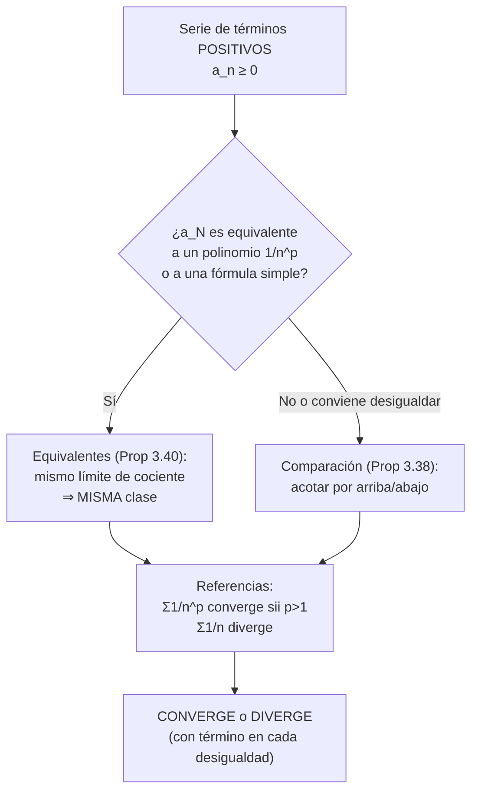
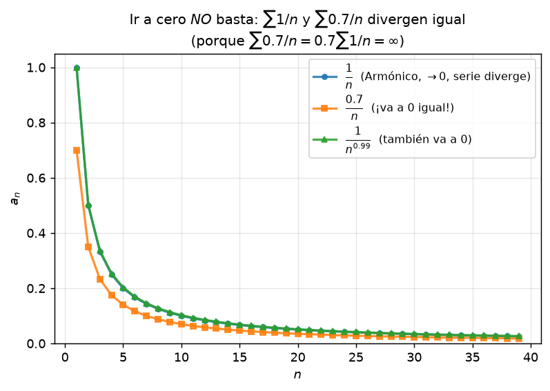
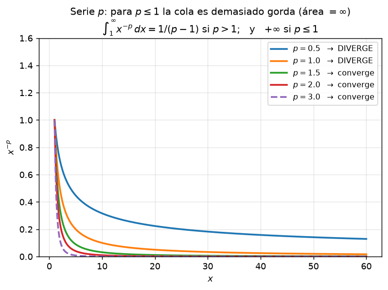

# Clase 22 — Series de términos positivos: comparación y equivalentes

> **Bloque 4 · Series · Dificultad: media · Tiempo estimado: 120 min**

---

## 🎯 Objetivos

1. Enunciar y **aplicar** el criterio de **comparación** (Proposición 3.38) sin confundir las dos flechas.
2. Enunciar y aplicar el criterio de **equivalentes** (Proposición 3.40) para reducir una serie a otra más simple.
3. Manejar la **familia $p$-series** $\sum 1/n^{p}$ como referencia y usar **desigualdades clásicas** ($e^{t}\geq t^4/24$, $\log n \leq \sqrt n$).
4. Resolver el Ejercicio 2 y 3 del Práctico 3 y problemas de V/F de parcial/examen.

---

## 🗺️ Mapa de la clase

---

## 📘 1. Criterio de comparación

Trabajamos con $a_n\geq0$: entonces $(s_N)$ es **creciente**, así que la serie o converge (acotada) o diverge a $+\infty$; **nunca oscila**.

> **Proposición 22.1 (notas, Proposición 3.38 — comparación).** Sean $\sum a_n$ y $\sum b_n$ series con $a_n\leq b_n$ para todo $n>n_0$ (basta **a partir de cierto término**). Entonces:
> 1. Si $\sum b_n$ **converge**, entonces $\sum a_n$ converge. *(lo chiquito converge)*
> 2. Si $\sum a_n$ **diverge**, entonces $\sum b_n$ diverge. *(lo grande diverge)*

**Idea de la demostración (reducidas):** $A_N-A_{n_0}\leq B_N-B_{n_0}$: si $(B_N)$ está acotada, $(A_N)$ también; si $(A_N)$ no está acotada, $(B_N)$ tampoco.

⚠️ **Las flechas son todo el contenido:** de "lo chico diverge" **no** se sigue nada, y de "lo grande converge" **tampoco**. Y ojo: los primeros $n_0$ términos **no importan** (cambiar finitos sumandos no cambia la clase de la serie).

**Desigualdades útiles para acotar** (que las notas usan y conviene tener a mano):

| Desigualdad | Uso típico |
|---|---|
| $\log(1+x)\leq x$ para $x\geq0$ | $\sum\frac1n$ diverge vía $\frac1n\geq\log(1+\frac1n)$ (Ejemplos 3.39.1) |
| $\frac{1}{n^{\alpha}}>\frac1n$ si $\alpha<1$ | $\sum\frac1{n^\alpha}$ diverge para $\alpha\leq1$ (Ejemplos 3.39.2) |
| $\log n\leq\sqrt n$ | $\sum\frac{\log n}{n^{2}}\leq\sum\frac1{n^{3/2}}$ converge |
| $e^{t}\geq\dfrac{t^{4}}{24}$ ($t\geq0$, de $e^{t}=\sum\frac{t^{k}}{k!}\geq\frac{t^4}{4!}$) | $e^{-\sqrt n}$ acotada por $1/n^{2}$ |
| $n^{n}\geq2^{n}$ ($n\geq2$) | $\sum\frac1{n^{n}}$ converge por comparación con geométrica |

---

## 📘 2. Criterio de equivalentes

> **Proposición 22.2 (notas, Proposición 3.40 — equivalentes).** Sean $\sum a_n$ y $\sum b_n$ de términos positivos.
> 1. Si $\displaystyle\lim\frac{a_n}{b_n}=L\in(0,\infty)$, entonces **son de la misma clase** (ambas convergen o ambas divergen).
> 2. Si $\displaystyle\lim\frac{a_n}{b_n}=0$ y $\sum b_n$ converge, entonces $\sum a_n$ converge.

**Demostración (caso 1, esquema).** Tomando $\varepsilon=L/2$, para $n$ grande: $\frac L2\leq\frac{a_n}{b_n}\leq\frac{3L}{2}$, es decir $\ \frac{L}{2}\,b_n\leq a_n\leq\frac{3L}{2}\,b_n$; aplicando **comparación** con cada lado se obtiene que $\sum a_n$ y $\sum b_n$ jalan juntas. $\blacksquare$

**Por qué es tan potente:** para series cuyo término es un **cociente de polinomios** (o con $\log$, $e^{-n}$, $\sqrt n$), se reemplaza el término por su **comportamiento asintótico** y listo:

$$\frac{n^{2}+1}{n^{3}}=\frac1n+\frac1{n^{3}}\sim\frac1n,\qquad \frac{1}{\sqrt{n(n+2)}}\sim\frac1n,\qquad \frac{1}{\sqrt{n(n+1)(n+2)(n+3)}}\sim\frac{1}{n^{2}}.$$

> ⚠️ La **ley de los cocientes** solo vale si el término es un **cociente** (producto/razón de funciones). Con $\log$, $+$ y $-$ mezclados a la fuerza, usá productos/sumas de límites con cuidado; si no, compará.

**Referencias de la familia $p$:**
$$\sum_{n}\frac{1}{n^{p}}\quad\text{converge si }p>1,\qquad \text{diverge si }p\leq1.$$
(Las notas clasifican $p\leq1$ por comparación y $p\geq2$ vía $\frac{1}{n^p}\leq\frac1{n^2}$ — Ejemplos 3.41.2 —; el tramo $1<p<2$ se cierra con el **criterio serie-integral** de la clase 23.)

---

## 🖼️ 3. Figuras del bloque

**Cómo leer la figura:** dos series de barras. Si las barras **azules** ($a_n$) viven **debajo** de unas **rojas** ($b_n$) cuya suma total es finita, las azules también suman poco (convergen). Para **divergir** se usa el sentido inverso: si las azules están **arriba** de unas rojas que se desbordan, las azules se desbordan. Fijate que las primeras barras da lo mismo cómo sean: la suma se juega en el infinito.

**Cómo leer la figura:** cada $p$ es un universo distinto. A la izquierda de la frontera ($p\leq1$) las reducidas se van al infinito lentísimo; a la derecha ($p>1$) se aplanan. **La frontera $p=1$ (armónica) es la más importante de la asignatura.**

---

## ✏️ 4. Ejercicios resueltos paso a paso — Práctico 3, Ejercicios 2 y 3

### Ejercicio 1 (Práctico 3, ej. 2a). $\displaystyle\sum_{n=1}^{\infty}\frac{1}{n^{n}}$ — comparación

**Paso 1 — acotar.** Para $n\geq2$: $n^{n}=\underbrace{n\cdot n\cdots n}_{n\ \text{factores}}\geq\underbrace{2\cdot 2\cdots 2}_{n}=2^{n}$, luego
$$0<\frac{1}{n^{n}}\leq\frac{1}{2^{n}}\qquad(n\geq2).$$

**Paso 2 — comparar.** $\sum\frac1{2^{n}}$ es geométrica con $q=\frac12<1$ → **converge**.

**Paso 3 — concluir (Prop 3.38.1).** Lo chico converge:
$$\sum_{n=1}^{\infty}\frac{1}{n^{n}}\ \textbf{converge}.$$

> 💡 Ojo: $n^n$ crece **muchísimo** más rápido que $2^n$… pero para **clasificar** alcanza con cualquier geométrica que corte por arriba. (Si te interesa la suma: es la serie de $\int$… no tiene fórmula cerrada; con $n=1,2,3$: $1+\frac14+\frac1{27}\approx1{,}287$.)

### Ejercicio 2 (Práctico 3, ej. 2b). $\displaystyle\sum_{n=1}^{\infty}e^{-\sqrt{n+1}}$ — comparación

**Paso 1 — elegir la cota.** Queremos algo tipo $1/n^{2}$ en el denominador. Usamos $e^{t}\geq\frac{t^{4}}{24}$ (término de la serie de $e^{t}$ con $k=4$; vale para todo $t\geq0$) con $t=\sqrt{n+1}$:
$$e^{\sqrt{n+1}}\geq\frac{(\sqrt{n+1})^{4}}{24}=\frac{(n+1)^{2}}{24}\geq\frac{n^{2}}{24}.$$
Invertimos (todo es positivo):
$$0<e^{-\sqrt{n+1}}\leq\frac{24}{n^{2}}.$$

**Paso 2 — comparar.** $\sum\frac{24}{n^{2}}=24\sum\frac1{n^{2}}$ **converge** (con $p=2>1$; de hecho las notas lo prueban con $\frac{1}{n^{2}}\sim\frac{1}{n(n+1)}$ telescópica, Ejemplos 3.41.1).

**Paso 3 — concluir.**
$$\sum_{n=1}^{\infty}e^{-\sqrt{n+1}}\ \textbf{converge}.$$

> 💡 El error típico es acotar con $e^{-\sqrt{n+1}}\le\frac{1}{n}$: eso daría una cota **divergente** y no prueba nada (Regla del error: chico-chico ✅, grande-divergente ❌).

### Ejercicio 3 (Práctico 3, ej. 3a). $\displaystyle\sum_{n=0}^{\infty}\frac{1}{n^{2}+1}$ — equivalentes

$$\frac{1}{n^{2}+1}\sim\frac{1}{n^{2}}\ \ \left(\lim_{n\to\infty}\frac{1/(n^{2}+1)}{1/n^{2}}=\lim\frac{n^{2}}{n^{2}+1}=1\right).$$
$\sum\frac1{n^{2}}$ converge ($p=2>1$), luego por **Prop 3.40** la serie **converge**. ✔

### Ejercicio 4 (Práctico 3, ej. 3b). $\displaystyle\sum_{n=1}^{\infty}\frac{n^{2}+1}{n^{3}}$ — equivalentes

$$\frac{n^{2}+1}{n^{3}}=\frac1n+\frac{1}{n^{3}}\sim\frac1n\quad(\text{el término dominante es }1/n).$$
$\sum\frac1n$ **diverge** (armónica), luego por **Prop 3.40** la serie **diverge**. ✔

**Aviso de contexto:** acá $a_n\to0$ ($\frac1n+\frac1{n^3}\to0$) y aun así diverge: otra vez la condición necesaria no alcanza.

### Ejercicio 5 (Práctico 3, ej. 3c). $\displaystyle\sum_{n=1}^{\infty}\dfrac{\log(n+1)-\log(n)}{10n+1}$ — equivalentes en dos niveles

**Paso 1 — numerador.** $\log(n+1)-\log n=\log\!\left(1+\frac1n\right)\sim\frac1n$ (Taylor del $\log$ en $0^+$: $\log(1+u)\sim u$).

**Paso 2 — denominador.** $10n+1\sim10n$.

**Paso 3 — cociente.** Con $b_n=\frac{1}{n^{2}}$:
$$\lim_{n\to\infty}\frac{a_n}{b_n}=\lim_{n\to\infty}\frac{\log(1+1/n)}{10n+1}\cdot n^{2}=\lim\frac{(1/n)\,n^{2}}{10n}=\frac{1}{10}\in(0,\infty).$$

**Paso 4 — concluir.** $L=\frac1{10}>0$ → **misma clase** que $\sum\frac1{n^{2}}$, que converge:
$$\sum_{n=1}^{\infty}\frac{\log(n+1)-\log(n)}{10n+1}\ \textbf{converge}.$$

> 💡 Lectura alternativa: el numerador es **pequeñito** ($\sim1/n$) y el denominador es **grande** ($\sim n$): en total $1/n^{2}$… "chico dividido grande converge". Si dudas, escribí el paso del cociente con un $b_n$ elegido a mano y medí el límite.

---

## 🏛️ 5. Ejercicios de parcial/examen

### Ejercicio 6 (Primer parcial 2020-2S matutino, ej. 4). Con $\sum a_n$ convergente, clasificar dos series

> Sea $(a_n)$ de **términos positivos** con $\sum a_n$ convergente. Clasificar
> $$\sum_{n=1}^{\infty}\left(e^{a_n^{2}}-1\right)\qquad\text{y}\qquad\sum_{n=1}^{\infty}\cos(a_n)\,\mathrm{sen}(a_n).$$

**Dato clave:** $a_n\geq0$ y $\sum a_n<\infty$ $\Rightarrow$ $a_n\to0$ (Prop 3.36).

**Serie 1.** Taylor de $e^{u}$ en $u=0$: $e^{u}-1\sim u$. Con $u=a_n^{2}\to0$:
$$e^{a_n^{2}}-1\sim a_n^{2}.$$
Además $a_n\to0$ implica $a_n\leq1$ desde cierto punto, así que $a_n^{2}\leq a_n$ y, por comparación con $\sum a_n$ (**convergente**), $\sum a_n^{2}$ converge. Luego la serie 1 **converge**.

**Serie 2.** Usamos $\mathrm{sen}(2u)/2=\mathrm{sen}\,u\cos u$ con $u=a_n\to0$:
$$\cos(a_n)\mathrm{sen}(a_n)=\frac12\mathrm{sen}(2a_n)\sim\frac12\cdot2a_n=a_n.$$
El término es **equivalente** al de una serie convergente $\sum a_n$ (y positivo para $n$ grande, pues $a_n\to0<\pi/4$) → la serie 2 **converge**.

**Respuesta: (B) ambas series son convergentes.** ✔ *(verificada con la solución oficial)*

---

### Ejercicio 7 (Examen julio 2022, V/F 3). $\displaystyle\sum_{n=1}^{\infty}\mathrm{sen}\!\left(\frac1n\right)$ es convergente

$$\mathrm{sen}\!\left(\frac1n\right)\sim\frac1n\quad(n\to\infty),\qquad\lim\frac{\mathrm{sen}(1/n)}{1/n}=1.$$
$\sum\frac1n$ **diverge** → mismo caso (Prop 3.40) → la serie **diverge**.

**Respuesta: FALSO.** ✔ *(respuesta oficial: F)*

> 💡 Es exactamente el Ejemplo 3.41.3 de las notas. La condición necesaria se cumple ($\mathrm{sen}(1/n)\to0$) y aun así diverge: el engaño es clásico en V/F.

---

### Ejercicio 8 (Examen diciembre 2021, V/F 1). $\displaystyle\sum_{n=0}^{\infty}e^{\,1-n^{2}}$ converge

**Paso 1 — acotar por arriba con una geométrica.** Para $n\geq1$ vale $n^{2}\geq n$, así que $1-n^{2}\leq1-n$ y
$$0<e^{\,1-n^{2}}\leq e^{\,1-n}=e\cdot\left(\frac1e\right)^{n}.$$

**Paso 2 — comparar.** $\sum_{n\geq1}e\left(\frac1e\right)^{n}$ es geométrica con $q=\frac1e<1$ → converge. (El término $n=0$ es $e^{1}$: irrelevante.)

**Paso 3 — concluir (Prop 3.38.1).** La serie **converge**.

**Respuesta: VERDADERO.** ✔

---

## ⚠️ 6. Errores comunes

| Error | Corrección |
|---|---|
| Usar la comparación al revés ("lo chico diverge") | Solo valen: **chico ≤ grande** con grande converge, y **grande ≥ chico** con chico diverge |
| Acotar con una serie divergente **para convergencia** | Ej.: $e^{-\sqrt n}\le\frac1n$ no prueba nada: $\sum\frac1n$ diverge |
| Aplicar equivalentes con $L=0$ **y** $\sum b_n$ divergente | Con $L=0$ solo se hereda la convergencia, nunca la divergencia |
| Cancelar términos en el cociente $\frac{a_n}{b_n}$ con sumas mal puestas | Los equivalentes se multiplican/dividen; los **sumandos** no se reemplazan individualmente |
| "Como $a_n\to0$, converge" | $\sum\frac1n$ y $\sum\mathrm{sen}(1/n)$ son la contra (ambos V/F de examen) |
| Olvidar que $a_n\geq0$ es **hipótesis** | Sin positividad no hay monotonía de $(s_N)$ y ni comparación ni equivalentes aplican tan fácil |
| Comparar contra $\sum\frac1{n^{p}}$ con $p\leq1$ para demostrar convergencia | La referencia útil para converger es $p>1$ (o una geométrica con $q<1$) |

---

## 🔗 7. Conexión con el resto del curso

- **Clase 21:** las referencias (geométrica, $\sum\frac{1}{n(n+1)}=1$) nacen ahí; la **condición necesaria** es el filtro previo.
- **Clase 23:** cuando los equivalentes o la comparación no se ven claros, el **cociente**, la **raíz** y el **serie-integral** resuelven el resto (y cierran el caso $1<p\leq2$ de la familia $p$).
- **Clase 24:** si los signos **no** son todos positivos, hay que partir en $\sum|a_n|$ (convergencia absoluta).
- **Clase 26 (integrales impropias):** el criterio serie-integral es el puente exacto: $\int_1^\infty f$ y $\sum f(n)$ son de la misma clase.

---

## ✅ 8. Autoevaluación

1. Enunciar el criterio de comparación **con las dos flechas** y el de equivalentes con sus dos casos ($L>0$ y $L=0$).
2. Clasificar $\displaystyle\sum\frac{1}{n^{3}+5}$.
3. Clasificar $\displaystyle\sum\frac{n}{n^{2}+1}$.
4. Clasificar $\displaystyle\sum\frac{2n+1}{n^{3}+4}$.
5. Clasificar $\displaystyle\sum\frac{n+1}{(n^{2}+n+1)^{2}}$.
6. (V/F) Si $a_n\geq0$, $\sum a_n$ converge y $\sum b_n$ diverge, entonces $\sum(a_n+b_n)$ diverge.
7. ¿Por qué $\sum\log\!\left(1+\frac1n\right)$ diverge si $\log(1+\frac1n)\to0$?

Respuestas

1. §1 y §2 (Proposiciones 22.1 y 22.2).
2. $\sim\frac{1}{n^{3}}$, $p=3>1$: **converge**.
3. $\sim\frac1n$: **diverge** (el término $\to0$ y aun así).
4. $\sim\frac{2}{n^{2}}$: **converge**.
5. $\sim\frac{n}{n^{4}}=\frac{1}{n^{3}}$: **converge**.
6. **VERDADERO:** $a_n+b_n\geq b_n$ y $\sum b_n$ diverge → por comparación diverge (positividad al rescate).
7. $\log(1+\frac1n)\sim\frac1n$ y $\sum\frac1n$ diverge → **misma clase** (el $\to0$ es condición necesaria, no suficiente).

---

**⬅️ Anterior:** [Clase 21 — Series: definición, geométrica y telescópica](21_series_definicion.md) · **➡️ Siguiente:** [Clase 23 — Cociente, raíz y criterio serie-integral](23_series_cociente_raiz.md)
