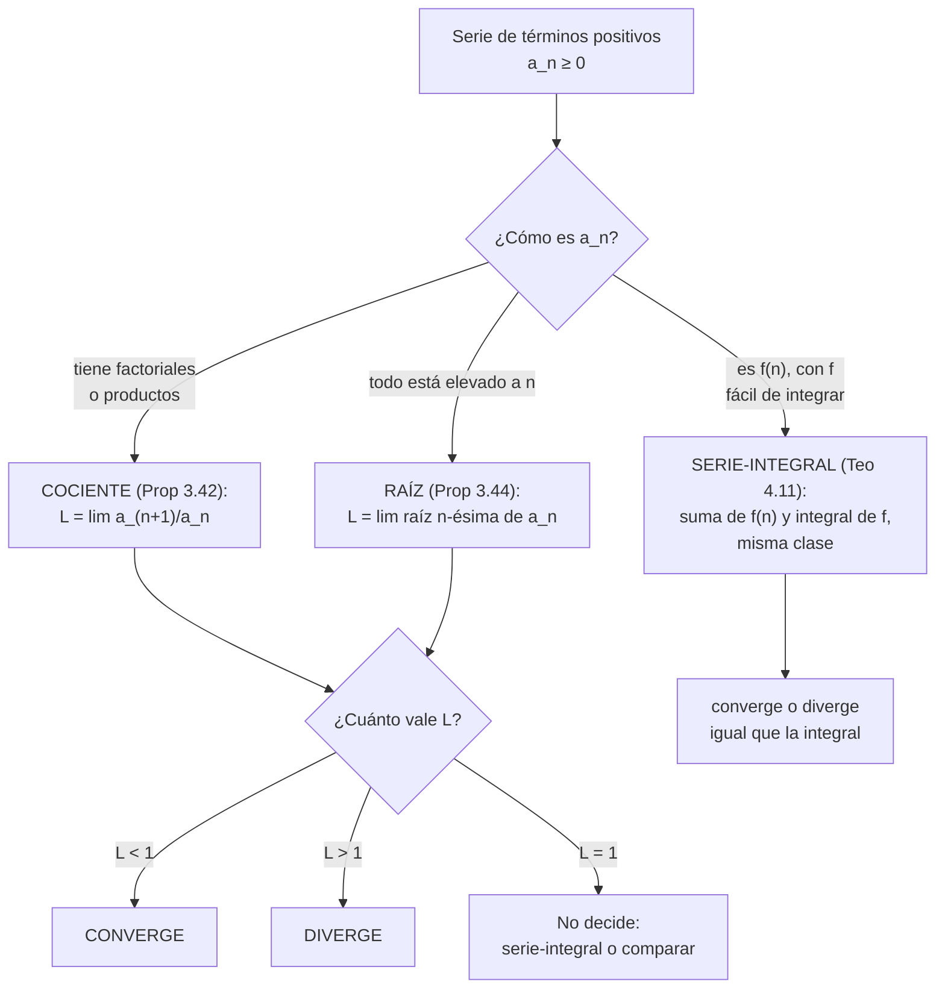
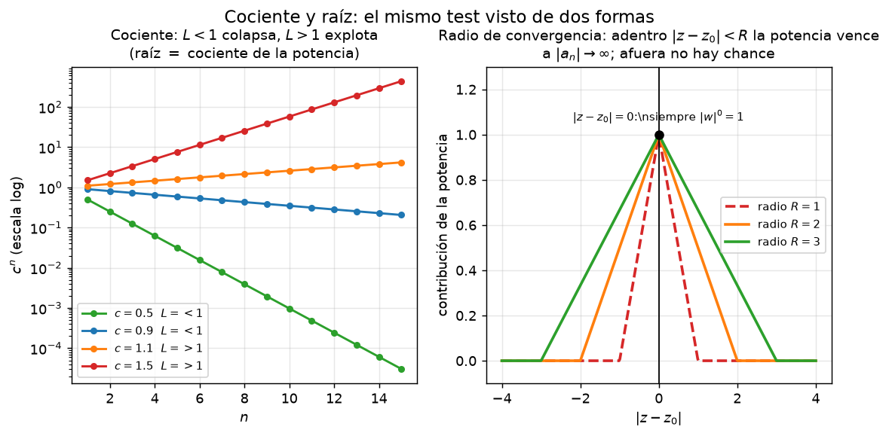

# Clase 23 — Criterio del cociente, de la raíz y criterio serie-integral

> **Bloque 4 · Series · Dificultad: media-alta · Tiempo estimado: 120 min**

---

## 🎯 Objetivos

1. **Enunciar y aplicar** el criterio del **cociente** o de D'Alembert (**Proposición 3.42**) a series de términos positivos.
2. **Enunciar y aplicar** el criterio de la **raíz $n$-ésima** o de Cauchy (**Proposición 3.44**), y entender por qué es más fuerte que el del cociente.
3. Entender y aplicar el **criterio serie-integral** (**Teorema 4.11**), que cierra la clasificación de la familia $\sum 1/n^{p}$ en el tramo $1<p<2$.
4. Resolver **Práctico 3, ej. 4–5**, **Práctico 4, ej. 8** y problemas de parcial/examen, eligiendo el criterio adecuado en cada caso.

---

## 🗺️ Mapa de la clase

---

## 🧱 Repaso / ideas previas

Antes de tirar criterios conviene tener frescas cuatro cosas.

**1. Series de términos positivos.** Si $a_n\geq0$, la reducida $s_N=a_1+\cdots+a_N$ es **creciente**. Entonces la serie **converge** (tiene techo) o **diverge a $+\infty$**; nunca oscila.

**2. El factorial.** $n!=1\cdot2\cdot3\cdots n$, con $0!=1$. Crece **rapidísimo**: más rápido que cualquier potencia o exponencial de base fija. En un cociente de factoriales conviene escribirlos en función de los anteriores:
$$\frac{(n+1)!}{n!}=n+1,\qquad \frac{n!}{(n+1)!}=\frac{1}{n+1}.$$

**3. Dos límites del Bloque 3.** Se usan una y otra vez:
$$\left(1+\frac1n\right)^{n}\xrightarrow[n\to\infty]{}e\approx2{,}718\ \ (\text{clase 18}),\qquad \sqrt[n]{c}\xrightarrow[n\to\infty]{}1\quad(c>0).$$
Del segundo sale, por ejemplo, $\sqrt[n]{n}=\bigl(\sqrt[n]{2}\bigr)^{\!\log_2 n}$… pero más simple: $\log\sqrt[n]{n}=\frac{\log n}{n}\to0$, luego $\sqrt[n]{n}\to e^{0}=1$. En general, **cualquier polinomio en $n$, dentro de una raíz $n$-ésima, tiende a $1$**: $\sqrt[n]{2n-1}\to1$, $\sqrt[n]{n^{5}}\to1$, etc.

**4. La integral impropia de la potencia** (curso de una variable):
$$\int_{1}^{+\infty}\frac{dx}{x^{\alpha}}\ \text{converge}\iff\alpha>1.$$
Este es el puente con el criterio serie-integral, porque para $f(x)=1/x^{\alpha}$ las dos cosas —serie e integral— van a resultar de la misma clase.

---

## 📘 Teoría

### 1. Criterio del cociente (D'Alembert)

> **Proposición 23.1 (notas, Proposición 3.42).** Sea $\sum a_n$ de **términos positivos**, y supongamos que existe
> $$L=\lim_{n\to\infty}\frac{a_{n+1}}{a_n}.$$
> Entonces:
> - si $L<1$, la serie $\sum a_n$ **converge**;
> - si $L>1$, la serie $\sum a_n$ **diverge**;
> - si $L=1$, el criterio **no decide**.

**Idea de la demostración.** Si $L<1$, a partir de cierto $n_0$ el cociente queda por debajo de un $k<1$, o sea $a_{n+1}\leq k\,a_n$. Encadenando hacia atrás,
$$a_n\leq k\,a_{n-1}\leq k^{2}a_{n-2}\leq\cdots\leq \frac{a_{n_0}}{k^{n_0}}\,k^{n}.$$
Es decir: **la cola de la serie está dominada por una geométrica de razón $k<1$**, y por comparación converge. Si $L>1$, desde cierto punto $a_{n+1}\geq a_n$, así que $(a_n)$ no puede tender a $0$ (queda $a_n\geq a_{n_0}>0$): por la condición necesaria, la serie diverge. $\blacksquare$

⚠️ El caso $L=1$ es **información cero**: $\sum\frac1n$ diverge y $\sum\frac1{n^{2}}$ converge, y en ambos $L=1$ (notas, Ejemplos 3.43.3). Nunca cierres una clasificación con "el cociente dio $1$".

> **Ejemplos (notas, Ejemplos 3.43).**
> 1. $\displaystyle\sum\frac{n!}{n^{n}}$: el cociente es $\displaystyle\frac{a_{n+1}}{a_n}=\frac{n^{n}}{(n+1)^{n}}=\frac{1}{\left(1+\frac1n\right)^{n}}\to\frac1e<1$, luego **converge**.
> 2. $\displaystyle\sum\frac{2^{n}}{n!}$: $\displaystyle\frac{a_{n+1}}{a_n}=\frac{2}{n+1}\to0<1$, luego **converge** (de hecho su suma es $e^{2}$).

**Cuándo brilla:** cuando el término tiene **factoriales** o **productos**, porque el cociente produce **cancelaciones masivas**.

### 2. Criterio de la raíz $n$-ésima (Cauchy)

> **Proposición 23.2 (notas, Proposición 3.44).** Sea $\sum a_n$ de **términos positivos**, y supongamos que existe
> $$L=\lim_{n\to\infty}\sqrt[n]{a_n}.$$
> Entonces:
> - si $L<1$, la serie $\sum a_n$ **converge**;
> - si $L>1$, la serie $\sum a_n$ **diverge**;
> - si $L=1$, el criterio **no decide**.

**Idea de la demostración.** Si $L<1$, desde cierto $n_0$ vale $\sqrt[n]{a_n}\leq k<1$, o sea $a_n\leq k^{n}$: de nuevo **comparación con una geométrica** de razón $k<1$. Si $L>1$, entonces $\sqrt[n]{a_n}\geq1$ desde cierto punto, es decir $a_n\geq1$: el término general no tiende a $0$ y la serie diverge. $\blacksquare$

> **Ejemplos (notas, Ejemplos 3.45).**
> 1. $\displaystyle\sum\left(\frac{\log n}{n}\right)^{n}$: $\sqrt[n]{a_n}=\frac{\log n}{n}\to0<1$, luego **converge**.
> 2. $\displaystyle\sum\frac{n^{5}}{2^{n}}$: $\displaystyle\sqrt[n]{a_n}=\frac{(\sqrt[n]{n})^{5}}{2}\to\frac12<1$, luego **converge**.

**Comparación entre cociente y raíz (notas, pág. 58).** La raíz es **más fuerte**: si el cociente decide, la raíz también; hay series que la raíz clasifica y el cociente no. Pero el cociente suele ser **más fácil de calcular**. Regla práctica:

| Si el término… | probá primero |
|---|---|
| tiene factoriales, $n!$, productos | **cociente** |
| es una potencia $n$-ésima "en bloque", $(\ \cdot\ )^{n}$ | **raíz** |

**Truco central de la raíz:** si $a_n=b_n^{n}$, entonces $\sqrt[n]{a_n}=b_n$ y el trabajo se reduce a un límite simple. Es exactamente lo que pasa con $\left(\frac{n+1}{2n-1}\right)^{n}$.

### 3. Criterio serie-integral

> **Teorema 23.3 (notas, Teorema 4.11 — criterio serie-integral).** Sea $f:[k,+\infty)\to\mathbb{R}$ **monótona decreciente** y **no negativa** ($f(x)\geq0$ para todo $x$). Entonces
> $$\sum_{n=k}^{\infty}f(n)\qquad\text{y}\qquad\int_{k}^{+\infty}f(x)\,dx$$
> son **de la misma clase**: ambas convergen o ambas divergen.

**Idea de la demostración (áreas).** Como $f$ es decreciente, en cada intervalo $[n,n+1]$ se tiene $f(n+1)\leq f(t)\leq f(n)$ para todo $t\in[n,n+1]$. Integrando en ese intervalo:
$$f(n+1)\leq\int_{n}^{n+1}f(t)\,dt\leq f(n).$$
Sumando de $n=k$ a $n=N$ y escribiendo $a_i=f(i)$:
$$\sum_{i=k+1}^{N+1}a_i\ \leq\ \int_{k}^{N+1}f(t)\,dt\ \leq\ \sum_{i=k}^{N}a_i.$$
La integral queda **encajada** entre dos sumas parciales. Si una suma está acotada, la integral también (y al revés); por lo tanto la suma y la integral revientan o se aquietan **juntas**. $\blacksquare$

> **Ejemplo (notas, Ejemplo 4.12).** Con $f(x)=\frac{1}{x^{\alpha}}$ ($\alpha>0$, decreciente), la integral $\int_{1}^{+\infty}\frac{dx}{x^{\alpha}}$ y la serie $\sum\frac{1}{n^{\alpha}}$ son de la misma clase. Como la integral converge si y solo si $\alpha>1$, queda **probada la familia $p$ completa**:
> $$\sum_{n=1}^{\infty}\frac{1}{n^{p}}\ \text{converge}\iff p>1.$$
> Esto cierra el tramo $1<p<2$ que había quedado pendiente en la clase 22.

> **Ejemplo (notas, Ejemplo 4.13).** Para $\sum\frac{1}{n\log n}$ tomamos $f(x)=\frac{1}{x\log x}$ en $[2,+\infty)$, positiva y decreciente. Con $u=\log x$, $du=\frac{dx}{x}$:
> $$\int_{2}^{+\infty}\frac{dx}{x\log x}=\int_{\log 2}^{+\infty}\frac{du}{u}=\lim_{T\to\infty}\log u\Big|_{\log 2}^{T}=+\infty.$$
> La integral **diverge**, luego la serie $\sum\frac{1}{n\log n}$ **diverge**. (¡Es un poquito más gorda que la armónica!)

**Receta para usar serie-integral:** el único trabajo real es (i) chequear que $f$ sea positiva y decreciente —basta ver $f'(x)\leq0$ para $x$ grande— y (ii) **calcular la primitiva**, casi siempre con $u=\log x$ o $u=x^{2}$.

### 4. ¿Qué criterio conviene en cada caso?

| Criterio / herramienta | Cuándo usarlo | Ejemplo típico |
|---|---|---|
| Condición necesaria (Prop 3.36) | chequeo inicial, siempre | $\sum\frac{n^{3}+5n+1}{\pi n^{3}+2n}$ diverge |
| Comparación / equivalentes | cocientes de polinomios, $\log$, $\sqrt{\ }$ | $\sum\frac{1}{n^{2}+1}\sim\sum\frac1{n^{2}}$ |
| **Cociente** | factoriales, productos | $\sum\frac{n!}{n^{n}}$, $\sum\frac{(n!)^{2}}{(2n)!}$ |
| **Raíz** | potencias $n$-ésimas en bloque | $\sum\left(\frac{n+1}{2n-1}\right)^{n}$ |
| **Serie-integral** | término $f(n)$ con primitiva fácil | $\sum\frac{\log n}{n^{2}}$, $\sum n e^{-n^{2}}$ |

---

## 🖼️ Figuras

**Cómo leer la figura.** Panel izquierdo: $c^{n}$ en escala logarítmica para varias $c$. Si $c=L<1$ la potencia **colapsa** (la serie converge); si $c=L>1$ **explota** (diverge). Los criterios de cociente y raíz solo detectan ese umbral $1$. Panel derecho: adentro del radio la potencia vence al crecimiento de $a_n$.

**Cómo leer la figura.** Todas las funciones de $n$: $\log n$, $\sqrt n$, $n$, $n\log n$, $n^{2}$, $1{,}2^{n}$, $n!$ y $n^{n}$. Para el criterio de la raíz importa que $\sqrt[n]{\text{cualquier polinomio}}\to1$ y que los exponenciales y factoriales queden **arriba**. Si el término tiene un $q^{n}$ con $q<1$, la raíz lo delata.

**Cómo leer la figura.** Cada curva es $x^{-p}$. El criterio serie-integral dice que **el área bajo la curva** (la integral) y la **suma de las alturas en los enteros** (la serie) son de la misma clase. A la izquierda de $p=1$ la cola es demasiado gorda y el área es infinita; a la derecha, finita. La igualdad clave de la figura:
$$\int_{1}^{+\infty}x^{-p}\,dx=\begin{cases}\dfrac{1}{p-1}, & p>1,\\[4pt] +\infty, & p\leq1.\end{cases}$$

---

## ✏️ Ejercicios resueltos paso a paso — Práctico 3, ej. 4–5 y Práctico 4, ej. 8

> ⚠️ **Nota sobre superíndices.** Los textos extraídos de PDF pierden fácilmente los exponentes. Verificamos en el **PDF original** (con PyMuPDF) que el numerador del ej. 4a/5a es el **lineal** $2n-1$, **no** $2^{n}-1$. Es un dato decisivo: con $2n-1$ el cociente da $1/\sqrt2<1$ (converge); con $2^{n}-1$ daría $\sqrt2>1$ (diverge).

### Ejercicio 1 (Práctico 3, ej. 4a). Criterio del cociente: $\displaystyle\sum_{n=1}^{\infty}\frac{2n-1}{(\sqrt2)^{\,n}}$

**Paso 1 — reconocer.** Hay una potencia $(\sqrt2)^{n}=2^{n/2}$ en el denominador y un polinomio arriba. Probamos el **cociente**.

**Paso 2 — armar el cociente.**
$$\frac{a_{n+1}}{a_n}=\frac{2(n+1)-1}{(\sqrt2)^{\,n+1}}\cdot\frac{(\sqrt2)^{\,n}}{2n-1}=\frac{2n+1}{2n-1}\cdot\frac{1}{\sqrt2}.$$

**Paso 3 — límite.**
$$\lim_{n\to\infty}\frac{2n+1}{2n-1}=1,\qquad L=\frac{1}{\sqrt2}\approx0{,}707<1.$$

**Paso 4 — concluir.** $L<1$, así que la serie **converge**. ✔ *(coincide con la solución oficial del parcial 2020-2S vespertino)*

### Ejercicio 2 (Práctico 3, ej. 4b). Criterio del cociente: $\displaystyle\sum_{n=1}^{\infty}\frac{n!}{n^{n}}$

**Paso 1 — cociente.**
$$\frac{a_{n+1}}{a_n}=\frac{(n+1)!}{(n+1)^{\,n+1}}\cdot\frac{n^{n}}{n!}=\frac{(n+1)\,n^{n}}{(n+1)^{\,n+1}}=\frac{n^{n}}{(n+1)^{\,n}}=\left(\frac{n}{n+1}\right)^{n}.$$

**Paso 2 — reescribir.**
$$\left(\frac{n}{n+1}\right)^{n}=\frac{1}{\left(\frac{n+1}{n}\right)^{n}}=\frac{1}{\left(1+\frac1n\right)^{n}}\xrightarrow[n\to\infty]{}\frac1e\approx0{,}368.$$

**Paso 3 — concluir.** $L=\frac1e<1$, luego la serie **converge**. Es el ejemplo que ya apareció en las notas (Ejemplos 3.43.1).

**Chequeo numérico:** $1+0{,}5+0{,}222+0{,}094+0{,}038+\cdots\approx1{,}88$ y crece poco: consistente. ✔

### Ejercicio 3 (Práctico 3, ej. 5a). Criterio de la raíz: $\displaystyle\sum_{n=1}^{\infty}\frac{2n-1}{(\sqrt2)^{\,n}}$

Es **la misma serie** del ejercicio 1, ahora con la raíz (el práctico pide comparar ambos criterios).

**Paso 1 — raíz $n$-ésima del término.**
$$\sqrt[n]{a_n}=\sqrt[n]{\frac{2n-1}{(\sqrt2)^{\,n}}}=\frac{\sqrt[n]{2n-1}}{\sqrt2}.$$

**Paso 2 — límite del numerador.** $\sqrt[n]{2n-1}=e^{\frac{\log(2n-1)}{n}}$, y $\frac{\log(2n-1)}{n}\to0$, así que $\sqrt[n]{2n-1}\to1$.

**Paso 3 — límite.** $L=\dfrac{1}{\sqrt2}<1$.

**Paso 4 — concluir.** La serie **converge**. ✔ Los dos criterios coinciden, como debe ser.

### Ejercicio 4 (Práctico 3, ej. 5b). Criterio de la raíz: $\displaystyle\sum_{n=1}^{\infty}\left(\frac{n+1}{2n-1}\right)^{n}$

**Paso 1 — aplicar la raíz directamente.** Como todo está elevado a la $n$:
$$\sqrt[n]{a_n}=\sqrt[n]{\left(\frac{n+1}{2n-1}\right)^{n}}=\frac{n+1}{2n-1}.$$

**Paso 2 — límite.**
$$L=\lim_{n\to\infty}\frac{n+1}{2n-1}=\frac12<1.$$

**Paso 3 — concluir.** La serie **converge**. ✔

> 💡 Este es el caso ideal de la raíz: el exponente $n$ se cancela **de un saque** con la raíz y queda un límite de cociente de polinomios.

### Ejercicio 5 (Práctico 4, ej. 8a). Serie-integral: $\displaystyle\sum_{n=1}^{\infty} n\,e^{-n^{2}}$

**Paso 1 — función.** Tomamos $f(x)=x\,e^{-x^{2}}$ en $[1,+\infty)$. Es **positiva** y **decreciente**: $f'(x)=e^{-x^{2}}\bigl(1-2x^{2}\bigr)<0$ para $x\geq1$.

**Paso 2 — integral.** Con $u=x^{2}$, $du=2x\,dx$:
$$\int_{1}^{+\infty}x\,e^{-x^{2}}\,dx=\frac12\int_{1}^{+\infty}e^{-u}\,du=\frac12\Bigl[-e^{-u}\Bigr]_{1}^{+\infty}=\frac12\bigl(0+e^{-1}\bigr)=\frac{1}{2e}.$$
La integral **converge**.

**Paso 3 — concluir (Teorema 4.11).** Misma clase que la integral: la serie **converge**. ✔

### Ejercicio 6 (Práctico 4, ej. 8b). Serie-integral: $\displaystyle\sum_{n=2}^{\infty}\frac{1}{n\sqrt{\log n}}$

**Paso 1 — función.** $f(x)=\dfrac{1}{x\sqrt{\log x}}$ en $[2,+\infty)$: positiva y decreciente (el denominador crece).

**Paso 2 — integral con $u=\log x$, $du=\dfrac{dx}{x}$.**
$$\int_{2}^{+\infty}\frac{dx}{x\sqrt{\log x}}=\int_{\log 2}^{+\infty}u^{-1/2}\,du=\Bigl[2\sqrt u\Bigr]_{\log 2}^{+\infty}=+\infty.$$
La integral **diverge**.

**Paso 3 — concluir.** La serie **diverge**. ✔

> 💡 Comparación mental: $\sqrt{\log n}$ crece **despacio**, así que $\frac{1}{n\sqrt{\log n}}$ es apenas **más chica** que la armónica $\frac1n$… pero no lo suficiente: sigue divergiendo.

### Ejercicio 7 (Práctico 4, ej. 8c). Serie-integral: $\displaystyle\sum_{n=1}^{\infty}\frac{\log n}{n^{2}}$

**Paso 1 — función.** $f(x)=\dfrac{\log x}{x^{2}}$. Para $x$ grande, el numerador crece pero el denominador $x^{2}$ gana; de hecho $f'(x)=\dfrac{1-2\log x}{x^{3}}<0$ para $x>e^{1/2}\approx1{,}65$, así que desde $x\geq2$ es decreciente (los primeros términos no afectan la clase).

**Paso 2 — integral por partes** ($u=\log x$, $dv=x^{-2}dx$, $v=-1/x$):
$$\int\frac{\log x}{x^{2}}\,dx=-\frac{\log x}{x}+\int\frac{1}{x^{2}}\,dx=-\frac{\log x+1}{x}.$$
Evaluando:
$$\int_{1}^{+\infty}\frac{\log x}{x^{2}}\,dx=\Bigl[-\frac{\log x+1}{x}\Bigr]_{1}^{+\infty}=0-\bigl(-1\bigr)=1.$$
La integral **converge**.

**Paso 3 — concluir.** La serie **converge**. ✔

---

## 🏛️ Ejercicios de parcial/examen

### Ejercicio 8 (Primer parcial 2019-2S, ej. 4). Enunciar el cociente y clasificar dos series

Formulario del parcial: (2) enunciar y probar el criterio del cociente; clasificar
$$\text{(3)}\ \sum_{n=1}^{\infty}\frac{n^{3}+5n+1}{\pi n^{3}+2n},\qquad\qquad \text{(4)}\ \sum_{n=1}^{\infty}\frac{(n!)^{2}}{(2n)!}.$$

**Serie (3) — condición necesaria.** Es un cociente de polinomios del **mismo grado**:
$$a_n=\frac{n^{3}+5n+1}{\pi n^{3}+2n}\xrightarrow[n\to\infty]{}\frac{1}{\pi}\neq0.$$
El término general **no** tiende a $0$, luego la serie **diverge** (basta la Prop 3.36, en un renglón). ✔ *(solución oficial: "por la parte (1), DIVERGE")*

**Serie (4) — criterio del cociente.**
$$\frac{a_{n+1}}{a_n}=\frac{\bigl((n+1)!\bigr)^{2}}{(2n+2)!}\cdot\frac{(2n)!}{(n!)^{2}}=\frac{(n+1)^{2}}{(2n+2)(2n+1)}=\frac{(n+1)^{2}}{2(n+1)(2n+1)}=\frac{n+1}{2(2n+1)}.$$
$$L=\lim_{n\to\infty}\frac{n+1}{2(2n+1)}=\frac14<1\ \Longrightarrow\ \textbf{converge}.$$
✔ *(solución oficial: "por la parte (2), CONVERGE")*

> 💡 Los factoriales obligan al **cociente**. Nunca intentes comparar $\frac{(n!)^{2}}{(2n)!}$ con un $1/n^{p}$ a ojo.

### Ejercicio 9 (Examen julio 2022, múltiple opción 5). Criterio de la raíz

$$\sum_{n=1}^{\infty}\Bigl(n\log\Bigl(1+\frac2n\Bigr)\Bigr)^{n}$$

Opciones: (A) No se puede clasificar. (B) diverge. (C) oscila. (D) converge.

**Paso 1 — es de términos positivos y todo está elevado a $n$: raíz.**
$$\sqrt[n]{a_n}=n\log\Bigl(1+\frac2n\Bigr).$$

**Paso 2 — equivalente.** Como $\log(1+u)\sim u$ cuando $u\to0$, con $u=\frac2n$:
$$n\log\Bigl(1+\frac2n\Bigr)\sim n\cdot\frac2n=2.$$

**Paso 3 — límite.** $L=2>1$, así que la serie **diverge**.

**Respuesta: (B) diverge.** ✔ *(verificada con la solución oficial del examen)*

---

## ⚠️ Errores comunes

| Error | Corrección |
|---|---|
| Cerrar con "el cociente dio $1$" | Con $L=1$ el criterio **no decide**: hace falta serie-integral o comparación ($\sum\frac1n$ vs $\sum\frac1{n^{2}}$) |
| Invertir las conclusiones del cociente/raíz | $L<1$ **converge**, $L>1$ **diverge**. (Es el **recíproco** de la intuición de la geométrica, donde $|q|<1$ converge… justamente por eso: $L$ es el "cociente asintótico" $q$) |
| Usar cociente o raíz con términos que cambian de signo | Estos criterios se enuncian para $a_n>0$; si hay signos, primero absolutizá (clase 24) |
| Olvidar el factor $1/\sqrt2$ en $\frac{2n-1}{(\sqrt2)^{n}}$ | El cociente arrastra $\frac{1}{\sqrt2}$, que es **todo** el resultado |
| Creer que $\sqrt[n]{\text{polinomio}}$ depende de $n$ | $\sqrt[n]{p(n)}\to1$ para **cualquier** polinomio $p$ con coeficiente principal positivo |
| Aplicar serie-integral con $f$ no decreciente | Es **hipótesis**: si $f$ no es decreciente, el teorema no aplica |
| Integrar $\frac{1}{x\log x}$ sin el cambio $u=\log x$ | Con $u=\log x$ queda $\int du/u$; sin él, no se ve la divergencia |
| En serie-integral, olvidar que los primeros términos no importan | La clase no cambia si $f$ es decreciente **a partir de cierto punto** |

---

## 🔗 Conexiones

- **Clase 22:** la comparación y los equivalentes siguen siendo la primera opción con polinomios; el cociente/raíz entran cuando hay factoriales o potencias $n$-ésimas.
- **Clase 24:** para series con signos variables se **absolutiza** y recién ahí se aplican cociente, raíz o serie-integral.
- **Clase 26–28 (integrales impropias):** el Teorema 4.11 es el puente exacto. Todo lo que se aprende acá de $\int_{k}^{\infty}f$ se reutiliza para clasificar integrales impropias, y viceversa.
- **Ingeniería:** los criterios del cociente y de la raíz son la base para calcular el **radio de convergencia** de las series de potencias (Bloque 1, exponencial compleja) y en el análisis de algoritmos (series de costos).
- **Función Gamma (Práctico 4, complementario):** $\Gamma(n)=(n-1)!$ enlaza la integral $\int_{0}^{\infty}e^{-t}t^{x-1}dt$ con los factoriales que tanto aparecen en el criterio del cociente.

---

## ✅ Autoevaluación

1. Enunciar los criterios del cociente y de la raíz, y decir cuál es más fuerte.
2. Clasificar $\displaystyle\sum\frac{3^{n}}{n!}$.
3. Clasificar $\displaystyle\sum\left(\frac{3n+2}{n}\right)^{n}$.
4. Clasificar $\displaystyle\sum\frac{n^{2}}{2^{n}}$.
5. Clasificar, con serie-integral, $\displaystyle\sum_{n=2}^{\infty}\frac{1}{n(\log n)^{2}}$.
6. Clasificar, con serie-integral, $\displaystyle\sum_{n=1}^{\infty}\frac{1}{n^{2}+1}$ —¿no era más rápido con equivalentes?
7. ¿Para qué valores de $p$ converge $\displaystyle\sum\frac{1}{n^{p}}$? ¿Cómo se prueba el tramo $1<p<2$?

### Respuestas

1. Proposiciones 23.1 y 23.2. La **raíz es más fuerte** (clasifica todo lo que clasifica el cociente), pero el cociente es más cómodo con factoriales.
2. Cociente: $\frac{a_{n+1}}{a_n}=\frac{3}{n+1}\to0<1$: **converge**.
3. Raíz: $\sqrt[n]{a_n}=\frac{3n+2}{n}\to3>1$: **diverge**.
4. Cociente (o raíz): $L=\frac12<1$: **converge**. (Raíz: $\frac{(\sqrt[n]{n})^{2}}{2}\to\frac12$.)
5. $f(x)=\frac{1}{x(\log x)^{2}}$, $u=\log x$: $\int\frac{du}{u^{2}}=\bigl[-\frac1u\bigr]_{\log2}^{\infty}=\frac{1}{\log2}$, **converge**.
6. Serie-integral: $f(x)=\frac{1}{x^{2}+1}$, $\int_{1}^{\infty}\frac{dx}{x^{2}+1}=\frac\pi2-\frac\pi4=\frac\pi4$: **converge**. Con equivalentes, $\frac{1}{n^{2}+1}\sim\frac1{n^{2}}$ y también converge; equivalentes es más rápido. ✔
7. Converge **si y solo si $p>1$**. El tramo $1<p<2$ se cierra con el criterio serie-integral aplicado a $f(x)=1/x^{p}$ (Ejemplo 4.12).

---

**⬅️ Anterior:** [Clase 22 — Términos positivos: comparación y equivalentes](22_series_positivos.md) · **🏠 Índice:** [00 — Índice](00_indice.md) · **➡️ Siguiente:** [Clase 24 — Series alternadas y convergencia absoluta](24_series_alternadas.md)
