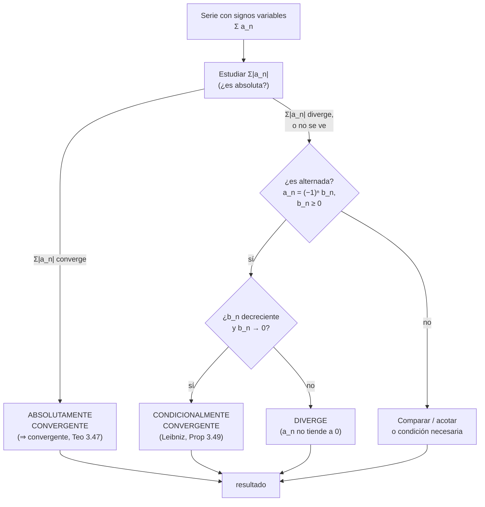
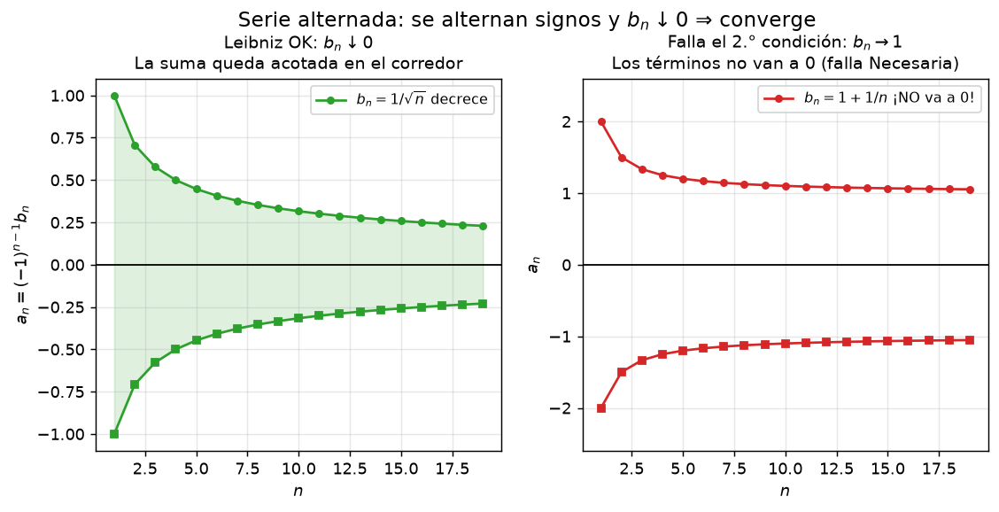
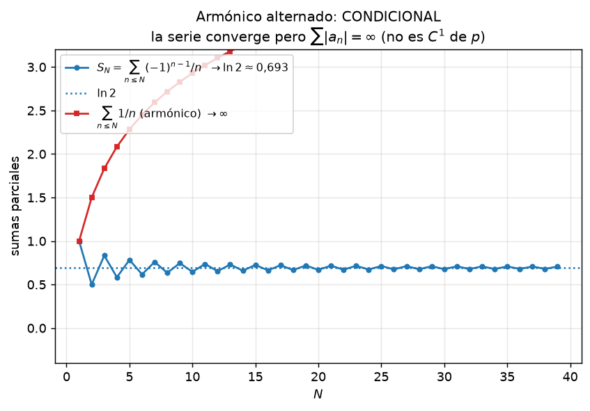

# Clase 24 — Series alternadas y convergencia absoluta

> **Bloque 4 · Series · Dificultad: media · Tiempo estimado: 120 min**

---

## 🎯 Objetivos

1. **Definir** la **convergencia absoluta** (**Definición 3.46**) y distinguirla de la **convergencia condicional**.
2. Enunciar y **demostrar** que toda serie absolutamente convergente es convergente (**Teorema 3.47**), con el truco de partir $a_n$ en su parte positiva y negativa.
3. Enunciar y **aplicar** el **criterio de Leibniz** (**Proposición 3.49**) para series alternadas $\sum(-1)^n b_n$ con $b_n$ decreciente hacia $0$.
4. Entender por qué el **orden** de los sumandos importa: reordenación y **Teorema de Riemann** (3.51).
5. Resolver **Práctico 3, ej. 6–8** y problemas de parcial/examen, decidiendo en cada caso **absoluta vs. condicional**.

---

## 🗺️ Mapa de la clase

---

## 🧱 Repaso / ideas previas

**1. Las clases 22 y 23 clasifican series de términos positivos.** Comparación, equivalentes, cociente, raíz y serie-integral. Todo eso vale para $\sum|a_n|$, **aun cuando $\sum a_n$ tenga signos**. Esta es la idea central de la clase.

**2. Condición necesaria (clase 21).** Si $\sum a_n$ converge entonces $a_n\to0$. Contrapositiva: si $a_n\not\to0$, la serie **diverge**. Es el primer chequeo, y sirve igual con signos.

**3. Valor absoluto.** Para todo real $x$: $|x|\geq0$, $|x|=0\iff x=0$, y $-|x|\leq x\leq|x|$. Además si $0\leq u\leq v$ entonces $\frac1u\geq\frac1v$ (al invertir se da vuelta la desigualdad).

**4. Sucesiones monótonas y acotadas (clase 17).** PSMC: una sucesión **decreciente y acotada inferiormente** converge. Con eso se prueba que $b_n\downarrow0$ "llega a $0$" sin calcular la suma.

**5. Intuición de la compensación.** Si hay signos alternados, los sumandos se **cancelan** entre sí: una serie puede converger aunque $\sum|a_n|$ diverja. Leibniz es el único criterio que ve esa cancelación.

---

## 📘 Teoría

### 1. Convergencia absoluta

> **Definición 24.1 (notas, Definición 3.46).** Decimos que una serie $\sum a_n$ es **absolutamente convergente** si y solo si la serie de los valores absolutos
> $$\sum_{n=1}^{\infty}|a_n|$$
> es convergente.

**Ejemplo inmediato (notas).** Si $-1<a<1$, la geométrica $\sum a^{n}$ es absolutamente convergente porque $|a^{n}|=|a|^{n}$ y $\sum|a|^{n}<\infty$.

La intuición de las notas: **sumar los valores absolutos es el "peor caso"**. Con signos mezclados, algunos términos se compensan; si aun así el peor caso suma finito, la serie original no puede escaparse. Formalicemos.

### 2. Absoluta implica convergente

> **Teorema 24.2 (notas, Teorema 3.47).** Toda serie absolutamente convergente es convergente.

**Demostración (notas).** Sea $\sum a_n$ absolutamente convergente. Partimos cada término en su parte positiva y negativa:
$$a_n^{+}=\begin{cases}a_n,& a_n\geq0,\\ 0,& a_n<0,\end{cases}\qquad\qquad a_n^{-}=\begin{cases}0,& a_n\geq0,\\ -a_n,& a_n<0.\end{cases}$$
Ambas sucesiones son de **términos positivos**, y valen las dos identidades clave:
$$a_n=a_n^{+}-a_n^{-},\qquad\qquad |a_n|=a_n^{+}+a_n^{-}.$$
Como $0\leq a_n^{+}\leq|a_n|$ y $\sum|a_n|$ converge, por **comparación** (Prop 3.38) la serie $\sum a_n^{+}$ converge. Lo mismo con $a_n^{-}$. Entonces
$$\sum a_n=\sum\bigl(a_n^{+}-a_n^{-}\bigr)=\sum a_n^{+}-\sum a_n^{-}$$
es resta de dos series convergentes, luego **convergente**. $\blacksquare$

⚠️ **El recíproco es falso.** Hay series convergentes cuya serie de valores absolutos diverge. A esas series se las llama **condicionalmente convergentes**.

> **Definición 24.3 (notas).** Una serie es **condicionalmente convergente** si es convergente pero **no** es absolutamente convergente.

El ejemplo canónico: $\sum\frac{(-1)^{n}}{n}$ converge (Leibniz), pero $\sum\bigl|\frac{(-1)^{n}}{n}\bigr|=\sum\frac1n$ **diverge** (armónica). Es condicionalmente convergente.

### 3. Criterio de Leibniz

> **Proposición 24.4 (notas, Proposición 3.49 — criterio de Leibniz).** Si $(b_n)$ es una sucesión **monótona decreciente** que **tiende a cero**, entonces la serie alternada
> $$\sum_{n=1}^{\infty}(-1)^{n}b_n$$
> es **convergente**.

**Idea de la demostración (los dos corredores).** Trabajemos con $\sum(-1)^{n-1}b_n$ (mismo análisis). Las reducidas pares e impares se ordenan así:
$$s_2\ \leq\ s_4\ \leq\ \cdots\ \leq\ s_{2N}\ \leq\ \cdots\ \leq\ s_{2N+1}\ \leq\ \cdots\ \leq\ s_3\ \leq\ s_1.$$
¿Por qué? Porque $s_{2N+2}-s_{2N}=b_{2N+1}-b_{2N+2}\geq0$ (cada par aporta $\geq0$) y $s_{2N+1}-s_{2N-1}=b_{2N}-b_{2N+1}\leq0$. Entonces las pares **crecen** y las impares **decrecen**, y están **entrelazadas**: todas las pares quedan por debajo de $s_1$ y todas las impares por encima de $s_2$. Por PSMC ambas convergen; como $s_{2N+1}-s_{2N}=b_{2N+1}\to0$, convergen **al mismo límite**, y la serie converge a él. $\blacksquare$

**El corredor.** La suma exacta queda **encajada** entre dos reducidas consecutivas, y el error al cortar en $N$ está acotado por $b_{N+1}$:
$$|S-s_N|\leq b_{N+1}.$$

> **Ejemplos 24.5 (notas, Ejemplos 3.50).**
> 1. $\displaystyle\sum(-1)^{n}\frac1n$ converge por Leibniz, pero **no** absolutamente: $\sum\bigl|(-1)^n\frac1n\bigr|=\sum\frac1n$ diverge.
> 2. $\displaystyle\sum(-1)^{n}\log\!\Bigl(1+\frac1n\Bigr)$ converge por Leibniz ($\log(1+\frac1n)\downarrow0$).

**Dos condiciones, no una.** Leibniz exige **las dos**: $b_n\downarrow$ **y** $b_n\to0$. Si $b_n\to L\neq0$, la condición necesaria ya muestra divergencia. Si $b_n\to0$ pero **no** es decreciente, Leibniz no aplica (puede igual converger, pero hay que mostrar otra cosa).

### 4. Reordenar: el Teorema de Riemann

> **Hecho (notas).** Si $\sum a_n$ es **absolutamente** convergente, cualquier reordenación de sus términos converge **a la misma suma**. La conmutatividad sobrevive.

Con la convergencia condicional, en cambio, la conmutatividad **se pierde**:

> **Teorema 24.6 (notas, Teorema 3.51 — Riemann).** Si $\sum a_n$ es condicionalmente convergente y $L\in\mathbb{R}$ es cualquier real, existe una **reordenación** de $\sum a_n$ que converge a $L$.

La demostración (notas) toma términos positivos en orden hasta **pasar** $L$, luego negativos hasta **caer** por debajo, y repite. Funciona porque, siendo la serie condicional, tanto la serie de positivos como la de negativos **divergen**: siempre hay material para cruzar $L$.

> 💡 **Moraleja conceptual:** la convergencia absoluta es "robusta" —no depende del orden—; la condicional es "frágil": la suma es un artefacto del orden elegido. Por eso, en el examen, **siempre** hay que decir si la convergencia es absoluta o condicional.

### 5. Estrategia para series con signos

| Paso | Qué hacer |
|---|---|
| 1 | Condición necesaria: ¿$a_n\to0$? Si no, **diverge** (un renglón). |
| 2 | ¿Es **alternada** ($a_n=(-1)^n b_n$, $b_n\geq0$)? Ver §3 (Leibniz). |
| 3 | Estudiar $\sum|a_n|$ con **cociente/raíz/comparación/equivalente** (clases 22–23). |
| 4 | Si $\sum|a_n|$ converge → **absolutamente convergente** (y por 24.2, convergente). Terminado. |
| 5 | Si $\sum|a_n|$ diverge **pero** Leibniz aplica → **condicionalmente convergente**. |
| 6 | Si nada de lo anterior decide, comparar/acotar (o usar el criterio de Dirichlet, fuera del programa). |

---

## 🖼️ Figuras

**Cómo leer la figura.** Panel izquierdo: $b_n=1/\sqrt n$ **decrece hacia 0**, así que $a_n=(-1)^{n-1}b_n$ oscila dentro de un corredor que se cierra: las reducidas van y vienen, pero quedan **atrapadas** y convergen. Panel derecho: $b_n=1+\frac1n\to1\neq0$; los términos tampoco van a $0$, falla la condición **necesaria** y la serie diverge. Leibniz necesita que el corredor **se cierre**.

**Cómo leer la figura.** La curva azul son las reducidas de $\sum\frac{(-1)^{n-1}}{n}$: suben y bajan, pero se **aplanan** contra $\ln2\approx0{,}693$. La curva roja son las reducidas de $\sum\frac1n=\sum|a_n|$: **suben sin freno**. Este es el retrato exacto de una serie **condicionalmente convergente**: la serie original converge y la de valores absolutos no.

---

## ✏️ Ejercicios resueltos paso a paso — Práctico 3, ej. 6–8

### Ejercicio 1 (Práctico 3, ej. 6). Si $a_n\geq0$ y $\sum a_n$ converge, ¿qué pasa con otras series?

> **Dato de oro:** si $\sum a_n$ converge con $a_n\geq0$, entonces $a_n\to0$ (Prop 3.36). Y $a_n\to0$ implica $a_n\leq1$ desde cierto $n_0$.

**6a) $\displaystyle\sum \frac{1}{a_n}$.** Como $a_n\to0^{+}$, se tiene $\dfrac{1}{a_n}\to+\infty$. El término general **no** tiende a $0$:
$$\Rightarrow\ \textbf{diverge}. \checkmark$$

**6b) $\displaystyle\sum a_n^{2}$.** Desde $n_0$, $0\leq a_n\leq1$, luego $a_n^{2}\leq a_n$. Por **comparación** con la serie convergente $\sum a_n$:
$$\Rightarrow\ \textbf{converge}. \checkmark$$

**6c) $\displaystyle\sum \sqrt{a_n}$.** **No se puede decidir**: depende de $a_n$.

- Si $a_n=\frac{1}{n^{2}}$: $\sum a_n=\sum\frac1{n^{2}}$ converge, pero $\sum\sqrt{a_n}=\sum\frac1n$ **diverge**.
- Si $a_n=\frac{1}{n^{4}}$: $\sum a_n$ converge y $\sum\sqrt{a_n}=\sum\frac1{n^{2}}$ también **converge**.

$$\Rightarrow\ \textbf{la información no alcanza (indecidible)}. \checkmark$$

**6d) $\displaystyle\sum \log(1+a_n)$.** Como $\log(1+x)\leq x$ para $x\geq0$, y $a_n\geq0$:
$$0\leq\log(1+a_n)\leq a_n.$$
Por **comparación** con la convergente $\sum a_n$:
$$\Rightarrow\ \textbf{converge}. \checkmark$$

> 💡 Equivalencia: $\log(1+a_n)\sim a_n$ cuando $a_n\to0$ (Prop 3.40). Las dos vías dan lo mismo; el 6d es el "buen" y el 6c el "tramposo".

---

### Ejercicio 2 (Práctico 3, ej. 7). Alternadas: convergencia y carácter absoluto

**7a) $\displaystyle\sum_{n=1}^{\infty}\frac{(-1)^{n+1}}{3^{n}}$.** Los valores absolutos forman la **geométrica** $\sum\frac{1}{3^{n}}$ con $q=\frac13<1$:
$$\sum\Bigl|\frac{(-1)^{n+1}}{3^{n}}\Bigr|=\sum\frac1{3^{n}}=\frac{1/3}{1-1/3}=\frac12<\infty.$$
$$\Rightarrow\ \textbf{absolutamente convergente}\quad(\text{suma }=\tfrac14).\ \checkmark$$

**7b) $\displaystyle\sum_{n=1}^{\infty}\frac{(-1)^{n+1}n}{n^{2}+1}$.** No absolutamente:
$$\Bigl|\frac{n}{n^{2}+1}\Bigr|\sim\frac{n}{n^{2}}=\frac1n\ \Longrightarrow\ \sum\Bigl|\frac{n}{n^{2}+1}\Bigr|\ \text{diverge (armónica).}$$
Leibniz con $b_n=\dfrac{n}{n^{2}+1}$: es **decreciente** desde $n=1$ (la función $f(x)=\frac{x}{x^{2}+1}$ tiene $f'(x)=\frac{1-x^{2}}{(x^{2}+1)^{2}}\leq0$ para $x\geq1$) y $b_n\to0$.
$$\Rightarrow\ \textbf{condicionalmente convergente}.\ \checkmark$$

**7c) $\displaystyle\sum_{n=1}^{\infty}\frac{(-1)^{n}n}{6n-5}$.** El módulo del término general tiende a $\frac16\neq0$:
$$b_n=\frac{n}{6n-5}\xrightarrow[n\to\infty]{}\frac16.$$
Falla la condición **necesaria** (los términos de la serie no van a $0$):
$$\Rightarrow\ \textbf{diverge}.\ \checkmark$$

**7d) $\displaystyle\sum_{n=1}^{\infty}\frac{(-1)^{n}(n^{3}+2n^{2}+8n+5)}{n^{5}+4n^{3}+15}$.** El módulo es equivalente a $\frac{n^{3}}{n^{5}}=\frac1{n^{2}}$:
$$\Bigl|\frac{n^{3}+2n^{2}+8n+5}{n^{5}+4n^{3}+15}\Bigr|\sim\frac1{n^{2}},\qquad \sum\frac1{n^{2}}<\infty.$$
$$\Rightarrow\ \textbf{absolutamente convergente}.\ \checkmark$$

---

### Ejercicio 3 (Práctico 3, ej. 8). Serie por serie, con el criterio adecuado

**8a) $\displaystyle\sum_{n=1}^{\infty}\frac{n}{(n+1)(n+2)}$.** El término es $\sim\frac{n}{n^{2}}=\frac1n$:
$$\frac{n}{(n+1)(n+2)}\sim\frac1n\ \Longrightarrow\ \sum\frac1n\ \text{diverge}\ \Rightarrow\ \textbf{diverge}. \checkmark$$

**8b) $\displaystyle\sum_{n=1}^{\infty}\frac{n}{(n+1)\log(n+1)}$.** Reacomodamos: $\frac{n}{n+1}\geq\frac12$ para $n\geq1$ y $\log(n+1)\leq n+1$, luego
$$\frac{n}{(n+1)\log(n+1)}\geq\frac{1}{2\log(n+1)}\geq\frac{1}{2(n+1)}.$$
Como $\sum\frac{1}{2(n+1)}$ diverge (armónica desfasada), por **comparación**:
$$\Rightarrow\ \textbf{diverge}. \checkmark$$

**8c) $\displaystyle\sum_{n=1}^{\infty}\frac{n^{3}}{e^{n}}$.** **Cociente** (hay una exponencial de base fija):
$$\frac{a_{n+1}}{a_n}=\frac{(n+1)^{3}}{e^{\,n+1}}\cdot\frac{e^{\,n}}{n^{3}}=\frac{1}{e}\Bigl(1+\frac1n\Bigr)^{3}\xrightarrow[n\to\infty]{}\frac1e<1.$$
$$\Rightarrow\ \textbf{converge}. \checkmark$$

**8d) $\displaystyle\sum_{n=1}^{\infty}\frac{(-1)^{n+1}}{\sqrt{n}}$.** Leibniz con $b_n=\frac{1}{\sqrt n}$: decreciente y $\to0$, luego **converge**. Pero
$$\sum\Bigl|\frac{(-1)^{n+1}}{\sqrt{n}}\Bigr|=\sum\frac{1}{n^{1/2}}\ \text{diverge (p-series con }p=\tfrac12\leq1).$$
$$\Rightarrow\ \textbf{condicionalmente convergente}. \checkmark$$

> ⚠️ **Ojo con el texto del práctico.** Verificamos en el PDF original que el ej. 8d es $\sum\frac{(-1)^{n+1}}{\sqrt n}$ (el "1" que aparecía suelto en la extracción de texto es el número de página, **no** un exponente). Si fuera $\sum(-1)^{n+1}\sqrt n$, el término no tendería a $0$ y **divergiría**.

---

## 🏛️ Ejercicios de parcial/examen

### Ejercicio 4 (Primer parcial 2019-1S, MO 3). ¿Absoluta o condicional?

$$\sum_{n=2}^{\infty}\frac{(-1)^{n}}{n\log(n)}.$$

**Paso 1 — Leibniz.** $b_n=\dfrac{1}{n\log n}$ es positiva, decreciente para $n\geq2$ (el denominador crece) y $b_n\to0$:
$$\Rightarrow\ \text{la serie }\textbf{converge}.$$

**Paso 2 — ¿absoluta?** Estudiamos $\sum\frac{1}{n\log n}$ con el **criterio serie-integral** (clase 23): $f(x)=\frac{1}{x\log x}$ es positiva y decreciente en $[2,\infty)$, y con $u=\log x$, $du=\frac{dx}{x}$:
$$\int_{2}^{+\infty}\frac{dx}{x\log x}=\int_{\log2}^{+\infty}\frac{du}{u}=\lim_{T\to\infty}\log u\Big|_{\log2}^{T}=+\infty.$$
La integral **diverge**, luego $\sum\frac{1}{n\log n}$ **diverge**: la serie **no** es absolutamente convergente.

**Respuesta: (A) la serie converge pero no converge absolutamente.** ✔ *(verificada con la solución oficial: convergente y no absolutamente)*

### Ejercicio 5 (Examen julio 2019, MO 5). Serie que converge absolutamente

$$\sum_{n=13}^{\infty}\frac{(-1)^{n}}{n(\ln n)^{2}}.$$

**Paso 1 — Leibniz.** $b_n=\dfrac{1}{n(\ln n)^{2}}\downarrow0$ para $n\geq13$ (denominador creciente, $\ln n>1$), así que la serie **converge**.

**Paso 2 — ¿absoluta? Serie-integral** con $f(x)=\dfrac{1}{x(\ln x)^{2}}$ (positiva y decreciente en $[13,\infty)$), y $u=\ln x$, $du=\frac{dx}{x}$:
$$\int_{13}^{+\infty}\frac{dx}{x(\ln x)^{2}}=\int_{\ln13}^{+\infty}\frac{du}{u^{2}}=\Bigl[-\frac1u\Bigr]_{\ln13}^{+\infty}=0+\frac{1}{\ln13}<\infty.$$
La integral **converge**, luego $\sum\frac{1}{n(\ln n)^{2}}$ converge: la serie es **absolutamente convergente**.

**Respuesta: (A) la serie converge absolutamente.** ✔ *(respuesta oficial: MO5 = A)*

> 💡 Compará con el ejercicio 4: cambiar el exponente del $\log$ de $1$ a $2$ pasa de **condicional** a **absoluta**. La frontera de $\sum\frac{1}{n(\ln n)^{p}}$ está en $p=1$ (clase 25).

### Ejercicio 6 (Examen febrero 2022, desarrollo 1(C)). Condicional con $b_n=\sqrt n/(n+2)$

$$\sum_{n=2}^{\infty}(-1)^{n}a_n,\qquad a_n=\frac{\sqrt n}{n+2}.$$

**Paso 1 — monotonía y límite (parte A del examen).** $a_n=\frac{\sqrt n}{n+2}$ es estrictamente decreciente para $n\geq2$ (se prueba elevando al cuadrado: $(n+2)^2(n+1)<(n+3)^2 n\iff 4<3n^{2}+3n$, válido para $n\geq2$) y $a_n\to0$ por órdenes. Por **Leibniz**, la serie **converge**.

**Paso 2 — ¿absoluta?** Como $\frac{\sqrt n}{n+2}\sim\frac{\sqrt n}{n}=\frac{1}{\sqrt n}$:
$$\sum_{n=2}^{\infty}\frac{\sqrt n}{n+2}\ \text{diverge (misma clase que }\sum\tfrac{1}{n^{1/2}},\ p=\tfrac12\leq1).$$
En la solución oficial se usa que $\frac{\sqrt n}{n+2}>\frac{1}{n+2}$ y $\sum\frac{1}{n+2}$ diverge (armónica desfasada).

**Conclusión:** la serie **converge pero no absolutamente**, es decir, es **condicionalmente convergente**. ✔ *(solución oficial)*

---

## ⚠️ Errores comunes

| Error | Corrección |
|---|---|
| Decir "Leibniz" sin chequear las **dos** hipótesis | Hacen falta $b_n\downarrow$ **y** $b_n\to0$. Falta cualquiera de las dos: el criterio **no** aplica |
| Concluir "converge" y no decir **si es absoluta** | El práctico y el parcial lo piden **siempre**. Hay que estudiar $\sum\lvert a_n\rvert$ aparte |
| "Si $\sum a_n$ converge entonces $\sum\lvert a_n\rvert$ converge" | **Falso.** El recíproco del Teorema 24.2 no vale (contraejemplo: $\sum(-1)^n/n$) |
| Aplicar Leibniz a una serie que **no** es alternada | Leibniz es solo para $(-1)^n b_n$ (o $(-1)^{n+1}b_n$) con $b_n\geq0$. Los signos deben ser estrictamente alternados |
| Olvidar el segmento inicial en la monotonía | Basta que $b_n$ sea decreciente **a partir de cierto $n_0$**; los finitos primeros términos no cambian la clase |
| Confundir "converge condicionalmente" con "no converge" | Condicional = **converge** (+ no absoluta). Es una forma de convergencia, no de divergencia |
| Comparar $a_n$ alternada con $\sum\frac1n$ sin tomar módulo | La comparación/equivalencia se usa sobre $\lvert a_n\rvert$; los signos se cancelan y arruinan la desigualdad |
| Creer que reordenar cambia la suma de una serie convergente | Solo para las **condicionales** (Riemann). Las absolutamente convergentes dan siempre el mismo valor |

---

## 🔗 Conexiones

- **Clase 21–23:** todo el arsenal de series **positivas** (comparación, equivalentes, cociente, raíz, serie-integral) se reaplica acá **sobre $|a_n|$**.
- **Clase 23 (serie-integral):** es el puente que decide la frontera entre condicional y absoluto (ejercicios 4 y 5: exponente $1$ vs. $2$ del $\log$).
- **Clase 25 (repaso):** las familias $\sum\frac{1}{n(\ln n)^{p}}$ y las series de potencias $\sum\frac{z^n}{n\log n}$ son las estrellas del repaso y del primer parcial.
- **Clase 26–28 (integrales impropias):** la **convergencia absoluta de integrales** (Definición 4.14) se define igual que la de series; el Teorema 3.47 se traslada con las integrales (Teorema 4.15).
- **Ingeniería / análisis de Fourier:** al reconstruir señales con series trigonométricas, la convergencia absoluta garantiza que **no importa el orden** de los armónicos; la condicional, en cambio, puede fallar.

---

## ✅ Autoevaluación

1. Definir **convergencia absoluta** y **convergencia condicional**. Dar un ejemplo de cada una.
2. Demostrar que toda serie absolutamente convergente es convergente (esquema).
3. Enunciar el criterio de **Leibniz** con sus dos hipótesis.
4. Clasificar (absoluta / condicional / divergente) $\displaystyle\sum\frac{(-1)^{n}}{\sqrt{n^{3}}}$.
5. Clasificar $\displaystyle\sum\frac{(-1)^{n}n}{n^{2}+5}$.
6. Clasificar $\displaystyle\sum\frac{(-1)^{n}\,3^{n}}{n!}$.
7. (V/F) Si $\sum a_n$ converge, entonces $\sum a_n^{2}$ converge.
8. ¿Por qué $\sum(-1)^{n}\frac{n}{6n-5}$ **no** se puede estudiar con Leibniz?

### Respuestas

1. Absoluta: $\sum|a_n|<\infty$ (Def 24.1). Condicional: converge pero **no** absolutamente (Def 24.3). Ejemplos: $\sum\frac{(-1)^n}{3^n}$ (absoluta) y $\sum\frac{(-1)^n}{n}$ (condicional).
2. Partir $a_n=a_n^{+}-a_n^{-}$, $|a_n|=a_n^{+}+a_n^{-}$, comparar $0\leq a_n^{\pm}\leq|a_n|$ y restar dos series convergentes.
3. $(b_n)$ decreciente y $b_n\to0$ $\Rightarrow$ $\sum(-1)^n b_n$ converge (Prop 24.4).
4. $|a_n|=n^{-3/2}$ y $p=\frac32>1$: **absolutamente convergente** (y no hace falta Leibniz).
5. $|a_n|\sim\frac1n$: $\sum|a_n|$ diverge; Leibniz con $b_n=\frac{n}{n^2+5}\downarrow0$: **condicionalmente convergente**.
6. **Absolutamente convergente**: cociente $\frac{3}{n+1}\to0<1$ sobre $|a_n|=\frac{3^n}{n!}$.
7. **FALSO** en general: $a_n=\frac{(-1)^n}{\sqrt n}$ da $\sum a_n$ convergente y $\sum a_n^{2}=\sum\frac1n$ divergente.
8. Porque $b_n=\frac{n}{6n-5}\to\frac16\neq0$: no cumple $b_n\to0$; de hecho la serie **diverge**.

---

**⬅️ Anterior:** [Clase 23 — Cociente, raíz y criterio serie-integral](23_series_cociente_raiz.md) · **🏠 Índice:** [00 — Índice](00_indice.md) · **➡️ Siguiente:** [Clase 25 — Repaso de series y pruebas](25_series_repaso.md)
