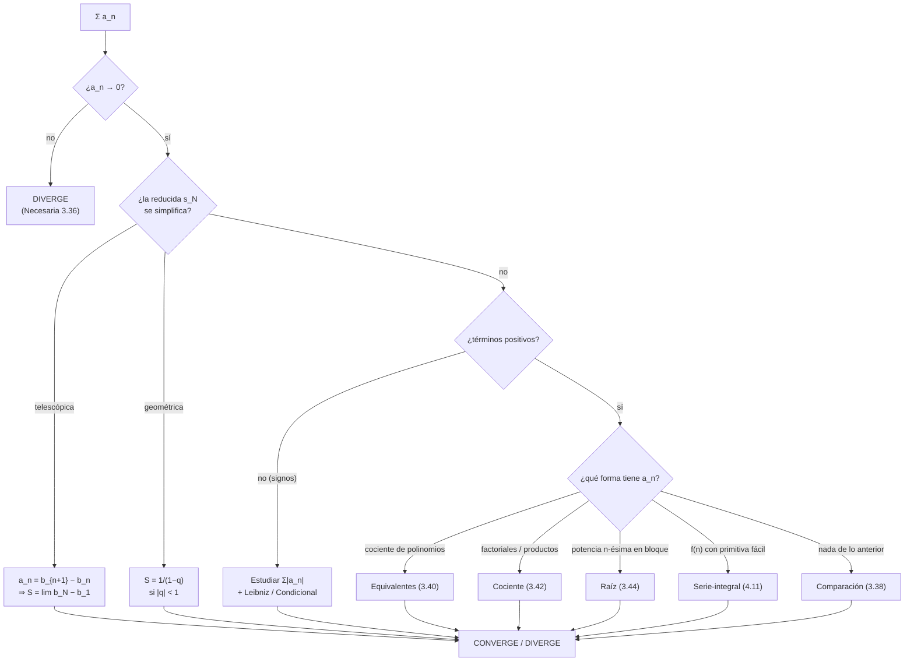
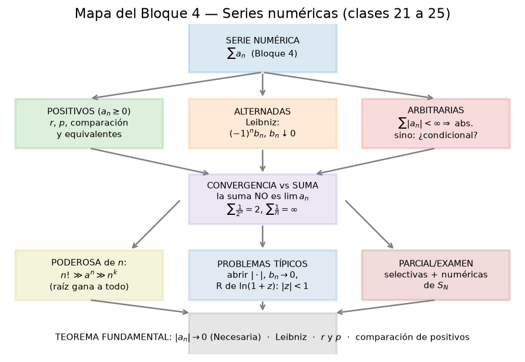

# Clase 25 — Repaso de series y pruebas

> **Bloque 4 · Series · Dificultad: media-alta · Tiempo estimado: 130 min (repaso integrador)**

---

## 🎯 Objetivos

1. **Repasar el árbol de decisión completo** del Bloque 4: geométrica/telescópica → positivos → signos variables.
2. Tener a mano una **tabla-resumen de todos los criterios** (definiciones 3.34–3.46, proposiciones 3.38–3.49, teoremas 3.47 y 4.11).
3. Cerrar la **familia con logaritmo** $\sum\frac{1}{n(\ln n)^{p}}$ y el **criterio serie-integral** con el **Práctico 4, ej. 9**.
4. Resolver un **bloque de parciales y exámenes 2018–2022**, eligiendo el criterio y **decidiendo el carácter absoluto/condicional** en cada caso.

---

## 🗺️ Mapa de la clase

---

## 🧱 Repaso / ideas previas

**1. Qué es una serie (clase 21).** La serie $\sum a_n$ es el límite de las **reducidas** $s_N=\sum_{n=1}^{N}a_n$. Si $a_n\geq0$, $(s_N)$ es **creciente**: converge (acotada) o diverge a $+\infty$, **nunca oscila**. Con signos, puede oscilar y aun así converger (clase 24).

**2. Condición necesaria (Prop 3.36).** $a_n\not\to0\Rightarrow$ diverge. Es lo **primero** que se mira, siempre, y sirve tanto con signos como sin ellos.

**3. Referencias de memoria.**

| Serie | Clase | Suma / comportamiento |
|---|---|---|
| $\sum_{n=0}^{\infty}q^{n}$ | geométrica | $\frac{1}{1-q}$ si $\lvert q\rvert<1$; diverge si $\lvert q\rvert\geq1$ |
| $\sum\frac{1}{n}$ | armónica | **diverge** |
| $\sum\frac{1}{n^{2}}$ | $p$-serie, $p=2$ | converge (a $\frac{\pi^{2}}{6}$) |
| $\sum\frac{1}{n^{p}}$ | $p$-serie | converge $\iff p>1$ |
| $\sum\frac{1}{n(\ln n)^{p}}$ | con log | converge $\iff p>1$ (clase 25) |

**4. La frontera $p=1$** (armónica, o $\sum\frac{1}{n\ln n}$) es **la** más importante: a un lado converge, al otro diverge, y todos los criterios "finos" (serie-integral) viven ahí.

**5. Lo que cambia y lo que no.** Cambiar **finitos** términos no cambia la clase de una serie; multiplicar por una constante $\neq0$ tampoco. Sumar/restar series convergentes funciona **término a término** ($\sum(a_n\pm b_n)$).

---

## 📘 Teoría — resumen de todo el Bloque 4

| # | Criterio / resultado | Hipótesis | Conclusión |
|---|---|---|---|
| 3.34 | Definición de serie | reducidas $s_N$ | $\sum a_n=\lim s_N$ |
| 3.35 | Geométrica | razón $q$ | converge $\iff\lvert q\rvert<1$, suma $\frac{1}{1-q}$ |
| 3.36 | **Necesaria** | (siempre) | $a_n\not\to0\Rightarrow$ diverge |
| 3.37 | Telescópica | $a_n=b_{n+1}-b_n$ | converge $\iff\lim b_N$ finito |
| 3.38 | **Comparación** | $0\leq a_n\leq b_n$ | $b$ conv $\Rightarrow a$ conv; $a$ div $\Rightarrow b$ div |
| 3.40 | **Equivalentes** | $a_n/b_n\to L\in(0,\infty)$ | misma clase |
| 3.42 | **Cociente** | $L=\lim a_{n+1}/a_n$ | $L<1$ conv, $L>1$ div, $L=1$ **no decide** |
| 3.44 | **Raíz** | $L=\lim\sqrt[n]{a_n}$ | igual que el cociente |
| 3.46 | **Absoluta** | $\sum\lvert a_n\rvert<\infty$ | (definición) |
| 3.47 | Absoluta $\Rightarrow$ conv | $\sum\lvert a_n\rvert<\infty$ | $\sum a_n$ converge |
| 3.49 | **Leibniz** | $(-1)^n b_n$, $b_n\downarrow0$ | converge (alternada) |
| 3.51 | Riemann | $\sum a_n$ condicional | reordenando se converge a cualquier $L$ |
| 4.11 | **Serie-integral** | $f\downarrow$, $f\geq0$, $a_n=f(n)$ | misma clase que $\int_{k}^{\infty}f$ |

> **Teorema 25.1 (notas, Teorema 4.11 — serie-integral, repaso fino).** Sea $f:[k,+\infty)\to\mathbb{R}$ **monótona decreciente** y **no negativa**. Entonces
> $$\sum_{n=k}^{\infty}f(n)\qquad\text{y}\qquad\int_{k}^{+\infty}f(x)\,dx$$
> son de la **misma clase**.

**De dónde sale (repaso de la idea).** Para cada $n$ se tiene $f(n+1)\leq\int_{n}^{n+1}f(t)\,dt\leq f(n)$. Sumando de $k$ a $N$:
$$\sum_{i=k+1}^{N+1}a_i\leq\int_{k}^{N+1}f(t)\,dt\leq\sum_{i=k}^{N}a_i.$$
La integral queda **encajada** entre dos reducidas; si una está acotada, la otra también. $\blacksquare$

**La familia con logaritmo (la estrella del parcial).**

> **Ejemplo 25.2.** $\displaystyle\sum_{n=2}^{\infty}\frac{1}{n(\ln n)^{p}}$ converge **si y solo si** $p>1$.

**Por qué.** $f(x)=\frac{1}{x(\ln x)^{p}}$ es positiva y decreciente para $x\geq2$ (se ve con $f'(x)=-\frac{\ln x+p}{x^{2}(\ln x)^{p+1}}<0$). Con $u=\ln x$, $du=\frac{dx}{x}$:
$$\int_{2}^{+\infty}\frac{dx}{x(\ln x)^{p}}=\int_{\ln2}^{+\infty}\frac{du}{u^{p}}\ \text{converge}\iff p>1.$$
Es la "misma" familia $p$ pero con un $\ln$ extra: el **umbral baja al exponente del logaritmo**.

> 💡 **Regla nemotécnica:** cada $\ln$ que aparece multiplicando en el denominador "absorbe" un grado de la $p$-serie. $\sum\frac{1}{n(\ln n)^{p}}$: el umbral es $p=1$ (igual que la armónica $\sum\frac1n$, que es el caso "sin log").

---

## 🖼️ Figuras

**Cómo leer la figura.** El recorrido completo: de la serie $\sum a_n$ salen tres ramas (positivos, alternadas, arbitrarias) y de ahí los criterios según la forma del término. En el pie están los **resultados fundamentales** que hay que saber de memoria: condición necesaria, Leibniz, cociente/raíz y comparación de positivos. Este mapa es, literalmente, el "chuleta" mental del primer parcial.

**Cómo leer la figura.** $\ln n\ll\sqrt n\ll n\ll n\ln n\ll n^{2}\ll1{,}2^{n}\ll n!\ll n^{n}$. Ubicar **dónde cae** el término general respecto de esta escalera es medio camino para elegir el criterio: si el término es "más chico que $\frac{1}{n}$ de sobra" (p. ej. $\frac{\ln n}{n^{2}}$) converge; si es "del tamaño de $\frac1n$ o más gordo" ($\frac{1}{n\ln n}$, $\frac{\ln n}{\sqrt n}$) suele divergir.

---

## ✏️ Ejercicios resueltos paso a paso — Práctico 4, ej. 9

### Ejercicio 1 (Práctico 4, ej. 9). La integral y la serie gemelas

> Estudiar la convergencia de
> $$\int_{2}^{\infty}\frac{dx}{x\ln x}\qquad\text{y}\qquad\sum_{n=2}^{\infty}\frac{1}{n\ln n}.$$

**Paso 1 — la integral (cambio $u=\ln x$).** Como $du=\frac{dx}{x}$:
$$\int_{2}^{\infty}\frac{dx}{x\ln x}=\int_{\ln2}^{\infty}\frac{du}{u}=\lim_{T\to\infty}\ln u\Big|_{\ln2}^{T}=\lim_{T\to\infty}\bigl(\ln\ln T-\ln\ln2\bigr)=+\infty.$$
La integral **diverge** (crece como $\ln\ln x$, lentísimo pero sin techo).

**Paso 2 — la serie.** $f(x)=\frac{1}{x\ln x}$ es **positiva** y **decreciente** en $[2,\infty)$. Por el criterio **serie-integral** (Teorema 4.11), serie e integral son de la **misma clase**:
$$\sum_{n=2}^{\infty}\frac{1}{n\ln n}\ \textbf{diverge}. \checkmark$$

> 💡 Es el caso $p=1$ de la familia $\sum\frac{1}{n(\ln n)^{p}}$: **justo en la frontera**, del lado que diverge. Comparado con $\frac1n$ va un poco más lento, pero sigue divergiendo.

---

## 🏛️ Ejercicios de parcial/examen (2018–2022)

### Ejercicio 2 (Primer parcial 2018-1S, ej. 4). Serie e integral con $\log$ en el numerador

> Clasificar $\displaystyle\sum_{n=1}^{\infty}\frac{\log n}{\sqrt n}$ y $\displaystyle\int_{1}^{+\infty}\frac{\log x}{\sqrt x}\,dx$.

**Serie — comparación.** Para $n\geq3$ vale $\log n>1$, luego
$$\frac{\log n}{\sqrt n}>\frac{1}{\sqrt n}\qquad(n\geq3).$$
Como $\sum\frac{1}{\sqrt n}=\sum\frac{1}{n^{1/2}}$ **diverge** ($p=\frac12\leq1$), por comparación
$$\sum_{n=1}^{\infty}\frac{\log n}{\sqrt n}\ \textbf{diverge}. \checkmark$$

**Integral — por partes** ($u=\log x$, $dv=x^{-1/2}dx$, $v=2\sqrt x$):
$$\int\frac{\log x}{\sqrt x}\,dx=2\sqrt x\,\log x-\int 2\sqrt x\cdot\frac1x\,dx=2\sqrt x\,\log x-4\sqrt x=2\sqrt x\,(\log x-2).$$
Evaluando y tomando límite:
$$\int_{1}^{+\infty}\frac{\log x}{\sqrt x}\,dx=\lim_{T\to\infty}\Bigl[2\sqrt x(\log x-2)\Bigr]_{1}^{T}=+\infty.$$
La integral **diverge**. ✔ *(coincide con la solución oficial del parcial)*

> 💡 Fijate que $\frac{\log x}{\sqrt x}\to\infty$: ¡el término **crece**! Ni siquiera hace falta ningún criterio para la serie (la condición necesaria falla a lo grande).

### Ejercicio 3 (Primer parcial 2018-2S, desarrollo). La familia $\sum\frac{1}{n\ln^{\beta}n}$

> Clasificar, discutiendo según $\beta>0$, la serie $\displaystyle\sum_{n=2}^{\infty}\frac{1}{n\ln^{\beta}n}$.

**Caso $\beta\leq0$.** Entonces $\ln^{\beta}n=\ln^{-\lvert\beta\rvert}n\leq1$ para $n\geq e$, así que
$$\frac{1}{n\ln^{\beta}n}\geq\frac1n,$$
y como la armónica diverge, la serie **diverge**.

**Caso $\beta>0$.** $f(x)=\frac{1}{x\ln^{\beta}x}$ es positiva y decreciente en $[2,\infty)$ (su derivada $f'(x)=-\frac{\ln x+\beta}{x^{2}\ln^{\beta+1}x}<0$). Con $u=\ln x$:
$$\int_{2}^{t}\frac{dx}{x\ln^{\beta}x}=\int_{\ln2}^{\ln t}\frac{du}{u^{\beta}}=\begin{cases}\dfrac{u^{1-\beta}}{1-\beta}\Big|_{\ln2}^{\ln t},&\beta\neq1,\\[6pt] \ln u\Big|_{\ln2}^{\ln t},&\beta=1.\end{cases}$$
- Si $\beta>1$: $u^{1-\beta}\to0$, la integral **converge**.
- Si $\beta=1$: $\ln u\to\infty$, **diverge**.
- Si $0<\beta<1$: $u^{1-\beta}\to\infty$, **diverge**.

**Conclusión (criterio serie-integral):**
$$\sum_{n=2}^{\infty}\frac{1}{n\ln^{\beta}n}\ \textbf{converge}\iff\beta>1.\ \checkmark$$
*(solución oficial)*

### Ejercicio 4 (Primer parcial 2022-1S, MO 4). Pitfall del exponente

> Sea $m=\displaystyle\sum_{n=0}^{\infty}2^{-n}$. Entonces $\displaystyle\sum_{n=1}^{\infty}\mathrm{sen}^{m}\!\Bigl(\frac1n\Bigr)$
> (A) converge. (B) oscila. (C) diverge. (D) $m=+\infty$, luego la serie no existe.

**Paso 1 — calcular $m$ (¡mirá el índice!).**
$$m=\sum_{n=0}^{\infty}\Bigl(\frac12\Bigr)^{n}=\frac{1}{1-\frac12}=2.$$
Si arrancara en $n=1$ el resultado cambiaría: por eso el índice inferior $n=0$ es la clave.

**Paso 2 — la serie es $\sum\mathrm{sen}^{2}(1/n)$.**
$$\mathrm{sen}^{2}\!\Bigl(\frac1n\Bigr)\sim\Bigl(\frac1n\Bigr)^{2}=\frac{1}{n^{2}}\qquad(n\to\infty),$$
(pues $\mathrm{sen}\,u\sim u$). Como $\sum\frac{1}{n^{2}}$ **converge** ($p=2>1$), por **equivalentes** la serie converge.

**Respuesta: (A) converge.** ✔ *(respuesta oficial)*

### Ejercicio 5 (Primer parcial 2022-1S, MO 5). Telescópica disfrazada

> $\displaystyle\sum_{n=2}^{\infty}\frac{2}{2n+n^{2}}$
> (A) converge a $\frac56$. (B) converge a $\frac32$. (C) converge a $\frac12$. (D) diverge.

**Paso 1 — fracciones parciales.** $2n+n^{2}=n(n+2)$, y
$$\frac{2}{n(n+2)}=\frac1n-\frac1{n+2}.$$

**Paso 2 — reducida (desfase 2).** Sobreviven dos términos al principio y dos al final:
$$s_N=\sum_{n=2}^{N}\Bigl(\frac1n-\frac1{n+2}\Bigr)=\Bigl(\frac12+\frac13\Bigr)-\Bigl(\frac{1}{N+1}+\frac{1}{N+2}\Bigr).$$

**Paso 3 — límite.** $\frac{1}{N+1},\frac{1}{N+2}\to0$, luego
$$S=\frac12+\frac13=\frac56.$$

**Respuesta: (A) converge a $\frac56$.** ✔ *(respuesta oficial)*

### Ejercicio 6 (Primer parcial 2022-2S, MO). Tres afirmaciones sobre series

> (1) $\displaystyle\sum_{n=1}^{\infty}\frac{1}{n\log(1+\frac1n)}$ es convergente.
> (2) $\displaystyle\sum_{n=1}^{\infty}\frac{(-1)^{n}n}{3^{n}}$ es absolutamente convergente.
> (3) $\displaystyle\sum_{n=2}^{\infty}\frac{\log2\cdot\log3\cdots\log n}{n!}$ es convergente.
> (A) solo (1) y (2). (B) solo (2) y (3). (C) todas. (D) solo (2). (E) solo (1) y (3).

**Afirmación (1) — FALSA.** Como $\log(1+\frac1n)\sim\frac1n$:
$$\frac{1}{n\log(1+\frac1n)}\sim\frac{1}{n\cdot\frac1n}=1\ \xrightarrow[n\to\infty]{}\ 1\neq0.$$
El término general no tiende a $0$: la serie **diverge**.

**Afirmación (2) — VERDADERA.** $\sum\bigl|\frac{(-1)^n n}{3^{n}}\bigr|=\sum\frac{n}{3^{n}}$, y por **cociente**:
$$\frac{a_{n+1}}{a_n}=\frac{n+1}{3^{\,n+1}}\cdot\frac{3^{\,n}}{n}=\frac{n+1}{3n}\xrightarrow[n\to\infty]{}\frac13<1.$$
Converge, luego (2) es **absolutamente convergente**.

**Afirmación (3) — VERDADERA.** Sea $a_n=\frac{\log2\cdots\log n}{n!}$. Por **cociente**:
$$\frac{a_{n+1}}{a_n}=\frac{\log(n+1)}{n+1}\xrightarrow[n\to\infty]{}0<1.$$
La serie **converge**.

**Respuesta: (B) solamente (2) y (3) son verdaderas.** ✔ *(respuesta oficial)*

### Ejercicio 7 (Examen diciembre 2022, MO 2). Integral vs. serie

> (Datos) $\displaystyle\int_{0}^{+\infty}\frac{e^{-x^{2}}}{x^{2}}\,dx\qquad$ y $\qquad\displaystyle\sum_{n=0}^{\infty}\mathrm{sen}\!\Bigl(\frac{1}{2^{n}}\Bigr)$.
> (A) ambas divergen. (B) la serie diverge, la integral converge. (C) ambas convergen.
> (D) la integral diverge, la serie es absolutamente convergente. (E) la integral diverge, la serie es condicionalmente convergente.

**Integral — Diverge.** Es impropia en $0$ y en $+\infty$. En $0$: $e^{-x^{2}}\to1$, así que
$$\frac{e^{-x^{2}}}{x^{2}}\sim\frac{1}{x^{2}}\quad(x\to0^{+}),\qquad \int_{0}^{1}\frac{dx}{x^{2}}=+\infty.$$
El comportamiento en $0$ ya la hace **divergente** (singularidad de segunda especie no integrable).

**Serie — Absolutamente convergente.** $\mathrm{sen}\,u\sim u$, con $u=\frac{1}{2^{n}}$:
$$\mathrm{sen}\!\Bigl(\frac{1}{2^{n}}\Bigr)\sim\frac{1}{2^{n}},\qquad \sum\frac{1}{2^{n}}\ \text{geométrica con }q=\tfrac12<1.$$
Los términos son positivos y la serie de módulos converge: **absolutamente convergente**.

**Respuesta: (D) la integral es divergente y la serie es absolutamente convergente.** ✔ *(respuesta oficial: MO2 versión 1 = D)*

### Ejercicio 8 (Primer parcial 2022-1S, V/F (6)). La trampa del criterio serie-integral

> (V/F) Si $f:[n_0,+\infty)\to\mathbb{R}$ y $a_n=f(n)$, entonces $\displaystyle\sum_{n=n_0}^{\infty}a_n$ y $\displaystyle\int_{n_0}^{+\infty}f(x)\,dx$ se comportan de la misma manera.

**FALSO.** Al criterio serie-integral (Teorema 4.11) le **faltan hipótesis**: $f$ debe ser **no negativa** y **monótona decreciente**. Sin eso, el enunciado falla.

**Contraejemplo.** $f(x)=\mathrm{sen}(\pi x)$: $\int_{n_0}^{+\infty}f$ no converge, pero $a_n=f(n)=\mathrm{sen}(\pi n)=0$, así que $\sum a_n=\sum0=0$ converge. Misma función, clases distintas: **la monotonía no es opcional**.

**Respuesta: FALSO.** ✔ *(respuesta oficial)*

---

## ⚠️ Errores comunes

| Error | Corrección |
|---|---|
| Elegir el criterio **antes** de la condición necesaria | Primero $a_n\to0$; recién después el resto |
| Cerrar con "el cociente dio $1$" | Con $L=1$ **no decide**: usar serie-integral o comparación (clase 23) |
| Aplicar serie-integral sin verificar $f\downarrow$ y $f\geq0$ | Son **hipótesis** (ejercicio 8). Sin monotonía el criterio no aplica |
| Confundir la frontera de $\sum\frac{1}{n^{p}}$ con la de $\sum\frac{1}{n(\ln n)^{p}}$ | Ambas tienen umbral $p=1$, pero una es potencia "pura" y la otra lleva un $\ln$ extra. **No las mezcles** |
| Olvidar el carácter absoluto/condicional en series con signos | Es la mitad del puntaje: siempre cerrar "converge **absoluta**mente" o "**condicional**mente" |
| Sumar mal el índice en una geométrica ($n=0$ vs. $n=1$) | El ejercicio 4 vive de esto: $\sum_{n=0}2^{-n}=2$, no $1$ |
| "Como diverge la integral, diverge la serie" sin hipótesis | Vale **solo** si $f\downarrow$ y $f\geq0$ y $a_n=f(n)$ |
| En V/F de series, contestar por "parecido" | Casi siempre hay un contraejemplo escondido ($\mathrm{sen}(1/n)\sim1/n$, etc.) |

---

## 🔗 Conexiones

- **Clase 21:** definición y reducidas; geométrica y telescópica son los dos casos "sumables" exactos.
- **Clase 22:** comparación y equivalentes —el caballo de batalla con cocientes de polinomios.
- **Clase 23:** cociente, raíz y **serie-integral** —el puente con las integrales impropias y la herramienta que cierra estas familias.
- **Clase 24:** series con signos: absoluta vs. condicional y Leibniz.
- **Bloque 5 (clases 26–29):** todo lo de serie-integral se reusa para clasificar **integrales impropias** de primera y segunda especie, y para la **función Gamma** ($\Gamma(n)=(n-1)!$).
- **Ingeniería:** las series de potencias (radio de convergencia vía cociente/raíz) son la base de las soluciones por series de EDOs y del análisis de Fourier.

---

## ✅ Autoevaluación

1. Enunciar la **condición necesaria** de convergencia y decir para qué sirve.
2. Clasificar $\displaystyle\sum_{n=1}^{\infty}\frac{n^{3}+2}{2n^{3}+n}$ **sin cuentas largas**.
3. Clasificar $\displaystyle\sum_{n=2}^{\infty}\frac{1}{n(\ln n)^{3}}$.
4. Clasificar $\displaystyle\sum_{n=2}^{\infty}\frac{1}{n(\ln n)^{1/2}}$.
5. Clasificar (absoluta/condicional) $\displaystyle\sum_{n=1}^{\infty}\frac{(-1)^{n}}{n^{2}+1}$.
6. Sumar $\displaystyle\sum_{n=2}^{\infty}\frac{2}{n(n+2)}$.
7. Dar un contraejemplo que muestre que **no** se puede aplicar serie-integral sin monotonía.
8. (V/F) Si $\sum a_n$ converge y $a_n\geq0$, entonces $\sum a_n^{2}$ converge.

### Respuestas

1. $a_n\to0$ (Prop 3.36). Sirve para **descartar**: si $a_n\not\to0$, la serie diverge. Nunca prueba convergencia.
2. $\frac{n^3+2}{2n^3+n}\to\frac12\neq0$: **diverge** (condición necesaria, un renglón).
3. $p=3>1$: **converge** (familia del log).
4. $p=\frac12\leq1$: **diverge** (familia del log).
5. $|a_n|\leq\frac1{n^2}$: $\sum\frac{1}{n^2}$ converge $\Rightarrow$ **absolutamente convergente**.
6. $\frac{2}{n(n+2)}=\frac1n-\frac1{n+2}$, telescópica de desfase 2 (arranca en $n=2$): sobreviven dos términos al principio, y $S=\frac12+\frac13=\frac56$.
7. $f(x)=\mathrm{sen}(\pi x)$: $\int_{n_0}^{+\infty}\mathrm{sen}(\pi x)\,dx$ no converge (oscila), pero $a_n=\mathrm{sen}(\pi n)=0$, así que $\sum a_n=\sum0$ converge. Faltan la **positividad** y la **monotonía**.
8. **VERDADERO.** $a_n\to0$ (pues $\sum a_n$ converge con $a_n\geq0$) ⇒ $a_n\leq1$ desde cierto punto ⇒ $a_n^{2}\leq a_n$ ⇒ comparación.

---

**⬅️ Anterior:** [Clase 24 — Series alternadas y convergencia absoluta](24_series_alternadas.md) · **🏠 Índice:** [00 — Índice](00_indice.md) · **➡️ Siguiente:** [Clase 26 — Integrales impropias de primera especie](26_impropias_primera_especie.md)
