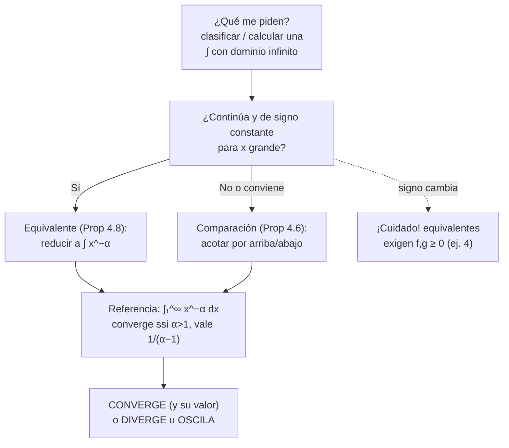
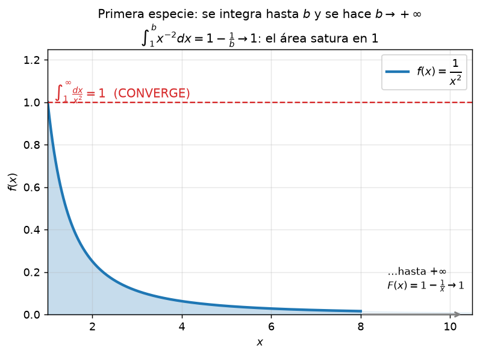
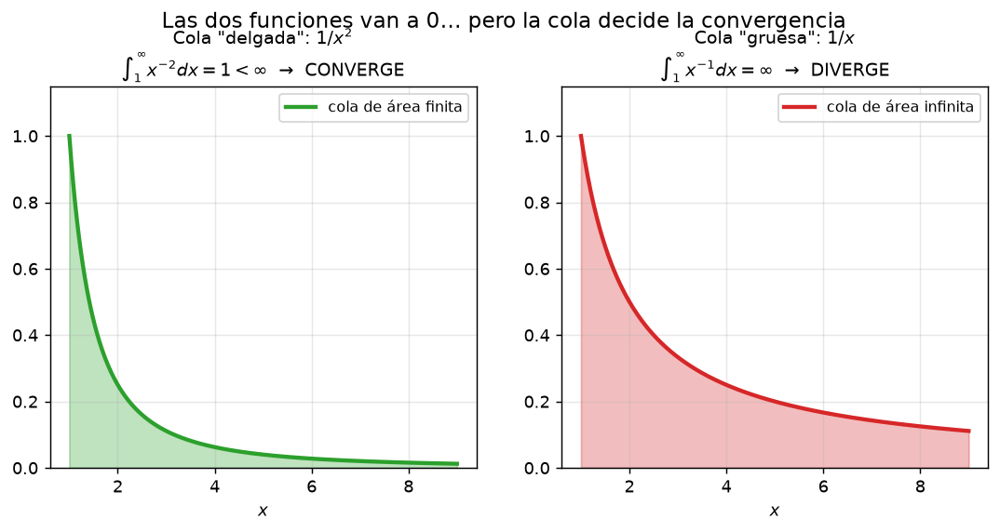

# Clase 26 — Integrales impropias de primera especie

> **Bloque 5 · Integrales impropias · Dificultad: inicial-media · Tiempo estimado: 120 min**

En el Bloque 4 aprendimos a "sumar infinitos sumandos". Ahora hacemos la **versión continua**: darle sentido a $\int_a^{+\infty} f(t)\,dt$, integrando hasta un corte finito y haciendo tender ese corte al infinito. Veremos la definición, los criterios de comparación y equivalentes (los mismos que para series, "mutatis mutandis"), y resolveremos el Práctico 4, ejercicios 1 a 4.

---

## 🎯 Objetivos

1. **Definir** la integral impropia de primera especie como límite de integrales acotadas (**Definición 4.1**).
2. Demostrar el vínculo **convergencia ⟺ primitiva acotada** (Práctico 4, ej. 1) y la **linealidad** (Proposición 4.3).
3. Aplicar **comparación** (Proposición 4.6) y **equivalentes** (Proposición 4.8) para clasificar; usar la familia de referencia $\int_1^\infty x^{-\alpha}dx$.
4. Resolver el Práctico 4, ejercicios 1 a 4 (incluida la trampa del ejercicio 4: equivalentes con signo variable).

---

## 🗺️ Mapa de la clase

---

## 🧱 Repaso / ideas previas

Antes de arrancar, recuperamos tres herramientas:

1. **Integral de Riemann en intervalos acotados** (curso anterior / clase 2): si $f$ es continua en $[a,b]$, entonces $\int_a^b f$ existe y la **Regla de Barrow** vale: $\int_a^b F' = F(b)-F(a)$.
2. **Límite de una función cuando $x\to+\infty$:** $\lim_{x\to\infty}F(x)=L$ significa que $F(x)$ se acerca a $L$ a medida que $x$ crece sin límite (definición $\varepsilon$-$X$ del curso pasado). Si $F$ es **creciente**, el límite es $+\infty$ o el supremo: nunca "oscila".
3. **PSMC de funciones:** si $F:[a,\infty)\to\mathbb{R}$ es **monótona creciente y acotada arriba**, entonces $\lim_{x\to\infty}F(x)$ existe y es finito (es $\sup F$). Este teorema es el motor de todo el Bloque 5, igual que lo fue para series (clase 17).

> 💡 **La idea clave:** la integral $\int_a^\infty f$ no es "una suma infinita" hecha: es **una familia de integrales finitas** $\int_a^b f$ (con $b$ creciente) cuyo límite se estudia. Nada nuevo conceptualmente: es el mismo movimiento $\text{reducida} \to \text{serie}$ de la clase 21, con $F(b)=\int_a^b f(t)dt$ haciendo de reducida.

---

## 📘 Teoría

### 1. Definición (notas, Definición 4.1)

> **Definición 26.1 (notas, Definición 4.1).** Sea $f:[a,\infty)\to\mathbb{R}$ continua, y definimos la **función acumulada**
> $$F(x)=\int_a^x f(t)\,dt.$$
> - Si $\lim_{x\to\infty}F(x)=L\in\mathbb{R}$, decimos que la **integral impropia de primera especie** $\int_a^{+\infty}f(t)\,dt$ **converge** a $L$ y escribimos $\int_a^{+\infty}f=L$.
> - Si el límite es $+\infty$ (o $-\infty$), la integral **diverge**.
> - Si el límite no existe (por ejemplo porque $F$ oscila), la integral **oscila**.

Observaciones que las notas destacan:

- $F$ juega el papel de la **reducida** $s_N$ de las series: muchos demostraciones se repiten word-for-word cambiando $s_N$ por $F(x)$ y $n\to\infty$ por $x\to\infty$.
- Pedimos continuidad por comodidad; basta con que $f$ sea **integrable en todo intervalo acotado** $[a,b]$ (que es lo que sabemos hacer).

### 2. Familia de referencia: $\int_1^{+\infty}\frac{dx}{x^{\alpha}}$ (notas, Ejemplos 4.2.1)

Para $\alpha\neq1$: $\displaystyle\int_1^x\frac{dt}{t^{\alpha}}=\frac{x^{1-\alpha}-1}{1-\alpha}$; para $\alpha=1$ vale $\log x$. Entonces:

$$\boxed{\ \int_1^{+\infty}\frac{dx}{x^{\alpha}}\ \text{converge si }\alpha>1\ \text{(y vale } \tfrac{1}{\alpha-1}\text{); diverge si }\alpha\leq1.\ }$$

Esto **replica el comportamiento de la serie $\sum 1/n^{\alpha}$** del Bloque 4 (clase 22): la frontera otra vez está en $\alpha=1$.

**Ejemplos de las notas (4.2):**

- $\displaystyle\int_0^{+\infty}\frac{dx}{1+x^{2}}=\lim_{x\to\infty}\arctan x=\frac{\pi}{2}$: **converge** (la cola de $1/x^{2}$ es finita).
- $\displaystyle\int_0^{+\infty}\cos x\,dx$: como $\int_0^x\cos t\,dt=\sin x$ no tiene límite, la integral **oscila** (¡ni converge ni diverge a infinito!).

### 3. Linealidad (notas, Proposición 4.3)

> **Proposición 26.2 (notas, Proposición 4.3).** Si $\int_a^\infty f$ y $\int_a^\infty g$ convergen, entonces, para cualesquiera $\lambda,\mu\in\mathbb{R}$,
> $$\int_a^\infty\bigl(\lambda f(t)+\mu g(t)\bigr)dt=\lambda\int_a^\infty f+\mu\int_a^\infty g.$$

Se deduce de la linealidad de la integral finita y del límite. ⚠️ Ojo: el recíproco es falso (como en series: la diferencia de dos divergentes puede converger).

### 4. ¿Hace falta $f(x)\to0$? (notas, Ejemplo 4.4 y Ejercicio 4.5)

Con series, $a_n\to0$ era **condición necesaria**. Con integrales hay más libertad: las notas construyen una función con **escalones** de altura $1$ que empiezan en cada $n\in\mathbb{N}$ y se van achicando ($[n,n+\frac{1}{2n}]$). Su integral acumulada satura en la suma de la geométrica $\sum\frac{1}{2^{k}}=2$: la integral **converge** aunque la función **no tiende a cero**.

> **Ejercicio 26.3 (notas, Ejercicio 4.5).** Si $\int_a^\infty f$ converge **y existe** $L=\lim_{x\to\infty}f(x)$, entonces $L=0$.

*(Ejercicio: adaptar la demostración de la Proposición 3.36, clase 21, usando $f(x)=F'(x)$ y el Teorema de Cauchy para límites de funciones.)*

### 5. Criterio de comparación (notas, Proposición 4.6)

> **Proposición 26.4 (notas, Proposición 4.6 — comparación).** Sean $f,g$ continuas con $0\leq f(t)\leq g(t)$ para todo $t>a$ (basta **a partir de cierto punto**). Entonces:
> 1. Si $\int_a^\infty g$ **converge**, entonces $\int_a^\infty f$ converge. *(lo chico converge)*
> 2. Si $\int_a^\infty f$ **diverge**, entonces $\int_a^\infty g$ diverge. *(lo grande diverge)*

**Ejemplos de las notas (4.7):** $\frac{1}{1+x^{2}}\leq\frac{1}{x^{2}}$ para $x\geq1$ (¡aunque los extremos de integración difieran, se usa desde $\max$ de los inicios!); $\log x<x$ para $x$ grande, luego $\frac{1}{\log x}>\frac{1}{x}$ y $\int_2^\infty\frac{dx}{\log x}$ **diverge**; $e^{x}>x^{3}$ para $x$ grande, luego $e^{-x}x^{k}<\frac{1}{x^{2}}$ para $x$ grande y $\int_0^\infty e^{-x}x^{k}dx$ converge para todo $k\in\mathbb{N}$.

### 6. Equivalentes (notas, Proposición 4.8)

> **Proposición 26.5 (notas, Proposición 4.8 — equivalentes).** Sean $f,g\geq0$ y $\displaystyle\lim_{x\to\infty}\frac{f(x)}{g(x)}=L\in(0,\infty)$. Entonces $\int_a^\infty f$ y $\int_a^\infty g$ son **de la misma clase** (ambas convergen o ambas divergen).

**Ejemplos de las notas (4.9):** $\frac{x}{\sqrt{x^{4}+1}}\sim\frac{x}{x^{2}}=\frac1x$ → **diverge**; $\frac{\sqrt x}{x^{2}+1}\sim x^{-3/2}$ → **converge**; $e^{1/x}-1-\frac1x\sim\frac{1}{2x^{2}}$ (Taylor en $0^+$) → converge.

### 7. Convergencia absoluta (notas, Definición 4.14 y Teorema 4.15)

> **Definición 26.6.** $\int_a^\infty f$ es **absolutamente convergente** si $\int_a^\infty|f|$ converge. **Teorema 4.15:** la convergencia absoluta implica la convergencia. *(Demostración: $-|f|\leq f\leq|f|$ + linealidad + comparación, "mutatis mutandis" respecto del Teorema 3.47 de series.)*

La recíproca es falsa (Ejercicio 4.18 de las notas: $\int_0^\infty x\cos(x^{4})dx$ converge pero no absolutamente) — igual que con las series condicionalmente convergentes de la clase 24.

---

## 🖼️ Figuras

**Cómo leer la figura:** $F(b)=\int_1^b x^{-2}dx=1-\frac1b$ crece y se acerca a $1$: el " área infinita" es en realidad **finita y valora 1**. La impropiedad no es un problema técnico enorme: es un límite.

**Cómo leer la figura:** ambas funciones tienden a cero, pero la cola de $1/x$ acumula área infinita ($\log b\to\infty$) y la de $1/x^{2}$ se satura. **La frontera entre colas finitas e infinitas es $1/x$** — la misma frontera $p=1$ de las $p$-series.

---

## ✏️ Ejercicios resueltos paso a paso — Práctico 4, ejercicios 1 a 4

### Ejercicio 1 (Práctico 4, ej. 1a). $F$ creciente y convergencia ⟺ acotación

> Sean $a>0$ y $f:[a,\infty)\to\mathbb{R}$ continua con $f\geq0$. Definimos $F(x)=\int_a^x f(t)\,dt$. Demostrar que $F$ es creciente y que $\int_a^{+\infty}f$ converge $\iff$ $F$ está acotada superiormente.

**Paso 1 — $F$ es creciente.** Sean $x_1<x_2$. Entonces
$$F(x_2)-F(x_1)=\int_a^{x_2}f-\int_a^{x_1}f=\int_{x_1}^{x_2}f(t)\,dt\ \geq\ 0,$$
porque $f\geq0$ en $[x_1,x_2]$ (integral de función continua no negativa $\geq0$).

**Paso 2 — "$\Leftarrow$".** Si $F$ está acotada arriba, $F$ es **creciente y acotada** → por **PSMC** existe $L=\lim_{x\to\infty}F(x)\in\mathbb{R}$ → la integral converge a $L$ por Definición 26.1.

**Paso 3 — "$\Rightarrow$".** Si la integral converge a $L$, entonces $F(x)\leq L$ para todo $x$ (por definición de límite: $F(x)\in(L-\varepsilon,L+\varepsilon)$ para $x$ grande; y $F$ acotada en el tramo inicial por Weierstrass, al ser continua en $[a,x_0]$). Luego $F$ está acotada arriba por $\max\{L,\sup_{[a,x_0]}F\}$. $\blacksquare$

> 💡 Este esquema es **idéntico** al de las series con $a_n\geq0$: convergencia = acumulación acotada.

### Ejercicio 2 (Práctico 4, ej. 1b). Criterio de comparación

> (i) Si $0\leq f\leq g$ y $\int_a^\infty g$ converge, probar que $\int_a^\infty f$ converge. (ii) Si $\int_a^\infty f$ diverge, probar que $\int_a^\infty g$ diverge.

**Paso 1.** Para $x\geq a$: $0\leq F(x)=\int_a^x f\leq\int_a^x g=G(x)$ (monotonía de la integral).

**Paso 2 — (i).** Si $\int_a^\infty g$ converge, $G$ está acotada por el Ejercicio 1 → $F$ acotada (por $G$) → $F$ creciente y acotada → PSMC → $\int_a^\infty f$ converge.

**Paso 3 — (ii).** Por contrapositiva de (i): si $\int_a^\infty f$ **no** converge, es decir $F(x)\to+\infty$ (¡ojo: $f\geq0$ y continua, así que no oscila!), entonces $G\geq F$ no está acotada → $\int_a^\infty g$ diverge. $\blacksquare$

> ⚠️ Nota de la propia fuente: en el enunciado del práctico (ii) el texto dice "$f$ diverge ⇒ $g$ diverge"; la hipótesis $0\leq f\leq g$ está puesta en el marco del ítem. Sin positividad, "divergir" incluye oscilar y las flechas se debilitan.

### Ejercicio 3 (Práctico 4, ej. 2). Clasificar y hallar el valor

**a)** $\displaystyle\int_2^{+\infty}\frac{dx}{x\log^{\alpha}(x)}$

Cambio $u=\log x$ (creciente, $du=dx/x$; $x=2\Rightarrow u=\log2$; $x\to\infty\Rightarrow u\to\infty$):
$$\int_2^{x}\frac{dt}{t\log^{\alpha}t}=\int_{\log2}^{\log x}\frac{du}{u^{\alpha}}.$$
Por la familia de referencia (con corte en $\log2>0$), esto converge sii $\alpha>1$, y entonces
$$\int_2^{+\infty}\frac{dx}{x\log^{\alpha}x}=\frac{(\log 2)^{1-\alpha}}{\alpha-1}.$$

$$\boxed{\text{Converge sii }\alpha>1,\ \text{con valor }\frac{(\log 2)^{1-\alpha}}{\alpha-1}.}$$

**b)** $\displaystyle\int_0^{+\infty}x^{3}e^{-x^{2}}\,dx$

Cambio $u=x^{2}$ ($du=2x\,dx$; arranca en $0$):
$$\int_0^{\infty}x^{3}e^{-x^{2}}dx=\frac12\int_0^{\infty}u\,e^{-u}du=\frac12\Big[-ue^{-u}\Big]_0^{\infty}+\frac12\int_0^\infty e^{-u}du=0+\frac12=\boxed{\dfrac12}.$$
(Los límites: $ue^{-u}\to0$ en $+\infty$ porque la exponencial vence a todo polinomio.)

**c)** $\displaystyle\int_0^{1}x^{2}\mathrm{sen}\!\left(\frac1x\right)dx$

El integrando está definido y **acotado** en $(0,1]$: $\bigl|x^{2}\mathrm{sen}(1/x)\bigr|\leq x^{2}$. La "singularidad" en $0$ es solo aparente (función acotada con una única discontinuidad: es integrable). Por comparación con la integral finita,
$$\left|\int_0^1x^{2}\mathrm{sen}(1/x)dx\right|\leq\int_0^1x^{2}dx=\frac13<\infty\ \Rightarrow\ \textbf{converge}.$$
(No tiene primitiva elemental; el valor exacto no se puede pedir con herramientas del curso.)

**d)** $\displaystyle\int_{-\infty}^{+\infty}\frac{dx}{1+x^{2}}$

**Mixta** en dos sentidos (dominio infinito a izquierda y derecha): se parte en $\int_{-\infty}^{0}+\int_{0}^{+\infty}$ (con corte en cualquier $a$; el resultado no depende de $a$, §mixtas de la clase 27). Cada una converge: $\int_0^x\frac{dt}{1+t^{2}}=\arctan x\to\frac\pi2$, y por simetría (función **par**), la de la izquierda también vale $\frac\pi2$:
$$\int_{-\infty}^{+\infty}\frac{dx}{1+x^{2}}=\frac\pi2+\frac\pi2=\boxed{\pi}.$$

**e)** $\displaystyle\int_{-\infty}^{+\infty}\frac{dx}{e^{x}+e^{-x}}$

Es **par**: $\int_{-\infty}^\infty=2\int_0^\infty\frac{dx}{e^{x}+e^{-x}}$. Multiplicamos y dividimos por $e^{x}$:
$$2\int_0^{x}\frac{e^{t}dt}{e^{2t}+1}\ \xrightarrow{\ u=e^{t}\ }\ 2\int_1^{e^{x}}\frac{du}{1+u^{2}}=2\bigl(\arctan e^{x}-\arctan 1\bigr)\xrightarrow[x\to\infty]{}2\Bigl(\frac\pi2-\frac\pi4\Bigr)=\boxed{\frac\pi2}.$$

### Ejercicio 4 (Práctico 4, ej. 3). El parámetro $k$

> Sea $k>0$. Hallar $k$ para que $\displaystyle\int_1^{+\infty}\left(\frac{x}{2x^{2}+2k}-\frac{k}{x+1}\right)dx$ converja y calcularla.

**Paso 1 — unificar en un solo cociente.**
$$\frac{x}{2x^{2}+2k}-\frac{k}{x+1}=\frac{x(x+1)-k(2x^{2}+2k)}{(2x^{2}+2k)(x+1)}=\frac{(1-2k)x^{2}+x-2k^{2}}{(2x^{2}+2k)(x+1)}.$$

**Paso 2 — análisis asintótico.** El denominador es $\sim2x^{3}$. Si $1-2k\neq0$, el integrando es $\sim\frac{(1-2k)x^{2}}{2x^{3}}=\frac{1-2k}{2x}$: como $\int^\infty\frac{dx}{x}$ **diverge** (y el integrando tiene signo constante para $x$ grande), la impropia diverge. Por lo tanto hace falta $1-2k=0$, es decir:

$$\boxed{k=\frac12}.$$

**Paso 3 — verificar convergencia y calcular.** Con $k=\frac12$: integrando $=\dfrac{x-\frac12}{(2x^{2}+1)(x+1)}\sim\frac{1}{2x^{2}}$ para $x\to\infty$ → converge. Fracciones parciales:
$$\frac{x-\frac12}{(2x^{2}+1)(x+1)}=\frac{A}{x+1}+\frac{Bx+C}{2x^{2}+1},\qquad x-\tfrac12=A(2x^{2}+1)+(Bx+C)(x+1).$$
- $x=-1$: $-\frac32=3A\Rightarrow A=-\frac12$;
- coeficiente de $x^{2}$: $0=2A+B\Rightarrow B=1$;
- término independiente: $-\frac12=A+C\Rightarrow C=0$.

Primitiva:
$$F(x)=-\frac12\log(x+1)+\frac14\log(2x^{2}+1)=\frac14\log\frac{2x^{2}+1}{(x+1)^{2}}.$$
Límites: $F(+\infty)=\frac14\log 2$ (el cociente tiende a $2$) y $F(1)=\frac14\log3-\frac12\log2$. Entonces
$$\int_1^{+\infty}\left(\frac{x}{2x^{2}+1}-\frac{1}{2(x+1)}\right)dx=\frac14\log2-\frac14\log3+\frac12\log2=\frac34\log2-\frac14\log3=\boxed{\dfrac14\log\frac83}\approx0{,}245.$$

### Ejercicio 5 (Práctico 4, ej. 4). Equivalentes con signo variable: la trampa

> a) Probar que para $x\to+\infty$: $\ \dfrac{\mathrm{sen}(x)}{\sqrt x}+\dfrac{\mathrm{sen}^{2}(x)}{x}\sim\dfrac{\mathrm{sen}(x)}{\sqrt x}$.
> b) Probar que $\int_1^{+\infty}\frac{\mathrm{sen}(x)}{\sqrt x}dx$ converge mientras que $\int_1^{+\infty}\left(\frac{\mathrm{sen}(x)}{\sqrt x}+\frac{\mathrm{sen}^{2}(x)}{x}\right)dx$ diverge.
> c) ¿Por qué no aplica el criterio del equivalente?

**a)** Cociente de las dos "piezas":
$$\frac{\mathrm{sen}^{2}(x)/x}{\mathrm{sen}(x)/\sqrt x}=\frac{|\mathrm{sen}(x)|}{\sqrt x}\leq\frac{1}{\sqrt x}\longrightarrow0\qquad(x\to+\infty),$$
(en los puntos donde $\mathrm{sen}(x)=0$ el cociente es $0$). Luego $\frac{\mathrm{sen}^{2}x}{x}=o\!\left(\frac{\mathrm{sen}x}{\sqrt x}\right)$ y la suma es equivalente al primer sumando.

**b) Convergencia de $\int_1^\infty\frac{\mathrm{sen}(x)}{\sqrt x}dx$ (partes + absolución).** Tomamos $u=\frac{1}{\sqrt x}$, $dv=\mathrm{sen}(x)dx$, $v=-\cos x$:
$$\int_1^{b}\frac{\mathrm{sen}(x)}{\sqrt x}dx=\left[\frac{-\cos x}{\sqrt x}\right]_1^{b}-\frac12\int_1^{b}\frac{\cos x}{x^{3/2}}dx.$$
El primer término tiene límite finito ($\cos b/\sqrt b\to0$; acotado por $1/\sqrt b$). En el segundo, $\bigl|\frac{\cos x}{x^{3/2}}\bigr|\leq\frac{1}{x^{3/2}}$ y $\int_1^\infty x^{-3/2}dx=2$ converge → converge **absolutamente**. Suma de límites finitos ⇒ $\int_1^{+\infty}\frac{\mathrm{sen}x}{\sqrt x}dx$ **converge**. *(Este es el mismo argumento que las notas usan para la integral de Fresnel, Ejemplo 4.17.2.)*

**Divergencia de la suma.** Escribimos $\mathrm{sen}^{2}(x)=\frac{1-\cos(2x)}{2}$:
$$\int_1^{b}\left(\frac{\mathrm{sen}x}{\sqrt x}+\frac{\mathrm{sen}^2x}{x}\right)dx=\int_1^{b}\frac{\mathrm{sen}x}{\sqrt x}dx+\frac12\int_1^{b}\frac{dx}{x}-\frac12\int_1^{b}\frac{\cos(2x)}{x}dx.$$
- El primero converge (recién visto).
- $\int_1^b\frac{\cos 2x}{x}dx=\int_2^{2b}\frac{\cos u}{u}du$ converge (mismo argumento de partes).
- $\frac12\int_1^b\frac{dx}{x}=\frac12\log b\to+\infty$.

La suma de un límite finito, un límite finito y $+\infty$ es $+\infty$: la integral **diverge**.

**c) ¿Por qué falla el criterio de equivalentes?** El Teorema/Proposición de equivalentes (4.8) exige $f\geq0$ y $g\geq0$. Acá $f(x)=\frac{\mathrm{sen}x}{\sqrt x}$ **cambia de signo** infinitas veces: sus "colas positivas" y "negativas" se cancelan y permiten la convergencia, mientras que $\mathrm{sen}^{2}(x)/x\geq0$ aporta un $+\infty$ puro. Equivalentes rige la **clase** solo cuando no hay cancelaciones posibles.

> 💡 **Lección de oro del bloque:** "equivalente" te dice que dos objetos se parecen **para el límite**; la convergencia de una impropia depende del **balance acumulado**, y con signos variables el balance puede existir aunque los sumandos sean grandes.

---

## 🏛️ Ejercicios de parcial/examen

### Ejercicio 6 (Examen diciembre 2021, V/F 2). $\int_1^{+\infty}x^{\alpha}dx$ converge sii $\alpha<-1$

Con $\alpha\neq-1$: $\int_1^{b}x^{\alpha}dx=\frac{b^{\alpha+1}-1}{\alpha+1}$, que tiene límite finito sii $\alpha+1<0$, es decir $\alpha<-1$ (valor $\frac{1}{-\alpha-1}$); con $\alpha=-1$ da $\log b\to\infty$.

**Respuesta: VERDADERO.** ✔ *(la afirmación del examen es exactamente ese enunciado)*

> 💡 No te confundas con la familia de referencia $\int_1^\infty x^{-\alpha}$: el exponente va **con signo menos** ahí. Acá el integrando es $x^{\alpha}$: "colgante" cuando $\alpha<-1$.

### Ejercicio 7 (Primer parcial 2019-1S, ej. 4). $\int_0^{+\infty}\frac{dx}{(x^{2}+1)^{s}}$

**Paso 1 — detectar impropiedades.** El integrando es continuo en $[0,\infty)$: solo hay impropiedad en $+\infty$.

**Paso 2 — equivalentes en el infinito.** $(x^{2}+1)^{s}\sim (x^{2})^{s}=x^{2s}$, luego
$$\frac{1}{(x^{2}+1)^{s}}\sim\frac{1}{x^{2s}}\qquad(x\to+\infty),\qquad\text{términos}\ \geq0.$$

**Paso 3 — familia de referencia.** Converge sii $2s>1$, es decir $s>\frac12$.

**Respuesta: (B) la integral converge solamente si $s>\frac12$.** ✔ *(verificada con la solución oficial del parcial)*

### Ejercicio 8 (Primer parcial 2018-1S, ej. 4). Serie e integral de $\frac{\log x}{\sqrt x}$: la trampa del "mismo valor"

> Considere la serie $\sum_{n=1}^{+\infty}\frac{\log n}{\sqrt n}$ y la impropia $\int_1^{+\infty}\frac{\log x}{\sqrt x}dx$.

**Serie:** $\frac{\log n}{\sqrt n}\geq\frac{1}{\sqrt n}$ para $n\geq3$ (pues $\log n\geq1$) y $\sum\frac{1}{\sqrt n}$ **diverge** ($p=\frac12\leq1$) → la serie **diverge**.

**Integral:** partes con $u=\log x$, $dv=x^{-1/2}dx$, $v=2\sqrt x$:
$$\int_1^{b}\frac{\log x}{\sqrt x}dx=\bigl[2\sqrt x\log x\bigr]_1^{b}-2\int_1^{b}\frac{dx}{\sqrt x}=2\sqrt b\log b-4\sqrt b+4\ \longrightarrow\ +\infty$$
(crecimiento logarítmico vencido por $\sqrt b$: $2\sqrt b(\log b-2)\to\infty$) → la integral **diverge**.

**Respuesta: (C) la serie no converge y la impropia tampoco.** ✔ *(verificada con la tabla de respuestas oficial)*

> ⚠️ La opción (E) ("convergen al mismo valor") es el señuelo clásico: el **criterio serie-integral** (clase 28) da **misma clase**, no mismo valor. Aquí ni siquiera convergen.

---

## ⚠️ Errores comunes

| Error | Corrección |
|---|---|
| "Integrar y poner $\infty$ adentro" sin límite | La impropia **es** $\lim_{b\to\infty}\int_a^b f$; escribí siempre el corte |
| Confundir el exponente en $\int_1^\infty x^{\alpha}$ | Converge sii $\alpha<-1$; la referencia $\int x^{-\alpha}$ converge sii $\alpha>1$ |
| Usar equivalentes con $f$ o $g$ de signo variable | Prop 4.8 exige $f,g\geq0$ (el ej. 4 del práctico es la contra) |
| Acotar "por el lado malo" de la comparación | Chico $\leq$ grande-convergente ✅; chico $\geq$ grande-divergente ✅; lo demás no prueba nada |
| Afirmar "$f\to0$ es necesario para que $\int f$ converja" | **Falso** en general (Ejemplo 4.4: los escalones); solo vale **si el límite existe** (Ejercicio 4.5) |
| Dar por hecho que una integral impropia "no oscila" | $\int_0^\infty\cos x\,dx$ oscila: $F(x)=\sin x$ no tiene límite |
| Cambiar los extremos de integración al comparar | En $\int_0^\infty\frac{dx}{1+x^{2}}\leq\int_0^\infty\frac{dx}{x^{2}}$ el segundo **diverge en 0**: hay que partir o comparar desde $x\geq1$ |
| Con $\int_{-\infty}^{\infty}$, integrar de $-b$ a $b$ y listo | Hay que partir la integral en dos (la clase 27 lo verá con $\int_{-\infty}^{\infty}x\,dx$) |

---

## 🔗 Conexiones

- **Clase 21 (series):** $F(x)=\int_a^x f$ es la "reducida continua"; PSMC, necesidad del límite cero y linealidad son los mismos argumentos.
- **Clase 22 (comparación/equivalentes):** las Proposiciones 3.38 y 3.40 tienen gemelas aquí (4.6 y 4.8), con la misma lógica de flechas.
- **Clases 27 y 28:** singularidades en puntos, mixtas, y el **criterio serie-integral** que conecta estas integrales con las series del Bloque 4 (cerrará el caso $1<p<2$ de las $p$-series).
- **Examen/agosto 2020 y parcial 2024:** integrales mixtas y comparaciones de este tipo aparecen casi siempre en el multiple choice del primer parcial.
- **Física/ingeniería:** la transformada de Fourier y de Laplace se definen con integrales impropias (las notas lo mencionan en la apertura del Capítulo 4).

---

## ✅ Autoevaluación

1. Definir integral impropia de primera especie (convergente, divergente, oscilante).
2. Demostrar: si $f$ es continua, acotada y $f\geq0$ con $\int_a^\infty f<\infty$, entonces... (¿qué se puede concluir de $f$ si además $\lim f$ existe?).
3. Clasificar $\displaystyle\int_1^{+\infty}\frac{dx}{x^{p}}$ para todo $p\in\mathbb{R}$.
4. Clasificar y valorar $\displaystyle\int_0^{+\infty}x e^{-x^{2}}dx$.
5. Clasificar $\displaystyle\int_1^{+\infty}\frac{\mathrm{arctg}(x)}{x^{2}}dx$ (pista: acotar por arriba).
6. (V/F) Si $\int_0^\infty f$ y $\int_0^\infty g$ divergen, entonces $\int_0^\infty(f-g)$ diverge.
7. ¿Converge $\int_1^{+\infty}\frac{\mathrm{sen}(x)}{x}dx$? ¿Y $\int_1^{+\infty}\left|\frac{\mathrm{sen}x}{x}\right|dx$? (Avance de la clase 28.)

### Respuestas

1. §1 (Definición 26.1).
2. $L$ debe ser $0$: es el Ejercicio 4.5 de las notas ($f=F'$ y teorema de Cauchy).
3. Converge sii $p>1$, con valor $\frac{1}{p-1}$; si $p\leq1$ diverge.
4. $\int_0^b xe^{-x^2}dx=\frac12(1-e^{-b^{2}})\to\frac12$: **converge a $\frac12$**.
5. $0\leq\frac{\mathrm{arctg}x}{x^{2}}\leq\frac{\pi/2}{x^{2}}$ → **converge** por comparación.
6. **FALSO:** $f=g=1$; ambas divergen pero $f-g=0$ converge a $0$ (la diferencia de divergentes puede converger).
7. Converge (partes: $\left[-\frac{\cos x}{x}\right]_1^\infty-\int_1^\infty\frac{\cos x}{x^{2}}dx$, ambos con límite finito), pero **no** converge absolutamente: $\bigl|\frac{\mathrm{sen}x}{x}\bigr|\geq\frac{\mathrm{sen}^{2}x}{x}$ y $\int_1^\infty\frac{\mathrm{sen}^2x}{x}dx=\infty$ (argumento del Ejercicio 5b). Es **condicional**.

---

> ⬅️ [Clase anterior — Series: repaso y pruebas](25_series_repaso.md) · 🏠 [Índice](00_indice.md) · [Clase siguiente — Segunda especie y mixtas](27_impropias_segunda_especie.md) ➡️
