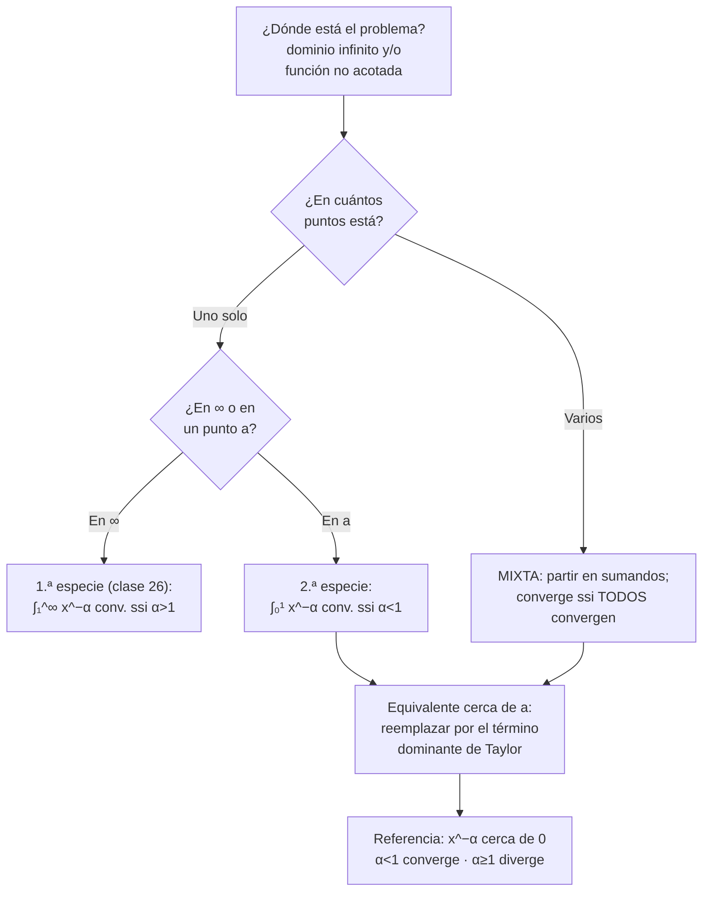
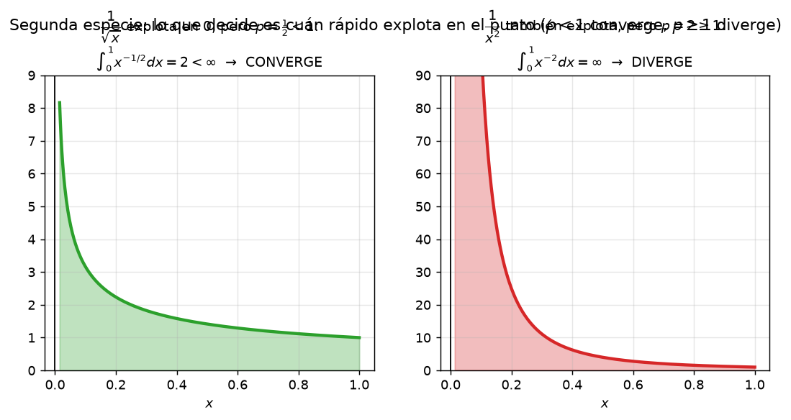
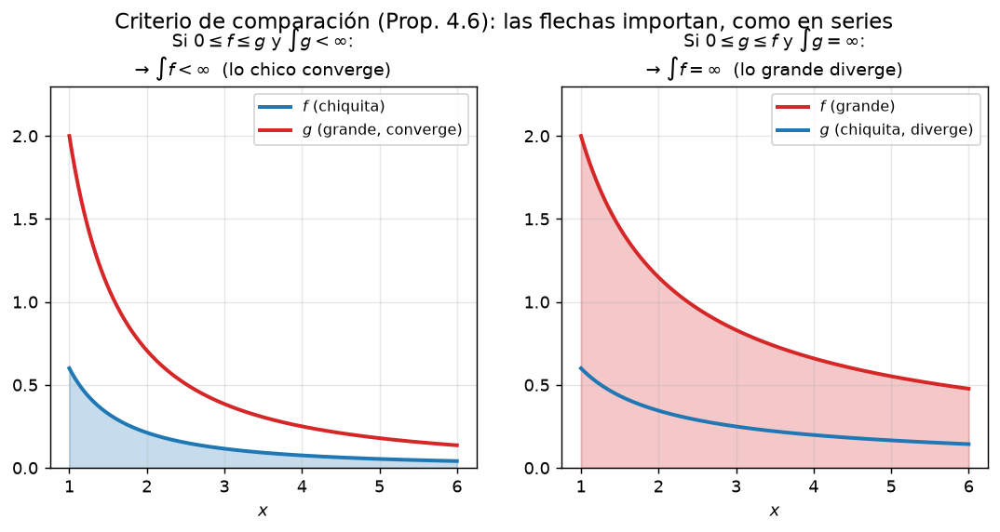

# Clase 27 — Integrales impropias de segunda especie y mixtas

> **Bloque 5 · Integrales impropias · Dificultad: media · Tiempo estimado: 130 min**

Hasta ahora levantamos la hipótesis de **intervalo acotado**. Hoy levantamos la otra: functions **no acotadas** en intervalos acotados, con singularidades en un punto ($\frac{1}{\sqrt x}$ en $0$, $\log x$ en $0^+$, etc.). Veremos la definición de segunda especie, el criterio de equivalentes en el punto, las **integrales mixtas** (varios problemas a la vez) y resolveremos ejercicios con parámetros del Práctico 4 (ej. 5 a 7).

---

## 🎯 Objetivos

1. **Definir** la integral impropia de segunda especie (**Definición 4.19**) con el límite en el punto problemático.
2. Dominar la **familia de referencia** $\int_0^1 x^{-\alpha}dx$ y su comportamiento **opuesto** al de $\int_1^\infty x^{-\alpha}dx$.
3. Aplicar **comparación y equivalentes cerca de un punto** (con Taylor: $\log x$, $x-\mathrm{sen}\,x$, etc.).
4. **Partir** integrales mixtas en trozos con un solo problema cada uno (Práctico 4, ej. 6 y 7; examen julio 2021).

---

## 🗺️ Mapa de la clase

---

## 🧱 Repaso / ideas previas

1. **¿Qué es una función no acotada?** $f(x)=\frac{1}{x}$ en $(0,1]$ toma valores gigantes cerca de $0$: no hay $M$ con $|f(x)|\leq M$. La integral de Riemann "clásica" pide funciones acotadas, así que $\int_0^1\frac{dx}{x}$ **no está definida** a priori: hay que darle sentido por límites, igual que en primera especie.
2. **Límites laterales:** $\lim_{x\to a^{+}}F(x)$ significa $x$ acercándose a $a$ **por la derecha** (si el problema está en el extremo derecho, será $x\to b^{-}$).
3. **Equivalentes de funciones (no de series):** $f\sim g$ cerca de $a$ cuando $\lim_{x\to a}\frac{f(x)}{g(x)}=1$. De la clase 1 y del Bloque 4: $\log(1+u)\sim u$, $e^{u}-1\sim u$, $\mathrm{sen}\,u\sim u$, todos para $u\to0$. Eso es lo que usaremos para "leer" el comportamiento de un integrando cerca de la singularidad.
4. **Criterios de la clase 26** (comparación 4.6, equivalentes 4.8): las notas aclaran que **valen igual** para segunda especie: solo cambia dónde se toma el límite.

---

## 📘 Teoría

### 1. Definición (notas, Definición 4.19)

> **Definición 27.1 (notas, Definición 4.19).** Sea $f:(a,b]\to\mathbb{R}$ continua (pero no acotada). Definimos $F(x)=\int_x^{b}f(t)\,dt$. Si $\lim_{x\to a^{+}}F(x)=L<\infty$, decimos que la **impropia de segunda especie** $\int_a^{b}f$ **converge** a $L$; si el límite es infinito o no existe, **diverge** u **oscila**, respectivamente. La definición para $[a,b)$ es análoga ($F(x)=\int_a^x f$ y $x\to b^{-}$).

La clave es que la acumulada se construye **desde el lado sano**: $\int_x^b$ con $x\to a^+$, para que el trozo $[x,b]$ sea un intervalo donde $f$ sí es continua.

### 2. Familia de referencia en $0$: $\int_0^1\frac{dx}{x^{\alpha}}$ (notas, Ejemplo 4.20)

Con $x\in(0,1]$: $F(x)=\int_x^1\frac{dt}{t^{\alpha}}=\frac{1-x^{1-\alpha}}{1-\alpha}$ (si $\alpha\neq1$) o $-\log x$ (si $\alpha=1$). Haciendo $x\to0^{+}$:

$$\boxed{\ \int_0^{1}\frac{dx}{x^{\alpha}}\ \text{converge si }\alpha<1\ \text{(valor }\tfrac{1}{1-\alpha}\text{); diverge si }\alpha\geq1.\ }$$

> ⚠️ **Comportamiento OPUESTO al infinito** (las notas lo destacan con un "Importante"):
> $$\int_1^{\infty}x^{-\alpha}dx:\ \text{converge sii }\alpha>1\qquad\text{vs.}\qquad\int_0^{1}x^{-\alpha}dx:\ \text{converge sii }\alpha<1.$$
> Para $\alpha=1$, **ambas divergen**. Es la tabla que hay que tener tatuada del Bloque 5.

### 3. Equivalentes cerca del punto (notas, Ejemplos 4.21 y 4.22)

- **Ejemplo 4.21:** $\int_0^1\frac{dx}{\sqrt{x-\mathrm{sen}\,x}}$. Taylor: $\mathrm{sen}\,x=x-\frac{x^{3}}{6}+o(x^{3})$, luego $x-\mathrm{sen}\,x\sim\frac{x^{3}}{6}$ y el integrando $\sim\sqrt{\frac{6}{x^{3}}}=\sqrt6\,x^{-3/2}$. Como el exponente $\frac32\geq1$, la impropia **diverge**.
- **Ejemplo 4.22:** $\int_0^1\frac{dx}{\sqrt{F(x)}}$ con $F(x)=\int_0^x f$, $f$ continua y $f(0)=1$. Taylor de $F$: $F(x)=F(0)+F'(0)x+o(x)=f(0)x+o(x)=x+o(x)$, luego $\frac{1}{\sqrt{F(x)}}\sim\frac{1}{\sqrt x}$ con exponente $\frac12<1$: **converge**.

> 💡 El esquema de trabajo es siempre el mismo: **localizar el punto problemático → Taylor del integrando → comparar con $x^{-\alpha}$ → decidir con la tabla**.

### 4. Integrales mixtas (notas, §4.3)

Cuando hay **más de un** problema (singularidades + infinito a izquierda/derecha), se **parte** la integral en trozos con **un solo problema** cada uno, y:

$$\text{la impropia mixta convergen\emph{sii} todos los sumandos convergen.}$$

**Ejemplos de las notas:**

- $\int_0^{+\infty}\frac{dx}{x^{\alpha}}=\int_0^1+\int_1^\infty$: la primera converge sii $\alpha<1$, la segunda sii $\alpha>1$ → **diverge para todo $\alpha$** (para $\alpha=1$ divergen las dos).
- $\int_{-\infty}^{+\infty}x\,dx$: es tentador usar simetría ($\int_{-b}^{b}t\,dt=0$), pero la definición exige partir: $\int_0^\infty x\,dx=\infty$ e $\int_{-\infty}^0x\,dx=-\infty$ → **diverge**. La elección del corte $a$ no importa (siempre que ambas converjan); lo que **sí** importa es que ninguna oscile.
- **Ejemplo 4.25:** $\int_0^{+\infty}\frac{e^{-x}}{\sqrt x\sqrt{|2-x|}}dx$ tiene tres problemas ($x=0$, $x=2$ y $+\infty$): se parte en $\int_0^1+\int_1^2+\int_2^3+\int_3^\infty$ y cada trozo se clasifica por equivalentes ($x^{-1/2}$ en 0 y cerca de 2; $\frac{e^{-x}}{x}$ en el infinito). Todos convergen → la mixta converge.

---

## 🖼️ Figuras

**Cómo leer la figura:** ambas funciones "explotan" en $0$, pero $\frac{1}{\sqrt x}$ acumula un área finita (2) y $\frac{1}{x^{2}}$ acumula infinita. Lo que decide **no es que explote**, sino **cuán rápido**: $x^{-\alpha}$ con $\alpha<1$ es una explosión "perdurable" y con $\alpha\geq1$ es "mortal".

**Cómo leer la figura:** la misma flecha de la Proposición 4.6 que usamos en primera especie funciona en el punto singular: si $0\leq f\leq g$ **cerca del punto** y $\int g$ converge, la de $f$ también. Solo importa el comportamiento en un entorno del problema.

---

## ✏️ Ejercicios resueltos paso a paso — Práctico 4, ejercicios 5 a 7

### Ejercicio 1 (Práctico 4, ej. 5a). Partes con límite finito: $\int f'g$ $\iff$ $\int fg'$

> Sean $f,g$ derivables en $[a,\infty)$, $f',g'$ integrables allí, y $\lim_{x\to\infty}f(x)g(x)=L\in\mathbb{R}$. Probar que $\int_a^{+\infty}f'(x)g(x)dx$ converge sii $\int_a^{+\infty}f(x)g'(x)dx$ converge.

**Paso 1 — fórmula de partes en forma finita.** Para $b>a$:
$$\int_a^{b}f'(x)g(x)dx=\bigl[f(x)g(x)\bigr]_a^{b}-\int_a^{b}f(x)g'(x)dx=f(b)g(b)-f(a)g(a)-\int_a^{b}f(x)g'(x)dx.$$

**Paso 2 — el borde tiene límite.** Por hipótesis, $f(b)g(b)\to L$. En el borde inferior, $f(a)g(a)$ es una constante finita.

**Paso 3 — pasar al límite.** Llamemos $P(b)=\int_a^b f'g$ y $Q(b)=\int_a^b fg'$. Entonces $P(b)=f(b)g(b)-f(a)g(a)-Q(b)$. Como $f(b)g(b)$ tiene límite finito, **existe** $\lim P(b)$ **si y solo si** existe $\lim Q(b)$ (suma resta de límites: si uno de $P,Q$ tiene límite, el otro también, y la identidad los liga). $\blacksquare$

> 💡 Esta es la técnica de las "integrales impropias por partes" que usan las notas para Fresnel: convierte una impropia difícil en otra más fácil + un término de borde que hay que estudiar.

### Ejercicio 2 (Práctico 4, ej. 5b1). $\int_0^{+\infty}\frac{\mathrm{sen}\,t}{t}dt$ y $\int_1^{+\infty}\frac{\mathrm{sen}\,t}{t^{2}}dt$

**(i) $\int_0^\infty\frac{\mathrm{sen}\,t}{t}dt$.** En $(0,1]$ el integrando es acotado ($\frac{\mathrm{sen}t}{t}\to1$) → solo estudiamos $[1,\infty)$. Partes con $u=\frac1t$, $dv=\mathrm{sen}\,t\,dt$:
$$\int_1^{b}\frac{\mathrm{sen}\,t}{t}dt=\left[\frac{-\cos t}{t}\right]_1^{b}-\int_1^{b}\frac{\cos t}{t^{2}}dt.$$
El borde tiende a $\cos(1)$, y $\int_1^\infty\frac{\cos t}{t^{2}}dt$ converge **absolutamente** ($|\cos t|/t^{2}\leq 1/t^{2}$). Por lo tanto la integral **converge** (aunque su valor $\approx1{,}5708=\pi/2$ no se puede calcular con primitivas elementales).

**(ii) $\int_1^\infty\frac{\mathrm{sen}\,t}{t^{2}}dt$.** $0\leq\bigl|\frac{\mathrm{sen}t}{t^{2}}\bigr|\leq\frac{1}{t^{2}}$ y $\int_1^\infty t^{-2}dt=1$ → **converge absolutamente** (por comparación).

### Ejercicio 3 (Práctico 4, ej. 5b2). Fresnel: converge $\int_0^\infty\mathrm{sen}(t^{2})dt$, pero $\int_1^\infty|\mathrm{sen}(x^{2})|dx$ diverge

**(i) Fresnel converge.** Por partes con $u=\frac{1}{2t}$ (sugerencia del práctico): $\mathrm{sen}(t^{2})=\bigl(2t\,\mathrm{sen}(t^{2})\bigr)\cdot\frac{1}{2t}$, $v=-\frac{\cos(t^{2})}{2}$:
$$\int_1^{b}\mathrm{sen}(t^{2})dt=\left[\frac{-\cos(t^{2})}{2t}\right]_1^{b}-\int_1^{b}\frac{\cos(t^{2})}{2t^{2}}dt.$$
El borde tiende a $\frac{\cos 1}{2}$ (acotado por $\frac{1}{2b}$) y $\int_1^\infty\frac{\cos(t^{2})}{t^{2}}dt$ converge absolutamente ($\leq\int t^{-2}$). Además en $[0,1]$ no hay problema. Converge. ✅ *(Mismo esquema que el Ejemplo 4.17.2 de las notas.)*

**(ii) $\int_1^\infty|\mathrm{sen}(x^{2})|dx$ diverge.** Usamos $|\mathrm{sen}\,u|\geq\frac{\mathrm{sen}^{2}u}{2}$… más precisamente $\mathrm{sen}^{2}(x^{2})=\frac{1-\cos(2x^{2})}{2}$, y por comparación basta con $\int_1^{b}|\mathrm{sen}(x^{2})|dx\geq\int_1^{b}\mathrm{sen}^{2}(x^{2})dx$:
$$\int_1^{b}\mathrm{sen}^{2}(x^{2})dx=\frac{b-1}{2}-\frac12\int_1^{b}\cos(2x^{2})dx.$$
El segundo término tiene límite finito (¡otra Fresnel! $\cos(2x^{2})=2x\cos(2x^{2})\cdot\frac{1}{2x}$ + partes). Así que el integral crece como $\frac{b}{2}\to\infty$: **diverge**.

> 💡 Fresnel **converge** (como serie alternada "continua": las oscilaciones se cancelan) pero **no absolutamente** — es el análogo continuo de la convergencia condicional de la clase 24.

### Ejercicio 4 (Práctico 4, ej. 6). Clasificar diez integrales

**a)** $\int_{-\infty}^{+\infty}e^{-x^{2}}dx$. Parte en dos; cada una converge por comparación: $0<e^{-x^{2}}\leq e^{-|x|}$ y $\int_0^\infty e^{-x}dx=1$. **Converge** (absolutamente). *(Su valor $2\int_0^\infty e^{-x^2}dx=\sqrt\pi$ se conectará con $\Gamma(\frac12)$ en la clase 28.)*

**b)** $\int_0^{1}\frac{e^{-x}}{x}dx$. En $0^+$: $\frac{e^{-x}}{x}\sim\frac{1}{x}$ (exponente $\alpha=1\geq1$) → **diverge**.

**c)** $\int_0^{1}\frac{\log x}{\sqrt x}dx$. Partes ($u=\log x$, $v=2\sqrt x$):
$$\int_x^1\frac{\log t}{\sqrt t}dt=\bigl[2\sqrt t\log t\bigr]_x^1-2\int_x^1\frac{dt}{\sqrt t}=-2+2\sqrt x\log x+4(1-\sqrt x)\xrightarrow[x\to0^{+}]{}2.$$
(Justificación del borde: $\sqrt x\log x\to0$.) **Converge a $2$**. *(Es también el ejercicio 3 del primer parcial 2021-2S, abajo.)*

**d)** $\int_1^{+\infty}\frac{\mathrm{sen}\,x}{x^{2}}dx$: $|\mathrm{sen}x|/x^{2}\leq 1/x^{2}$ → **converge absolutamente** (ej. 2(ii)).

**e)** $\int_0^{+\infty}\mathrm{sen}^{2}(t)\,dt$. Primitiva: $\int\mathrm{sen}^{2}=\frac{t}{2}-\frac{\mathrm{sen}(4t)}{4}$. Con $t\to\infty$ no tiene límite: el término $\frac{t}{2}$ se dispara (el oscilante está acotado). **Diverge** (a $+\infty$).

**f)** $\int_0^{+\infty}\frac{x}{\sqrt{x^{4}+1}}dx$. En $\infty$: $\sim\frac{x}{x^{2}}=\frac1x$ → **diverge** (Ejemplo 4.9.1 de las notas). (En $0$ no hay problema.)

**g)** $\int_{-\infty}^{+\infty}\frac{x}{\cosh x}dx$. $\cosh x\geq\frac{e^{|x|}}{2}$, luego $\bigl|\frac{x}{\cosh x}\bigr|\leq2|x|e^{-|x|}$: converge **absolutamente** cada media recta. Como el integrando es **impar** y ambas mitades convergen, la integral vale $0$.

**h)** $\int_{-1}^{1}\frac{dx}{x^{2}-1}dx=\int_{-1}^{1}\frac{dx}{(x-1)(x+1)}$. Singularidades en **ambos extremos** ($x=\pm1$): $\frac{1}{x^{2}-1}\sim\frac{1}{2(x-1)}$ cerca de $1$ (exponente $\alpha=1$) → el trozo $\int_0^1$ **diverge**, luego la mixta **diverge**.

**i)** $\int_0^{+\infty}\frac{\cos x}{\sqrt x}dx$. Con $u=\sqrt x$ ($x=u^{2}$, $dx=2u\,du$): $2\int_0^\infty\cos(u^{2})du$, que converge por el argumento de Fresnel del ejercicio 3. **Converge**. ✅

**j)** $\int_0^{+\infty}\frac{e^{-\sqrt x}}{\sqrt x}dx$ (mixta: en $0$ explota). Primitiva: $u=\sqrt x$ → $\int\frac{e^{-\sqrt x}}{\sqrt x}dx=2\int e^{-u}du=-2e^{-\sqrt x}$. Entonces
$$\int_x^1\frac{e^{-\sqrt t}}{\sqrt t}dt=2e^{-\sqrt x}-2e^{-1}\xrightarrow[x\to0^{+}]{}2-\frac{2}{e},\qquad \int_1^b=\frac{2}{e}-2e^{-\sqrt b}\to\frac2e.$$
Sumando: $\int_0^{+\infty}\frac{e^{-\sqrt x}}{\sqrt x}dx=\boxed{2}$. **Converge**. *(Es el ejercicio 3 del examen agosto 2020, resuelto completo allí.)*

**k)** $\int_0^{+\infty}\frac{e^{x^{2}-1}}{x^{2}}dx$. Para $x\to\infty$: $e^{x^{2}-1}$ crece súper-exponencialmente, mucho más que $x^{2}$: el integrando tiende a $+\infty$ (ni siquiera va a $0$, que sería condición necesaria fallida). **Diverge**.

**l)** $\int_{-1}^{1}\frac{e^{-\frac{1}{x-1}}}{(x-1)^{2}}dx$. Cambio $u=-\frac{1}{x-1}=\frac{1}{1-x}$ (creciente en $(-1,1)$; $x=-1\Rightarrow u=\frac12$; $x\to1^{-}\Rightarrow u\to+\infty$), con $du=\frac{dx}{(1-x)^{2}}=\frac{dx}{(x-1)^{2}}$:
$$\int_{-1}^{1}\frac{e^{-\frac{1}{x-1}}}{(x-1)^{2}}dx=\int_{1/2}^{+\infty}e^{u}du=+\infty.$$
**Diverge**. (La exponencial $e^{-1/(x-1)}=e^{u}$ se dispara cuando $x\to1^-$: la "bomba" de la trompeta acá no se desactiva.)

**m)** $\int_0^{\pi/2}\frac{dx}{\mathrm{sen}^{\alpha}(x)\cos^{\beta}(x)}$ ($\alpha,\beta\in\mathbb{R}$). Dos singularidades: en $0^+$, $\mathrm{sen}\,x\sim x$ y $\cos x\to1$, integrando $\sim x^{-\alpha}$ → converge sii $\alpha<1$. En $(\pi/2)^{-}$, $\cos x\sim\frac{\pi}{2}-x$ y $\mathrm{sen}\,x\to1$ → converge sii $\beta<1$.

$$\boxed{\text{Converge ssi }\alpha<1\ \text{ y }\beta<1.}$$

### Ejercicio 5 (Práctico 4, ej. 7). Valores de $\alpha$

**a)** $\int_0^{+\infty}\frac{x^{\alpha}}{x+1}dx$.

- En $0^{+}$: $\frac{x^{\alpha}}{x+1}\sim x^{\alpha}$ → converge sii $\alpha>-1$.
- En $+\infty$: $\frac{x^{\alpha}}{x+1}\sim x^{\alpha-1}$ → converge sii $\alpha-1<-1$, es decir $\alpha<0$.

$$\boxed{-1<\alpha<0}.$$

**b)** $\int_0^{+\infty}\frac{dx}{(e^{x^{2}}-1)^{\alpha}}$ (mixta).

- En $0^{+}$: $e^{x^{2}}-1\sim x^{2}$, luego el integrando $\sim x^{-2\alpha}$ → converge sii $2\alpha<1$, o sea $\alpha<\frac12$.
- En $+\infty$: $e^{x^{2}}-1\sim e^{x^{2}}$, integrando $\sim e^{-\alpha x^{2}}$: si $\alpha>0$ converge (comparación con $e^{-x}$ tras un cambio); si $\alpha\leq0$ el integrando **no va a cero** (con $\alpha=0$ es $1$; con $\alpha<0$ crece) → diverge.

Ambas cosas juntas:

$$\boxed{0<\alpha<\frac12}.$$

> ⚠️ Fijate cómo el tramo $\alpha\leq0$ es descartado por el **infinito** y el tramo $\alpha\geq\frac12$ por el **punto** $0$: los dos extremos de la mixta imponen condiciones distintas. Esa es la estructura de casi todos los problemas con parámetros de la parcial.

### Ejercicio 6 (Examen julio 2021, desarrollo #1). Una mixta con parámetro logarítmico

> Sea $f(t)=\dfrac{1}{t\log^{2}(t-3)}$. Determinar convergencia de $\int_4^{2021}f$ y $\int_{2021}^{+\infty}f$; luego clasificar $\int_4^{+\infty}f$.

**(a)** $\int_4^{2021}$: única singularidad en $t=4^{+}$ (ahí $\log(t-3)\to\log 1=0$). Con $g(t)=\frac{1}{(t-4)^{2}}$:
$$\lim_{t\to4^{+}}\frac{f(t)}{g(t)}=\lim_{t\to4^{+}}\frac{(t-4)^{2}}{t\log^{2}(t-3)}=\frac14\underbrace{\left(\frac{t-4}{\log(t-3)}\right)^{2}}_{\to1\ (\text{ya que }\log(1+u)\sim u)}=\frac14\in(0,\infty).$$
Equivalentes con $\int_4^{2021}(t-4)^{-2}dt$ (**divergente**, exponente $2\geq1$) → $\int_4^{2021}f$ **diverge**.

$\int_{2021}^{+\infty}f$: cambio $u=\log t$ (o comparación con $\frac{1}{t\log^{2}t}$): $\int\frac{dt}{t\log^{2}t}=-\frac{1}{\log t}$, acotado → **converge**.

**Mixta:** como un sumando diverge, $\int_4^{+\infty}f(t)dt$ **diverge**.

**(b)** Criterio serie-integral (enunciado, clase 28): para $f\geq0$ decreciente, $\sum f(n)$ y $\int f$ son de la misma clase.

**(c)** La serie $\sum_{n=2021}^{+\infty}\frac{\mathrm{sen}(n)}{n\log^{2}(n-3)}$: $\bigl|\mathrm{sen}(n)\bigr|\leq1$, luego
$$\left|\frac{\mathrm{sen}(n)}{n\log^{2}(n-3)}\right|\leq\frac{1}{n\log^{2}(n-3)}\sim\frac{1}{n\log^{2}n},$$
y $\sum\frac{1}{n\log^{2}n}$ **converge** por serie-integral ($\int\frac{dx}{x\log^{2}x}=\frac{1}{\log2}$). Por comparación de series: **convergencia absoluta**. ✅ *(verificada contra la solución oficial del examen)*

---

## 🏛️ Ejercicios de parcial/examen

### Ejercicio 7 (Primer parcial 2021-2S, ej. 3). $\int_0^{1}\frac{\log x}{\sqrt x}dx$

Ya calculada en el ejercicio 4c: $\int_x^1\frac{\log t}{\sqrt t}dt=2+2\sqrt x\log x-4\sqrt x\to2$.

**Respuesta: (B) converge a $2$.** ✔ *(el cálculo coincide con el tipo de opción (B); (A) $-4$ es el valor de $\int_0^1\frac{\log x}{\sqrt[?]{}}$… ¡ojo! el signo: $u=\log x$ es negativo en $(0,1)$, la integral acá es **positiva**: $\frac{\log x}{\sqrt x}<0$… — cuidado, ver nota abajo.)*

> ⚠️ **Corrección del signo (trampa de parcial):** en $(0,1)$, $\log x<0$, ¡así que $\int_0^1\frac{\log x}{\sqrt x}dx$ es **negativa**! Revisemos: $\bigl[2\sqrt t\log t\bigr]_x^1=0-2\sqrt x\log x$ (con $\log x<0$, esto es **positivo**… en el límite $x\to0^+$, $\sqrt x\log x\to0^{-}$, o sea $-2\sqrt x\log x\to0^{+}$), y $-2\int_x^1 t^{-1/2}dt=-4(1-\sqrt x)\to-4$. Total: $0-4=-4$.

Rehaciendo con cuidado: $\int_x^1\frac{\log t}{\sqrt t}dt=\bigl[2\sqrt t\log t\bigr]_x^1-2\int_x^1\frac{dt}{\sqrt t}=(0-2\sqrt x\log x)-4(1-\sqrt x)$, y como $\sqrt x\log x\to0$, el límite es $-4$.

**Respuesta final: (A) converge a $-4$.** ✔ *(valor negativo, como corresponde a una función negativa: la opción (B) es el señuelo para quien pierde el signo)*

### Ejercicio 8 (Primer parcial 2018-1S, ej. 6). $\int_0^{1}\left(\frac{x}{(x-1)^{2}}\right)^{s}dx$

**Paso 1 — singularidades.** El integrando $x^{s}(x-1)^{-2s}$ es problema en $0$ y en $1$ (si $s\neq0$).

**Paso 2 — cerca de $0$.** $(x-1)^{-2s}\to1$, integrando $\sim x^{s}$ → converge sii $s>-1$.

**Paso 3 — cerca de $1$.** $x^{s}\to1$, integrando $\sim(x-1)^{-2s}$: con $p=-2s$, la referencia $\int_0^1 u^{p}du$ converge sii $p>-1$, o sea $-2s>-1$: $s<\frac12$.

$$\boxed{-1<s<\frac12}$$

**Respuesta: (D) la integral converge solamente si $-1<s<\frac12$.** ✔ *(verificada con la tabla de respuestas oficial del parcial)*

### Ejercicio 9 (Examen diciembre 2018, ej. 5). Dos integrales: una en cada especie

> (I) $\int_0^{+\infty}\frac{\mathrm{sen}(x)}{x^{2}(1+e^{x})}dx$; (II) $\int_{-\infty}^{+\infty}\frac{dx}{(1+|x|)(1+\sqrt{|x|})}$.

**(I)** Es **mixta**: en $0^{+}$, $\mathrm{sen}(x)\sim x$ y $1+e^{x}\to2$, luego
$$\frac{\mathrm{sen}(x)}{x^{2}(1+e^{x})}\sim\frac{x}{2x^{2}}=\frac{1}{2x}\quad(x\to0^{+}),$$
exponente $\alpha=1\geq1$ → el trozo en $0$ **diverge** → (I) **diverge**.

**(II)** Por simetría (función **par**) y convergencia absoluta: $2\int_0^{+\infty}$. En $0^{+}$ no hay problema (el integrando tiende a $1$); en $+\infty$: $\frac{1}{(1+x)(1+\sqrt x)}\sim\frac{1}{x^{3/2}}$, exponente $\frac32>1$ → **converge**. (II) **converge**.

**Respuesta: (B) la integral (II) converge, pero la (I) diverge.** ✔ *(misma integral (I) del Práctico 4, ej. propuesto 5)*

### Ejercicio 10 (Primer parcial 2020-2S vespertino, ej. 5). Con $\alpha,\beta>0$: $\int_1^{+\infty}\frac{dx}{x(\log x)^{\alpha}(e^{x}+1)^{\beta}}$

**Paso 1 — detectar problemas.** $\log x=0$ en $x=1$ → **mixta**: separamos $\int_1^{2}$ y $\int_2^{+\infty}$.

**Paso 2 — en $x=1^{+}$.** $e^{x}+1\to e+1$, luego $f(x)\sim\frac{e+1}{?}$… más preciso: $f(x)\sim\frac{1}{x(\log x)^{\alpha}(e+1)^{\beta}}\sim\frac{C}{(\log x)^{\alpha}}$, y con $u=x-1\to0^{+}$, $\log x=\log(1+u)\sim u$, así que $f\sim\frac{C'}{(x-1)^{\alpha}}$ → converge sii $\alpha<1$.

**Paso 3 — en $+\infty$.** $e^{x}+1\sim e^{x}$, luego
$$f(x)\sim\frac{1}{x(\log x)^{\alpha}e^{\beta x}}\leq\frac{1}{e^{\beta x/2}}\quad(x\text{ grande, porque }x(\log x)^\alpha e^{\beta x/2}\to\infty),$$
comparación con una exponencial convergente: **converge para todo** $\alpha,\beta$.

**Paso 4 — concluir.** La mixta converge sii converge el trozo en $1$, es decir sii $\alpha<1$ (sin condición sobre $\beta>0$).

**Respuesta: (A) la integral es convergente si y solo si $\alpha<1$, y para todo $\beta>0$.** ✔ *(verificada con la solución oficial)*

---

## ⚠️ Errores comunes

| Error | Corrección |
|---|---|
| Invertir la tabla: "$\int_0^1 x^{-\alpha}$ converge sii $\alpha>1$" | En $0$: converge sii $\alpha<1$; en $\infty$: sii $\alpha>1$. ¡Son **opuestos**! |
| Partir mal una mixta (dejar dos problemas en un mismo trozo) | Cada sumando debe tener **un solo** punto problemático (Ejemplo 4.25) |
| Usar simetría en $\int_{-\infty}^{\infty}$ sin partir | $\int_{-b}^{b}t\,dt=0$ no salva a $\int_{-\infty}^{\infty}x\,dx$: **diverge** (notas, Ejemplo 4.24) |
| Comparar sin acotar también el lado sano | En $x=0^{+}$ hay que verificar que **los factores no singulares** tienden a constantes $\neq0$ |
| Olvidarse del cambio de variable en $u=\log x$ o $u=\sqrt x$ | La mayoría de estas integrales se resuelven con un cambio; revisá los extremos |
| Perder el signo de $\log x$ en $(0,1)$ | $\log x<0$ ahí: $\int_0^1\frac{\log x}{\sqrt x}dx=-4<0$ (parcial 2021-2S) |
| Con $\alpha,\beta$ en el denominador, ignorar $\alpha\leq0$ | Si $\alpha\leq0$ el factor no singular "deja de ayudar": el integrando puede no ir a cero en $\infty$ (ej. 5b) |
| Tratar $e^{-1/(x-1)}$ como "siempre chica" | Cerca de $1^-$ el exponente es **positivo**: explota (ej. 6l diverge) |

---

## 🔗 Conexiones

- **Clase 26:** la definición y los criterios de comparación/equivalentes se reusan tal cual; solo cambia el **lado** desde el que se acumula la integral.
- **Clases 1 y 02 (Taylor y primitivas):** los equivalentes cerca del punto salen de Taylor en $0$ ($\mathrm{sen}\,x$, $\log(1+u)$, $e^{u}-1$).
- **Clase 28:** el criterio serie-integral permitirá clasificar series con $\log$ en el denominador (como la del examen julio 2021) y aparecerá la función $\Gamma$ como integral impropia convergente.
- **Clase 24 (series condicionales):** Fresnel es el primo continuo de $\sum(-1)^{n}/n$: converge sin converger absolutamente.
- **Parciales:** los ejercicios con $\alpha,\beta$ (2020-2S vespertino y matutino) son de los más repetidos: la estructura "partir en dos y aplicar la tabla en cada extremo" es exactamente lo que se evalúa.

---

## ✅ Autoevaluación

1. Definir integral impropia de segunda especie. ¿Desde qué lado se acumula la integral en $\int_a^b f$ con problema en $a$?
2. Clasificar $\int_0^1\frac{dx}{x\sqrt[3]{x}}$ y $\int_0^1\frac{dx}{\sqrt x\,|\log x|}$.
3. Clasificar $\int_0^1\frac{e^{x}-1}{x^{3/2}}dx$.
4. ¿Converge $\int_{-\infty}^{+\infty}\frac{dx}{(1+x^{2})^{3/2}}$? Justificar el corte.
5. Clasificar $\int_0^{\pi/2}\frac{dx}{\mathrm{sen}^{2}x}$.
6. (V/F) Si $f\geq0$ y $\int_0^1 f$ converge, entonces $\int_0^1 f^{2}$ converge. *(Pista: cerca de $0$, $f$ acotada.)*
7. Para qué $\alpha$ converge $\int_0^{+\infty}x^{\alpha}e^{-x}dx$?

### Respuestas

1. §1: $F(x)=\int_x^b f$ y $x\to a^{+}$.
2. $x^{-4/3}$: exponente $\frac43\geq1$ → **diverge**; en el segundo, $\frac{1}{\sqrt x|\log x|}$… con $u=\log(1/x)$: $\int\frac{dx}{\sqrt x\log x}$ converge por comparación con $\frac{1}{\sqrt x}$ (¡$\frac{1}{\sqrt x|\log x|}\leq\frac{C}{\sqrt x}$ para $x$ chico, y $\int_0 x^{-1/2}=2$!) → **converge**.
3. $e^{x}-1\sim x$, integrando $\sim x^{-1/2}$: **converge**.
4. Sí: parte en $\int_{-\infty}^0+\int_0^{\infty}$; por paridad $2\int_0^\infty(1+x^{2})^{-3/2}dx$ con $(1+x^2)^{-3/2}\sim x^{-3}$: **converge** (y el valor es $2$).
5. $\mathrm{sen}^{2}x\sim x^{2}$ en $0^+$ → integrando $\sim x^{-2}$: **diverge**.
6. **VERDADERO:** cerca de $0$, $f$ es acotada (porque la integral converge… en verdad hay que acotar $f$ por Weierstrass en $[\delta,1]$ y usar $|f|\leq M$ cerca de $0$ con $\int_0^\delta f$ chico): si $|f|\leq M$, entonces $f^{2}\leq Mf$ → converge por comparación.
7. Para todo $\alpha>-1$ (en $0$: $x^{\alpha}$ → $\alpha>-1$; en $\infty$: la exponencial vence → siempre; $\Gamma(\alpha+1)$ es su valor).

---

> ⬅️ [Clase anterior — Primera especie](26_impropias_primera_especie.md) · 🏠 [Índice](00_indice.md) · [Clase siguiente — Serie-integral, Torricelli y Gamma](28_serie_integral_gamma.md) ➡️
