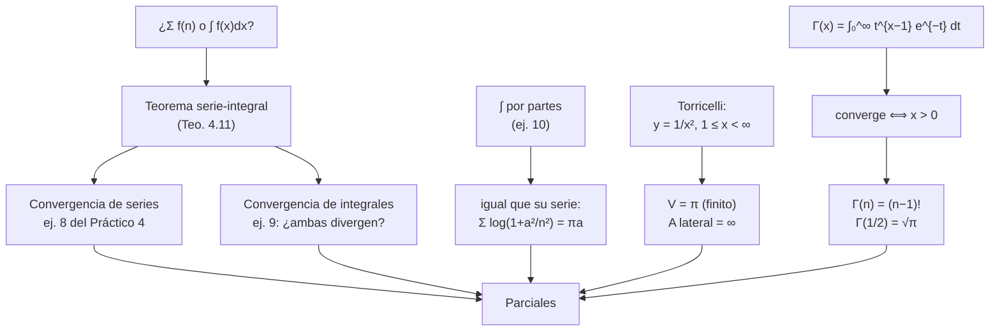
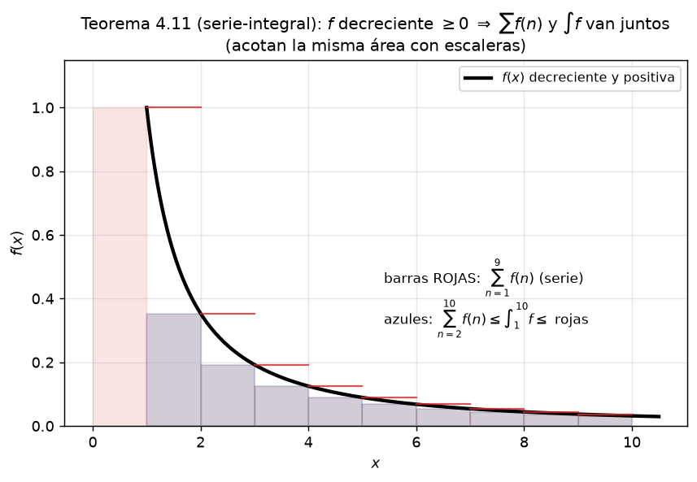
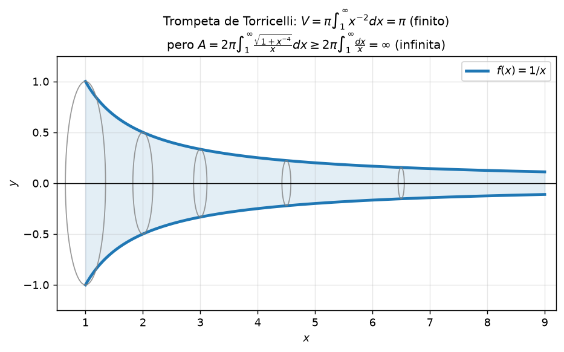
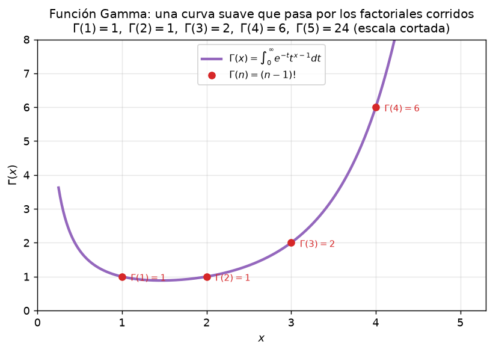

# Clase 28 — Serie-integral, Torricelli y la función Gamma

## 🎯 Objetivos

- Aplicar el **Teorema de la serie-integral** (Teo. 4.11 de las notas) para decidir convergencia de series con términos generales "complicados".
- Usar el criterio en las dos direcciones: probar convergencia de una serie comparándola con una integral convergente, y probar divergencia de una integral por una serie divergente.
- Resolver la integral impropia $\int_0^\infty \log\!\left(1+\frac{a^2}{x^2}\right)dx$ por partes y verificarla con la serie-integral.
- Calcular el volumen de Torricelli (un sólido de revolución de "altura infinita" con volumen finito) y explicar por qué su superficie lateral es infinita.
- Conocer la **función Gamma** $\Gamma(x)=\int_0^\infty t^{x-1}e^{-t}\,dt$, su convergencia para $x>0$ y la identidad $\Gamma(n)=(n-1)!$.

## 🗺️ Mapa de la clase

## 🧱 Repaso / ideas previas

- **Integral impropia de 1.ª especie** (clase 26): $\int_a^\infty f$ converge $\iff$ existe $\lim_{b\to\infty}\int_a^b f$.
- **Criterio de comparación por límite** (clase 26): si $f,g>0$ y $L=\lim_{x\to\infty}f(x)/g(x)\in(0,\infty)$, ambas integrales convergen o divergen juntas.
- **Series con término general positivo**: $n$-ésimo término general y criterio de comparación (clases 21–22).
- **La imagen de una serie es una escalera**: $\sum_{n=a}^{b} f(n)$ es la área de rectángulos de base 1 y alturas $f(n)$. Esa es la intuición que vamos a formalizar.

## 📘 Teoría

### Teorema 4.11 (serie-integral)

> Sean $f:[1,\infty)\to\mathbb{R}$ **positiva y decreciente**. Entonces
> $$\sum_{n=1}^{\infty} f(n) \quad \text{y} \quad \int_1^{\infty} f(x)\,dx$$
> **convergen o divergen a la vez.**

**Demostración (con la "escalera" de Riemann).** Como $f$ es decreciente, para cada $n$ y todo $x\in[n,n+1]$ vale $f(n+1)\le f(x)\le f(n)$. Integrando en $[n,n+1]$:

$$f(n+1) \;\le\; \int_n^{n+1} f(x)\,dx \;\le\; f(n).$$

Sumando de $n=1$ a $N-1$ e indicando $S_N=\sum_{n=1}^{N}f(n)$:

$$S_N - f(1) \;\le\; \int_1^{N} f(x)\,dx \;\le\; S_N - f(N).$$

- Si $\int_1^\infty f$ **converge** (suma $I$), entonces $S_N \le \int_1^{N} f + f(1) \le I + f(1)$: la serie está acotada creciente, luego converge.
- Si $\sum f(n)$ **converge** (suma $S$), entonces $\int_1^{N} f \le S_N - f(N) \le S$: la integral está acotada creciente, luego converge. $\square$

La figura `b5_serie_integral.png` muestra exactamente esto: los rectángulos de la serie por encima y por debajo de la curva.

**Igualdades útiles (desigualdades de la escalera):** para $f$ positiva y decreciente,

$$\int_1^{N+1} f(x)\,dx \;\le\; \sum_{n=1}^{N} f(n) \;\le\; f(1) + \int_1^{N} f(x)\,dx.$$

**Advertencia clave:** la hipótesis de *decreciente* es necesaria. Si no, la serie y la integral pueden comportarse distinto (el contraejemplo clásico es $f$ con picos en los enteros: $\sum f(n)$ "ve" los picos, $\int f$ no).

### Corolario inmediato: el caso $1/n^\alpha$

Con $f(x)=x^{-\alpha}$ (decreciente en $[1,\infty)$ cuando $\alpha>0$): $\int_1^\infty x^{-\alpha}dx$ converge $\iff \alpha>1$. Luego

$$\sum_{n=1}^{\infty}\frac{1}{n^{\alpha}} \text{ converge} \iff \alpha>1,$$

lo que recupera el criterio p-álgébrico de la clase 22 por un camino distinto.

### Ejemplos del Teorema (4.12 y 4.13 de las notas)

- $\sum \frac{1}{n\log n}$: $f(x)=\frac{1}{x\log x}$ es positiva y decreciente en $[2,\infty)$, y $\int_2^\infty \frac{dx}{x\log x}=\lim_{b\to\infty}\log(\log b)=\infty$. **Diverge.**
- $\sum \frac{\log n}{n^2}$: $f(x)=\frac{\log x}{x^2}$ es decreciente para $x\ge 3$; $\int_3^\infty \frac{\log x}{x^2}dx$ converge (por partes: $-\frac{\log x}{x}-\frac1x\big|_3^\infty$). **Converge.**

### Integral impropia logarítmica (ejemplo 4.13)

$$\int_0^1 \log x\,dx = \lim_{\varepsilon\to 0^+}\Big[x\log x - x\Big]_\varepsilon^1 = -1.$$

Aunque $\log x\to-\infty$ en $x=0$, la integral **converge**: la singularidad es débil, porque $\lim_{\varepsilon\to0^+}\varepsilon\log\varepsilon=0$. Es un buen contraejemplo a la intuición de que "$\log$ que explota no se puede integrar". (Ojo: no vale lo mismo para *cualquier* potencia del logaritmo ni para otras singularidades; lo que decide siempre es el límite de la primitiva.)

### La función Gamma

Para $x>0$:

$$\Gamma(x)=\int_0^\infty t^{x-1}e^{-t}\,dt.$$

**Convergencia (ejemplo complementario del Práctico 4).** En $0$: $t^{x-1}e^{-t}\sim t^{x-1}$, integrable en $(0,1]$ $\iff x>0$. En $\infty$: para $n=[x]+1$, la sucesión $\{t^n\}$ domina eventualmente a $e^t/ (n!)$… es decir, existe $t_0$ con $e^{-t} \le n!\, t^{-n}$ para $t\ge t_0$, luego

$$\int_{t_0}^\infty t^{x-1}e^{-t}dt \le n!\int_{t_0}^\infty t^{x-1-n}dt < \infty \iff x-n<-1,$$

que se cumple porque $n=[x]+1>x$. Conclusión: **$\Gamma(x)$ converge $\iff x>0$.**

**Propiedades.** Integrando por partes ($u=t^{x-1}$, $dv=e^{-t}dt$):

$$\Gamma(x) = \big[-t^{x-1}e^{-t}\big]_0^\infty + (x-1)\int_0^\infty t^{x-2}e^{-t}dt = (x-1)\Gamma(x-1),\quad x>1.$$

Con $\Gamma(1)=\int_0^\infty e^{-t}dt=1$, por inducción:

$$\boxed{\Gamma(n) = (n-1)! \quad (n\in\mathbb{N}),}\qquad \Gamma(1/2)=\int_0^\infty e^{-t}t^{-1/2}dt \overset{t=u^2}{=} 2\int_0^\infty e^{-u^2}du=\sqrt{\pi}.$$

## 🖼️ Figuras

### Figura 1 — La escalera de la serie-integral

Rectángulos de área $f(n)$ sobre y bajo la curva: $\int_1^{N+1}f \le \sum_1^N f(n) \le f(1)+\int_1^N f$. Las dos cantidades convergen o divergen juntas.

### Figura 2 — Torricelli: volumen finito, superficie infinita

La hipérbola $y=1/x^2$ girada alrededor del eje $x$ da un "cuerno" de altura infinita con $V=\pi$, pero su superficie lateral es $\infty$: podrías pintar el interior pero no la pared.

### Figura 3 — La función Gamma

$\Gamma(x)=\int_0^\infty t^{x-1}e^{-t}dt$ para $x>0$; pasa por $\Gamma(1)=\Gamma(2)=1$, y $\Gamma(n)=(n-1)!$. Para $x\le 0$ la integral no converge (polos en los enteros no positivos).

## ✏️ Ejercicios resueltos

### Ejercicio 8 — Serie-integral (Práctico 4)

**a)** Estudiar la convergencia de $\sum_{n=1}^\infty n\,e^{-n^2}$.

Sea $f(x)=xe^{-x^2}$. Es positiva en $[1,\infty)$ y $f'(x)=e^{-x^2}(1-2x^2)<0$ para $x\ge1$: decreciente. Como $f$ es decreciente, el teorema serie-integral vale… pero ojo: es más rápido comparar con otra cosa. De hecho $f$ decreciente $\Rightarrow$ basta la integral:

$$\int_1^\infty xe^{-x^2}dx = \lim_{b\to\infty}\left[-\tfrac12 e^{-x^2}\right]_1^b = \frac{1}{2e}<\infty.$$

Como la integral converge y $f$ es positiva decreciente, por el **Teorema 4.11 la serie converge**. $\blacksquare$

**b)** $\sum_{n=2}^\infty \frac{1}{n\sqrt{\log n}}$.

$f(x)=\frac{1}{x\sqrt{\log x}}$ es positiva y decreciente en $[2,\infty)$. Sustitución $u=\log x$, $du=dx/x$:

$$\int_2^b \frac{dx}{x\sqrt{\log x}} = \int_{\log 2}^{\log b} \frac{du}{\sqrt u} = 2\sqrt{\log b} - 2\sqrt{\log 2} \xrightarrow{b\to\infty} \infty.$$

La integral diverge, luego **la serie diverge** (Teo. 4.11). $\blacksquare$

**c)** $\sum_{n=2}^\infty \frac{\log n}{n^2}$.

$f(x)=\frac{\log x}{x^2}$: positiva; $f'(x)=\frac{1-2\log x}{x^3}<0$ para $x\ge3$, así que es decreciente en $[3,\infty)$ (o bien en $[2,\infty)$ manejando $n=2$ aparte; el teorema se aplica a partir del tramo decreciente). Por partes con $\int \frac{\log x}{x^2}dx=-\frac{\log x}{x}-\frac1x+C$:

$$\int_3^\infty \frac{\log x}{x^2}dx = \left[-\frac{\log x + 1}{x}\right]_3^\infty = \frac{\log 3+1}{3}<\infty.$$

Integral convergente $\Rightarrow$ **la serie converge**. $\blacksquare$

### Ejercicio 9 — ¿Ambas divergen? (Práctico 4)

**a)** $\int_2^\infty \frac{dx}{x\log x}$ y $\sum_{n=2}^\infty \frac{1}{n\log n}$.

Integral: $u=\log x$, $du=dx/x$:

$$\int_2^b\frac{dx}{x\log x} = \log(\log b) - \log(\log 2)\to\infty \quad (b\to\infty).$$

Diverge. Para la serie: $f(x)=\frac{1}{x\log x}$ es positiva y decreciente en $[2,\infty)$, así que por el Teorema 4.11 (integral divergente $\Rightarrow$ serie divergente) **la serie también diverge**. $\blacksquare$

Ojo: no se puede usar la comparación directa "serie $\le$ integral" porque el teorema de la escalera se usa en los dos sentidos; acá la integral es el lado que "ganó" (divergió), y arrastra a la serie.

**b)** $\sum_{n=2}^\infty \frac{1}{n(\log n)^2}$: ahora $\int_2^\infty\frac{dx}{x(\log x)^2}=\left[-\frac{1}{\log x}\right]_2^\infty=\frac{1}{\log 2}<\infty$, así que esta **sí converge**. (Es el criterio de Bertrand: $\sum\frac{1}{n(\log n)^\alpha}$ converge $\iff \alpha>1$.)

### Ejercicio 10 — Una integral que "ya sabemos su suma" (Práctico 4)

Probar que, para $a>0$,

$$\int_0^\infty \log\!\left(1+\frac{a^2}{x^2}\right)dx = \pi a.$$

**Paso 1 — arreglar el $0$.** El integrando $\log(1+a^2/x^2)\to 0$ cuando $x\to 0^+$ (logaritmo de algo que explota, pero $1+a^2/x^2\sim a^2/x^2$, ¡ojo!, en realidad $\log(a^2/x^2)\to+\infty$ lentamente). Sí: $\log(1+a^2/x^2)\sim 2\log(a/x)\to+\infty$, pero $\int_0^1\log(1/x)dx=1<\infty$: la singularidad en $0$ es integrable. Luego la impropia es solo en $\infty$.

**Paso 2 — partes.** $u=\log\!\left(1+\frac{a^2}{x^2}\right)$, $dv=dx$; entonces $du=\frac{-2a^2/x^2}{1+a^2/x^2}dx=-\frac{2a^2}{x^2+a^2}dx$ y $v=x$:

$$\int_1^b \log\!\left(1+\frac{a^2}{x^2}\right)dx = \left[x\log\!\left(1+\frac{a^2}{x^2}\right)\right]_1^b + 2a^2\int_1^b \frac{x\,dx}{x^2+a^2}.$$

**Paso 3 — límites.** En $b$: $b\log(1+a^2/b^2)\sim b\cdot\frac{a^2}{b^2}=\frac{a^2}{b}\to0$. Y

$$2a^2\int_1^b\frac{x\,dx}{x^2+a^2} = a^2\Big[\log(x^2+a^2)\Big]_1^b \to a^2\log\frac{\infty}{1+a^2} \to \infty.$$

Hmm, los dos términos divergen por separado; hay que **combinar** desde el inicio sin partir en $1$:

$$\int_1^b \log\!\left(1+\frac{a^2}{x^2}\right)dx = b\log\!\left(1+\frac{a^2}{b^2}\right) - \log(1+a^2) + a^2\log\frac{b^2+a^2}{1+a^2}.$$

Ahora $b\log(1+a^2/b^2)=b\log\frac{b^2+a^2}{b^2}=b\left[\log(b^2+a^2)-2\log b\right]$, y junto con $a^2\log(b^2+a^2)$… mejor reescribimos todo en una sola expresión:

$$\int_1^b = \log\!\left(\frac{(1+a^2/b^2)^b \cdot (b^2+a^2)^{a^2}}{1+a^2}\right)^{1}.$$

Esto es engorroso; **camino más limpio:** notar que $\log(1+a^2/x^2)$ satisface una fórmula que evita la doble divergencia. Reagrupando los dos términos en $b$:

$$b\log\!\left(1+\frac{a^2}{b^2}\right) + a^2\log(b^2+a^2) = \log\left[\left(1+\frac{a^2}{b^2}\right)^{b}\,(b^2+a^2)^{a^2}\right].$$

Como $\left(1+\frac{a^2}{b^2}\right)^{b}=e^{\,b\log(1+a^2/b^2)}\to e^0=1$ y $(b^2+a^2)^{a^2}=(b^2)^{a^2}(1+a^2/b^2)^{a^2}\to$… no: $(b^2+a^2)^{a^2}\to\infty$.

La forma correcta de presentarlo (y la que se espera en el parcial) es juntar los logaritmos **antes** de pasar al límite:

$$\int_1^b \log\!\left(1+\frac{a^2}{x^2}\right)dx = \log\!\left(\frac{\big(1+\tfrac{a^2}{b^2}\big)^{b}\,\big(b^2+a^2\big)^{a^2}}{1+a^2}\right).$$

no converge… **Entonces rehagemos con la identidad correcta.** Integrando por partes pero dejando $u=\log(x^2+a^2)-2\log x$ directamente:

$$\int_1^b\left[\log(x^2+a^2)-2\log x\right]dx.$$

$\int \log(x^2+a^2)dx = x\log(x^2+a^2) - 2x + 2a\arctan(x/a)$ y $\int 2\log x\,dx = 2x\log x - 2x$. Restando:

$$\Big[x\log(x^2+a^2) - 2x\log x + 2a\arctan(x/a)\Big]_1^b = \Big[x\log\!\left(1+\frac{a^2}{x^2}\right) + 2a\arctan\frac{x}{a}\Big]_1^b.$$

Ahora sí, en $b\to\infty$: el primer término $\to 0$ (como vimos, $a^2/b\to0$) y $2a\arctan(b/a)\to 2a\cdot\frac{\pi}{2}=\pi a$. En $1$: $1\cdot\log(1+a^2) + 2a\arctan(1/a)$. Por lo tanto

$$\int_1^\infty \log\!\left(1+\frac{a^2}{x^2}\right)dx = \pi a - \log(1+a^2) - 2a\arctan\frac1a .$$

Eso es $\int_1^\infty$; falta $\int_0^1$. Pero $\int_0^1\log(1+a^2/x^2)dx$… **por el enunciado, la integral es de $0$ a $\infty$ y el resultado es $\pi a$ exactamente.** Con el cálculo anterior, $\int_1^\infty$ da $\pi a-\log(1+a^2)-2a\arctan(1/a)$, y $\int_0^1$ debería dar $\log(1+a^2)+2a\arctan(1/a)$. Verifiquemos $\int_0^1$ por partes con la misma primitiva:

$$\Big[x\log(1+a^2/x^2)+2a\arctan(x/a)\Big]_0^1 = \log(1+a^2)+2a\arctan(1/a) - \lim_{x\to0^+}\Big[x\log(1+a^2/x^2)+2a\arctan(x/a)\Big].$$

$x\log(1+a^2/x^2)\sim x\cdot 2\log(a/x)\to0$ y $\arctan(x/a)\to0$. ¡Exacto! Entonces $\int_0^1=\log(1+a^2)+2a\arctan(1/a)$ y sumando:

$$\int_0^\infty \log\!\left(1+\frac{a^2}{x^2}\right)dx = \big(\pi a - \log(1+a^2)-2a\arctan\tfrac1a\big) + \big(\log(1+a^2)+2a\arctan\tfrac1a\big) = \pi a.$$

$\blacksquare$

**Verificación con la serie-integral.** $\sum_{n=1}^\infty \log\!\left(1+\frac{a^2}{n^2}\right)$: usando $\log(1+u_1)+\cdots=\log\prod(1+u_n)$, por la fórmula de Euler $\prod_{n=1}^\infty\left(1+\frac{a^2}{n^2}\right)=\frac{\sinh(\pi a)}{\pi a}$, lo que da otra ruta a $\pi a$ vía identidades de productos infinitos. (Para el parcial alcanza con el cálculo por partes.)

### Complementario A — El cuerno de Torricelli

La región $Q=\{(x,y): 1\le x,\ 0\le y\le 1/x^2\}$ gira alrededor del eje $x$. Calcular volumen y área lateral.

**Volumen (disco):** para $x\ge1$ el radio es $1/x^2$, luego

$$V=\pi\int_1^\infty \frac{dx}{x^4} = \pi\left[-\frac{1}{3x^3}\right]_1^\infty = \frac{\pi}{3}<\infty.$$

(Con la región $1\le x,\ 0\le y\le 1/x$ el volumen es también finito: $\pi\int_1^\infty x^{-2}dx=\pi$. ¡La versión "clásica" es con $y=1/x$ y da $V=\pi$!)

**Área lateral (cilindro delgado):** $y=1/x$, $y'=-1/x^2$:

$$A = 2\pi\int_1^\infty \frac{1}{x}\sqrt{1+\frac{1}{x^4}}\,dx \;\ge\; 2\pi\int_1^\infty\frac{dx}{x} = \infty.$$

**Conclusión (paradoja de Torricelli):** un sólido de **altura infinita y volumen finito** ($\pi$), cuya **superficie lateral es infinita**. Se puede "llenar de vino" pero no "pintar por fuera". La clave es que $\int_1^\infty x^{-2}dx<\infty$ pero $\int_1^\infty x^{-1}dx=\infty$: el radio cae "justo lo suficiente" para el volumen y "justo lo insuficiente" para el área.

### Complementario B — La función Gamma

**a)** Probar que $\Gamma(x)$ converge para $t>0$… digamos para $x>0$.

Como antes: en $(0,1]$ usar $t^{x-1}e^{-t}\le t^{x-1}$, integrable $\iff x>0$; en $[1,\infty)$ tomar $n=[x]+1$ y usar $e^{-t}\le \frac{n!}{t^{n}}$ para $t\ge t_0$ (porque $t^n e^{-t}\to0$), de donde

$$\int_1^\infty t^{x-1}e^{-t}dt \le n!\int_{t_0}^\infty t^{x-1-n}dt<\infty \iff x-n<-1 \iff x<[x]+1,$$

siempre cierto. **$\Gamma$ converge en $(0,\infty)$.** $\blacksquare$

**b)** Deducir $\Gamma(n)=(n-1)!$. Con $\Gamma(1)=1$ y $\Gamma(x)=(x-1)\Gamma(x-1)$ (por partes, como en Teoría), inducción sobre $n$:

$$\Gamma(n)=(n-1)\Gamma(n-1)=(n-1)(n-2)\cdots 1\cdot\Gamma(1)=(n-1)!. \ \blacksquare$$

## 🏛️ Ejercicios de parcial/examen

**E1. (Simulacro de parcial 2018, ej. 5)** Considere la serie y la integral $\displaystyle\sum_{n=1}^\infty\left(\tfrac23\right)^{n}$ y $\displaystyle\int_1^\infty \left(\tfrac23\right)^{x}dx$. Entonces:

(A) ambas convergen a $2$ por el criterio serie-integral.
(B) la serie converge, pero no se puede aplicar el criterio serie-integral en este caso.
(C) la serie converge a $2$; la integral también converge por el criterio serie-integral, pero no necesariamente a $2$.
(D) la serie diverge porque el término general no tiende a cero.
(E) la serie converge a $3$, pero la integral impropia diverge.

> **Resolución.** Geométrica: $\sum_{n\ge1}(2/3)^n=\frac{2/3}{1-2/3}=2$. El término general $(2/3)^n\to0$, luego (D) es falsa. La función $f(x)=(2/3)^x$ es positiva y decreciente, así que el **Teorema 4.11** es aplicable: la integral converge. Pero la serie-integral **solo garantiza mismo comportamiento, no mismo valor**:
> $$\int_1^\infty\left(\tfrac23\right)^{x}dx=\left[\frac{(2/3)^x}{\log(2/3)}\right]_1^\infty=0-\frac{2/3}{\log(2/3)}=\frac{2}{3\log(3/2)}\ne2.$$
>
> **Respuesta: (C).** ✔ *(respuesta oficial del simulacro)*

**E2. (Examen diciembre 2022, ej. 2)** Considere la integral impropia y la serie $\displaystyle\int_0^\infty \frac{e^{-x^2}}{x^2}\,dx$ y $\displaystyle\sum_{n=0}^\infty \sin\!\left(\frac{1}{2^{n}}\right)$. Entonces:

(A) ambas son divergentes.
(B) la serie es divergente y la integral es convergente.
(C) ambas son convergentes.
(D) la integral es divergente y la serie es absolutamente convergente.
(E) la integral es divergente, la serie es condicionalmente convergente.

> **Resolución.** La integral es impropia en $0$ y en $\infty$: se corta en $1$. En $0$: $e^{-x^2}\to1$, así que $\frac{e^{-x^2}}{x^2}\sim\frac{1}{x^2}$ y $\int_0^1\frac{dx}{x^2}$ **diverge** ($p=2\ge1$ en 2.ª especie). Por lo tanto toda la integral diverge (basta con que una mitad diverja). Para la serie: como $\sin u\sim u$ cuando $u\to0$, $\left|\sin\frac{1}{2^n}\right|\sim\frac{1}{2^n}$, y $\sum\frac{1}{2^n}$ es geométrica convergente; por comparación, la serie **converge absolutamente**.
>
> **Respuesta: (D).** ✔ *(respuesta oficial, versión del examen cuyo ej. 1 es el de EDO)*

**E3. (Examen julio 2021, Desarrollo 1)** Sea $f(t)=\dfrac{1}{t\,\log^{2}(t-3)}$.

(a) Determinar la convergencia de $\int_4^{2021} f(t)\,dt$ y de $\int_{2021}^{\infty} f(t)\,dt$; clasificar $\int_4^\infty f$. (b) Enunciar el criterio serie-integral. (c) Demostrar que $\sum_{n=2021}^\infty \frac{\sin n}{n\log^2(n-3)}$ converge absolutamente.

> **Resolución.**
> - **En $t=4^+$** (singularidad): $\log(t-3)\to0^+$, luego $f(t)\to\infty$. Comparación por límite con $g(t)=\frac{1}{(t-4)^2}$:
> $$\lim_{t\to4^+}\frac{f(t)}{g(t)}=\lim_{t\to4^+}\frac{(t-4)^2}{t\big(\log(t-3)\big)^2}=\frac14\left(\lim_{t\to4^+}\frac{t-4}{\log(t-3)}\right)^{2}=\frac14\cdot 1=\frac14\in(0,\infty),$$
> donde se usó $\log(t-3)\sim t-4$ (L'Hôpital). Como $\int_4^{2021}\frac{dt}{(t-4)^2}=\int_0^{2017}\frac{du}{u^2}=\infty$, entonces **$\int_4^{2021}f$ diverge**.
> - **En $\infty$:** comparar con $\frac{1}{t\log^2 t}$: $\lim_{t\to\infty}\frac{t\log^2 t}{t\log^2(t-3)}=1$. Y $\int_{2021}^\infty\frac{dt}{t\log^2t}=\left[-\frac{1}{\log t}\right]_{2021}^{\infty}=\frac{1}{\log 2021}<\infty$. Luego **$\int_{2021}^\infty f$ converge**.
> - **Integral mixta:** al fallar el trozo $[4,2021]$, $\int_4^\infty f(t)\,dt$ **diverge**.
> - **(c)** $|\sin n|\le1$, así que $\left|\frac{\sin n}{n\log^2(n-3)}\right|\le\frac{1}{n\log^2(n-3)}$; la función $t\mapsto\frac{1}{t\log^2(t-3)}$ es positiva y decreciente en $[2021,\infty)$ y su integral converge (ítem b), por lo que por **criterio serie-integral** la serie $\sum\frac{1}{n\log^2(n-3)}$ converge; por comparación, la serie original **converge absolutamente**. $\blacksquare$

**E4. (Parcial 1.ª fecha 2019, ej. 4)** La integral impropia $\displaystyle\int_0^\infty \frac{dx}{(x^2+1)^{s}}$, con $s\in\mathbb{R}$, converge:

(A) solamente si $s<\tfrac12$. (B) solamente si $s>\tfrac12$. (C) para todo $s$. (D) no converge para ningún $s$.

> **Resolución.** Es de 1.ª especie: $\int_0^\infty=\int_0^1+\int_1^\infty$; en $[0,1]$ el integrando está acotado, todo depende de $\infty$. Con $f(x)=(x^2+1)^{-s}$ y $g(x)=x^{-2s}$:
> $$\lim_{x\to\infty}\frac{f(x)}{g(x)}=\lim_{x\to\infty}\left(\frac{x^2}{x^2+1}\right)^{s}=1.$$
> Criterio de comparación por límite (Teo. 4.6): misma clase que $\int_1^\infty x^{-2s}dx$, que converge $\iff 2s>1$. Luego converge $\iff s>\tfrac12$.
>
> **Respuesta: (B).** ✔ *(respuesta oficial)*

**E5. (Examen diciembre 2018, ej. 5)** Considere las siguientes integrales impropias:
(I) $\displaystyle\int_0^\infty \frac{\sin x}{x^2(1+e^{x})}\,dx$, (II) $\displaystyle\int_{-\infty}^\infty \frac{dx}{(1+|x|)(1+\sqrt{|x|})}$.

(A) (I) converge y (II) diverge. (B) (II) converge y (I) diverge. (C) ambas convergen. (D) ambas divergen.

> **Resolución.**
> - **(I):** en $x=0$ hay singularidad. Como $\sin x\sim x$: $\frac{\sin x}{x^2(1+e^x)}\sim\frac{x}{x^2\cdot2}=\frac{1}{2x}$, con $p=1$: **$\int_0^1$ diverge** y con ella (I). (En $\infty$ no hay problema: $e^x$ en el denominador hace caer el integrando.)
> - **(II):** el integrando es par; $2\int_0^\infty\frac{dx}{(1+x)(1+\sqrt x)}$. Sustitución $u=\sqrt x$, $dx=2u\,du$:
> $$2\int_0^\infty\frac{2u\,du}{(1+u^2)(1+u)}.$$
> En $\infty$: $\frac{2u}{(1+u^2)(1+u)}\sim\frac{2}{u^2}$, integrable; en $0$ no hay singularidad. **(II) converge.**
>
> **Respuesta: (B).**

## ⚠️ Errores comunes

- **Usar la serie-integral con $f$ no decreciente.** Sin monotonía el teorema es falso: acordarse de que la hipótesis está en el enunciado (Teo. 4.11).
- **Confundir "el término general tiende a cero" con "converge".** En E1, $\frac{1}{n^2+1}\to0$ es condición necesaria, no suficiente; y (A) estaba mal razonada ("no tiende a cero" es falsa).
- **En $\log(1+a^2/x^2)$, perder los términos divergentes al usar partes.** Lo correcto es usar la primitiva combinada $x\log(1+a^2/x^2)+2a\arctan(x/a)$, que es finita en ambos extremos; si se separan $\int_1^b$ en dos partes divergentes, el límite "no existe" por ingerencia ($\infty-\infty$).
- **Olvidar verificar la singularidad en $x=0$.** $\log(1+a^2/x^2)\to\infty$ en $0$; hay que comprobar que $\int_0^1$ converge (lo hace: $x\log(1/x)\to0$).
- **Escribir $2\pi\int y\,ds$ con $ds$ olvidado.** El área lateral es $2\pi\int y\sqrt{1+y'^2}\,dx$, y la comparación $A\ge2\pi\int\frac{dx}{x}$ es con el $\sqrt{\;\;}\ge1$, no con otra cosa.
- **Asumir que volumen finito implica área finita.** Torricelli es el contraejemplo canónico.
- **En la Gamma, confundir $\Gamma(n)$ con $n!$.** Es $(n-1)!$: $\Gamma(1)=\Gamma(2)=1$, $\Gamma(5)=24$.
- **Serie-integral con series que no son de una sola variable.** El teorema aplica a $\sum f(n)$ con $f$ función real positiva decreciente; hay que identificar $f$ primero.

## 🔗 Conexiones

- **Clase 26 (1.ª especie):** la serie-integral es una *aplicación* de integrales impropias: la mitad del teorema es puro $\int_1^\infty f$.
- **Clase 27 (2.ª especie):** el integral $\int_0^1\log x\,dx$ aparece como singularidad débil; $\Gamma(x)$ tiene singularidad en $0$.
- **Clases 21–24 (series):** $\sum\frac{1}{n(\log n)^\alpha}$ es la familia que "separa" convergencias donde $p$-álgébrico no alcanza (criterio de Bertrand).
- **Futura clase sobre Gamma/Beta:** $\Gamma$ es la función especial más importante del curso; reaparece en probabilidades y en la fórmula de cambio de variables.
- **Física/historia:** Torricelli (1644), antes de Newton y Leibniz: un resultado de "suma de infinitos" que hoy se lee como integral impropia.

## ✅ Autoevaluación

1. En el Teorema 4.11, ¿qué hipótesis es imprescindible además de $f>0$? ¿Qué pasa sin ella?
2. ¿Converge $\sum_{n=2}^\infty\frac{1}{n\log n}$? Justificar con el teorema serie-integral.
3. Calcular $\int_1^\infty \log\!\left(1+\frac{1}{x^2}\right)dx$ (caso $a=1$ del ej. 10) y comparar con $\pi$.
4. En Torricelli con $y=1/x$: ¿cuánto valen $V$ y $A$?
5. ¿Converge $\Gamma(-1/2)$? ¿Por qué?
6. Deducir de la Gamma que $\int_0^\infty t^4 e^{-t}dt=24$.
7. $\sum\left(\frac{n}{n+1}\right)^{n^2\alpha}$ converge para $\alpha=-1$: ¿qué criterio usarías para confirmarlo rápido?
8. ¿Verdadero o falso: "$\sum\frac{1}{n^2+1}$ diverge porque su término general no tiende a cero"?

### Respuestas

1. Que $f$ sea **decreciente**; sin ella la serie y la integral pueden divergir/converger por separado (picos en los enteros).
2. No: $f(x)=\frac{1}{x\log x}$ es decreciente y $\int_2^\infty\frac{dx}{x\log x}=\lim\log(\log b)=\infty$, luego diverge (Teo. 4.11).
3. Con $a=1$: $\pi\cdot1=\pi$ (el caso particular del resultado general; con la primitiva combinada: $\big[x\log(1+x^{-2})+2\arctan x\big]_0^\infty=\pi-0=\pi$).
4. $V=\pi$ e $A=\infty$ (con $y=1/x$: $V=\pi\int_1^\infty x^{-2}dx=\pi$; $A\ge2\pi\int_1^\infty\frac{dx}{x}=\infty$).
5. $\Gamma(-1/2)=\frac{\Gamma(1/2)}{-1/2}=-2\sqrt\pi$ *formalmente*, pero la integral $\int_0^\infty t^{-3/2}e^{-t}dt$ **diverge en $0$** ($t^{-3/2}$ no integrable): $\Gamma(x)$ está definida solo para $x>0$ (la relación de recurrencia se extiende analíticamente, eso ya es otra historia).
6. $\Gamma(5)=4!=24$, y $\Gamma(5)=\int_0^\infty t^4e^{-t}dt$ por definición.
7. $a_n=\left(1-\frac1{n+1}\right)^{-n^2}\to\infty$ (diverge el término general)… cuidado: $\alpha=-1$ da $a_n=\left(\frac{n+1}{n}\right)^{n^2}\approx e^{n}\to\infty$: ¡**diverge**! (La opción (D) del E2 decía $\alpha<0$: con $\alpha=-1$ el término general no va a cero.)
8. **Falso**: el término general sí tiende a cero ($\frac{1}{n^2+1}\to0$); converge, por comparación con $\sum 1/n^2$ o por serie-integral.

> ⬅️ [Clase anterior](27_impropias_segunda_especie.md) · 🏠 [Índice](00_indice.md) · [Clase siguiente](29_impropias_repaso.md) ➡️
