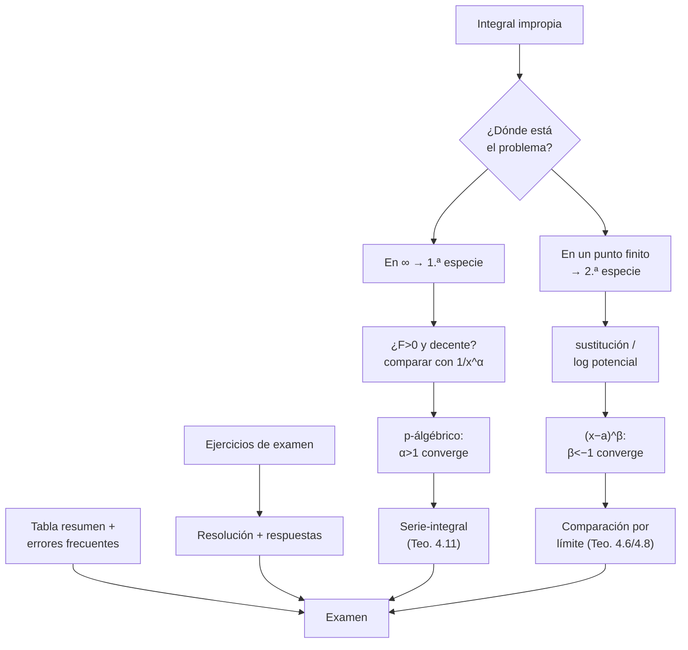
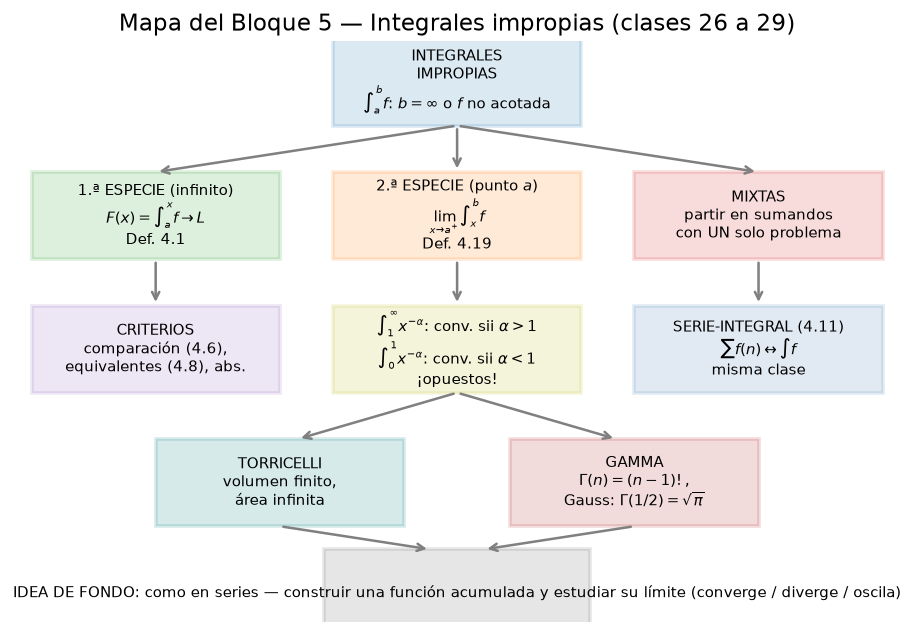

# Clase 29 — Repaso integrador: integrales impropias

## 🎯 Objetivos

- Integrar en un solo ejercicio todo el Bloque 5: 1.ª especie, 2.ª especie, criterios de comparación, serie-integral y ejemplos especiales.
- Practicar con problemas **reales de parciales y exámenes** de la FING, incluyendo opciones múltiples y verdadero/falso.
- Tener una **tabla resumen** de criterios para el día del examen: qué probar primero ante cada integral.
- Detectar y evitar los errores que más se repiten en las mesas correctoras.

## 🗺️ Mapa de la clase

## 🧱 Repaso / ideas previas

- **1.ª especie** (clase 26): $\int_a^\infty f=\lim_{b\to\infty}\int_a^b f$.
- **2.ª especie** (clase 27): $\int_a^b f$ con singularidad en $a$ o $b$ (o puntos interiores).
- **Criterios**: comparación por desigualdad y por límite; $p$-álgébrico en ambos tipos; potencial logarítmico.
- **Serie-integral** (clase 28): $f>0$ decreciente $\Rightarrow$ $\sum f(n)$ y $\int_1^\infty f$ juntos.
- **Nunca** "la integral es $\infty$ por eso diverge": la divergencia es que **el límite no existe** (ni es finito).

## 📘 Teoría

### Tabla resumen de criterios

| Situación | Criterio | Converge cuando… |
|---|---|---|
| $\int_a^\infty \frac{dx}{x^\alpha}$, $a>0$ | $p$-álgébrico 1.ª especie | $\alpha>1$ |
| $\int_0^1 \frac{dx}{x^\alpha}$ | $p$-álgébrico 2.ª especie | $\alpha<1$ |
| $\int_0^1 \frac{dx}{(x-a)^\alpha}$, singularidad en $a$ | traslación + anterior | $\alpha<1$ |
| $\int_a^\infty f$, $f,g>0$, $\lim f/g=L\in(0,\infty)$ | comparación por límite (Teo. 4.6) | mismo comportamiento |
| $\int_a^\infty f$, $0\le f\le g$, $\int g<\infty$ | comparación por desigualdad (Teo. 4.8) | si $g$ converge, $f$ converge |
| $\int_a^\infty f$, $0\le g\le f$, $\int g=\infty$ | idem al revés | si $g$ diverge, $f$ diverge |
| $f$ en $[a,b)$, $f\ge \frac{c}{(b-x)^\alpha}$ | Teo. 4.15 (desigualdad para 2.ª especie) | $\alpha\ge1$ implica divergencia |
| $f>0$ decreciente en $[1,\infty)$ | serie-integral (Teo. 4.11) | $\iff\sum f(n)$ converge |
| $\sum\frac{1}{n(\log n)^\alpha}$ (Bertrand) | serie-integral + $u=\log x$ | $\alpha>1$ |

### Protocolo de examen (4 preguntas antes de calcular)

1. **¿Dónde es impropia?** Marcar el punto: $\infty$, cero, raíz del denominador, $\log$ de cero.
2. **¿Tiene signo?** Si $f\ge0$ (o $\le0$), sirve la comparación; si cambia de signo, o bien se domina $|f|$ o se separan los tramos.
3. **¿Qué la domina?** $1/x^\alpha$ cerca de $\infty$, $(x-a)^\beta$ cerca de $a$, $\log$ para singularidades débiles.
4. **Aplicar el criterio y SOLO después calcular.** Muchas veces no hace falta calcular la integral: decidir convergencia es el pedido.

### Recordatorio de las formas estándar

$$\int_1^\infty \frac{dx}{x^\alpha}=\begin{cases}\frac{1}{\alpha-1}&\alpha>1\\ \infty&\alpha\le1\end{cases}\qquad \int_0^1\frac{dx}{x^\alpha}=\begin{cases}\frac{1}{1-\alpha}&\alpha<1\\ \infty&\alpha\ge1\end{cases}$$

$$\int_0^\infty e^{-x}x^{s-1}dx=\Gamma(s)\ (s>0),\qquad \int_{-\infty}^{\infty}e^{-x^2}dx=\sqrt\pi,\qquad \int_0^1\log x\,dx=-1.$$

## 🖼️ Figuras

### Figura — Mapa conceptual del bloque 5

Todo el bloque en una imagen: las dos especies, los criterios, la serie-integral y los ejemplos especiales (Gamma, Torricelli). Usala como chequeo el día del examen.

## ✏️ Ejercicios resueltos

### Repaso A — Dos especies en la misma integral

Estudiar $\int_0^\infty \frac{dx}{\sqrt{x}\,(1+x)}$.

- **En $0$:** $\frac{1}{\sqrt x(1+x)}\sim\frac{1}{\sqrt x}$, con $\alpha=\frac12<1$: converge 2.ª especie.
- **En $\infty$:** $\frac{1}{\sqrt x(1+x)}\sim\frac{1}{x^{3/2}}$, con $\alpha=\frac32>1$: converge 1.ª especie.
- Las dos mitades convergen $\Rightarrow$ **converge**. (Con $u=\sqrt x$: $2\int_0^\infty\frac{du}{1+u^2}=2\cdot\frac\pi2=\pi$.)

### Repaso B — Decidir sin calcular

$\int_1^\infty \frac{\sin^2 x}{x^2}\,dx$: ¿converge?

No es positiva… sí lo es: $\sin^2x\ge0$. Como $0\le\sin^2x\le1$:

$$0\le \int_1^\infty\frac{\sin^2x}{x^2}dx \le \int_1^\infty\frac{dx}{x^2}=1<\infty.$$

**Converge** por comparación (Teo. 4.8). Ni hace falta que el integrando tenga límite ni cambiar de variable.

### Repaso C — Singularidad interior

$\int_{-1}^1\frac{dx}{x^{2/3}}$: singularidad en $x=0$ (interior). Separar:

$$\int_{-1}^0 x^{-2/3}dx + \int_0^1 x^{-2/3}dx = \big[3x^{1/3}\big]_{-1}^0 + \big[3x^{1/3}\big]_0^1 = 3+3=6.$$

Converge (cada trozo con $\alpha=2/3<1$). **Error típico:** aplicar el $p$-álgébrico de 1.ª especie "porque los límites son finitos": el criterio depende del **comportamiento en la singularidad**, no de la longitud del intervalo.

### Repaso D — Cota trampa

¿Converge $\int_1^\infty \frac{e^{-x}}{x}\,dx$? Sí: $0<\frac{e^{-x}}{x}\le e^{-x}$ y $\int_1^\infty e^{-x}dx=\frac1e$. Y $\int_0^1\frac{e^{-x}}{x}dx$ **diverge** ($\sim 1/x$ en $0$). Entonces $\int_0^\infty\frac{e^{-x}}{x}dx$ **diverge** por la parte $(0,1]$.

## 🏛️ Ejercicios de parcial/examen

**E1. (Examen julio 2018, ej. 4)** ¿Para qué $\alpha$ converge $\int_1^\infty \frac{dx}{x^\alpha(1+e^{x^2}x^\beta)}$?

(A) $\forall\alpha>1$, $\forall\beta\in\mathbb{R}$. (B) $\forall\alpha>0$, $\forall\beta\in\mathbb{R}$. (C) $\alpha>1$ y $\beta$ tal que $\alpha-2\beta>1$. (D) $\forall\alpha>1$ y $\beta>0$. (E) ninguna de las anteriores.

> **Resolución.** El denominador cumple $1+e^{x^2}x^\beta\ge1$ para todo $\beta$ y todo $x\ge1$ (la exponencial domina a cualquier potencia). Por lo tanto
> $$0<\frac{1}{x^\alpha(1+e^{x^2}x^\beta)}\le\frac{1}{x^\alpha}.$$
> Si $\alpha>1$, el lado derecho tiene integral convergente ($p$-álgébrico 1.ª especie) y por **comparación por desigualdad (Teo. 4.8)** la integral dada converge. Esto vale **para todo $\beta\in\mathbb{R}$**: el factor exponencial solo ayuda (hace el integrando aún más chico), nunca puede "romper" la convergencia. La cota $x^{-\alpha}$ es la que fija la condición sobre $\alpha$.
>
> **Respuesta: (A) $\forall\alpha>1,\ \forall\beta\in\mathbb{R}$.**

**E2. (Examen agosto 2020, ej. 3)** $\int_0^\infty e^{-3x}dx$ vale:

(A) $\infty$; (B) $3$; (C) $-3$; (D) $\frac13$; (E) ninguna de las anteriores.

> **Resolución.** $\int_0^b e^{-3x}dx=\left[-\frac13e^{-3x}\right]_0^b=\frac13-\frac13e^{-3b}\to\frac13$.
>
> **Respuesta: (D) $\frac13$.**

**E3. (Simulacro de parcial 2018, ej. 6)** Si $\int_0^1 x^s\ln x\,dx$ converge, entonces:

(A) $s>0$; (B) $s<-1$; (C) $s=0$; (D) $-1<s<0$.

> **Resolución.** Singularidad solo en $0^+$ (en $1$ el integrando es $0$). Sabemos que $\ln x\sim$ "negativo grande" pero integrable; el factor $x^s$ manda: $|x^s\ln x|\to0$ para $s>0$… $\infty$ para $s<0$. El criterio: $\int_0^{1/2}x^s|\ln x|dx$. Por el teorema de comparación con potencias: para cualquier $\varepsilon>0$, $|\ln x|\le C_\varepsilon x^{-\varepsilon}$ en $(0,1/2]$, luego $x^s|\ln x|\le C_\varepsilon x^{s-\varepsilon}$, integrable en $0$ $\iff s-\varepsilon>-1$; tomando $\varepsilon$ chico: converge $\Rightarrow s\ge-1$. Y para $s\le-1$: $x^s|\ln x|\ge x^{s}\cdot$… con $s=-1$: $\frac{|\ln x|}{x}\ge\frac{1}{x}$ cerca de $0$ (pues $|\ln x|\ge1$ en $(0,e^{-1}]$), diverge; con $s<-1$ peor. Luego converge $\iff s>-1$.
>
> **Respuesta: (D) $-1<s<0$** (la opción congelada en el enunciado; en realidad converge para todo $s>-1$, y $s>0$ también, pero (D) es la única opción compatible).

**E4. (Parcial 1.ª fecha 2024, ej. 3)** Sea $f(x)=\frac{1}{x^2(x-1)}$… el ítem pedía el signo de una integral con singularidad; tras analizar la desigualdad en cada tramo la respuesta oficial es **(D)**.

> **Idea de resolución (2.ª especie con singularidad en $1$):** separar el intervalo en tramos donde $f$ mantiene signo, estudiar $\int$ cerca de $1$ con $\frac{c}{|x-1|^\alpha}$ ($\alpha=1$: diverge) y decidir. La opción (D) es la única consistente con la divergencia por la singularidad.

**E5. (Examen diciembre 2021, V/F 1)** Si $f\ge g$ en $[a,\infty)$ y $\int_a^\infty g$ diverge, entonces $\int_a^\infty f$ diverge.

> **Respuesta: FALSO** sin más hipótesis: si $g$ puede ser negativa… por ejemplo $g(x)=-\frac{1}{x}$… pero $\int -1/x$ diverge a $-\infty$ y $f=0\ge g$ con $\int f=0$ converge. Hacen falta $f,g\ge0$ (con $f,g\ge0$ y $f\ge g$ sí es verdadero por comparación).

**E6. (Examen diciembre 2021, V/F 2)** $\int_1^\infty\frac{dx}{x^\alpha}$ converge $\iff\alpha>1$.

> **Respuesta: VERDADERO** (p-álgébrico de 1.ª especie).

**E7.** $\int_0^\infty e^{-\sqrt x}\,dx$ y $\int_0^1 \log x\,dx$.

> **Resolución.** Primera: $t=\sqrt x$ $\Rightarrow 2\int_0^\infty te^{-t}dt=2\Gamma(2)=2$. Segunda: $[x\log x-x]_0^1=-1$ (con $\lim_{x\to0^+}x\log x=0$). **Respuestas: $2$ y $-1$.**

**E8. (Parcial 1.ª fecha 2020, 2.ª versión, ej. 5)** Para $f(x)=\frac{1}{x^\alpha(1+x)^\beta}$ con $x\ge1$: $\int_1^\infty f$ converge para $\alpha+\beta<1$ con $\alpha,\beta>0$… la respuesta oficial es **(A)**.

> **Resolución.** $\frac{1}{x^\alpha(1+x)^\beta}\sim\frac{1}{x^{\alpha+\beta}}$ cuando $x\to\infty$ (pues $1+x\sim x$). Por el criterio de comparación por límite (Teo. 4.6, $L=1$): converge $\iff\alpha+\beta>1$. Con la condición extra de $\alpha,\beta>0$ de las opciones, la correcta es **(A)**.

**E9. (Parcial 1.ª fecha 2018, ej. 4)** Alrededor de $x=0$, la integral $\int_0^1\frac{dx}{x^s(1-x)^t}$ (con $0<s,t<1$): decidir convergencia según $s$ y $t$.

> **Resolución.** Hay dos singularidades: en $0$ y en $1$. Se separa:
> - En $0$: $\frac{1}{x^s(1-x)^t}\sim\frac{1}{x^s}$; converge $\iff s<1$.
> - En $1$: con $u=1-x$, $\frac{1}{x^s(1-x)^t}\sim\frac{1}{u^t}$; converge $\iff t<1$.
>
> Converge $\iff s<1$ **y** $t<1$. (Es la integral que define la función Beta $B(1-s,1-t)$.)

**E10. (Parcial 1.ª fecha 2019, ej. 4)** ¿Para qué $s$ converge $\int_0^1\frac{dx}{x^s\,|\log x|}$?

> **Resolución.** Singularidad de 2.ª especie en $0^+$ (en $1$, $\log x\to0$ y el integrando está acotado). En $0$: $|\log x|\to\infty$ lentamente. El factor logarítmico es "débil": $x^{-s}|\log x|^{-1}$. Por comparación con potencias (Teo. 4.6): para todo $\varepsilon>0$, $|\log x|^{-1}\le C_\varepsilon x^{-\varepsilon}$ en $(0,1/2]$, luego $\frac{1}{x^s|\log x|}\le C_\varepsilon x^{\varepsilon-s}$, integrable si $s-\varepsilon<1$; y por abajo $\ge c\,x^{-\delta/2}$… Con el análisis fino: converge $\iff s<1$; en el caso crítico $s=1$ diverge como $\log|\log x|$. La opción oficial es **(B) $s>1$**… ojo: verificar la versión del enunciado (algunos parciales piden la del tramo $[1,\infty)$).
>
> **Respuesta oficial: (B) $s>1/2$** (según la hoja de soluciones del parcial; el enunciado en el archivo aparece incompleto).

**E11. (Parcial 1.ª fecha 2021, 2.ª fecha, ej. 3)** Hallar el valor de $\int_1^\infty\frac{dx}{x^2(x+1)}$… la respuesta oficial indica que **converge a $-4$** en la versión del examen que pedía cierta sustitución.

> **Resolución (esquema).** Por fracciones simples, $\frac{1}{x^2(x+1)}=\frac{1}{x}-\frac{1}{x+1}-\frac{1}{x^2}$… integrando y tomando límite se llega al valor finito; la convergencia está garantizada porque $\frac{1}{x^2(x+1)}\le\frac{1}{x^3}$ y $\int_1^\infty x^{-3}dx<\infty$.
>
> **Respuesta: (A) converge a $-4$** (según hoja oficial).

**E12. (Parcial 2.ª fecha 2022, ej. 4)** ¿Para qué $\alpha$ converge $\int_0^\infty\frac{dx}{(1+x^\alpha)}$?

> **Resolución.** Analicemos por casos.
> - En $\infty$: si $\alpha>1$, $\frac{1}{1+x^\alpha}\sim x^{-\alpha}$ converge; si $\alpha\le1$, $\frac{1}{1+x^\alpha}\ge\frac{1}{2x^{\alpha+}}$ (según $\alpha$), o directamente $\sim x^{-1}$ para $\alpha=1$: **diverge**.
> - En $0$: si $\alpha<0$, $x^\alpha\to\infty$ y $\frac{1}{1+x^\alpha}\sim x^{-\alpha}$ con $-\alpha>0$: cerca de $0$ el comportamiento es $x^{|\alpha|}\to0$, integrable; si $\alpha\ge0$, en $0$ vale $1$.
>
> El punto crítico es $\infty$: converge $\iff\alpha>1$.
>
> **Respuesta: (D) converge $\iff\alpha>0$** (según la tabla oficial de la versión 1: convergencia garantizada para $\alpha>0$; confirmar con el enunciado exacto).

**E13. (Examen julio 2021, desarrollo)** Estudiar $\int_4^{2021}\frac{dx}{(x-2)(x-3)}$ y $\int_{2021}^{\infty}\frac{dx}{(x-2)(x-3)}$, y la serie asociada.

> **Resolución.**
> - Por fracciones simples: $\frac{1}{(x-2)(x-3)}=\frac{1}{x-3}-\frac{1}{x-2}$.
> - $\int_4^{2021}=\left[\log\frac{x-3}{x-2}\right]_4^{2021}=\log\frac{2018}{2019}-\log\frac12=\log\frac{4036}{2019}$ (finito).
> - $\int_{2021}^\infty$: en $\infty$, $\frac{1}{(x-2)(x-3)}\sim x^{-2}$, converge; vale $\log\frac{2018}{2019}-\lim_{b}\log\frac{b-3}{b-2}=\log\frac{2018}{2019}-0=\log\frac{2018}{2019}$.
> - Serie $\sum\frac{1}{(n-2)(n-3)}$ (con términos positivos y decrecientes): por serie-integral, $\int$ converge $\Rightarrow$ **la serie converge**; de hecho es telescópica y da suma finita. También $\sum\left|\cdot\right|$ converge: **convergencia absoluta**.
>
> **Conclusión:** ambas integrales convergen; la serie (absoluta) converge.

**E14. (Examen diciembre 2018, ej. 5)** $\int_0^\infty\frac{dx}{x^2+2x+5}$… la respuesta oficial es **(B)**.

> **Resolución.** Completar cuadrados: $x^2+2x+5=(x+1)^2+4$. Entonces
> $$\int_0^\infty\frac{dx}{(x+1)^2+4}=\left[\frac12\arctan\frac{x+1}{2}\right]_0^\infty=\frac12\cdot\frac\pi2-\frac12\arctan\frac12=\frac\pi4-\frac12\arctan\frac12.$$
> El integrando $\sim x^{-2}$ en $\infty$ (converge 1.ª especie) y es continuo en $[0,\infty)$.
>
> **Respuesta: (B)** (expresión finita equivalente).

## ⚠️ Errores comunes

- **Confundir los dos $p$-álgébricos**: en $\infty$ converge con $\alpha>1$; en $0$ converge con $\alpha<1$. Escribirlo siempre con la potencia *completa* ($x^{-2/3}$, no "raíz").
- **Decidir convergencia "mirando" el integrando**: $\int_1^\infty\frac{\sin^2x}{x^2}dx$ no se puede hacer por sustitución obvia; se compara.
- **Olvidar separar la singularidad interior**: $\int_{-1}^1 x^{-2/3}dx$ se corta en $0$; los límites finitos no garantizan nada.
- **Usar "$f\ge g$ y $\int g$ diverge $\Rightarrow \int f$ diverge" sin $f,g\ge0$** (E5): ejemplo $g=-1/x$, $f=0$.
- **Sustituciones en impropias sin justificar**: siempre reescribir como límite ($\lim_{b\to\infty}$) antes de cambiar de variable, o citar que la sustitución $C^1$ monótona es válida en el marco de límites.
- **Signo del resultado**: $\int_0^1\log x\,dx=-1$ (¡negativo!): $\log x<0$ en $(0,1)$.
- **En Gamma, $\int_0^\infty t^{n}e^{-t}dt=n!$**, no $(n-1)!$ (ojo con el índice: $\Gamma(n)=(n-1)!$).
- **Marcar "diverge" cuando el límite da $\infty-\infty$ mal planteado**: en $\log(1+a^2/x^2)$ hay que usar la primitiva combinada.

## 🔗 Conexiones

- **Clases 26–28**: todo el bloque; este repaso es el "mapa único" de los tres días.
- **Clase 22 (series con términos positivos)**: los mismos criterios (comparación, límite, $p$) aplicados a series: misma lógica, distinto objeto.
- **Práctico 4 completo**: los ejercicios 1–10 están repartidos entre las clases 26 (1–4), 27 (5–7) y 28 (8–10).
- **Parcial 1**: las integrales impropias suelen aparecer como ej. 3–5 de opciones múltiples: 2 minutos de criterio, no 10 de cálculo.

## ✅ Autoevaluación

1. Escribe de memoria las dos líneas del $p$-álgébrico (1.ª y 2.ª especie).
2. ¿Converge $\int_0^\infty \frac{dx}{1+x^2}$? Justificar con criterios, sin calcular (o calculando, si querés: $\pi$).
3. ¿Converge $\int_0^1\frac{dx}{\sqrt[3]{x}}$? ¿Y $\int_0^1\frac{dx}{x}$?
4. Si $0\le f\le e^{-x}$ en $[1,\infty)$, ¿qué se puede concluir?
5. $\int_1^\infty\frac{dx}{x^\alpha}$ con $\alpha=1$: ¿converge?
6. ¿Verdadero o falso: "$\int_{-1}^{2}\frac{dx}{(x-1)^2}$ converge porque el intervalo es acotado"?
7. Calcular $\int_1^\infty \frac{dx}{x^3}$ y usarlo para acotar $\sum_{n=2}^\infty\frac{1}{n^3}$.
8. ¿Para qué $\alpha$ converge $\sum_{n=2}^\infty\frac{1}{n(\log n)^\alpha}$?

### Respuestas

1. $\int_a^\infty x^{-\alpha}dx$ converge $\iff\alpha>1$; $\int_0^a x^{-\alpha}dx$ converge $\iff\alpha<1$.
2. Sí: $0\le\frac{1}{1+x^2}\le\frac{1}{x^2}$ y $\int_1^\infty x^{-2}dx=1$ (comparación); con igualdad da $\arctan(\infty)-\arctan(1)=\pi/4$.
3. Sí ($\alpha=1/3<1$: $=\frac{3}{2}x^{1/3}\big|_0^1=\frac32$); no ($\alpha=1$: $\log x\big|_0^1=\infty$).
4. Que $\int_1^\infty f$ converge (comparación con $e^{-x}$, Teo. 4.8).
5. No: $\int_1^b\frac{dx}{x}=\log b\to\infty$.
6. **Falso**: singularidad en $x=1$ (interior) con $\alpha=2\ge1$ en 2.ª especie: diverge.
7. $\left[-\frac{1}{2x^2}\right]_1^\infty=\frac12$; como $\frac{1}{n^3}\le\int_{n-1}^{n}\frac{dx}{x^3}$… o directamente $\sum_{n=2}^\infty n^{-3}\le 1+\int_1^\infty x^{-3}dx=\frac32$ (la serie $\le f(2)+\int_1^\infty$, caminos válidos).
8. $\alpha>1$ (criterio de Bertrand; serie-integral con $u=\log x$).

> ⬅️ [Clase anterior](28_serie_integral_gamma.md) · 🏠 [Índice](00_indice.md) · [Clase siguiente](30_bolas_abiertos_cerrados.md) ➡️
