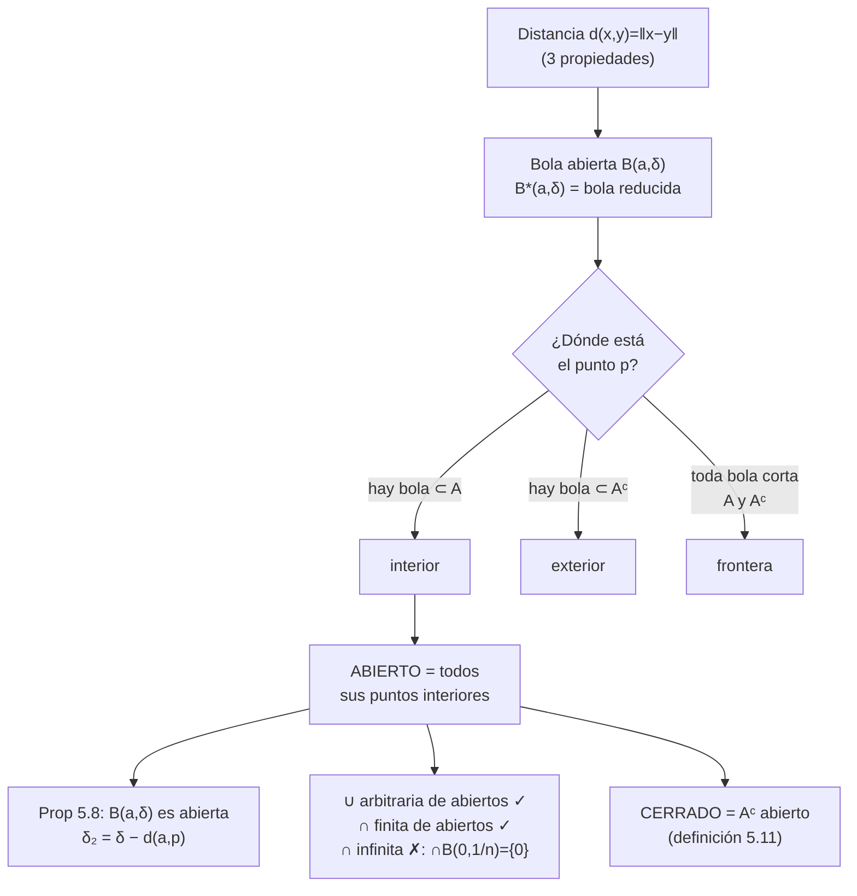
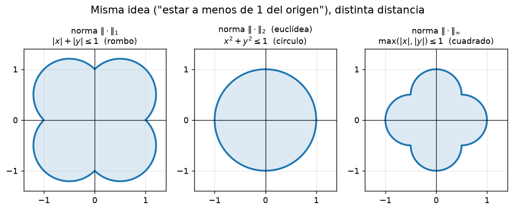
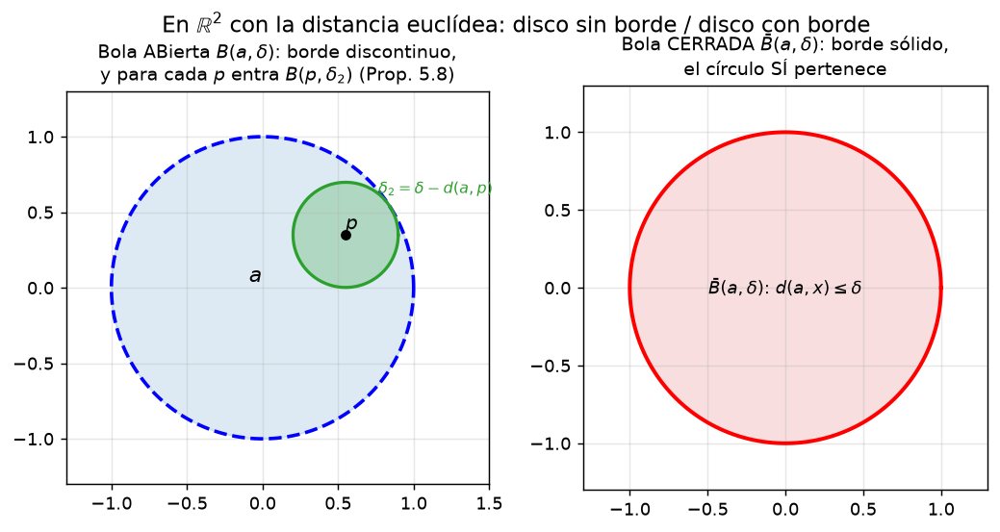
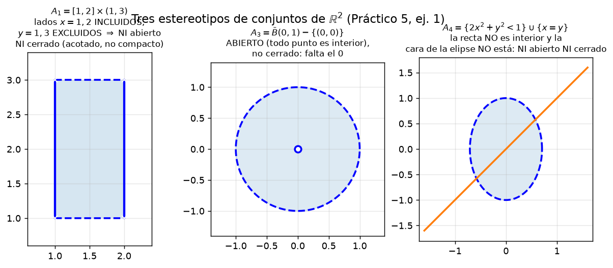

# Clase 30 — Bolas, conjuntos abiertos y cerrados

> **Bloque 6 · Topología en ℝⁿ · Dificultad: inicial · Tiempo estimado: 115 min**

¡Bienvenida/o al Bloque 6! La topología en ℝⁿ es el lenguaje con el que se enuncian
prácticamente todos los teoremas del resto de la asignatura (continuidad, Weierstrass,
Bolzano–Weierstrass, extremos…). La buena noticia: son pocas definiciones, muy visuales,
y en los parciales se resuelven con un bosquejo y un par de bolas.

---

## 🎯 Objetivos

1. **Definir** distancia (Definición 5.2), bola abierta $B(a,\delta)$ y bola reducida $B^*(a,\delta)$ (Definición 5.3).
2. **Clasificar** un punto respecto de un conjunto: interior, exterior o frontera (Definición 5.5).
3. Probar que **toda bola abierta es un conjunto abierto** (Proposición 5.8) y que la bola "le queda grande" a cualquier punto de adentro.
4. Dominar las **operaciones**: unión arbitraria de abiertos e intersección finita de abiertos (Proposiciones 5.9 y 5.10), y la definición de **cerrado** (Definición 5.11).
5. Resolver paso a paso el **Ejercicio 2** y el **Ejercicio 1** (acotación, abierto, cerrado, compacto) del Práctico 5, más problemas de parcial/examen.

---

## 🗺️ Mapa de la clase

---

## 🧱 Repaso / ideas previas

- **Normas y distancias (clase 4 y 19):** la norma euclídea $\|x\|_2=\sqrt{x_1^2+\cdots+x_n^2}$ y la **desigualdad triangular** $\|x+z\|\leq\|x\|+\|z\|$, que es la que mueve todo el bloque.
- **Entornos en ℝ (clases 16 y 19):** en ℝ la "bola" de centro $a$ y radio $\delta$ es el intervalo $(a-\delta,\,a+\delta)$ y la reducida es $(a-\delta,a+\delta)-\{a\}$. En ℝⁿ es la misma idea con distancia.
- **Funciones continuas "de una variable vieja" (clase 1):** $f^{-1}((a,b))$ abierto cuando $f$ es continua; en ℝⁿ aparecerá lo mismo (clase 36).
- **$\mathbb{Q}$ es denso en ℝ:** entre dos reales siempre hay un racional. Este hecho (y su versión $\mathbb{Q}^2$ denso en ℝ²) es la clave de los conjuntos "raros" del Práctico 5.

---

## 📘 Teoría

### 30.1 Distancias

> **Definición 30.1 (notas, Definición 5.2 — distancia).** Una función $d:\mathbb{R}^n\times\mathbb{R}^n\to\mathbb{R}$ es una **distancia** si cumple, para todo $x,y,z$:
> 1. $d(x,y)\geq 0$, y $d(x,y)=0$ **solo si** $x=y$;
> 2. $d(x,y)=d(y,x)$ (simetría);
> 3. $d(x,y)\leq d(x,z)+d(z,y)$ (**desigualdad triangular**).

La distancia que usamos por defecto es la que viene de la norma euclídea:
$$d(x,y)=\|y-x\|_2=\sqrt{\sum_{i=1}^{n}(y_i-x_i)^2}.$$
(Ejercicio 5.4 de las notas: con las normas $\|\cdot\|_1$ y $\|\cdot\|_\infty$ también se obtienen "bolas", con otra forma geométrica — lo vemos en la primera figura.)

### 30.2 Bola abierta, bola reducida

> **Definición 30.2 (notas, Definición 5.3 — bola).** Dado $a\in\mathbb{R}^n$ y $\delta>0$, la **bola abierta** (o entorno) de centro $a$ y radio $\delta$ es
> $$B(a,\delta)=\{x\in\mathbb{R}^n:\ d(x,a)<\delta\}.$$

> **Definición 30.3 (notas, Definición tras 5.4 — bola reducida).** La **bola reducida** es $B^*(a,\delta)=B(a,\delta)-\{a\}$: la bola sin su centro.

Con $\|\cdot\|_2$: en ℝ es un intervalo, en ℝ² el interior de un círculo, en ℝ³ el interior de una esfera. **Ojo:** la bola *depende del espacio ambiente*: $(0,1)$ es abierto en ℝ, pero la copia del segmento $\{(x,0):0<x<1\}$ **no** es abierta en ℝ² (Ejemplos 5.6.2 de las notas): ninguna bola de radio chico cabe dentro de un segmento.

### 30.3 Interior, exterior y frontera

> **Definición 30.4 (notas, Definición 5.5).** Sea $A\subset\mathbb{R}^n$ y $A^{c}$ su complemento. Decimos que un punto $x_0$ es:
> - **interior** a $A$ si existe $B(x_0,\delta)\subset A$ (una bola completa dentro de $A$);
> - **exterior** a $A$ si existe $B(x_0,\delta)\subset A^{c}$;
> - **frontera** de $A$ si $\forall\delta>0$: $A\cap B(x_0,\delta)\neq\emptyset$ **y** $A^{c}\cap B(x_0,\delta)\neq\emptyset$ (toda bola corta a ambos).

Esto es una **tricotomía**: todo punto de ℝⁿ es interior, exterior o frontera (nunca dos a la vez). Notar: los interiores pertenecen a $A$, los exteriores a $A^{c}$, pero **los puntos de frontera pueden pertenecer a cualquiera de los dos**. Ejemplo (Ejemplos 5.6.1): el semiplano $A=\{(x,y):y\geq 0\}$ tiene de frontera al eje $x$: los puntos $(x,0)$ pertenecen a $A$; si en cambio $A=\{y>0\}$, la misma recta es frontera pero ya no pertenece.

### 30.4 Conjuntos abiertos y la Proposición 5.8

> **Definición 30.5 (notas, Definición 5.7 — abierto).** $A$ es **abierto** si **todos** sus puntos son interiores.

> **Proposición 30.6 (notas, Proposición 5.8).** La bola abierta $B(a,\delta)$ es un conjunto abierto.

**Demostración.** Tomamos $p\in B(a,\delta)$ y queremos una bola centrada en $p$ adentro de $B(a,\delta)$. La intuición dice: "usa la distancia al borde". Definimos
$$\delta_2=\delta-d(a,p).$$
Como $p\in B(a,\delta)$ se tiene $d(a,p)<\delta$, así que $\delta_2>0$. Para todo $x\in B(p,\delta_2)$, por la desigualdad triangular,
$$d(a,x)\leq d(a,p)+d(x,p)<d(a,p)+\delta_2=\delta,$$
es decir $x\in B(a,\delta)$. Luego $B(p,\delta_2)\subset B(a,\delta)$ y $p$ es interior. Como $p$ era arbitrario, $B(a,\delta)$ es abierto. $\blacksquare$

> 💡 El $\delta_2$ es **positivo aunque $p$ esté pegado al borde**: por eso "los bordes no están" y la bola es abierta. Es la misma razón por la que $(a,b)$ es abierto en ℝ.

### 30.5 Operaciones con abiertos

> **Proposición 30.7 (notas, Proposición 5.9 — intersección finita).** Si $A_1,\dots,A_k$ son abiertos, entonces $A_1\cap\cdots\cap A_k$ es abierto.

**Demostración (caso $k=2$; el general es análogo).** Sea $p\in A\cap B$. Como $p\in A$ existe $\delta_A>0$ con $B(p,\delta_A)\subset A$; como $p\in B$ existe $\delta_B>0$ con $B(p,\delta_B)\subset B$. Tomamos $\delta=\min\{\delta_A,\delta_B\}>0$: entonces $B(p,\delta)\subset A\cap B$. $\blacksquare$

> **Proposición 30.8 (notas, Proposición 5.10 — unión arbitraria).** Si $(A_\lambda)_{\lambda\in L}$ es **cualquier** familia de conjuntos abiertos, $\bigcup_\lambda A_\lambda$ es abierto.

**Demostración.** Sea $p\in\bigcup_\lambda A_\lambda$: pertenece a alguno, digamos $p\in A_{\lambda_0}$. Como $A_{\lambda_0}$ es abierto, hay $\delta>0$ con $B(p,\delta)\subset A_{\lambda_0}\subset\bigcup_\lambda A_\lambda$. $\blacksquare$

⚠️ **La intersección infinita puede fallar:** $\bigcap_{n\geq1}B(0,\tfrac1n)=\{(0,0)\}$: cada $B(0,1/n)$ es abierto pero su intersección es un punto, que no es abierto en ℝⁿ. (La demo de la Prop 5.9 usa el **mínimo** de los radios: con infinitos radios el mínimo puede no existir.)

### 30.6 Conjuntos cerrados

> **Definición 30.9 (notas, Definición 5.11 — cerrado).** $C$ es **cerrado** si su complemento $C^{c}$ es abierto.

Ejemplos de cerrados (Ejemplos 5.13): un punto $\{p\}$; la **bola cerrada** $\bar B(p,\delta)=\{x:d(p,x)\leq\delta\}$; la esfera $S^{n-1}=\{\|x\|=1\}$; el semiplano $\{y\geq0\}$; los rectángulos $[a,b]\times[c,d]$.

> ⚠️ **"Abierto" y "cerrado" no son complementarios.** $[0,1)$ no es abierto ni cerrado en ℝ. Y en ℝⁿ los **únicos** conjuntos que son abiertos y cerrados a la vez son $\emptyset$ y todo $\mathbb{R}^n$.

---

## 🖼️ Figuras

**Cómo leer la figura:** "estar a menos de 1 del origen" depende de cómo mido. Con la euclídea ($\|\cdot\|_2$) la bola es el disco; con la $\|\cdot\|_1$ es un rombo y con la $\|\cdot\|_\infty$ un cuadrado. Todas son abiertas: lo importante no es la forma, sino que **el borde no está**.

**Cómo leer la figura:** a la izquierda, la bola abierta con su borde discontinuo y, para un punto $p$ adentro, la bola verde $B(p,\delta_2)$ con $\delta_2=\delta-d(a,p)$: **por más pegado al borde que esté $p$, siempre entra una bolita**. A la derecha, la bola cerrada: ahí el círculo sí pertenece.

**Cómo leer la figura:** el rectángulo semiabierto $A_1$ tiene los lados verticales sólidos (pertenecen) y los horizontales discontinuos (no). Aunque lo parezca, **no es cerrado**: los puntos del lado $y=1$ (por ejemplo $(3/2,1)$) no están en $A_1$ pero son de frontera. Y **tampoco es abierto**: los puntos de $x=1$ sí están pero no son interiores. El disco pinchado $A_3$ sí es abierto (alrededor de todo punto $p\neq 0$ cabe una bolita). $A_4$ mezcla una elipse abierta con una recta: los puntos de la recta no son interiores y la cara de la elipse tampoco está → **ni abierto ni cerrado**.

---

## ✏️ Ejercicios resueltos — Práctico 5, Ejercicio 2 y Ejercicio 1 (parte 1)

### Ejercicio 1 (Práctico 5, ej. 2a). Toda bola abierta es un conjunto abierto

Es exactamente la Proposición 30.6 de arriba: dado $p\in B(a,\delta)$, el radio
$$\delta_2=\delta-d(a,p)>0$$
satisface, por la desigualdad triangular, $B(p,\delta_2)\subset B(a,\delta)$. Como $p$ era arbitrario, todos los puntos de $B(a,\delta)$ son interiores: la bola es abierta. $\blacksquare$

> 💡 **Análogo en ℝ:** $(a,b)$ es abierto porque para $p\in(a,b)$ la distancia al borde $\min\{p-a,\,b-p\}>0$ da el entorno. La desigualdad triangular es la "distancia al borde" en ℝⁿ.

### Ejercicio 2 (Práctico 5, ej. 2b). $A$ abierto y $p\in A$ ⇒ $A-p$ es abierto

**Paso 1 — qué hay que probar.** Sea $q\in A-p$ (es decir $q\in A$ y $q\neq p$). Debemos encontrar una bola centrada en $q$ contenida en $A-p$.

**Paso 2 — usar la apertura de $A$.** Como $A$ es abierto y $q\in A$, existe $\delta_q>0$ con $B(q,\delta_q)\subset A$.

**Paso 3 — asegurar que la bola no vuelva a tener a $p$.** Como $q\neq p$, la distancia $d(q,p)>0$. Tomamos
$$\delta=\min\{\delta_q,\ d(q,p)\}>0.$$
Entonces $B(q,\delta)\subset B(q,\delta_q)\subset A$, y además $p\notin B(q,\delta)$ porque $d(q,p)\geq\delta$. Luego $B(q,\delta)\subset A-\{p\}$.

**Conclusión.** Todo $q\in A-p$ es interior: $A-p$ es abierto. $\blacksquare$

> 💡 Quitar **un punto** de un abierto no lo rompe. Pero quitarle **una bola entera** sí lo puede romper (por ejemplo $B(0,1)-B(0,\tfrac12)$ es abierto… pero $B(0,1)-\bar B(0,\tfrac12)$ no: su borde interior quedó expuesto). La clave acá fue que $\{p\}$ es cerrado: la diferencia de un abierto con un cerrado es abierta.

### Ejercicio 3 (Práctico 5, ej. 1 — A₁). $A_1=\{(x,y)\in\mathbb{R}^2: 1\leq x\leq 2,\ 1<y<3\}$

**Representar:** rectángulo con lados $x=1$, $x=2$ **incluidos** y $y=1$, $y=3$ **excluidos** (ver figura de arriba).

**¿Acotado?** Sí: $A_1\subset B((0,0),\sqrt{2^2+3^2})=B(0,\sqrt{13})$ (Definición 5.20: basta una bola que lo contenga).

**¿Abierto?** No: el punto $(1,2)\in A_1$ no es interior. Toda bola $B((1,2),\delta)$ contiene puntos con $x<1$ (por ejemplo $(1-\delta/2,\,2)$), que están en $A_1^{c}$: no hay bola contenida en $A_1$.

**¿Cerrado?** No. Analicemos el complemento:
$$A_1^{c}=\{x<1\}\cup\{x>2\}\cup\{y\leq 1\}\cup\{y\geq 3\}.$$
El punto $q=(3/2,\,1)$ no pertenece a $A_1$, pero **toda** bola $B(q,\delta)$ contiene puntos tipo $(3/2,\,1+\delta/2)\in A_1$. Es decir: $q$ no es interior a $A_1^{c}$ (en realidad es punto de frontera de $A_1$). Como $A_1^{c}$ tiene un punto no interior, $A_1^{c}$ no es abierto:
$$A_1\ \textbf{no es cerrado}.$$
(Equivalente con la Proposición 5.18 de las notas — $C$ cerrado sii contiene a todos sus puntos de acumulación: los puntos $(x,1)$, $1\leq x\leq 2$, son de acumulación de $A_1$ y no pertenecen a $A_1$.)

**¿Compacto?** No: compacto = cerrado **y** acotado (Definición 5.21); $A_1$ no es cerrado. ❌

> ⚠️ Este ejercicio es una trampa clásica: el $1\leq x\leq 2$ "cerrado" en $x$ engaña. Los lados verticales incluidos no salvan al conjunto: los lados horizontales excluidos son de frontera y eso lo delata.

### Ejercicio 4 (Práctico 5, ej. 1 — A₂). $A_2=\{(x,y): y=x^2\}$ (la parábola)

- **Acotado?** No: $(t,t^2)\in A_2$ con $\| (t,t^2)\|\to\infty$.
- **¿Interior?** No hay interiores: es una curva; toda bola alrededor de un punto de la parábola contiene puntos por encima y por debajo de ella (en $A_2^{c}$).
- **¿Abierto?** No (sus puntos no son interiores).
- **¿Cerrado?** Sí: sea $q\notin A_2$, o sea $q_2\neq q_1^{2}$. Entonces $|q_2-q_1^{2}|>0$ y, tomando $\delta$ chico (donde $(x,y)\mapsto x^2-y$ es continua: $|y-x^{2}|\geq |q_2-q_1^{2}|-|x-q_1|-|y-q_2|$…), toda bola de radio $\delta$ alrededor de $q$ queda fuera de la parábola: $q$ es exterior. Como todo punto no perteneciente es exterior, $A_2^{c}$ es abierto → $A_2$ es **cerrado**. (Equivalente: $A_2=f^{-1}(\{0\})$ con $f(x,y)=y-x^2$ continua, y el preimagen de un cerrado bajo continua es cerrado — lo veremos en la clase 36.)
- **¿Compacto?** No: falta acotación. ❌

### Ejercicio 5 (Práctico 5, ej. 1 — A₄). $A_4=\{2x^2+y^2<1\}\cup\{x=y\}$

$A_4$ une la **elipse abierta** con la **recta diagonal** (ver figura).

- **Acotado?** No: la recta $x=y$ se va al infinito.
- **¿Abierto?** No: el punto $(2,2)\in A_4$ (está en la recta) no es interior. Cualquier bola $B((2,2),\delta)$ con $\delta$ chico contiene puntos que no están en la recta $x=y$ (por ejemplo $(2+\delta/2,\,2)$) y que tampoco están en la elipse $\{2x^2+y^2<1\}$ (que está toda cerca del origen): esos puntos son de $A_4^{c}$. Luego $(2,2)$ no es interior. ❌
- **¿Cerrado?** Tampoco: los puntos de la cara de la elipse (donde $2x^2+y^2=1$) **no** están en $A_4$ pero son de frontera: toda bola alrededor de $(\tfrac{1}{\sqrt2},0)$ contiene puntos con $2x^2+y^2<1$ (de la elipse, en $A_4$). No cerrado. ❌
- **¿Compacto?** No (ni cerrado ni acotado). ❌

### Ejercicio 6 (Práctico 5, ej. 1 — A₆). $A_6=\{(x,y,z)\in\mathbb{R}^3: x+y+z<1,\ x>0,\ y>0,\ z>0\}$

$A_6$ es la intersección de **cuatro semiplanos abiertos**: $\{x+y+z<1\}$, $\{x>0\}$, $\{y>0\}$, $\{z>0\}$. Cada uno tiene la forma $\{f>c\}$ con $f$ lineal (por ejemplo $f(x,y,z)=x+y+z$, $c=1$). Un semiplano así es abierto: si $f(p)>c$, tomando como $\delta$ la **distancia de $p$ al plano** $f=c$ (que es $\frac{f(p)-c}{\|\nabla f\|}>0$), la bola $B(p,\delta)$ no cruza el plano y queda del lado correcto. Por la Proposición 30.7 (**intersección finita** de abiertos):
$$A_6\ \textbf{es abierto}.$$
- **¿Cerrado?** No: el punto $(\tfrac12,0,0)$ no pertenece a $A_6$ (porque $y=0$ no cumple $y>0$), pero toda bola $B((\tfrac12,0,0),\delta)$ con $\delta<\tfrac14$ contiene puntos $(\tfrac12,\varepsilon,\varepsilon)\in A_6$ para $\varepsilon$ chico. Es decir: es un punto de frontera que no está en $A_6$ → no cerrado. ❌
- **Acotado?** No: $(t,0^{+},0^{+})$ con $t\to+\infty$… concretamente $(t,\tfrac1t,\tfrac1t)\in A_6$ para $t$ grande y su norma crece. ❌
- **¿Compacto?** No. ❌

### Ejercicio 7 (Práctico 5, ej. 1 — A₇). $A_7=\{(x,y,z)\in\mathbb{R}^3: x^2+y^2+1\leq z\}$

Es el **epigráfico** de la paraboloide $z=x^2+y^2+1$ (todo lo que está "arriba", incluyendo la cara).

- **¿Cerrado?** Sí: $A_7=f^{-1}((-\infty,0])$ con $f(x,y,z)=x^2+y^2+1-z$ **continua**; el preimagen de un cerrado bajo una continua es cerrado (equivale a: si $f(p)<0$ hay bola donde $f<0$, por la desigualdad triangular aplicada a $|f(x)-f(p)|\leq \|\nabla f\|\cdot\|x-p\|$-ish; formalmente se prueba como en el Ej. 4). También se puede hacer "à la letra": si $q\notin A_7$ entonces $q_3<q_1^2+q_2^2+1$ y una bola de radio $\delta$ chico mantiene la desigualdad estricta.
- **¿Abierto?** No: los puntos de la cara $z=x^2+y^2+1$ pertenecen pero no son interiores (cualquier bola baja un pelín y sale del conjunto).
- **Acotado?** No: sube sin límite en $z$ (con $x=y=0$: $(0,0,t)\in A_7$ para $t\geq1$).
- **¿Compacto?** No. ❌

> 📌 **Resumen de los siete (parte "fácil"):** **acotados:** $A_1, A_2, A_3, A_5, B, C$ (sí) y $A_4, A_6, A_7$ (no). **Abiertos:** solo $A_3$ y $A_6$. **Cerrados:** solo $A_2$ y $A_7$ (y $A_1$ quedó descartado). **Compactos:** hasta ahora ninguno; en la clase 31 vemos que $A_3$ y $A_5$ tampoco (falta cerrar $A_5$, $B$ y $C$ con sus puntos de acumulación).

---

## 🏛️ Ejercicios de parcial/examen

### Ejercicio 8 (Examen diciembre 2021, ej. 3). $A=\{(x,y)\in\mathbb{R}^2: x^2-y^2\leq 1\ \text{y}\ x\neq 0\}$

- **¿Cerrado?** $\{x^2-y^2\leq1\}$ es cerrado (preimagen de cerrado bajo $f(x,y)=x^2-y^2$ continua), pero **le quitamos el eje $y$** ($x=0$): el punto $(0,0)\notin A$ y sin embargo $(0,0)$ es de frontera de $A$ (toda bola contiene $(\pm\varepsilon,0)\in A$, ya que $0\leq1$). **No cerrado.**
- **Acotado?** No: $(t,t)\in A$ para todo $t\neq0$ (porque $t^2-t^2=0\leq1$), y $\|(t,t)\|\to\infty$.
- **¿Abierto?** No: los puntos de la hipérbola $x^2-y^2=1$ con $x\neq0$ están en $A$ pero no son interiores.
- **¿Compacto?** No.

**Respuesta: (D) $A$ no es ni cerrado ni acotado.** ✔

### Ejercicio 9 (Primer parcial 2025-1S, ej. 1). Columna de puntos y disco pinchado

Sean en ℝ²:
$$A=\{(x,y):x=0,\ y=\tfrac{1}{2n},\ n\in\mathbb{N}\},\qquad B=\{(x,y):x^2+y^2<1,\ (x,y)\neq(0,0)\}.$$

**Análisis de $A$:** es un conjunto de puntos sobre el eje $y$, acumulándose en el origen. $A^{\circ}=\emptyset$ (una bola de radio $\delta>0$ es un disco: no cabe en un conjunto de puntos colineales), luego $A^{\circ}\neq A$ y **$A$ no es abierto**. Su frontera: $\partial A=A\cup\{(0,0)\}\not\subseteq A$.

**Análisis de $B$:** es el disco abierto menos el centro. Como vimos en el Ejercicio de la figura (y confirmamos en la clase 31), **todo punto de $B$ es interior**: para $p\in B$ con $p\neq 0$, $\delta=\min\{1-d(0,p),\ d(0,p)\}>0$ y $B(p,\delta)\subset B$. Es decir
$$B^{\circ}=B.$$

**Respuesta: (D) $A$ no es abierto y $B^{\circ}=B$.** ✔ *(en particular $B\cap\partial B=\emptyset$, descartando (A); y $\partial A\not\subseteq A$, descartando (C))*

### Ejercicio 10 (Examen julio 2022, V/F 1). "Si $A$ es abierto y $B$ es cerrado, entonces $A\cap B$ es cerrado"

**FALSO.** Contraejemplo: $A=(0,2)$ abierto, $B=[1,3]$ cerrado (en ℝ):
$$A\cap B=[1,2),$$
que no es cerrado (el $2$ es punto de acumulación y no está). En ℝⁿ vale el mismo contraejemplo (usar $A=(0,2)\times(0,1)$, $B=[1,3]\times[0,1]$).

> 💡 Lo que **sí** vale: intersección **finita** de cerrados = cerrado, y unión **arbitraria** de cerrados = cerrado (los duales de las Proposiciones 5.9 y 5.10). ¡Esa es la trampa del V/F!

**Respuesta: FALSO.** ✔ *(respuesta oficial: F)*

---

## ⚠️ Errores comunes

| Error | Corrección |
|---|---|
| "Cerrado = lo contrario de abierto" | Un conjunto puede ser **ni abierto ni cerrado** ($[0,1)$, $A_1$, $A_4$); en ℝⁿ los únicos "abiertos y cerrados" son $\emptyset$ y $\mathbb{R}^n$ |
| Creer que $[1,2]\times(1,3)$ es cerrado porque "el $x$ está cerrado" | Se decide en ℝⁿ: los puntos $(x,1)$, $(x,3)$ son de frontera y **no** están en el conjunto |
| Pensar que una bola de radio chico cabe "casi" dentro de otra | Hay que **calcular** $\delta_2=\delta-d(a,p)$: es positiva, pero tiene que estar bien elegida |
| Usar la intersección infinita de abiertos como si fuera abierta | $\bigcap_n B(0,1/n)=\{0\}$ no es abierto: el mínimo de infinitos radios puede no existir |
| Decir "$A$ cerrado ⇒ $A+B$ cerrado" (aparición frecuente) | Falso en general (ver Ejercicio 4 de la clase 31); la **unión** de abiertos sí salva siempre |
| Olvidar que la bola depende del **espacio ambiente** | $(0,1)$ es abierto en ℝ; su copia en el eje de ℝ² **no** lo es |
| "Compacto = acotado" | En ℝⁿ compacto = **cerrado y acotado** (Definición 5.21); falta la mitad |

---

## 🔗 Conexiones

- **Clase 31:** aparecen $\mathring{A}$, $\partial A$, $A'$ y $\bar A$: la frontera y el interior acá definidos "punto a punto" se convierten en **conjuntos** y en identidades ($A$ abierto sii $A\cap\partial A=\emptyset$).
- **Clase 32:** cerrado + acotado = **compacto**, y eso es lo que garantiza subsucesiones convergentes (Bolzano–Weierstrass).
- **Clase 34–36 (funciones y continuidad):** $f$ continua sii el preimagen de un abierto es abierto; los teoremas de Weierstrass y Bolzano piden dominios cerrados y acotados.
- **Examen:** casi todo ejercicio de topología del primer parcial arranca con "¿es abierto? ¿es cerrado? ¿acotado?" — se resuelve con una bola a mano.

---

## ✅ Autoevaluación

1. Definir: distancia, bola abierta, bola reducida.
2. ¿Por qué $\bar B(0,1)$ (la bola **cerrada**) no es un abierto? Y ¿por qué $B(0,1)$ no es cerrado?
3. Demostrar que $A=\{(x,y)\in\mathbb{R}^2: y>x\}$ es abierto.
4. ¿Es abierto $\bigcup_{n\geq1}B(e_n,1/n)$ (uniones de bolas centradas en los vectores canónicos)? ¿Y $\bigcap_{n\geq1}B(e_1,\,1+\tfrac1n)$?
5. Clasificar: $S^1=\{(x,y):x^2+y^2=1\}$ (abierto/cerrado/acotado/compacto).
6. Clasificar: $\mathbb{Q}^2$ en ℝ².
7. (V/F) Si $A$ es abierto, entonces $A-\{p\}$ es abierto para todo $p$.

Respuestas

1. §30.1 y §30.2 (Definiciones 30.1–30.3).
2. La cerrada contiene puntos de frontera (el círculo), que no tienen bola adentro; $B(0,1)$ no es cerrado porque su complemento contiene puntos de frontera ($\|x\|=1$) que no tienen bola dentro del complemento.
3. Para $p$ con $p_2>p_1$: $\delta=\frac{p_2-p_1}{\sqrt2}$ (distancia de $p$ a la recta $y=x$); $B(p,\delta)\subset A$.
4. Unión arbitraria de abiertos: **sí** es abierta (Prop 5.10). La intersección $\bigcap_n B(e_1,1+\tfrac1n)=\bar B(e_1,1)$ **no** es abierta (el borde quedó).
5. $S^1$ **no es abierto** (ningún punto tiene bola adentro), **sí es cerrado** (complemento abierto: la distancia a $S^1$ da la bola), **acotado** (dentro de $B(0,2)$), **compacto** ✓.
6. $\mathbb{Q}^2$: **no abierto, no cerrado** (toda bola contiene irracionales y racionales), **acotado no**… $\mathbb{Q}^2$ es acotado solo si acotamos: $\mathbb{Q}^2$ completo **no** es acotado; pero $\mathbb{Q}^2\cap B(0,1)$ sí sería acotado y ni abierto ni cerrado. **Compacto?** No.
7. **VERDADERO** (Ejercicio 2b: quitar un punto de un abierto deja un abierto).

---

**⬅️ Anterior:** [Clase 29 — Repaso de impropias y pruebas](29_impropias_repaso.md) · **➡️ Siguiente:** [Clase 31 — Interior, frontera, clausura y puntos de acumulación](31_interior_frontera_clausura.md)
