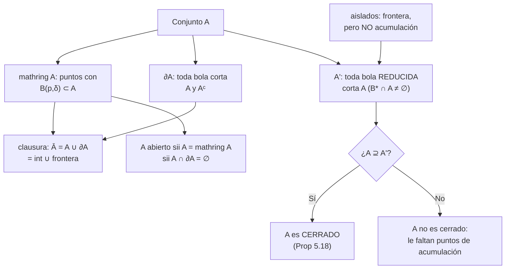
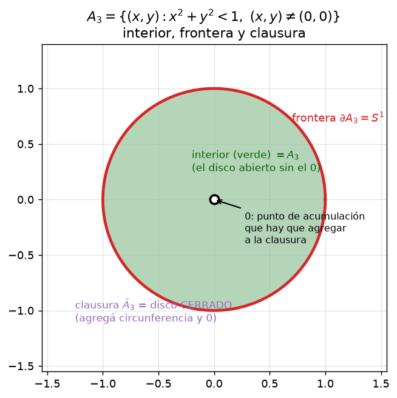
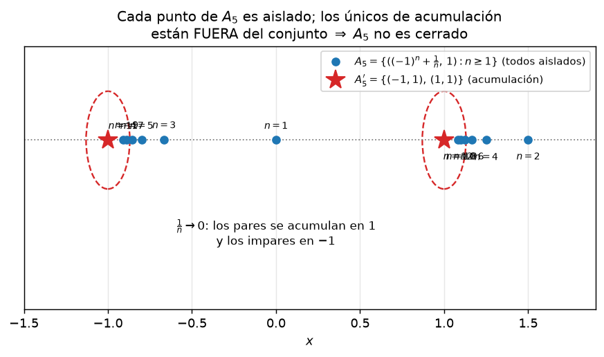

# Clase 31 — Interior, frontera, clausura y puntos de acumulación

> **Bloque 6 · Topología en ℝⁿ · Dificultad: media · Tiempo estimado: 130 min**

Los conjuntos "raros" (densos, con puntos aislados, pegados a su borde) son los que se
llevan el tiempo del práctico y los que más aparecen en el parcial. Esta clase les pone
**nombre** (interior, frontera, acumulación, clausura) y fórmulas para calcularlos.

---

## 🎯 Objetivos

1. Definir **punto de acumulación** ($A'$) y **punto aislado**, y distinguirlos de los de frontera.
2. Manejar la notación $\mathring{A}$ (interior), $\partial A$ (frontera), $A'$ (acumulación) y la **clausura** $\bar A=A\cup\partial A$.
3. Enunciar y demostrar la caracterización: $C$ es cerrado **sii** $C$ contiene a todos sus puntos de acumulación (Proposición 5.18).
4. Resolver el Práctico 5, **Ejercicio 1** (interior, frontera, clausura y acumulación de $A_1,\dots,A_7$, $B$ y $C$) y los **Ejercicios 3 a 6** (densidad, conjunto suma, caracterizaciones, unión/∩ de abiertos).
5. Resolver problemas reales de parcial/examen sobre acumulación y frontera.

---

## 🗺️ Mapa de la clase

---

## 🧱 Repaso / ideas previas

- **Clase 30:** interior, exterior y frontera (Definición 5.5); abierto (todos interiores); cerrado (complemento abierto); uniones e intersecciones de abiertos.
- **Bolsa reducida:** $B^*(p,\varepsilon)=B(p,\varepsilon)-\{p\}$; es la diferencia fina entre frontera y acumulación: la frontera mira **toda** bola, la acumulación solo la **reducida** (para no "auto-tocarse" con el propio punto).
- **Densidad de $\mathbb{Q}$ en ℝ:** entre dos reales siempre hay un racional y un irracional; en ℝ² vale lo mismo para $\mathbb{Q}^2$ (racionales simultáneos) y para $(A\cap\mathbb{Q}^2)$ dentro de cualquier abierto $A$.
- **Clase 19 (sucesiones):** un límite de puntos del conjunto es exactamente un punto de acumulación cuando los puntos son distintos de él.

---

## 📘 Teoría

### 31.1 Puntos de acumulación

> **Definición 31.1 (notas, Definición 5.15 — punto de acumulación).** Dado $A\subset\mathbb{R}^n$, decimos que $p\in\mathbb{R}^n$ es **punto de acumulación** de $A$ si **toda bola reducida corta** a $A$:
> $$\forall\varepsilon>0:\quad B^*(p,\varepsilon)\cap A\neq\emptyset.$$

Comparación con lo ya visto:

| Punto | Condición | ¿Pertenece a $A$? |
|---|---|---|
| interior | $\exists\delta: B(p,\delta)\subset A$ | sí, siempre |
| exterior | $\exists\delta: B(p,\delta)\subset A^{c}$ | no, nunca |
| frontera | $\forall\delta:\ B(p,\delta)$ corta a $A$ **y** a $A^{c}$ | puede o no |
| **acumulación** | $\forall\varepsilon:\ B^*(p,\varepsilon)$ corta a $A$ | puede o no |

Todo **punto interior es de acumulación** (si hay una bola entera adentro, al quitarle el centro siguen quedando infinitos puntos de $A$). Y **todo punto de acumulación es de frontera o interior**. La diferencia entre "frontera" y "acumulación" es el **punto aislado**:

> **Definición 31.2 (notas, Ejemplo 5.17).** $p\in A$ es **aislado** si existe $B(p,\delta)$ tal que $A\cap B(p,\delta)=\{p\}$. Los aislados son de frontera, **pero no** de acumulación.

**Ejemplo (notas, 5.19):** $A_4=\{(1/n,0):n\in\mathbb{N}\}$ en ℝ². Cada $1/n$ es aislado; el único punto de acumulación es $(0,0)$, que **no** está en $A_4$. Por eso $A_4$ no es cerrado, pero $A_4\cup\{(0,0)\}$ sí lo es.

### 31.2 Interior, frontera y clausura como conjuntos

> **Notación (notas, tras la Proposición 5.18).** Para $A\subset\mathbb{R}^n$:
> - $\mathring{A}$ = conjunto de puntos interiores (**interior** de $A$);
> - $\partial A$ = conjunto de puntos frontera (**frontera** de $A$);
> - $A'$ = conjunto de puntos de acumulación;
> - $\bar A=A\cup\partial A$ = **clausura** de $A$.

Con esto, las definiciones se reescriben elegantemente:
$$A\ \text{abierto}\iff A=\mathring{A},\qquad C\ \text{cerrado}\iff C=\bar C.$$
Y siempre: $\mathring{A}\subset A\subset\bar A$, y $A'\subset\bar A$.

### 31.3 La Proposición 5.18: cerrado = contiene sus acumulaciones

> **Proposición 31.3 (notas, Proposición 5.18).** Un conjunto $C\subset\mathbb{R}^n$ es cerrado **si y solo si** $C$ contiene a **todos** sus puntos de acumulación ($A'\subset C$).

**Demostración.**
$(\Rightarrow)$ Sea $p$ punto de acumulación de $C$ y supongamos, para llegar a un absurdo, que $p\notin C$. Como $C$ es cerrado, $C^{c}$ es abierto y entonces existe $\delta>0$ con $B(p,\delta)\subset C^{c}$. En particular $B^*(p,\delta)\subset C^{c}$, o sea $B^*(p,\delta)\cap C=\emptyset$: contradice que $p$ era de acumulación. El absurdo vino de suponer $p\notin C$; luego $p\in C$. $\checkmark$

$(\Leftarrow)$ Supongamos que $C$ contiene a todos sus puntos de acumulación y probemos que $C^{c}$ es abierto. Sea $p\in C^{c}$; entonces $p$ **no** es de acumulación de $C$, o sea existe $\delta>0$ con $B^*(p,\delta)\cap C=\emptyset$. Como además $p\notin C$, resulta $B(p,\delta)\cap C=\emptyset$, es decir $B(p,\delta)\subset C^{c}$: $p$ es interior a $C^{c}$. Entonces $C^{c}$ es abierto y $C$ es cerrado. $\blacksquare$

> 💡 En la práctica: para ver si un conjunto es cerrado, buscá **un solo** punto de acumulación que le falte; para ver si es abierto, buscá **un solo** punto suyo que no sea interior. ¡Un contraejemplo alcanza!

### 31.4 Identidades útiles (Práctico, Ejercicio 5)

Todas se prueban "con la definición y buenas palabras". Las dejamos listas para usar:

| Identidad | Lectura |
|---|---|
| $A$ abierto $\iff A\cap\partial A=\emptyset$ | un abierto no toca su frontera |
| $A$ cerrado $\iff \partial A\subset A$ | un cerrado contiene su frontera |
| $A$ cerrado $\iff A'\subset A$ | Prop 31.3 |
| $\bar A=A\cup\partial A$ es **cerrado** | es el **menor** cerrado que contiene a $A$ |
| $\mathring{A}=\bar A-\partial A$ es **abierto** | es el **mayor** abierto contenido en $A$ |
| $\partial A=\partial(A^{c})$ | un conjunto y su complemento comparten la frontera |
| $A'$ es **cerrado** | los puntos de acumulación de un conjunto forman un cerrado |

**Demostración corta de "$A$ abierto sii $A\cap\partial A=\emptyset$".** Si $A$ es abierto, todo $p\in A$ tiene bola $B(p,\delta)\subset A$, y esa bola **no** corta $A^{c}$; luego $p\notin\partial A$ y $A\cap\partial A=\emptyset$. Recíprocamente, si $A\cap\partial A=\emptyset$, tomemos $p\in A$: como $p$ no es de frontera y sí pertenece a $A$, tiene que ser **interior** (la frontera es lo que queda cuando no es ni interior ni exterior). Así, todo punto de $A$ es interior: $A$ es abierto. $\blacksquare$

---

## 🖼️ Figuras

**Cómo leer la figura:** para $A_3=\{(x,y):x^2+y^2<1,\ (x,y)\neq(0,0)\}$, el **interior** (verde) es $A_3$ entero; la **frontera** (rojo) es la circunferencia **más el origen** (¡fijate que el $0$ no está en $A_3$ pero toda bola lo "rodea"!); y la **clausura** (violeta) es el disco cerrado completo. Interior + frontera = clausura.

**Cómo leer la figura:** los puntos de $A_5$ sobre la recta $y=1$ son todos **aislados** (cada uno tiene una bolita donde está solo). Los pares se apiñan hacia $(1,1)$ y los impares hacia $(-1,1)$: esos dos son los únicos puntos de acumulación, y **están afuera** del conjunto. Por la Prop 31.3, $A_5$ no es cerrado.

---

## ✏️ Ejercicios resueltos — Práctico 5, Ejercicio 1 (parte 2: interior, frontera, clausura, acumulación)

> **Recordatorio del enunciado (Práctico 5, ej. 1).** Hallar el interior, la frontera y la clausura de cada conjunto; y el conjunto de sus puntos de acumulación.

### Ejercicio 1. $A_1=\{(x,y):1\leq x\leq 2,\ 1<y<3\}$

- **Interior.** Todo punto con $1<x<2$ y $1<y<3$ tiene una bolita adentro (radio = distancia al borde); los puntos con $x=1$ o $x=2$ **no** (cualquier bola cruza hacia $x<1$ o $x>2$). Entonces
$$\mathring{A_1}=(1,2)\times(1,3).$$
- **Frontera.** El borde del rectángulo cerrado $[1,2]\times[1,3]$ completo: la frontera son los cuatro lados, **aunque los lados $y=1$ e $y=3$ no pertenezcan** a $A_1$ (toda bola corta a $A_1$ por un lado y a $A_1^{c}$ por el otro):
$$\partial A_1=\{1,2\}\times[1,3]\ \cup\ [1,2]\times\{1,3\}.$$
- **Clausura.** $\bar A_1=A_1\cup\partial A_1=[1,2]\times[1,3]$ (el rectángulo cerrado).
- **Puntos de acumulación.** Todos los de la clausura (ningún punto es aislado): $A_1'=[1,2]\times[1,3]$.
- **Chequeo:** $A_1$ no es cerrado porque $\partial A_1\not\subset A_1$ (los lados $y=1,3$ no están) ✔; es acotado ✔; no compacto ✔.

### Ejercicio 2. $A_2=\{(x,y):y=x^2\}$ (la parábola)

- **Interior.** $\mathring{A_2}=\emptyset$: no hay ninguna bola contenida en una curva (toda bola tiene puntos "arriba" y "abajo" de la parábola).
- **Frontera.** Todo punto de la parábola es de frontera (toda bola corta la parábola y su complemento), y ningún punto de afuera lo es (los de afuera son **exteriores**, pues $A_2$ es cerrado). Luego
$$\partial A_2=A_2.$$
- **Clausura.** $\bar A_2=A_2\cup\partial A_2=A_2$ (coherente con que $A_2$ es cerrado).
- **Puntos de acumulación.** $A_2'=A_2$: cada punto de la parábola se acumula con otros puntos de la propia parábola (acercándose por la curva).
- **Resumen:** $\mathring{A_2}=\emptyset$, cerrado, no abierto, no acotado, no compacto.

### Ejercicio 3. $A_3=\{(x,y):x^2+y^2<1,\ (x,y)\neq(0,0)\}$ (disco pinchado)

- **Interior.** Es **abierto**: en la clase 30 vimos que a todo punto $p\in A_3$ (con $p\neq 0$), el radio $\delta=\min\{1-d(0,p),\,d(0,p)\}>0$ le da $B(p,\delta)\subset A_3$. Entonces
$$\mathring{A_3}=A_3.$$
- **Frontera.** Por un lado, la **circunferencia** $S^1=\{\|x\|=1\}$: para $p$ con $\|p\|=1$, toda bola tiene puntos con $\|x\|<1$ (de $A_3$) y con $\|x\|>1$ (de $A_3^{c}$). Por otro lado, el **origen**: toda bola $B(0,\varepsilon)$ contiene puntos de $A_3$ (por ejemplo $(\varepsilon/2,0)$) y puntos de $A_3^{c}$ (el propio $0$). Entonces
$$\partial A_3=S^1\cup\{(0,0)\}.$$
- **Clausura.** $\bar A_3=A_3\cup\partial A_3=\{(x,y):x^2+y^2\leq 1\}=\bar B(0,1)$ (el disco cerrado).
- **Puntos de acumulación.** $A_3'=\bar B(0,1)$: los del interior (interiores), los de la circunferencia (se aproximan desde adentro) y el **origen** (los puntos del disco pinchado se le acercan).
- **Chequeo:** abierto ✔; no cerrado (le falta el $0$, que es de acumulación) ✔; acotado ✔; **no compacto** (no es cerrado).

### Ejercicio 4. $A_4=\{2x^2+y^2<1\}\cup\{x=y\}$ (elipse abierta ∪ diagonal)

- **Interior.** Solo los puntos de la **elipse abierta** tienen bolita adentro: $\mathring{A_4}=\{2x^2+y^2<1\}$. (Los puntos de la recta que caen dentro de la elipse también son interiores, y ya están contados ahí.)
- **Frontera.** $\partial A_4=\{2x^2+y^2=1\}\ \cup\ \{x=y,\ 2x^2+y^2\geq 1\}$: el borde de la elipse, más los tramos de la diagonal **que quedan afuera** de la elipse.
- **Clausura.** $\bar A_4=\{2x^2+y^2\leq 1\}\cup\{x=y\}$.
- **Puntos de acumulación.** $A_4'=\bar A_4$ (ningún aislado).
- **Resumen:** ni abierto (los tramos de recta de afuera no son interiores) ni cerrado (el borde de la elipse falta); no acotado (por la recta); no compacto.

### Ejercicio 5. $A_5=\{((-1)^n+\tfrac1n,\,1):n\geq 1\}$

Escribamos los primeros puntos:
$$n=1:\ (0,1),\quad n=2:\ (\tfrac32,1),\quad n=3:\ (-\tfrac23,1),\quad n=4:\ (\tfrac54,1),\quad n=5:\ (-\tfrac45,1),\dots$$
Los **pares** dan $1+\tfrac1n\to 1^{+}$ y los **impares** dan $-1+\tfrac1n\to -1^{+}$.

- **Interior.** $\mathring{A_5}=\emptyset$: no hay ninguna bola contenida en un conjunto de puntos colineales (y separados).
- **Puntos de acumulación.** Los dos puntos límite de la recta $y=1$, y **ninguno más** (los puntos de $A_5$ están separados: entre uno y otro hay distancia positiva):
$$A_5'=\{(1,1),\,(-1,1)\}.$$
- **Frontera.** Cada punto de $A_5$ es **aislado** → de frontera. Y los dos puntos de acumulación (que no están en $A_5$) también son de frontera:
$$\partial A_5=A_5\cup\{(1,1),\,(-1,1)\}.$$
- **Clausura.** $\bar A_5=A_5\cup\partial A_5=A_5\cup\{(1,1),(-1,1)\}$.
- **Resumen:** acotado sí ($x\in[-1,\tfrac32]$, $y=1$); no abierto; **no cerrado** (le faltan los dos puntos de acumulación); no compacto.

### Ejercicio 6. $B=A_1\cap\mathbb{Q}^2$ y $C=A_3\cap\mathbb{Q}^2$ (densidad)

**$B=A_1\cap\mathbb{Q}^2$, con $A_1=[1,2]\times(1,3)$.**

- **Interior.** $\mathring B=\emptyset$: ninguna bola (que es un disco de infinitos puntos) puede estar contenida en un conjunto de puntos racionales; toda bola contiene puntos irracionales, que no están en $B$.
- **Clausura.** Como $\mathbb{Q}^2$ es **denso** en ℝ², en toda bola alrededor de cualquier punto de $[1,2]\times[1,3]$ hay puntos de $A_1$ con las dos coordenadas racionales, es decir de $B$:
$$\bar B=[1,2]\times[1,3].$$
- **Frontera.** $\partial B=\bar B-\mathring B=[1,2]\times[1,3]$ (como el interior es vacío, **todo** es frontera).
- **Puntos de acumulación.** $B'=[1,2]\times[1,3]$: **cada** punto de $B$ es de acumulación (no hay aislados, porque los racionales se apiñan).
- **Resumen:** ni abierto ni cerrado; acotado; no compacto.

**$C=A_3\cap\mathbb{Q}^2$** (racionales del disco pinchado): el mismo argumento da
$$\mathring C=\emptyset,\qquad \bar C=\partial C=C'=\bar B(0,1).$$
(En particular $C'\supset\{(0,0)\}\cup S^1$, que es lo "sorprendente": los racionales del disco se acumulan en todo el disco cerrado.)

### Ejercicio 7. $A_6$ (tetraedro abierto) y $A_7$ (epigráfico del paraboloide) — resumen

| Conjunto | Interior | Frontera | Clausura / $A'$ |
|---|---|---|---|
| $A_6=\{x+y+z<1,\,x,y,z>0\}$ | $A_6$ (es abierto) | las cuatro caras: $\{x+y+z=1\}\cup\{x=0\}\cup\{y=0\}\cup\{z=0\}$ recortadas al tetraedro | $A_6$ ∪ frontera (el **tetraedro** $\{x+y+z\leq1,\,x,y,z\geq0\}$) |
| $A_7=\{x^2+y^2+1\leq z\}$ | $\{x^2+y^2+1<z\}$ | el paraboloide $\{z=x^2+y^2+1\}$ | $A_7$ (es cerrado) |

> 💡 **Regla mnemotécnica:** en un conjunto definido por $f<0$ o $f\leq 0$ con $f$ continua, la **frontera** es $\{f=0\}$, el **interior** es $\{f<0\}$ y la **clausura** es $\{f\leq0\}$. Componer con uniones (como $A_1$ o $A_4$) obliga a mirar cada pieza por separado.

---

### Ejercicio 8 (Práctico 5, ej. 3). $A$ abierto de ℝ² y $C=A\cap(\mathbb{Q}\times\mathbb{Q})$

**Afirmación.** $\mathring C=\emptyset$, $\bar C=\bar A$, $\partial C=\bar A$.

**Paso 1 — interior.** En toda bola (disco) hay irracionales: $B(p,\delta)\not\subset C$ para cualquier $p$ y $\delta$. Luego no hay puntos interiores: $\mathring C=\emptyset$.

**Paso 2 — clausura.** $\bar C\supset$? Tomemos $q\in\bar A$ y $\varepsilon>0$. Como $A$ es abierto y $q\in\bar A$, hay un punto $a\in A\cap B(q,\varepsilon/2)$. Como $A$ es abierto, hay $\delta>0$ con $B(a,\delta)\subset A$. Por densidad de $\mathbb{Q}^2$, existe $z\in\mathbb{Q}^2\cap B(a,\min(\delta,\varepsilon/2))\subset A\cap B(q,\varepsilon)$. Es decir, $C\cap B(q,\varepsilon)\neq\emptyset$. Así $\bar A\subset\bar C$; y $\bar C\subset\bar A$ es claro porque $C\subset A$. Por lo tanto
$$\bar C=\bar A.$$

**Paso 3 — frontera.** Como $\mathring C=\emptyset$, $\partial C=\bar C-\mathring C=\bar A$. (Coincide con la fórmula $\partial C=\bar C-\mathring C$.)

### Ejercicio 9 (Práctico 5, ej. 4). El conjunto suma $A+B=\{a+b:a\in A,\ b\in B\}$

**a) Si $A$ es abierto, $A+B$ es abierto.**
Fijemos $b\in B$ y miremos la **traslación** $A+b=\{a+b:a\in A\}$: si $p=a+b\in A+b$, como $A$ es abierto hay $B(a,\delta)\subset A$, y entonces $B(a+b,\delta)\subset A+b$ (la suma con $b$ es una isometría: preserva distancias). Luego cada $A+b$ es abierto. Ahora
$$A+B=\bigcup_{b\in B}(A+b),$$
una **unión arbitraria de abiertos**, que es abierta por la Proposición 5.10. $\blacksquare$

**b) ¿Y si $A$ es cerrado?** En general, $A+B$ **no** tiene por qué ser cerrado. Contraejemplo: en ℝ², $A=\{(t,0):t\in\mathbb{R}\}$ (el eje $x$, cerrado) y $B=\{(u,\,1/u):u\neq 0\}$ (la hipérbola, cerrada). Entonces
$$A+B=\{(t+u,\,\tfrac1u):t\in\mathbb{R},\ u\neq 0\}=\{(x,y):y\neq 0\},$$
que es el plano sin el eje $x$: **abierto y no cerrado**. Así, de $A$ y $B$ cerrados no se concluye nada sobre $A+B$. (Lo que **sí** se puede decir: si $A$ es compacto y $B$ cerrado, entonces $A+B$ es cerrado.)

### Ejercicio 10 (Práctico 5, ej. 5e). $A'$ es un conjunto cerrado

**Paso 1 — reescribir el complemento.** Sea $p\notin A'$. Entonces **no** es cierto que toda bola reducida corte a $A$: existe $\varepsilon>0$ con
$$B^*(p,\varepsilon)\cap A=\emptyset.$$

**Paso 2 — abrir una bola entera sin puntos de $A'$.** Tomemos $q\in B(p,\varepsilon/2)$ y veamos que $q\notin A'$. Si $x\in B^*(q,\varepsilon/2)\cap A$, entonces por la desigualdad triangular
$$d(p,x)\leq d(p,q)+d(q,x)<\tfrac\varepsilon2+\tfrac\varepsilon2=\varepsilon,$$
y como $x\in A$ se tiene $x\neq p$ (porque $A\cap B^*(p,\varepsilon)=\emptyset$), o sea $x\in B^*(p,\varepsilon)\cap A$, absurdo. Luego $B^*(q,\varepsilon/2)\cap A=\emptyset$ y $q\notin A'$. Por lo tanto $B(p,\varepsilon/2)\subset(A')^{c}$: el complemento de $A'$ es abierto, es decir
$$A'\ \text{es cerrado}.\qquad\blacksquare$$

### Ejercicio 11 (Práctico 5, ej. 6). Uniones e intersecciones: abiertos y cerrados

- **a) Unión arbitraria de abiertos es abierta.** Proposición 5.10 de la clase 30. ✔
- **b) Intersección finita de abiertos es abierta.** Proposición 5.9 (se toma el mínimo de los radios). ✔
- **c) ¿Intersección arbitraria de abiertos?** **No**: $\bigcap_{n\geq1}B(0,\tfrac1n)=\{(0,0)\}$, que no es abierto (un punto no tiene bola adentro). ✔
- **d) Conclusiones por complementación.** Como $C$ es cerrado sii $C^{c}$ es abierto:
  - **intersección arbitraria de cerrados es cerrada** (el complemento es unión arbitraria de abiertos);
  - **unión finita de cerrados es cerrada** (el complemento es intersección finita de abiertos);
  - **unión arbitraria de cerrados puede no ser cerrada**: $\bigcup_{n\geq1}[0,\,1-\tfrac1n]=[0,1)$ no es cerrado.

---

## 🏛️ Ejercicios de parcial/examen

### Ejercicio 12 (Primer parcial 2020-2S, ej. 6). $A=\{y<2x+1\}\cap\{y+x^2\leq 3\}$

- **¿Abierto?** No: los puntos de la parábola $y=3-x^2$ que además cumplen $y<2x+1$ están en $A$ pero no son interiores (toda bola cae por encima de la parábola). Entonces $\mathring A\neq A$.
- **¿Cerrado?** No: los puntos de la recta $y=2x+1$ con $y+x^2<3$ **no** están en $A$ pero son de acumulación (toda bola tiene puntos con $y<2x+1$).
- **$\partial A\subset A$?** No (esos mismos puntos de la recta son frontera y no pertenecen a $A$).
- **$A'\subset A$?** No: $A'=\{y\leq 2x+1\}\cap\{y+x^2\leq3\}$ incluye la recta, que no está en $A$.
- **¿$A'$ acotado?** **No.** Sobre el tramo de parábola, para $x\to-\infty$ se tiene $3-x^2\to-\infty$; los puntos $(-t,\,-t^2-1)$ cumplen las dos desigualdades (para $t$ grande, $-t^2-1<2(-t)+1$ y $-t^2-1+(t)^2=-1\leq3$), así que $A'$ contiene puntos de norma arbitrariamente grande.

**Respuesta: (E) el conjunto de puntos de acumulación $A'$ es no acotado.** ✔

### Ejercicio 13 (Examen diciembre 2021 — y Práctico 5, propuesto 3). $B=\{x\in\mathbb{R}^2:\cos x=0,\ \sin y=-1\}$

Los puntos son
$$B=\Big\{\Big(\tfrac\pi2+k\pi,\ -\tfrac\pi2+2m\pi\Big):\ k,m\in\mathbb{Z}\Big\},$$
una **retícula** de puntos aislados.

- **(I) $\mathrm{int}(B)=\emptyset$.** ✓ Cualquier bola alrededor de un punto de $B$ contiene puntos que no son de la forma $(\tfrac\pi2+k\pi,\,-\tfrac\pi2+2m\pi)$ (basta moverse "un poquito" en la primera coordenada). No hay bolas contenidas en una retícula discreta.
- **(II) $B$ es cerrado.** ✓ Sea $p\notin B$; como $B$ es discreto, $p$ tiene una distancia positiva $r>0$ al punto de $B$ más cercano, y $B(p,r/2)\subset B^{c}$: el complemento es abierto.
- **(III) Todo elemento de $B$ es punto de acumulación de $B^{c}$.** ✓ Toda bola **reducida** alrededor de $(\tfrac\pi2+k\pi,\,-\tfrac\pi2+2m\pi)$ está llena de puntos que **no** son de la retícula (cualquier punto con la primera coordenada no de la forma $\tfrac\pi2+k\pi$ sirve). Es decir, son de frontera… y de acumulación del complemento.

**Respuesta: (A) todas las afirmaciones son verdaderas.** ✔ *(verificada con la solución oficial)*

> ⚠️ Este ejercicio es el retrato de un **conjunto cerrado sin puntos interiores**: $\mathring B=\emptyset$, $\partial B=B$, $B'=\emptyset$ (¡ningún punto de $B$ es de acumulación de $B$!, porque son todos aislados). Nada de esto lo hace "no cerrado": cerrado ≠ "tener puntos de acumulación".

### Ejercicio 14 (Examen julio 2022, MO 7). Afirmaciones sobre frontera, acumulación y unión

Sean $A\subset\mathbb{R}^n$ cualquiera. Analicemos:

- **(I) "$\partial A\cup\mathring A=A$".** **FALSA** en general: $A=\mathbb{Q}^2$ tiene $\mathring A=\emptyset$ y $\partial A=\mathbb{R}^2$, pero $\mathbb{Q}^2\neq\mathbb{R}^2$. (Lo que vale es la contención $\partial A\cup\mathring A\supset A$.)
- **(II) "El conjunto $A'$ de puntos de acumulación es cerrado".** **VERDADERA** (Ejercicio 10).
- **(III) "La unión arbitraria de cerrados es cerrada".** **FALSA**: $\bigcup_n[0,1-\tfrac1n]=[0,1)$.

**Respuesta: (D) solamente II es verdadera.** ✔ *(respuesta oficial: D)*

---

## ⚠️ Errores comunes

| Error | Corrección |
|---|---|
| Confundir frontera con acumulación | La frontera usa **toda** bola; la acumulación, la **reducida**. Un punto aislado es frontera pero **no** acumulación |
| "$\mathring A=A$ porque saco el borde y queda $A$" | Para $A_1=[1,2]\times(1,3)$ el interior es $(1,2)\times(1,3)$: hay que **excluir** los lados que sí pertenecen |
| Olvidar el origen en $\partial A_3$ | En el disco pinchado, $(0,0)\notin A_3$ pero es de frontera **y** de acumulación |
| Creer que $A'=A$ | $A_5'=\{(1,1),(-1,1)\}\not\subset A_5$; al revés, en $B$ (retícula) $B'=\emptyset$ |
| "$\bar A$ es abierto" | $\bar A$ es **cerrado** (el menor cerrado que contiene a $A$); el que es abierto es $\mathring A$ |
| Pensar que un cerrado no puede tener interior vacío | La retícula y $A_2$ (parábola) son cerrados con interior vacío |
| Usar que "abierto ∩ cerrado = cerrado" | Falso (clase 30, V/F del examen julio 2022) |

---

## 🔗 Conexiones

- **Clase 30:** nos dio $\mathring{\ }$, abierto y cerrado; acá completamos la tríada con $\partial A$ y $A'$.
- **Clase 32:** $A'$ y la clausura son la bisagra hacia **sucesiones** ($p\in A'$ sii hay una sucesión en $A-\{p\}$ que tiende a $p$) y hacia **compactos** (cerrado + acotado).
- **Clase 36 (continuidad):** $\lim_{x\to a}f(x)=L$ se define con bolas **reducidas**; el teorema de Weierstrass pide dominio **cerrado y acotado**.
- **Ejercicios propuestos del Práctico 5:** el conjunto de Cantor ($K=K'$, interior vacío) y la densidad son primos hermanos de lo de acá.

---

## ✅ Autoevaluación

1. Definir punto de acumulación y punto aislado. Dar un ejemplo de cada uno dentro del mismo conjunto.
2. Hallar $\mathring A$, $\partial A$, $A'$ y $\bar A$ para $A=\{(x,0):0<x<1\}$ en ℝ².
3. ¿Es cierto que si $A$ es finito entonces $A'=\emptyset$? ¿Y que todo cerrado con infinitos puntos tiene algún acumulamiento?
4. Demostrar que $\partial A=\partial(A^{c})$.
5. Para $A=\{(1/n,1/m):n,m\in\mathbb{N}\}$ en ℝ²: hallar $A'$ y decidir si es abierto, cerrado, acotado y compacto.
6. (V/F) Si $A\subset B$ entonces $\bar A\subset\bar B$ y $\mathring A\subset\mathring B$.
7. (V/F) Todo punto de frontera es punto de acumulación.

Respuestas

1. §31.1 (Definiciones 31.1 y 31.2). Ejemplo: en $A_5$, todo punto es aislado y ningún punto de $A_5$ es de acumulación; los acumulados están afuera.
2. $\mathring A=\emptyset$; $\partial A=A\cup\{(0,0),(1,0)\}$; $A'=\{(0,0),(1,0)\}$; $\bar A=[0,1]\times\{0\}$. (Es un segmento: cerrado en la recta, con interior vacío en ℝ².)
3. Sí a lo primero ($A'=\emptyset$: los finitos son discretos). No a lo segundo como enunciado general "todo cerrado infinito tiene acumulación"… **sí es cierto** en ℝⁿ si además es **acotado** (Bolzano–Weierstrass, clase 32); sin acotación, $\mathbb{Z}$ es cerrado infinito con $A'=\emptyset$.
4. $p\in\partial A$ sii toda bola corta $A$ y $A^{c}$; como $(A^{c})^{c}=A$, la condición es simétrica: $p\in\partial(A^{c})$.
5. $A'=\{(0,0)\}\cup\{(\tfrac1n,0):n\in\mathbb{N}\}\cup\{(0,\tfrac1m):m\in\mathbb{N}\}$. No es abierto ni cerrado ($(0,0)$ falta), es acotado, **no** compacto.
6. **VERDADERO** ambas: $x\in\bar A\Rightarrow$ toda bola corta $A\subset B\Rightarrow x\in\bar B$; y $x\in\mathring A\Rightarrow B(x,\delta)\subset A\subset B\Rightarrow x\in\mathring B$.
7. **FALSO**: un punto aislado es frontera pero no acumulación (necesita un elemento **distinto** de él en toda bola reducida).

---

**⬅️ Anterior:** [Clase 30 — Bolas, conjuntos abiertos y cerrados](30_bolas_abiertos_cerrados.md) · **➡️ Siguiente:** [Clase 32 — Compactos, conexos y sucesiones en ℝⁿ](32_compactos_conexos.md)
