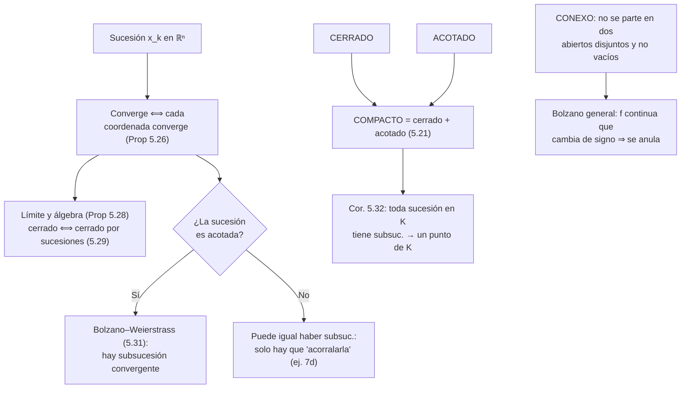
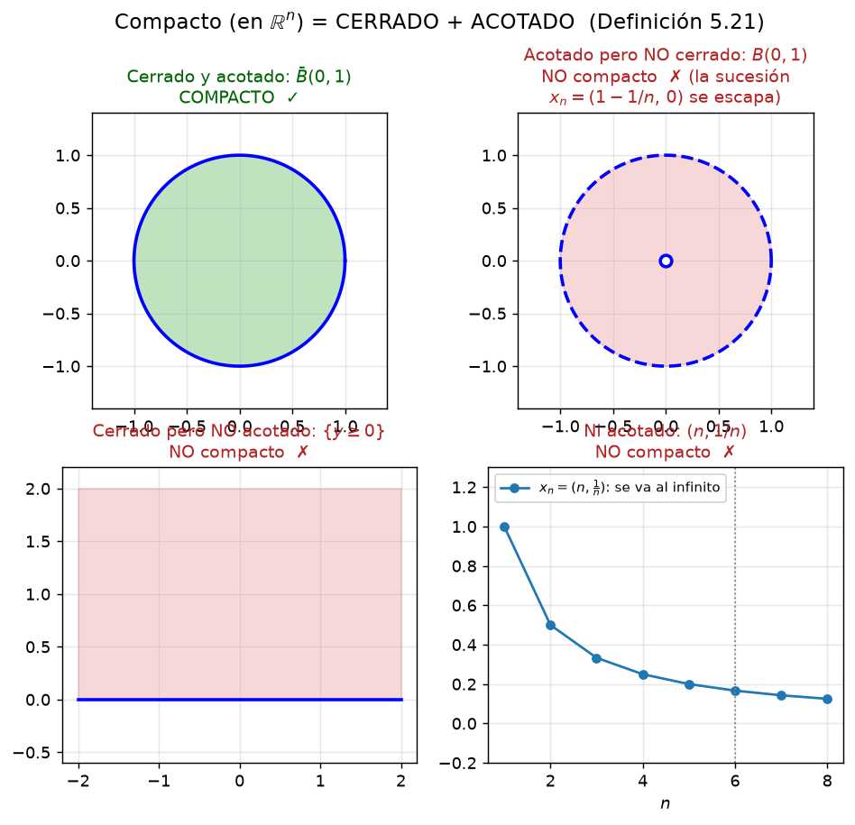
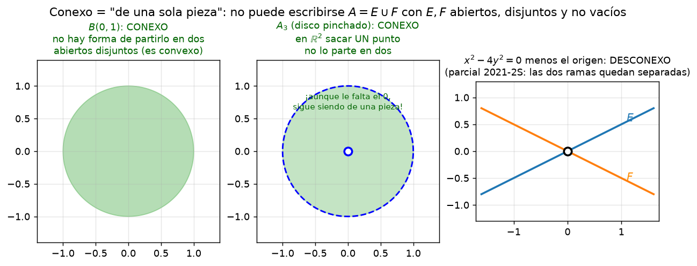

# Clase 32 — Compactos, conexos y sucesiones en ℝⁿ

> **Bloque 6 · Topología en ℝⁿ · Dificultad: media · Tiempo estimado: 140 min**

En las clases 30 y 31 clasificamos puntos y conjuntos y aprendimos a calcular $\mathring A$,
$\partial A$, $A'$ y $\bar A$. Nos faltan las dos piezas "grandes" del bloque: los conjuntos
que se portan bien (**compacto = cerrado y acotado**) y los conjuntos "de una sola pieza"
(**conexos**), más el puente con las **sucesiones en ℝⁿ**, que es el idioma con el que se
demuestran casi todos los teoremas del resto de la asignatura. El Práctico 5, ejercicios 7
y 8 (y varios opcionales), es exactamente esto.

---

## 🎯 Objetivos

1. **Definir** conjunto **acotado** (Definición 5.20) y **compacto** (Definición 5.21: cerrado y acotado), con sus ejemplos y propiedades.
2. Definir **convergencia de sucesiones en ℝⁿ** (Definiciones 5.23 y 5.24) y demostrar que **se converge coordenada a coordenada** (Proposición 5.26).
3. Usar el **álgebra de límites** (Proposición 5.28) y la caracterización **cerrado = cerrado por sucesiones** (Proposición 5.29).
4. Enunciar y aplicar **Bolzano–Weierstrass en ℝⁿ** (Teorema 5.31) y su corolario: toda sucesión dentro de un compacto tiene una subsucesión convergente **con límite en el compacto** (Corolario 5.32).
5. Entender la noción de **conjunto conexo** y el Bolzano generalizado (si una continua en un conexo cambia de signo, se anula).
6. Resolver **paso a paso** el Práctico 5, **Ejercicios 7 y 8**, más ejercicios **opcionales** (distancia entre conjuntos, sucesión contractiva, conjunto de Cantor).

---

## 🗺️ Mapa de la clase

---

## 🧱 Repaso / ideas previas

- **Clase 30:** abiertos, cerrados, bolas, la desigualdad triangular $\|x+z\|\le\|x\|+\|z\|$ (es la que mueve todas las demostraciones de épocas).
- **Clase 31:** $\mathring A$, $\partial A$, $A'$, $\bar A$; **cerrado $\iff$ contiene a sus puntos de acumulación** (Proposición 5.18). Esa es la bisagra con esta clase.
- **Clase 19 (sucesiones en ℝ):** toda sucesión real **acotada** tiene una subsucesión convergente (Bolzano–Weierstrass); toda sucesión convergente de Cauchy converge; $\mathbb{R}$ es completo. Acá hacemos lo mismo en ℝⁿ.
- **Distancia:** $d(x,y)=\|y-x\|_2$. Recordar que $d(a_k,L)<\varepsilon$ es exactamente $a_k\in B(L,\varepsilon)$: la definición de límite con $\varepsilon$ y la definición con bolas son la misma cosa.

---

## 📘 Teoría

### 32.1 Acotados y compactos

> **Definición 32.1 (notas, Definición 5.20 — acotado).** $A\subset\mathbb{R}^n$ es **acotado** si existe $K>0$ tal que
> $$A\subset B(0,K).$$

En ℝ esta definición coincide con "estar dentro de algún intervalo $[-K,K]$".

> **Definición 32.2 (notas, Definición 5.21 — compacto).** $A\subset\mathbb{R}^n$ es **compacto** si es **cerrado y acotado**.

> **Ejemplos 32.3 (notas, Ejemplos 5.22).**
> 1. La bola cerrada $\bar B(0,1)=\{x:\|x\|\le 1\}$ es compacta.
> 2. El conjunto $A_4\cup\{(0,0)\}$ de la clase 31 (los puntos $\{(1/n,0)\}$ más el origen) es compacto: es cerrado y está dentro de $B(0,1)$.
> 3. En general, **si $A$ es acotado, entonces $\bar A$ es compacto** (la clausura "cierra" el conjunto y sigue acotada).

> 💡 La nota imprime el ítem 3 como "si $A$ es acotado entonces $A$ es compacto": falta la barra. La afirmación correcta —y la que se usa siempre— es que **$\bar A$** es compacto: un conjunto acotado sin su frontera (por ejemplo $B(0,1)$) **no** es cerrado, y por lo tanto **no** es compacto.

**Propiedades útiles (se prueban con las definiciones y las leyes de abiertos/cerrados de la clase 30):**

| Afirmación | ¿Por qué? |
|---|---|
| Todo compacto es cerrado y acotado | es la definición |
| Unión **finita** de compactos es compacta | unión finita de cerrados es cerrada y la unión de acotados es acotada |
| Intersección **arbitraria** de compactos es compacta | intersección arbitraria de cerrados es cerrada; está contenida en cualquiera de ellos, que es acotado |
| Si $K$ es compacto y $F$ es cerrado con $F\subset K$, entonces $F$ es compacto | $F=F\cap K$: intersección de dos cerrados; y $F\subset K$ acotado |

### 32.2 Sucesiones en ℝⁿ

> **Definición 32.4 (notas, Definición 5.23).** Una **sucesión en ℝⁿ** es una función $a:\mathbb{N}\to\mathbb{R}^n$, es decir una lista de puntos $a_k=(a_{k,1},a_{k,2},\dots,a_{k,n})$.

> **Definición 32.5 (notas, Definición 5.24 — límite).** $\displaystyle\lim_{k\to\infty}a_k=L\in\mathbb{R}^n$ si
> $$\forall\varepsilon>0\ \exists k_0\in\mathbb{N}:\ \forall k\ge k_0,\quad a_k\in B(L,\varepsilon).$$

Como $d(a_k,L)<\varepsilon\iff a_k\in B(L,\varepsilon)$, esto es lo mismo que pedir
$$d(a_k,L)=\|a_k-L\|\to 0\quad\text{(una sucesión real).}$$

> **Proposición 32.6 (notas, Proposición 5.26).** Sea $a_k$ una sucesión en ℝⁿ y $L=(L_1,\dots,L_n)$. Entonces
> $$\lim_{k\to\infty}a_k=L\iff \lim_{k\to\infty}a_{k,i}=L_i\quad\text{para cada }i=1,\dots,n.$$

**Demostración.** Para cada coordenada $i$, $0\le |a_{k,i}-L_i|\le \|a_k-L\|_2$.
- $(\Rightarrow)$ Si $\|a_k-L\|_2\to0$, por el sandwich la coordenada $i$ también tiende a $0$: $a_{k,i}\to L_i$.
- $(\Leftarrow)$ Si cada $|a_{k,i}-L_i|\to0$, entonces
$$\|a_k-L\|_2=\sqrt{\sum_{i=1}^n (a_{k,i}-L_i)^2}\le \sum_{i=1}^n |a_{k,i}-L_i|\xrightarrow[k\to\infty]{}0,$$
usando que la suma de $n$ sucesiones que tienden a cero tiende a cero. $\blacksquare$

> 💡 **Moraleja operativa:** una sucesión en ℝⁿ converge **si y solo si** lo hace cada coordenada por separado. Para analizar $a_k\in\mathbb{R}^3$ alcanza con analizar tres sucesiones reales.

> **Proposición 32.7 (notas, Proposición 5.28 — álgebra de límites).** Si $a_k\to a$ y $b_k\to b$ en ℝⁿ y $\lambda_k\to\lambda$ en ℝ, entonces
> $$a_k+b_k\to a+b,\qquad \lambda_k a_k\to\lambda a,\qquad \|a_k\|\to\|a\|.$$

La prueba es la misma que en ℝ, coordenada a coordenada (o con la desigualdad triangular). Ejemplo de uso: si $a_k\to(1,2)$ y $b_k\to(0,-1)$, entonces $2a_k-b_k\to(2,5)$.

### 32.3 Cerrado = cerrado por sucesiones

> **Proposición 32.8 (notas, Proposición 5.29).** Un conjunto $C\subset\mathbb{R}^n$ es cerrado **si y solo si** es **cerrado por sucesiones**: toda sucesión $\{a_k\}\subset C$ convergente cumple $\lim a_k\in C$.

**Demostración (bosquejo).**
$(\Rightarrow)$ Si $a_k\in C$ y $a_k\to a$, supongamos $a\notin C$. Como $C$ es cerrado, $C^{c}$ es abierto, así que hay $\varepsilon>0$ con $B(a,\varepsilon)\subset C^{c}$. Pero $a_k\to a$ obliga a que, a partir de cierto $k_0$, todos los $a_k$ estén en $B(a,\varepsilon)$… ¡y los $a_k$ están en $C$! Absurdo.
$(\Leftarrow)$ Sea $x_0$ un punto de frontera de $C$; en cada bola $B(x_0,1/k)$ hay un punto $a_k\in C$, y $a_k\to x_0$; por hipótesis $x_0\in C$. Como $\partial C\subset C$, el conjunto es cerrado (Propiedad 31.4). $\blacksquare$

### 32.4 Subsucesiones y Bolzano–Weierstrass

> **Definición 32.9 (notas, Definición 5.30).** Si $a_k$ es una sucesión en ℝⁿ y $k_1<k_2<k_3<\cdots$ es una sucesión estrictamente creciente de naturales, entonces $a_{k_j}$ es una **subsucesión** de $a_k$.

> **Hecho (notas, tras la Definición 5.30).** Si $a_k\to L$, toda subsucesión $a_{k_j}$ también converge a $L$ (lo probamos en el Ejercicio 6 de abajo).

> **Teorema 32.10 (notas, Teorema 5.31 — Bolzano–Weierstrass en ℝⁿ).** Toda sucesión **acotada** en ℝⁿ tiene una subsucesión convergente.

**Demostración.** Escribamos $a_k=(a_{k,1},\dots,a_{k,n})$.
1. La primera coordenada $(a_{k,1})$ es una sucesión real acotada, así que tiene una subsucesión convergente. Sea $N_1\subset\mathbb{N}$ el conjunto (infinito) de índices que la define: entonces $(a_{k,1})_{k\in N_1}$ converge.
2. Ahora miremos la segunda coordenada **solo sobre $N_1$**: $(a_{k,2})_{k\in N_1}$ sigue acotada, así que tiene una subsucesión convergente, definida por $N_2\subset N_1$. La primera coordenada sobre $N_2$ **también** converge, porque es subsucesión de una convergente.
3. Repetimos el argumento coordenada por coordenada, encajando los índices: obtenemos $N_n\subset N_{n-1}\subset\cdots\subset N_1$ de modo que **cada** coordenada $(a_{k,i})_{k\in N_n}$ converge. Por la Proposición 32.6, la subsucesión $a_k$ con $k\in N_n$ converge. $\blacksquare$

> ⚠️ **Ojo con la trampa:** no alcanza con extraer una subsucesión convergente en cada coordenada por separado (los índices pueden no coincidir). Por eso **encajamos** los conjuntos de índices coordenada por coordenada.

> **Corolario 32.11 (notas, Corolario 5.32).** Si $K\subset\mathbb{R}^n$ es **compacto** y $a_k$ es una sucesión de elementos de $K$, entonces $a_k$ tiene una subsucesión convergente **cuyo límite pertenece a $K$**.

**Demostración.** Como $K$ es acotado, la sucesión es acotada y por el Teorema 32.10 tiene una subsucesión convergente $a_{k_j}\to a$. Como $a_{k_j}\in K$ y $K$ es **cerrado**, por la Proposición 32.8 se tiene $a\in K$. $\blacksquare$

> 💡 **Así se usa en las pruebas:** "como $K$ es compacto, puedo suponer (pasando a una subsucesión) que $x_k\to x\in K$". Es la jugada estrella de los teoremas de Weierstrass y de continuidad uniforme (clase 36). Y caracteriza a los compactos: un conjunto es compacto sii toda sucesión en él tiene una subsucesión que converge dentro del conjunto.

> **Ejercicio (notas, 5.33).** (1) Tomar $C=\{y\ge 0\}$ (cerrado, no acotado) y $a_k=(k,0)$: toda subsucesión se va al infinito. (2) Tomar $A=B(0,1)$ (acotado, no cerrado) y $a_k=(1-\tfrac1k,0)$: su límite es $(1,0)\notin A$.

### 32.5 Conjuntos conexos

> **Definición 32.12 (notas, discusión tras el Teorema de Weierstrass).** Un conjunto $C\subset\mathbb{R}^n$ es **conexo** si **no** puede escribirse como unión de dos conjuntos **abiertos** (relativos a ℝⁿ) **disjuntos y no vacíos**. Es decir: **no** existen abiertos $U,V$ con
> $$U\cap V=\emptyset,\qquad C\cap U\neq\emptyset,\qquad C\cap V\neq\emptyset,\qquad C\subset U\cup V.$$
> Si tales $U,V$ existen, $C$ es **disconexo** (se puede "partir en dos piezas").

La intuición es la del nombre: un conjunto conexo es **"de una sola pieza"**. Son conexos:
- los intervalos de ℝ (incluyendo los semiabiertos $[a,b)$, $(a,b]$);
- toda **bola** $B(a,\delta)$ y todo conjunto **convexo** (clase 34 y opcional 5 del Práctico 5);
- todo ℝⁿ (y cualquier subespacio);
- quitarle **un punto** a ℝⁿ con $n\ge 2$ **no** desconecta: el disco pinchado $A_3$ de la clase 31 **sigue siendo conexo** (ver la figura).

Es **disconexo**, por ejemplo, $[0,1]\cup[2,3]$ (los abiertos $U=(-0.5,1.5)$, $V=(1.5,3.5)$ lo parten), el conjunto $A_5$ de la clase 31 (puntos aislados apiñados en dos grupos) y el conjunto
$$\{(x,y):x^2-4y^2=0\}-\{(0,0)\}$$
del parcial 2021-2S que aparece abajo: el eje $x$ separa sus cuatro semirrectas en dos grupos, $U=\{y>0\}$ y $V=\{y<0\}$.

> **Teorema 32.13 (Bolzano generalizado; notas, Capítulo 6).** Si $C$ es conexo, $f:C\to\mathbb{R}$ es continua y existen $a,b\in C$ con $f(a)>0$ y $f(b)<0$, entonces existe $c\in C$ con $f(c)=0$.

**Idea de la prueba (notas).** Si $f$ nunca se anulara, $C$ se partiría en $C\cap\{f>0\}$ y $C\cap\{f<0\}$; los dos son **abiertos** (por continuidad de $f$: en un entorno de un punto donde $f>0$, sigue siendo $f>0$) y **disjuntos**. Eso contradice la conexidad de $C$. $\blacksquare$

> 💡 En una variable esto es el clásico teorema de Bolzano: una continua en un intervalo que cambia de signo se anula. Lo que hace posible el teorema es que el **dominio** sea de una sola pieza.

> 📎 **Sobre "homeomorfo":** en las notas del curso **no** se define homeomorfismo (no forma parte del programa). Decimos solo, a modo de vocabulario, que un **homeomorfismo** es una biyección continua con inversa continua: dos conjuntos son homeomorfos si tienen "la misma forma topológica" (los mismos abiertos, y por lo tanto las mismas propiedades de compacidad y conexidad). No se pide en el parcial.

---

## 🖼️ Figuras

**Cómo leer la figura:** arriba a la izquierda, el disco **cerrado** $\bar B(0,1)$: es cerrado **y** acotado, así que es **compacto** ✓. Los otros tres paneles muestran por qué hacen falta las **dos** condiciones: $B(0,1)$ (acotado pero no cerrado: la sucesión $x_n=(1-1/n,0)$ "se escapa" al borde), el semiplano $\{y\ge 0\}$ (cerrado pero no acotado) y los puntos $(n,1/n)$ (ni acotado) **no** son compactos ✗.

**Cómo leer la figura:** el disco $B(0,1)$ es conexo (es convexo: cada par de puntos se une con un segmento adentro). El disco pinchado $A_3$ **sigue** siendo conexo: en ℝ² (o ℝⁿ con $n\ge 2$) sacar **un** punto no lo parte en dos. En cambio $x^2-4y^2=0$ menos el origen **sí** es disconexo: sus cuatro semirrectas quedan separadas, por ejemplo, por $U=\{y>0\}$ y $V=\{y<0\}$.

---

## ✏️ Ejercicios resueltos — Práctico 5, Ejercicios 7 y 8

> **Enunciado (Práctico 5, ej. 7).** Estudiar la convergencia de las siguientes sucesiones definidas en ℝ². En caso de no convergencia, determinar la existencia de subsucesiones convergentes y calcularlas.

### Ejercicio 1 (Práctico 5, ej. 7a). $a_n=\left(e^{-n},\ \dfrac{3}{n}\right)$

**Paso 1 — coordenada a coordenada (Prop 32.6).**
$$e^{-n}\xrightarrow[n\to\infty]{}0,\qquad \frac{3}{n}\xrightarrow[n\to\infty]{}0.$$

**Paso 2 — conclusión.** Como las dos coordenadas convergen,
$$a_n\longrightarrow (0,0).$$
La sucesión **converge** (y por lo tanto, toda subsucesión converge también a $(0,0)$).

### Ejercicio 2 (Práctico 5, ej. 7b). $b_n=\left(e^{-n}+2,\ [1+(-1)^n]^n\right)$

**Paso 1 — primera coordenada.** $e^{-n}+2\to 2$.

**Paso 2 — segunda coordenada.** Distingamos la paridad de $n$:
$$n\ \text{par}:\ [1+1]^n=2^n\to+\infty;\qquad n\ \text{impar}:\ [1-1]^n=0^n=0.$$
La segunda coordenada **no** tiene límite, así que $b_n$ **no converge**.

**Paso 3 — buscar subsucesiones convergentes.** Para que una subsucesión converja, su segunda coordenada debe ser acotada: entonces la subsucesión debe tomar (a partir de algún índice) **solo índices impares**. En esos índices,
$$b_{2k-1}=\left(e^{-(2k-1)}+2,\ 0\right)\xrightarrow[k\to\infty]{}(2,0).$$
Por lo tanto **la única subsucesión convergente (salvo colas) converge a $(2,0)$**. Toda subsucesión con infinitos índices pares **diverge** (segunda coordenada $\to+\infty$).

### Ejercicio 3 (Práctico 5, ej. 7c). $c_n=\left((-1)^n,\ \dfrac{(-1)^n+1}{n}\right)$

**Paso 1 — segunda coordenada.**
$$n\ \text{par}:\ \frac{2}{n}\to 0;\qquad n\ \text{impar}:\ \frac{0}{n}=0.$$
Así que la segunda coordenada tiende a $0$ **siempre**.

**Paso 2 — primera coordenada.** Vale $(-1)^n$, que oscila entre $1$ y $-1$: **no hay límite**. Luego $c_n$ **no converge**.

**Paso 3 — subsucesiones.** Por la Prop 32.6 basta mirar cada paridad:
$$c_{2k}=\left(1,\ \tfrac{1}{k}\right)\longrightarrow(1,0),\qquad c_{2k-1}=(-1,\ 0)\longrightarrow(-1,0).$$
Hay **exactamente dos** límites de subsucesiones: $(1,0)$ (índices pares) y $(-1,0)$ (índices impares). El conjunto de puntos de acumulación del recorrido es $\{(1,0),(-1,0)\}$.

### Ejercicio 4 (Práctico 5, ej. 7d). $d_n=\left(n\big[(-1)^n+1\big],\ e\right)$

**Paso 1 — segunda coordenada.** Es constante: $e\to e$.

**Paso 2 — primera coordenada.**
$$n\ \text{par}:\ n\cdot 2=2n\to+\infty;\qquad n\ \text{impar}:\ n\cdot 0=0.$$
No hay límite: $d_n$ **no converge** (¡ni siquiera es acotada!).

**Paso 3 — subsucesiones.** Los índices **impares** dan
$$d_{2k-1}=(0,\ e)\longrightarrow(0,e):$$
**hay subsucesión convergente**. Los índices **pares** divergen. Observar que la **no acotación** no impidió tener una subsucesión convergente: Bolzano–Weierstrass **no** se aplica (pide acotación), pero la sucesión igual tiene una parte "quieta".

### Ejercicio 5 (Práctico 5, ej. 7e). $e_n=\left(\sin\!\frac{n\pi}{8},\ \cos\!\frac{n\pi}{3}\right)$

**Paso 1 — periodicidad.** La primera coordenada depende solo de $n\bmod 16$ (el período de $\sin(n\pi/8)$ es $16$), y la segunda solo de $n\bmod 6$ (período $6$). Entonces la **sucesión de pares** es periódica de período
$$\operatorname{mcm}(16,6)=48.$$
Es decir: $e_{n+48}=e_n$ para todo $n$.

**Paso 2 — ¿converge?** Una sucesión periódica que no es constante **no** converge: recorre finitos valores distintos. Acá, por ejemplo, $e_1=(\sin\frac\pi8,\frac12)$ y $e_3=(\sin\frac{3\pi}8,-1)$ son distintos, y vuelven a aparecer infinitas veces. Luego $e_n$ **no converge**.

**Paso 3 — subsucesiones convergentes.** Como la sucesión toma **finitamente muchos valores** (a lo sumo 48), cada valor alcanzado infinitas veces es límite de una subsucesión **constante**; el Teorema 32.10 garantiza que hay al menos una. Veamos una concreta:
$$e_{48k+3}=\Big(\sin\big(6k\pi+\tfrac{3\pi}8\big),\ \cos\big(16k\pi+\pi\big)\Big)=\Big(\sin\tfrac{3\pi}8,\ -1\Big)\ \ \forall k.$$
Es una subsucesión constante, así que converge a $\left(\sin\frac{3\pi}{8},\,-1\right)=\left(\frac{\sqrt{2+\sqrt2}}{2},-1\right)$. Del mismo modo $e_{48k+6}\to\left(\frac{\sqrt2}{2},\,1\right)$, etc. En general: **el conjunto de límites de subsucesiones es exactamente el conjunto (finito) de valores que toma la sucesión.**

> 💡 **Síntesis del ej. 7:** a) converge; b) no converge, única subsuc.: $(2,0)$; c) no converge, límites $(1,0)$ y $(-1,0)$; d) no converge, subsuc. $(0,e)$; e) no converge, límites = todos los valores alcanzados (periódica de período 48).

---

> **Enunciado (Práctico 5, ej. 8).** a) Probar que si una sucesión tiene límite, toda subsucesión tiene el mismo límite. b) Sea $x_n$ en ℝ² con $x_n\to p$, y $A=\{x_n:n\in\mathbb{N}\}$: hallar $\operatorname{int}(A)$, $\bar A$, $A'$ y $\partial A$. c) Demostrar que $a$ es punto de acumulación de $X$ sii existe una sucesión $(x_k)\subset X-\{a\}$ con $x_k\to a$.

### Ejercicio 6 (Práctico 5, ej. 8a). Una subsucesión de una convergente converge al mismo límite

**Paso 1 — notación.** Sea $x_n\to L$ y sea $x_{n_k}$ una subsucesión, con $n_1<n_2<n_3<\cdots$. Una observación clave: como los $n_k$ son naturales estrictamente crecientes,
$$n_k\ge k\qquad\text{para todo }k.$$

**Paso 2 — el argumento $\varepsilon$.** Sea $\varepsilon>0$. Como $x_n\to L$, existe $n_0$ tal que
$$\forall n\ge n_0:\quad d(x_n,L)<\varepsilon.$$
Para ese mismo $n_0$, si $k\ge n_0$ entonces $n_k\ge k\ge n_0$, así que $d(x_{n_k},L)<\varepsilon$. Por lo tanto $x_{n_k}\to L$. $\blacksquare$

> 💡 Este hecho se usa constantemente: "si el límite **existiera**, toda subsucesión tendería a él". Su contrapositivo es la herramienta del Ejercicio 8c para **probar que un punto es de acumulación**: exhibiendo una subsucesión que converge a él, o (mejor) probando que dos subsucesiones tienden a cosas distintas.

### Ejercicio 7 (Práctico 5, ej. 8b). El conjunto de valores de una sucesión convergente

**Paso 1 — interior.** $A=\{x_n\}_n$ tiene a lo sumo una cantidad **numerable** de puntos, mientras que una bola $B(q,\delta)$ de ℝ² es **no numerable**. Ninguna bola puede estar contenida en $A$:
$$\operatorname{int}(A)=\emptyset.$$

**Paso 2 — clausura.** Como $x_n\to p$, toda bola $B(p,\varepsilon)$ contiene a **todos** los $x_n$ con $n$ grande; en particular $p\in\bar A$. Además $A\subset\bar A$. Entonces
$$\bar A=A\cup\{p\}.$$

**Paso 3 — puntos de acumulación.** Distinguimos:
- si $A$ es **infinito**: $p\in A'$. En efecto, si fuera $B^*(p,\varepsilon)\cap A=\emptyset$, entonces todos los términos dentro de $B(p,\varepsilon)$ valdrían $p$, y fuera de $B(p,\varepsilon)$ hay finitos términos: $A$ sería finito. Como $A$ infinito, para cada $\varepsilon$ hay infinitos términos distintos de $p$ en $B(p,\varepsilon)$. Y **ningún** $q\neq p$ es de acumulación (eligiendo $\varepsilon<d(p,q)/2$, la bola $B(q,\cdot)$ contiene finitos términos). Luego
$$A'=\{p\}.$$
- si $A$ es **finito**: una sucesión convergente que toma finitos valores es **eventualmente constante** (el valor repetido infinitas veces es el límite $p$; los demás valores aparecen finitas veces). Entonces $A'=\emptyset$.

**Paso 4 — frontera.** Como $\operatorname{int}(A)=\emptyset$, $\partial A=\bar A-\operatorname{int}(A)=\bar A=A\cup\{p\}$.

**Conclusión (caso interesante, $A$ infinito).** $\operatorname{int}(A)=\emptyset$, $A'=\{p\}$, $\bar A=\partial A=A\cup\{p\}$. En particular: si además $p\notin A$, entonces $A$ **no es cerrado** (le falta $p$, que es de acumulación); y si $p\in A$ (por ejemplo cuando hay un valor que se repite o $p$ es uno de los términos), $A$ sí es cerrado.

### Ejercicio 8 (Práctico 5, ej. 8c). Acumulación $\iff$ sucesión que tiende al punto

**$(\Rightarrow)$ Sea $a\in X'$: construyamos la sucesión.** Como toda bola reducida corta a $X$, para cada $k$ elegimos
$$x_k\in B^*(a,\tfrac1k)\cap X\qquad(\text{no vacío}).$$
Entonces $x_k\neq a$, $x_k\in X-\{a\}$ y $d(x_k,a)<\frac1k\to 0$: es decir, $x_k\to a$.

**$(\Leftarrow)$ Supongamos que $x_k\in X-\{a\}$ y $x_k\to a$.** Sea $\varepsilon>0$. Como $x_k\to a$, existe $k_0$ con $d(x_k,a)<\varepsilon$ para todo $k\ge k_0$. En particular $x_{k_0}\in B(a,\varepsilon)$ y $x_{k_0}\neq a$, o sea $x_{k_0}\in B^*(a,\varepsilon)\cap X\neq\emptyset$. Como $\varepsilon$ era arbitrario, $a$ es de acumulación de $X$. $\blacksquare$

> 💡 Esta equivalencia es la que permite **hablar de clausura y frontera con sucesiones** y enlaza la Prop 32.8 (cerrado por sucesiones) con la Definición 31.1 de punto de acumulación.

---

### Ejercicio 9 (Práctico 5, opcional 1). Distancia entre dos conjuntos

Recordemos que $d(A,B)=\inf\{d(x,y):x\in A,\ y\in B\}$.

**a) $A\cap B\neq\emptyset\Rightarrow d(A,B)=0$.** Si $x\in A\cap B$, entonces $d(x,x)=0$ aparece en el conjunto de distancias, y todas las distancias son $\ge 0$. El ínfimo es $0$. ✔

**b) $d(A,B)=0$ con $A\cap B=\emptyset$.** En ℝ², tomar
$$A=B(0,1)\ (\text{disco abierto}),\qquad B=S^1=\{\|x\|=1\}\ (\text{circunferencia}).$$
Son disjuntos. Pero con los puntos $a_k=(1-\tfrac1k,0)\in A$ y $b_k=(1,0)\in B$ se tiene $d(a_k,b_k)=\tfrac1k\to 0$, así que el ínfimo es $0$: $d(A,B)=0$. (El ínfimo **no se alcanza**: $A$ no es cerrado.)

**c) Si $A$ y $B$ son compactos: $A\cap B\neq\emptyset\iff d(A,B)=0$.**
- $(\Rightarrow)$ es la parte a).
- $(\Leftarrow)$ Por definición de ínfimo, para cada $k$ existen $a_k\in A$, $b_k\in B$ con $d(a_k,b_k)<\tfrac1k$. Como $A$ es **compacto** (en particular acotado), Bolzano–Weierstrass (Teorema 32.10) da una subsucesión $a_{k_j}\to a$. Como $A$ es cerrado, $a\in A$. Ahora
$$d(b_{k_j},a)\le d(b_{k_j},a_{k_j})+d(a_{k_j},a)<\tfrac1{k_j}+d(a_{k_j},a)\xrightarrow[j\to\infty]{}0,$$
así que $b_{k_j}\to a$. Como $B$ es cerrado, $a\in B$. Entonces $a\in A\cap B\neq\emptyset$. $\blacksquare$

> 💡 **Por qué se pide compacidad:** sin ella, el ínfimo puede no ser alcanzado (parte b). El mismo argumento funciona si $A$ es compacto y $B$ es **cerrado**.

### Ejercicio 10 (Práctico 5, opcional 3). Sucesiones contractivas

Sea $(x_n)_{n\ge0}$ en ℝⁿ con $\|x_{n+1}-x_n\|\le k\|x_n-x_{n-1}\|$ para cierto $0<k<1$.

**a) $\|x_{n+1}-x_n\|\le k^n\|x_1-x_0\|$.** Inducción en $n$. Para $n=0$ es igualdad. Si vale para $n$, entonces
$$\|x_{n+2}-x_{n+1}\|\le k\|x_{n+1}-x_n\|\le k\cdot k^n\|x_1-x_0\|=k^{n+1}\|x_1-x_0\|.\quad\checkmark$$

**b) Si $p>q$, $\|x_p-x_q\|\le \dfrac{k^q}{1-k}\|x_1-x_0\|$.** Encadenando con la desigualdad triangular y telescopando:
$$\|x_p-x_q\|=\Big\|\sum_{j=q}^{p-1}(x_{j+1}-x_j)\Big\|\le\sum_{j=q}^{p-1}\|x_{j+1}-x_j\|\le\sum_{j=q}^{p-1}k^j\|x_1-x_0\|.$$
La suma de la cola geométrica es
$$\sum_{j=q}^{p-1}k^j\le\sum_{j=q}^{\infty}k^j=\frac{k^q}{1-k}.$$

**c) $(x_n)$ es de Cauchy, luego converge.** Dado $\varepsilon>0$, elegimos $q_0$ con $\dfrac{k^{q_0}}{1-k}\|x_1-x_0\|<\varepsilon$ (posible porque $k^{q}\to0$). Entonces, para $p>q\ge q_0$,
$$\|x_p-x_q\|\le\frac{k^{q}}{1-k}\|x_1-x_0\|\le\frac{k^{q_0}}{1-k}\|x_1-x_0\|<\varepsilon.$$
Así $(x_n)$ es de Cauchy en ℝⁿ, y ℝⁿ es **completo**, luego converge. $\blacksquare$

### Ejercicio 11 (Práctico 5, opcional 2a). Intersección de una cadena decreciente de compactos

> **Enunciado.** Sea $(K_m)_{m\ge0}$ con $K_m\subset\mathbb{R}^n$ **compacto y no vacío**, $K_{m+1}\subset K_m$. Probar que $K=\bigcap_{m\ge0}K_m$ es **compacto y no vacío**.

**Paso 1 — compacto.** $K$ es intersección **arbitraria** de cerrados, luego es cerrado; y $K\subset K_0$, que es acotado, luego $K$ es acotado. Cerrado y acotado: **compacto**. ✔

**Paso 2 — no vacío.** Para cada $m$ elegimos $x_m\in K_m$ (no vacío). La sucesión $(x_m)$ vive en el compacto $K_0$, así que (Corolario 32.11) tiene una subsucesión convergente $x_{m_j}\to x$, con $x\in K_0$. Para **cada** $m$ fijo: como $m_j\to\infty$, todos los $x_{m_j}$ con $m_j\ge m$ están en $K_m$ (por la cadena decreciente), y $K_m$ es cerrado, así que su límite $x\in K_m$. Como esto vale para todo $m$,
$$x\in\bigcap_{m\ge0}K_m=K\neq\emptyset.\qquad\blacksquare$$

> 💡 Este resultado es el motor del **conjunto de Cantor** (opcional 2b): la cadena decreciente de compactos $\emptyset\neq K\Rightarrow$ intersección no vacía es lo que permite "encajar" conjuntos sin bajar a vacío. Allí $K=K'$ (todo punto es de acumulación) y $\operatorname{int}(K)=\emptyset$: un conjunto **compacto**, **perfecto** y "flaco", uno de los ejemplos más bonitos de la topología.

### Ejercicio 12 (Práctico 5, opcional 4). Sucesión no acotada con subsucesión convergente

**a) Si $\|x_k\|\to\infty$, no hay subsucesión convergente.** Una subsucesión convergente tiene que ser **acotada** (todo convergente es acotado); pero toda subsucesión de una sucesión que cumple $\|x_k\|\to\infty$ también cumple $\|x_{k_j}\|\to\infty$, así que no puede ser acotada. Contradicción. ✔

**b) No acotada pero con subsucesión convergente.** En ℝ, $x_k=k$ si $k$ es impar y $x_k=0$ si $k$ es par. La sucesión no es acotada, y la subsucesión de índices pares es constante $=0$, luego converge a $0$. **No contradice** la parte a): allí la hipótesis era la **más fuerte** $\|x_k\|\to\infty$ (todos los términos se van al infinito), no la mera falta de acotación.

---

## 🏛️ Ejercicios de parcial/examen

### Ejercicio (Primer parcial 2021-2S, ej. 8). Las dos rectas sin el origen

> Sea $A=\{(x,y)\in\mathbb{R}^2:x^2-4y^2=0\}-\{(0,0)\}$ y las afirmaciones:
> (I) $A$ no es ni abierto ni cerrado.
> (II) Todos los puntos de $A$ son de acumulación de $A$.
> (III) $A$ es un conjunto acotado.

**Paso 1 — describir el conjunto.** $x^2-4y^2=0\iff x^2=4y^2\iff |x|=2|y|\iff y=\pm\tfrac{x}{2}$. Entonces
$$A=\Big\{\big(x,\tfrac{x}{2}\big):x\neq0\Big\}\cup\Big\{\big(x,-\tfrac{x}{2}\big):x\neq0\Big\}:$$
son las dos rectas $y=\frac x2$ e $y=-\frac{x}{2}$ **menos el origen** (cuatro semirrectas).

**Paso 2 — (I) ¿abierto? ¿cerrado?** Un punto de una recta no es interior (toda bola tiene puntos con $y\neq\pm x/2$, que no están en $A$): $A$ **no es abierto**. Y el origen **no** pertenece a $A$, pero es de acumulación (los puntos $(\tfrac1k,\pm\tfrac{1}{2k})\to(0,0)$): $A$ **no es cerrado** (Prop 32.8). Así **(I) es verdadera**. ✔

**Paso 3 — (II) acumulación.** Sea $p=(x,x/2)\in A$ con $x\neq0$. Los puntos $p_k=\big(x+\tfrac1k,\ \tfrac12(x+\tfrac1k)\big)\in A$ cumplen $p_k\to p$ y $p_k\neq p$; luego $p\in A'$ (Ejercicio 8c). Igual para la otra recta. Todos los puntos de $A$ son de acumulación: **(II) es verdadera**. ✔

**Paso 4 — (III) acotación.** Sobre $y=\frac x2$ el punto $(x,\tfrac x2)$ tiene norma $|x|\sqrt{1+\tfrac14}\to\infty$: $A$ **no** es acotado. **(III) es falsa**. ✘

**Respuesta: (C) solo las afirmaciones (I) y (II) son verdaderas.** ✔

> 💡 Además, $A$ es **disconexo** (ver la segunda figura): el eje $x$ lo parte en $U=\{y>0\}$ y $V=\{y<0\}$, abiertos disjuntos que contienen puntos de $A$. Es el ejemplo clásico de que "dos rectas que se cortan en un punto que sacamos" ya no son de una sola pieza.

---

## ⚠️ Errores comunes

| Error | Corrección |
|---|---|
| "Todo acotado es compacto" | Falta la mitad: $B(0,1)$ es acotado y **no** compacto (no es cerrado). Compacto = cerrado **y** acotado |
| Demostrar la convergencia en ℝⁿ "a mano" con $\varepsilon$ | Se hace **coordenada a coordenada** (Prop 32.6): es más corto y seguro |
| Aplicar Bolzano–Weierstrass a una sucesión no acotada | El teorema **exige acotación**. Una sucesión no acotada *puede* igual tener subsucesiones convergentes (ej. 7d), pero eso hay que probarlo aparte |
| Creer que "no convergente ⇒ ninguna subsucesión converge" | Falso (ej. 7b, 7c, 7d). Toda sucesión **acotada** tiene al menos una subsucesión convergente |
| Extraer subsucesiones coordenada a coordenada sin cuidar los índices | Hay que **encajar** los índices (Teorema 32.10): la subsuc. de $x$ y la de $y$ pueden no compartir índices |
| "Quitarle un punto a un conjunto lo desconecta" | En ℝⁿ con $n\ge2$, quitar **un** punto **no** desconecta (el disco pinchado es conexo); en ℝ sí parte un intervalo en dos |
| Confundir conexo con "no tiene agujeros" | Conexo no es simplemente conexo: $S^1$ y el disco pinchado son conexos, aunque "rodeen" un punto |
| "Cerrado + acotado = compacto" se aplica a **cualquier** subespacio | Vale en ℝⁿ (es la definición de las notas). En otros espacios, el equivalente es "toda sucesión tiene subsuc. convergente en el conjunto" |

---

## 🔗 Conexiones

- **Clases 30–31:** abiertos/cerrados (30) y $\mathring A,\partial A,A',\bar A$ (31) se combinan acá en las definiciones de **compacto** y **conexo**.
- **Clases 16–19 (sucesiones y series):** todo el lenguaje de límites, subsucesiones y Cauchy se generaliza tal cual; la novedad es que ahora se trabaja **coordenada a coordenada**.
- **Clase 33 (repaso):** integra el bloque con los ejercicios de parcial 2022-2S y examen febrero 2022.
- **Clases 35–36 (límites y continuidad en ℝⁿ):** la definición de límite usa bolas reducidas (como acá $B^*$), y el **Teorema de Weierstrass** (existe máximo y mínimo de una continua en un compacto) es el Corolario 32.11 puesto a trabajar. El **Bolzano generalizado** (Teo 32.13) reaparece en continuidad.
- **Clases 37–43 (diferenciabilidad y extremos):** los mínimos y máximos de funciones $C^1$ se buscan en el interior y en la **frontera de un compacto**; la compacidad es la que garantiza que existan.

---

## ✅ Autoevaluación

1. Definir conjunto acotado y compacto en ℝⁿ. Dar un compacto, un conjunto cerrado no acotado, y uno acotado no cerrado.
2. ¿Por qué $S^1=\{(x,y):x^2+y^2=1\}$ es compacto? ¿Y $\mathbb{Z}\times\mathbb{Z}$?
3. Estado del enunciado de Bolzano–Weierstrass en ℝⁿ y explicar por qué la acotación es imprescindible.
4. Sea $x_k\to(2,-3)$ en ℝ² y $A=\{x_k\}$. Hallar $\operatorname{int}(A)$, $A'$, $\bar A$ y $\partial A$ (suponer $A$ infinito y $(2,-3)\notin A$).
5. ¿Es conexo $A=\{x^2+y^2=1\}\cup\{(x-3)^2+y^2=1\}$ (dos circunferencias disjuntas)?
6. Sea $K$ compacto y $a_k\in K$. ¿Qué se puede afirmar sobre alguna subsucesión de $a_k$?
7. (V/F) Si $A$ y $B$ son compactos y $d(A,B)=0$, entonces $A\cap B\neq\emptyset$.

### Respuestas

1. §32.1 (Definiciones 32.1 y 32.2). Compacto: $\bar B(0,1)$. Cerrado no acotado: $\{y\ge0\}$. Acotado no cerrado: $B(0,1)$.
2. $S^1$ es **cerrado** (su complemento es abierto: la distancia a $S^1$ da la bola) y **acotado** ($\subset\bar B(0,1)$): compacto. $\mathbb{Z}\times\mathbb{Z}$ es cerrado pero **no acotado**: no compacto.
3. §32.4 (Teorema 32.10): acotada ⇒ subsucesión convergente. Sin acotación falla: $x_k=(k,0)$ no tiene ninguna subsucesión convergente (Ejercicio 12a).
4. $\operatorname{int}(A)=\emptyset$; $A'=\{(2,-3)\}$; $\bar A=A\cup\{(2,-3)\}$; $\partial A=A\cup\{(2,-3)\}$ (Ejercicio 7).
5. **No es conexo**: $U=\{\|x\|<\tfrac32\}$ y $V=\{\|x-(3,0)\|<\tfrac32\}$ son abiertos disjuntos y parten las dos circunferencias.
6. Como $K$ es compacto, $(a_k)$ tiene una subsucesión $a_{k_j}\to a$ con $a\in K$ (Corolario 32.11).
7. **VERDADERO**: es exactamente el Ejercicio 9c.

---

> ⬅️ [Clase anterior](31_interior_frontera_clausura.md) · 🏠 [Índice](00_indice.md) · [Clase siguiente](33_topologia_repaso.md) ➡️
