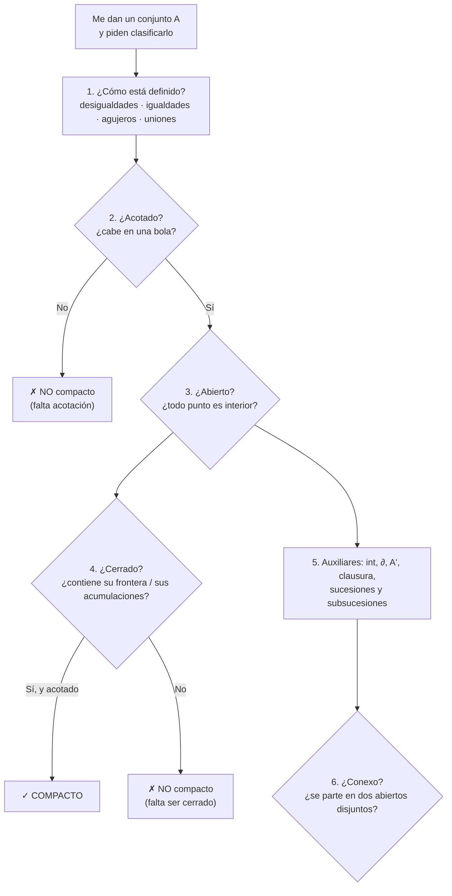
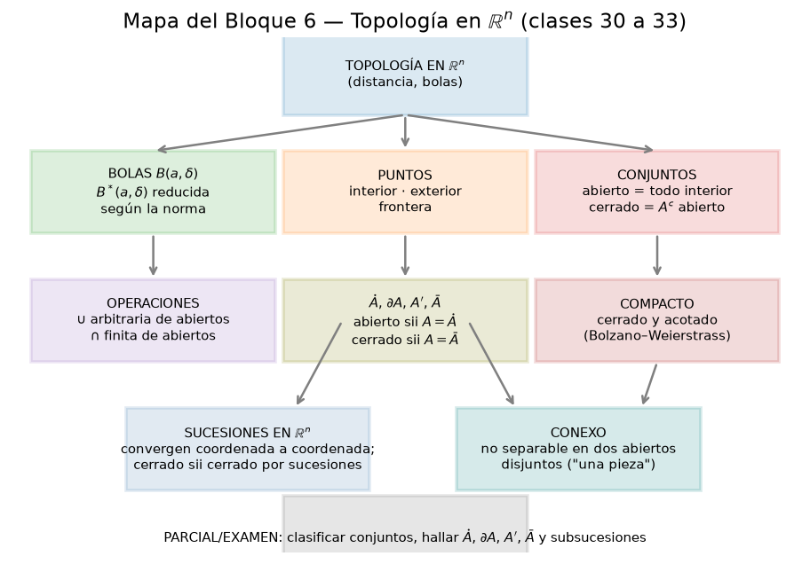

# Clase 33 — Topología en ℝⁿ: repaso integrador

> **Bloque 6 · Topología en ℝⁿ · Dificultad: media · Tiempo estimado: 115 min**

Esta es la clase de cierre del bloque. Ponemos en una misma hoja **todo** lo de las clases 30,
31 y 32 (bolas, abiertos y cerrados, interior/frontera/clausura/acumulación, sucesiones,
compactos y conexos) y lo estrenamos con dos ejercicios reales: el **múltiple opción del
Primer parcial 2022-2S** y el del **Examen de febrero de 2022**, más el desarrollo de
definiciones del mismo parcial. La idea no es aprender nada nuevo, sino adquirir **velocidad
de clasificación**: casi todos los ejercicios de topología del parcial se resuelven con la
misma checklist, y acá la dejamos escrita.

---

## 🎯 Objetivos

1. Repasar de un vistazo las **definiciones y los resultados** de las clases 30, 31 y 32, en una tabla única.
2. Fijar un **protocolo de clasificación** ("¿acotado? ¿abierto? ¿cerrado? ¿compacto?") para resolver los ejercicios de parcial sin perderse.
3. Repasar los **cálculos algorítmicos**: $\mathring A$, $\partial A$, $A'$, $\bar A$ para conjuntos definidos por desigualdades, uniones y "agujeros".
4. Resolver el **Primer parcial 2022-2S** (ejercicio 5 y desarrollo) y el **Examen febrero 2022** (múltiple opción 4), verificando con las soluciones oficiales.
5. Practicar con dos **propuestos del Práctico 5** que combinan todo: densidad/numerabilidad y acumulación.

---

## 🗺️ Mapa de la clase

---

## 🧱 Repaso / ideas previas

La topología del bloque se apoya en **una sola** desigualdad famosa: la **desigualdad triangular**
$\|x+z\|\le\|x\|+\|z\|$ (equivalente a $d(x,y)\le d(x,z)+d(z,y)$). Todo lo demás son definiciones
encadenadas:

| Herramienta | Dónde aparece |
|---|---|
| Distancia $d(x,y)=\|y-x\|_2$ y desigualdad triangular | clase 30, y **todas** las demostraciones de esta clase |
| Bolas $B(a,\delta)$ y $B^*(a,\delta)=B(a,\delta)-\{a\}$ | clases 30 y 31 |
| $\varepsilon$ de sucesiones $\equiv$ bolas | definición de límite (clase 32) |
| Densidad de $\mathbb{Q}^2$ en ℝ² | conjuntos "raros": $\mathbb{Q}^2$, $A\cap\mathbb{Q}^2$ |
| $\mathbb{R}$ (y ℝⁿ) es **completo** | toda sucesión de Cauchy converge |

---

## 📘 Teoría — el recetario del bloque

### 33.1 Definiciones en una tabla

> **Definición 33.1 (clases 30 y 32 — resumen).** Sea $A\subset\mathbb{R}^n$:
> - **Acotado:** existe $K>0$ con $A\subset B(0,K)$.
> - **Abierto:** todo $p\in A$ tiene una bola $B(p,\delta)\subset A$ (Definición 5.7).
> - **Cerrado:** $A^{c}$ es abierto; equivalentemente $A'\subset A$ (Proposición 5.18) o "toda sucesión de $A$ convergente tiene su límite en $A$" (Proposición 5.29).
> - **Compacto:** cerrado **y** acotado (Definición 5.21).
> - **Conexo:** no puede escribirse como unión de dos **abiertos disjuntos y no vacíos** (Definición 32.12).

| Punto de $p$ | Condición | ¿$p\in A$? |
|---|---|---|
| interior | $\exists\delta:\ B(p,\delta)\subset A$ | sí |
| exterior | $\exists\delta:\ B(p,\delta)\subset A^{c}$ | no |
| frontera | $\forall\delta:\ B(p,\delta)$ corta a $A$ y a $A^{c}$ | puede |
| acumulación | $\forall\varepsilon:\ B^*(p,\varepsilon)\cap A\neq\emptyset$ | puede |
| aislado | $p\in A$ y $\exists\delta:\ B(p,\delta)\cap A=\{p\}$ | sí (pero no acumulación) |

### 33.2 Las fórmulas que hay que saber de memoria

$$\mathring A=\{\text{interiores}\},\qquad \partial A=\{\text{frontera}\},\qquad A'=\{\text{acumulación}\},\qquad \bar A=A\cup\partial A.$$
$$A\ \text{abierto}\iff A=\mathring A\iff A\cap\partial A=\emptyset,\qquad C\ \text{cerrado}\iff C=\bar C\iff \partial C\subset C\iff C'\subset C,$$
$$\partial A=\bar A-\mathring A=\partial(A^{c}),\qquad \bar A=\mathring A\cup\partial A.$$

> 💡 **Regla para conjuntos definidos por una función continua $f$.** Si $A=\{f<0\}$ o $A=\{f\le0\}$ con $f$ continua, entonces $\partial A\subset\{f=0\}$; y en los casos "limpios"
> $$\mathring A=\{f<0\},\qquad \partial A=\{f=0\},\qquad \bar A=\{f\le0\}.$$
> Con **uniones** ($A_1$ y $A_4$ de la clase 30) o **agujeros** ($A_3$, $\mathbb{Q}^2$) hay que mirar cada pieza por separado.

### 33.3 Sucesiones y subsucesiones en ℝⁿ

- **Convergencia coordenada a coordenada** (Proposición 5.26): $a_k\to L$ sii cada coordenada converge.
- **Cerrado por sucesiones** (Proposición 5.29): $C$ cerrado sii toda sucesión de $C$ que converge lo hace a un punto de $C$.
- **Bolzano–Weierstrass** (Teorema 5.31): toda sucesión **acotada** en ℝⁿ tiene una subsucesión convergente. La acotación es imprescindible.
- **Corolario 5.32:** si $K$ es compacto, toda sucesión en $K$ tiene una subsucesión que converge **dentro de $K$**.
- **Truco típico:** para **negar** la convergencia, alcanza con exhibir **dos subsucesiones con límites distintos** (o una que se va al infinito).

### 33.4 El protocolo de clasificación (Paso a Paso)

Dado un conjunto $A$, contestar en este **orden**:

1. **¿Cómo está definido?** Separar por piezas: desigualdades estrictas (aportan abierto), no estrictas (aportan cerrado), igualdades (curvas/superficies, aportan frontera), agujeros ("menos un punto / menos el conjunto $X$").
2. **¿Está acotado?** Buscar $K$ con $A\subset B(0,K)$. Si alguna pieza "se va al infinito" (rectas, parábolas, semirrectas, $|x|\to\infty$), **no** es acotado.
3. **¿Es abierto?** ¿Todo punto tiene una bolita adentro? Si hay puntos "pegados" a una igualdad o a un agujero, **no** lo es.
4. **¿Es cerrado?** ¿Contiene a su frontera / a sus puntos de acumulación? Si hay un punto límite que le falta (frontera sin incluir, agujero), **no** lo es.
5. **¿Compacto?** Sí **solo si** respondió "sí, sí" a las preguntas 2 y 4 (cerrado y acotado).
6. **¿Conexo?** ¿Se puede partir en dos abiertos disjuntos? (Una recta/circunferencia que "rodea" un agujero **no** lo parte; dos piezas separadas **sí**.)

---

## 🖼️ Figuras

**Cómo leer la figura:** es el índice visual del bloque. De la noción de **bola** salen tres ramas: los **puntos** (interior, exterior, frontera), los **conjuntos** (abierto/cerrado) y sus **operaciones**. Estas alimentan, abajo, los tres conceptos finales: **compacto** (cerrado y acotado, vía Bolzano–Weierstrass), **sucesiones en ℝⁿ** (coordenada a coordenada, cerrado por sucesiones) y **conexo** ("una sola pieza"). El casillero inferior es la meta: **clasificar conjuntos y hallar $\mathring A,\partial A,A',\bar A$ y subsucesiones** en el parcial.

**Cómo leer la figura:** recordatorio de la clase 31. En $A_5=\{((-1)^n+\tfrac1n,1)\}$ cada punto es **aislado** (tiene una bolita donde está solo), pero el conjunto se apiña hacia $(1,1)$ (pares) y $(-1,1)$ (impares): esos dos son sus **únicos** puntos de acumulación y **no** pertenecen a $A_5$. Por eso $A_5$ no es cerrado. Es el ejemplo que hay que tener a mano para no confundir "aislado" con "acumulación".

---

## ✏️ Ejercicios resueltos — propuestos del Práctico 5

### Ejercicio 1 (Práctico 5, propuesto 6 — Primer parcial 2018-2S). Las hipérbolas encajadas

> Sea $\displaystyle B=\bigcup_{n\in\mathbb{N}^*}\{(x,y)\in\mathbb{R}^2:xy=1/n\}$. Determinar la opción correcta:
> (A) $\partial B\cap B=\emptyset$ (B) $B$ es cerrado (C) $B'\cup B=\emptyset$ (D) $A\subset\bar B$, con $A=\{(x,y):y=0\}$.

**Paso 1 — describir el conjunto.** $xy=\frac1n$ con $n\in\mathbb{N}^*$ equivale a $xy>0$ y $\frac1{xy}\in\mathbb{N}^*$:
$$B=\big\{(x,y):xy\in\{1,\tfrac12,\tfrac13,\dots\}\big\},$$
una familia infinita de **hipérbolas** $y=\frac{1}{nx}$ (dos ramas cada una), que se van acercando a los ejes.

**Paso 2 — (A) ¿$\partial B\cap B=\emptyset$?** Veamos que $\operatorname{int}(B)=\emptyset$: $B$ es una unión numerable de curvas; toda bola alrededor de un punto de $B$ contiene puntos **fuera** de todas las hipérbolas (basta perturbar un poquito), que no están en $B$. Entonces ninguna bola está contenida en $B$. Como $\operatorname{int}B=\emptyset$, vale $\partial B=\bar B\supset B$, y como $B\neq\emptyset$ resulta $B\cap\partial B=B\neq\emptyset$. **(A) es falsa.** ✘

**Paso 3 — (B) ¿es cerrado?** El punto $(1,0)$ **no** está en $B$ (allí $xy=0$), pero para todo $k$ el punto $\big(1,\tfrac1k\big)\in B$ y $\big(1,\tfrac1k\big)\to(1,0)$. Por lo tanto $(1,0)$ es de acumulación y no pertenece a $B$: **$B$ no es cerrado**. **(B) es falsa.** ✘

**Paso 4 — (C) ¿$B'\cup B=\emptyset$?** Falso de inmediato: $B\neq\emptyset$. ✘

**Paso 5 — (D) ¿$A\subset\bar B$ para $A=\{y=0\}$?** Tomemos $(x,0)\in A$ con $x\neq0$. Para cada $k$ grande, $n$ tal que $\frac{1}{nx}$ sea chico: el punto $\big(x,\tfrac{1}{nx}\big)\in B$ (porque $x\cdot\tfrac{1}{nx}=\tfrac1n$) y $\big(x,\tfrac{1}{nx}\big)\to(x,0)$. Luego $(x,0)\in\bar B$. Para $x=0$: los puntos $\big(\tfrac1k,\tfrac1k\big)$ cumplen $\tfrac1{k^2}\notin\{1/n\}$… en cambio tomemos $n=k^2$, $\big(\tfrac1k,\tfrac{1}{k}\big)$ tiene producto $\tfrac1{k^2}=\tfrac1n$: ¡sí está en $B$! y tiende a $(0,0)$. Así todo $A\subset\bar B$. **(D) es verdadera.** ✔

**Respuesta: (D).** ✔

> 💡 Moraleja del bloque: una unión **infinita** de conjuntos cerrados (las hipérbolas) puede **no** ser cerrada (unión arbitraria de cerrados falla, clase 31), y su clausura agrega los ejes.

### Ejercicio 2 (Práctico 5, propuesto 5 — Primer parcial 2019-1S). Ellipse con agujeros

> (a) Definir **interior** de un conjunto $A$. (b) Definir **punto de acumulación** de $A$.
> (c) Para $A=\Big\{(x,y)\in\mathbb{R}^2:\dfrac{x^2}{4}+\dfrac{y^2}{9}<1\Big\}\cap(\mathbb{N}\times\mathbb{N})^{c}$, representar los **puntos de acumulación de $A$ que no son interiores** y justificar.

**Paso 1 — definiciones (a) y (b).** $p$ es **interior** a $A$ si existe $\delta>0$ con $B(p,\delta)\subset A$ (equivalentemente: $p$ no toca ni la frontera de $A$ ni su complemento). $p$ es **punto de acumulación** de $A$ si toda bola reducida corta a $A$: $\forall\varepsilon>0$, $B^*(p,\varepsilon)\cap A\neq\emptyset$.

**Paso 2 — ¿es $A$ abierto?** Llamemos $E=\{\frac{x^2}{4}+\frac{y^2}{9}<1\}$ (el **interior de la elipse**, que es abierto) y $L=\mathbb{N}\times\mathbb{N}$ (una retícula de puntos aislados, que es **cerrado**, como en la clase 31). Entonces
$$A=E\cap L^{c}=E-L.$$
Quitarle a un abierto un conjunto **cerrado** deja un abierto (dual del Ejercicio 2 de la clase 30: $A$ abierto y $F$ cerrado $\Rightarrow A-F$ abierto). Luego $A$ es abierto y
$$\operatorname{int}(A)=A.$$

**Paso 3 — clausura.** Como $L$ es discreto, sacarle a $E$ los puntos de $L$ no cambia la clausura:
$$\bar A=\bar E=\Big\{\tfrac{x^2}{4}+\tfrac{y^2}{9}\le 1\Big\},\qquad A'=\bar A.$$

**Paso 4 — los pedidos: $A'-$ interiores $=\bar A-A$.** Es
$$A'\setminus\operatorname{int}(A)=\bar A\setminus A=\underbrace{\Big\{\tfrac{x^2}{4}+\tfrac{y^2}{9}=1\Big\}}_{\text{la elipse frontera}}\ \cup\ \underbrace{\big(E\cap L\big)}_{\text{puntos de la retícula dentro de }E}.$$

**Conclusión.** Los puntos de acumulación que **no** son interiores son: (i) **toda la elipse** $\frac{x^2}{4}+\frac{y^2}{9}=1$, y (ii) **los puntos de coordenadas naturales** estrictamente dentro de la elipse (por ejemplo $(0,0),(1,0),(0,1),(1,1),(0,2),(1,2)$ — con cualquiera de las dos convenciones para $\mathbb{N}$). Justificación: los de la elipse son de frontera de $A$ (toda bola corta $E$ y su complemento) y **no** están en $A$; los naturales interiores **no** están en $A$ (se los quitó), pero toda bola a su alrededor contiene puntos de $E$ que no son naturales (porque $L$ es discreto), así que son de acumulación. ✔

> ⚠️ **Lección:** "abierto menos cerrado = abierto" (clase 30) y "quitar un conjunto **discreto** no cambia la clausura" son los dos atajos que resuelven este tipo de ejercicio. Un conjunto **numerable** como $L$ nunca puede contener una bola.

### Ejercicio 3 (Práctico 5, opcional 5). Convexidad: definición y propiedades

> $A$ no vacío es **convexo** si para todo $p,q\in A$ el segmento $[p,q]=\{tp+(1-t)q:t\in[0,1]\}\subset A$.

**a) Todo subespacio $V$ es convexo.** Si $p,q\in V$ y $V$ es subespacio, entonces $tp+(1-t)q\in V$ para todo $t$ (cerrado por suma y producto por escalar). ✔

**c) Intersección de convexos es convexa.** Si $p,q\in A=\bigcap_i A_i$, entonces $p,q\in A_i$ para cada $i$; como cada $A_i$ es convexo, el segmento $[p,q]\subset A_i$ para todo $i$, así que $[p,q]\subset A$. ✔

**d) La bola unidad de una norma es convexa.** Sean $\|p\|<1$, $\|q\|<1$ y $t\in[0,1]$. Por la **desigualdad triangular** (que toda norma cumple),
$$\|tp+(1-t)q\|\le t\|p\|+(1-t)\|q\|<t+(1-t)=1. \quad\blacksquare$$

> 💡 **Para qué nos sirve:** todo conjunto **convexo** es **conexo** (si se partiera en dos abiertos disjuntos $U,V$ con $p\in U$, $q\in V$, el segmento $[p,q]$ — que es un intervalo — daría una "partición" imposible por el teorema de Bolzano). Así, las bolas, los subespacios, los semiplanos y las elipses cerradas son conexos: coincide con la figura del bloque.

---

## 🏛️ Ejercicios de parcial/examen

### Ejercicio A (Primer parcial 2022-2S, ejercicio 5). El "helado" con borde recto

> Sea $A=\{(x,y)\in\mathbb{R}^2:x^2+y^2<1,\ y\ge|x|\}$ y las afirmaciones:
> (I) $A$ es un conjunto abierto. (II) $\bar A=A$. (III) $(0,1/2)$ es un punto de acumulación de $A$.

**Paso 1 — dibujar.** $A$ es la parte del **disco unitario abierto** que queda **por encima** del par de rectas $y=|x|$, o sea el sector angular $45^\circ\le\theta\le135^\circ$ (el "gorro" superior), cortado por dentro del círculo.

**Paso 2 — (I) ¿abierto?** Tomemos $p=(\tfrac12,\tfrac12)$: cumple $x^2+y^2=\tfrac12<1$ y $y=\tfrac12=|x|$, así que $p\in A$. ¿Es interior? Cualquier bola $B(p,\delta)$ tiene puntos con $y<|x|$ (por debajo de la recta, por ejemplo $(\tfrac12,\tfrac12-\varepsilon)$ para $\varepsilon>0$ chico), que **no** están en $A$. Luego $p$ no es interior y $A$ **no es abierto**: **(I) es falsa**. ✘

**Paso 3 — (II) ¿$\bar A=A$?** El arco de circunferencia $x^2+y^2=1$ con $y\ge|x|$ (los puntos $(\pm\frac{1}{\sqrt2},\frac{1}{\sqrt2})$, etc.) **no** pertenece a $A$ (la desigualdad $x^2+y^2<1$ es estricta) pero es de frontera: toda bola cruza el disco y su exterior. Así que $\partial A\not\subset A$ y
$$\bar A\supsetneq A:\quad\textbf{(II) es falsa.}$$ ✘

**Paso 4 — (III) ¿$(0,\tfrac12)\in A'$?** El punto $(0,\tfrac12)$ cumple $0+\tfrac14<1$ y $\tfrac12\ge0$, y de hecho **es interior** a $A$ (está lejos de la frontera: $\delta=\tfrac12$ sirve, pues $B\big((0,\tfrac12),\tfrac12\big)\subset A$). Todo punto interior es de acumulación, luego **(III) es verdadera**. ✔

**Respuesta: (D) solo la afirmación (III) es verdadera.** ✔ *(coincide con la respuesta oficial del parcial, versión 1)*

> ⚠️ La trampa está en el $\ge$ de $y\ge|x|$: hace que la "tapa recta" del sector **pertenezca** a $A$ pero no sea interior (rompe la apertura) y, a la vez, que el **arco curvo** falte (rompe la clausura). Dos bordes, dos problemas distintos.

### Ejercicio B (Examen febrero 2022, múltiple opción 4). El conjunto en el plano complejo

> Identificando $z=x+iy$ con $(x,y)$, sea $A=\{z\in\mathbb{C}:z\bar z>2,\ \operatorname{Re}(z)>1,\ \operatorname{Im}(e^{z})=0\}$. Indicar cuál afirmación es correcta:
> (A) abierto, acotado, y acumula en $(1,1)$; (B) no abierto, acotado, y acumula en $(1,1)$; (C) no abierto, acotado, y no acumula en $(1,1)$; (D) abierto, no acotado, y no acumula en $(1,1)$; (E) no abierto, no acotado, y no acumula en $(1,1)$; (F) no abierto, no acotado, y acumula en $(1,1)$.

**Paso 1 — traducir cada condición.**
$$z\bar z=|z|^2=x^2+y^2>2\ \Rightarrow\ |z|>\sqrt2;\qquad \operatorname{Re}(z)=x>1.$$
Y como $e^{z}=e^{x}(\cos y+i\sin y)$,
$$\operatorname{Im}(e^{z})=e^{x}\sin y=0\ \iff\ \sin y=0\ \iff\ y=k\pi,\quad k\in\mathbb{Z}.$$

**Paso 2 — describir $A$.** Se cruzan las tres condiciones:
- para $k\neq0$: $y=k\pi$ y $x>1$; la condición $x^2+y^2>2$ se cumple sola (pues $y^2=k^2\pi^2\ge\pi^2>2$). Son **semirrectas horizontales** $\{(x,k\pi):x>1\}$.
- para $k=0$: $y=0$, $x>1$ y $x^2>2$, o sea $x>\sqrt2$. Es la semirrecta $\{(x,0):x>\sqrt2\}$.

Entonces $A$ es una familia numerable de **semirrectas horizontales hacia la derecha**, paralelas al eje $x$.

**Paso 3 — ¿abierto?** No: cualquier punto $p=(x,k\pi)\in A$ tiene bolas que contienen puntos con $y\neq k\pi$ (por ejemplo $y=k\pi+\varepsilon$), que **no** cumplen la condición de $e^z$ y no están en $A$. Luego $A$ no es abierto. ✘

**Paso 4 — ¿acotado?** No: sobre cada semirrecta, $x\to+\infty$ y $\|(x,k\pi)\|\to\infty$. ✘

**Paso 5 — ¿acumula en $(1,1)$?** La condición de $A$ exige $y=k\pi$. La bola $B\big((1,1),\tfrac12\big)$ tiene segunda coordenada $y\in(\tfrac12,\tfrac32)$, donde **no** hay ningún múltiplo de $\pi$ (los más cercanos son $0$ y $\pi$). Así que esa bola **no toca** a $A$: de hecho $(1,1)$ es **exterior** a $A$. En particular **no** es punto de acumulación. ✘

**Respuesta: (E) $A$ no es abierto, no es acotado, y no acumula en $(1,1)$.** ✔ *(coincide con la respuesta oficial del examen)*

> 💡 Observar, de paso, que $A$ **sí** acumula: en $(1,k\pi)$ para cada $k\neq0$ (el extremo de cada semirrecta, que no está en $A$), y en $(\sqrt2,0)$. Pero justo en $(1,1)$ el conjunto tiene un "hueco" vertical.

### Ejercicio C (Primer parcial 2022-2S, desarrollo 1). Definiciones y el producto de sucesiones

> 1. (a) Definir $\lim_{n\to\infty}a_n=L\in\mathbb{R}$. (b) Definir sucesión acotada.
> 2. Sean $a_n\to0$ y $b_n$ acotada. Demostrar que $a_nb_n\to0$.

**Paso 1 — (1a) definición de límite** (notas, Definición 2.3):
$$\lim_{n\to\infty}a_n=L\iff \forall\varepsilon>0\ \exists n_0\in\mathbb{N}:\ \forall n\ge n_0,\ |a_n-L|<\varepsilon.$$

**Paso 2 — (1b) definición de acotada** (notas, Definición 2.5): existe $K>0$ tal que $|b_n|\le K$ para todo $n$.

**Paso 3 — (2) la demostración, con todos los detalles.** Sea $\varepsilon>0$. Nos interesa acotar $|a_nb_n-0|=|a_n||b_n|$.

- Si $K=0$, entonces $b_n=0$ para todo $n$, y $a_nb_n=0\to0$: listo.
- Si $K>0$: tomemos $\varepsilon'=\dfrac{\varepsilon}{K}>0$. Como $a_n\to0$, existe $n_0$ tal que $|a_n|<\varepsilon'$ para todo $n\ge n_0$. Entonces, para $n\ge n_0$,
$$|a_nb_n|=|a_n|\,|b_n|<\frac{\varepsilon}{K}\cdot K=\varepsilon.$$
Como $\varepsilon$ era arbitrario, $a_nb_n\to0$. $\blacksquare$

> 💡 **Idea de fondo:** la sucesión que tiende a $0$ "absorbe" todo lo que es **acotado**. Es la misma que se generaliza a ℝⁿ (Prop 32.7): si $\|a_k\|\to0$ y $\|b_k\|$ acotada, entonces $a_k\cdot b_k\to0$.

> 📎 **Para completar el repaso (desarrollo 3 del mismo parcial).** (a) $a_n=\tfrac1n$, $b_n=\sqrt n$ (no acotada): $a_nb_n=\tfrac{1}{\sqrt n}\to0$. (b) $a_n=\tfrac1n$, $b_n=n^2$: $a_nb_n=n\to+\infty$. En ambos casos $a_n\to0$ y $b_n$ no acotada, pero el producto hace cosas distintas: **la acotación era esencial**.

---

## ⚠️ Errores comunes

| Error | Corrección |
|---|---|
| Empezar calculando $\partial A$ sin decidir antes acotación/apertura/clausura | Usar el **protocolo** §33.4: primero acotado, después abierto/cerrado, y recién entonces los auxiliares |
| "$\ge$ en una desigualdad ⇒ el conjunto es cerrado" | No alcanza: en $A=\{x^2+y^2<1,\ y\ge|x|\}$ el $\ge$ **rompe** la apertura, pero el $<$ del disco **también** rompe la clausura |
| Confundir el **arco** de la circunferencia (frontera) con los puntos del sector | La frontera de $A$ son **las dos rectas recortadas y el arco**; el arco no está en $A$ (por el $<1$) |
| "No es abierto ⇒ es cerrado" | No son complementarios: $A$ del Ejercicio A es **ni abierto ni cerrado** |
| Buscar acumulación "en el borde" y olvidar los **agujeros** | Un agujero discreto ($\mathbb{N}\times\mathbb{N}$, un punto quitado) aporta puntos de acumulación que **no** están en $A$ |
| Aplicar "abierto − cerrado = abierto" al revés | Vale $A$ abierto, $F$ cerrado $\Rightarrow A-F$ abierto; pero $A-F$ con $F$ **abierto** puede fallar (clase 30) |
| Decir que $\mathbb{N}\times\mathbb{N}$ dentro de la elipse "son interiores" | **No** pertenecen a $A$, así que son acumulación pero **no** interiores (Ejercicio 2) |
| En el plano complejo, olvidar que $z\bar z=x^2+y^2$ y que $\operatorname{Im}(e^z)=e^{x}\sin y$ | Son las dos claves para "dibujar" $A$ antes de clasificarlo (Ejercicio B) |

---

## 🔗 Conexiones

- **Clase 30:** bolas, abiertos, cerrados y operaciones. El "abierto − cerrado = abierto" del Ejercicio 2 viene de acá.
- **Clase 31:** $\mathring A,\partial A,A',\bar A$ y la Proposición 5.18 (cerrado = contiene sus acumulaciones) son el 80 % de los ejercicios de múltiple opción.
- **Clase 32:** sucesiones, Bolzano–Weierstrass, compactos y conexos; el Corolario 5.32 y el "coordenada a coordenada" se usan en el desarrollo y en los ejemplos.
- **Clase 34 (dominio, curvas de nivel y gráficas):** el próximo bloque usa todo esto: para dibujar curvas de nivel de una $f$, se clasifican los conjuntos $\{f=c\}$ como hicimos acá.
- **Clases 35–36 (límites y continuidad):** las definiciones de límite y continuidad se enuncian con bolas (clase 30) y el Teorema de Weierstrass necesita **compactos** (clase 32).
- **Parcial:** este bloque es el primero del programa y aparece **siempre** como múltiple opción de clasificación y, a veces, como desarrollo de definiciones (como el Ejercicio C).

---

## ✅ Autoevaluación

1. Escribir el protocolo de clasificación (§33.4) de memoria, en cinco preguntas.
2. Para $A=\{1<x^2+y^2\le4\}\subset\mathbb{R}^2$: hallar $\operatorname{int}(A)$, $\partial A$, $A'$, $\bar A$ y decidir abierto/cerrado/acotado/compacto.
3. (V/F) Todo conjunto finito es compacto. ¿Y todo conjunto compacto es finito?
4. Para $A=\{(x,y):xy=1/n,\ n\in\mathbb{N}^*\}$: ¿es abierto? ¿es cerrado? ¿es acotado?
5. Sea $A=\{z\in\mathbb{C}:|z|>1,\ \operatorname{Re}(z)=0\}$ (eje imaginario sin el disco unitario). Describirlo, y decidir abierto/cerrado/acotado/compacto/conexo.
6. ¿Por qué se puede afirmar "si $A$ es compacto y $a_k\in A$, entonces alguna subsucesión converge dentro de $A$"?
7. Enunciar el error del Ejercicio A: ¿por qué $A$ no es abierto **y** no es cerrado a la vez?

### Respuestas

1. §33.4: definición → acotación → apertura → clausura → compacidad (y, aparte, conexidad).
2. $\operatorname{int}(A)=\{1<x^2+y^2<4\}$; $\partial A=\{\|x\|=1\}\cup\{\|x\|=2\}$; $A'=\bar A=\{1\le\|x\|\le2\}$ (anillo cerrado); **no** es abierto, **sí** es cerrado, acotado, **compacto** ✓.
3. Verdadero a lo primero (un conjunto finito no tiene puntos de acumulación: $A'=\emptyset\subset A$, y es acotado). Falso a lo segundo: $[0,1]$ es compacto e infinito.
4. Es la unión de las hipérbolas: **no** es abierto ($\operatorname{int}=\emptyset$), **no** es cerrado (le faltan los ejes y el origen; Ejercicio 1) y **no** es acotado (cada hipérbola se va al infinito).
5. $A$ son las dos semirrectas del eje imaginario con $|y|>1$; **no** es abierto; **no** es cerrado (le faltan $(0,\pm1)$, que son de acumulación); **no** es acotado; **no** es compacto; **no** es conexo (las dos semirrectas se separan con $U=\{y>0\}$, $V=\{y<0\}$).
6. Es el Corolario 5.32: $K$ acotado $\Rightarrow$ $(a_k)$ acotada $\Rightarrow$ Bolzano–Weierstrass da una subsucesión convergente; $K$ cerrado $\Rightarrow$ el límite está en $K$.
7. El borde recto $y=|x|$ (incluido por el $\ge$) hace que sus puntos no sean interiores → no abierto; el arco $x^2+y^2=1$ (excluido por el $<$) es frontera que no pertenece → no cerrado.

---

> ⬅️ [Clase anterior](32_compactos_conexos.md) · 🏠 [Índice](00_indice.md) · [Clase siguiente](34_dominio_nivel_graficas.md) ➡️
