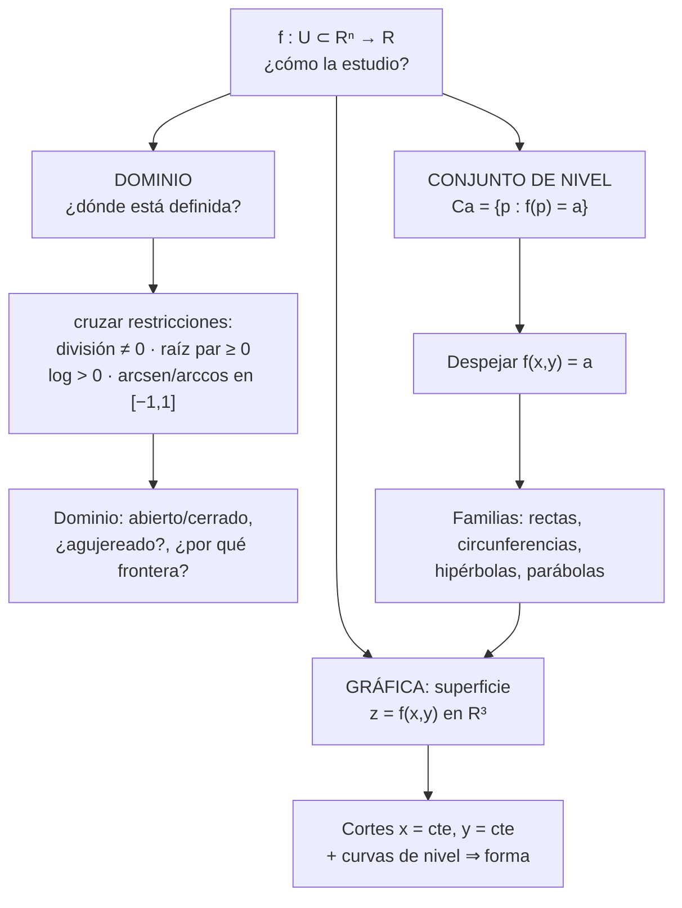
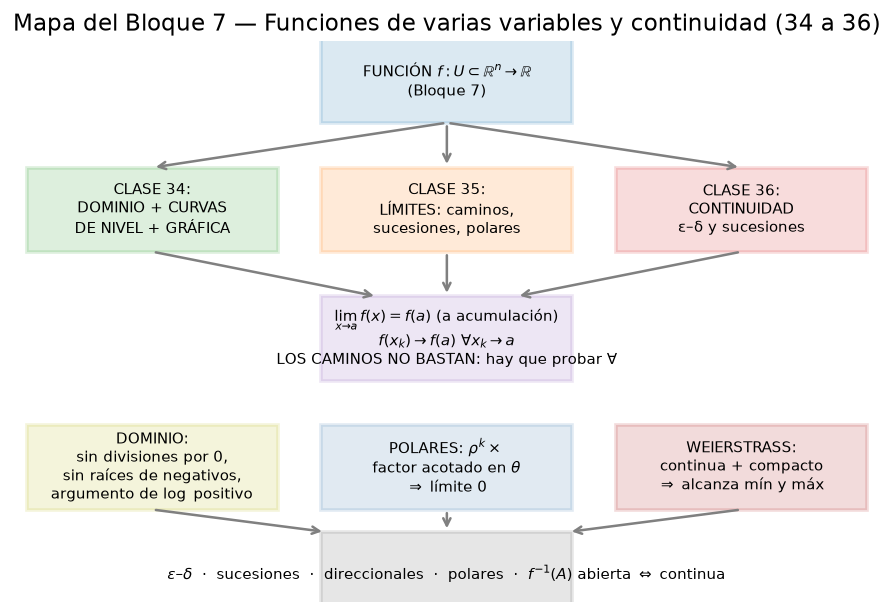
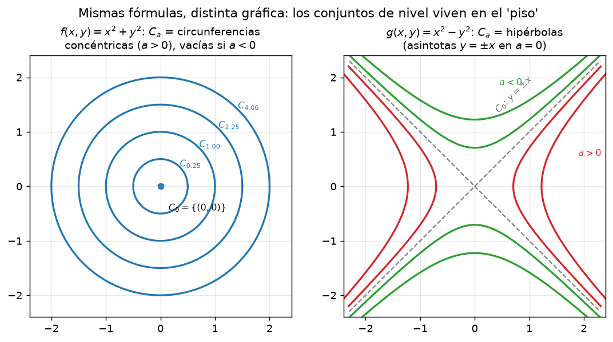
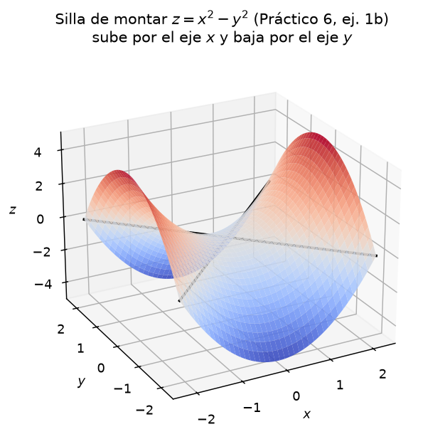
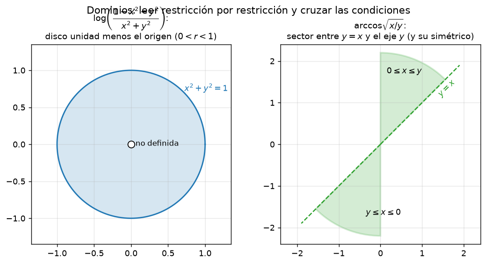

# Clase 34 — Dominio, gráfica y conjuntos de nivel

> **Bloque 7 · Funciones de varias variables y continuidad · Dificultad: inicial · Tiempo estimado: 110 min**

Empezamos el Bloque 7: después de aprender a movernos en $\mathbb{R}^n$ (bolas, abiertos, cerrados, compactos), toca **estudiar funciones** $f:U\subseteq\mathbb{R}^n\to\mathbb{R}$. El primer paso es siempre el mismo: **¿dónde están definidas?** (el dominio), **¿cómo se ven?** (la gráfica) y **¿qué familias de curvas describen sus valores?** (los conjuntos de nivel). Con esas tres herramientas resolvemos los ejercicios 1 a 3 del Práctico 6.

---

## 🎯 Objetivos

1. **Definir** función de varias variables, dominio, gráfica y **conjunto de nivel** (notas 2024, §6.1).
2. Decidir el **dominio natural** cruzando todas las **restricciones** (división, raíz par, $\log$, $\arcsin/\arccos$, $\min/\max$).
3. **Calcular y dibujar** conjuntos de nivel de las familias básicas: rectas, circunferencias, hipérbolas, parábolas.
4. **Bosquejar la gráfica** combinando curvas de nivel y cortes con los planos $x=\text{cte}$, $y=\text{cte}$ (paraboloide, silla, cono).
5. Resolver el **Práctico 6, ejercicios 1 a 3** y problemas de parcial paso a paso.

---

## 🗺️ Mapa de la clase

---

## 🧱 Repaso / ideas previas

Del **Bloque 6 (topología)**: una bola es $B(p,r)=\{x:\|x-p\|<r\}$ y la **reducida** $B^*(p,r)$ es la misma bola sin el centro. Los conjuntos que aparecerán como dominios son los que ya sabemos clasificar: **abiertos** (por ejemplo un disco sin su borde), **cerrados** (con el borde) o **ninguno de los dos**.

De **una variable** (bloques 0 y 1): el gráfico de $y=\varphi(x)$ es la curva $\{(x,\varphi(x))\}$; sus **ceros** son el "conjunto de nivel $0$". Vamos a generalizar exactamente eso.

De la **clase 4 (cuádricas)**: ya conocemos las superficies que van a aparecer una y otra vez:

| Superficie | Ecuación | Corte con $y=0$ |
|---|---|---|
| Paraboloide | $z=x^2+y^2$ | parábola $z=x^2$ |
| Cono | $z=\sqrt{x^2+y^2}$ | "V" $z=|x|$ |
| Silla (hiperbólico) | $z=x^2-y^2$ | parábola $z=x^2$ |

> 💡 **Idea central:** una función $f:\mathbb{R}^2\to\mathbb{R}$ tiene **un solo gráfico** (una superficie en $\mathbb{R}^3$), pero **infinitas** curvas de nivel. Ambas miradas se complementan: ver *muchas* curvas de nivel en el piso ayuda a imaginar la superficie, y los cortes verticales confirman la forma.

---

## 📘 Teoría

> **Definición 34.1 (notas 2024, §6.1).** Una **función** $f:U\subseteq\mathbb{R}^n\to\mathbb{R}$ consta de un **dominio** $U$, un **codominio** ($\mathbb{R}$) y una **regla** que a cada $p\in U$ le asigna un único $f(p)\in\mathbb{R}$.

El **dominio natural** es el mayor subconjunto de $\mathbb{R}^n$ donde la fórmula tiene sentido. Para calcularlo se cruzan **todas** estas condiciones:

| Aparece | Restricción |
|---|---|
| $\dfrac{1}{g}$ | $g\neq 0$ |
| $\sqrt[2k]{g}$ | $g\geq 0$ |
| $\log g$ | $g>0$ |
| $\arcsin g,\ \arccos g$ | $-1\leq g\leq 1$ |
| $g^{h}$ (exponente variable) | $g>0$ |
| $\min\{g,h\}$, $\max\{g,h\}$ | siempre definidos (¡pero los niveles se parten!) |

> **Definición 34.2 (notas 2024, §6.1 — gráfica).** La **gráfica** de $f:U\subseteq\mathbb{R}^n\to\mathbb{R}$ es
> $$\operatorname{graf}(f)=\{(p,f(p)):p\in U\}\subseteq\mathbb{R}^{n+1}.$$
> Si $n=1$ es una **curva**; si $n=2$ es una **superficie** de $\mathbb{R}^3$; para $n\geq 3$ no se puede dibujar (haría falta $\mathbb{R}^{n+1}$).

> **Definición 34.3 (notas 2024, §6.1 — conjunto de nivel).** Para $a\in\mathbb{R}$,
> $$C_a=\{p\in U:f(p)=a\}=f^{-1}\big(\{a\}\big)\subseteq U.$$
> Es un subconjunto del **dominio** (vive "en el piso", $\mathbb{R}^n$), y geométricamente es la **intersección de la gráfica con el plano horizontal $z=a$** (proyectada al piso).

**Cómo se calculan.** Se escribe $f(p)=a$ y se **despeja**; el resultado se interpreta geométricamente. La tabla de familias:

- **Plano inclinado** $f=px+qy$: los niveles son **rectas paralelas** $px+qy=a$.
- **Paraboloide** $f=x^2+y^2$: **circunferencias** $x^2+y^2=a$ para $a>0$; vacío para $a<0$; el origen para $a=0$.
- **Silla** $f=x^2-y^2$: **hipérbolas** $x^2-y^2=a$ ($a\neq0$); en $a=0$, las **dos rectas** $y=\pm x$ (las asíntotas).
- **Cociente** $f=y/x$: **rectas** $y=ax$ (con $x\neq0$), es decir, rectas por el origen **pinchadas** en el origen.

> ⚠️ **Trampa clásica (notas, §6.1).** Dos funciones con las **mismas** familias de curvas de nivel pueden tener **gráficas distintas**: $f=x^2+y^2$ y $g=\sqrt{x^2+y^2}$ tienen ambos circunferencias como niveles, pero los niveles están **separados de otra manera** y las superficies son un paraboloide y un cono. Las curvas de nivel solas *no* determinan la función: hay que mirar también los **cortes verticales** $f(x,0)$ y $f(0,y)$.

**Funciones con $\max$ y $\min$.** Para $f=\max\{u,v\}$: el nivel $a$ es
$$C_a=\Big(\underbrace{\{u=a,\ v\leq a\}}_{\text{gana }u}\Big)\ \cup\ \Big(\underbrace{\{v=a,\ u\leq a\}}_{\text{gana }v}\Big),$$
o sea, la **unión** de dos pedazos, **recortados** por quién gana. La curva donde $u=v$ **pega** los pedazos.

---

## 🖼️ Figuras

**Cómo leer la figura:** el bloque arranca con la **función** y se abre en tres preguntas (dominio, límites, continuidad). Esta clase responde la primera rama: *¿dónde está definida y cómo se ve?*

**Cómo leer la figura:** a la izquierda, todas las curvas son **circunferencias concéntricas** separadas cada vez más juntas (el paraboloide crece igual en toda dirección). A la derecha, la silla tiene **hipérbolas**: en $a=0$ quedan las rectas $y=\pm x$, que son las **asíntotas** de todas las demás. Esa misma fórmula $x^2-y^2$, con $a=0$, será decisiva para mostrar que un límite **no existe**.

**Cómo leer la figura:** a lo largo del eje $x$ la silla **sube** (parábola hacia arriba) y a lo largo del eje $y$ **baja** (parábola hacia abajo). En el origen la superficie tiene un **punto silla**: no es ni máximo ni mínimo. Las dos líneas negras son $y=x$ e $y=-x$, el nivel $z=0$.

**Cómo leer la figura:** izquierda, el dominio de $\log\!\big(\tfrac{1-x^2-y^2}{x^2+y^2}\big)$ es el **disco unidad pinchado**: hacen falta $r^2<1$ (numerador positivo) **y** $r\neq0$ (denominador no nulo). Derecha, el dominio de $\arccos\sqrt{x/y}$ son dos **sectores** simétricos entre la recta $y=x$ y el eje $y$: la condición $0\leq x/y\leq 1$ fuerza a que $x$ e $y$ tengan el mismo signo y $|x|\leq|y|$.

---

## ✏️ Ejercicios resueltos paso a paso — Práctico 6, Ejercicios 1 a 3

### Ejercicio 1a (Práctico 6, ej. 1a). $\;f(x,y)=x^2+y^2$

**Dominio.** Es un polinomio: no hay restricciones.
$$U=\mathbb{R}^2\quad(\text{abierto y cerrado a la vez: todo el plano}).$$

**Conjuntos de nivel.**
$$C_a=\{(x,y):x^2+y^2=a\}=\begin{cases}\text{circunferencia de radio }\sqrt a & a>0,\\[2pt] \{(0,0)\} & a=0,\\[2pt] \varnothing & a<0.\end{cases}$$

**Gráfica.** Los cortes $f(x,0)=x^2$ y $f(0,y)=y^2$ son parábolas: la superficie es el **paraboloide** de revolución (Figura izquierda de `b7_nivel_cuadrados`).

### Ejercicio 1b (Práctico 6, ej. 1b). $\;f(x,y)=x^2-y^2$

**Dominio.** $U=\mathbb{R}^2$.

**Conjuntos de nivel.** $x^2-y^2=a$:
- $a>0$: **hipérbolas** con vértices en $(\pm\sqrt a,0)$ (abren hacia los lados);
- $a<0$: **hipérbolas** con vértices en $(0,\pm\sqrt{-a})$ (abren hacia arriba/abajo);
- $a=0$: $x^2=y^2$, es decir, las **dos rectas** $y=x$ e $y=-x$.

**Gráfica.** $f(x,0)=x^2$ (sube) y $f(0,y)=-y^2$ (baja): la **silla de montar** (notas, Ejercicio 6.2 y `b7_silla`).

### Ejercicio 1d (Práctico 6, ej. 1d). $\;f(x,y)=\dfrac{y}{x}$

**Dominio.** Hace falta $x\neq0$ (no se puede dividir por cero):
$$U=\{(x,y)\in\mathbb{R}^2:x\neq0\}=\mathbb{R}^2\setminus\{\text{eje }y\}.$$
Es un conjunto **abierto** (complemento de una recta).

**Conjuntos de nivel.** $\dfrac{y}{x}=a\iff y=ax$ (con $x\neq0$). Son **rectas por el origen**, a las que hay que **quitarle el propio origen** (porque allí $x=0$ y la función no está definida):
$$C_a=\{(x,ax):x\neq0\}.$$

**Gráfica.** Es un **plano** $z=y/x$ que en realidad es una superficie reglada: cada recta del nivel $a$ se eleva a la altura constante $a$. El eje $y$ (donde $x=0$) es una **asíntota vertical**.

### Ejercicio 1f (Práctico 6, ej. 1f). $\;f(x,y)=\max\{x^2,\;y^3\}$

**Dominio.** $\max$ siempre está definido: $U=\mathbb{R}^2$.

**Conjuntos de nivel.** Uso la regla del $\max$ de la teoría. Para $a\geq0$:
$$C_a=\underbrace{\{x^2=a,\ y^3\leq a\}}_{\text{gana }x^2}\ \cup\ \underbrace{\{y^3=a,\ x^2\leq a\}}_{\text{gana }y^3}
=\underbrace{\{x=\pm\sqrt a,\ y\leq\sqrt[3]{a}\}}_{\text{dos semirrectas verticales}}\ \cup\ \underbrace{\{y=\sqrt[3]{a},\ |x|\leq\sqrt a\}}_{\text{un segmento horizontal}}.$$
Para $a<0$ es **vacío** (no puede ganar $x^2\geq0$ ni $y^3=a<0$ con $x^2\leq a<0$). Cada nivel $a>0$ es entonces una letra "$\Pi$": dos semirrectas unidas por un segmento, con el **codo** en el punto $(\pm\sqrt a,\sqrt[3]a)$.

**Gráfica.** Donde $x^2>y^3$ la altura es $x^2$ (un "techo" parabólico); donde $y^3>x^2$ es $y^3$. Las dos piezas se **pegan** a lo largo de la curva $x^2=y^3$.

### Ejercicio 1g (Práctico 6, ej. 1g). $\;f(x,y)=\max\{x^2,\;x+y\}$

**Conjuntos de nivel.** Igual que antes, para $a$ real:
$$C_a=\{x^2=a,\ x+y\leq a\}\ \cup\ \{x+y=a,\ x^2\leq a\}.$$
- Para $a<0$: la primera rama es vacía ($x^2=a$ imposible); la segunda exige $x^2\leq a<0$, también imposible. Luego $C_a=\varnothing$ para $a<0$.
- Para $a=0$: $\{x=0,\ y\leq0\}\cup\{y=-x,\ x=0\}=\{(0,y):y\leq0\}$: la semirrecta negativa del eje $y$.
- Para $a>0$: dos puntos $x=\pm\sqrt a$ con $x+y\leq a$, más el **segmento** de la recta $x+y=a$ con $|x|\leq\sqrt a$. Se distinguen **dos piezas** separadas: la "V" de arriba (donde gana $x^2$) aparece recién para $a>0$.

**Moraleja:** los niveles de un $\max$ **no** forman una familia suave continua; se **parten** y cambian de forma al cruzar $a=0$, justo donde las dos piezas empatan.

### Ejercicio 2a (Práctico 6, ej. 2a). $\;f(x,y,z)=\dfrac{x}{x-y-z}$

**Dominio.** El denominador no puede ser cero: $x-y-z\neq0$, es decir, se excluye el **plano** $\Pi:x-y-z=0$.
$$U=\mathbb{R}^3\setminus\Pi\quad(\text{abierto}).$$

**Conjuntos de nivel.** $\dfrac{x}{x-y-z}=a$ con $a\in\mathbb{R}$. Multiplicando (el denominador es $\neq0$):
$$x=a(x-y-z)\iff (1-a)x+ay+az=0.$$
Es un **plano que pasa por el origen** para todo $a$ (todos contienen a $(0,0,0)$). Excepciones: para $a=1$ queda $y+z=0$; para $a=0$ queda $x=0$. Notar que **ningún** plano de nivel es paralelo a $\Pi$ (el plano excluido): las preimágenes de un valor son planos "del otro lado".

### Ejercicio 2b (Práctico 6, ej. 2b). $\;f(x,y,z)=\mathrm{sen}(x^2+y^2+z^2)$

**Dominio.** $U=\mathbb{R}^3$ (el seno está definido en todo $\mathbb{R}$).

**Conjuntos de nivel.** Sea $r^2=x^2+y^2+z^2$. La ecuación es $\mathrm{sen}(r^2)=a$.
- Si $|a|>1$: $C_a=\varnothing$.
- Si $|a|\leq1$: hay **infinitas** soluciones de $r^2=\arcsin$-ramas:
$$r^2=\alpha_k:=\arcsin a+2k\pi\quad\text{o}\quad r^2=\beta_k:=\pi-\arcsin a+2k\pi,\qquad k\in\mathbb{Z},\ k\text{ con }r^2\geq0.$$
Cada valor positivo de $r^2$ da una **esfera** de radio $\sqrt{r^2}$ centrada en el origen. Por lo tanto $C_a$ es una **familia infinita de esferas concéntricas** (dos radios por cada vuelta del seno). Para $a=0$ se agrega $r=0$: la esfera degenerada (el origen).

> 💡 No te asustes: la clave es que $C_a$ **no depende del signo** de las coordenadas sino solo de $x^2+y^2+z^2$. Todo lo radial da esferas.

### Ejercicio 3a (Práctico 6, ej. 3a). $\;f(x,y)=\dfrac{1}{\sqrt{x^2+y^2}}$

**Dominio.** Hace falta $x^2+y^2>0$ (raíz no nula y radicando positivo):
$$U=\mathbb{R}^2\setminus\{(0,0)\}\quad(\text{plano pinchado, abierto}).$$

**Conjuntos de nivel.** $\dfrac{1}{\sqrt{x^2+y^2}}=a$. Como el lado izquierdo es **positivo**, para $a\leq0$ no hay solución. Para $a>0$:
$$\sqrt{x^2+y^2}=\frac1a\iff x^2+y^2=\frac{1}{a^2},$$
una **circunferencia** de radio $1/a$. Cuanto más chico el valor $a$ (cerca de $0$), **más grande** el radio: la "montaña" se eleva hacia el origen y se aplana al alejarse.

### Ejercicio 3b (Práctico 6, ej. 3b). $\;f(x,y)=\log\!\left(\dfrac{1-x^2-y^2}{x^2+y^2}\right)$

**Dominio.** Dos condiciones simultáneas:
$$\frac{1-x^2-y^2}{x^2+y^2}>0\iff 1-r^2>0\ \text{y}\ r^2\neq0\iff 0<r^2<1.$$
$$U=\{(x,y):0<x^2+y^2<1\}\quad(\text{disco unidad sin el centro, abierto}).$$

**Conjuntos de nivel.** Con $r^2=x^2+y^2$, $\log\frac{1-r^2}{r^2}=a\iff\frac{1-r^2}{r^2}=e^{a}\iff 1=r^2(e^a+1)$, o sea
$$C_a=\Big\{x^2+y^2=\frac{1}{1+e^{a}}\Big\},$$
**circunferencias** centradas en el origen de radio $<1$ (siempre dentro del dominio). A mayor $a$, mayor el numerador $1-r^2$… y menor el radio: los niveles se **amontonan contra el origen**, que es la frontera que no se toca.

### Ejercicio 3d (Práctico 6, ej. 3d). $\;f(x,y)=\mathrm{tg}\!\left(\dfrac{x^2}{y}\right)$

**Dominio.** Hace falta $y\neq0$ **y** que el argumento de la tangente no sea una singularidad (donde el $\cos$ se anula):
$$\frac{x^2}{y}\neq\frac{\pi}{2}+k\pi,\quad k\in\mathbb{Z}.$$
Entonces $U=\{(x,y):y\neq0\}\setminus\{(x,y):x^2=(\tfrac\pi2+k\pi)y\}$: el plano sin el eje $x$ y sin las **parábolas** $y=x^2/(\tfrac\pi2+k\pi)$.

**Conjuntos de nivel.** $\mathrm{tg}(x^2/y)=a\iff x^2/y=\mathrm{arctg}(a)+k\pi\iff$
$$C_a:\quad y=\frac{x^2}{\mathrm{arctg}(a)+k\pi},\qquad k\in\mathbb{Z},$$
esto es, una **familia de parábolas** que pasan por el origen (una por cada rama del arco tangente), salvo cuando el denominador se anula.

### Ejercicio 3e (Práctico 6, ej. 3e). $\;f(x,y)=\arccos\!\left(\sqrt{\dfrac{x}{y}}\right)$

**Dominio.** Hay que cruzar: la raíz pide $x/y\geq0$ y el arco coseno pide $-1\leq\sqrt{x/y}\leq1$; como la raíz ya es $\geq0$, la segunda condición queda $\sqrt{x/y}\leq1\iff x/y\leq1$. Juntas: $0\leq\dfrac{x}{y}\leq1$, con $y\neq0$.

Con $y>0$: $0\leq x\leq y$. Con $y<0$: al multiplicar cambia el signo, $x$ entre $y$ y $0$ pero en valor absoluto $|x|\leq|y|$. En limpio:
$$U=\{(x,y):0\leq x\leq y,\ y>0\}\ \cup\ \{(x,y):y\leq x<0\}.$$
Son los **dos sectores** (ángulos de $45^\circ$ contra el eje $y$) que muestra `b7_dominio`. La frontera $y=x$ **no tiene el origen** y $x=0$ sí está (allí $\sqrt0=0$).

**Conjuntos de nivel.** $\arccos(\sqrt{x/y})=a$ con $a\in[0,\pi]$ $\iff\sqrt{x/y}=\cos a\iff x/y=\cos^2a$, es decir
$$C_a:\quad y=\frac{x}{\cos^2 a}\quad(\text{restingido a }U),$$
**rectas por el origen** de pendiente $1/\cos^2 a\geq1$, dentro de los sectores.

> ⚠️ **Comparar con el ejercicio 1d:** en $y/x$ los niveles eran *todas* las rectas (pendiente $a$); aquí la pendiente es $\sec^2a\in[1,\infty)$, consistente con que el dominio son solo dos sectores con $|x|\leq|y|$.

---

## 🏛️ Ejercicios de parcial/examen

### Ejercicio (Segundo parcial 2022-2S, ej. 5). Curvas de nivel de $f(x,y)=\max\{x^2+y^2,\ 2x\}$

> ¿Cuál figura se asemeja más a las curvas de nivel de $f(x,y)=\max\{x^2+y^2,\;2x\}$?

**Paso 1 — ¿quién gana dónde?** La frontera es donde las dos expresiones empatan:
$$x^2+y^2=2x\iff x^2-2x+y^2=0\iff (x-1)^2+y^2=1,$$
la circunferencia de centro $(1,0)$ y radio $1$.

**Paso 2 — decidir por zonas.** En el origen $x^2+y^2=0<2x$… evaluamos en un punto interior, por ejemplo $(1,0)$: $x^2+y^2=1$ y $2x=2$, gana $2x$. Un punto exterior, por ejemplo $(3,0)$: $x^2+y^2=9>6=2x$, gana $x^2+y^2$. Entonces:

- **Dentro** del disco $(x-1)^2+y^2<1$: gana $2x$ → el nivel es la **recta vertical** $2x=a$, o sea $x=a/2$ (un segmento, recortado por el disco).
- **Fuera** del disco: gana $x^2+y^2$ → el nivel es la **circunferencia** $x^2+y^2=a$ de radio $\sqrt a$ (su arco externo).

**Paso 3 — armar el dibujo.** Cada nivel es un **arco de circunferencia** centrada en el origen unido a una **cuerda vertical** $x=a/2$ dentro del disco: circunferencias que se "cortan" con una recta en la zona de la derecha.

**Respuesta: la figura (D).** ✔ *(verificada con la solución oficial: "es fácil ver que en el interior de la circunferencia la expresión más grande es $2x$, y en el exterior $x^2+y^2$".)*

### Ejercicio (Segundo parcial 2021-2S, V/F 1). ¿Las circunferencias son niveles de $e^{-x^2-y^2}$?

> Las circunferencias centradas en el origen en $\mathbb{R}^2$ son conjuntos de nivel de $f(x,y)=e^{-x^2-y^2}$.

**Paso 1 — plantear el nivel.** Con $r^2=x^2+y^2$:
$$e^{-r^2}=a.$$

**Paso 2 — despejar.** Como $e^{-r^2}>0$, para $a>0$: $-r^2=\log a\iff r^2=-\log a$. Para $a\geq1$ no hay solución ($r^2<0$); para $0<a<1$, $r^2=-\log a>0$.

**Paso 3 — interpretar.** $C_a$ es la circunferencia $x^2+y^2=-\log a$: **todas las circunferencias centradas en el origen** (de radio $\sqrt{-\log a}$) son niveles (y $a=1$ da el punto $(0,0)$).

**Respuesta: VERDADERO.** ✔

---

## ⚠️ Errores comunes

| Error | Corrección |
|---|---|
| Olvidar una restricción del dominio | Hay que **cruzar todas**: en $\log\frac{1-r^2}{r^2}$ faltan $r\neq0$ **y** $1-r^2>0$ |
| Dibujar los conjuntos de nivel en $\mathbb{R}^3$ | Los niveles $C_a$ viven en el **dominio** ($\mathbb{R}^2$): son curvas del piso, no de la superficie |
| Poner $C_a$ "en el aire" a la altura $a$ | La curva se dibuja en el plano $(x,y)$; es la **proyección** del corte con $z=a$ |
| Creer que las mismas curvas de nivel ⇒ misma función | $x^2+y^2$ y $\sqrt{x^2+y^2}$ comparten la *familia* de circunferencias pero son paraboloide y cono |
| Tratar $a$ como dato fijo y no distinguir casos | Los niveles cambian según $a>0$, $a=0$, $a<0$ (¡mira el paraboloide y la silla!) |
| En un $\max/\min$, resolver "de un tirón" | Hay que **partir**: quién gana en cada zona, y recortar cada pieza |
| Confundir dominio con conjunto de nivel | El dominio es **dónde está definida**; el nivel es **dónde vale $a$** |
| En $y/x$ incluir el origen en $C_a$ | $C_a=\{y=ax\}$ **sin** el origen: allí la función no existe |

---

## 🔗 Conexiones

- **Clase 35 (límites):** para estudiar $\lim_{(x,y)\to(0,0)}f$ vamos a usar **curvas del dominio** como caminos; los niveles de la silla ($y=\pm x$) y las parábolas de estos ejercicios son exactamente los "caminos" que dan resultados distintos.
- **Clase 36 (continuidad):** una función es continua en los puntos **interiores del dominio**; el dominio que calculamos aquí (abierto, cerrado, agujereado) decide qué puntos hay que chequear.
- **Bloque 8 (diferenciabilidad):** el **gradiente es perpendicular a las curvas de nivel** y el **plano tangente**; toda la geometría de esta clase se reusa allí.
- **Bloque 9 (Lagrange):** los conjuntos de nivel son las **restricciones** de los problemas de extremos con vínculo.
- **Bloque 10 (integrales múltiples):** primero se **dibuja el dominio** (tal como aprendimos acá) y recién después se integra.

---

## ✅ Autoevaluación

1. Dar el dominio natural de $f(x,y)=\dfrac{\log y}{x-1}$.
2. Hallar y describir los conjuntos de nivel de $f(x,y)=xy$.
3. ¿Qué familia de curvas son los niveles de $f(x,y)=x^2+4y^2$? ¿Y los de $g(x,y)=x^2-y^2$?
4. Dominio y niveles de $f(x,y)=\sqrt{4-x^2-y^2}$.
5. Explicar con palabras la diferencia entre *gráfica* y *conjunto de nivel*.
6. Describir los niveles de $f(x,y)=\max\{|x|,|y|\}$.
7. (V/F) Si dos funciones tienen las mismas curvas de nivel, entonces son la misma función.

### Respuestas

1. $y>0$ (argumento del $\log$) **y** $x\neq1$ (denominador): $U=\{y>0,\ x\neq1\}$.
2. $xy=a$: **hipérbolas** $y=a/x$ con asíntotas los ejes; para $a=0$, el **par de ejes** $xy=0$.
3. $x^2+4y^2=a$: **elipses** ($a>0$) de semiejes $\sqrt a$ y $\sqrt a/2$; vacío si $a<0$; el origen si $a=0$. $g$: **hipérbolas** (como el ej. 1b).
4. Dominio: $4-x^2-y^2\geq0\iff x^2+y^2\leq4$: el **disco cerrado** de radio $2$ (cerrado, con el borde). Niveles $a\in[0,2]$: **circunferencias** de radio $\sqrt{4-a^2}$.
5. La gráfica es la **superficie** $\{(x,y,f(x,y))\}$ en $\mathbb{R}^3$; el nivel $C_a$ es la **curva** $\{f=a\}$ en el dominio $\mathbb{R}^2$ (una vista "desde arriba" del corte con $z=a$).
6. $C_a$ para $a>0$: el **borde del cuadrado** $[-a,a]^2$ (lados $x=\pm a$, $|y|\leq a$ e $y=\pm a$, $|x|\leq a$); para $a=0$: el origen; para $a<0$: vacío.
7. **FALSO:** $x^2+y^2$ y $\sqrt{x^2+y^2}$ tienen las mismas circunferencias como familia de niveles y son funciones distintas (paraboloide vs cono).

---

**⬅️ Anterior:** [Clase 33 — Repaso de topología y pruebas](33_topologia_repaso.md) · **➡️ Siguiente:** [Clase 35 — Límites: direccionales, iterados y coordenadas polares](35_limites_direccionales_polares.md)
