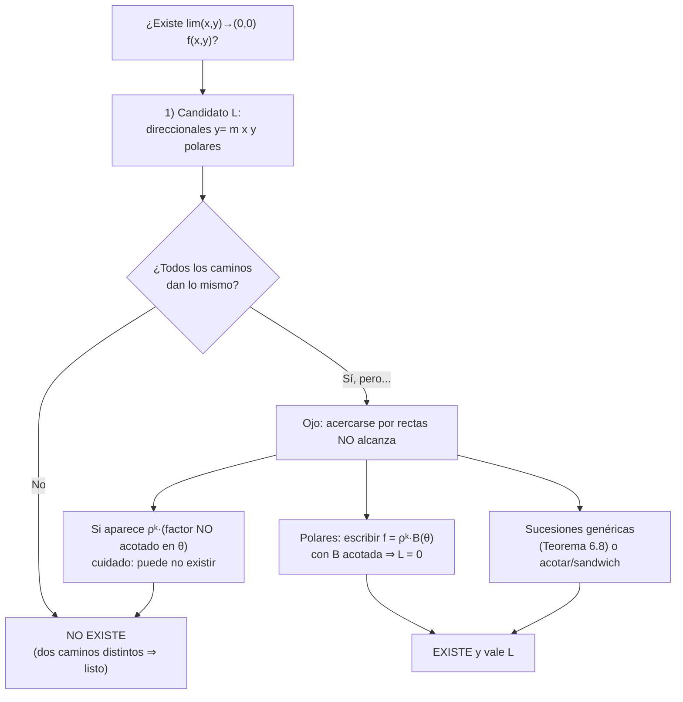
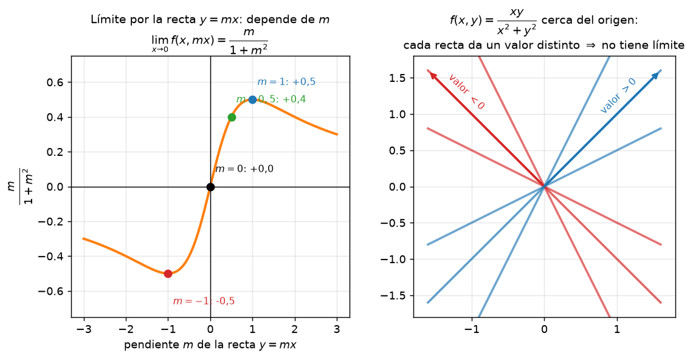
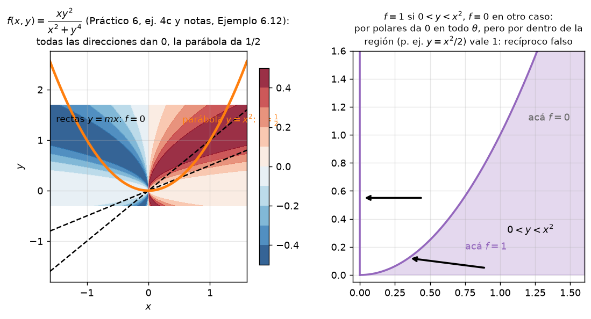
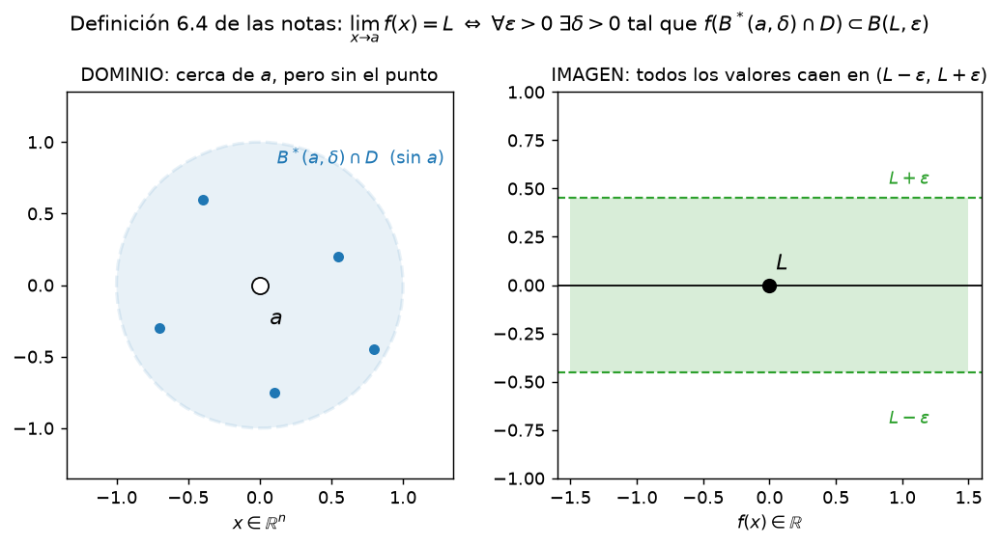

# Clase 35 — Límites: direccionales, iterados y coordenadas polares

> **Bloque 7 · Funciones de varias variables y continuidad · Dificultad: media · Tiempo estimado: 125 min**

En una variable, acercarse a un punto tiene **dos** formas (por izquierda o por derecha). En el plano hay **infinitas**: podemos llegar al origen por cualquier recta, por una parábola, en espiral, etc. Esa es la dificultad nueva, y también la herramienta nueva: para **negar** un límite alcanza con **dos caminos** que den resultados distintos; pero para **probarlo** hay que controlar **todos** los caminos a la vez, y ahí entran las **coordenadas polares**. Esta clase resuelve los ejercicios 4 a 10 del Práctico 6.

---

## 🎯 Objetivos

1. **Definir** $\lim_{x\to a}f(x)=L$ con la definición $\varepsilon$–$\delta$ en varias variables (**Definición 6.4**).
2. Usar la **caracterización por sucesiones** (**Teorema 6.8**) para probar y, sobre todo, para **negar** límites.
3. Calcular **límites direccionales** (por rectas) y **límites iterados**, sabiendo exactamente qué prueban y qué **no**.
4. Calcular límites con **coordenadas polares** y el criterio "$\rho^{k}\times$ factor acotado".
5. Resolver los **ejercicios 4 a 10 del Práctico 6** y problemas de parcial paso a paso.

---

## 🗺️ Mapa de la clase

---

## 🧱 Repaso / ideas previas

- **Límite en una variable:** $\lim_{x\to a}\varphi(x)=L$ significa que $\varphi(x)$ se acerca a $L$ cuando $x$ se acerca a $a$. Todo el cálculo de límites (Taylor, equivalentes, sandwich) sigue valiendo para las funciones de $\theta$ o de $m$ que aparezcan.
- **Sucesiones (Bloque 3):** $x_k\to a$ y el **criterio de divergencia** por subsucesiones. La caracterización por sucesiones de esta clase es la versión funcional del mismo juego.
- **Topología (Bloque 6):** para definir el límite, $a$ tiene que ser **punto de acumulación** del dominio $D$; si no, no hay a qué acercarse. La bola reducida $B^*(a,\delta)$ es "todo lo cercano **salvo** el propio $a$".
- **Polares (clase 6, complejos):** $x=\rho\cos\theta$, $y=\rho\sin\theta$, con $\rho\geq0$ la distancia al origen y $\theta\in[0,2\pi)$ la dirección.

---

## 📘 Teoría

> **Definición 35.1 (notas 2024, Definición 6.4).** Sea $D\subseteq\mathbb{R}^n$, $f:D\to\mathbb{R}$ y $a$ un **punto de acumulación** de $D$. Decimos que
> $$\lim_{x\to a}f(x)=L$$
> si y solo si
> $$\forall\varepsilon>0\ \exists\delta>0\ \text{ tal que }\ \forall x\in B^*(a,\delta)\cap D\ \text{ se cumple }\ f(x)\in B(L,\varepsilon).$$
> Dos observaciones clave: (i) $f(a)$ **no influye** (no hace falta que $f$ esté definida en $a$); (ii) $\|x-a\|<\delta$ es exactamente "estar en la bola".

> **Teorema 35.2 (notas 2024, Teorema 6.8 — caracterización por sucesiones).** Con las mismas hipótesis,
> $$\lim_{x\to a}f(x)=L\iff \text{para toda sucesión } x_k\in D\setminus\{a\}\text{ con } x_k\to a,\ \text{ vale } f(x_k)\to L.$$

**Cómo se usa en la práctica.**

| Objetivo | Herramienta |
|---|---|
| **Negar** que el límite existe | Dos caminos (o dos sucesiones) $x_k,y_k\to a$ con $\lim f(x_k)\neq\lim f(y_k)$ |
| **Probar** que existe y vale $L$ | Una **sucesión genérica** $x_k\to a$ y mostrar $f(x_k)\to L$ — o polares/sandwich |
| Encontrar el **candidato** $L$ | Direccionales + polares |

> ⚠️ **Regla de oro.** Si todos los caminos que probás dan lo mismo, **no** probaste que el límite existe: solo que *si* existe, vale eso. Ver los **Ejemplos 6.12 y 6.15** y la **Observación 6.13** de las notas.

### Límites direccionales

Nos acercamos por las **rectas** $y=mx$ (más la vertical $x=0$):
$$\ell(m)=\lim_{x\to0}f(x,mx),\qquad \ell_\perp=\lim_{y\to0}f(0,y).$$
Si $\ell(m)$ **depende de $m$**, el límite doble **no existe**. Si no depende de $m$, $L$ es un **candidato** (¡nada más que eso!).

### Límites iterados

Son los límites anidados
$$\lim_{x\to0}\left(\lim_{y\to0}f(x,y)\right)\qquad\text{y}\qquad\lim_{y\to0}\left(\lim_{x\to0}f(x,y)\right).$$
Se calculan **primero en una** variable y **después en la otra** (por eso "iterados"). Advertencias:
1. Pueden existir, **coincidir**, y el límite doble **no** existir. Ejemplo: $f=\dfrac{xy}{x^2+y^2}$ tiene ambos iterados $=0$, pero los direccionales dan $\dfrac{m}{1+m^2}$ (no existe).
2. Pueden **no coincidir**: entonces el límite tampoco existe. Por ejemplo $f=\dfrac{xy}{x^2+y^2}$… o el clásico $\dfrac{x-y}{x+y}$: iterado en $x$ da $1$, y en $y$ da $-1$.

> 💡 Los iterados **no** son "caminos del plano": son procesos de dos etapas. Sirven como pista, jamás como prueba.

### Coordenadas polares

Escribimos $x=\rho\cos\theta$, $y=\rho\sin\theta$. Cuando $(x,y)\to(0,0)$, resulta $\rho\to0^+$ **independientemente de** $\theta$. La función pasa a ser $g(\rho,\theta)=f(\rho\cos\theta,\rho\sin\theta)$.

> **Criterio 35.3 (límite 0 por polares).** Si $g(\rho,\theta)=\rho^{k}\,B(\theta)$ con $k>0$ y $B$ **acotada** en $[0,2\pi)$, entonces
> $$\lim_{(x,y)\to(0,0)}f(x,y)=0.$$

**Demostración.** Sea $M$ con $|B(\theta)|\leq M$. Entonces $|g(\rho,\theta)|=\rho^k|B(\theta)|\leq M\rho^k$, y $\rho^k\to0$ cuando $\rho\to0^+$. Dado $\varepsilon>0$, basta tomar $\delta=(\varepsilon/M)^{1/k}$: si $\rho<\delta$ (o sea, $(x,y)\in B^*((0,0),\delta)$), entonces $|f(x,y)|<\varepsilon$. $\blacksquare$

> ⚠️ **El factor tiene que estar acotado.** En el **Ejemplo 6.15** de las notas, $f=\frac{xy}{x+y}$ da por polares $\rho\cdot\frac{\cos\theta\sin\theta}{\cos\theta+\sin\theta}$, y el segundo factor se **dispara** cerca de $\theta=-45^\circ$ (¡denominador $\to0$!): no está acotado y efectivamente el límite no existe. Suspender el criterio cuando el factor de $\theta$ no tiene cota.

**Otra herramienta (Práctico 6, ej. 6a).** Si $\lim_{x\to p}f(x)=0$ y $g$ es **acotada** en una bola reducida de $p$, entonces $\lim_{x\to p}f(x)g(x)=0$. Es el mismo argumento del criterio.

**El ejercicio 4 del práctico (caracterización polar).** Vale la pena entenderlo como *teorema*:

- **(a)** $\lim_{(x,y)\to(0,0)}f(x,y)=L$ **si y solo si** $\forall\varepsilon>0\ \exists\delta>0$ con $|g(r,\theta)-L|<\varepsilon$ para todo $r\in(0,\delta)$ y todo $\theta\in[0,2\pi)$. *Prueba:* identificar $\|(x,y)\|=r$; cada punto del plano salvo el origen corresponde a un par $(r,\theta)$, de modo que "$\|(x,y)\|<\delta$" y "$r<\delta$" son **la misma** condición.
- **(b)** Si el límite doble vale $L$, entonces $\lim_{r\to0^+}g(r,\theta)=L$ para **cada** $\theta$ fijo. *Prueba:* usar (a) con el mismo $\delta$; es la restricción a la dirección $\theta$. (Fijar $\theta$ es exactamente un límite direccional.)
- **(d)** El **recíproco de (b) es falso**: puede ocurrir $\lim_{r\to0^+}g(r,\theta)=L$ para todo $\theta$ y el límite **no existir** (ver el ejercicio 4c(iii) resuelto abajo).
- **(e)** Si $g(r,\theta)=h(r)k(\theta)$ con $k$ **acotada** y $\lim_{r\to0^+}h(r)=0$, entonces $\lim_{(x,y)\to(0,0)}f(x,y)=0$. *Prueba:* es exactamente el Criterio 35.3 con $B=k$ y $h(r)\to0$ (aunque $h$ no sea una potencia $\rho^k$).

---

## 🖼️ Figuras

**Cómo leer la figura:** a la izquierda, el valor del límite por la recta $y=mx$ en función de $m$: $\frac{m}{1+m^2}$. A la derecha, las rectas dibujadas en el plano, coloreadas por ese valor. Como el color (el límite) **cambia** al girar la recta, el límite doble **no existe**. Formalmente: por $y=0$ da $0$ y por $y=x$ da $\frac12$.

**Cómo leer la figura:** a la izquierda, el "mapa" de $f=\frac{xy^2}{x^2+y^4}$. Todas las rectas $y=mx$ (punteadas) dan $f\to0$, pero la **parábola** $y=x^2$ (naranja) da $f\to\frac12$: dos caminos, dos resultados, no hay límite (notas, Ejemplo 6.12). A la derecha, la función del ejercicio 4c(iii): vale $1$ dentro de la región $0<y<x^2$ y $0$ fuera. Por polares (dirección fija) siempre da $0$, pero el camino "por dentro" de la región da $1$: **recíproco de (b) falso**.

**Cómo leer la figura:** la condición de límite es **uniforme en todas las direcciones**: un mismo $\delta$ sirve para *toda* la bola reducida, y ninguna flecha puede escaparse de la franja verde. Si por algún camino la función se va de la franja, ese camino es testigo de que el límite (ese $L$) no sirve.

---

## ✏️ Ejercicios resueltos paso a paso — Práctico 6, Ejercicios 4 a 10

### Ejercicio 1 (Práctico 6, ej. 5a). Probar que **no** existe $\displaystyle\lim_{(x,y)\to(0,0)}\frac{x^2-y^2}{x^2+y^2}$

**Paso 1 — dos direcciones.** Restringimos a rectas:

- Eje $x$ ($y=0$): $\ f(x,0)=\dfrac{x^2}{x^2}=1\ \Rightarrow\ \ell=1$.
- Eje $y$ ($x=0$): $\ f(0,y)=\dfrac{-y^2}{y^2}=-1\ \Rightarrow\ \ell=-1$.

**Paso 2 — concluir (Teorema 35.2).** Las sucesiones $\left(\frac1k,0\right)$ y $\left(0,\frac1k\right)$ van al origen y sus imágenes tienden a $1$ y a $-1$. Como los resultados **difieren**, el límite **no existe**. ✔

> 💡 Esta es la función "de la silla": su nivel $0$ son las rectas $y=\pm x$, y por eso **girando** con ángulo $\theta$ el valor es $\cos2\theta$: depende de la dirección.

### Ejercicio 2 (Práctico 6, ej. 5b). Probar que **no** existe $\displaystyle\lim_{(x,y)\to(0,0)}\frac{2x^3y}{(x^2+y^2)^2}$

**Paso 1 — rectas.** Por $y=mx$:
$$f(x,mx)=\frac{2x^3(mx)}{(x^2+m^2x^2)^2}=\frac{2mx^4}{x^4(1+m^2)^2}=\frac{2m}{(1+m^2)^2}.$$
(No depende de $x$: para cada recta es **constante**.)

**Paso 2 — dos pendientes.** Con $m=0$: $0$. Con $m=1$: $\dfrac{2}{4}=\dfrac12$.

**Paso 3 — concluir.** $0\neq\frac12$ ⟹ **no existe**. ✔

> ⚠️ Los direccionales **todos** son finitos y bien definidos… y aun así el límite no existe. Los direccionales son un test de **necesidad**, no de suficiencia.

### Ejercicio 3 (Práctico 6, ej. 5c). Probar que **no** existe $\displaystyle\lim_{(x,y)\to(0,0)}\frac{xy}{x+y}$ (con $f=0$ si $x+y=0$)

**Paso 1 — rectas.** Por $y=mx$ con $m\neq-1$:
$$f(x,mx)=\frac{mx^2}{(1+m)x}=\frac{m}{1+m}x\to0.$$
Por $x=0$ la definición da $0$. Todos los direccionales dan $0$.

**Paso 2 — camino curvo.** Acercarse por la parábola $y=-x+x^2$ (así $x+y=x^2\neq0$):
$$f(x,-x+x^2)=\frac{x(-x+x^2)}{x^2}=\frac{-x^2+x^3}{x^2}=-1+x\to-1.$$

**Paso 3 — concluir.** $0\neq-1$ ⟹ **no existe**. ✔ *(Es el Ejemplo 6.15 de las notas; por polares se ve que el factor en $\theta$ es $\frac{\cos\theta\sin\theta}{\cos\theta+\sin\theta}$, que se dispara cerca de $\theta=-45^\circ$.)*

### Ejercicio 4 (Práctico 6, ej. 4c y 4d). Los tres ejemplos del práctico y el recíproco falso

**(i) $f(x,y)=\dfrac{x}{\sqrt{x^2+y^2}}$.** Por polares:
$$g(r,\theta)=\frac{r\cos\theta}{r}=\cos\theta\quad(\text{independiente de }r).$$
Cada dirección da $\cos\theta$: por el eje $x$, $1$; por el eje $y$, $0$. **No existe** el límite, y $\lim_{r\to0^+}g(r,\theta)=\cos\theta$ depende de $\theta$.

**(ii) $f=\frac{y}{x}$ si $x\neq0$, y $f=0$ si $x=0$.** Por polares, para $\theta\neq\frac\pi2,\frac{3\pi}2$:
$$g(r,\theta)=\frac{r\sin\theta}{r\cos\theta}=\mathrm{tg}\,\theta,$$
y en las direcciones verticales vale $0$ por definición. Entonces $\lim_{r\to0^+}g(r,\theta)=\mathrm{tg}\,\theta$ (con $0$ en las verticales): depende de la dirección ⟹ **no existe**. (Coincide con lo que ya sabíamos del ejercicio 1d.)

**(iii) $f=\begin{cases}1,&0<y<x^2\\ 0,&\text{en otro caso}\end{cases}$.** Por polares:
$$g(r,\theta)=1\iff 0<r\sin\theta<r^2\cos^2\theta\iff \sin\theta<r\cos^2\theta.$$
**Para cada $\theta$ fijo**, cuando $r\to0^+$ la desigualdad $\sin\theta<r\cos^2\theta$ **falla** (el lado derecho se hace chico, salvo cuando $\sin\theta<0$ o $\sin\theta=0$, y ahí tampoco vale $0<y$). Por lo tanto
$$\lim_{r\to0^+}g(r,\theta)=0\qquad\text{para todo }\theta\in[0,2\pi).$$

**Pero el límite doble no existe:** acercándose por la parábola $y=\dfrac{x^2}{2}$ (que cumple $0<y<x^2$ para $x\neq0$), resulta $f=1$ siempre, así que
$$\lim_{x\to0}f\!\left(x,\tfrac{x^2}{2}\right)=1\neq0.$$

**(d) El recíproco de la parte (b) es falso.** El caso (iii) **es** el contraejemplo: todos los límites a $\theta$ fijo valen $0$, pero el límite doble no existe. Fijar $\theta$ es solo "un camino"; el límite exige controlarlos **todos** con el **mismo** $\delta$. ✔

### Ejercicio 5 (Práctico 6, ej. 4f). Calcular por polares

**(i) $\displaystyle\lim_{(x,y)\to(0,0)}\frac{x^2y}{x^2+y^2}$.** Por polares:
$$\frac{r^2\cos^2\theta\cdot r\sin\theta}{r^2}=r\cos^2\theta\sin\theta.$$
Ahora $|\cos^2\theta\sin\theta|\leq1$ (factor **acotado**) y $r\to0$ ⟹ **el límite es $0$**, por el Criterio 35.3.

**(ii) $\displaystyle\lim_{(x,y)\to(0,0)}\frac{xy}{\sqrt{x^2+y^2}}$.** Por polares:
$$\frac{r^2\cos\theta\sin\theta}{r}=r\cos\theta\sin\theta,\qquad |\cos\theta\sin\theta|\leq\tfrac12.$$
Factor acotado por $r\to0$ ⟹ **el límite es $0$**. ✔

### Ejercicio 6 (Práctico 6, ej. 6). Acotado por algo que tiende a cero

**(a) Probar:** si $\lim_{x\to p}f(x)=0$ y $|g(x)|\leq M$ en una bola reducida de $p$, entonces $\lim_{x\to p}f(x)g(x)=0$.

**Prueba.** Dado $\varepsilon>0$, usemos el límite de $f$ con $\varepsilon'=\varepsilon/M$ (si $M=0$ es trivial): existe $\delta$ con $|f(x)|<\varepsilon/M$ para $x\in B^*(p,\delta)$. Entonces
$$|f(x)g(x)|=|f(x)|\,|g(x)|<\frac{\varepsilon}{M}\cdot M=\varepsilon.\qquad\blacksquare$$

**(b)(a) $\displaystyle\lim_{(x,y)\to(0,0)}x\,\mathrm{sen}\!\left(\frac{1}{x^2+y^2}\right)$.** Aquí $f(x,y)=x\to0$ y $g=\mathrm{sen}(\dots)$ está acotada por $1$. Por (a), el límite es $\mathbf{0}$.

**(b)(c) $\displaystyle\lim_{(x,y)\to(0,0)}\frac{xy^3}{x^2+y^4}=y\cdot\frac{xy^2}{x^2+y^4}$.** Acotamos el segundo factor con $2\,|x|y^2\leq x^2+y^4$ (AM–GM):
$$\left|\frac{xy^2}{x^2+y^4}\right|\leq\frac{1}{2},$$
y $y\to0$. Producto de algo acotado por algo que tiende a $0$ ⟹ **límite $0$**. ✔

### Ejercicio 7 (Práctico 6, ej. 7). Existencia en tres variables

**(a) $\displaystyle\lim_{(x,y,z)\to(2,2,6)}\frac{x-y}{x^2+y-z}$.** En el punto, numerador y denominador se anulan ($0/0$): hay que mirar caminos.

- Camino $x=2+t,\ y=2,\ z=6$: $\ \dfrac{t}{(2+t)^2+2-6}=\dfrac{t}{t^2+4t}=\dfrac{1}{t+4}\to\dfrac14$.
- Camino $x=2,\ y=2+t,\ z=6$: $\ \dfrac{-t}{4+(2+t)-6}=\dfrac{-t}{t}=-1$.

Los resultados difieren ⟹ **no existe**. ✔

**(b) $\displaystyle\lim_{(x,y,z)\to(1,0,1)}\frac{\mathrm{sen}(x^2+e^{y}-z)}{x^2+\mathrm{tg}\!\big(\tfrac{1}{\cos(xyz)}\big)}$.** En el punto $(1,0,1)$ **no** hay indeterminación: numerador $\mathrm{sen}(1+1-1)=\mathrm{sen}(1)$, denominador $1+\mathrm{tg}\big(\tfrac{1}{\cos 0}\big)=1+\mathrm{tg}(1)\neq0$. Como la función es un cociente de funciones continuas con denominador no nulo, el límite es el valor:
$$\frac{\mathrm{sen}(1)}{1+\mathrm{tg}(1)}.$$

**(c) $\displaystyle\lim_{(x,y,z)\to(0,0,0)}\frac{x^2yz-z^4}{x^4+y^4+z^4}$.** La función es **homogénea de grado 0**: numerador y denominador son polinomios de grado 4. Usemos coordenadas polares esféricas: $x=\rho u_1$, $y=\rho u_2$, $z=\rho u_3$ con $\|u\|=1$ (dirección en la esfera unitaria). Cancelando $\rho^4$:
$$f(\rho u)=\frac{u_1^2u_2u_3-u_3^4}{u_1^4+u_2^4+u_3^4}=:B(u).$$
El denominador $u_1^4+u_2^4+u_3^4$ se anula **solo** en $u=0$, que queda excluido; y la esfera $\{\|u\|=1\}$ es **compacta**, así que $B$ (continua) está **acotada** allí. Pero atención: $B$ no depende de $\rho$… entonces $f=B(u)$ **no** tiende a un valor único: tomando direcciones fijas distintas se obtienen valores distintos (por ejemplo $u=(0,0,1)$ da $-1$; $u=(0,1,0)$ da $0$). Conclusión: **el límite no existe**.

> 💡 En este ejercicio **no** hay que andar "demostrando cerca de cero": al ser de grado 0, la función toma el **mismo valor** en cada rayo, y dos direcciones distintas ya bastan para descartar el límite. En cambio, si el numerador fuera de grado **mayor** que el denominador (por ejemplo $\frac{x^3y^3}{x^4+y^4+z^4}$), sobreviviría un factor $\rho>0$ que tiende a $0$ y el límite sería $0$. ✔

### Ejercicio 8 (Práctico 6, ej. 8). Tres límites con logaritmo y raíces

**(b) $\displaystyle\lim_{(x,y)\to(0,0)}xy\log|y|$.** La función $t\mapsto t|\log t|$ es acotada cerca de $0$ (su máximo en $(0,1)$ es $1/e$). Entonces
$$|xy\log|y||=|x|\cdot\big|y\log|y|\big|\leq\frac{|x|}{e}\to0\ \Longrightarrow\ \textbf{límite }0.$$

**(d) $\displaystyle\lim_{(x,y)\to(0,0)}\frac{x^3+y^3}{x^2+y^2}$.** Por polares:
$$\frac{r^3(\cos^3\theta+\sin^3\theta)}{r^2}=r(\cos^3\theta+\sin^3\theta),\qquad |\cos^3\theta+\sin^3\theta|\leq2.$$
Factor acotado por $r\to0$ ⟹ **límite $0$**. ✔

**(f) $\displaystyle\lim_{(x,y)\to(0,0)}\frac{\log(1+x^2+y^2)}{x^2+y^2+x^3y}$.** Con $s=x^2+y^2\to0$, $\log(1+s)\sim s$. Además $|x^3y|\leq\frac12(x^2+y^2)^2=\frac12s^2=o(s)$. Entonces
$$\frac{\log(1+s)}{s+x^3y}=\frac{s+o(s)}{s(1+o(1))}\to1.$$
**El límite es $1$.** ✔

### Ejercicio 9 (Práctico 6, ej. 10). Discutir según $\alpha,\beta$: $\displaystyle\lim_{(x,y)\to(0,0)}\frac{x^{\alpha}y^{\beta}}{x^2+xy+y^2}$

**Paso 1 — el denominador nunca se anula** fuera del origen:
$$x^2+xy+y^2=\Big(x+\tfrac y2\Big)^2+\tfrac34y^2\geq\tfrac14(x^2+y^2).$$
Es decir, $\frac14 r^2\leq x^2+xy+y^2\leq\frac32 r^2$: está **entre** dos múltiplos de $r^2$.

**Paso 2 — camino por rectas $y=mx$** (para $m$ con $1+m+m^2\neq0$, siempre):
$$\frac{x^\alpha(mx)^\beta}{x^2(1+m+m^2)}=x^{\alpha+\beta-2}\cdot\frac{m^\beta}{1+m+m^2}.$$

**Paso 3 — caso $\alpha,\beta\geq0$.**
- Si $\alpha+\beta>2$: por polares, $f=r^{\alpha+\beta-2}\cdot\frac{\cos^\alpha\theta\sin^\beta\theta}{1+\cos\theta\sin\theta}$, donde el factor en $\theta$ está **acotado** (el denominador tiene una cota inferior positiva). Como $\alpha+\beta-2>0$, $f\to0$. **Existe y vale $0$.**
- Si $\alpha+\beta=2$: por rectas queda $\frac{m^\beta}{1+m+m^2}$, que **depende de $m$** (por ejemplo $m=1$ da $\frac13$, $m\to\infty$ da $0$). **No existe.**
- Si $\alpha+\beta<2$: por rectas, $x^{\alpha+\beta-2}\to+\infty$; **no existe** (se va a infinito por cada recta, con signos según $\beta$).

**Paso 4 — caso algún exponente negativo.** Si $\alpha<0$ o $\beta<0$, la función **no está definida** sobre los ejes (potencias negativas de $0$). Aun restringida al resto del dominio, el límite **no existe**: tomando el camino $y=x^{k}$ con $k>0$ chico (dominio válido: $x,y>0$),
$$f(x,x^k)=\frac{x^{\alpha+k\beta}}{x^2+O(x^{1+k})}\sim x^{\alpha+k\beta-\min(2,k)},$$
y eligiendo $k$ pequeño el exponente es negativo (para $\alpha<0$), de modo que $f\to\infty$ por ese camino.

**Respuesta.** El límite **existe (y vale $0$)** si y solo si
$$\boxed{\ \alpha\geq0,\quad\beta\geq0,\quad \alpha+\beta>2.\ }$$
En todos los otros casos **no existe**. ✔

---

## 🏛️ Ejercicios de parcial/examen

### Ejercicio (Segundo parcial 2021-2S, múltiple opción 1). $\displaystyle\lim_{(x,y)\to(0,0)}\frac{\mathrm{sen}(x^2+y^2)}{e^{x^2+y^2}-1}$

**Paso 1 — meter una sola variable.** Con $t=x^2+y^2\to0^+$:
$$\lim_{t\to0^+}\frac{\mathrm{sen}\,t}{e^{t}-1}.$$

**Paso 2 — equivalentes.** $\mathrm{sen}\,t\sim t$ y $e^{t}-1\sim t$ cuando $t\to0$. Entonces
$$\frac{\mathrm{sen}\,t}{e^{t}-1}\sim\frac{t}{t}=1\ \Longrightarrow\ \text{límite}=1.$$
**Respuesta: (C) $1$.** ✔

### Ejercicio (Segundo parcial 2020-2S, ej. 7). ¿Cuáles de estos límites existen?

> $f(x,y)=\dfrac{x^4-y^4+x^6}{(x^2+y^2)^2}$ y $g(x,y)=\dfrac{x^2y^2}{x^3-y^3}$ si $x\neq y$, $g=0$ si $x=y$.

**Parte A — ¿existe $\lim f$?** Por las rectas $y=mx$:
$$f(x,mx)=\frac{x^4(1-m^4)+x^6}{x^4(1+m^2)^2}=\frac{1-m^4}{(1+m^2)^2}+\frac{x^2}{(1+m^2)^2}\xrightarrow[x\to0]{}\frac{1-m^4}{(1+m^2)^2}.$$
Con $m=0$ da $1$; con $m=1$ da $0$. Distintos ⟹ **$f$ no tiene límite** en el origen.

**Parte B — ¿existe $\lim g$?** Por las rectas $y=mx$ ($m\neq1$): $\ g=\frac{m^2x^4}{x^3(1-m^3)}=\frac{m^2x}{1-m^3}\to0$. Todos los direccionales dan $0$… pero hay que buscar una **curva**. Probemos $y=x-x^3$ (con $x\neq y$, pues $x-y=x^3\neq0$):
$$x^3-y^3=(x-y)(x^2+xy+y^2)=x^3\big(3x^2-3x^4+x^6\big)\sim3x^5,\qquad x^2y^2\sim x^4,$$
$$g(x,x-x^3)\sim\frac{x^4}{3x^5}=\frac{1}{3x}\longrightarrow\pm\infty.$$
Se va a infinito (con signo) ⟹ **$g$ tampoco tiene límite**.

**Respuesta: (D) no existe ninguno de los dos límites.** ✔

### Ejercicio (Variación de verdadero/falso). Si los límites iterados existen y coinciden, ¿existe el límite doble?

**Falso.** Con $f(x,y)=\dfrac{xy}{x^2+y^2}$:
$$\lim_{x\to0}\Big(\lim_{y\to0}f\Big)=\lim_{x\to0}0=0,\qquad \lim_{y\to0}\Big(\lim_{x\to0}f\Big)=0,$$
coinciden; sin embargo los **direccionales** dan $\frac{m}{1+m^2}$, que dependen de $m$. El límite **no existe**.

> 💡 Moraleja del parcial: *direccionales* e *iterados* son tests de **no existencia** cómodos; ninguno de ellos **prueba** existencia. Para probar, polares con factor acotado o sucesión genérica.

---

## ⚠️ Errores comunes

| Error | Corrección |
|---|---|
| "Dos caminos iguales ⟹ existe el límite" | Falso: hay que controlar **todos** los caminos, no dos |
| "Todos los direccionales coinciden ⟹ existe" | Falso (Ejemplo 6.12): hace falta la parábola o polares |
| Usar polares y decir "$\theta$ tiende a…" | $\theta$ **no** tiende a nada: es un parámetro que recorre $[0,2\pi)$ |
| Aplicar $\rho^k\times$ acotado con factor **no** acotado | Ej.: $\frac{xy}{x+y}$ da factor $\frac{\cos\theta\sin\theta}{\cos\theta+\sin\theta}$, que se dispara: no vale |
| Confundir **iterado** con **direccional** | El iterado va primero en una variable y luego en la otra; el direccional es un camino del plano |
| Concluir por un solo iterado | Aun coincidiendo, no prueban nada |
| Dividir por $x$ o por $x+y$ sin chequear que no se anula en el camino | Hay que elegir el camino **dentro del dominio** (p. ej. $y=-x+x^2$ evita $x+y=0$) |
| Reemplazar $f(x,y)$ por $f(x,mx)$ y creer que $m$ es "el límite" | El resultado $\ell(m)$ es una función de la **dirección**; si varía, ya está |

---

## 🔗 Conexiones

- **Clase 34:** los caminos que usamos (rectas, parábolas) son exactamente los **conjuntos de nivel** de las funciones básicas; dibujar el dominio (ej. 3) evita elegir caminos indefinidos.
- **Clase 36 (continuidad):** $\lim_{x\to a}f(x)=f(a)$ **es** la definición de continuidad en un punto de acumulación; y por el Teorema 6.8 se prueba con sucesiones.
- **Bloque 8 (diferenciabilidad):** si $f$ es diferenciable, $f$ es continua, y muchos límites "feos" se resuelven con el **polinomio de Taylor** en vez de con caminos.
- **Bloque 10 (integrales):** las integrales impropias múltiples usan la misma idea de "acercarse al punto singular" y comparar por polares.

---

## ✅ Autoevaluación

1. Enunciar la definición $\varepsilon$–$\delta$ de $\lim_{x\to a}f(x)=L$.
2. ¿Qué dice la caracterización por sucesiones (Teorema 6.8)? ¿Para qué se usa más?
3. Calcular, si existe, $\displaystyle\lim_{(x,y)\to(0,0)}\frac{x^2y}{x^4+y^2}$.
4. Calcular $\displaystyle\lim_{(x,y)\to(0,0)}\frac{\mathrm{sen}(xy)}{xy}$ y justificar.
5. ¿Por qué $f(x,y)=\dfrac{x^2-y^2}{x^2+y^2}$ no tiene límite en el origen? Dar dos caminos.
6. Calcular los dos límites iterados de $f(x,y)=\dfrac{x-y}{x+y}$ en el origen. ¿Existe el límite doble?
7. (V/F) Si $\lim_{r\to0^+}g(r,\theta)=0$ para todo $\theta$, entonces $\lim_{(x,y)\to(0,0)}f(x,y)=0$.

### Respuestas

1. $\forall\varepsilon>0\ \exists\delta>0$ tal que $\forall x\in B^*(a,\delta)\cap D$ vale $f(x)\in B(L,\varepsilon)$ (notas, Definición 6.4).
2. $\lim_{x\to a}f=L\iff$ para **toda** sucesión $x_k\to a$ (en $D\setminus\{a\}$) se tiene $f(x_k)\to L$. Se usa sobre todo para **negar** (dos sucesiones con límites distintos).
3. Por polares queda $\frac{r^2\cos^2\theta\sin\theta}{r^4\cos^4\theta+r^2\sin^2\theta}$, que no se deja acotar. **Por caminos:** eje $x$ ($y=0$) da $0$; parábola $y=x^2$ da $\frac{x^4}{x^4+x^4}=\frac12$. **No existe.**
4. Con $t=xy\to0$: $\frac{\mathrm{sen}t}{t}\to1$. Existe y vale $1$ (la función se extiende continua).
5. Por $y=0$ da $1$ y por $x=0$ da $-1$; dos caminos distintos ⟹ no existe.
6. Iterado en $x$: $\lim_{y\to0}\frac{0-y}{0+y}=-1$ (haciendo $x\to0$ primero)… y al revés da $+1$. Como los iterados **no coinciden**, el **límite doble no existe**.
7. **FALSO:** es el ejercicio 4c(iii); por toda dirección fija da $0$ y por dentro de $0<y<x^2$ da $1$.

---

**⬅️ Anterior:** [Clase 34 — Dominio, gráfica y conjuntos de nivel](34_dominio_nivel_graficas.md) · **➡️ Siguiente:** [Clase 36 — Continuidad, teorema de Weierstrass y extensiones](36_continuidad_weierstrass.md)
