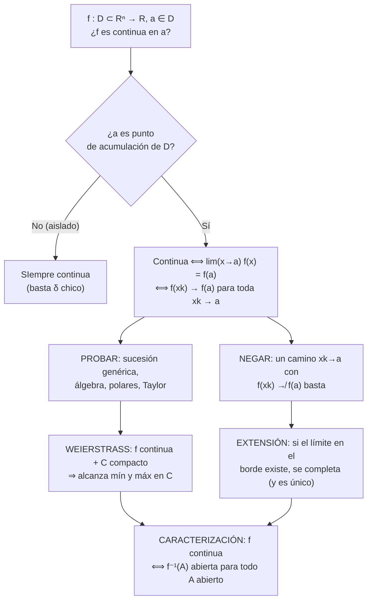
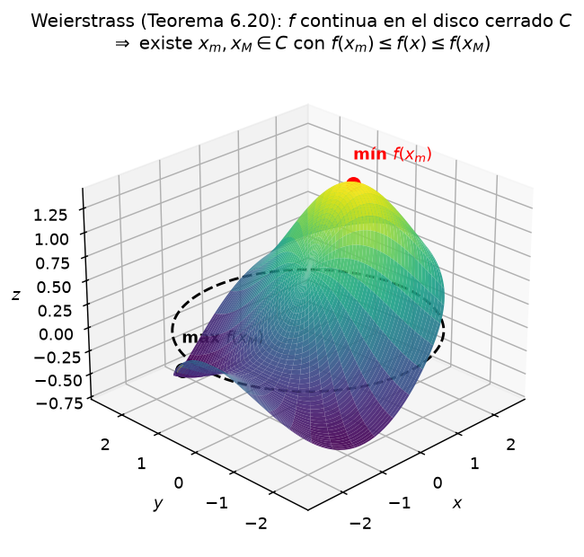
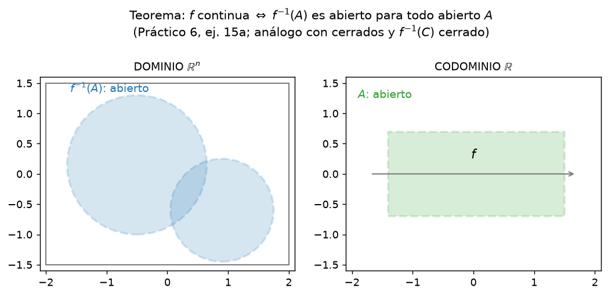

# Clase 36 — Continuidad, teorema de Weierstrass y extensiones

> **Bloque 7 · Funciones de varias variables y continuidad · Dificultad: media · Tiempo estimado: 130 min**

Ya sabemos qué es una función de varias variables y cómo estudiar sus límites. Ahora llega el concepto que gobierna el resto del curso: la **continuidad**. Veremos su definición $\varepsilon$–$\delta$, su versión **sucesiones** (la que más se usa en parcial), el álgebra de funciones continuas, el **Teorema de Weierstrass** (extremos en compactos) y la **caracterización topológica** por preimágenes. Cerramos con los ejercicios 11 a 15 del Práctico 6 y cinco ejercicios de parciales/exámenes reales.

---

## 🎯 Objetivos

1. **Definir** continuidad de $f$ en un punto (**Definición 6.5**) y distinguir el caso **aislado** del **acumulación**.
2. Usar la **caracterización por sucesiones** (**Teorema 6.9**) para probar continuidad y, sobre todo, para **construir discontinuidades**.
3. Aplicar el **álgebra de continuas** (sumas, productos, cocientes, composiciones) y la **conservación del signo**.
4. Enunciar y **demostrar** el **Teorema de Weierstrass** (Teorema 6.20) y explicar por qué hacen falta **los tres ingredientes**.
5. Usar la caracterización "$f$ continua $\iff$ $f^{-1}(A)$ abierta" y **extender** funciones de forma continua.
6. Resolver el **Práctico 6, ejercicios 11 a 15** y ejercicios de parcial/examen paso a paso.

---

## 🗺️ Mapa de la clase

---

## 🧱 Repaso / ideas previas

- **Límite (clase 35):** $\lim_{x\to a}f(x)=L$ con $\varepsilon$–$\delta$ y la caracterización por sucesiones (Teorema 6.8). La continuidad **es** ese límite, pero evaluado **en el punto**.
- **Topología (Bloque 6):** $a$ es **punto de acumulación** de $D$ si todo entorno de $a$ toca $D$ en otro punto; si no, $a$ es **aislado**. Compacto $=$ cerrado y acotado (en $\mathbb{R}^n$), y **Bolzano–Weierstrass**: toda sucesión en un compacto tiene subsucesión convergente (con límite **dentro** del compacto).
- **Una variable:** continuidad de sumas, productos, cocientes, composiciones; extremos en $[a,b]$; y el "principio del sandwich".

---

## 📘 Teoría

> **Definición 36.1 (notas 2024, Definición 6.5).** Sea $D\subseteq\mathbb{R}^n$, $f:D\to\mathbb{R}$ y $a\in D$ (el punto **debe pertenecer** al dominio, porque escribimos $f(a)$). Decimos que $f$ es **continua en $a$** si
> $$\forall\varepsilon>0\ \exists\delta>0\ \text{ tal que }\ \forall x\in B(a,\delta)\cap D\ \text{ se cumple }\ f(x)\in B(f(a),\varepsilon).$$

¡Fíjate en la diferencia con el límite (Definición 35.1)! Ahí la bola era **reducida** $B^*$ y el valor $L$ era ajeno; acá la bola **incluye** el centro y el valor de referencia es **$f(a)$**.

> **Observación 36.2 (notas, Observación 6.6).** Dos casos:
> 1. Si $a$ es **punto de acumulación** de $D$: $f$ es continua en $a$ $\iff$ $\lim_{x\to a}f(x)=f(a)$. (La definición de continuidad y la de límite coinciden con $L=f(a)$.)
> 2. Si $a$ es **aislado**: existe $\delta>0$ con $B(a,\delta)\cap D=\{a\}$; entonces la condición se cumple para **cualquier** $\delta$ chico y **toda** función es continua en $a$. (En los puntos aislados no hay "vecinos" que puedan desobedecer.)

> **Teorema 36.3 (notas, Teorema 6.9 — sucesiones).** Con $a\in D$,
> $$f\text{ es continua en }a\iff\text{para toda sucesión } x_k\in D\text{ con } x_k\to a,\ \text{vale } f(x_k)\to f(a).$$

**Demostración (esquema completo, tal como lo pide el examen de diciembre 2022).**

($\Rightarrow$) Sea $x_k\to a$. Dado $\varepsilon>0$, la continuidad da $\delta>0$ tal que $x\in B(a,\delta)\cap D\Rightarrow f(x)\in B(f(a),\varepsilon)$. Como $x_k\to a$, existe $k_0$ con $x_k\in B(a,\delta)$ para $k\geq k_0$. Entonces $f(x_k)\in B(f(a),\varepsilon)$ para $k\geq k_0$, es decir $f(x_k)\to f(a)$.

($\Leftarrow$) Por absurdo: si $f$ **no** es continua en $a$, existe $\varepsilon>0$ tal que para **todo** $\delta>0$ hay un punto $x\in B(a,\delta)\cap D$ con $f(x)\notin B(f(a),\varepsilon)$. Aplicándolo con $\delta_k=\frac1k$, elegimos un $x_k\in B(a,\frac1k)\cap D$ fuera de esa bola de imágenes. Entonces $x_k\to a$ pero $f(x_k)$ **nunca** entra en $B(f(a),\varepsilon)$: contradicción con la hipótesis. $\blacksquare$

> 💡 **Dónde se usa cada hipótesis:** $x_k\to a$ es el "$\varepsilon$–$\delta$" de las sucesiones; la bola $B(a,\delta)$ (¡sin estrella!) incluye al propio $a$, por eso en el recíproco se puede usar $x_k=a$ cuando convenga.

**Álgebra de funciones continuas.**

> **Proposición 36.4 (notas, Proposición 6.18).** Si $f$ y $g$ son continuas en $a$, entonces $f+g$ y $f\cdot g$ son continuas en $a$; y $f/g$ también, siempre que $g(a)\neq0$.
>
> **Proposición 36.5 (notas, Proposición 6.19).** Si $f:D\to\mathbb{R}$ es continua en $a$ y $\varphi:\mathbb{R}\to\mathbb{R}$ es continua en $f(a)$, entonces $\varphi\circ f$ es continua en $a$.

La prueba es corta con sucesiones: si $x_k\to a$, entonces $f(x_k)\to f(a)$ y $g(x_k)\to g(a)$; por el álgebra de límites de sucesiones (Teorema 3.11), $(f+g)(x_k)\to f(a)+g(a)$, etc. Con esto queda gratis que **los polinomios son continuos en todo $\mathbb{R}^n$**, que las **racionales** son continuas donde el denominador no se anula, que $x\mapsto\|x\|$ es continua, y composiciones como $\log(1+x^2+y^2)$ o $\mathrm{sen}(xy)$.

> **Proposición 36.6 (notas, Proposición 6.22 — conservación de signo).** Si $f$ es continua en $a$ y $f(a)>0$, entonces existe $B(a,\delta)$ donde $f>0$. *(Prueba: tomar $\varepsilon=f(a)/2$.)*

### Teorema de Weierstrass

> **Teorema 36.7 (notas, Teorema 6.20 — Weierstrass).** Sea $C\subseteq\mathbb{R}^n$ un conjunto **compacto** y $f:C\to\mathbb{R}$ **continua**. Entonces $f$ **alcanza** mínimo y máximo en $C$: existen $x_m,x_M\in C$ con
> $$f(x_m)\leq f(x)\leq f(x_M)\qquad\forall x\in C.$$

**Demostración (parte de la acotación; la segunda mitad queda como ejercicio guiado en las notas).**

Supongamos $f$ **no acotada arriba** en $C$: para cada $k\in\mathbb{N}$ existe $x_k\in C$ con $f(x_k)>k$. Como $C$ está **acotado y cerrado** (compacto), Bolzano–Weierstrass da una subsucesión $x_{k_j}\to\bar x$ con $\bar x\in C$. Como $f$ es continua en $\bar x$, $f(x_{k_j})\to f(\bar x)$; pero $f(x_{k_j})>k_j\to\infty$: **contradicción**. Luego $f$ está acotada arriba, y análogamente abajo; por lo tanto $M=\sup f(C)$ existe.

Para la segunda parte: por la propiedad del supremo hay $x_k\in C$ con $f(x_k)\to M$; otra vez BW da $x_{k_j}\to x_M\in C$; la continuidad da $f(x_{k_j})\to f(x_M)$, y por unicidad del límite $f(x_M)=M$. El mínimo es igual. $\blacksquare$

> ⚠️ **Los tres ingredientes son necesarios** (notas, Ejercicio 6.21; ejemplos de una variable alcanzan):
> - **Continuidad:** $f(x)=x$ en $C=(0,1)$… no alcanza nada; mejor: $C=[0,1]$ compacto y $f$ **discontinua** en $0$ con $f(0)=1$, $f(x)=x$ si $x>0$: no alcanza el mínimo $0$.
> - **Cerrado:** $f(x)=x$ en $(0,1]$: acotado, pero no alcanza el mínimo (el ínfimo es $0\notin C$).
> - **Acotado:** $f(x)=x$ en $[0,\infty)$: cerrado, continuo, pero no alcanza el máximo.

### Caracterización topológica y extensiones

> **Teorema 36.8 (Práctico 6, ej. 15a y 15b).** Sea $f:\mathbb{R}^n\to\mathbb{R}^m$. Entonces son equivalentes:
> 1. $f$ es continua en todo punto;
> 2. para todo $A\subseteq\mathbb{R}^m$ **abierto**, $f^{-1}(A)$ es abierto en $\mathbb{R}^n$;
> 3. para todo $C\subseteq\mathbb{R}^m$ **cerrado**, $f^{-1}(C)$ es cerrado en $\mathbb{R}^n$.

**Demostración (esquema).** (2 $\Rightarrow$ 1) Sea $a\in\mathbb{R}^n$ y $\varepsilon>0$. El abierto $A=B(f(a),\varepsilon)$ cumple $a\in f^{-1}(A)$, que es abierto por hipótesis; entonces hay $B(a,\delta)\subseteq f^{-1}(A)$, es decir $f(B(a,\delta))\subseteq B(f(a),\varepsilon)$: continuidad en $a$. (1 $\Rightarrow$ 2) Si $A$ es abierto y $a\in f^{-1}(A)$, como $f(a)\in A$ abierto existe $B(f(a),\varepsilon)\subseteq A$; por continuidad hay $B(a,\delta)$ que $f$ manda dentro de $B(f(a),\varepsilon)\subseteq A$, o sea $B(a,\delta)\subseteq f^{-1}(A)$: $f^{-1}(A)$ es abierto. Y (2 $\Leftrightarrow$ 3) porque $f^{-1}(\mathbb{R}^m\setminus C)=\mathbb{R}^n\setminus f^{-1}(C)$ (preimagen respeta complementos). $\blacksquare$

**Extensiones continuas.** Sea $f:D\to\mathbb{R}$ continua y $p$ un punto de $\operatorname{cl}(D)\setminus D$ (frontera). *¿Se puede definir* $f(p)$ *para que la extensión sea continua?* Por la Observación 36.2, haría falta que exista $\lim_{x\to p}f(x)$. Y si existe, el valor está **obligado**: por el Teorema 36.3, para cualquier sucesión $x_k\to p$ hay que poner $f(p)=\lim f(x_k)$ (el resultado no puede depender de la sucesión). Es decir:

$$\text{existe extensión continua en }p\iff\lim_{x\to p}f(x)\text{ existe},\quad\text{y en ese caso es única.}$$

Clásicos: $\dfrac{\mathrm{sen}(x^2+y^2)}{x^2+y^2}$ **se extiende** con valor $1$ en el origen (¡equivalentes!), mientras $\dfrac{y}{x}$ o $\mathrm{sen}\big(\tfrac{1}{x^2+y^2}\big)$ **no** se extienden (límite no existe).

---

## 🖼️ Figuras

**Cómo leer la figura:** la superficie vive sobre el **disco cerrado** (borde punteado). No importa qué tan "enredada" sea: en algún punto del disco hay un punto **más alto** y uno **más bajo**, y están **dentro** del disco (no "se escapan por el borde" ni tienden a infinito). Esa garantía es la que usamos para optimizar sin derivar.

**Cómo leer la figura:** la función manda el abierto $A$ (derecha) a su **preimagen** $f^{-1}(A)$ (izquierda). Que $f$ sea continua significa exactamente que las preimágenes de abiertos son **abiertas** (puntos "sembrados" sin cerrar la cerca): ninguna preimagen se queda "pegada" al borde. Es la misma idea que la bola verde de la Figura `b7_disco_agujereado`, pero *para todos* los puntos a la vez.

---

## ✏️ Ejercicios resueltos paso a paso — Práctico 6, Ejercicios 11 a 15

### Ejercicio 1 (Práctico 6, ej. 11a). $\;f(x,y)=\begin{cases}\dfrac{4x^2y^3}{4x^2+y^6}, & (x,y)\neq(0,0)\\[4pt] 0, & (x,y)=(0,0)\end{cases}$

**Paso 1 — fuera del origen.** La fórmula es un cociente de polinomios y el denominador $4x^2+y^6>0$ salvo en $(0,0)$. Por álgebra (Proposición 36.4), $f$ es continua en todo $(x,y)\neq(0,0)$.

**Paso 2 — en el origen.** Acotemos por AM–GM: $4x^2+y^6\geq2\sqrt{4x^2y^6}=4|x||y^3|$. Entonces, para $y\neq0$,
$$\left|\frac{4x^2y^3}{4x^2+y^6}\right|\leq\frac{4x^2|y^3|}{4|x||y^3|}=|x|.$$
Y $|x|\to0$ cuando $(x,y)\to(0,0)$. Por el sandwich, $\lim_{(x,y)\to(0,0)}f(x,y)=0=f(0,0)$.

**Conclusión.** $f$ es continua **en todo $\mathbb{R}^2$**. ✔

### Ejercicio 2 (Práctico 6, ej. 11b). $\;f(x,y)=\begin{cases}x/y, & y\neq0\\ 0, & y=0\end{cases}$

**Paso 1 — donde $y\neq0$.** Cociente de continuas con denominador $\neq0$ ⟹ continua en $\{(x,y):y\neq0\}$.

**Paso 2 — puntos $(x_0,0)$ con $x_0\neq0$.** Por el camino $y=0$ la función vale $0$; por el camino vertical $(x_0,t)$ con $t\to0$:
$$f(x_0,t)=\frac{x_0}{t}\longrightarrow\pm\infty.$$
No hay límite ⟹ **discontinua** en todo punto del eje $x$ con $x_0\neq0$.

**Paso 3 — el origen.** Por los caminos $y=mx$:
$$f(x,mx)=\frac{x}{mx}=\frac1m,$$
que depende de $m$ ⟹ discontinua en $(0,0)$ (aunque $f(0,0)=0$ está definida).

**Conclusión.** $f$ es continua **si y solo si** $y\neq0$; es discontinua en **todo el eje $x$**. ✔

### Ejercicio 3 (Práctico 6, ej. 11c). $\;f(x,y)=\begin{cases}x^2+2y-1, & x\geq0\\ 3x+y^2, & x<0\end{cases}$

**Paso 1 — fuera del eje $y$.** Cada rama es un **polinomio** en su media plano abierto ($x>0$ o $x<0$): continua por Proposición 36.4.

**Paso 2 — puntos $(0,y_0)$.** El valor es la rama de $x\geq0$: $f(0,y_0)=2y_0-1$. Calculamos los límites laterales:

- Por la derecha ($x\to0^+$): $\lim(x^2+2y-1)=2y_0-1$.
- Por la izquierda ($x\to0^-$): $\lim(3x+y^2)=y_0^2$.

**Paso 3 — igualar.** Continuidad en $(0,y_0)$ ⟺ ambas ramas dan lo mismo **y** coinciden con el valor:
$$y_0^2=2y_0-1\iff y_0^2-2y_0+1=0\iff(y_0-1)^2=0\iff y_0=1.$$

**Conclusión.** $f$ es continua en todo $\mathbb{R}^2$ **salvo** en los puntos $(0,y)$ con $y\neq1$; es decir, es discontinua exactamente en el eje $y$ menos el punto $(0,1)$. ✔

### Ejercicio 4 (Práctico 6, ej. 12). ¿Se pueden extender continuamente a todo el plano?

**(a) $\dfrac{\mathrm{sen}(x^2+y^2)}{x^2+y^2}$ (definida en $\mathbb{R}^2\setminus\{(0,0)\}$).** Con $t=x^2+y^2\to0^+$:
$$\frac{\mathrm{sen}\,t}{t}\xrightarrow[t\to0]{}1\quad(\text{equivalentes: }\mathrm{sen}\,t\sim t).$$
Existe el límite $\Rightarrow$ **sí se extiende**, definiendo $f(0,0)=1$ (y es la única forma).

**(b) $x^2\log(x^2+y^2)$ (definida fuera del origen).** Con $t=r^2$:
$$|x^2\log r^2|\leq r^2\,|\log r^2|=2r^2|\log r|\longrightarrow0$$
(pues $t|\log t|\to0$ cuando $t\to0^+$). **Sí se extiende**, con $f(0,0)=0$.

**(c) $\dfrac{\mathrm{sen}(x^4+y^4)}{x^2+y^2}$ (fuera del origen).** Acotamos: $|\mathrm{sen}(u)|\leq|u|$ y $x^4+y^4\leq(x^2+y^2)^2$, luego
$$\left|\frac{\mathrm{sen}(x^4+y^4)}{x^2+y^2}\right|\leq\frac{x^4+y^4}{x^2+y^2}\leq\frac{(x^2+y^2)^2}{x^2+y^2}=x^2+y^2\to0.$$
**Sí se extiende**, con $f(0,0)=0$. ✔

### Ejercicio 5 (Práctico 6, ej. 13). $\;f(x,y)=\begin{cases}\dfrac{\varphi(y)-\varphi(x)}{y-x}, & x\neq y\\[4pt] \varphi'(x), & x=y\end{cases}$ con $\varphi$ derivable y $\varphi'$ continua

**Paso 1 — fuera de la diagonal.** Para $x\neq y$: es un cociente de funciones continuas con denominador $\neq0$ ⟹ continua.

**Paso 2 — en la diagonal.** Sea $(x_0,x_0)$ fijo y $(x_k,y_k)\to(x_0,x_0)$ con $x_k\neq y_k$. Por el **teorema del valor medio** existe $\xi_k$ entre $x_k$ e $y_k$ con
$$f(x_k,y_k)=\frac{\varphi(y_k)-\varphi(x_k)}{y_k-x_k}=\varphi'(\xi_k).$$
Como $x_k\leq\xi_k\leq y_k$ (o al revés) y ambos extremos $\to x_0$, se tiene $\xi_k\to x_0$. Como $\varphi'$ es **continua**, $\varphi'(\xi_k)\to\varphi'(x_0)=f(x_0,x_0)$.

**Paso 3 — concluir (Teorema 36.3).** Toda sucesión que tiende a la diagonal tiene imágenes que tienden al valor: $f$ es continua **en todo $\mathbb{R}^2$**. ✔

> 💡 Es el "cociente de incrementos" de la derivada estirado a dos dimensiones: la continuidad de $\varphi'$ es exactamente lo que permite que el valor sobre la diagonal (donde el cociente es $0/0$) sea el límite del entorno.

### Ejercicio 6 (Práctico 6, ej. 14). La parametrización polar $\;F(\rho,\theta)=(\rho\cos\theta,\ \rho\sin\theta)$

**(a) Continuidad y biyectividad.** Las dos componentes $\rho\cos\theta$ y $\rho\sin\theta$ son **continuas** (productor de continuas), luego $F$ es continua. Para la biyectividad: dado $(x,y)\neq(0,0)$, $\rho=\sqrt{x^2+y^2}$ queda **obligado** (único $\rho>0$), y $\theta$ es **único** en $[0,2\pi)$ (es la representación polar estándar). Inyectiva y sobyectiva ⟹ biyectiva.

**(b) Imágenes.** Con $\rho=c$ fijo: $F(c,\theta)=(c\cos\theta,c\sin\theta)$ recorre la **circunferencia** de radio $c$ centrada en el origen. Con $\theta=c_0$ fijo: $F(\rho,c_0)=\rho(\cos c_0,\sin c_0)$ recorre la **semirrecta** (rayo) de origen el origen y dirección $c_0$.

**(c) La inversa y su continuidad.** $F^{-1}(x,y)=\big(\|(x,y)\|,\ \theta(x,y)\big)$, donde $\theta$ es el argumento. Tomemos dos sucesiones que tienden a $(1,0)$:
$$p_k=\Big(1,\tfrac1k\Big)\ \Rightarrow\ F^{-1}(p_k)=\Big(\sqrt{1+\tfrac1{k^2}},\ \arctan\tfrac1k\Big)\longrightarrow(1,0),$$
$$q_k=\Big(1,-\tfrac1k\Big)\ \Rightarrow\ F^{-1}(q_k)=\Big(\sqrt{1+\tfrac1{k^2}},\ 2\pi-\arctan\tfrac1k\Big)\longrightarrow(1,2\pi).$$
Las dos sucesiones van al **mismo** punto, pero sus imágenes por $F^{-1}$ van a $(1,0)$ y $(1,2\pi)$: los límites difieren ⟹ **$F^{-1}$ no es continua** en $(1,0)$ (ni en ningún punto del semieje positivo del eje $x$, que es el "corte" de la representación polar). ✔

### Ejercicio 7 (Práctico 6, ej. 15c). Probar que $S=\{(x,y,z):x^2+y^3<4,\ y^2+z^3>2\}$ es abierto en $\mathbb{R}^3$

**Paso 1 — armar un mapa continuo.** Definimos $\Phi:\mathbb{R}^3\to\mathbb{R}^2$,
$$\Phi(x,y,z)=\big(x^2+y^3,\ y^2+z^3\big).$$
Es una función **polinomial** (componente a componente): continua en todo $\mathbb{R}^3$ (Proposición 36.4).

**Paso 2 — reconocer $S$ como preimagen de un abierto.** El conjunto $A=(-\infty,4)\times(2,+\infty)$ es un **abierto** del plano (producto de intervalos abiertos). Entonces
$$S=\{(x,y,z): (x^2+y^3,\,y^2+z^3)\in A\}=\Phi^{-1}(A).$$

**Paso 3 — concluir (Teorema 36.8).** Como $\Phi$ es continua y $A$ es abierto, $S=\Phi^{-1}(A)$ es **abierto**. $\blacksquare$

> 💡 Truco muy pedible: "el conjunto de puntos que cumplen $g_1<c$ y $g_2>d$ con $g_i$ continuas es abierto", porque es la preimagen de un rectángulo abierto bajo un mapa continuo.

---

## 🏛️ Ejercicios de parcial/examen

### Ejercicio (Examen diciembre 2022, ej. 3). Definiciones + un contraejemplo con sucesiones

> a) Definir continuidad en $a$. b) Definir $\lim a_k=a$. c) Demostrar que si $f$ es continua en $a$ y $a_k\to a$, entonces $f(a_k)\to f(a)$. d) Estudiar la continuidad en el origen de
> $$f(x,y)=\begin{cases}\dfrac{x^6}{(x^2-y)^2+x^6}, & (x,y)\neq(0,0)\\ 0, & (x,y)=(0,0)\end{cases}$$

**Partes a–c.** Las definiciones son las 36.1 y de sucesiones (clase 16); la demostración del punto c es el **directo** del Teorema 36.3 (reproducido arriba, un párrafo).

**Parte d — un camino que delata.** Elegimos la sucesión $a_k=\big(\frac1k,\ \frac1{k^2}\big)$. Claramente $a_k\to(0,0)$. Evaluamos:
$$f\!\left(\tfrac1k,\tfrac1{k^2}\right)=\frac{(1/k)^6}{\big((1/k)^2-(1/k^2)\big)^2+(1/k)^6}=\frac{(1/k)^6}{0+(1/k)^6}=1\quad\text{para todo }k.$$
(¡El truco es que $y=x^2$ hace que $x^2-y$ se anule y sobreviva solo $x^6$!) Entonces $f(a_k)=1\to1\neq0=f(0,0)$.

**Conclusión.** Por el Teorema 36.3, $f$ **no es continua en el origen** (y sí lo es en el resto del plano, por álgebra). ✔ *(verificada con la solución oficial del examen)*

### Ejercicio (Segundo parcial 2023-2S, ej. 6). El parámetro $A$

> $f(x,y)=\dfrac{y(x^2+y^2)}{x^2-y^2}$ si $|x|\neq|y|$, y $f=A$ si $|x|=|y|$. ¿Cuál $A$ hace que $f$ sea continua en el origen?

**Paso 1 — caminos "simples".** Por el eje $x$ ($y=0$): $f=0$. Por el eje $y$ ($x=0$): $f=0$. Por rectas $y=mx$ con $|m|\neq1$:
$$f(x,mx)=\frac{mx(x^2+m^2x^2)}{x^2(1-m^2)}=\frac{m(1+m^2)}{1-m^2}\,x\longrightarrow0.$$
Si el límite existe, es $0$: la única candidata sería $A=0$.

**Paso 2 — camino curvo.** Probemos la parábola $y=x+x^2$ (para $x\neq0$ chico, $|x|\neq|y|$):
$$x^2+y^2=2x^2+2x^3+x^4,\qquad y(x^2+y^2)=2x^3+O(x^4),$$
$$x^2-y^2=-2x^3-x^4,\qquad \frac{y(x^2+y^2)}{x^2-y^2}=\frac{2x^3+O(x^4)}{-2x^3-x^4}\longrightarrow-1.$$

**Paso 3 — concluir.** Por caminos distintos la función tiende a $0$ y a $-1$: **no tiene límite**, ni siquiera tomando $A=0$. Ninguna $A$ salva la continuidad.

**Respuesta: (D) No existe $A$ para que $f$ sea continua.** ✔ *(respuesta oficial del parcial 2023-2S, versión 1)*

### Ejercicio (Segundo parcial 2022-2S, ej. 4). El parámetro $\alpha$

> $f(x,y)=\dfrac{x^4}{y(x^2+y^2)}$ si $y\neq0$, y $f=\alpha$ si $y=0$. ¿Para qué $\alpha\in\mathbb{R}$ es continua en $(0,0)$?

**Paso 1 — eje $x$.** $f(0,y)=0$ para todo $y$… en particular por los puntos $(x,0)$ la definición dice $f=\alpha$. Por el camino $(x,0)$ con $x\to0$: $f\to\alpha$.

**Paso 2 — parábola $y=x^2$.** Para $x\neq0$:
$$f(x,x^2)=\frac{x^4}{x^2(x^2+x^4)}=\frac{x^4}{x^4+x^6}=\frac{1}{1+x^2}\longrightarrow1.$$

**Paso 3 — concluir.** $\alpha$ tendría que ser $1$ (por la parábola) y $0$ (por el eje): imposible. **$f$ es discontinua en el origen para todo $\alpha\in\mathbb{R}$.**

**Respuesta: (C) $f$ es discontinua en $(0,0)$ para todo $\alpha\in\mathbb{R}$.** ✔ *(verificada con la solución oficial; allí además se aclara que por polares no se puede, porque el factor $\cos^4\theta/\mathrm{sen}\,\theta$ no está acotado en ningún entorno del origen)*

### Ejercicio (Segundo parcial 2022-1S, ej. 4). La función de los cuadrantes

> $f=1$ si $x>0,y>0$; $f=2$ si $x<0,y>0$; $f=3$ si $x<0,y<0$; $f=4$ si $x>0,y<0$; $f=0$ sobre los ejes.

**Paso 1 — puntos con $xy\neq0$.** Un punto $(x_0,y_0)$ con ambos coordenadas $\neq0$ tiene un **entorno** entero dentro de su cuadrante, donde $f$ es **constante** (1, 2, 3 ó 4): continua.

**Paso 2 — puntos de los ejes.** Sea $(x_0,0)$ con $x_0\neq0$: por encima del eje $f$ vale $1$ (si $x_0>0$) y por debajo $4$; dos caminos con límites distintos ⟹ discontinua. Igual en $(0,y_0)$ con $y_0\neq0$ (valores $1$ y $2$, o $4$ y $3$). Y en $(0,0)$ hay un cuadrante por cada valor.

**Respuesta: (C) $f$ es continua para todo $(x,y)$ tal que $xy\neq0$.** ✔ *(respuesta oficial del parcial 2022-1S)*

### Ejercicio (Segundo parcial 2021-2S, ej. 2). ¿Existe un $a$ que haga continua a $f$?

> $f(x,y)=\dfrac{xy}{ax^2+y^2}$ si $(x,y)\neq(0,0)$, y $f(0,0)=1$.

**Paso 1 — camino por el eje $x$.** Para $x\neq0$: $f(x,0)=\dfrac{0}{ax^2}=0$ (si $a\neq0$; si $a=0$ también da $0$). Entonces
$$\lim_{x\to0}f(x,0)=0.$$

**Paso 2 — condición de continuidad.** Para que $f$ sea continua en $(0,0)$ haría falta que **todo** límite valga $f(0,0)=1$. Pero el camino del eje $x$ ya da $0\neq1$.

**Conclusión.** **Ningún valor de $a$** hace $f$ continua en el origen. (Y si $a<0$ la función ni siquiera está bien definida en todo $\mathbb{R}^2$, porque $ax^2+y^2=0$ en las rectas $y=\pm\sqrt{-a}\,x$.)

**Respuesta: (E) No hay ningún valor de $a$ para el cual $f$ sea continua.** ✔

### Ejercicio complementario (Práctico 6, comp. 1). El gráfico de una continua sobre un cerrado es cerrado

> Sea $C\subseteq\mathbb{R}^n$ cerrado y $f:C\to\mathbb{R}^m$ continua. Probar que $\operatorname{graf}(f)=\{(x,f(x)):x\in C\}$ es cerrado en $\mathbb{R}^{n+m}$.

**Prueba por sucesiones.** Sean $(x_k,f(x_k))\to(p,w)$ en $\mathbb{R}^{n+m}$. Entonces $x_k\to p$ y, como $C$ es **cerrado**, $p\in C$. Como $f$ es continua en $p$ (Teorema 36.3), $f(x_k)\to f(p)$. Pero también $f(x_k)\to w$ por la convergencia del par; por **unicidad** del límite, $w=f(p)$. Luego $(p,w)\in\operatorname{graf}(f)$: el conjunto contiene sus puntos de acumulación, es **cerrado**. $\blacksquare$

---

## ⚠️ Errores comunes

| Error | Corrección |
|---|---|
| Definir continuidad **sin** exigir $a\in D$ | $f(a)$ aparece en la definición: el punto debe estar en el dominio |
| Usar bola **reducida** $B^*$ en continuidad | En continuidad se usa $B(a,\delta)$ (con el centro); en límite, $B^*$ |
| "Continua en $(0,0)$" chequeando solo los ejes | Los ejes son **un** camino: hace falta un argumento que cubra **todos** ($\varepsilon$–$\delta$, sucesión genérica, acotar) |
| Concluir que es continua porque "todos los direccionales dan lo mismo" | Falso (Ejemplo 6.12): los direccionales no bastan |
| En una función a trozos, mirar solo el valor en la frontera | Hay que igualar **límite lateral por cada lado** con el valor (ej. 11c) |
| Usar Weierstrass en un **abierto** o un no acotado | El teorema necesita **compacto + continua**; $f(x)=x$ en $(0,1]$ es la contra |
| Confundir "existe el límite" con "existe extensión continua" | Es lo mismo, pero hay que probar que el límite **existe** (¡igual que en la clase 35!) |
| En Weierstrass, olvidar el **cierre** del dominio | La BW da $\bar x\in C$ solo si $C$ es **cerrado** |

---

## 🔗 Conexiones

- **Clase 35:** la continuidad es $\lim_{x\to a}f(x)=f(a)$: todas las técnicas de límites (polares, caminos, sandwich) se reusan tal cual para probar continuidad y para negarla.
- **Bloque 6 (topología):** compactos, cerrados y BW son el motor de Weierstrass; la caracterización por preimágenes conecta continuidad con la **topología** de ambos espacios.
- **Bloque 8 (diferenciabilidad):** toda derivable es continua (¡el recíproco es falso!); las derivadas parciales son límites de funciones de una variable, y su continuidad es el problema de la clase 40.
- **Bloque 9 (extremos):** Weierstrass garantiza que el **extremo absoluto existe**; el Bloque 9 enseña a **encontrarlo** (puntos críticos + frontera + Lagrange).
- **Bloque 4 (sucesiones/series):** el "todo pasa por sucesiones" de este bloque es el mismo Teorema 6.8/6.9 de las notas: en examen, siempre que pidan "demostrar que $f(a_k)\to f(a)$", es el directo de acá.

---

## ✅ Autoevaluación

1. Definir continuidad de $f$ en $a$ ($\varepsilon$–$\delta$) y escribir su **negación**.
2. Demostrar que $f(x,y)=x^2y+\mathrm{sen}(xy)$ es continua en $(1,2)$ (usando álgebra).
3. ¿Es continua en el origen la función $f(x,y)=\dfrac{x^2y}{x^4+y^2}$ (con $f(0,0)=0$)? Justificar.
4. Enunciar Weierstrass. ¿Qué pasa con $f(x,y)=x$ en $C=\{(x,y):x>0,\ x^2+y^2\leq1\}$?
5. ¿Se puede extender continuamente $f(x,y)=\dfrac{x^2-y^2}{x^2+y^2}$ al origen? ¿Y $\dfrac{x^2y}{x^2+y^2}$?
6. Probar que $f(x,y)=\mathrm{arctg}(x^2+y^2)$ es continua en todo $\mathbb{R}^2$ (composición).
7. Dar un ejemplo de $f:\mathbb{R}^2\to\mathbb{R}$ continua en todo punto menos el origen, y probar la discontinuidad con una sucesión.
8. (V/F) Si $f$ no es continua en $a$, existe una sucesión $x_k\to a$ con $f(x_k)\not\to f(a)$.

### Respuestas

1. Continua: $\forall\varepsilon>0\ \exists\delta>0:\ f(B(a,\delta)\cap D)\subseteq B(f(a),\varepsilon)$. Negación: $\exists\varepsilon>0$ tal que $\forall\delta>0$ existe $x\in B(a,\delta)\cap D$ con $|f(x)-f(a)|\geq\varepsilon$.
2. $x^2y$ es producto de polinomios (continuos) y $\mathrm{sen}(xy)$ es composición de continuas; por la Proposición 36.4, la suma es continua en todo $\mathbb{R}^2$, en particular en $(1,2)$.
3. **No:** por la parábola $y=x^2$, $f(x,x^2)=\frac{x^4}{2x^4}=\frac12\neq0=f(0,0)$.
4. Continua en compacto $\Rightarrow$ alcanza mín y máx. En $C$ (media bola abierta a la izquierda) $f(x,y)=x$ **no** alcanza el mínimo ($0$ es el ínfimo y no está en $C$): falta el cerrado.
5. $\frac{x^2-y^2}{x^2+y^2}$: **no** (los direccionales dan $1$ y $-1$). $\frac{x^2y}{x^2+y^2}$: **sí**, con $f(0,0)=0$ (por polares es $r\cos^2\theta\sin\theta$, acotado por $r$).
6. $x^2+y^2$ es continua (polinomio) y $\mathrm{arctg}$ es continua en $\mathbb{R}$: por Proposición 36.5 la composición es continua en todo $\mathbb{R}^2$.
7. Por ejemplo $f(x,y)=\dfrac{xy}{x^2+y^2}$ (nula en el origen): con $x_k=(\frac1k,\frac1k)$, $f(x_k)=\frac12\not\to0$.
8. **VERDADERO:** es exactamente la contrapositiva del Teorema 6.9 (la prueba del recíproco construye esa sucesión con $\delta_k=1/k$).

---

**⬅️ Anterior:** [Clase 35 — Límites: direccionales, iterados y coordenadas polares](35_limites_direccionales_polares.md) · **➡️ Siguiente:** [Clase 37 — Derivadas parciales y direccionales; gradiente](37_derivadas_parciales_direccionales.md)
