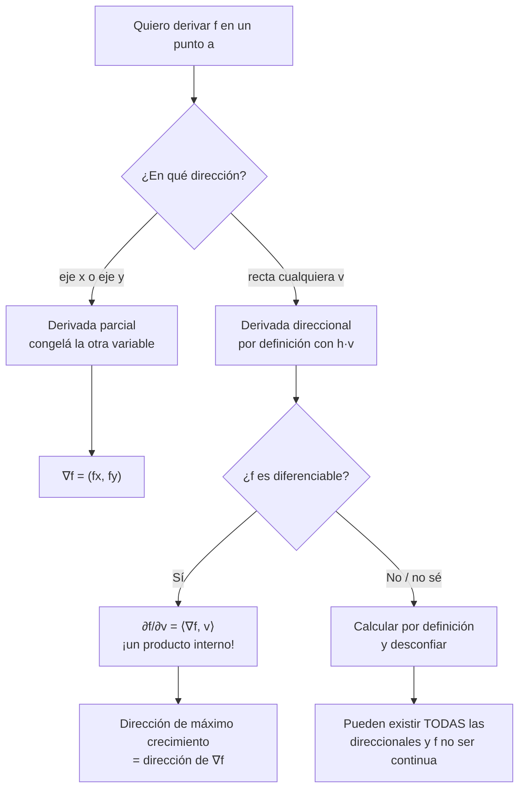
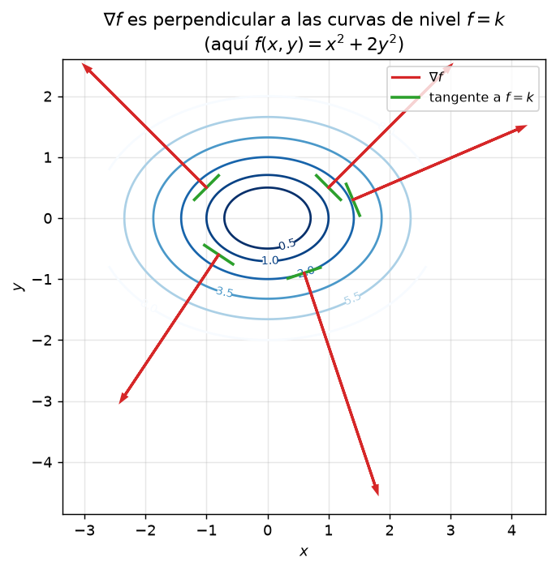
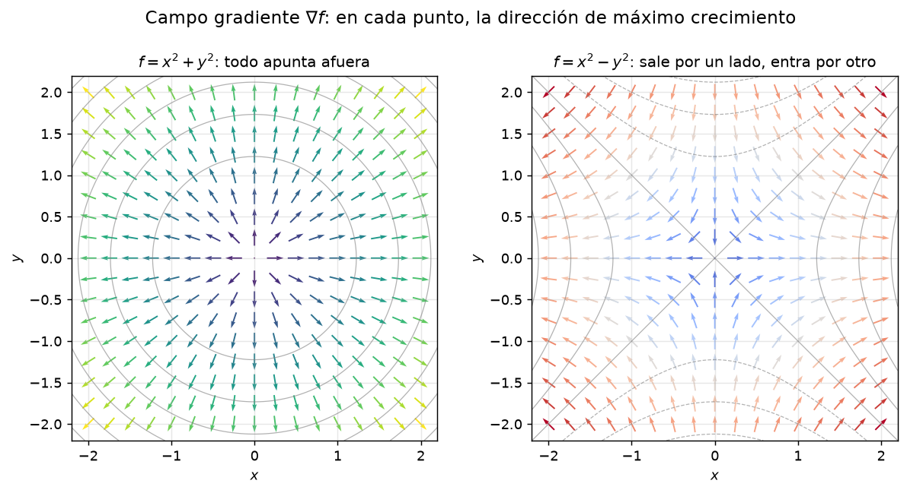

# Clase 37 — Derivadas parciales y direccionales; gradiente

> **Bloque 8 · Diferenciabilidad · Dificultad: media · Tiempo estimado: 120 min**

En una variable, "derivar" era mirar **cómo cambia** $f$ cuando movemos la entrada un poquito. En el plano hay **infinitas direcciones** para moverse, así que la primera pregunta es: ¿en cuál? Esta clase define la variación de $f$ a lo largo de **los ejes** (derivadas parciales) y a lo largo de **cualquier recta** (derivadas direccionales), y empaqueta toda esa información en un solo vector: el **gradiente** $\nabla f$. Cerramos con la advertencia central del bloque: **tener todas las direccionales no alcanza** para decir que $f$ se comporta bien.

---

## 🎯 Objetivos

1. **Definir** la derivada parcial $\partial f/\partial x$ y $\partial f/\partial y$ (Definición 7.1 de las notas) y calcularlas "congelando" la otra variable.
2. **Definir** la derivada direccional $\partial f/\partial v$ (Definición 7.6) y reconocer las parciales como el caso $v=e_i$.
3. Saber que, **cuando $f$ es diferenciable**, $\dfrac{\partial f}{\partial v}(a)=\langle\nabla f(a),v\rangle$ (Teorema 7.13), y usar el gradiente para hallar la dirección de **máximo crecimiento**.
4. Entender por qué **"existen todas las derivadas direccionales" NO implica "continuidad"** (Ejemplos 7.5 y 7.9).

---

## 🗺️ Mapa de la clase

---

## 🧱 Repaso / ideas previas

Del **Bloque 7** y del final de **una variable**:

- **Derivada en una variable:** $g'(x_0)=\displaystyle\lim_{h\to0}\dfrac{g(x_0+h)-g(x_0)}{h}$. Es la pendiente de la **recta tangente** al gráfico.
- **Límites direccionales (clase 35):** para ver si existe $\lim_{(x,y)\to a}f(x,y)$ miramos la restricción a rectas $a+hv$. Ahora damos **un paso más**: en lugar de mirar el límite de $f$, miramos el límite del **cociente incremental** a lo largo de la recta.
- **Curvas de nivel (clase 34):** el conjunto $C_k=\{(x,y):f(x,y)=k\}$. En esta clase empezamos a usar que el gradiente "mira" perpendicular a estas curvas (lo demostraremos en la clase 39).
- **Superficie:** el gráfico de $f(x,y)$ es una superficie en $\mathbb{R}^3$. Un **corte vertical** por esa superficie da una curva; su pendiente es lo que vamos a medir.

> 💡 **Idea ancla:** una derivada parcial es la derivada de un **corte** del gráfico por un plano vertical. Por eso se calcula como una derivada común, tratando la otra variable como constante.

---

## 📘 Teoría

### 1. Derivadas parciales

> **Definición 37.1 (notas, Definición 7.1).** Sea $f:\mathbb{R}^2\to\mathbb{R}$ y $(x_0,y_0)\in\mathbb{R}^2$. La **derivada parcial de $f$ respecto de $x$** en $(x_0,y_0)$ es el límite (si existe)
> $$\frac{\partial f}{\partial x}(x_0,y_0)=\lim_{h\to0}\frac{f(x_0+h,\,y_0)-f(x_0,y_0)}{h}.$$
> Análogamente, derivando la **segunda** coordenada,
> $$\frac{\partial f}{\partial y}(x_0,y_0)=\lim_{h\to0}\frac{f(x_0,\,y_0+h)-f(x_0,y_0)}{h}.$$

El límite de la definición es de **una sola variable** ($h\in\mathbb{R}$): es exactamente la derivada de $g(x)=f(x,y_0)$ evaluada en $x_0$. De ahí la regla práctica:

> ⚙️ **Receta:** para hallar $f_x$, **mirá a $y$ como un número fijo** y derivá respecto de $x$ como siempre. Para $f_y$, congelá $x$.

Notaciones equivalentes (las notas usan varias): $f_x,\ \partial_x f,\ \dfrac{\partial f}{\partial x}$, y lo mismo con $y$.

**Ejemplo (notas, Ejemplo 7.2).** Para $f(x,y)=x^2+y^2$ en el origen,
$$f_x(0,0)=\lim_{h\to0}\frac{h^2-0}{h}=0,\qquad f_y(0,0)=\lim_{h\to0}\frac{h^2-0}{h}=0.$$
El paraboloide "sale con pendiente horizontal" en ambas direcciones.

**Ejemplo (notas, Ejemplo 7.3).** Si $f(x,y)=x^2y+5y$, para $f_x(1,1)$ congelamos $y=1$: la función queda $x^2+5$, su derivada es $2x$ y en $x=1$ vale $\boxed{2}$.

### 2. Derivadas direccionales

> **Definición 37.2 (notas, Definición 7.6).** Sea $f:\mathbb{R}^2\to\mathbb{R}$, $a=(x_0,y_0)$ y una dirección $v=(v_1,v_2)$. La **derivada direccional de $f$ en la dirección $v$** en $a$ es, si existe,
> $$\frac{\partial f}{\partial v}(x_0,y_0)=\lim_{h\to0}\frac{f(x_0+hv_1,\;y_0+hv_2)-f(x_0,y_0)}{h}.$$

Es el cociente incremental a lo largo de la recta $a+hv$: **la pendiente de $f$ cuando caminamos en la dirección $v$**.

> 🔑 **Las parciales son direccionales especiales:** con $v=(1,0)$ recuperamos $\partial f/\partial x$, y con $v=(0,1)$, la $\partial f/\partial y$.

**Ejemplo (notas, Ejemplo 7.7).** Para $f(x,y)=x^2+y^2$ y $v=(1,1)$:
$$\frac{\partial f}{\partial v}(x_0,y_0)=\lim_{h\to0}\frac{(x_0+h)^2+(y_0+h)^2-x_0^2-y_0^2}{h}=\lim_{h\to0}\frac{2x_0h+h^2+2y_0h+h^2}{h}=2x_0+2y_0.$$

### 3. El gradiente

> **Definición 37.3 (notas, Definición 7.14).** Si $f$ es **diferenciable** en $(x_0,y_0)$, el **gradiente** es el vector
> $$\nabla f(x_0,y_0)=\left(\frac{\partial f}{\partial x}(x_0,y_0),\ \frac{\partial f}{\partial y}(x_0,y_0)\right).$$

> **Teorema 37.4 (notas, Teorema 7.13).** Si $f$ es **diferenciable** en $(x_0,y_0)$, entonces existen **todas** las derivadas direccionales y
> $$\frac{\partial f}{\partial v}(x_0,y_0)=\langle\nabla f(x_0,y_0),\,v\rangle=f_x(x_0,y_0)\,v_1+f_y(x_0,y_0)\,v_2.$$

Consecuencias geométricas:

- Si $v$ es **unitario**, $\dfrac{\partial f}{\partial v}=\|\nabla f\|\cos\theta$, donde $\theta$ es el ángulo entre $v$ y $\nabla f$. Se **maximiza** cuando $v$ es paralelo a $\nabla f$: **la dirección del gradiente es la de máximo crecimiento** (y $-\nabla f$, la de máximo decrecimiento).
- El gradiente es **perpendicular a las curvas de nivel** (lo probaremos con la regla de la cadena).

> ⚠️ **La fórmula $\partial f/\partial v=\langle\nabla f,v\rangle$ SOLO vale si $f$ es diferenciable.** Si no lo es (o no lo sabés todavía), hay que **ir a la definición**.

### 4. La advertencia: direccionales $\neq$ continuidad

La existencia de parciales, e incluso de **todas** las direccionales, no garantiza continuidad.

- **Ejemplo 7.5 (notas).** $f(x,y)=1$ sobre los ejes, $f=0$ en el resto. Es constante sobre los ejes, así que $f_x(0,0)=f_y(0,0)=0$; pero en todo entorno del origen hay puntos con valor $1$ y puntos con valor $0$: **$f$ no es continua**.
- **Ejemplo 7.9 (notas).** $f(x,y)=1$ si $0<y<x^2$, y $f=0$ en otro caso. Toda recta por el origen entra, cerca del origen, en la zona donde $f=0$; por eso **todas** las direccionales valen $0$. Pero sobre la curva $y=x^2/2$ vale $1$, así que el límite no existe: **no es continua**.
- Al revés: **continuidad no implica parciales.** Por ejemplo $f(x,y)=|x|+|y|$ es continua en $(0,0)$ y no tiene parciales allí.

> 🧭 **Moraleja:** parciales y direccionales son información **direccional**, no global. La herramienta que sí controla el comportamiento en todas las direcciones a la vez se llama **diferenciabilidad** y es la clase 38.

---

## 🖼️ Figuras

**Cómo leerla:** a la izquierda, cortamos la superficie $z=x^2+y^2$ con el plano vertical $y=y_0$; la curva roja es $g(x)=f(x,y_0)=x^2+1$. La recta punteada es su tangente y su pendiente es exactamente $f_x$ en ese punto. A la derecha hacemos el corte "en una variable": derivar $g$ es lo mismo que derivar $f$ dejando $y$ fijo.

**Cómo leerla:** las curvas azules son los conjuntos de nivel de $f(x,y)=x^2+2y^2$. En cada punto, el vector rojo es $\nabla f$ y el segmento verde es la **tangente** a la curva de nivel. Son perpendiculares en todos los puntos: el gradiente **no** avanza por la curva, sale "para el lado del crecimiento".

**Cómo leerla:** cada flecha es $\nabla f$ en un punto. Para $f=x^2+y^2$ (izquierda) todo apunta hacia afuera del origen: el origen es un centro de mínimo. Para $f=x^2-y^2$ (derecha) el campo "entra por un lado y sale por otro": ese es el paisaje de un **punto silla**. Estas dos imágenes anticipan el criterio de la Hessiana (clases 41 y 42).

---

## ✏️ Ejercicios resueltos

### Ejercicio 1 (notas, Ejemplos 7.4.1). Parciales de $f(x,y)=x^2y+ye^{2x}$

**Paso 1 — $f_x$: congelo $y$.** Trato $y$ como constante:
$$f_x(x,y)=2xy+y\cdot 2e^{2x}=2xy+2ye^{2x}.$$

**Paso 2 — $f_y$: congelo $x$.** Ahora $x^2$ y $e^{2x}$ son constantes:
$$f_y(x,y)=x^2+e^{2x}.$$

**Chequeo en $(0,1)$:** $f_x(0,1)=0+2=2$, $f_y(0,1)=0+1=1$. ✔

### Ejercicio 2 (notas, Ejemplos 7.4.2). Parciales de $f(x,y)=(y-x)^2+x^2y^2$

**Paso 1 — $f_x$.** Derivando la cadena del primer término: $2(y-x)\cdot(-1)+2x y^2$.
$$f_x(x,y)=-2(y-x)+2xy^2.$$

**Paso 2 — $f_y$.** $2(y-x)\cdot 1+x^2\cdot 2y$.
$$f_y(x,y)=2(y-x)+2x^2y.$$

### Ejercicio 3 (notas, Ejemplos 7.15.2 — la trampa clásica). $f(x,y)=\dfrac{xy}{\sqrt{x^2+y^2}}$

> Estudiar las parciales en el origen.

**Paso 1 — $f_x(0,0)$.** Sobre el eje $x$ la función es constante $0$ ($y=0$):
$$f_x(0,0)=\lim_{h\to0}\frac{f(h,0)-f(0,0)}{h}=\lim_{h\to0}\frac{0-0}{h}=0.$$

**Paso 2 — $f_y(0,0)$.** Ídem, $f(0,h)=0$: $f_y(0,0)=0$.

**Lectura:** las parciales existen (=0) y aun así, como veremos en la clase 38, **$f$ no es diferenciable** en el origen. La receta "chequear parciales" no decide diferenciabilidad.

### Ejercicio 4 (notas, Ejemplo 7.9). Todas las direccionales existen y $f$ no es continua

$$f(x,y)=\begin{cases}1 & \text{si } 0<y<x^2,\\ 0 & \text{en otro caso.}\end{cases}$$

**Paso 1 — sobre los ejes $f=0$.** En el eje $x$ ($y=0$) y en el eje $y$ ($x=0$, con $y\le0$) la función vale $0$; restringida al eje $y$ positivo, $0<y<0$ es falso, así que también $0$. Luego $f_x(0,0)=f_y(0,0)=0$.

**Paso 2 — una dirección genérica $v=(v_1,v_2)$.** A lo largo de la recta $h\mapsto(hv_1,hv_2)$, para $h$ chico la recta queda fuera de la franja $0<y<x^2$ (la parábola se "aprieta" contra el eje más rápido que cualquier recta). Por lo tanto $f(hv_1,hv_2)=0$ para $h$ chico y
$$\frac{\partial f}{\partial v}(0,0)=\lim_{h\to0}\frac{0-0}{h}=0.$$

**Paso 3 — todas las direccionales valen $0$.** En particular $\partial f/\partial v(0,0)=0$ para **toda** dirección $v$.

**Paso 4 — ¿continuidad?** Sobre la curva $y=x^2/2$ (que está dentro de la franja $0<y<x^2$) se tiene $f=1$. Cuando $(x,y)\to(0,0)$ por esa curva, $f\to1\neq f(0,0)=0$. Por lo tanto **$f$ no es continua** en $(0,0)$.

**Conclusión:** existen todas las derivadas direccionales y $f$ **no es continua**. ✔

### Ejercicio 5 (notas, Ejercicio 7.10). $f(x,y)=\dfrac{x^3y}{x^6+y^2}$ (y $f(0,0)=0$)

**Paso 1 — dirección genérica $v=(v_1,v_2)$.** Para $h\neq0$,
$$f(hv_1,hv_2)=\frac{h^3v_1^3\cdot hv_2}{h^6v_1^6+h^2v_2^2}=\frac{h^2\,v_1^3v_2}{h^4v_1^6+v_2^2}.$$
Dividiendo por $h$:
$$\frac{f(hv_1,hv_2)-f(0,0)}{h}=\frac{h\,v_1^3v_2}{h^4v_1^6+v_2^2}\xrightarrow[h\to0]{}0.$$
(Si $v_2=0$, $f\equiv0$ sobre la recta y el límite también es $0$.) **Todas las direccionales existen y valen $0$.**

**Paso 2 — no continuidad.** Por la parábola cúbica $(x,x^3)$:
$$f(x,x^3)=\frac{x^3\cdot x^3}{x^6+x^6}=\frac{x^6}{2x^6}=\frac12.$$
Por el eje $x$: $f(x,0)=0$. Dos curvas que llegan al origen dan límites distintos ($\tfrac12$ y $0$), así que $\lim_{(x,y)\to(0,0)}f$ **no existe**: $f$ no es continua. ✔

---

## 🏛️ Ejercicios de parcial/examen

### Ejercicio 6 (Segundo parcial 2025-1S, Desarrollo Ej. 2). Hallar $\nabla f(1,1)$ a partir de dos direccionales

> Sea $f:\mathbb{R}^2\to\mathbb{R}$ diferenciable en $(1,1)$. Las derivadas direccionales en las direcciones $v_1=(2,-1)$ y $v_2=(1,4)$ valen
> $$\frac{\partial f}{\partial v_1}(1,1)=5,\qquad \frac{\partial f}{\partial v_2}(1,1)=7.$$
> Calcular, justificando, $\nabla f(1,1)$.

**Paso 1 — usar $\partial f/\partial v=\langle\nabla f,v\rangle$** (válido porque $f$ es **diferenciable**). Escribimos $\nabla f(1,1)=(a,b)$.

**Paso 2 — plantear las dos ecuaciones.**
$$\langle(a,b),(2,-1)\rangle=2a-b=5,\qquad \langle(a,b),(1,4)\rangle=a+4b=7.$$

**Paso 3 — resolver el sistema.** De la primera, $b=2a-5$. Sustituyendo en la segunda: $a+4(2a-5)=7\Rightarrow 9a=27\Rightarrow a=3$, y $b=2\cdot3-5=1$.

**Respuesta:**
$$\boxed{\nabla f(1,1)=(3,1).}\qquad ✔$$

> 💡 No hace falta que $v_1,v_2$ sean unitarios: la definición de direccional usa $a+hv$ y el producto interno sale **exacto**. Pero sí hace falta la **diferenciabilidad** (¡es la hipótesis del enunciado!).

### Ejercicio 7 (Segundo parcial 2021-2S, Ej. 3). De $f_x$ y una direccional, deducir otra

> Sean $f:\mathbb{R}^2\to\mathbb{R}$ diferenciable, $v=(1,1)$, $w=(1,-1)$. Sabiendo que
> $$\frac{\partial f}{\partial x}(0,0)=2,\qquad \frac{\partial f}{\partial v}(0,0)=5,$$
> calcular $\dfrac{\partial f}{\partial w}(0,0)$.

**Paso 1 — gradiente.** $\nabla f(0,0)=(2,\,f_y(0,0))$.

**Paso 2 — usar la direccional.**
$$\frac{\partial f}{\partial v}(0,0)=\langle(2,f_y),(1,1)\rangle=2+f_y=5\ \Rightarrow\ f_y(0,0)=3.$$
Así $\nabla f(0,0)=(2,3)$.

**Paso 3 — calcular $w$.**
$$\frac{\partial f}{\partial w}(0,0)=\langle(2,3),(1,-1)\rangle=2-3=-1.$$

**Respuesta: (B) $\dfrac{\partial f}{\partial w}(0,0)=-1$.** ✔

### Ejercicio 8 (Examen febrero 2022, Parte I). Verdadero o falso con $f(x,y)=|x+e^{y^2}|$

> (1) $f$ es continua en $(0,0)$. (3) $f$ es diferenciable en $(0,0)$ y $\nabla f(0,0)=(1,0)$.
> (4) Existe $\partial f/\partial x(-1,0)$ y vale $1$. (5) Existe $\partial f/\partial y(-1,0)$ y vale $0$.

**Paso 1 — cerca de $(0,0)$.** Como $e^{y^2}\ge1>0$ y $x$ es chico, $x+e^{y^2}>0$, así que $f=x+e^{y^2}$. Es una suma de funciones suaves: **continua** y **diferenciable** en $(0,0)$. Sus derivadas son $f_x=1$ y $f_y=2ye^{y^2}$, de modo que $\nabla f(0,0)=(1,0)$.

**Respuestas (1) V, (3) V.**

**Paso 2 — en $(-1,0)$.** Ahora $x+e^{y^2}$ se **anula** en $(-1,0)$: es el "pico" del valor absoluto. La parcial en $x$ es una derivada de $|x+1|$ en $x=-1$, que **no existe** (pendiente $-1$ a la izquierda, $+1$ a la derecha). En cambio, a lo largo de $y$ con $x=-1$ fijo, $-1+e^{y^2}\approx y^2>0$, luego localmente $f=e^{y^2}-1$ y $\partial f/\partial y(-1,0)=2y e^{y^2}\big|_{y=0}=0$.

**Respuestas (4) F, (5) V.** ✔

---

## ⚠️ Errores comunes

| Error | Corrección |
|---|---|
| "Existen las parciales $\Rightarrow$ $f$ es continua" | Falso (Ejemplo 7.5). La implicancia va al revés **solo desde diferenciabilidad** |
| "Existen **todas** las direccionales $\Rightarrow$ $f$ diferenciable" | Falso (Ejemplos 7.9 y Ejercicio 7.10). Ver clase 38 |
| Usar $\partial f/\partial v=\langle\nabla f,v\rangle$ sin diferenciabilidad | Esa fórmula es un **teorema** que pide $f$ diferenciable; si no, definición |
| Creer que la direccional es "por componente" | $\dfrac{\partial f}{\partial v}$ es la pendiente sobre la **recta** $a+hv$, no una combinación de parciales arbitraria (salvo diferenciabilidad) |
| Al derivar $f_y$, "arrastrar" mal la $x$ | Congelá **de verdad** $x$: $x^2$ es constante, $e^{2x}$ es constante |
| Decir que $\nabla f$ es tangente a la curva de nivel | Es **perpendicular**. La tangente aparece al resolver $\langle\nabla f,\alpha'\rangle=0$ |
| Olvidar que la parcial es un **límite** | Cuando la función tiene un caso aparte en el punto, hay que ir a la definición |

---

## 🔗 Conexiones

- **Clase 36 (continuidad):** las parciales y direccionales son nociones **más débiles** que la continuidad; conviene tener frescos los ejemplos de límites que no existen.
- **Clase 38 (diferenciabilidad):** el gran salto. La definición pide una **aproximación lineal** y hace que $\partial f/\partial v=\langle\nabla f,v\rangle$ sea automática.
- **Clase 39 (regla de la cadena):** con ella se demuestra que $\nabla f$ es perpendicular a las curvas de nivel.
- **Clases 40-42:** las parciales de las parciales dan la **Hessiana**, que decide máximos, mínimos y sillas.
- **Aplicaciones:** en ingeniería, el gradiente es la base de los métodos de descenso (optimización) y del cálculo de campos (temperatura, potencial, presión).

---

## ✅ Autoevaluación

1. Definir $\partial f/\partial x$ y $\partial f/\partial v$ en un punto.
2. Calcular las parciales de $f(x,y)=x^3y^2-\sin(xy)+e^{x}$.
3. Calcular todas las parciales de $f(x,y)=e^{xy}\log(x^2+y^2)$.
4. Para $f(x,y)=x^2-y^2$, calcular la derivada direccional en $(1,1)$ en la dirección $v=(3,4)$ (¿$f$ es diferenciable? Sí, es polinómica).
5. Calcular, **por definición**, la derivada direccional de $f(x,y)=\sqrt[3]{x^3+y^3}$ en $(0,0)$ según $v=(1,1)$.
6. ¿Verdadero o falso? "Si existe $\nabla f(a)$, entonces existen todas las derivadas direccionales en $a$". Justificar.
7. Dar un ejemplo de función con todas las derivadas direccionales en el origen que no sea continua allí.

### Respuestas

1. Ver §Teoría (Definiciones 37.1 y 37.2).
2. $f_x=3x^2y^2-y\cos(xy)+e^{x}$, $\ f_y=2x^3y-x\cos(xy)$.
3. $f_x=e^{xy}\big(y\log(x^2+y^2)+\frac{2x}{x^2+y^2}\big)$, $\ f_y=e^{xy}\big(x\log(x^2+y^2)+\frac{2y}{x^2+y^2}\big)$.
4. $\nabla f(1,1)=(2,-2)$ y $\partial f/\partial v=\dfrac{2\cdot3+(-2)\cdot4}{\sqrt{3^2+4^2}}=\dfrac{6-8}{5}=-\dfrac25$. *(Si no pidieran dirección unitaria, el producto interno da $-2$; conviene aclarar la convención.)*
5. $f(h,h)=\sqrt[3]{2h^3}=h\sqrt[3]{2}$, luego $\dfrac{f(h,h)-0}{h}=\sqrt[3]{2}$ y la derivada direccional vale $\sqrt[3]{2}$ (¡no es $\langle\nabla f,(1,1)\rangle$, porque $f$ **no** es diferenciable en el origen!).
6. **FALSO:** solo se garantiza si $f$ es **diferenciable**. Un contraejemplo es el Ejercicio 5, donde hay direccionales pero no hay plano tangente.
7. $f(x,y)=1$ si $0<y<x^2$ y $0$ en otro caso (todos los cálculos en el Ejercicio 4).

---

**⬅️ Anterior:** [Clase 36 — Continuidad y teorema de Weierstrass](36_continuidad_weierstrass.md) · 🏠 [Índice](00_indice.md) · **➡️ Siguiente:** [Clase 38 — Diferenciabilidad y plano tangente](38_diferenciabilidad_plano_tangente.md)
