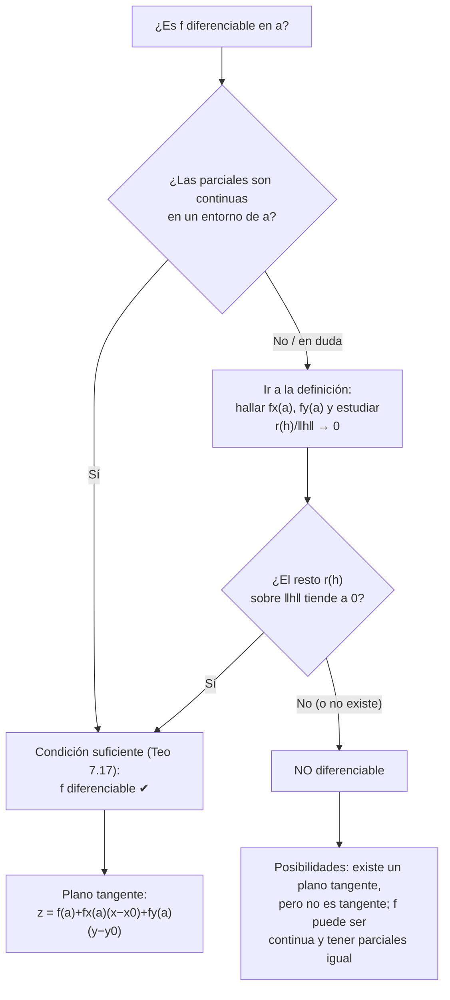
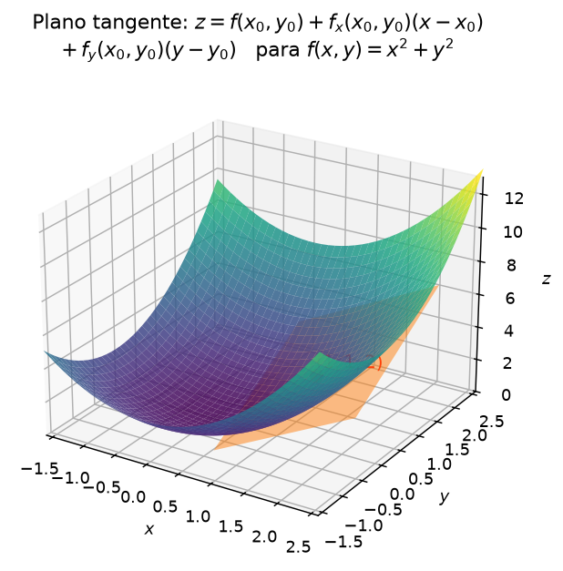
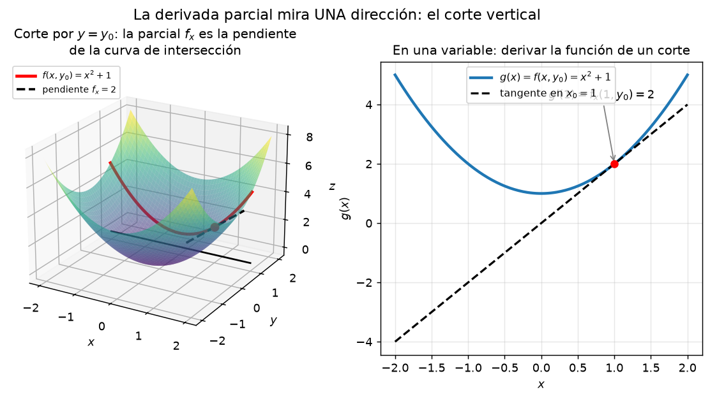

# Clase 38 — Diferenciabilidad, plano tangente y condición suficiente

> **Bloque 8 · Diferenciabilidad · Dificultad: alta · Tiempo estimado: 135 min**

En la clase 37 vimos que las derivadas direccionales son información **dirección por dirección**. La **diferenciabilidad** es la noción que las junta todas en una sola: $f$ es diferenciable en $a$ si su gráfico se puede **aproximar por un plano** con un error que tiende a cero **más rápido** que la distancia. Este es el concepto central del bloque y el que da la ecuación del **plano tangente**. También es el que hace verdadera la fórmula $\partial f/\partial v=\langle\nabla f,v\rangle$ (Teorema 7.13). Cerramos con el criterio práctico del curso: si las parciales existen y son **continuas**, entonces $f$ es diferenciable (Teorema 7.17).

---

## 🎯 Objetivos

1. **Definir** diferenciabilidad en un punto (**Definiciones 7.11/7.12**): $f(a+h)=f(a)+df_a(h)+r(h)$ con $r(h)/\|h\|\to0$.
2. Enunciar el **Teorema 7.13**: diferenciable $\Rightarrow$ continua, $\Rightarrow$ existen las parciales ($=\,$coeficientes $A,B$) y todas las direccionales ($\partial f/\partial v=\langle\nabla f,v\rangle$).
3. Escribir la ecuación del **plano tangente** y usarla en ejercicios de múltiple opción.
4. Aplicar la **condición suficiente** (Teorema 7.17): parciales continuas $\Rightarrow$ diferenciable. Entender que el recíproco es **falso**.
5. Resolver el **Ejercicio 3 del Segundo parcial 2025-1S** y el Ejercicio 2 (plano tangente) del mismo parcial.

---

## 🗺️ Mapa de la clase

---

## 🧱 Repaso / ideas previas

- **Una variable (clase 2).** $f$ derivable en $x_0$ $\iff$ $f(x_0+h)=f(x_0)+f'(x_0)\,h+r(h)$ con $\dfrac{r(h)}{h}\to0$. Es decir, la recta tangente aproxima **bien** (error de orden mayor que $h$).
- **Clase 35.** Recordá que "una transformación lineal de $\mathbb{R}^2$ en $\mathbb{R}$" es simplemente $T(\Delta x,\Delta y)=A\,\Delta x+B\,\Delta y$.
- **Clase 37.** Parciales $f_x,f_y$, direccionales y gradiente $\nabla f$. **Atención:** "existen todas las direccionales" **no** implica continuidad; eso es precisamente lo que la diferenciabilidad repara.
- **Norma.** $\|h\|=\sqrt{\Delta x^2+\Delta y^2}$ es la distancia (no la suma de componentes).

> 💡 **La clave es el resto.** Que $r\to0$ no dice nada: cualquier plano que pase por el punto lo cumple. Lo que exige la diferenciabilidad es que el resto se **aplaste**: $r(h)/\|h\|\to0$.

---

## 📘 Teoría

### 1. La definición

> **Definición 38.1 (notas, Definición 7.11).** Sean $f:\mathbb{R}^n\to\mathbb{R}$ y $a\in\mathbb{R}^n$. Decimos que $f$ es **diferenciable en $a$** si existe una transformación lineal $df_a:\mathbb{R}^n\to\mathbb{R}$ tal que
> $$f(a+h)=f(a)+df_a(h)+r(h),\qquad\text{con}\qquad\lim_{h\to0}\frac{r(h)}{\|h\|}=0.$$

Para $f:\mathbb{R}^2\to\mathbb{R}$ esto se lee: existen $A,B\in\mathbb{R}$ con
$$f(x_0+\Delta x,\,y_0+\Delta y)=f(x_0,y_0)+A\,\Delta x+B\,\Delta y+r(\Delta x,\Delta y),\qquad \lim_{(\Delta x,\Delta y)\to(0,0)}\frac{r(\Delta x,\Delta y)}{\|(\Delta x,\Delta y)\|}=0. \tag{38.1}$$

### 2. Qué sabemos de los coeficientes y qué implica

> **Teorema 38.2 (notas, Teorema 7.13).** Sea $f:\mathbb{R}^2\to\mathbb{R}$ **diferenciable** en $(x_0,y_0)$. Entonces:
> 1. $f$ es **continua** en $(x_0,y_0)$.
> 2. Existen las derivadas parciales y valen $\dfrac{\partial f}{\partial x}(x_0,y_0)=A$ y $\dfrac{\partial f}{\partial y}(x_0,y_0)=B$.
> 3. Existen **todas** las derivadas direccionales, y para $v=(v_1,v_2)$,
> $$\frac{\partial f}{\partial v}(x_0,y_0)=A\,v_1+B\,v_2=\Big\langle\nabla f(x_0,y_0),\,v\Big\rangle.$$

**Esquema de la demostración.**

1. **Continuidad:** despejando de (38.1), $\lim_{h\to0}f(a+h)=f(a)$ porque $A\Delta x+B\Delta y\to0$ (es lineal, y lo lineal es continuo) y $r(h)\to0$ (porque $r/\|h\|\to0$ implica $r\to0$).
2. **Parciales $=A,B$:** tomando $\Delta y=0$ y dividiendo por $h$,
   $$\frac{\partial f}{\partial x}=\lim_{h\to0}\frac{f(x_0+h,y_0)-f(x_0,y_0)}{h}=\lim_{h\to0}\Big(A+\frac{r(h,0)}{h}\Big)=A,$$
   porque $\left|\dfrac{r(h,0)}{h}\right|\le\dfrac{|r(h,0)|}{\|(h,0)\|}\to0$.
3. **Direccionales:** reemplazando $(h v_1,h v_2)$ y dividiendo por $h$, el resto dividido por $h$ tiende a $0$ (multiplicando y dividiendo por $\|v\|$). $\blacksquare$

> **Corolario 38.3 (necesario).** Si $f$ **no** es continua en $a$, entonces **no** es diferenciable. Y si $f$ no tiene parciales, tampoco.

### 3. Plano tangente

Si despreciamos el resto en (38.1), el gráfico se aproxima por el plano
$$\boxed{\,z=f(x_0,y_0)+f_x(x_0,y_0)\,(x-x_0)+f_y(x_0,y_0)\,(y-y_0).\,}$$
Es la **parte lineal** de la definición: el único plano que aproxima bien.

**Ejemplo (notas).** Para $f(x,y)=x^2+y^2$ en $(1,2)$: $f(1,2)=5$, $f_x=2x\Rightarrow 2$, $f_y=2y\Rightarrow4$, y
$$z=5+2(x-1)+4(y-2).$$

### 4. La condición suficiente (el criterio práctico)

> **Teorema 38.4 (notas, Teorema 7.17 — condición suficiente).** Sea $f:\mathbb{R}^2\to\mathbb{R}$ y $(x_0,y_0)$ un punto tales que las derivadas parciales existen en una bola de centro $(x_0,y_0)$ y **ambas son continuas** en $(x_0,y_0)$. Entonces $f$ es **diferenciable** en $(x_0,y_0)$.

**Idea de la prueba (dos tramos).** Se va de $(x_0,y_0)$ a $(x_0+\Delta x,y_0+\Delta y)$ pasando por $(x_0+\Delta x,y_0)$, aplicando el **valor medio de Lagrange** en cada tramo:
$$f(x_0+\Delta x,y_0+\Delta y)-f(x_0,y_0)=f_y(x_0+\Delta x,\,y_0+\tilde\theta\Delta y)\,\Delta y+f_x(x_0+\theta\Delta x,\,y_0)\,\Delta x.$$
Al restar $f_x(x_0,y_0)\Delta x+f_y(x_0,y_0)\Delta y$, el resto queda como una suma de dos términos; cada uno es $\dfrac{\Delta x}{\|(\Delta x,\Delta y)\|}$ (acotado) por $\big(f_x(x_0+\theta\Delta x,y_0)-f_x(x_0,y_0)\big)$ (que $\to0$ por **continuidad** de las parciales). El producto tiende a $0$. $\blacksquare$

De aquí en adelante: diremos que $f$ es **de clase $C^1$** si tiene parciales continuas. **$C^1$ $\Rightarrow$ diferenciable** es el atajo que usaremos casi siempre (polinomios, exponenciales, senos, cocientes con denominador no nulo son $C^1$).

> ⚠️ **El recíproco es FALSO.** Hay funciones diferenciables cuyas parciales **no** son continuas. El ejemplo clásico es
> $$f(x,y)=(x^2+y^2)\sin\!\frac{1}{x^2+y^2}\ (x,y\neq0),\qquad f(0,0)=0,$$
> que es diferenciable en el origen pero **no** es $C^1$ (lo resolvemos en la clase 40).

### 5. Operaciones

Si $f$ y $g$ son diferenciables en un punto, entonces $\lambda f$, $f+g$ y $fg$ también lo son; y $f/g$ lo es allí donde $g\neq0$. Esto permite concluir la diferenciabilidad de una enorme familia de funciones "de fórmula" sin tocar la definición.

---

## 🖼️ Figuras

**Cómo leerla:** la superficie azul es $z=x^2+y^2$ y el plano naranja es su plano tangente en $(1,1,2)$: $z=2+2(x-1)+2(y-1)$. Cerca del punto de contacto, superficie y plano son **casi indistinguibles**; al alejarse, el error (el resto) crece. La diferenciabilidad dice que ese error, medido en unidades de $\|h\|$, se anula.

**Cómo leerla:** los coeficientes del plano tangente son las pendientes de los **cortes**. Si el plano aproxima bien, su pendiente en la dirección $x$ debe ser $f_x$ y en la dirección $y$, $f_y$. La definición de diferenciabilidad es exactamente "existe un plano cuyas dos pendientes son estas y cuyo resto es de orden mayor".

---

## ✏️ Ejercicios resueltos

### Ejercicio 1 (notas, Ejemplos 7.15.1). $f(x,y)=2x+3y+4$

**Paso 1 — parciales.** $f_x=2$, $f_y=3$ en todo punto.

**Paso 2 — el resto.** La definición pide
$$f(\Delta x,\Delta y)=f(0,0)+2\Delta x+3\Delta y+r(\Delta x,\Delta y).$$
Como $f(\Delta x,\Delta y)=2\Delta x+3\Delta y+4$ y $f(0,0)=4$, se despeja $r\equiv0$. El resto nulo cumple trivialmente $r/\|h\|\to0$: **$f$ es diferenciable** (y su plano tangente es ella misma, que ya era un plano).

### Ejercicio 2 (notas, Ejemplos 7.15.2). $f(x,y)=\dfrac{xy}{\sqrt{x^2+y^2}}$ no es diferenciable en $(0,0)$

**Paso 1 — parciales.** Sobre los ejes $f\equiv0$, luego $f_x(0,0)=f_y(0,0)=0$ y $\nabla f(0,0)=(0,0)$.

**Paso 2 — el resto es toda la función.**
$$\frac{r(\Delta x,\Delta y)}{\|(\Delta x,\Delta y)\|}=\frac{1}{\sqrt{\Delta x^2+\Delta y^2}}\cdot\frac{\Delta x\,\Delta y}{\sqrt{\Delta x^2+\Delta y^2}}=\frac{\Delta x\,\Delta y}{\Delta x^2+\Delta y^2}.$$

**Paso 3 — este límite no existe.** Por la recta $\Delta y=\Delta x$ da $\tfrac12$; por el eje $\Delta y=0$ da $0$. Por lo tanto **$f$ no es diferenciable** en el origen. (Nótese que los coeficientes eran $A=B=0$: no hay ningún plano que aproxime bien.)

### Ejercicio 3 (notas, Ejemplos 7.15.3). $f(x,y)=\dfrac{x^2y}{\sqrt{x^2+y^2}}$ sí es diferenciable en $(0,0)$

**Paso 1 — parciales.** Otra vez $f\equiv0$ sobre los ejes: $f_x(0,0)=f_y(0,0)=0$.

**Paso 2 — el cociente del resto.**
$$\frac{r}{\|(\Delta x,\Delta y)\|}=\frac{\Delta x^2\,\Delta y}{\Delta x^2+\Delta y^2}.$$

**Paso 3 — acotar.** Usando $\Delta x^2\le\Delta x^2+\Delta y^2$ y $|\Delta y|\le\sqrt{\Delta x^2+\Delta y^2}$:
$$\left|\frac{\Delta x^2\,\Delta y}{\Delta x^2+\Delta y^2}\right|\le|\Delta y|\xrightarrow[(\Delta x,\Delta y)\to(0,0)]{}0.$$
Luego el resto es de orden mayor que $\|h\|$: **$f$ es diferenciable** en el origen, con plano tangente $z=0$. ✔

> 💡 **El mensaje de los dos ejercicios anteriores:** $\dfrac{x^2y}{x^2+y^2}\to0$ pero $\dfrac{xy}{x^2+y^2}$ **no**. Un exponente más en el numerador cambia todo.

### Ejercicio 4 (notas, plano tangente). Plano tangente a $f(x,y)=x^2+y^2$ en $(1,2)$

**Paso 1 — valor y pendientes.** $f(1,2)=1+4=5$; $f_x=2x\Rightarrow f_x(1,2)=2$; $f_y=2y\Rightarrow f_y(1,2)=4$.

**Paso 2 — armar el plano.**
$$z=5+2(x-1)+4(y-2)\ \Longleftrightarrow\ \boxed{z=2x+4y-5.}$$

**Chequeo:** en $(1,2)$, $z=2+8-5=5=f(1,2)$ ✔; la pendiente en $x$ es $2$ ✔; en $y$, $4$ ✔.

### Ejercicio 5 (plano tangente con condición suficiente). $f(x,y)=x^2y+e^{xy}$ en $(1,0)$

**Paso 1 — diferenciabilidad.** $f$ es suma y producto de polinomios y de la exponencial (que es $C^\infty$): es $C^1$, luego **diferenciable** en todo punto por el Teorema 38.4.

**Paso 2 — valor.** $f(1,0)=1\cdot0+e^{0}=1$.
**Paso 3 — parciales.** $f_x=2xy+y\,e^{xy}\Rightarrow f_x(1,0)=0$; $f_y=x^2+x\,e^{xy}\Rightarrow f_y(1,0)=1+1=2$.

**Paso 4 — plano tangente.**
$$z=1+0\cdot(x-1)+2(y-0)=\boxed{1+2y.}$$

---

## 🏛️ Ejercicios de parcial/examen

### Ejercicio 6 (Segundo parcial 2025-1S, Ej. 3, múltiple opción). $f(x,y)=\dfrac{|x|\,y}{\sqrt{x^2+y^2}}$

> Entonces:
> A) $f$ es diferenciable en $(0,0)$ y por lo tanto continua.
> B) $f$ tiene parciales en $(0,0)$, pero no es continua.
> C) No existen las parciales en $(0,0)$, pero $f$ es continua.
> D) $f$ no es diferenciable en $(0,0)$, aunque es continua en $(0,0)$ y existen las parciales.

**Paso 1 — parciales.** $f(h,0)=\dfrac{|h|\cdot0}{\sqrt{h^2}}=0$ y $f(0,h)=\dfrac{0\cdot h}{|h|}=0$, así que
$$f_x(0,0)=\lim_{h\to0}\frac{0-0}{h}=0,\qquad f_y(0,0)=\lim_{h\to0}\frac{0-0}{h}=0.$$
Existen ambas.

**Paso 2 — continuidad.** Escribimos $f(x,y)=y\cdot\dfrac{|x|}{\sqrt{x^2+y^2}}$, y $\left|\dfrac{|x|}{\sqrt{x^2+y^2}}\right|=\dfrac{\sqrt{x^2}}{\sqrt{x^2+y^2}}\le1$. Producto de algo **acotado** por $y\to0$ da $0$:
$$\lim_{(x,y)\to(0,0)}f(x,y)=0=f(0,0).$$
La función **sí es continua** en el origen.

**Paso 3 — diferenciabilidad.** Con $\nabla f(0,0)=(0,0)$, el cociente del resto es
$$\frac{r(\Delta x,\Delta y)}{\|(\Delta x,\Delta y)\|}=\frac{|\Delta x|\,\Delta y}{\Delta x^2+\Delta y^2}.$$
Por la recta $\Delta y=\Delta x>0$: $\dfrac{\Delta x^2}{2\Delta x^2}=\dfrac12$; por $\Delta y=0$: $0$. El límite no existe, así que **$f$ no es diferenciable** en $(0,0)$.

**Respuesta: (D).** ✔ *(verificada con la solución oficial)*

> 🎓 Es el "retrato hablado" de la frontera entre la clase 37 y la 38: **continua $+$ parciales $\nRightarrow$ diferenciable**.

### Ejercicio 7 (Segundo parcial 2025-1S, Ej. 2, múltiple opción). Plano tangente a $f(x,y)=\sqrt{xy+\dfrac{x}{y}}$

> $\pi$ es el plano tangente al gráfico en $(2,1,2)$. ¿Qué punto pertenece a $\pi$?
> A) $(0,1,3)$  B) $(4,1,3)$  C) $(4,0,-3)$  D) $(0,0,3)$

**Paso 1 — valor.** $f(2,1)=\sqrt{2\cdot1+\dfrac21}=\sqrt4=2$ ✔ (coincide con el dato).

**Paso 2 — parciales.** Con la regla de la cadena,
$$f_x=\tfrac12\Big(xy+\tfrac{x}{y}\Big)^{-1/2}\Big(y+\tfrac1y\Big),\qquad f_y=\tfrac12\Big(xy+\tfrac{x}{y}\Big)^{-1/2}\Big(x-\tfrac{x}{y^2}\Big).$$
En $(2,1)$: $f_x=\tfrac12\cdot\tfrac12\cdot(1+1)=\tfrac12$; y $f_y=\tfrac12\cdot\tfrac12\cdot(2-2)=0$.

**Paso 3 — plano tangente.**
$$z=2+\tfrac12(x-2)+0\,(y-1)=2+\tfrac12(x-2)\ \Longleftrightarrow\ x-2z+2=0.$$

**Paso 4 — chequear las opciones.** $(4,1,3)$: $4-6+2=0$ ✔. Las demás no.

**Respuesta: (B).** ✔ *(verificada con la solución oficial)*

### Ejercicio 8 (Segundo parcial 2018-2S, Desarrollo Ej. 5). Probar el Teorema 7.13

> Sea $f:\mathbb{R}^2\to\mathbb{R}$ diferenciable en $(x_0,y_0)$. Probar que:
> 1. $f$ es continua en $(x_0,y_0)$.
> 2. existen $\partial f/\partial x$ y $\partial f/\partial y$ en $(x_0,y_0)$.
> 3. si $v=(v_1,v_2)$, entonces $\dfrac{\partial f}{\partial v}(x_0,y_0)=f_x(x_0,y_0)v_1+f_y(x_0,y_0)v_2$.

**Paso 1 (parte 1).** Por definición, $f(x_0+\Delta x,y_0+\Delta y)=f(x_0,y_0)+A\Delta x+B\Delta y+r(\Delta x,\Delta y)$. Como $r(h)/\|h\|\to0$, en particular $r(h)\to0$; y $A\Delta x+B\Delta y\to0$. Sumando:
$$\lim_{(\Delta x,\Delta y)\to(0,0)}f(x_0+\Delta x,y_0+\Delta y)=f(x_0,y_0),$$
que es la continuidad.

**Paso 2 (parte 2).** Evaluando en $\Delta y=0$ y dividiendo por $\Delta x=h$,
$$\frac{f(x_0+h,y_0)-f(x_0,y_0)}{h}=A+\frac{r(h,0)}{h}.$$
Como $\left|\dfrac{r(h,0)}{h}\right|\le\dfrac{|r(h,0)|}{\|(h,0)\|}\to0$, resulta $\dfrac{\partial f}{\partial x}(x_0,y_0)=A$. Análogamente $\dfrac{\partial f}{\partial y}(x_0,y_0)=B$.

**Paso 3 (parte 3).** Evaluando en $(\Delta x,\Delta y)=h(v_1,v_2)$ y dividiendo por $h$:
$$\frac{f(x_0+hv_1,y_0+hv_2)-f(x_0,y_0)}{h}=Av_1+Bv_2+\frac{r(hv_1,hv_2)}{h}.$$
El último término tiende a $0$ porque
$$\frac{|r(hv_1,hv_2)|}{|h|}=\frac{|r(hv_1,hv_2)|}{\|h(v_1,v_2)\|}\cdot\frac{\|h(v_1,v_2)\|}{|h|}\xrightarrow[h\to0]{}0\cdot\|v\|=0.$$
Sustituyendo $A=f_x$, $B=f_y$ queda exactamente la fórmula pedida. $\blacksquare$

### Ejercicio 9 (Examen julio 2019, Desarrollo Ej. 6a-6b). Parciales y diferenciabilidad en $(0,0)$

$$f(x,y)=\begin{cases} y^2+y+1 & \text{si } x=0,\\[2pt] x^2\sin\!\dfrac1x+y+1 & \text{si } x\neq0.\end{cases}$$

**Paso 1 — valor.** $f(0,0)=0+0+1=1$.

**Paso 2 — parciales.**
$$f_x(0,0)=\lim_{h\to0}\frac{f(h,0)-1}{h}=\lim_{h\to0}\frac{h^2\sin(1/h)}{h}=\lim_{h\to0}h\sin\tfrac1h=0,$$
$$f_y(0,0)=\lim_{h\to0}\frac{f(0,h)-1}{h}=\lim_{h\to0}\frac{h^2+h}{h}=1.$$

**Paso 3 — el resto.** Con $A=0$, $B=1$,
$$r(x,y)=f(x,y)-1-y=\begin{cases} y^2 & x=0,\\ x^2\sin\frac1x & x\neq0.\end{cases}$$

**Paso 4 — $r/\|(x,y)\|\to0$.** Si $x=0$: $\dfrac{y^2}{\sqrt{y^2}}=|y|\to0$. Si $x\neq0$: $\left|\dfrac{x^2\sin(1/x)}{\sqrt{x^2+y^2}}\right|\le\dfrac{x^2}{|x|}=|x|\to0$. Ambos casos dan $0$, así que **$f$ es diferenciable** en $(0,0)$. ✔

---

## ⚠️ Errores comunes

| Error | Corrección |
|---|---|
| "Existen las parciales $\Rightarrow$ diferenciable" | Falso: el Ejercicio 6 (y los Ejemplos 7.5, 7.9) son la contra |
| "Es continua $\Rightarrow$ diferenciable" | Falso: $f(x,y)=|x|$ es continua y no diferenciable cuando $x=0$ |
| Dividir el resto por $\Delta x+\Delta y$ | Va dividido por la **norma** $\sqrt{\Delta x^2+\Delta y^2}$ |
| Verificar el resto con una sola trayectoria | Para **probar** diferenciabilidad hay que acotar en todas las direcciones (usar $|\Delta y|\le\|h\|$, etc.); para **refutar**, sí alcanza una curva |
| Usar $\langle\nabla f,v\rangle$ sin chequear diferenciabilidad | Es la conclusión del Teorema 7.13; sin la hipótesis no vale |
| Creer que $C^1$ es equivalente a diferenciable | $C^1\Rightarrow$ diferenciable; el recíproco es **falso** (clase 40) |
| Confundir el plano tangente con "cualquier plano por el punto" | El plano tangente tiene **exactamente** las pendientes $f_x,f_y$ |

---

## 🔗 Conexiones

- **Clase 37:** las direccionales y el gradiente; acá se vuelven un **teorema** cuando $f$ es diferenciable.
- **Clase 39:** la regla de la cadena es la herramienta que permite componer funciones diferenciables y demostrar que $\nabla f\perp$ curvas de nivel.
- **Clase 40:** derivadas de orden superior y Hessiana; allí aparece el ejemplo de función diferenciable **no** $C^1$.
- **Clase 42:** el plano tangente es el polinomio de Taylor de **orden 1**; con la Hessiana se sube al orden 2.
- **Aplicaciones:** el diferencial $df_a$ es la base de la propagación de errores y de la sensibilidad en modelos físicos: $\Delta f\approx f_x\Delta x+f_y\Delta y$.

---

## ✅ Autoevaluación

1. Definir "f diferenciable en $a$" para $f:\mathbb{R}^2\to\mathbb{R}$ sin mirar las notas.
2. Enunciar el Teorema 7.13 con sus tres conclusiones y la fórmula del plano tangente.
3. ¿Por qué "parciales continuas" es solo **condición suficiente** y no necesaria?
4. Probar que $f(x,y)=x^2+y^2$ es diferenciable en todo punto usando la condición suficiente.
5. Estudiar la diferenciabilidad en $(0,0)$ de $f(x,y)=\dfrac{x^3}{x^2+y^2}$ (con $f(0,0)=0$).
6. Hallar el plano tangente a $f(x,y)=e^{x}\cos y$ en $(0,0)$.
7. ¿Verdadero o falso? "Si existen las derivadas direccionales en todas las direcciones y $f$ es continua, entonces $f$ es diferenciable". Justificar.

### Respuestas

1. Ver Definición 38.1.
2. Ver Teorema 38.2 y la fórmula del plano tangente.
3. Porque hay funciones diferenciables cuyas parciales no son continuas: $f=(x^2+y^2)\sin\frac{1}{x^2+y^2}$ en el origen (clase 40).
4. $f_x=2x$, $f_y=2y$ son continuas (polinomios) $\Rightarrow$ $f$ es $C^1$ $\Rightarrow$ diferenciable (Teorema 38.4).
5. $f_x(0,0)=f_y(0,0)=0$ y $\dfrac{|r|}{\|h\|}=\dfrac{|x^3|}{(x^2+y^2)^{3/2}}\le\dfrac{|x|^3}{|x|^3}\cdot\ldots$: acotando $|x|\le\|h\|$ resulta $\le1$, pero por la recta $y=0$, $\frac{x^3}{x^3}=1\nrightarrow0$. **No es diferenciable** (de hecho tampoco es continua: por $y=0$ tiende a... veamos $f(x,0)=x\to0$, por $y=x$: $x^3/(2x^2)=x/2\to0$; el límite es $0$; es continua. Pero el resto no se aplasta).
6. $f(0,0)=1$, $f_x=e^x\cos y\Rightarrow1$, $f_y=-e^x\sin y\Rightarrow0$: $z=1+x$.
7. **FALSO.** Es exactamente la situación del Ejercicio 4 y del Ejemplo 7.9 de la clase 37: continuidad + direccionales no alcanzan.

---

**⬅️ Anterior:** [Clase 37 — Derivadas parciales y direccionales; gradiente](37_derivadas_parciales_direccionales.md) · 🏠 [Índice](00_indice.md) · **➡️ Siguiente:** [Clase 39 — Regla de la cadena y matriz jacobiana](39_regla_cadena_jacobiano.md)
