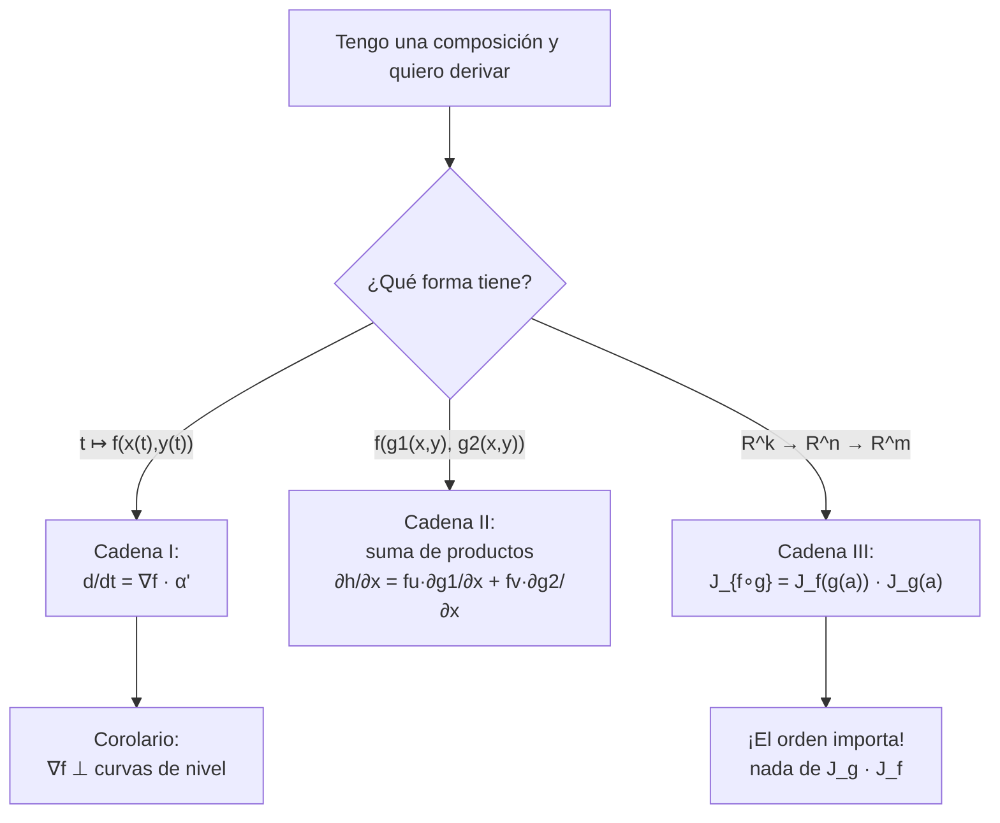
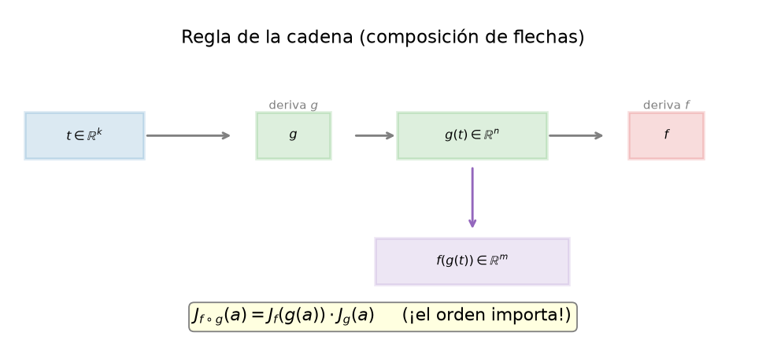
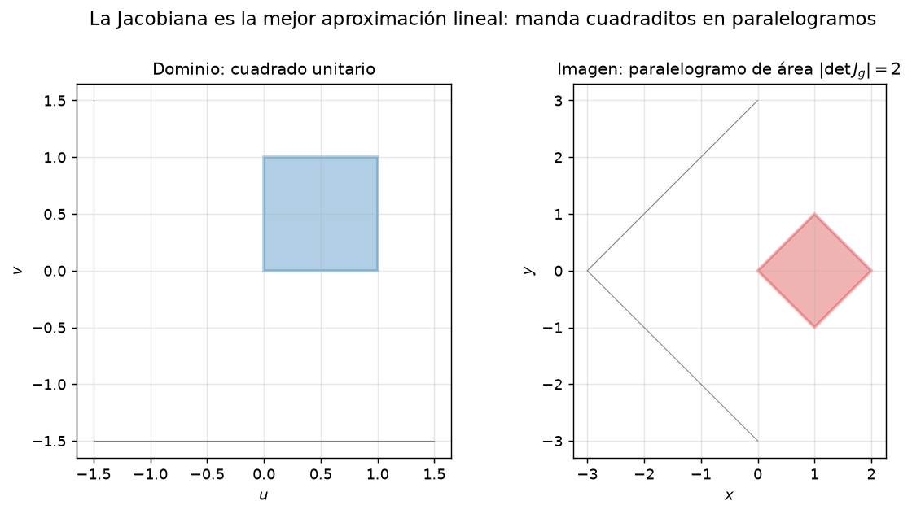

# Clase 39 — Regla de la cadena y matriz jacobiana

> **Bloque 8 · Diferenciabilidad · Dificultad: media-alta · Tiempo estimado: 130 min**

La **regla de la cadena** dice cómo se deriva una composición. En una variable es $g'(t)=f'(x(t))\,x'(t)$; en varias variables, cada variable "influye" a través de cada camino posible, y eso produce **una suma de productos**. Cuando las funciones toman valores en $\mathbb{R}^m$, todos esos productos se ordenan en una **matriz**: la **matriz jacobiana**. La regla de la cadena se vuelve una multiplicación de matrices, $J_{f\circ g}(a)=J_f(g(a))\cdot J_g(a)$, y de ella sale también que el **gradiente es perpendicular a las curvas de nivel**.

---

## 🎯 Objetivos

1. Aplicar la **regla de la cadena I** (Teorema 7.20): $\dfrac{d}{dt}f(\alpha(t))=\langle\nabla f(\alpha(t)),\alpha'(t)\rangle$.
2. Aplicar la **regla de la cadena II** (Teorema 7.21) para $h(x,y)=f(g_1(x,y),g_2(x,y))$.
3. Construir la **matriz jacobiana** $J_f(a)$ de una función $f:\mathbb{R}^n\to\mathbb{R}^m$ (filas $=$ gradientes de las componentes).
4. Aplicar la **regla de la cadena III** (Teorema 7.29): $J_{f\circ g}(a)=J_f(g(a))\,J_g(a)$, respetando el **orden**.
5. Demostrar que $\nabla f$ es perpendicular a las curvas de nivel.
6. Resolver el **Ejercicio 4 del Segundo parcial 2025-1S** y otros de parcial/examen.

---

## 🗺️ Mapa de la clase

---

## 🧱 Repaso / ideas previas

- **Diferenciabilidad (clase 38):** $f(a+h)=f(a)+df_a(h)+r(h)$ con $r/\|h\|\to0$. La regla de la cadena es el teorema que hace de la composición una operación cerrada entre funciones diferenciables.
- **Composición de funciones:** $f\circ g$ se define cuando el **codominio de $g$** entra en el **dominio de $f$**. Si $g:\mathbb{R}^k\to\mathbb{R}^n$ y $f:\mathbb{R}^n\to\mathbb{R}^m$, entonces $f\circ g:\mathbb{R}^k\to\mathbb{R}^m$.
- **Funciones a valores vectoriales:** $f:\mathbb{R}^n\to\mathbb{R}^m$ se escribe por componentes, $f=(f_1,\dots,f_m)$, con cada $f_i:\mathbb{R}^n\to\mathbb{R}$.
- **Matrices:** producto de una matriz $m\times n$ por una $n\times k$ da $m\times k$. Recordar que **no conmutan**.

> 💡 **Truco para no equivocarse:** en la cadena, "cada variable intermedia aporta un término". Derivás respecto de la variable final, multiplicando por la derivada de cada variable intermedia que dependa de ella.

---

## 📘 Teoría

### 1. Regla de la cadena I (componer con una curva)

> **Teorema 39.1 (notas, Teorema 7.20).** Sean $f:\mathbb{R}^2\to\mathbb{R}$ **diferenciable** en $(x_0,y_0)$, y $\alpha(t)=(x(t),y(t))$ una curva con $\alpha(t_0)=(x_0,y_0)$ y coordenadas **derivables** en $t_0$. Entonces $g(t)=f(\alpha(t))$ es derivable en $t_0$ y
> $$g'(t_0)=f_x(x_0,y_0)\,x'(t_0)+f_y(x_0,y_0)\,y'(t_0)=\big\langle\nabla f(x_0,y_0),\,\alpha'(t_0)\big\rangle.$$

**Lectura:** al movernos de $t_0$ a $t_0+h$, la primera coordenada de $\alpha$ cambia a velocidad $x'(t_0)$ y eso produce un cambio en $f$ de $f_x\cdot x'(t_0)$; la segunda aporta $f_y\cdot y'(t_0)$. Los efectos **se suman**.

### 2. Regla de la cadena II (componer dos funciones de $\mathbb{R}^2$ a $\mathbb{R}$)

> **Teorema 39.2 (notas, Teorema 7.21).** Sean $g(x,y)=(g_1(x,y),g_2(x,y)):\mathbb{R}^2\to\mathbb{R}^2$ y $f(u,v):\mathbb{R}^2\to\mathbb{R}$, con $g(x_0,y_0)=(u_0,v_0)$. Supongamos $f$ diferenciable en $(u_0,v_0)$ y $g_1,g_2$ diferenciables en $(x_0,y_0)$. Entonces $h=f\circ g$ tiene parciales
> $$\frac{\partial h}{\partial x}(x_0,y_0)=\frac{\partial f}{\partial u}(u_0,v_0)\frac{\partial g_1}{\partial x}(x_0,y_0)+\frac{\partial f}{\partial v}(u_0,v_0)\frac{\partial g_2}{\partial x}(x_0,y_0),$$
> $$\frac{\partial h}{\partial y}(x_0,y_0)=\frac{\partial f}{\partial u}(u_0,v_0)\frac{\partial g_1}{\partial y}(x_0,y_0)+\frac{\partial f}{\partial v}(u_0,v_0)\frac{\partial g_2}{\partial y}(x_0,y_0).$$

> ⚠️ **Puntos de evaluación:** las derivadas de $f$ se evalúan en $(u_0,v_0)=g(x_0,y_0)$; las de $g_i$, en $(x_0,y_0)$. Confundir esto es el error más común.

### 3. La matriz jacobiana

Para $f:\mathbb{R}^n\to\mathbb{R}^m$, $f=(f_1,\dots,f_m)$, la diferencial $df_a$ es una transformación lineal $\mathbb{R}^n\to\mathbb{R}^m$ y se representa por una matriz $m\times n$: la **matriz jacobiana**,
$$J_f(a)=\begin{pmatrix} \dfrac{\partial f_1}{\partial x_1}(a) & \cdots & \dfrac{\partial f_1}{\partial x_n}(a)\\[8pt] \vdots & & \vdots\\[4pt] \dfrac{\partial f_m}{\partial x_1}(a) & \cdots & \dfrac{\partial f_m}{\partial x_n}(a)\end{pmatrix}=\begin{pmatrix} \nabla f_1(a)\\ \vdots\\ \nabla f_m(a)\end{pmatrix}.$$
Es decir: **cada fila es el gradiente de una componente**.

**Ejemplo (notas, Ejemplo 7.28).** Para $f(x,y,z)=(x^2y+e^z,\ \sin x+yz):\mathbb{R}^3\to\mathbb{R}^2$,
$$J_f(x,y,z)=\begin{pmatrix} 2xy & x^2 & e^{z}\\ \cos x & z & y\end{pmatrix}.$$

### 4. Regla de la cadena III (la versión matricial)

> **Teorema 39.3 (notas, Teorema 7.29).** Sean $g:\mathbb{R}^k\to\mathbb{R}^n$ diferenciable en $a$ y $f:\mathbb{R}^n\to\mathbb{R}^m$ diferenciable en $g(a)$. Entonces $f\circ g$ es diferenciable en $a$ y
> $$d(f\circ g)_a=df_{g(a)}\circ dg_a,\qquad\text{es decir}\qquad \boxed{\,J_{f\circ g}(a)=J_f(g(a))\,J_g(a).\,}$$

**Chequeo de tamaños:** $J_f(g(a))$ es $m\times n$ y $J_g(a)$ es $n\times k$; el producto es $m\times k$, el tamaño de $J_{f\circ g}(a)$. Si intentás multiplicar al revés, las dimensiones no cierran: **el orden está forzado**.

**Corolario 39.4 (gradiente perpendicular a las curvas de nivel).** Sea $f$ diferenciable y $\alpha$ una curva con $f(\alpha(t))=k$ constante. Entonces $g=f\circ\alpha$ es constante, así que $g'=0$. Por la cadena I,
$$0=g'(t)=\big\langle\nabla f(\alpha(t)),\,\alpha'(t)\big\rangle.$$
Como $\alpha'$ es **tangente** a la curva de nivel, el gradiente es **perpendicular** a todas las curvas de nivel. $\blacksquare$

---

## 🖼️ Figuras

**Cómo leerla:** la composición encadena dos derivadas: primero deriva $g$ (de $\mathbb{R}^k$ a $\mathbb{R}^n$) y después $f$ (de $\mathbb{R}^n$ a $\mathbb{R}^m$). En matrices, la tangente de la compuesta es el **producto** de las tangentes, y por eso el orden $J_f\cdot J_g$ no se puede alterar.

**Cómo leerla:** el diferencial es la mejor aproximación lineal. Si el cuadrado unitario del dominio se manda con $g(u,v)=(u+v,\ v-u)$, se convierte en un paralelogramo. El **factor de área** es $|\det J_g|=2$: la Jacobiana "estira el espacio" tanto como su determinante (esto reaparecerá en el cambio de variable de integrales múltiples, clase 46).

También conviene releer la figura **b8_gradiente_nivel** de la clase 37 con nuevos ojos: el Corolario 39.4 es la demostración de lo que allí se veía, $\nabla f\perp$ curvas de nivel.

---

## ✏️ Ejercicios resueltos

### Ejercicio 1 (cadena I). $g(t)=f(t^2,\sin t)$ con $f(x,y)=x^2y$

**Paso 1 — datos.** $x(t)=t^2$, $y(t)=\sin t$; $x'=2t$, $y'=\cos t$. Y $f_x=2xy$, $f_y=x^2$.

**Paso 2 — cadena I.**
$$g'(t)=f_x\big(x(t),y(t)\big)\,x'(t)+f_y\big(x(t),y(t)\big)\,y'(t)=(2t^2\sin t)(2t)+(t^4)(\cos t).$$
$$g'(t)=4t^3\sin t+t^4\cos t.$$

**Paso 3 — chequeo directo.** $g(t)=f(t^2,\sin t)=(t^2)^2\sin t=t^4\sin t$; derivando, $g'=4t^3\sin t+t^4\cos t$. ✔

### Ejercicio 2 (cadena II). $h(x,y)=f(xy,\ x+y)$ con $f(u,v)=u^2+v^2$

**Paso 1 — parciales de $f$.** $f_u=2u$, $f_v=2v$.

**Paso 2 — parciales de $g$.** $g_1=xy$: $\partial_x g_1=y$, $\partial_y g_1=x$. $g_2=x+y$: $\partial_x g_2=1$, $\partial_y g_2=1$.

**Paso 3 — cadena II.**
$$h_x=f_u\cdot y+f_v\cdot1=2(xy)\,y+2(x+y)=2xy^2+2x+2y.$$
$$h_y=f_u\cdot x+f_v\cdot1=2(xy)\,x+2(x+y)=2x^2y+2x+2y.$$

**Paso 4 — chequeo directo.** $h=(xy)^2+(x+y)^2=x^2y^2+x^2+2xy+y^2$; $h_x=2xy^2+2x+2y$ ✔, $h_y=2x^2y+2x+2y$ ✔.

### Ejercicio 3 (Jacobiana). $f(x,y,z)=(x^2y+e^z,\ \sin x+yz)$

**Paso 1 — componentes.** $f_1=x^2y+e^z$, $f_2=\sin x+yz$.

**Paso 2 — filas (gradientes).** $\nabla f_1=(2xy,\ x^2,\ e^z)$, $\nabla f_2=(\cos x,\ z,\ y)$.

**Paso 3 — matriz.**
$$J_f(x,y,z)=\begin{pmatrix} 2xy & x^2 & e^{z}\\ \cos x & z & y\end{pmatrix}\qquad(2\times3).$$

**Paso 4 — evaluar, por ejemplo, en $(0,1,0)$:**
$$J_f(0,1,0)=\begin{pmatrix} 0 & 0 & 1\\ 1 & 0 & 1\end{pmatrix}.$$

### Ejercicio 4 (Corolario 39.4). Gradiente $\perp$ curvas de nivel

**Paso 1.** Sea $C_k=\{(x,y):f(x,y)=k\}$ y $\alpha(t)$ una curva derivable con imagen en $C_k$.

**Paso 2.** $g(t)=f(\alpha(t))\equiv k$, así que $g'(t)=0$.

**Paso 3 — cadena I.** $0=g'(t)=\langle\nabla f(\alpha(t)),\alpha'(t)\rangle$.

**Paso 4.** Como el producto interno es nulo y $\alpha'(t)$ es tangente a la curva, $\nabla f(\alpha(t))$ es perpendicular a la tangente, es decir, **normal** a la curva de nivel. $\blacksquare$

---

## 🏛️ Ejercicios de parcial/examen

### Ejercicio 5 (Segundo parcial 2025-1S, Ej. 4, múltiple opción). $d(f\circ g)_{(1,1)}(0,1)$

> Sean $f:\mathbb{R}^2\to\mathbb{R}^3$, $f(x,y)=(e^{xy},\,x+y,\,x^2)$, y $g:\mathbb{R}^2\to\mathbb{R}^2$, $g(u,v)=(2uv,\,u)$.
> Entonces $d(f\circ g)_{(1,1)}(0,1)$ es:
> A) $(2e^2,2,8)$  B) $(e,2,2)$  C) $(2e,2,8)$  D) $(e^2,2,2)$

**Paso 1 — punto donde evaluar $f$.** $g(1,1)=(2\cdot1\cdot1,\ 1)=(2,1)$.

**Paso 2 — Jacobiana de $f$.**
$$J_f(x,y)=\begin{pmatrix} y\,e^{xy} & x\,e^{xy}\\ 1 & 1\\ 2x & 0\end{pmatrix}\ \Rightarrow\ J_f(2,1)=\begin{pmatrix} e^{2} & 2e^{2}\\ 1 & 1\\ 4 & 0\end{pmatrix}.$$

**Paso 3 — Jacobiana de $g$.**
$$J_g(u,v)=\begin{pmatrix} 2v & 2u\\ 1 & 0\end{pmatrix}\ \Rightarrow\ J_g(1,1)=\begin{pmatrix} 2 & 2\\ 1 & 0\end{pmatrix}.$$

**Paso 4 — producto (¡en orden! $J_f(g(a))\,J_g(a)$).**
$$J_{f\circ g}(1,1)=\begin{pmatrix} e^{2} & 2e^{2}\\ 1 & 1\\ 4 & 0\end{pmatrix}\begin{pmatrix} 2 & 2\\ 1 & 0\end{pmatrix}=\begin{pmatrix} 4e^{2} & 2e^{2}\\ 3 & 2\\ 8 & 8\end{pmatrix}.$$

**Paso 5 — aplicar al vector $(0,1)$.**
$$d(f\circ g)_{(1,1)}(0,1)=J_{f\circ g}(1,1)\begin{pmatrix}0\\1\end{pmatrix}=\begin{pmatrix}2e^{2}\\ 2\\ 8\end{pmatrix}.$$

**Respuesta: (A) $(2e^2,2,8)$.** ✔ *(verificada con la solución oficial)*

### Ejercicio 6 (Examen diciembre 2022, Ej. 3, múltiple opción). Jacobiana de $f\circ g$ en $(1,0)$

> Sean $f:\mathbb{R}^2\to\mathbb{R}$ y $g:\mathbb{R}^2\to\mathbb{R}^2$ de clase $C^1$, con
> $$g(u,v)=(u^2+v^3,\ e^{u^2}-v),\quad \nabla f(1,0)=(1,-1),\quad \frac{\partial f}{\partial(1,1)}(1,e)=4,\quad f(x,e)=x^2+1.$$
> La matriz Jacobiana de $f\circ g$ en $(1,0)$ es:
> A) $(4+4e,-2)$  B) $(4+2e,-2e)$  C) $(2+2e,0)$  D) $(2e,-1)$  E) $(2-2e,1)$

**Paso 1 — punto.** $g(1,0)=(1+0,\ e^{1}-0)=(1,e)$.

**Paso 2 — Jacobiana de $g$.**
$$J_g(u,v)=\begin{pmatrix} 2u & 3v^2\\ 2u\,e^{u^2} & -1\end{pmatrix}\ \Rightarrow\ J_g(1,0)=\begin{pmatrix} 2 & 0\\ 2e & -1\end{pmatrix}.$$

**Paso 3 — gradiente de $f$ en $(1,e)$.**
- De $f(x,e)=x^2+1$ se sigue $f_x(x,e)=2x$, así que $f_x(1,e)=2$.
- De $\dfrac{\partial f}{\partial(1,1)}(1,e)=f_x(1,e)+f_y(1,e)=4$: $f_y(1,e)=4-2=2$.
- Así $\nabla f(1,e)=(2,2)$.

**Paso 4 — producto.**
$$J_{f\circ g}(1,0)=\nabla f(1,e)\,J_g(1,0)=(2,2)\begin{pmatrix} 2 & 0\\ 2e & -1\end{pmatrix}=(4+4e,\ -2).$$

**Respuesta: (A) $(4+4e,-2)$.** ✔ *(verificada con la solución oficial)*

> 💡 Fijate que hubo que **deducir** $f_y(1,e)$ combinando dos datos. En estos ejercicios la dificultad está en leer bien la información disponible.

### Ejercicio 7 (Examen julio 2019, Desarrollo Ej. 6c). Jacobiana de $g\circ f$ en $(0,0)$

> Del Ejercicio 9 de la clase 38 se sabe que $f$ es diferenciable en $(0,0)$ con $\nabla f(0,0)=(0,1)$, $f(0,0)=1$. Sea $g:\mathbb{R}\to\mathbb{R}^3$ diferenciable con
> $$J_g(1)=\begin{pmatrix} 1\\ -1\\ 2\end{pmatrix}.$$
> Hallar la matriz jacobiana de $g\circ f$ en $(0,0)$.

**Paso 1 — tamaños.** $f:\mathbb{R}^2\to\mathbb{R}$ (Jacobiana $1\times2$) y $g:\mathbb{R}\to\mathbb{R}^3$ (Jacobiana $3\times1$). Entonces $g\circ f:\mathbb{R}^2\to\mathbb{R}^3$ tiene Jacobiana $3\times2$.

**Paso 2 — cadena III.** $J_{g\circ f}(0,0)=J_g(f(0,0))\,J_f(0,0)=J_g(1)\,J_f(0,0)$.

**Paso 3 — armar $J_f(0,0)$.** Es el gradiente como fila: $J_f(0,0)=\begin{pmatrix}0 & 1\end{pmatrix}$.

**Paso 4 — producto.**
$$J_{g\circ f}(0,0)=\begin{pmatrix} 1\\ -1\\ 2\end{pmatrix}\begin{pmatrix} 0 & 1\end{pmatrix}=\begin{pmatrix} 0 & 1\\ 0 & -1\\ 0 & 2\end{pmatrix}.$$

**Respuesta:** $\boxed{J_{g\circ f}(0,0)=\begin{pmatrix} 0 & 1\\ 0 & -1\\ 0 & 2\end{pmatrix}}.$ ✔ *(verificada con la solución oficial)*

### Ejercicio 8 (Segundo parcial 2019-2S, Desarrollo Ej. 2.2). Límite de un cociente incremental

> $f:\mathbb{R}^3\to\mathbb{R}^2$ es diferenciable en $(1,1,1)$, con
> $$\frac{\partial f}{\partial x}(1,1,1)=(3,0),\quad \frac{\partial f}{\partial y}(1,1,1)=(\pi,5),\quad \frac{\partial f}{\partial z}(1,1,1)=(2,1),$$
> y $f(1,1,1)=(\sqrt5,2)$. Calcular
> $$L=\lim_{h\to0}\frac{f(1+\pi h,\ 1+eh,\ 1-\pi h)-(\sqrt5,2)}{h}.$$

**Paso 1 — leer el numerador como incremento.** El punto base es $(1,1,1)$ y el incremento es $\Delta=f$ evaluada en $(1,1,1)+h(\pi,e,-\pi)$. Entonces, por definición de diferenciabilidad (en $\mathbb{R}^m$),
$$f(1,1,1)+\Delta-(\sqrt5,2)=df_{(1,1,1)}\big(h(\pi,e,-\pi)\big)+r\big(h(\pi,e,-\pi)\big).$$

**Paso 2 — reconocer la matriz.** $df_{(1,1,1)}(v)=J_f(1,1,1)\,v$, con
$$J_f(1,1,1)=\begin{pmatrix} 3 & \pi & 2\\ 0 & 5 & 1\end{pmatrix}.$$

**Paso 3 — límite (el resto se aplasta).**
$$L=\frac1h\Big[df_{(1,1,1)}\big(h(\pi,e,-\pi)\big)+r\Big]\xrightarrow[h\to0]{}df_{(1,1,1)}(\pi,e,-\pi).$$

**Paso 4 — calcular.**
$$L=\begin{pmatrix} 3 & \pi & 2\\ 0 & 5 & 1\end{pmatrix}\begin{pmatrix}\pi\\ e\\ -\pi\end{pmatrix}=\begin{pmatrix}3\pi+\pi e-2\pi\\ 5e-\pi\end{pmatrix}=\begin{pmatrix}\pi(1+e)\\ 5e-\pi\end{pmatrix}.$$

**Respuesta:** $\boxed{L=\big(\pi(1+e),\,5e-\pi\big).}$ ✔

---

## ⚠️ Errores comunes

| Error | Corrección |
|---|---|
| Escribir $J_g\,J_f$ en lugar de $J_f\,J_g$ | El orden es **forzado** por las dimensiones: $J_f(g(a))$ es $m\times n$, $J_g(a)$ es $n\times k$ |
| Evaluar $J_f$ en $a$ y no en $g(a)$ | Las parciales de $f$ van **en $g(a)$** (el punto que $f$ ve) |
| Olvidar un término de la suma | Cada variable intermedia dependiente de la variable final aporta un sumando |
| En la cadena I, derivar $\alpha$ pero no multiplicar por $\nabla f$ | Es un **producto interno**: $\langle\nabla f,\alpha'\rangle\neq\|\nabla f\|\,\|\alpha'\|$ salvo que sean paralelos |
| Confundir Jacobiana con Hessiana | La Jacobiana es de **primer** orden ($m\times n$); la Hessiana es de **segundo** orden y cuadrada (clase 40) |
| Pensar que $J_{f\circ g}=J_f\,J_g$ con matrices conmutando | Las matrices **no conmutan**; escribir el orden correcto |
| Suponer diferenciabilidad sin chequear $C^1$ | La cadena pide diferenciabilidad; el atajo es verificar $C^1$ (clase 38) |

---

## 🔗 Conexiones

- **Clase 38:** la cadena es la herramienta que convierte "diferenciable" en una propiedad estable al componer.
- **Clase 40:** derivando la regla de la cadena aparecen las derivadas segundas y la Hessiana.
- **Clase 44:** la función implícita y la inversa se prueban con Jacobianas: $g^{-1}$ es diferenciable si $\det J_g\neq0$.
- **Clase 46:** el **determinante jacobiano** es exactamente el factor de cambio de variable en las integrales múltiples: $\mathrm{d}x\,\mathrm{d}y=|\det J|\,\mathrm{d}u\,\mathrm{d}v$.
- **Aplicaciones:** propagación de errores en cadenas de mediciones, cinemática de robots (Jacobiano = relación entre velocidades articulares y del extremo), y retropropagación en redes neuronales.

---

## ✅ Autoevaluación

1. Enunciar la regla de la cadena I y la III. ¿Qué relación tienen?
2. $h(x,y)=f(x^2-y,\ xy)$ con $f$ diferenciable. Escribir $h_x$ y $h_y$ en términos de $f_u,f_v$.
3. Calcular la Jacobiana de $f(x,y,z)=(xy,\ yz,\ zx)$ y evaluarla en $(1,2,3)$.
4. Para $f(x,y)=x^2+y^2$ y $\alpha(t)=(\cos t,\sin t)$, verificar que $g(t)=f(\alpha(t))$ es constante. ¿Qué dice el Corolario 39.4?
5. $f:\mathbb{R}^2\to\mathbb{R}^2$ con $J_f(a)$ invertible. ¿Qué dice la regla de la cadena aplicada a $f^{-1}\circ f$?
6. Calcular $d(f\circ g)_{(0,1)}$ si $g(x,y)=(x+y,\ xy)$ y $f(u,v)=u^2v$.
7. ¿Por qué $\dfrac{\partial f}{\partial v}$ (clase 37) coincide con $df_a(v)$ cuando $f$ es diferenciable?

### Respuestas

1. Ver Teoremas 39.1 y 39.3. La cadena I es el caso particular de la III componiendo con una curva ($k=1$).
2. $h_x=f_u\cdot2x+f_v\cdot y$, $\ h_y=f_u\cdot(-1)+f_v\cdot x$.
3. $J_f(x,y,z)=\begin{pmatrix} y & x & 0\\ 0 & z & y\\ z & 0 & x\end{pmatrix}$, y $J_f(1,2,3)=\begin{pmatrix} 2 & 1 & 0\\ 0 & 3 & 2\\ 3 & 0 & 1\end{pmatrix}$.
4. $g=\cos^2t+\sin^2t=1$: constante; por el Corolario, $\langle\nabla f(\alpha(t)),\alpha'(t)\rangle=0$. Aquí $\nabla f(\alpha)=(2\cos t,2\sin t)$ y $\alpha'=(-\sin t,\cos t)$: producto $-2\cos t\sin t+2\sin t\cos t=0$ ✔.
5. $f^{-1}\circ f=\mathrm{id}$, cuya Jacobiana es $I$; por lo tanto $J_{f^{-1}}(f(a))=\big(J_f(a)\big)^{-1}$ (regla de la función inversa, clase 44).
6. $g(0,1)=(1,0)$, $f(1,0)=0$; $J_f(1,0)=(2uv,u^2)|= (0,1)$; $J_g(0,1)=\begin{pmatrix}1&1\\1&0\end{pmatrix}$; producto $(0,1)\begin{pmatrix}1&1\\1&0\end{pmatrix}=(1,0)$, así que $d(f\circ g)_{(0,1)}=(1,0)$ como funcional.
7. Porque $df_a(v)=\lim_{h\to0}\frac{f(a+hv)-f(a)}{h}=\partial f/\partial v(a)$ (Teorema 7.13, parte 3).

---

**⬅️ Anterior:** [Clase 38 — Diferenciabilidad, plano tangente y condición suficiente](38_diferenciabilidad_plano_tangente.md) · **➡️ Siguiente:** [Clase 40 — Derivadas de orden superior, Clairaut y Hessiana](40_orden_superior_clairaut_hessiana.md)
