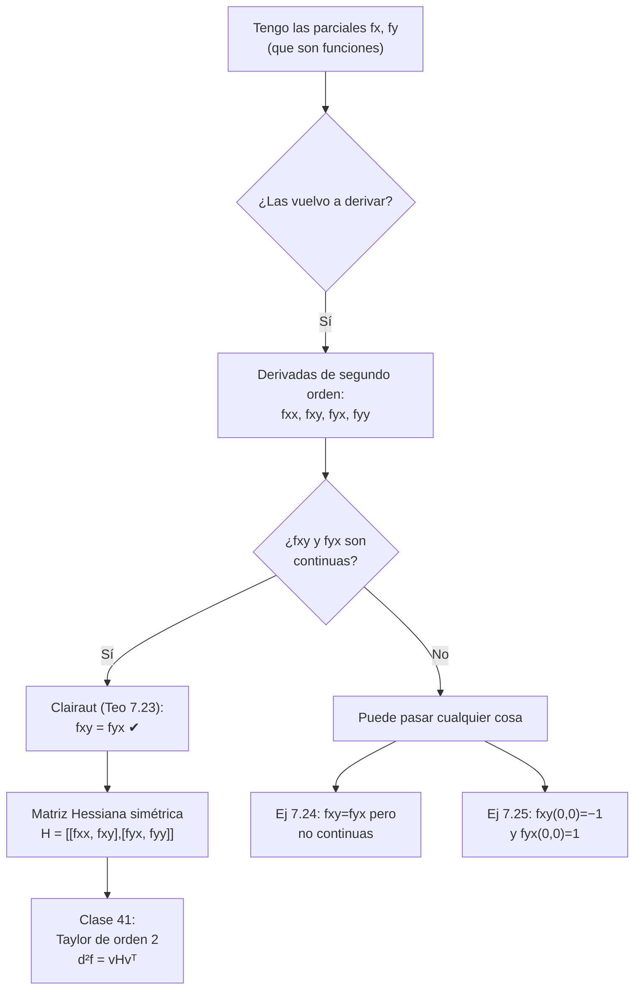

# Clase 40 — Derivadas de orden superior, Clairaut y matriz Hessiana

> **Bloque 8 · Diferenciabilidad · Dificultad: media-alta · Tiempo estimado: 130 min**

Las derivadas parciales son, a su vez, **funciones**: si $f$ es diferenciable, entonces $f_x$ y $f_y$ están definidas en todo punto y podemos **volver a derivarlas**. Así nacen las **derivadas parciales de segundo orden** ($f_{xx},f_{xy},f_{yx},f_{yy}$) y, ordenadas en una tabla, la **matriz Hessiana**. El resultado central es el **Teorema de Schwarz** (o de Clairaut): si las derivadas cruzadas son **continuas**, entonces $f_{xy}=f_{yx}$. Este teorema es el que hace que la matriz Hessiana sea **simétrica**, y por eso $f_{xy}\,\Delta x\,\Delta y$ aparece contado **dos veces** en el desarrollo de Taylor (clase 41). Cierra el bloque mostrando que el recíproco es **falso**: hay funciones con $f_{xy}=f_{yx}$ en un punto pero sin continuidad, y hasta funciones con $f_{xy}(0,0)\neq f_{yx}(0,0)$.

---

## 🎯 Objetivos

1. Definir las **derivadas parciales de segundo orden** y manejar las notaciones $\dfrac{\partial^2 f}{\partial x\,\partial y}=f_{xy}$, etc.
2. Enunciar y aplicar el **Teorema de Schwarz/Clairaut** (Teorema 7.23): derivadas cruzadas continuas $\Rightarrow$ $f_{xy}=f_{yx}$.
3. Entender el **esquema de la demostración** (incremento de cuatro puntos $\phi(h)$ y valor medio de Lagrange).
4. Reconocer que el **recíproco es falso** con los Ejercicios 7.24 y 7.25 de las notas.
5. Construir la **matriz Hessiana** $H_f(a)$ y usar su **simetría** (cuando $f$ es $C^2$).
6. Resolver el **Ejercicio 1 del Segundo parcial 2023-1S** ($f=(x^2+y^2)\sin\frac{1}{x^2+y^2}$): parciales, diferenciabilidad y por qué **no es $C^1$**.

---

## 🗺️ Mapa de la clase

---

## 🧱 Repaso / ideas previas

- **Clase 37.** Las derivadas parciales $f_x$ y $f_y$ se definen por límites de cocientes incrementales; restringen $f$ a una recta.
- **Clase 38.** Diferenciable $\Rightarrow$ existen las parciales; parciales **continuas** ($C^1$) $\Rightarrow$ diferenciable. Pero $C^1$ no es lo mismo que diferenciable.
- **Clase 39.** La regla de la cadena permite derivar $f_x$ y $f_y$ como funciones de varias variables.
- **Derivadas de una variable.** Si $g$ es dos veces derivable, $g''=(g')'$. Acá hacemos lo mismo, sólo que hay **dos** direcciones para volver a derivar, de ahí las cuatro derivadas de segundo orden.

> 💡 **La clave:** derivar parcialmente es "fijar la otra variable y derivar". Repetir el proceso es legal porque $f_x$ y $f_y$ vuelven a ser funciones $\mathbb{R}^2\to\mathbb{R}$.

---

## 📘 Teoría

### 1. Derivadas de segundo orden y notación

Sea $f:\mathbb{R}^2\to\mathbb{R}$ diferenciable. Entonces $f_x:\mathbb{R}^2\to\mathbb{R}$ y $f_y:\mathbb{R}^2\to\mathbb{R}$ son funciones y tiene sentido **derivarlas**. Se obtienen cuatro derivadas de segundo orden:

$$\frac{\partial^2 f}{\partial x^2}=f_{xx},\qquad \frac{\partial^2 f}{\partial y\,\partial x}=f_{yx},\qquad \frac{\partial^2 f}{\partial x\,\partial y}=f_{xy},\qquad \frac{\partial^2 f}{\partial y^2}=f_{yy}.$$

**Convención de lectura (¡ojo!):** en $f_{xy}$ se deriva primero respecto de $x$ y después respecto de $y$: $f_{xy}=(f_x)_y$. En la notación $\dfrac{\partial^2 f}{\partial y\,\partial x}$ el orden se lee **de derecha a izquierda** (primero $x$). En este curso usaremos sobre todo la notación con subíndices.

Las derivadas de orden superior siguen igual: $f_{xxy}=(f_{xx})_y$, etc.

**Ejemplo 40.1 (notas, Ejemplo 7.22).** Para $f(x,y)=x\sin y+x^2y^2$,
$$f_x=\sin y+2xy^2,\qquad f_y=x\cos y+2x^2y,$$
y entonces
$$f_{xx}=2y^2,\quad f_{yy}=-x\sin y+2x^2,\quad f_{xy}=\cos y+4xy=f_{yx}.$$
Observar que $f_{xy}=f_{yx}$ en **todo** punto. Las notas calculan además $f_{xxy}=4y$.

### 2. Teorema de Schwarz (o de Clairaut)

> **Teorema 40.2 (notas, Teorema 7.23 — Schwarz).** Si $f_{xy}$ y $f_{yx}$ existen en una bola $B((x_0,y_0),\delta)$ y son **continuas** en $(x_0,y_0)$, entonces
> $$\boxed{\,f_{xy}(x_0,y_0)=f_{yx}(x_0,y_0).\,}$$

**Esquema de la demostración.** En primer orden se miraba la diferencia $f(a+h)-f(a)$; en segundo orden se usa el **incremento de cuatro puntos**
$$\phi(h)=f(x_0+h,y_0+h)-f(x_0+h,y_0)-f(x_0,y_0+h)+f(x_0,y_0).$$
La misma suma se agrupa de dos maneras:

$$\phi(h)=\big[f(x_0+h,y_0+h)-f(x_0+h,y_0)\big]-\big[f(x_0,y_0+h)-f(x_0,y_0)\big],\tag{40.1}$$
$$\phi(h)=\big[f(x_0+h,y_0+h)-f(x_0,y_0+h)\big]-\big[f(x_0+h,y_0)-f(x_0,y_0)\big].\tag{40.2}$$

En (40.1) definimos $\psi(x)=f(x,y_0+h)-f(x,y_0)$, de modo que $\phi(h)=\psi(x_0+h)-\psi(x_0)$. Por el **valor medio de Lagrange** para $\psi$,
$$\phi(h)=h\,\psi'(x_0+\theta h)=h\big[f_x(x_0+\theta h,y_0+h)-f_x(x_0+\theta h,y_0)\big].$$
Ahora definimos $g(y)=f_x(x_0+\theta h,y)$ y aplicamos **otra vez** valor medio:
$$\phi(h)=h\big[g(y_0+h)-g(y_0)\big]=h^2g'(y_0+\theta_2 h)=h^2\,f_{xy}(x_0+\theta h,\,y_0+\theta_2 h).$$
Por **continuidad** de $f_{xy}$ en $(x_0,y_0)$,
$$\lim_{h\to0}\frac{\phi(h)}{h^2}=f_{xy}(x_0,y_0).$$
Arrancando de (40.2) y repitiendo el procedimiento se obtiene $\displaystyle\lim_{h\to0}\frac{\phi(h)}{h^2}=f_{yx}(x_0,y_0)$. Como el límite es **único**, $f_{xy}(x_0,y_0)=f_{yx}(x_0,y_0)$. $\blacksquare$

> 🔎 **Subproducto numérico:** la demostración muestra que $\dfrac{\phi(h)}{h^2}$ **aproxima** la derivada cruzada para $h$ chico. Eso se usa para calcular segundas derivadas numéricamente.

### 3. El recíproco es falso (dos contraejemplos)

El teorema pide continuidad. ¿Es necesaria? Los siguientes ejercicios muestran que **sí** lo es:

- **Ejercicio 7.24.** $f(x,y)=xy^2\sin\dfrac1y$ si $y\neq0$, y $f(x,y)=0$ si $y=0$. Aquí $f_{xy}(0,0)=f_{yx}(0,0)=0$, pero las derivadas cruzadas **no son continuas** en el origen. Es decir: $f_{xy}=f_{yx}$ en el punto **no** obliga a que sean continuas.
- **Ejercicio 7.25.** $f(x,y)=\dfrac{xy(x^2-y^2)}{x^2+y^2}$ si $(x,y)\neq(0,0)$, y $f(0,0)=0$. Aquí
  $$f_{xy}(0,0)=-1\neq1=f_{yx}(0,0).$$
  Es decir: **sin** continuidad, las cruzadas pueden no coincidir.

Ambos se resuelven paso a paso en la sección de ejercicios.

### 4. La matriz Hessiana

Cuando $f$ es de clase $C^2$ (todas las segundas parciales continuas), el Teorema de Schwarz dice que $f_{xy}=f_{yx}$ y la matriz

$$H_f(a)=\begin{pmatrix} f_{xx}(a) & f_{xy}(a)\\[4pt] f_{yx}(a) & f_{yy}(a)\end{pmatrix}\ \xrightarrow[\ C^2\ ]{}\ \begin{pmatrix} f_{xx}(a) & f_{xy}(a)\\[4pt] f_{xy}(a) & f_{yy}(a)\end{pmatrix}$$

es **simétrica**. A $H_f(a)$ se la llama **matriz Hessiana** de $f$ en $a$. Para $n$ variables es la matriz $n\times n$ de las segundas parciales.

La Hessiana ordena toda la información de segundo orden y es el ingrediente del diferencial segundo (clase 41):
$$d^2f_a(v)=v\,H_f(a)\,v^{\top},\qquad v=(\Delta x,\Delta y).$$

**Ejemplo 40.3.** Para $f(x,y)=x^3+y^3-3xy$:
$$f_x=3x^2-3y,\quad f_y=3y^2-3x\ \Rightarrow\ H_f(x,y)=\begin{pmatrix}6x & -3\\ -3 & 6y\end{pmatrix}.$$
En $(0,0)$: $H_f(0,0)=\begin{pmatrix}0&-3\\-3&0\end{pmatrix}$; en $(1,1)$: $H_f(1,1)=\begin{pmatrix}6&-3\\-3&6\end{pmatrix}$. (Volveremos sobre estas matrices en la clase 42: la Hessiana clasifica los puntos críticos.)

---

## 🖼️ Figuras

**Cómo leerla:** la matriz Hessiana define una **forma cuadrática** $q(v)=vHv^{\top}$. En la figura, $x^2+y^2$ (autovalores $>0$) sube en todas las direcciones; $x^2-y^2$ (autovalores de signos opuestos) sube en una dirección y baja en otra: es una **silla**; y $x^2$ (un autovalor nulo) es **plana** a lo largo de $y$. Estas tres formas reaparecerán al clasificar extremos relativos (clase 42).

También conviene releer la figura **b8_campo_gradiente** de la clase 37: el panel de $f=x^2-y^2$ muestra el campo del **sillín**, cuya Hessiana tiene determinante negativo. La simetría de la Hessiana (Clairaut) es lo que garantiza que esa forma cuadrática esté bien definida sin ambigüedad.

---

## ✏️ Ejercicios resueltos

### Ejercicio 1 (notas, Ejemplo 7.22). Segundas derivadas de $f(x,y)=x\sin y+x^2y^2$

**Paso 1 — primeras parciales.**
$$f_x=\sin y+2xy^2,\qquad f_y=x\cos y+2x^2y.$$

**Paso 2 — segundas parciales.**
$$f_{xx}=\frac{\partial}{\partial x}(\sin y+2xy^2)=2y^2,$$
$$f_{xy}=\frac{\partial}{\partial y}(\sin y+2xy^2)=\cos y+4xy,$$
$$f_{yx}=\frac{\partial}{\partial x}(x\cos y+2x^2y)=\cos y+4xy,$$
$$f_{yy}=\frac{\partial}{\partial y}(x\cos y+2x^2y)=-x\sin y+2x^2.$$

**Paso 3 — verificación de Clairaut.** $f_{xy}=f_{yx}=\cos y+4xy$ en todo punto. Como $f$ es un polinomio en $x$ y en las funciones $\sin y,\cos y$ (todas $C^\infty$), las cruzadas son **continuas** y el Teorema 40.2 se aplica. ✔

**Paso 4 — de tercer orden.** $f_{xxy}=\dfrac{\partial}{\partial y}(2y^2)=4y$, tal como indican las notas.

### Ejercicio 2 (notas, Ejercicio 7.24). $f_{xy}=f_{yx}=0$ pero sin continuidad

$$f(x,y)=\begin{cases} xy^2\sin\dfrac1y & y\neq0,\\[6pt] 0 & y=0.\end{cases}$$

**Paso 1 — primeras parciales.** Para $y\neq0$,
$$f_x=y^2\sin\tfrac1y,\qquad f_y=2xy\sin\tfrac1y-x\cos\tfrac1y.$$
Sobre el eje $y=0$ la función es idénticamente nula, así que $f_x(x,0)=0$. Además
$$f_y(x,0)=\lim_{k\to0}\frac{f(x,k)-f(x,0)}{k}=\lim_{k\to0}\frac{xk^2\sin(1/k)}{k}=\lim_{k\to0}xk\sin\tfrac1k=0.$$
Resumiendo: $f_x(x,y)=y^2\sin\frac1y$ (con $0$ si $y=0$) y $f_y(x,0)=0$.

**Paso 2 — cruzadas en el origen.**
$$f_{xy}(0,0)=(f_x)_y(0,0)=\lim_{k\to0}\frac{f_x(0,k)-f_x(0,0)}{k}=\lim_{k\to0}\frac{k^2\sin(1/k)}{k}=\lim_{k\to0}k\sin\tfrac1k=0,$$
$$f_{yx}(0,0)=(f_y)_x(0,0)=\lim_{h\to0}\frac{f_y(h,0)-f_y(0,0)}{h}=\lim_{h\to0}\frac{0-0}{h}=0.$$
Luego $f_{xy}(0,0)=f_{yx}(0,0)=0$. ✔

**Paso 3 — ¿son continuas?** Para $y\neq0$,
$$f_{xy}(x,y)=\frac{\partial}{\partial y}\Big(y^2\sin\tfrac1y\Big)=2y\sin\tfrac1y-\cos\tfrac1y.$$
Como $\cos\frac1y$ **oscila** (vale $1$ o $-1$ en puntos arbitrariamente cercanos al $0$) y $\frac1y\to\infty$, el término $-\cos\frac1y$ **no tiene límite** cuando $y\to0$. Por lo tanto $f_{xy}$ (y también $f_{yx}$, que coincide para $y\neq0$) **no es continua** en $(0,0)$. $\blacksquare$

> 🎓 Moraleja: la hipótesis de **continuidad** del Teorema 40.2 no se puede eliminar. Aquí $f_{xy}=f_{yx}$ en el origen, pero las cruzadas no son continuas.

### Ejercicio 3 (notas, Ejercicio 7.25). $f_{xy}(0,0)=-1$ y $f_{yx}(0,0)=1$

$$f(x,y)=\begin{cases}\dfrac{xy(x^2-y^2)}{x^2+y^2} & (x,y)\neq(0,0),\\[8pt] 0 & (x,y)=(0,0).\end{cases}$$

**Paso 1 — parciales en el origen.** Sobre los ejes $f\equiv0$:
$$f_x(0,0)=\lim_{h\to0}\frac{f(h,0)-0}{h}=\lim_{h\to0}\frac{h\cdot0\cdot h^2/h^2}{h}=0,\qquad f_y(0,0)=0.$$

**Paso 2 — parcial $f_x$ en general.** Escribiendo $f=\dfrac{x^3y-xy^3}{x^2+y^2}$ y aplicando regla del cociente,
$$f_x=\frac{(3x^2y-y^3)(x^2+y^2)-(x^3y-xy^3)(2x)}{(x^2+y^2)^2}=\frac{x^4y+4x^2y^3-y^5}{(x^2+y^2)^2}.$$
Entonces $f_x(0,k)=\dfrac{0+0-k^5}{k^4}=-k$, y
$$f_{xy}(0,0)=(f_x)_y(0,0)=\lim_{k\to0}\frac{f_x(0,k)-f_x(0,0)}{k}=\lim_{k\to0}\frac{-k-0}{k}=-1.$$

**Paso 3 — parcial $f_y$ en general.**
$$f_y=\frac{(x^3-3xy^2)(x^2+y^2)-(x^3y-xy^3)(2y)}{(x^2+y^2)^2}=\frac{x^5-4x^3y^2-xy^4}{(x^2+y^2)^2}.$$
Entonces $f_y(h,0)=\dfrac{h^5}{h^4}=h$, y
$$f_{yx}(0,0)=(f_y)_x(0,0)=\lim_{h\to0}\frac{f_y(h,0)-f_y(0,0)}{h}=\lim_{h\to0}\frac{h-0}{h}=1.$$

**Paso 4 — conclusión.** $f_{xy}(0,0)=-1\neq1=f_{yx}(0,0)$. Como las cruzadas no pueden ser continuas en el origen (si lo fueran, Clairaut forzaría la igualdad), este ejemplo muestra que **sin continuidad las cruzadas pueden diferir**. $\blacksquare$

### Ejercicio 4 (Hessiana). $H_f$ de $f(x,y)=x^3+y^3-3xy$ en $(0,0)$ y $(1,1)$

**Paso 1 — gradiente.** $f_x=3x^2-3y,\quad f_y=3y^2-3x$.

**Paso 2 — segundas parciales.**
$$f_{xx}=6x,\qquad f_{xy}=-3=f_{yx},\qquad f_{yy}=6y.$$

**Paso 3 — matriz Hessiana.**
$$H_f(x,y)=\begin{pmatrix}6x & -3\\ -3 & 6y\end{pmatrix}.$$

**Paso 4 — evaluar.**
$$H_f(0,0)=\begin{pmatrix}0 & -3\\ -3 & 0\end{pmatrix}\quad(\det=-9<0), \qquad H_f(1,1)=\begin{pmatrix}6 & -3\\ -3 & 6\end{pmatrix}\quad(\det=27>0,\ \operatorname{tr}=12>0).$$

**Lectura:** en $(0,0)$ la Hessiana es indefinida (silla); en $(1,1)$ es definida positiva. Es exactamente la información que la clase 42 usa para clasificar extremos. ✔

---

## 🏛️ Ejercicios de parcial/examen

### Ejercicio 5 (Segundo parcial 2023-1S, Desarrollo Ej. 1). $f(x,y)=(x^2+y^2)\sin\dfrac{1}{x^2+y^2}$

> $f(x,y)=(x^2+y^2)\sin\dfrac{1}{x^2+y^2}$ si $(x,y)\neq(0,0)$, y $f(0,0)=0$.
> a) Probar que existen las derivadas parciales en **todos** los puntos y calcularlas.
> b) Probar que $f$ es **diferenciable**.
> c) Probar que $f$ **no** es de clase $C^1$.

**Paso 1 (parte a) — fuera del origen.** Sea $r^2=x^2+y^2$. Por regla de la cadena y del producto,
$$f_x=2x\sin\frac{1}{r^2}+r^2\cos\frac{1}{r^2}\cdot\Big(-\frac{2x}{r^4}\Big)=2x\sin\frac{1}{r^2}-\frac{2x}{r^2}\cos\frac{1}{r^2},$$
y análogamente
$$f_y=2y\sin\frac{1}{r^2}-\frac{2y}{r^2}\cos\frac{1}{r^2}.$$
Existen en todo punto $(x,y)\neq(0,0)$.

**Paso 2 (parte a) — en el origen.**
$$f_x(0,0)=\lim_{h\to0}\frac{f(h,0)-f(0,0)}{h}=\lim_{h\to0}\frac{h^2\sin\frac{1}{h^2}}{h}=\lim_{h\to0}h\sin\frac{1}{h^2}=0,$$
porque $h\to0$ multiplica a algo **acotado** ($|\sin|\le1$). Igualmente $f_y(0,0)=0$. Luego existen las parciales en **todos** los puntos. ✔

**Paso 3 (parte b) — diferenciabilidad en el origen.** Con $\nabla f(0,0)=(0,0)$ el resto es $r(h,k)=f(h,k)-f(0,0)$. Dividiendo por la norma,
$$\frac{|r(h,k)|}{\|(h,k)\|}=\frac{(h^2+k^2)\big|\sin\frac{1}{h^2+k^2}\big|}{\sqrt{h^2+k^2}}\le\frac{h^2+k^2}{\sqrt{h^2+k^2}}=\sqrt{h^2+k^2}\xrightarrow[(h,k)\to(0,0)]{}0.$$
El resto es de orden mayor que $\|h\|$: $f$ **es diferenciable** en $(0,0)$.

**Paso 4 (parte b) — fuera del origen.** Para $(x,y)\neq(0,0)$, $f$ es composición y producto de funciones $C^\infty$ ($x^2+y^2$, $\sin$, $1/r^2$ con $r^2>0$), luego es $C^1$ y por lo tanto **diferenciable** (Teorema 7.17). Junto con el paso 3: $f$ es diferenciable en **todo** $\mathbb{R}^2$. ✔

**Paso 5 (parte c) — no es $C^1$.** Basta ver que $f_x$ **no** es continua en $(0,0)$. Sobre el eje $y=0$ con $x\neq0$,
$$f_x(x,0)=2x\sin\frac{1}{x^2}-2x\cdot\frac{1}{x^2}\cos\frac{1}{x^2}=2x\sin\frac{1}{x^2}-\frac{2}{x}\cos\frac{1}{x^2}.$$
Eligiendo $x_n$ con $\cos\frac{1}{x_n^2}=1$ y $x_n\to0$, el segundo término vale $-\frac{2}{x_n}\to-\infty$; en cambio para $x$ con $\cos\frac{1}{x^2}=0$ el término se anula. No hay límite, así que $f_x$ **no es continua** en $(0,0)$. Por lo tanto $f$ **no es de clase $C^1$**. $\blacksquare$

> 🎓 Este ejercicio es el "retrato hablado" de la diferencia entre **diferenciable** y **$C^1$**: es el ejemplo prometido en las clases 38 y 39. La función es perfectamente diferenciable (su gráfico tiene plano tangente $z=0$ en el origen) pero sus parciales son salvajemente discontinuas allí.

### Ejercicio 6 (Verdadero/Falso). Clairaut, necesidad y suficiencia

> Decidir y justificar:
> 1. Si $f$ es de clase $C^2$, entonces $f_{xy}=f_{yx}$.
> 2. Si $f_{xy}(x_0,y_0)=f_{yx}(x_0,y_0)$, entonces $f$ es de clase $C^2$ en $(x_0,y_0)$.
> 3. Si existen todas las derivadas de segundo orden, entonces las cruzadas son continuas.

**Paso 1 (1).** **Verdadero.** Si $f$ es $C^2$ las segundas parciales (en particular las cruzadas) son continuas, y el Teorema 40.2 (Schwarz) da la igualdad.

**Paso 2 (2).** **Falso.** Es el Ejercicio 7.24: allí $f_{xy}(0,0)=f_{yx}(0,0)=0$ pero las cruzadas **no** son continuas, así que $f$ no es $C^2$ en el origen.

**Paso 3 (3).** **Falso.** Es el Ejercicio 7.25 (y otra vez el 7.24): tanto $f_{xy}$ como $f_{yx}$ existen en el origen y sin embargo no son continuas allí.

---

## ⚠️ Errores comunes

| Error | Corrección |
|---|---|
| "Clairaut dice que $f_{xy}=f_{yx}$ siempre" | Solo si las cruzadas son **continuas**. Los Ejercicios 7.24 y 7.25 son contraejemplos |
| Leer mal el orden en $\dfrac{\partial^2 f}{\partial x\,\partial y}$ | Ese es $f_{yx}$: el denominador se lee **de derecha a izquierda**. Con subíndices, $f_{xy}=(f_x)_y$ |
| Confundir $f_{xx}$ con $(f_x)^2$ | $f_{xx}$ es la **derivada** de $f_x$; $(f_x)^2$ es el cuadrado del valor |
| Creer que $f$ diferenciable $\Rightarrow$ $f$ es $C^2$ | Falso: $f=(x^2+y^2)\sin\frac1{x^2+y^2}$ es diferenciable y **no** es ni $C^1$ (Ejercicio 5) |
| Olvidar la regla del producto/cociente al derivar $f_x$ | $f_x$ suele tener dos sumandos; hay que derivar **los dos** |
| Suponer la Hessiana simétrica sin hipótesis | La simetría usa Clairaut: hay que saber que $f$ es $C^2$ |
| Evaluar $f_{xy}$ como una derivada direccional | Es un límite **iterado**: primero derivar en $x$, después en $y$ |

---

## 🔗 Conexiones

- **Clase 37:** las parciales y el gradiente; acá se derivan **otra vez** para obtener el orden dos.
- **Clase 38:** el Ejercicio 5 cierra el círculo "diferenciable pero no $C^1$" que quedó abierto allí.
- **Clase 39:** la regla de la cadena aplicada a $f_x$ produce las derivadas cruzadas.
- **Clase 41:** la Hessiana es el **núcleo** del diferencial segundo y del polinomio de Taylor de orden dos.
- **Clase 42:** el **criterio de la Hessiana** clasifica los puntos críticos (mínimo, máximo, silla) usando determinante y signo.
- **Aplicaciones:** la matriz Hessiana aparece en optimización (método de Newton), en superficies (segunda forma fundamental y curvatura) y en el análisis de estabilidad de sistemas físicos.

---

## ✅ Autoevaluación

1. Escribir las cuatro derivadas de segundo orden de $f(x,y)=e^{xy}$.
2. Enunciar el Teorema de Schwarz con todas sus hipótesis. ¿Por qué se pide **continuidad**?
3. Explicar con el incremento de cuatro puntos por qué aparece $h^2$ y no $h$ en el cociente del esquema de demostración.
4. Calcular $f_{xy}$ y $f_{yx}$ de $f(x,y)=x^2y^3+\sin(xy)$ y comparar.
5. Construir la Hessiana de $f(x,y)=x^4+y^4-2x^2+4xy-2y^2$ y evaluarla en $(0,0)$.
6. ¿Por qué el Ejercicio 7.25 no contradice el Teorema de Schwarz?
7. Explicar por qué $f=(x^2+y^2)\sin\frac{1}{x^2+y^2}$ es diferenciable en el origen pero no $C^1$.

### Respuestas

1. $f_x=ye^{xy},\ f_y=xe^{xy}$, y $f_{xx}=y^2e^{xy},\ f_{xy}=(1+xy)e^{xy}=f_{yx},\ f_{yy}=x^2e^{xy}$.
2. Ver Teorema 40.2. La continuidad es lo que permite pasar al límite dentro de $f_{xy}(x_0+\theta h,\,y_0+\theta_2h)$.
3. Porque se aplica valor medio **dos veces** (una por cada tramo/variable): cada aplicación aporta un factor $h$, y el total es $h^2$; la continuidad de la cruzada permite concluir el límite.
4. $f_x=2xy^3+y\cos(xy)$, $f_y=3x^2y^2+x\cos(xy)$; $f_{xy}=6xy^2+\cos(xy)-xy\sin(xy)=f_{yx}$.
5. $f_x=4x^3-4x+4y,\ f_y=4y^3+4x-4y$; $f_{xx}=12x^2-4,\ f_{xy}=4=f_{yx},\ f_{yy}=12y^2-4$; $H_f(0,0)=\begin{pmatrix}-4&4\\4&-4\end{pmatrix}$ (determinante nulo: hace falta analizar más).
6. Porque en $(0,0)$ las derivadas cruzadas **no son continuas**: falta una hipótesis del teorema, así que no hay contradicción.
7. El resto dividido por $\|h\|$ tiende a $0$ (paso 3 del Ejercicio 5), de donde la diferenciabilidad. Pero $f_x$ sobre el eje $y=0$ tiene el término $\frac{2}{x}\cos\frac{1}{x^2}$, que oscila sin límite: no es continua.

---

**⬅️ Anterior:** [Clase 39 — Regla de la cadena y matriz jacobiana](39_regla_cadena_jacobiano.md) · 🏠 [Índice](00_indice.md) · **➡️ Siguiente:** [Clase 41 — Polinomio de Taylor y formas cuadráticas](41_taylor_formas_cuadraticas.md)
