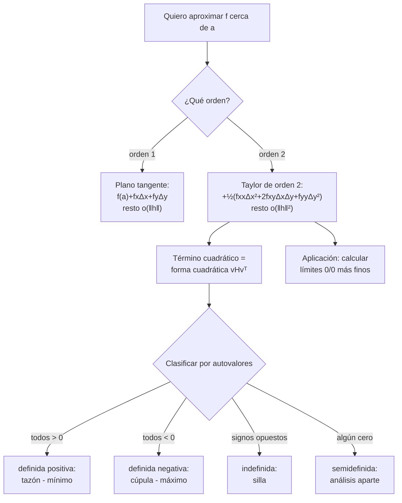
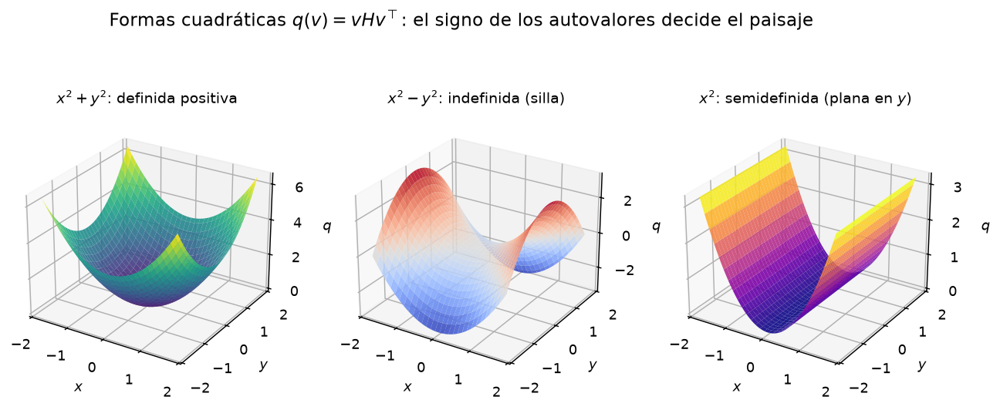
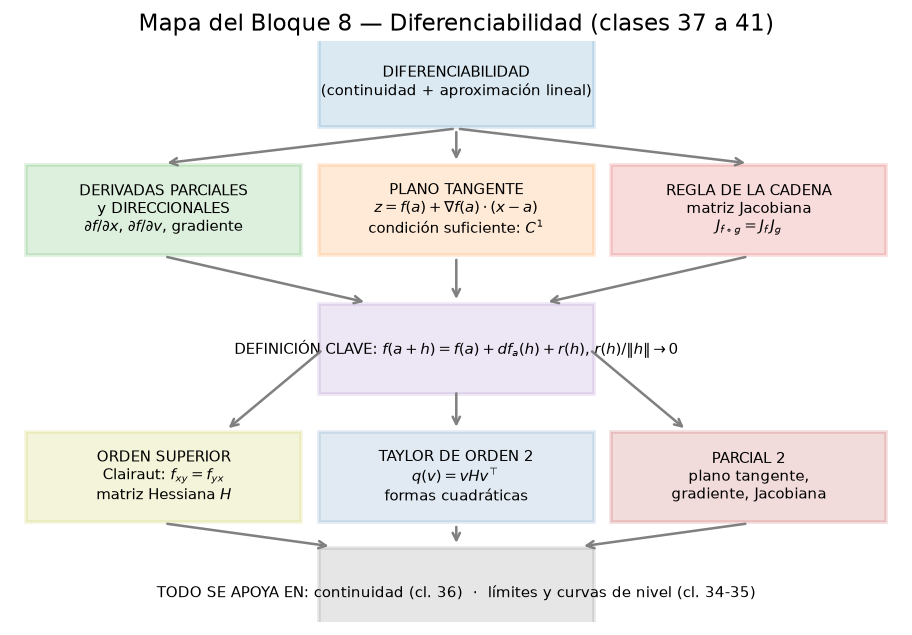

# Clase 41 — Polinomio de Taylor y formas cuadráticas

> **Bloque 8 · Diferenciabilidad · Dificultad: alta · Tiempo estimado: 140 min**

La diferenciabilidad dice que, cerca de $a$, el gráfico de $f$ se parece a su **plano tangente**: $f(a+h)\approx f(a)+df_a(h)$, con un error que se aplasta más rápido que $\|h\|$. El **desarrollo de Taylor** lleva esa idea al orden siguiente: agrega un término cuadrático, $\tfrac12 d^2f_a(h)$, de modo que el error ahora es más chico que $\|h\|^2$. Ese término cuadrático está gobernado por la **matriz Hessiana** (clase 40) y es una **forma cuadrática**. Clasificar una forma cuadrática —definida positiva, negativa, indefinida o semidefinida— es clasificar la **curvatura** del gráfico, y es la herramienta con la que la clase 42 decide si un punto crítico es mínimo, máximo o silla. Además, Taylor es el método más fino para calcular **límites** del tipo $\frac{0}{0}$ en dos variables.

---

## 🎯 Objetivos

1. Recordar el **diferencial primero** $df_a(\Delta x,\Delta y)=f_x(a)\Delta x+f_y(a)\Delta y$ y escribir el desarrollo de **orden 1**.
2. Definir el **diferencial segundo** $d^2f_a(\Delta x,\Delta y)=f_{xx}\Delta x^2+2f_{xy}\Delta x\Delta y+f_{yy}\Delta y^2$ y su forma matricial $d^2f_a(v)=vH_f(a)v^{\top}$.
3. Enunciar el **Teorema de Taylor** (Teorema 7.31) y la fórmula explícita de orden dos en dos variables, con la propiedad del resto $\dfrac{r(h)}{\|h\|^2}\to0$.
4. **Clasificar formas cuadráticas** (definida positiva/negativa, indefinida, semidefinida) con autovalores o con el criterio de $2\times2$ ($\det$ y $f_{xx}$).
5. Resolver ejercicios de **múltiple opción** que piden el polinomio de Taylor de orden dos (Parcial 2022-2S, Examen julio 2022, Parcial 2019-1S, Parcial 2018-2S).
6. Usar Taylor para **calcular límites** en dos variables (Examen febrero 2020).

---

## 🗺️ Mapa de la clase

---

## 🧱 Repaso / ideas previas

- **Clase 38.** La definición de diferenciabilidad: $f(a+h)=f(a)+df_a(h)+r(h)$ con $r(h)/\|h\|\to0$. Es el desarrollo de Taylor de **orden 1**.
- **Clase 40.** Derivadas de segundo orden y **matriz Hessiana** $H_f(a)$; Clairaut garantiza que es simétrica cuando $f$ es $C^2$.
- **Una variable.** Taylor en $x_0$: $g(x_0+h)=g(x_0)+g'(x_0)h+\frac12 g''(x_0)h^2+\cdots$. Acá el rol de $g''$ lo juega la Hessiana.
- **Polinomios homogéneos.** En $d^2f_a$ cada sumando tiene **grado total dos** en $(\Delta x,\Delta y)$.

> 💡 **Idea fuerza:** el diferencial de orden $k$ es la parte **homogénea de grado $k$** del polinomio de Taylor; el resto es de orden $o(\|h\|^k)$.

---

## 📘 Teoría

### 1. Del diferencial primero al segundo

Si $f$ es diferenciable en $a=(x_0,y_0)$, el **diferencial primero** es
$$df_a(\Delta x,\Delta y)=f_x(a)\,\Delta x+f_y(a)\,\Delta y.$$

Si además $f$ es de **clase $C^2$**, se define el **diferencial segundo** (notas, sección 7.5):
$$d^2f_a(\Delta x,\Delta y)=f_{xx}(a)\,\Delta x^2+2f_{xy}(a)\,\Delta x\,\Delta y+f_{yy}(a)\,\Delta y^2.$$
Como $f$ es $C^2$, $f_{xy}=f_{yx}$ (Clairaut) y por eso el término cruzado aparece **dos veces** (uno por cada orden de derivación).

### 2. Forma matricial: la forma cuadrática

Con $v=(\Delta x,\Delta y)$ y la Hessiana
$$H=H_f(a)=\begin{pmatrix} f_{xx}(a) & f_{xy}(a)\\ f_{yx}(a) & f_{yy}(a)\end{pmatrix},$$
un cálculo directo (ejercicio de las notas) muestra
$$\boxed{\,d^2f_a(v)=v\,H\,v^{\top}.\,}$$
Es un **polinomio homogéneo de grado dos**: una **forma cuadrática** asociada a la matriz simétrica $H$.

Un polinomio de la forma $q(\Delta x,\Delta y)=A\,\Delta x^2+2B\,\Delta x\,\Delta y+C\,\Delta y^2$ se clasifica por los **autovalores** de $\begin{pmatrix}A&B\\B&C\end{pmatrix}$, o completando cuadrados:
$$q=A\Big(\Delta x+\tfrac{B}{A}\Delta y\Big)^2+\frac{\det H}{A}\,\Delta y^2\qquad(A\neq0),\qquad \det H=AC-B^2.$$

**Clasificación (caso $2\times2$, $H$ simétrica):**

| Condición | Tipo | Gráfico de $f$ (curvatura) |
|---|---|---|
| $\det H>0$ y $A=f_{xx}>0$ | **definida positiva** | tazón hacia arriba $\Rightarrow$ mínimo |
| $\det H>0$ y $A=f_{xx}<0$ | **definida negativa** | cúpula $\Rightarrow$ máximo |
| $\det H<0$ | **indefinida** | **silla** (sube por un lado, baja por otro) |
| $\det H=0$ | **semidefinida** | plana en alguna dirección: hace falta más análisis |

> ⚠️ Cuando $\det H=0$ la forma cuadrática **no decide**: puede haber mínimo, máximo o silla, según los términos de orden superior. (La clase 42 estudia estos casos.)

### 3. Teorema de Taylor

> **Teorema 41.1 (notas, Teorema 7.31 — Taylor).** Sea $f:\mathbb{R}^m\to\mathbb{R}$ de clase $C^{k+1}$ en un entorno de $a$. Entonces
> $$f(a+h)=f(a)+df_a(h)+\frac1{2!}d^2f_a(h)+\frac1{3!}d^3f_a(h)+\cdots+\frac1{k!}d^kf_a(h)+r_k(h),$$
> donde el resto cumple $\displaystyle\lim_{h\to0}\frac{r_k(h)}{\|h\|^k}=0$.

En **dos variables y orden dos** esto es
$$f(x_0+\Delta x,\,y_0+\Delta y)=f(x_0,y_0)+f_x(a)\Delta x+f_y(a)\Delta y+\frac12\big(f_{xx}(a)\Delta x^2+2f_{xy}(a)\Delta x\Delta y+f_{yy}(a)\Delta y^2\big)+r_2,$$
con $\displaystyle\lim_{(\Delta x,\Delta y)\to(0,0)}\frac{r_2(\Delta x,\Delta y)}{\Delta x^2+\Delta y^2}=0$ (la norma al cuadrado es $\|h\|^2$).

**Esquema de la demostración.** Se considera la función de una variable $g(t)=f(x_0+t\Delta x,\ y_0+t\Delta y)$, que va de $(x_0,y_0)$ en $t=0$ a $(x_0+\Delta x,y_0+\Delta y)$ en $t=1$. Por la regla de la cadena,
$$g'(t)=f_x(x_0+t\Delta x,y_0+t\Delta y)\Delta x+f_y(x_0+t\Delta x,y_0+t\Delta y)\Delta y,$$
y derivando otra vez (¡aparecen las cruzadas $f_{xy}$ y $f_{yx}$, que coinciden por ser $C^2$!),
$$g''(0)=f_{xx}(a)\Delta x^2+2f_{xy}(a)\Delta x\Delta y+f_{yy}(a)\Delta y^2=d^2f_a(\Delta x,\Delta y).$$
Aplicando Taylor en una variable a $g$ entre $0$ y $1$ se concluye. Al derivar más veces van apareciendo los **números combinatorios** (las formas de ordenar las derivadas). $\blacksquare$

### 4. Criterio de $2\times2$ en la práctica

Para decidir la clasificación **sin** calcular autovalores, cuando $H=\begin{pmatrix}A&B\\B&C\end{pmatrix}$:
- $\det H=AC-B^2>0$ y $A>0$: definida **positiva**.
- $\det H>0$ y $A<0$: definida **negativa**.
- $\det H<0$: **indefinida**.
- $\det H=0$: **indeterminada** (semidefinida o degenerada).

---

## 🖼️ Figuras

**Cómo leerla:** cada panel es el gráfico de $q(v)=vHv^{\top}$ para una Hessiana distinta. $x^2+y^2$ (autovalores $3$ y $1$, ambos positivos) es un **tazón**; $x^2-y^2$ (autovalores $+1$ y $-1$) es una **silla**; $x^2$ (autovalores $2$ y $0$) es un **canal** plano en la dirección $y$. Esas tres siluetas son las que veremos en los puntos críticos.

**Cómo leerla:** el mapa ubica esta clase en el bloque. Todo cuelga de la **definición de diferenciabilidad** (clase 38); el orden dos (clases 40 y 41) es la rama que alimenta la clasificación de extremos (clase 42). Repasar esta figura antes del parcial ayuda a recordar qué herramienta usar en cada ejercicio.

---

## ✏️ Ejercicios resueltos

### Ejercicio 1 (notas, Ejemplo 7.32). Taylor de orden 2 de $f(x,y)=\log(1+2x+y)$ en $a=(1,2)$

**Paso 1 — valor.** $f(1,2)=\log(1+2+4)=\log 5$.

**Paso 2 — primeras parciales.**
$$f_x=\frac{2}{1+2x+y}\Rightarrow f_x(1,2)=\frac25,\qquad f_y=\frac{1}{1+2x+y}\Rightarrow f_y(1,2)=\frac15.$$

**Paso 3 — segundas parciales.**
$$f_{xx}=\frac{-4}{(1+2x+y)^2}\Rightarrow -\frac{4}{25},\qquad f_{xy}=\frac{-2}{(1+2x+y)^2}\Rightarrow -\frac{2}{25},\qquad f_{yy}=\frac{-1}{(1+2x+y)^2}\Rightarrow -\frac{1}{25}.$$

**Paso 4 — armar el desarrollo** (con $\Delta x=x-1$, $\Delta y=y-2$):
$$f=\log 5+\frac25\Delta x+\frac15\Delta y+\frac12\Big(-\frac4{25}\Delta x^2-\frac4{25}\Delta x\Delta y-\frac1{25}\Delta y^2\Big)+r,$$
es decir
$$\boxed{f(x,y)=\log 5+\frac25(x-1)+\frac15(y-2)-\frac{1}{50}\Big(4(x-1)^2+4(x-1)(y-2)+(y-2)^2\Big)+r.}$$
con $\dfrac{r}{\|(\Delta x,\Delta y)\|^2}\to0$. ✔

### Ejercicio 2. Clasificar las formas cuadráticas asociadas a tres Hessianas

**(a)** $H=\begin{pmatrix}2&1\\1&2\end{pmatrix}$. $\det=4-1=3>0$ y $A=2>0$: **definida positiva**.
Autovalores: $\lambda=2\pm1\Rightarrow \{1,3\}$, ambos $>0$. Coincide.

**(b)** $H=\begin{pmatrix}0&-3\\-3&0\end{pmatrix}$. $\det=0-9=-9<0$: **indefinida** (silla). Autovalores: $\lambda=\pm3$.

**(c)** $H=\begin{pmatrix}1&0\\0&0\end{pmatrix}$. $\det=0$: **semidefinida**. La forma es $q=\Delta x^2\ge0$ (plana en $\Delta y$); autovalores $\{1,0\}$.

**Lectura:** en (a) el gráfico es un tazón (mínimo), en (b) una silla, en (c) un canal. ✔

### Ejercicio 3. Taylor de orden 2 de $f(x,y)=e^{x}\cos y$ en $(0,0)$

**Paso 1 — valor.** $f(0,0)=1$.

**Paso 2 — primeras parciales.** $f_x=e^x\cos y\Rightarrow 1$; $f_y=-e^x\sin y\Rightarrow 0$.

**Paso 3 — segundas parciales.** $f_{xx}=e^x\cos y\Rightarrow1$; $f_{xy}=-e^x\sin y\Rightarrow0$; $f_{yy}=-e^x\cos y\Rightarrow-1$.

**Paso 4 — polinomio.**
$$p_2(x,y)=1+x+\frac12\big(x^2-y^2\big)=1+x+\frac{x^2}{2}-\frac{y^2}{2}.$$
Es un tazón en $x$ y una cúpula en $y$: **punto silla** cerca del origen. ✔

---

## 🏛️ Ejercicios de parcial/examen

### Ejercicio 4 (Segundo parcial 2022-2S, Ej. 3, múltiple opción). $f(x,y)=\log(x^2+y)$ en $(1,0)$

> El polinomio de Taylor de orden 2 de $f(x,y)=\log(x^2+y)$ en $(1,0)$ es:
> A) $1+2x-y+\frac{x^2}{2}-\frac{y^2}{2}+3xy$
> B) $-3+4x+3y-x^2-\frac{y^2}{2}-2xy$
> C) $2x+y-\frac{x^2}{2}+y^2-2xy$
> D) $1-2x+y+x^2+\frac{y^2}{2}+2xy$
> E) $2(x-1)+y+(x-1)^2+y^2+(x-1)y$

**Paso 1 — valor.** $f(1,0)=\log(1)=0$.

**Paso 2 — primeras parciales.**
$$f_x=\frac{2x}{x^2+y}\Rightarrow f_x(1,0)=2,\qquad f_y=\frac{1}{x^2+y}\Rightarrow f_y(1,0)=1.$$

**Paso 3 — segundas parciales.**
$$f_{xx}=\frac{-2(x^2-y)}{(x^2+y)^2}\Rightarrow -2,\qquad f_{yy}=\frac{-1}{(x^2+y)^2}\Rightarrow -1,\qquad f_{xy}=\frac{-2x}{(x^2+y)^2}\Rightarrow -2.$$

**Paso 4 — polinomio.**
$$p_2= 0+2(x-1)+y+\frac12\big(-2(x-1)^2+2(-2)(x-1)y+(-1)y^2\big).$$
Desarrollando:
$$p_2=2x-2+y-(x-1)^2-2(x-1)y-\frac{y^2}{2}=-3+4x+3y-x^2-\frac{y^2}{2}-2xy.$$

**Respuesta: (B).** ✔ *(verificada con la solución oficial)*

> 💡 Chequeo rápido: el polinomio está escrito en variables $(x,y)$, así que debe valer $f(a)=0$ en $(1,0)$. En la opción B: $-3+4\cdot1-1=0$ ✔.

### Ejercicio 5 (Examen julio 2022, Ej. 4, múltiple opción). $f(x,y)=\cos(x+y)e^{-x^2}$ en $(0,0)$

> El polinomio de Taylor de orden 2 de $f(x,y)=\cos(x+y)e^{-x^2}$ en $(0,0)$ es:
> A) $1-\frac32x^2-xy-\frac12y^2$
> B) $1+x-\frac32x^2+xy-\frac12y^2$
> C) $1+\frac32x^2-xy+\frac12y^2$
> D) $1$

**Paso 1 — primeras parciales.**
$$f_x=-e^{-x^2}\big(\sin(x+y)+2x\cos(x+y)\big),\qquad f_y=-e^{-x^2}\sin(x+y).$$
En $(0,0)$: $f_x(0,0)=0$, $f_y(0,0)=0$.

**Paso 2 — segundas parciales.**
$$f_{xx}=e^{-x^2}\big((4x^2-3)\cos(x+y)+4x\sin(x+y)\big)\Rightarrow -3,$$
$$f_{xy}=e^{-x^2}\big(2x\sin(x+y)-\cos(x+y)\big)\Rightarrow -1,\qquad f_{yy}=-e^{-x^2}\cos(x+y)\Rightarrow -1.$$

**Paso 3 — polinomio.** $f(0,0)=1$ y
$$p_2=1+\frac12\big(-3x^2+2(-1)xy+(-1)y^2\big)=1-\frac32x^2-xy-\frac12y^2.$$

**Respuesta: (A).** ✔ *(verificada con la solución oficial)*

### Ejercicio 6 (Segundo parcial 2019-1S, Ej. 1, múltiple opción). $f(x,y)=x\ln(1+x+2y)$

> Sea $p$ el polinomio de Taylor de orden 2 de $f$ en un entorno de $(0,0)$. Entonces:
> A) $p(2,1)=8$  B) $p(2,1)=16$  C) $p(2,1)=6$  D) $p(2,1)=12$

**Paso 1 — valor y primeras parciales.**
$$f(0,0)=0,\quad f_x=\ln(1+x+2y)+\frac{x}{1+x+2y}\Rightarrow 0,\quad f_y=\frac{2x}{1+x+2y}\Rightarrow 0.$$

**Paso 2 — segundas parciales en $(0,0)$.**
$$f_{xx}=\frac{1}{1+x+2y}+\frac{1+2y}{(1+x+2y)^2}\Rightarrow 2,\qquad f_{xy}=\frac{2+4y}{(1+x+2y)^2}\Rightarrow 2,\qquad f_{yy}=\frac{-2x}{(1+x+2y)^2}\Rightarrow 0.$$

**Paso 3 — polinomio** (incrementos $=(\Delta x,\Delta y)=(x,y)$, porque $a=(0,0)$):
$$p(\Delta x,\Delta y)=0+0+\frac12\big(2\Delta x^2+2\cdot2\,\Delta x\Delta y+0\big)=\Delta x^2+2\,\Delta x\,\Delta y.$$

**Paso 4 — evaluar en $(2,1)$.**
$$p(2,1)=2^2+2\cdot2\cdot1=4+4=8.$$

**Respuesta: (A) $p(2,1)=8$.** ✔ *(verificada con la solución oficial)*

### Ejercicio 7 (Segundo parcial 2018-2S, Ej. 2, múltiple opción). $f(x,y)=\dfrac{\log\frac{x+y}{2}}{y^2}$ en $(1,1)$

> El polinomio de Taylor de orden 2 de $f$ en $(1,1)$ es:
> A) $\frac18(x^2-10xy-9y^2+4x+4y)$
> B) $\frac12(x-1)+\frac12(y-1)+\frac14(x-1)^2-\frac52(x-1)(y-1)-\frac94(y-1)^2$
> C) $\frac18(-x^2-10xy-9y^2+16x+32y-28)$
> D) $\frac12(x-1)+\frac12(y-1)+\frac18(x-1)^2-\frac58(x-1)(y-1)-\frac98(y-1)^2$

**Paso 1 — valor.** $f(1,1)=\dfrac{\log 1}{1}=0$.

**Paso 2 — escribir en incrementos.** Con $p=x-1$, $q=y-1$: $x=1+p$, $y=1+q$, $\frac{x+y}{2}=1+\frac{p+q}{2}$, $y^2=(1+q)^2$. Entonces
$$f=\frac{\log\!\big(1+\frac{p+q}{2}\big)}{(1+q)^2}.$$

**Paso 3 — desarrollar a orden 2.** Con $s=\frac{p+q}{2}$:
$$\log(1+s)=s-\frac{s^2}{2}+o(s^2),\qquad \frac{1}{(1+q)^2}=1-2q+3q^2+o(q^2).$$
Multiplicando y quedándonos con términos de grado $\le2$:
$$f=\Big(s-\frac{s^2}{2}\Big)(1-2q)+o = s-2qs-\frac{s^2}{2}+o.$$
Sustituyendo $s=\frac{p+q}{2}$:
$$f=\frac{p}{2}+\frac{q}{2}-pq-q^2-\frac{(p+q)^2}{8}+o=\frac{p}{2}+\frac{q}{2}-\frac54 pq-\frac98 q^2-\frac18 p^2+o.$$

**Paso 4 — volver a $(x,y)$.** Multiplicando por $8$ y usando $p=x-1$, $q=y-1$:
$$8f=-p^2-10pq-9q^2+4p+4q,$$
y expandiendo $p,q$ alrededor de $(1,1)$ se obtiene la forma de la opción C:
$$f=-\frac18 x^2-\frac{10}{8}xy-\frac98 y^2+2x+4y-\frac{28}{8}.$$

**Respuesta: (C).** ✔ *(verificada con la solución oficial)*

> 🔎 Alternativamente se calculan las seis derivadas en $(1,1)$: $f_x=\frac{1}{(x+y)y^2}\Rightarrow\frac12$, $f_y\Rightarrow\frac12$, $f_{xx}\Rightarrow-\frac14$, $f_{xy}\Rightarrow-\frac54$, $f_{yy}\Rightarrow-\frac94$, y se reemplaza en la fórmula. El desarrollo en $s$ es más rápido y explica **de dónde salen** esos coeficientes.

### Ejercicio 8 (Examen febrero 2020, Ej. 7). Límite con Taylor

> Calcular, justificando: $\displaystyle\lim_{(x,y)\to(0,0)}\frac{xy-\sin x\,\sin y}{x^2+y^2}$.

**Paso 1 — Taylor de $\sin x\,\sin y$ en $(0,0)$.** Usando $\sin t=t-\frac{t^3}{6}+o(t^3)$,
$$\sin x\,\sin y=\Big(x-\frac{x^3}{6}\Big)\Big(y-\frac{y^3}{6}\Big)+o\big((x^2+y^2)^2\big)=xy-\frac{xy^3}{6}-\frac{x^3y}{6}+o\big((x^2+y^2)^2\big).$$
Como $-\frac{xy^3}{6}-\frac{x^3y}{6}=-\frac{xy}{6}(x^2+y^2)$, queda
$$\sin x\,\sin y=xy-\frac{xy}{6}\big(x^2+y^2\big)+R_4,\qquad \frac{R_4}{x^2+y^2}\xrightarrow[(x,y)\to(0,0)]{}0.$$

**Paso 2 — sustituir en el cociente.**
$$\frac{xy-\sin x\,\sin y}{x^2+y^2}=\frac{xy-\Big(xy-\frac{xy}{6}(x^2+y^2)+R_4\Big)}{x^2+y^2}=\frac{xy}{6}-\frac{R_4}{x^2+y^2}.$$

**Paso 3 — límite.** El primer término $\frac{xy}{6}\to0$ y el segundo $\to0$ por la propiedad del resto. Por lo tanto
$$\boxed{\lim_{(x,y)\to(0,0)}\frac{xy-\sin x\,\sin y}{x^2+y^2}=0.}$$
✔ *(verificado con la solución oficial)*

> 💡 El numerador se cancela a orden 2 ($xy$ desaparece) y queda un término de orden 4 dividido por un orden 2: por eso el límite es $0$ y no una constante.

### Ejercicio 9 (Examen febrero 2021, Problema 7). Coeficientes y Hessiana

> Hallar $a+b+c+d+e+f$ si
> $$\lim_{(x,y)\to(1,1)}\frac{\dfrac{x\log y}{y}-ax^2-by^2-cxy-dx-ey-f}{(x-1)^2+(y-1)^2}=0.$$

**Paso 1 — Taylor de $g(x,y)=\dfrac{x\log y}{y}$ en $(1,1)$.** Con $g(1,1)=0$, $g_x=\frac{\log y}{y}\Rightarrow0$, $g_y=\frac{x(1-\log y)}{y^2}\Rightarrow1$. El término de Taylor de orden 2 es
$$g(x,y)=0+\underbrace{0\cdot(x-1)}_{}\,+\,(y-1)+\frac12\Big(A(x-1)^2+2B(x-1)(y-1)+C(y-1)^2\Big)+r,$$
donde $A=g_{xx}(1,1)$, $B=g_{xy}(1,1)$, $C=g_{yy}(1,1)$ y $\dfrac{r}{(x-1)^2+(y-1)^2}\to0$.

**Paso 2 — por qué el numerador debe anularse.** Si quedara algún término de **grado $\le1$** en la diferencia, el cociente tendería a $\infty$; si quedara un término **cuadrático**, tendería a una constante no nula. Como el límite es $0$, el numerador (salvo el resto) debe ser **idénticamente cero**.

**Paso 3 — igualar coeficientes.** Expandiendo el desarrollo e igualándolo a $ax^2+by^2+cxy+dx+ey+f$ resultan las relaciones
$$a=\tfrac A2,\quad b=\tfrac C2,\quad c=B,\quad d=-A-B,\quad e=E-B-C,\quad f=\tfrac A2+\tfrac C2+B-E,$$
con $E=g_y(1,1)=1$.

**Paso 4 — sumar.** Al sumar miembro a miembro, **todos** los términos en $A,B,C,E$ se cancelan:
$$a+b+c+d+e+f=0.$$

**Respuesta: $a+b+c+d+e+f=0$.** ✔ *(verificado con la solución oficial)*

---

## ⚠️ Errores comunes

| Error | Corrección |
|---|---|
| Olvidar el factor $\frac12$ del término cuadrático | El desarrollo de orden 2 lleva $\frac12 d^2f_a$, igual que en una variable |
| Escribir el término cruzado una sola vez | Vale $2f_{xy}\Delta x\Delta y$ (dos veces $f_{xy}$), porque $f_{xy}=f_{yx}$ |
| Derivar "para adentro" en el orden de $f_{xy}$ | $f_{xy}=(f_x)_y$: primero $x$, después $y$ |
| Evaluar las derivadas en el punto equivocado | Todas se evalúan en $a=(x_0,y_0)$; los incrementos son $h=(x-x_0,y-y_0)$ |
| Usar el polinomio para valores muy lejos de $a$ | Taylor es **local**: sirve para $h$ chico, no para aproximar en todo el dominio |
| Dividir el resto por $\|h\|$ en lugar de $\|h\|^2$ | En orden 2 el resto es $o(\|h\|^2)$ |
| Clasificar con $\det H=0$ | La forma es **semidefinida**: hace falta analizar términos de orden superior (clase 42) |
| Confundir opciones escritas en $(x,y)$ con las escritas en incrementos | Expandir o evaluar en $a$ para chequear que el polinomio vale $f(a)$ |

---

## 🔗 Conexiones

- **Clase 38:** Taylor de orden 1 **es** la definición de diferenciabilidad (el plano tangente).
- **Clase 40:** la Hessiana y Clairaut son el motor del término cuadrático $d^2f_a$.
- **Clase 42:** el criterio de la Hessiana para extremos relativos se deduce de Taylor de orden 2 clasificando la forma cuadrática.
- **Clase 43:** los multiplicadores de Lagrange también se apoyan en el desarrollo de Taylor.
- **Aplicaciones:** aproximación numérica de funciones de varias variables, análisis de error de segundo orden, cálculo de límites indeterminados, y —en ingeniería— linealización y análisis de sensibilidad con curvatura (método de Newton, superficies de respuesta).

---

## ✅ Autoevaluación

1. Escribir la fórmula del polinomio de Taylor de orden 2 en $(x_0,y_0)$ y la propiedad del resto.
2. Probar que $d^2f_a(v)=vHv^{\top}$ para $v=(\Delta x,\Delta y)$ y $H$ la Hessiana.
3. Clasificar las formas cuadráticas $q_1=x^2+4xy+y^2$, $q_2=2x^2-2xy+2y^2$, $q_3=x^2+y^2$.
4. Hallar el polinomio de Taylor de orden 2 de $f(x,y)=\sqrt{1+x+y}$ en $(0,0)$.
5. ¿Por qué en el Ejercicio 9 la suma de los seis coeficientes da $0$?
6. Usar Taylor para calcular $\displaystyle\lim_{(x,y)\to(0,0)}\frac{1-\cos(xy)}{x^2y^2}$.
7. Explicar la relación entre el signo de los autovalores de la Hessiana y la forma del gráfico alrededor de un punto crítico.

### Respuestas

1. $f(a+h)=f(a)+f_x\Delta x+f_y\Delta y+\frac12(f_{xx}\Delta x^2+2f_{xy}\Delta x\Delta y+f_{yy}\Delta y^2)+r$, con $r/\|h\|^2\to0$.
2. Desarrollar $(\Delta x,\Delta y)\begin{pmatrix}f_{xx}&f_{xy}\\f_{yx}&f_{yy}\end{pmatrix}\begin{pmatrix}\Delta x\\ \Delta y\end{pmatrix}=f_{xx}\Delta x^2+(f_{xy}+f_{yx})\Delta x\Delta y+f_{yy}\Delta y^2$; como $f_{xy}=f_{yx}$, queda la fórmula.
3. $q_1$: $H=\begin{pmatrix}1&2\\2&1\end{pmatrix}$, $\det=-3<0$: **indefinida**. $q_2$: $H=\begin{pmatrix}2&-1\\-1&2\end{pmatrix}$, $\det=3>0$, $A>0$: **definida positiva**. $q_3$: definida positiva.
4. $f(0,0)=1$, $f_x=f_y=\frac12$, $f_{xx}=f_{xy}=f_{yy}=-\frac14$; $p_2=1+\frac12(x+y)-\frac18(x+y)^2=1+\frac{x+y}{2}-\frac{x^2+2xy+y^2}{8}$.
5. Porque las condiciones de anulación del numerador (paso 3) hacen que al sumar $a+b+c+d+e+f$ todas las contribuciones $A,B,C,E$ se cancelen por pares.
6. $1-\cos t=\frac{t^2}{2}+o(t^2)$ con $t=xy$, así que $\frac{1-\cos(xy)}{x^2y^2}\to\frac12$.
7. Autovalores todos $>0$: mínimo (tazón); todos $<0$: máximo (cúpula); signos mixtos: silla; algún autovalor $0$: la curvatura es plana en esa dirección y hay que mirar órdenes superiores.

---

**⬅️ Anterior:** [Clase 40 — Derivadas de orden superior, Clairaut y Hessiana](40_orden_superior_clairaut_hessiana.md) · **➡️ Siguiente:** [Clase 42 — Extremos relativos y criterio de la Hessiana](42_extremos_relativos_hessiana.md)
