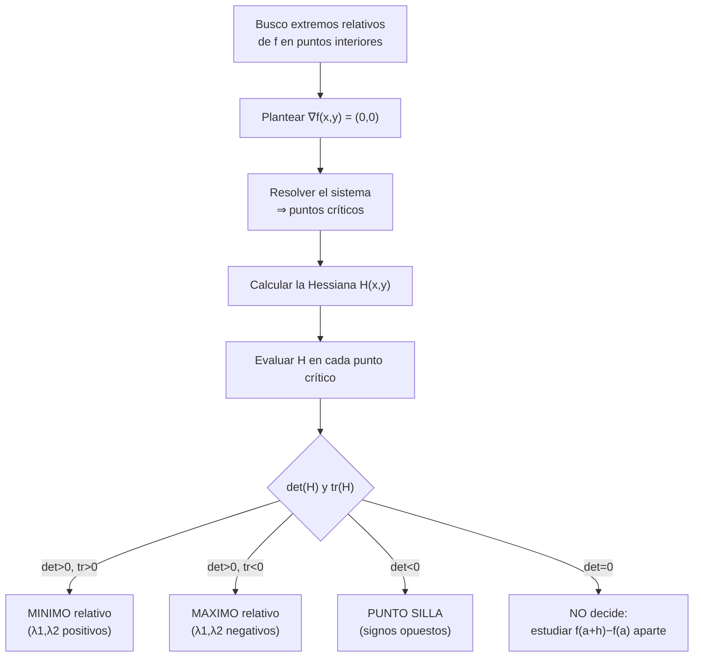
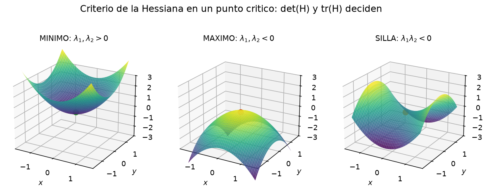
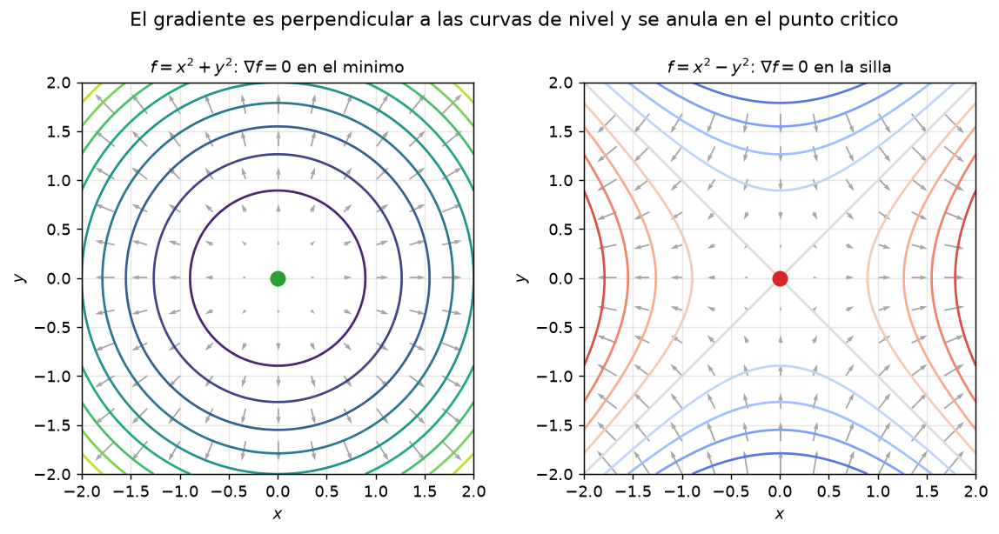
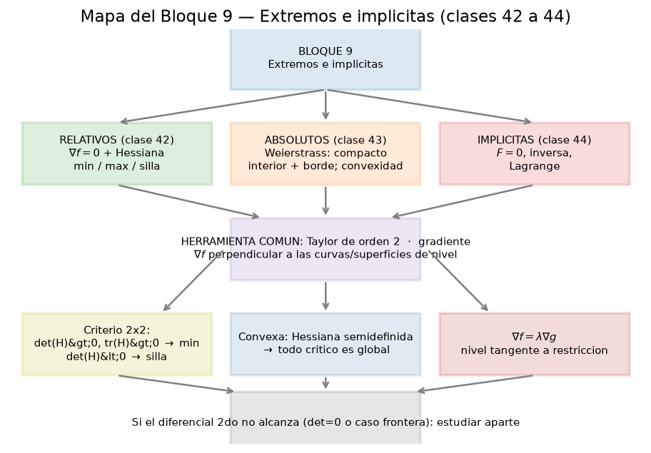

# Clase 42 — Extremos relativos y criterio de la Hessiana

> **Bloque 9 · Extremos e implícitas · Dificultad: media · Tiempo estimado: 120 min**

Hasta ahora sabemos **calcular** derivadas parciales, **armar** el gradiente y **escribir** el plano tangente. En esta clase damos el primer gran uso de todo eso: encontrar los **puntos más altos y más bajos** de una función, los **extremos relativos**. La idea es simple y poderosa: donde hay un extremo interior, el plano tangente es horizontal ($\nabla f=0$); para decidir **qué tipo** de punto es, miramos la curvatura, y la curvatura la guarda la **matriz Hessiana**.

---

## 🎯 Objetivos

1. **Definir** máximo/mínimo relativo (local) y **punto crítico**.
2. Enunciar y **demostrar** que un extremo relativo interior de una función diferenciable obliga a $\nabla f(a)=0$ (**Proposición 7.34** de las notas).
3. **Construir** la matriz Hessiana $H_f(a)$ y usarla para **clasificar** el punto crítico (mínimo, máximo o silla).
4. Distinguir los **dos criterios equivalentes**: valores propios y el par $(\det H,\ \operatorname{tr}H)$.
5. Reconocer el caso **degenerado** ($\det H=0$) donde el diferencial segundo **no decide** y hay que estudiar aparte.
6. Resolver ejercicios del **práctico y del segundo parcial** paso a paso.

---

## 🗺️ Mapa de la clase

---

## 🧱 Repaso / ideas previas

Todo lo que necesitamos ya lo construimos en el Bloque 8:

- **Gradiente.** Para $f:D\subseteq\mathbb{R}^2\to\mathbb{R}$ diferenciable,
  $$\nabla f(x,y)=\bigl(f_x(x,y),\,f_y(x,y)\bigr).$$
  El gradiente apunta en la dirección de **máximo crecimiento** y es **perpendicular a las curvas de nivel**.

- **Plano tangente.** Si $f$ es diferenciable en $(x_0,y_0)$, el plano tangente a la gráfica es
  $$z=f(x_0,y_0)+f_x(x_0,y_0)(x-x_0)+f_y(x_0,y_0)(y-y_0).$$
  Cuando el gradiente se anula, ese plano es **horizontal**: $z=f(x_0,y_0)$.

- **Taylor de orden 2 (clase 41).** Si $f$ es de clase $C^2$,
  $$f(a+h)=f(a)+df_a(h)+\tfrac12\,d^2f_a(h)+r(h),\qquad \lim_{h\to0}\frac{r(h)}{\|h\|^2}=0.$$
  El término $d^2f_a(h)$ es un **polinomio cuadrático** (forma cuadrática) que, en dos variables, se escribe con la **Hessiana**.

- **Formas cuadráticas.** Una forma cuadrática $q(h)=hHh^{\mathsf T}$ es *definida positiva* ($q>0$ salvo $h=0$), *definida negativa*, *indefinida* (toma ambos signos) o *semidefinida* (se anula en alguna dirección). Eso se lee en los **valores propios** de $H$.

---

## 📘 Teoría

### 1. Extremos relativos y condición necesaria

> **Definición 42.1 (notas, Definición 7.33).** Sea $f:D\subseteq\mathbb{R}^n\to\mathbb{R}$ y $a$ un punto **interior** de $D$. Decimos que $f$ tiene un **máximo relativo** (o *local*) en $a$ si existe $\delta>0$ tal que
> $$f(a)\geq f(x)\qquad\text{para todo }x\in B(a,\delta)\cap D.$$
> Análogamente, $f$ tiene un **mínimo relativo** en $a$ si $f(a)\leq f(x)$ en una bola alrededor de $a$. A los máximos y mínimos relativos los llamamos **extremos relativos**.

> **Proposición 42.2 (notas, Proposición 7.34).** Si $f:D\subseteq\mathbb{R}^n\to\mathbb{R}$ es **diferenciable** y tiene un extremo relativo en $a\in\mathring D$, entonces
> $$\nabla f(a)=(0,0,\dots,0).$$

**Demostración.** Restrinjamos $f$ a cada **dirección canónica**. Por ejemplo, consideremos
$$g(t)=f(a+t\,e_1),\qquad g'(0)=f_{x_1}(a).$$
Como $f$ tiene un extremo relativo en $a$, la función de una variable $g$ tiene el mismo tipo de extremo relativo en $t=0$. Por el teorema de Fermat (una variable), $g'(0)=0$, es decir $f_{x_1}(a)=0$. Repitiendo con cada coordenada, todas las derivadas parciales se anulan:
$$\nabla f(a)=(0,0,\dots,0).\qquad\blacksquare$$

A los puntos donde se anula el gradiente los llamamos **puntos críticos** (o *estacionarios*).

> ⚠️ **El recíproco es falso.** Un punto crítico **no** tiene por qué ser extremo. En una variable, $f(x)=x^3$ tiene $f'(0)=0$ y en el origen no hay extremo. En varias variables pasa lo mismo, y peor: $f(x,y)=x^2-y^2$ tiene $\nabla f(0,0)=(0,0)$ y en el origen la función **sube** en la dirección $x$ y **baja** en la dirección $y$. Ese es el **punto silla**.

### 2. La matriz Hessiana y el criterio

Supongamos que $a$ es un punto crítico interior y que $f$ es de clase $C^2$. El desarrollo de Taylor alrededor de $a$ es
$$f(a+h)=f(a)+df_a(h)+\tfrac12\,d^2f_a(h)+r(h).$$
Como $a$ es crítico, $df_a(h)=0$, y entonces
$$f(a+h)-f(a)=\tfrac12\,d^2f_a(h)+r(h).$$
El resto $r(h)$ es **despreciable** frente a $\|h\|^2$, así que **el signo de $f(a+h)-f(a)$ lo decide el diferencial segundo**, salvo el caso degenerado que veremos al final.

> **Definición 42.3 (Hessiana).** Para $f$ de clase $C^2$ en $a$,
> $$H_f(a)=\begin{pmatrix} f_{xx}(a) & f_{xy}(a)\\ f_{yx}(a) & f_{yy}(a)\end{pmatrix}.$$
> Como $f$ es $C^2$, $f_{xy}=f_{yx}$ (Clairaut) y la Hessiana es **simétrica**.

El diferencial segundo, escrito en forma matricial, es
$$d^2f_a(\Delta x,\Delta y)=\begin{pmatrix}\Delta x & \Delta y\end{pmatrix}H_f(a)\begin{pmatrix}\Delta x\\ \Delta y\end{pmatrix}=f_{xx}(a)\,\Delta x^2+2f_{xy}(a)\,\Delta x\,\Delta y+f_{yy}(a)\,\Delta y^2.$$

**Clasificación por valores propios.** Sean $\lambda_1,\lambda_2$ los valores propios de $H_f(a)$:

| Valores propios | Tipo de punto crítico |
|---|---|
| $\lambda_1>0$ y $\lambda_2>0$ | **mínimo relativo** |
| $\lambda_1<0$ y $\lambda_2<0$ | **máximo relativo** |
| $\lambda_1>0$ y $\lambda_2<0$ (o al revés) | **punto silla** |
| $\lambda_1=0$ o $\lambda_2=0$ | el diferencial segundo **no decide** |

**Clasificación por determinante y traza.** Como en $2\times2$ se tiene $\det H=\lambda_1\lambda_2$ y $\operatorname{tr}H=\lambda_1+\lambda_2$, la tabla anterior se reescribe:

$$\boxed{\ \begin{aligned}
&\det H>0,\ \operatorname{tr}H>0 &&\Longrightarrow\ \text{mínimo relativo,}\\
&\det H>0,\ \operatorname{tr}H<0 &&\Longrightarrow\ \text{máximo relativo,}\\
&\det H<0 &&\Longrightarrow\ \text{punto silla,}\\
&\det H=0 &&\Longrightarrow\ \text{no decide.}
\end{aligned}\ }$$

**Observación práctica (muy usada en el parcial):** cuando $\det H>0$, los dos valores propios tienen el **mismo signo**, y el signo lo dicta $f_{xx}$ (o la traza). Entonces basta recordar:

$$\det H>0\ \text{y}\ f_{xx}(a)>0\ \Rightarrow\ \text{mínimo};\qquad \det H>0\ \text{y}\ f_{xx}(a)<0\ \Rightarrow\ \text{máximo}.$$

### 3. El caso degenerado (¡ojo con esto!)

Si $\det H=0$, hay un valor propio nulo y el diferencial segundo es **semidefinido** o nulo: hay direcciones donde la aproximación de orden 2 no da información. Las notas (Observación 7.37) lo muestran con dos funciones que tienen **la misma** Hessiana en el origen pero **distinto** comportamiento:

- $f(x,y)=x^2+y^3$ tiene $H(0,0)=\begin{pmatrix}2&0\\0&0\end{pmatrix}$ y en el origen hay un **punto silla** (por el término $y^3$, que cambia de signo).
- $f(x,y)=x^2+y^4$ tiene $H(0,0)=\begin{pmatrix}2&0\\0&0\end{pmatrix}$ idéntica, y en el origen hay un **mínimo relativo** ($f\geq0$).

Entonces, ante $\det H=0$: **volver a la definición** y estudiar directamente $f(a+h)-f(a)$, o apelar a la estructura de la función (cuadrados, términos pares/impares).

---

## 🖼️ Figuras

**Cómo leer la figura:** las tres superficies comparten que el plano tangente en el origen es horizontal (todas tienen $\nabla f(0,0)=0$). En $f=x^2+y^2$ los valores propios son positivos y la superficie es un **paraboloide hacia arriba** (mínimo). En $f=-x^2-y^2$ son negativos y es un paraboloide **hacia abajo** (máximo). En $f=x^2-y^2$ hay un valor propio de cada signo: **sube por un lado y baja por el otro**, la silla de montar.

**Cómo leer la figura:** el campo de flechas es $\nabla f$. Fijate que en el **centro** (el punto marcado) las flechas dejan de empujar: ahí $\nabla f=0$. En el paraboloide, todas las flechas "huyen" del mínimo; en la silla, se acercan por una dirección y se alejan por la otra. Además, las flechas son **perpendiculares** a las curvas de nivel (Blanco del Bloque 8).

**Cómo leer la figura:** el bloque entero, de un vistazo. Esta clase cubre la rama "relativos"; la 43 suma el borde y la convexidad; la 44 trae las implícitas y Lagrange. Todas comparten la misma herramienta: el **gradiente** y la lectura de las **curvas de nivel**.

---

## ✏️ Ejercicios resueltos paso a paso

### Ejercicio 1 (notas, Ejemplos 7.36). $f(x,y)=x^2+y^2$ y $f(x,y)=x^2-y^2$

**Parte A — $f(x,y)=x^2+y^2$.**

**Paso 1 — gradiente.** $\nabla f=(2x,\,2y)$.

**Paso 2 — puntos críticos.** $2x=0$ y $2y=0$ dan el único punto $(0,0)$.

**Paso 3 — Hessiana.** Es constante:
$$H_f=\begin{pmatrix}2&0\\0&2\end{pmatrix}.$$

**Paso 4 — clasificar.** $\det H=4>0$ y $\operatorname{tr}H=4>0$ (o $f_{xx}=2>0$): **mínimo relativo** en $(0,0)$, con $f(0,0)=0$.

**Parte B — $f(x,y)=x^2-y^2$.**

**Paso 1 — gradiente.** $\nabla f=(2x,\,-2y)$.

**Paso 2 — puntos críticos.** Otra vez el único es $(0,0)$.

**Paso 3 — Hessiana.**
$$H_f=\begin{pmatrix}2&0\\0&-2\end{pmatrix}.$$

**Paso 4 — clasificar.** $\det H=-4<0$: **punto silla** en $(0,0)$. Los valores propios son $2$ y $-2$: uno de cada signo. ✔ (De acá viene el nombre "silla de montar" de la clase 6.)

### Ejercicio 2 (notas, Observación 7.37). El caso degenerado

Consideremos $f(x,y)=x^2+y^3$.

**Paso 1 — gradiente.** $\nabla f=(2x,\,3y^2)$. El único punto crítico es $(0,0)$ (ya que $2x=0\Rightarrow x=0$ y $3y^2=0\Rightarrow y=0$).

**Paso 2 — Hessiana.** $f_{xx}=2$, $f_{xy}=0$, $f_{yy}=6y$, así que
$$H_f(0,0)=\begin{pmatrix}2&0\\0&0\end{pmatrix},\qquad \det H=0.$$

**Paso 3 — la Hessiana no decide.** Volvemos a la definición sobre el eje $y$ (donde $x=0$): allí $f(0,y)=y^3$, que es $>0$ para $y>0$ y $<0$ para $y<0$. Por lo tanto, en cualquier bola alrededor del origen la función toma valores mayores **y** menores que $f(0,0)=0$: es un **punto silla**.

**Paso 4 — comparar con $g(x,y)=x^2+y^4$.** Su Hessiana en el origen es la **misma** $\begin{pmatrix}2&0\\0&0\end{pmatrix}$, pero $g(x,y)=x^2+y^4\geq0=g(0,0)$: **mínimo relativo**. Moraleja: con $\det H=0$ **no alcanza** la Hessiana. ✔

### Ejercicio 3 (notas, Ejemplo 7.38). $f(x,y)=x^3+y^3-3xy$

**Paso 1 — gradiente.**
$$\nabla f(x,y)=(3x^2-3y,\ 3y^2-3x).$$

**Paso 2 — puntos críticos.** Hay que resolver
$$3x^2-3y=0\ \Rightarrow\ y=x^2,\qquad 3y^2-3x=0\ \Rightarrow\ x=y^2.$$
Sustituyendo: $x=(x^2)^2=x^4$, o sea $x^4-x=0$, es decir $x(x^3-1)=0$. Las raíces reales son $x=0$ y $x=1$:
$$(0,0)\quad\text{y}\quad(1,1).$$

**Paso 3 — Hessiana.**
$$H_f(x,y)=\begin{pmatrix}6x&-3\\-3&6y\end{pmatrix}.$$

**Paso 4 — clasificar $(0,0)$.** $H_f(0,0)=\begin{pmatrix}0&-3\\-3&0\end{pmatrix}$. $\det H=0\cdot0-9=-9<0$: **punto silla**. (Valores propios $3$ y $-3$.)

**Paso 5 — clasificar $(1,1)$.** $H_f(1,1)=\begin{pmatrix}6&-3\\-3&6\end{pmatrix}$. $\det H=36-9=27>0$ y $\operatorname{tr}H=12>0$: **mínimo relativo**. (Valores propios $9$ y $3$.) ✔

### Ejercicio 4 (Práctico, estilo clásico). $f(x,y)=x^4+y^4-4xy$

**Paso 1 — gradiente.**
$$\nabla f(x,y)=(4x^3-4y,\ 4y^3-4x).$$

**Paso 2 — puntos críticos.** El sistema es
$$4x^3-4y=0\Rightarrow y=x^3,\qquad 4y^3-4x=0\Rightarrow x=y^3.$$
Sustituyendo $y=x^3$ en $x=y^3$: $x=(x^3)^3=x^9$, o sea $x^9-x=0$, es decir $x(x^8-1)=0$. Las raíces reales son $x=0$, $x=1$ y $x=-1$:
$$(0,0),\qquad(1,1),\qquad(-1,-1).$$

**Paso 3 — Hessiana.**
$$H_f(x,y)=\begin{pmatrix}12x^2&-4\\-4&12y^2\end{pmatrix}.$$

**Paso 4 — clasificar $(0,0)$.** $H_f(0,0)=\begin{pmatrix}0&-4\\-4&0\end{pmatrix}$, $\det H=-16<0$: **punto silla**.

**Paso 5 — clasificar $(1,1)$.** $H_f(1,1)=\begin{pmatrix}12&-4\\-4&12\end{pmatrix}$, $\det H=144-16=128>0$ y $\operatorname{tr}H=24>0$: **mínimo relativo**, $f(1,1)=1+1-4=-2$.

**Paso 6 — clasificar $(-1,-1)$.** $H_f(-1,-1)=\begin{pmatrix}12&-4\\-4&12\end{pmatrix}$ es la misma: también **mínimo relativo**, $f(-1,-1)=-2$. ✔

> 💡 La simetría $x\leftrightarrow y$ y el signo $(-1,-1)$ explican por qué aparecen dos mínimos iguales. La función es par en el cambio $(x,y)\mapsto(-x,-y)$.

### Ejercicio 5. $f(x,y)=x^3-3x+y^2$ (sin término cruzado)

**Paso 1 — gradiente.** $\nabla f=(3x^2-3,\ 2y)$.

**Paso 2 — puntos críticos.** $3x^2-3=0\Rightarrow x=\pm1$; $2y=0\Rightarrow y=0$. Puntos: $(1,0)$ y $(-1,0)$.

**Paso 3 — Hessiana.** $f_{xx}=6x$, $f_{xy}=0$, $f_{yy}=2$:
$$H_f(x,y)=\begin{pmatrix}6x&0\\0&2\end{pmatrix}.$$

**Paso 4 — clasificar $(1,0)$.** $H_f(1,0)=\begin{pmatrix}6&0\\0&2\end{pmatrix}$, $\det H=12>0$, $f_{xx}=6>0$: **mínimo relativo**, $f(1,0)=1-3=-2$.

**Paso 5 — clasificar $(-1,0)$.** $H_f(-1,0)=\begin{pmatrix}-6&0\\0&2\end{pmatrix}$, $\det H=-12<0$: **punto silla**, $f(-1,0)=-1+3=2$. ✔

---

## 🏛️ Ejercicios de parcial/examen

### Ejercicio 6 (Segundo parcial 2019-1S, múltiple opción 3). La familia $x^3+y^3+axy$

> Sea $a$ un número real distinto de $0$ y $f:\mathbb{R}^2\to\mathbb{R}$ dada por $f(x,y)=x^3+y^3+axy$. Entonces:
> (A) Si $a>0$ entonces $f$ tiene un punto silla y un máximo relativo.
> (B) $f$ tiene dos puntos silla para todo valor de $a$.
> (C) $f$ tiene sólo un punto crítico, que es punto silla para todo valor de $a$.
> (D) Si $a>1$ entonces $f$ tiene un punto silla y un mínimo relativo.

**Paso 1 — gradiente y puntos críticos.**
$$f_x=3x^2+ay=0,\qquad f_y=3y^2+ax=0.$$
Restando ambas ecuaciones (para empatar los términos con $a$):
$$3(x^2-y^2)+a(y-x)=0\ \Rightarrow\ 3(x-y)(x+y)-a(x-y)=0\ \Rightarrow\ (x-y)\bigl[3(x+y)-a\bigr]=0.$$

**Caso 1: $x=y$.** Reemplazando en $f_x=0$: $3x^2+ax=x(3x+a)=0$, de donde $x=0$ o $x=-\dfrac{a}{3}$. Obtenemos
$$P_0=(0,0),\qquad P_1=\Bigl(-\frac{a}{3},-\frac{a}{3}\Bigr).$$

**Caso 2: $x\neq y$.** Entonces $3(x+y)=a$, o sea $y=\dfrac{a}{3}-x$. Sustituyendo en $f_y=0$:
$$3\Bigl(\frac{a}{3}-x\Bigr)^2+ax=0\ \Rightarrow\ 3x^2-ax+\frac{a^2}{3}=0.$$
El discriminante es $a^2-4\cdot3\cdot\dfrac{a^2}{3}=a^2-4a^2=-3a^2<0$ para $a\neq0$: **no hay raíces reales**. Así que **no hay más puntos críticos**.

**Paso 2 — Hessiana.**
$$H_f(x,y)=\begin{pmatrix}6x&a\\ a&6y\end{pmatrix}.$$

**Paso 3 — clasificar $P_0=(0,0)$.**
$$H_f(0,0)=\begin{pmatrix}0&a\\ a&0\end{pmatrix},\qquad \det H=-a^2<0\ (a\neq0).$$
Signos opuestos garantizados: **punto silla** para todo $a\neq0$. ✔

**Paso 4 — clasificar $P_1=\bigl(-\tfrac a3,-\tfrac a3\bigr)$.**
$$H_f(P_1)=\begin{pmatrix}-2a&a\\ a&-2a\end{pmatrix},\qquad \det H=4a^2-a^2=3a^2>0,\qquad \operatorname{tr}H=-4a.$$
Si $a>0$, la traza es negativa: **máximo relativo**. Si $a<0$, es un **mínimo relativo**.

**Paso 5 — elegir la opción.** Con $a>0$ hay un **silla** (en el origen) y un **máximo relativo** (en $P_1$).

**Respuesta: (A).** ✔ *(verificada con la solución oficial del segundo parcial 2019-1S)*

> ⚠️ La trampa es (D): dice "si $a>1$, un silla y un **mínimo**". Para $a>1>0$ el segundo punto es un **máximo**, no un mínimo. El signo de $\operatorname{tr}H$ es el que manda.

### Ejercicio 7 (Entrenamiento segundo parcial 2019, MO 2). Un parámetro y una Hessiana degenerada

> Sea $f(x,y)=x^2+y^4+axy$, con $a\in\mathbb{R}$. Entonces:
> (A) $f$ tiene un punto silla en $(0,0)$ para todo $a$.
> (B) $f$ tiene un mínimo relativo en $(0,0)$ para todo $a$.
> (C) Si $|a|\leq2$, $f$ tiene un mínimo relativo en $(0,0)$.
> (D) Si $|a|\geq2$, $f$ tiene un punto silla en $(0,0)$.

**Paso 1 — gradiente.** $f_x=2x+ay$, $f_y=4y^3+ax$. El origen es punto crítico.

**Paso 2 — Hessiana en el origen.** $f_{xx}=2$, $f_{xy}=a$, $f_{yy}=12y^2$ (que vale $0$ en $(0,0)$):
$$H_f(0,0)=\begin{pmatrix}2&a\\ a&0\end{pmatrix},\qquad \det H=2\cdot0-a^2=-a^2.$$

**Paso 3 — analizar.** Si $a\neq0$, $\det H<0$: **punto silla**. Si $a=0$, entonces $f(x,y)=x^2+y^4\geq0=f(0,0)$: **mínimo relativo** (el criterio no decide porque $\det H=0$, pero la definición sí).

**Paso 4 — leer las opciones.**
- (A) es falsa por el caso $a=0$. (B) es falsa por cualquier $a\neq0$.
- (C) dice que con $|a|\leq2$ hay mínimo; pero con $a=1$ (que cumple $|a|\leq2$) ya hay silla. **Falsa.**
- (D) dice que con $|a|\geq2$ hay silla; en efecto, $|a|\geq2\Rightarrow a\neq0\Rightarrow\det H<0$. **Verdadera.**

**Respuesta: (D).** ✔

> 💡 El ejemplo enseña dos cosas: (i) hay que **evaluar la Hessiana en el punto** y no confundirla con la expresión general; (ii) cuando $\det H=0$ hay que **volver a la definición**.

---

## ⚠️ Errores comunes

| Error | Corrección |
|---|---|
| Confundir punto crítico con extremo | $\nabla f=0$ es **necesario**, no suficiente: $x^2-y^2$ tiene silla en el origen |
| Olvidar que el criterio vale sólo para **puntos interiores** | En el borde de $D$ el gradiente puede no anularse y aun así haber extremo (clase 43) |
| Evaluar mal la Hessiana: dejarla como función | Hay que **evaluarla en el punto crítico** para clasificar |
| Usar $\det H>0$ y concluir mínimo sin mirar la traza | Hace falta $\operatorname{tr}H>0$; si $\operatorname{tr}H<0$ es **máximo** |
| Creer que $\det H=0$ significa "silla" | Con $\det H=0$ **no se decide**: vuelve a la definición ($x^2+y^3$ vs $x^2+y^4$) |
| Olvidar el signo de $a$ en familias parametrizadas | La traza $\operatorname{tr}H$ cambia de signo con $a$ y con eso cambia min ↔ max |
| Resolver mal el sistema $\nabla f=0$ y perder puntos | Despejá una variable y sustituí; contá **todas** las raíces reales (aparecen $x=0,\pm1,\dots$) |

---

## 🔗 Conexiones

- **Clase 41 (Taylor y formas cuadráticas):** el criterio es, literalmente, el **signo del diferencial segundo**. Si entendiste la clasificación de formas cuadráticas, ya tenés la Hessiana.
- **Clase 43 (extremos absolutos y convexidad):** los puntos críticos interiores son sólo **una mitad** del problema absoluto; falta el borde. En dominios convexos, la convexidad convierte todo mínimo local en **global**.
- **Clase 44 (implícitas y Lagrange):** cuando el extremo está **sobre una restricción** (una curva o superficie), usamos multiplicadores de Lagrange; la condición $\nabla f=\lambda\nabla g$ es "el gradiente es perpendicular al nivel", lo mismo que vimos acá.
- **Aplicaciones:** minimizar costos, maximizar ganancias, ajustar modelos (mínimos cuadrados), y en ingeniería, puntos de equilibrio estable/inestable (mín/máx de una energía potencial).

---

## ✅ Autoevaluación

1. Enunciar la condición necesaria de extremo relativo interior y demostrarla para $n=2$.
2. Escribir la Hessiana de $f(x,y)=x^2y+y^3$ y clasificar su punto crítico.
3. Hallar y clasificar los puntos críticos de $f(x,y)=x^3-3xy^2$.
4. Clasificar el origen para $f(x,y)=x^4+y^4$.
5. Hallar y clasificar los críticos de $f(x,y)=3x^2y-3x^2+y^3-3y$ (si te animás).
6. ¿Por qué $\det H=0$ obliga a mirar la función y no sólo la Hessiana?
7. (V/F) Si $\nabla f(a)=0$ y $f_{xx}(a)<0<f_{yy}(a)$, entonces $a$ es un punto silla.

### Respuestas

1. Ver Proposición 42.2: restringir a las direcciones canónicas y usar Fermat en una variable.
2. $\nabla f=(2xy,\ x^2+3y^2)=0\Rightarrow x=0,\ y=0$ (o $y=0,x=0$): único crítico $(0,0)$. $H_f=\begin{pmatrix}2y&2x\\2x&6y\end{pmatrix}$, en $(0,0)$ es la matriz nula: $\det H=0$, **no decide**; de hecho $f(x,y)=x^2y+y^3=y(x^2+y^2)$ cambia de signo ⇒ **silla**.
3. $f_x=3x^2-3y^2=0$, $f_y=-6xy=0$. De $xy=0$: o $x=0$ (entonces $y=0$) o $y=0$ (entonces $x=0$). Único crítico $(0,0)$. $H_f=\begin{pmatrix}6x&-6y\\-6y&-6x\end{pmatrix}$, en $(0,0)$ la matriz nula: $\det H=0$. Directo: $f(x,0)=x^3$ cambia de signo ⇒ **silla**.
4. $\nabla f=(4x^3,4y^3)=0\Rightarrow(0,0)$. $H_f(0,0)=0$ (matriz nula): no decide. Directo: $f=x^4+y^4\geq0=f(0,0)$ ⇒ **mínimo relativo**.
5. $f_x=6xy-6x=6x(y-1)$; $f_y=3x^2+3y^2-3=3(x^2+y^2-1)$. De $x(y-1)=0$: caso $x=0\Rightarrow y=\pm1$ (puntos $(0,1),(0,-1)$); caso $y=1\Rightarrow x^2+1-1=0\Rightarrow x=0$, o sea $(0,1)$ de nuevo. Críticos: $(0,1)$ y $(0,-1)$. $H_f=\begin{pmatrix}6y-6&6x\\6x&6y\end{pmatrix}$. En $(0,1)$: $\begin{pmatrix}0&0\\0&6\end{pmatrix}$, $\det=0$, no decide; directo $f(0,y)=y^3-3y$ tiene en $y=1$ un mínimo local de una variable, así que $(0,1)$ es **mínimo relativo** (con $f=-2$). En $(0,-1)$: $\begin{pmatrix}-12&0\\0&-6\end{pmatrix}$, $\det=72>0$, $\operatorname{tr}<0$: **máximo relativo** ($f=2$).
6. Porque con un valor propio nulo hay una dirección en la que el término cuadrático se anula y el signo lo fija el término siguiente (grado 3 o 4); la misma Hessiana puede dar silla o mínimo.
7. **VERDADERO:** $\det H=f_{xx}f_{yy}-f_{xy}^2<0$ (pues $f_{xx}f_{yy}<0$), luego hay valores propios de signos opuestos: **silla**.

---

**⬅️ Anterior:** [Clase 41 — Taylor de orden 2 y formas cuadráticas](41_taylor_formas_cuadraticas.md) · **➡️ Siguiente:** [Clase 43 — Extremos absolutos y convexidad](43_extremos_absolutos_convexidad.md)
