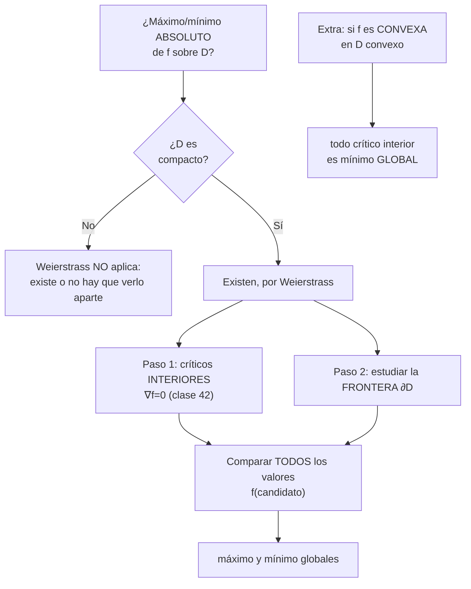
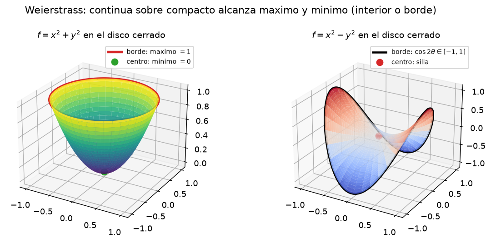
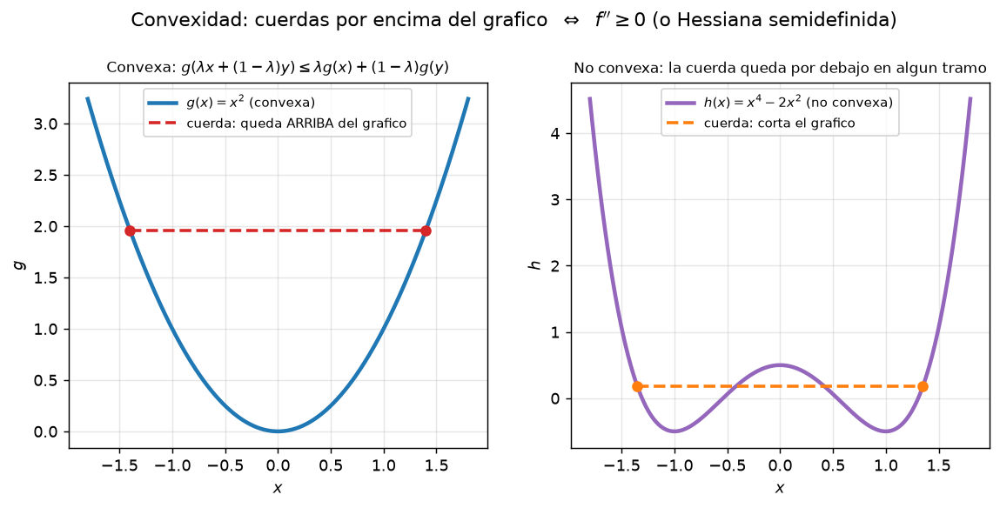

# Clase 43 — Extremos absolutos y convexidad

> **Bloque 9 · Extremos e implícitas · Dificultad: media · Tiempo estimado: 120 min**

En la clase 42 aprendimos a clasificar los puntos críticos **interiores**. Pero en la práctica casi siempre queremos el **máximo o mínimo global** de una función sobre una región. El **Teorema de Weierstrass** nos garantiza que existen cuando la región es **compacta**, y nos da un método: mirar el **interior** (críticos, clase 42) y la **frontera**. En la segunda mitad aparece el concepto de **convexidad**, que es la propiedad que hace que todo mínimo local sea directamente **global**.

---

## 🎯 Objetivos

1. **Definir** máximo y mínimo **absolutos** (globales) de una función sobre un conjunto.
2. Enunciar el **Teorema de Weierstrass** (**Teorema 6.20** de las notas) y usarlo para **garantizar** la existencia de extremos.
3. Aplicar el **método de interior + frontera** para hallar extremos absolutos en dominios compactos.
4. **Parametrizar** la frontera de un dominio sencillo y reducir a una variable.
5. Definir **conjunto convexo** (Práctico 5) y **función convexa**; caracterizarlas con la **Hessiana** (semidefinida positiva).
6. Usar que en una función convexa **todo punto crítico es un mínimo global**.
7. Resolver ejercicios de **parcial/examen** con estas herramientas.

---

## 🗺️ Mapa de la clase

---

## 🧱 Repaso / ideas previas

- **Puntos críticos y Hessiana (clase 42):** un extremo interior diferenciable cumple $\nabla f=0$, y la Hessiana clasifica (mín/máx/silla).

- **Topología (Bloque 6):**
  - Un conjunto es **compacto** en $\mathbb{R}^n$ si es **cerrado** y **acotado**.
  - La **frontera** $\partial D$ es el conjunto de puntos que son "límite" desde adentro y desde afuera: para una bola cerrada, $\partial D$ es la circunferencia.
  - Los conjuntos compactos de $\mathbb{R}^n$ son exactamente los **cerrados y acotados**.

- **Curvas paramétricas:** una circunferencia se parametriza como $(x,y)=(\cos t,\sin t)$, $t\in[0,2\pi]$. Así, al evaluar $f$ sobre la frontera, **una** variable ($t$) reemplaza a dos.

- **Formas cuadráticas (clase 41):** una matriz simétrica $A$ es **definida positiva** (todos los valores propios $>0$), **semidefinida positiva** ($\geq0$), **definida negativa**, o **indefinida**.

---

## 📘 Teoría

### 1. Extremos absolutos y el Teorema de Weierstrass

> **Definición 43.1.** Sea $f:D\subseteq\mathbb{R}^n\to\mathbb{R}$. Decimos que $f$ tiene un **máximo absoluto** (o *global*) en $a\in D$ si
> $$f(a)\geq f(x)\qquad\text{para todo }x\in D.$$
> Análogamente, tiene un **mínimo absoluto** en $a$ si $f(a)\leq f(x)$ para todo $x\in D$. A los dos los llamamos **extremos absolutos**.

> **Teorema 43.2 (notas, Teorema 6.20 — Weierstrass).** Sea $C\subseteq\mathbb{R}^n$ un conjunto **compacto** y $f:C\to\mathbb{R}$ una función **continua**. Entonces $f$ **alcanza** su máximo y su mínimo en $C$: existen $x_m,x_M\in C$ con
> $$f(x_m)\leq f(x)\leq f(x_M)\qquad\forall x\in C.$$

**Idea de la demostración.** La imagen $f(C)$ es un conjunto de $\mathbb{R}$ acotado (por continuidad y compacidad) y no vacío; por el axioma del supremo tiene supremo $M$. Se construye una sucesión $(x_k)$ en $C$ con $f(x_k)\to M$; como $C$ es compacto, pasa a una subsucesión convergente $x_{k_j}\to x_M\in C$ (Bolzano–Weierstrass), y por continuidad $f(x_M)=M$. $\blacksquare$

> ⚠️ Las **dos** hipótesis son necesarias. Sin continuidad, o sin compacidad, el extremo puede **no alcanzarse**:
> - $f(x)=x$ sobre el **abierto** $(0,1)$: $\sup=1$ e $\inf=0$ pero no se alcanzan.
> - $f(x)=1/x$ sobre $(0,1]$: no tiene máximo ($\to\infty$).
> - $f(x,y)=x^2+y^2$ sobre el disco **abierto** $B(0,1)$: el mínimo $0$ sí se alcanza, pero el máximo $1$ **no**.

### 2. Método para hallar extremos absolutos en un compacto

Sea $D$ compacto y $f$ continua. Como sabemos que **existen** (Weierstrass), los buscamos con esta receta:

1. **Interior $\mathring D$:** hallar los puntos críticos de $f$ (resolver $\nabla f=0$) y quedarse con los que caen dentro de $\mathring D$. Sus valores son **candidatos**.
2. **Frontera $\partial D$:** estudiar $f$ restringida al borde. En dominios "de una sola curva" se **parametriza**: $x=x(t),\ y=y(t)$, y se estudia la función de una variable $t\mapsto f(x(t),y(t))$ en un intervalo cerrado (ahí Weierstrass en una variable vuelve a aplicar). Si $\partial D$ es un polígono, se recorre **cada lado** por separado, y no hay que olvidar los **vértices**.
3. **Comparar** los valores: el mayor es el máximo absoluto y el menor, el mínimo absoluto.

> 💡 En la clase 44 veremos que la frontera también se puede atacar con **multiplicadores de Lagrange**, sin parametrizar. Para curvas fáciles (círculos, rectas, elipses), parametrizar suele ser más rápido.

### 3. Conjuntos convexos y funciones convexas

> **Definición 43.3 (Práctico 5, ej. 5).** Un conjunto $A\subseteq\mathbb{R}^n$ no vacío es **convexo** si para todo par $p,q\in A$ y todo $t\in[0,1]$ se cumple
> $$(1-t)p+tq\in A.$$
> Es decir, el **segmento** que une $p$ con $q$ queda enteramente dentro de $A$.

Son convexos: los subespacios, los semiespacios, los semplanos, las bolas (con cualquier norma), y las **intersecciones** de convexos. No son convexos: la unión de dos discos disjuntos, una "L", el complemento de un disco.

> **Definición 43.4.** Sea $D\subseteq\mathbb{R}^n$ convexo. Una función $f:D\to\mathbb{R}$ es **convexa** si para todo $p,q\in D$ y todo $t\in[0,1]$,
> $$f\bigl((1-t)p+tq\bigr)\leq (1-t)f(p)+t\,f(q).$$
> Geométricamente: la **cuerda** que une dos puntos de la gráfica queda **por encima** de la gráfica. Es **estrictamente convexa** si la desigualdad es estricta para $p\neq q$.

> **Proposición 43.5 (caracterización con la Hessiana).** Sea $f:D\to\mathbb{R}$ de clase $C^2$ en un **abierto convexo** $D$. Entonces
> $$f\ \text{es convexa}\iff H_f(x)\ \text{es semidefinida positiva para todo }x\in D.$$
> Si $H_f(x)$ es **definida positiva** en todo $D$, entonces $f$ es **estrictamente convexa**.

En dos variables, "$H_f$ semidefinida positiva" significa: $f_{xx}\geq0$ y $\det H_f\geq0$ en todo punto (equivalentemente, los dos valores propios $\geq0$).

> **Teorema 43.6 (mínimos de funciones convexas).** Sea $f$ convexa en un conjunto convexo $D$.
> 1. Si $a\in D$ es un **mínimo local**, entonces es un **mínimo global**.
> 2. Si además $f$ es diferenciable y $\nabla f(a)=0$ con $a$ interior, entonces $a$ es un **mínimo global**.
> 3. Si $f$ es estrictamente convexa, el mínimo global (si existe) es **único**.

**Demostración de (1).** Sea $a$ mínimo local y $y\in D$ arbitrario. Para $t\in[0,1]$ pequeño, $a+t(y-a)$ está en $D$ (convexo) y cerca de $a$, así que $f(a)\leq f\bigl(a+t(y-a)\bigr)$. Por convexidad,
$$f\bigl(a+t(y-a)\bigr)=f\bigl((1-t)a+ty\bigr)\leq(1-t)f(a)+t\,f(y).$$
Combinando: $f(a)\leq(1-t)f(a)+tf(y)$, de donde $t\,f(a)\leq t\,f(y)$ y, para $t>0$, $f(a)\leq f(y)$. Como $y$ era arbitrario, $a$ es mínimo **global**. $\blacksquare$

> 💡 Dos **funciones convexas** que conviene reconocer de memoria: $f(x)=x^2$, $f(x)=e^{x}$, $f(x)=-\log x$, y las **normas** $\|x\|$. En varias variables, la forma cuadrática $f(x)=x^{\mathsf T}Ax+b^{\mathsf T}x+c$ es convexa **si y sólo si** $A$ es semidefinida positiva.

**Cierre:** si el dominio $D$ es **convexo** y $f$ es **convexa**, entonces no hace falta estudiar la frontera para el **mínimo**: cualquier punto crítico interior (o cualquier punto donde el gradiente se anule) da directamente el **mínimo global**. Para el **máximo**, en cambio, sigue valiendo el método general.

---

## 🖼️ Figuras

**Cómo leer la figura:** dos funciones sobre el **disco cerrado** (un compacto). A la izquierda, $f=x^2+y^2$: el **mínimo** está en el centro y el **máximo** en todo el borde (la circunferencia marcada). A la derecha, $f=x^2-y^2$: en el centro hay una **silla** (ni máximo ni mínimo) y los extremos absolutos están **en el borde**, donde $f$ vale $\cos 2\theta$, entre $-1$ y $1$. Lección: el extremo absoluto puede estar **adentro** o en la **frontera**, y hay que revisar las dos partes.

**Cómo leer la figura:** en una función **convexa** (izquierda) la **cuerda** entre dos puntos del gráfico queda por encima de la curva; en una **no convexa** (derecha) la cuerda atraviesa la curva. Esa es toda la definición, y es lo que implica que en la convexa no haya "valles" escondidos: el mínimo local es global.

**Cómo leer la figura:** esta clase combina la rama "absolutos" (Weierstrass y el borde) con la propiedad de convexidad, que convierte críticos en mínimos globales.

---

## ✏️ Ejercicios resueltos paso a paso

### Ejercicio 1. $f(x,y)=x^2+y^2$ sobre el disco cerrado $\overline B((0,0),1)$

**Paso 1 — garantía.** El disco cerrado es **cerrado y acotado** ($\Rightarrow$ compacto) y $f$ es continua (un polinomio). Por **Weierstrass**, existen máximo y mínimo absolutos.

**Paso 2 — interior.** $\nabla f=(2x,2y)=0\Rightarrow(0,0)$, que está dentro del disco. $f(0,0)=0$. La Hessiana $\begin{pmatrix}2&0\\0&2\end{pmatrix}$ es definida positiva: es un **mínimo local** (y $f$ es convexa, así que es **global**).

**Paso 3 — frontera.** Parametrizamos la circunferencia $x=\cos t,\ y=\sin t$, $t\in[0,2\pi]$:
$$f(\cos t,\sin t)=\cos^2t+\sin^2t=1.$$
Constante: en todo el borde, $f=1$.

**Paso 4 — comparar.** Valores candidatos: $\{0\}\cup\{1\}$.

$$\boxed{\text{Mínimo absoluto }=0\text{ en }(0,0);\qquad \text{máximo absoluto }=1\text{ en todo }\partial D.}$$

### Ejercicio 2. $f(x,y)=x^2-y^2$ sobre el disco cerrado $\overline B((0,0),1)$

**Paso 1 — garantía.** Igual que antes: compacto + continua $\Rightarrow$ existen.

**Paso 2 — interior.** $\nabla f=(2x,-2y)=0\Rightarrow(0,0)$, con $f(0,0)=0$. Pero $H_f=\begin{pmatrix}2&0\\0&-2\end{pmatrix}$ tiene $\det H=-4<0$: es un **punto silla**. No es candidato a extremo absoluto (aunque su valor se compara igual).

**Paso 3 — frontera.** $x=\cos t,\ y=\sin t$:
$$f(\cos t,\sin t)=\cos^2t-\sin^2t=\cos 2t,\qquad t\in[0,2\pi].$$
Como $t$ recorre una vuelta completa, $2t$ recorre todo y $\cos 2t\in[-1,1]$. El máximo $1$ se alcanza en $2t=0,2\pi$, es decir $t=0,\pi$: puntos $(\pm1,0)$. El mínimo $-1$ se alcanza en $2t=\pi,3\pi$, es decir $t=\pi/2,3\pi/2$: puntos $(0,\pm1)$.

**Paso 4 — comparar.** Candidatos: $\{0\}\cup\{1,-1\}$.

$$\boxed{\text{Máximo absoluto }=1\text{ en }(1,0)\text{ y }(-1,0);\qquad \text{mínimo absoluto }=-1\text{ en }(0,1)\text{ y }(0,-1).}$$

> 💡 El punto silla del centro no "gana": da $0$, intermedio entre $-1$ y $1$.

### Ejercicio 3. $f(x,y)=x^2+y^2-2x-2y+2$ sobre el cuadrado $D=[0,2]\times[0,2]$

**Paso 0 — reescribir.** Completando cuadrados:
$$f(x,y)=(x-1)^2+(y-1)^2.$$

**Paso 1 — garantía.** $D$ es cerrado y acotado, $f$ continua: hay extremos absolutos.

**Paso 2 — interior.** $\nabla f=(2x-2,\ 2y-2)=0\Rightarrow(x,y)=(1,1)\in\mathring D$. $f(1,1)=0$. La Hessiana $\begin{pmatrix}2&0\\0&2\end{pmatrix}$ es definida positiva: **mínimo local** (y global, por convexidad).

**Paso 3 — frontera.** El borde son cuatro segmentos. Sobre cada uno:

- $x=0,\ y\in[0,2]$: $f=1+(y-1)^2$, que en $[0,2]$ vale como mínimo $1$ (en $y=1$) y como máximo $2$ (en $y=0,2$).
- $x=2,\ y\in[0,2]$: $f=1+(y-1)^2$: mismos valores.
- $y=0,\ x\in[0,2]$: $f=(x-1)^2+1$: mínimo $1$ (en $x=1$), máximo $2$ (en $x=0,2$).
- $y=2,\ x\in[0,2]$: idem.

Los **vértices** $(0,0),(0,2),(2,0),(2,2)$ dan $f=1+1=2$, ya contemplados.

**Paso 4 — comparar.** Candidatos: $\{0\}\cup\{1\}\cup\{2\}$.

$$\boxed{\text{Mínimo absoluto }=0\text{ en }(1,1);\qquad \text{máximo absoluto }=2\text{ en los cuatro vértices.}}$$

### Ejercicio 4. Convexidad: $f(x,y)=x^2+y^2+xy$ y su mínimo global

**Paso 1 — Hessiana.**
$$f_x=2x+y,\quad f_y=x+2y,\qquad H_f=\begin{pmatrix}2&1\\1&2\end{pmatrix}.$$

**Paso 2 — ¿convexa?** $\det H=4-1=3>0$ y $f_{xx}=2>0$: la Hessiana es **definida positiva** en todo punto. Por lo tanto $f$ es **estrictamente convexa** en $\mathbb{R}^2$.

**Paso 3 — crítico.** $2x+y=0$ y $x+2y=0$. De la primera, $y=-2x$; sustituyendo, $x-4x=0\Rightarrow x=0\Rightarrow y=0$. Único crítico: $(0,0)$.

**Paso 4 — conclusión.** Por el Teorema 43.6, el único crítico de una función estrictamente convexa es el **mínimo global** (y es único). $f(0,0)=0$.

$$\boxed{\text{Mínimo global }=0\text{ en }(0,0).}$$

**Verificación directa:** $f(x,y)=\tfrac34(x+y)^2+\tfrac14(x-y)^2$ (comprobalo desarrollando). Es suma de cuadrados, así que $f\geq0$ y $f=0$ sólo en $x=y=0$. ✔

### Ejercicio 5. Una función convexa $C^2$ pero no estricta: $f(x,y)=x^2$

**Paso 1 — Hessiana.** $H_f=\begin{pmatrix}2&0\\0&0\end{pmatrix}$, **semidefinida positiva** pero no definida. Por lo tanto $f$ es **convexa** (no estricta).

**Paso 2 — críticos.** $\nabla f=(2x,0)=0\Rightarrow x=0$, con $y$ libre: la recta $\{x=0\}$.

**Paso 3 — conclusión.** El **mínimo global** vale $0$ y se alcanza en **toda** la recta $x=0$ (no es único). Coherente con la no estricta convexidad.

---

## 🏛️ Ejercicios de parcial/examen

### Ejercicio 6 (Examen julio 2021, V/F 4). Weierstrass sobre uniones e intersecciones de bolas

> Sea $f:\mathbb{R}^2\to\mathbb{R}$ continua. Para cada una de las siguientes familias $\{U_n\}$, decidir si la restricción $f|_U$ posee **necesariamente** máximo y mínimo absolutos.

**(V1)** $U_n=\overline B((0,0),1+\tfrac1n)$ (bolas **cerradas**) y $U=\bigcap_{n\geq1}U_n$.

**Paso 1 — identificar $U$.** La intersección de bolas cerradas concéntricas con radios decrecientes $1+\tfrac1n\downarrow1$ es la bola cerrada de radio $1$:
$$U=\overline B((0,0),1).$$

**Paso 2 — ¿compacto?** Cerrado (intersección de cerrados) y acotado. Sí.

**Paso 3 — conclusión.** Por Weierstrass, $f|_U$ alcanza máximo y mínimo. **VERDADERO.** ✔

**(V2)** $U_n=\overline B((0,0),2+\tfrac1n)$ y $U=\bigcap_n U_n$. Igual que antes, $U=\overline B((0,0),2)$ es compacto, así que $f|_U$ **sí** posee máximo absoluto. La afirmación dice que **no** lo posee: **FALSO.** ✔

**(V3)** $U_n=B((0,0),3-\tfrac1n)$ (bolas **abiertas**) y $U=\bigcup_n U_n$. La unión de bolas abiertas crecientes con radios $3-\tfrac1n\uparrow3$ es la bola **abierta** $U=B((0,0),3)$, que **no** es cerrada (no es compacta). Weierstrass no aplica y, en efecto, **no** está garantizado el mínimo: por ejemplo $f(x,y)=1-x^2-y^2$ sobre $U$ tiene ínfimo $-8$ (cuando $x^2+y^2\to9$) que **no se alcanza**. La afirmación ("no posee necesariamente") es **VERDADERO.** ✔

**(V4)** $U_n=B((0,0),4-\tfrac1n)$ y $U=\bigcup_n U_n=B((0,0),4)$, abierto. La afirmación dice que $f|_U$ posee **necesariamente** máximo y mínimo: **FALSO.** Basta $f(x,y)=x^2+y^2$: el mínimo $0$ se alcanza en el centro, pero el máximo $16$ no se alcanza (el borde no está en $U$). ✔

> 💡 Esta pregunta es **puro Weierstrass**: cerrado + acotado $\Rightarrow$ extremos garantizados; abierto $\Rightarrow$ no garantizados (y hay que exhibir un contraejemplo).

### Ejercicio 7 (Segundo parcial 2019-1S, MO 5). Continuidad y mínimo absoluto

> Sea $B=\overline B((0,0),2)$ y $f:B\to\mathbb{R}$
> $$f(x,y)=\begin{cases}0, & (x,y)=(0,0),\\[4pt] \dfrac{x^2+y^2+x^4y^4}{x^2+y^2}, & (x,y)\neq(0,0).\end{cases}$$
> Entonces: (A)/(B) continua… (C) no es continua en $(0,0)$ y presenta mínimo absoluto en $(0,0)$; (D) no es continua en $(0,0)$ y no tiene mínimo absoluto allí.

**Paso 1 — límite en el origen.** Separando,
$$\frac{x^2+y^2+x^4y^4}{x^2+y^2}=1+\frac{x^4y^4}{x^2+y^2}.$$
Por la **desigualdad** $x^2+y^2\geq x^2$, se tiene $\dfrac{x^4y^4}{x^2+y^2}\leq x^2y^4\to0$. (O con polares: $\rho^6\cos^4\theta\sin^4\theta\to0$.) Entonces
$$\lim_{(x,y)\to(0,0)}f(x,y)=1\neq0=f(0,0).$$
Por lo tanto $f$ **no es continua** en el origen.

**Paso 2 — ¿mínimo absoluto?** Para $(x,y)\neq(0,0)$, numerador y denominador son positivos, así que $f(x,y)>0$; y $f(0,0)=0$. Entonces
$$f(0,0)=0\leq f(x,y)\quad\text{para todo }(x,y)\in B.$$
Hay **mínimo absoluto** en $(0,0)$.

**Respuesta: (C).** ✔ *(verificada con la solución oficial)*

> 💡 Moraleja: **continuidad** y **existencia de extremos** son cosas distintas. Acá $f$ es discontinua y aun así tiene mínimo absoluto (aunque Weierstrass no aplica, porque $f$ no es continua).

### Ejercicio 8 (Segundo parcial 2022-2S, MO 5). Curvas de nivel de un máximo

> Sea $f(x,y)=\max\{x^2+y^2,\,2x\}$. Indicar qué figura se asemeja a sus curvas de nivel.

**Paso 1 — separar en zonas.** $f$ es el **máximo** de dos funciones: $g_1=x^2+y^2$ (un paraboloide) y $g_2=2x$ (un plano). En cada zona "gana" la expresión más grande.

**Paso 2 — la frontera entre zonas.** Donde ambas coinciden:
$$x^2+y^2=2x\ \Longleftrightarrow\ (x-1)^2+y^2=1,$$
una **circunferencia** de centro $(1,0)$ y radio $1$.

**Paso 3 — ¿quién gana dónde?** Dentro de esa circunferencia (o sea, cerca del $(1,0)$), vale $2x>x^2+y^2$, así que $f=2x$: las curvas de nivel son **rectas verticales**. Fuera de la circunferencia gana $x^2+y^2$, y las curvas de nivel son **circunferencias concéntricas** al origen.

**Paso 4 — conclusión.** La figura correcta es la que muestra **circunferencias** afuera y, en la zona central, **rectas verticales**, con la circunferencia $(x-1)^2+y^2=1$ como frontera. (Es la opción (D) de la figura original.) ✔

> 💡 Bonus de convexidad: $x^2+y^2$ y $2x$ son **convexas**, y el **máximo de convexas es convexo**. Entonces $f$ es convexa; su mínimo global es $0$ y se alcanza en $(0,0)$, un punto donde $f$ "no tiene gradiente" (el máximo de dos funciones suele tener un "pico"). Las curvas de nivel lo confirman: el nivel $0$ es un solo punto.

---

## ⚠️ Errores comunes

| Error | Corrección |
|---|---|
| Usar Weierstrass sin chequear **compacto** y **continua** | Hacen falta **las dos** hipótesis; si falla una, el extremo puede no existir |
| Estudiar sólo los puntos críticos interiores | Hay que revisar la **frontera**; el extremo absoluto suele estar ahí |
| Parametrizar la frontera y olvidar el **rango** de $t$ | Al restringir a $t\in[0,2\pi]$ trabajás en un **compacto** de $\mathbb{R}$ y aplicás Weierstrass 1D |
| Olvidar los **vértices** en un dominio poligonal | En cada lado el extremo puede estar en un extremo del segmento |
| Confundir convexa con "tiene un solo mínimo" | Convexa se define por la **desigualdad de las cuerdas**; que el mínimo local sea global es una **consecuencia** |
| Mirar la Hessiana **sólo en un punto** para decidir convexidad | Para convexidad en $D$ hay que verificar $H_f(x)$ semidefinida positiva **en todo $D$** |
| Creer que en una función convexa el **máximo** también es fácil | La convexidad organiza los **mínimos**; el máximo sigue necesitando el método (borde incluido) |
| Comparar mal: pintar candidatos sin evaluar | Hay que **evaluar $f$** en cada candidato y comparar **números** |

---

## 🔗 Conexiones

- **Clase 42:** los críticos interiores y la Hessiana son el "Paso 1"; acá sumamos el borde.
- **Clase 44 (Lagrange):** la frontera de esta clase se puede resolver también con multiplicadores; ahí $f$ se extrema **sujeta** a la curva $g=0$.
- **Bloque 6 (topología):** "cerrado y acotado = compacto" es la hipótesis que usamos todo el tiempo; el examen la evalúa en V/F.
- **Clase 41 (formas cuadráticas):** la convexidad es "Hessiana semidefinida positiva"; el puente exacto entre álgebra lineal y extremos.
- **Aplicaciones:** en optimización y aprendizaje automático, las funciones **convexas** son el caso "fácil" (sin mínimos locales falsos); en ingeniería aparecen al minimizar energías y costos cuadráticos.

---

## ✅ Autoevaluación

1. Enunciar el Teorema de Weierstrass y dar un ejemplo donde falle **cada** hipótesis.
2. Hallar máx/mín absolutos de $f(x,y)=x^2+y^2$ sobre el cuadrado $[-1,1]^2$.
3. Hallar máx/mín absolutos de $f(x,y)=xy$ sobre el disco cerrado $\overline B((0,0),1)$.
4. Definir conjunto convexo y función convexa; dar un ejemplo y un contraejemplo de cada uno.
5. Probar que $f(x,y)=e^{x}+y^2$ es estrictamente convexa y hallar su mínimo global.
6. (V/F) Si $f$ es convexa en el convexo $D$ y tiene un mínimo local en $a\in D$, entonces es mínimo global.
7. ¿Es cierta la recíproca de (6): "todo mínimo global es local"? ¿Y "todo crítico de una convexa es máximo"?

### Respuestas

1. Ver Teorema 43.2. Falla la continuidad: $f(x)=1/x$ en $(0,1]$. Falla la compacidad: $f(x)=x$ en $(0,1)$.
2. $\nabla f=(2x,2y)=0\Rightarrow(0,0)$, $f=0$ (mínimo). Borde: en cada lado, $x$ o $y$ valen $\pm1$ y la otra variable recorre $[-1,1]$; el máximo del borde es $1+1=2$ en los **cuatro vértices** $(\pm1,\pm1)$. Máximo $=2$ en los vértices, mínimo $=0$ en el centro.
3. Interior: $\nabla f=(y,x)=0\Rightarrow(0,0)$, silla ($\det H=-1<0$), $f=0$. Borde $x=\cos t,y=\sin t$: $f=\cos t\,\sin t=\tfrac12\sin 2t\in[-\tfrac12,\tfrac12]$. Máximo $=\tfrac12$ en $(\tfrac{1}{\sqrt2},\tfrac{1}{\sqrt2})$ y $(-\tfrac{1}{\sqrt2},-\tfrac{1}{\sqrt2})$; mínimo $=-\tfrac12$ en $(\tfrac{1}{\sqrt2},-\tfrac{1}{\sqrt2})$ y $(-\tfrac{1}{\sqrt2},\tfrac{1}{\sqrt2})$.
4. Conjunto convexo: un disco. No convexo: una "L". Función convexa: $x^2$. No convexa: $\sin x$ (en $[0,2\pi]$).
5. $H_f=\begin{pmatrix}e^x&0\\0&2\end{pmatrix}$ es definida positiva ($e^x>0$): estrictamente convexa. $\nabla f=(e^x,2y)=0\Rightarrow x$ no existe (pues $e^x>0$ nunca se anula): **no hay punto crítico** y el ínfimo es $0^+$, no se alcanza; **no hay mínimo global**.
6. **VERDADERO:** Teorema 43.6(1).
7. (6) recíproca: **sí**, todo mínimo global es local (por definición, con $\delta$ cualquiera). Un crítico de una convexa **no** es máximo: por 43.6(2) es mínimo global; un máximo necesita la Hessiana definida negativa, incompatible con convexa no constante.

---

**⬅️ Anterior:** [Clase 42 — Extremos relativos y criterio de la Hessiana](42_extremos_relativos_hessiana.md) · 🏠 [Índice](00_indice.md) · **➡️ Siguiente:** [Clase 44 — Función implícita, inversa y multiplicadores de Lagrange](44_implicita_inversa_lagrange.md)
