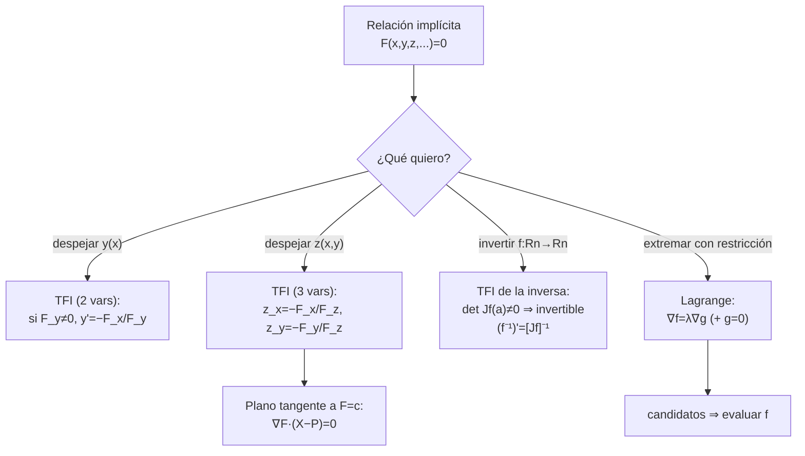
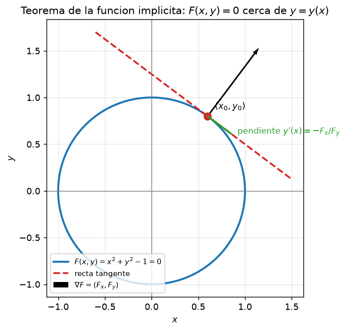
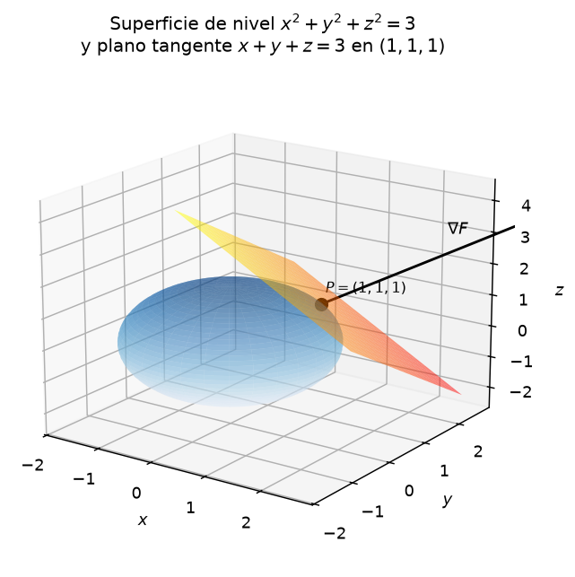
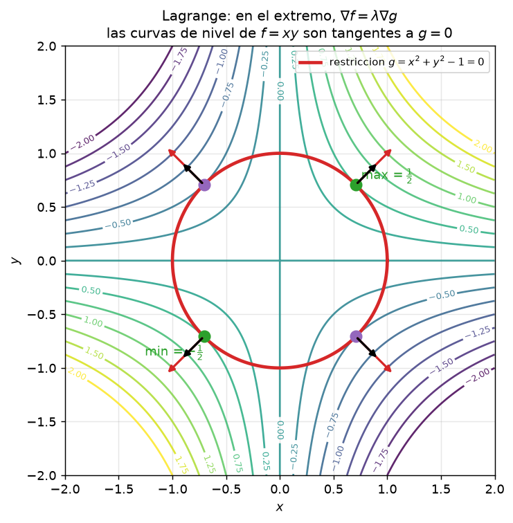

# Clase 44 — Función implícita, función inversa y multiplicadores de Lagrange

> **Bloque 9 · Extremos e implícitas · Dificultad: media-alta · Tiempo estimado: 130 min**

Cerramos el bloque con las tres herramientas "implícitas", todas ellas basadas en la misma idea geométrica: **el gradiente es perpendicular a las curvas y superficies de nivel**. Con eso podremos (1) derivar una función $y=y(x)$ **definida implícitamente** por una ecuación $F(x,y)=0$, (2) **invertir** localmente una función de $\mathbb{R}^n$ en $\mathbb{R}^n$ y calcular la derivada de la inversa, y (3) encontrar extremos **sujetos a restricciones** con los **multiplicadores de Lagrange**, que es la forma elegante de estudiar el borde de la clase 43.

---

## 🎯 Objetivos

1. Enunciar el **Teorema de la Función Implícita** en $\mathbb{R}^2$ y calcular $y'(x)=-\dfrac{F_x}{F_y}$.
2. Extenderlo a tres variables: de $F(x,y,z)=0$ despejar $z=\varphi(x,y)$ y hallar $\partial z/\partial x$, $\partial z/\partial y$.
3. Calcular el **plano tangente a una superficie de nivel** $F(x,y,z)=c$ usando $\nabla F$ (problemas de desarrollo: cuádricas).
4. Enunciar el **Teorema de la Función Inversa**: $f$ es localmente invertible si $\det J_f(a)\neq0$, y
   $$\bigl(f^{-1}\bigr)'\bigl(f(a)\bigr)=\bigl[J_f(a)\bigr]^{-1}.$$
5. Aplicar los **multiplicadores de Lagrange**: extremar $f$ sujeto a $g=0$ resolviendo $\nabla f=\lambda\nabla g$.
6. Extender a **varias restricciones** y usarlo en la frontera de extremos absolutos (clase 43).
7. Resolver ejercicios de **práctico y parcial/examen**.

---

## 🗺️ Mapa de la clase

---

## 🧱 Repaso / ideas previas

- **Gradiente normal a los conjuntos de nivel (notas §7.2–7.3).** Si $\alpha(t)$ es una curva contenida en el conjunto de nivel $\{f=k\}$, entonces $f(\alpha(t))=k$ y, por la regla de la cadena,
  $$\frac{d}{dt}f(\alpha(t))=\langle\nabla f(\alpha(t)),\alpha'(t)\rangle=0.$$
  Como $\alpha'(t)$ es **tangente** a la curva, $\nabla f$ es **perpendicular (normal)** a la curva de nivel. En $\mathbb{R}^3$ lo mismo vale para las **superficies de nivel**: $\nabla F(x_0,y_0,z_0)$ es **normal** a $\{F=c\}$ en $(x_0,y_0,z_0)$.

- **Plano tangente a un gráfico (clase 38):** $z=f(x_0,y_0)+f_x(\cdot)(x-x_0)+f_y(\cdot)(y-y_0)$.

- **Matriz Jacobiana (clase 39):** para $f:\mathbb{R}^n\to\mathbb{R}^n$, $J_f(a)$ es la matriz de derivadas parciales; su determinante mide cómo cambia localmente el volumen.

- **Reglas de derivación implícita en una variable:** si $F(x,y)=0$ define $y=y(x)$, derivando respecto de $x$ con la **regla de la cadena**:
  $$F_x+F_y\,y'=0\ \Longrightarrow\ y'=-\frac{F_x}{F_y}\quad(\text{si }F_y\neq0).$$

---

## 📘 Teoría

### 1. Teorema de la Función Implícita (TFI)

> **Teorema 44.1 (TFI en dos variables).** Sea $F:U\subseteq\mathbb{R}^2\to\mathbb{R}$ de clase $C^1$ en un abierto $U$, y $(x_0,y_0)\in U$ con
> $$F(x_0,y_0)=0,\qquad F_y(x_0,y_0)\neq0.$$
> Entonces existen un intervalo $I$ alrededor de $x_0$ y una **única** función $y=\varphi(x)$ definida en $I$, de clase $C^1$, tales que
> $$\varphi(x_0)=y_0,\qquad F\bigl(x,\varphi(x)\bigr)=0\ \ \forall x\in I.$$
> Además,
> $$\varphi'(x)=-\frac{F_x\bigl(x,\varphi(x)\bigr)}{F_y\bigl(x,\varphi(x)\bigr)}.$$

**Idea.** La condición $F_y\neq0$ dice que, cerca del punto, $F$ **cambia de signo** cuando movemos $y$ (es "monótona" en $y$); por el teorema del valor intermedio, para cada $x$ cercano a $x_0$ hay un único $y$ con $F(x,y)=0$. La fórmula de la derivada sale de derivar $F(x,\varphi(x))=0$ y despejar. La **hipótesis clave** es $F_y\neq0$: si se anula, el despeje puede fallar (pensá en $F=y^3$, o en la circunferencia en los puntos $(\pm1,0)$).

> **Teorema 44.2 (TFI en tres variables).** Sea $F:U\subseteq\mathbb{R}^3\to\mathbb{R}$ de clase $C^1$ y $F(x_0,y_0,z_0)=0$ con $F_z(x_0,y_0,z_0)\neq0$. Entonces existen un entorno de $(x_0,y_0)$ y una única $z=\varphi(x,y)$ de clase $C^1$ con $\varphi(x_0,y_0)=z_0$ y $F(x,y,\varphi(x,y))=0$. Además
> $$\frac{\partial z}{\partial x}=-\frac{F_x}{F_z},\qquad \frac{\partial z}{\partial y}=-\frac{F_y}{F_z}.$$

### 2. Plano tangente a una superficie de nivel

Si $S=\{F(x,y,z)=c\}$ es una superficie de nivel y $P=(x_0,y_0,z_0)\in S$, el vector $\nabla F(P)$ es **normal** a $S$ en $P$. Por lo tanto el **plano tangente** es

$$\boxed{\ F_x(P)\,(x-x_0)+F_y(P)\,(y-y_0)+F_z(P)\,(z-z_0)=0.\ }$$

> **Ejemplo clásico (Prob. de desarrollo 2, 2020).** Para el **elipsoide** $\dfrac{x^2}{a^2}+\dfrac{y^2}{b^2}+\dfrac{z^2}{c^2}=1$, tomando $F=\dfrac{x^2}{a^2}+\dfrac{y^2}{b^2}+\dfrac{z^2}{c^2}-1$, el plano tangente en $P=(x_0,y_0,z_0)$ (un punto del elipsoide) se simplifica a
> $$\frac{x_0\,x}{a^2}+\frac{y_0\,y}{b^2}+\frac{z_0\,z}{c^2}=1.$$
> Con $a=b=c=r$ recuperás el plano tangente a la **esfera** $x_0x+y_0y+z_0z=r^2$. **Ventaja:** no hay que despejar $z$ ni discutir el signo de la raíz. Este es el método de las **superficies de nivel** que reemplaza al "despejar" de la clase 38.

### 3. Teorema de la Función Inversa (TFInv)

> **Teorema 44.3 (TFInv).** Sea $f:U\subseteq\mathbb{R}^n\to\mathbb{R}^n$ de clase $C^1$ en un abierto $U$ y $a\in U$. Si
> $$\det J_f(a)\neq0,$$
> entonces existen entornos $V$ de $a$ y $W$ de $b=f(a)$ tales que $f:V\to W$ es **biyectiva**, su inversa $f^{-1}:W\to V$ es de clase $C^1$, y
> $$\bigl(f^{-1}\bigr)'(b)=\bigl[J_f(a)\bigr]^{-1}.$$

La condición $\det J_f(a)\neq0$ es la de "no aplastar" localmente: el diferencial es invertible como **transformación lineal**, y eso se traslada (localmente) a la función. Una función $C^1$ con inversa $C^1$ se llama **difeomorfismo** (las notas lo usan en el capítulo 8 para los cambios de variable). El ejemplo estrella es el **cambio a polares** $g(r,\theta)=(r\cos\theta,r\sin\theta)$, con $J_g=\begin{pmatrix}\cos\theta&-r\sin\theta\\ \sin\theta&r\cos\theta\end{pmatrix}$ y $\det J_g=r\neq0$ en $r>0$: invertible fuera del origen.

### 4. Multiplicadores de Lagrange

Queremos extremar $f(x,y)$ **sobre una curva** dada por la restricción $g(x,y)=0$ (por ejemplo, el borde de un disco). En la clase 43 resolvimos el borde **parametrizando**; Lagrange es el método general.

> **Teorema 44.4 (Lagrange, una restricción).** Sean $f,g:U\subseteq\mathbb{R}^2\to\mathbb{R}$ de clase $C^1$ y $a\in U$ con $g(a)=0$. Si $\nabla g(a)\neq0$ y $f$ tiene un extremo (relativo) de $f$ **restringida** a la curva $g=0$ en $a$, entonces existe $\lambda\in\mathbb{R}$ tal que
> $$\nabla f(a)=\lambda\,\nabla g(a).$$
> Es decir, los gradientes son **paralelos**: las curvas de nivel de $f$ y la restricción son **tangentes** en $a$.

**Interpretación geométrica.** Al recorrer la restricción $g=0$, el valor de $f$ sube o baja según la componente de $\nabla f$ **a lo largo** de la curva. En un extremo esa componente se anula, o sea $\nabla f$ es **perpendicular** a la curva, y por lo tanto **paralelo** a $\nabla g$ (que también es normal a $g=0$).

**Método práctico (una restricción).** Para extremar $f$ sujeta a $g=0$:

1. Plantear el sistema de $n+1$ ecuaciones con $n+1$ incógnitas $(x,y,\lambda)$:
   $$\begin{cases} f_x=\lambda\,g_x,\\ f_y=\lambda\,g_y,\\ g(x,y)=0.\end{cases}$$
2. Resolver: despejar $\lambda$ de una ecuación, sustituir, y no olvidar la **tercera** (la restricción).
3. Evaluar $f$ en **todos** los candidatos y comparar (el mayor es el máximo, el menor el mínimo).

> **Teorema 44.5 (varias restricciones).** Si se extremiza $f:\mathbb{R}^n\to\mathbb{R}$ sujeta a $m$ restricciones $g_1=\dots=g_m=0$ (con los $\nabla g_i$ linealmente independientes), existen multiplicadores $\lambda_1,\dots,\lambda_m$ con
> $$\nabla f=\lambda_1\nabla g_1+\lambda_2\nabla g_2+\cdots+\lambda_m\nabla g_m.$$

> 💡 **Uso en extremos absolutos (clase 43).** Para el borde $\partial D$ que es una curva de nivel $g=k$, se minimiza/maximiza $f$ sujeto a $g=k$ con Lagrange, y se comparan los valores del interior con los de la frontera. Es la alternativa a parametrizar.

---

## 🖼️ Figuras

**Cómo leer la figura:** la circunferencia es $F(x,y)=x^2+y^2-1=0$. Cerca del punto marcado $(x_0,y_0)$ la ecuación **define** $y$ como función de $x$ (localmente hay una sola rama). El gradiente $\nabla F$ es **normal** a la curva, y la recta tangente tiene pendiente $y'(x)=-F_x/F_y$. Si $F_y=0$ (como en $(\pm1,0)$), la recta tangente es vertical y **no** se puede despejar $y$: ahí falla la hipótesis del TFI.

**Cómo leer la figura:** la esfera $x^2+y^2+z^2=3$ es una superficie de nivel de $F=x^2+y^2+z^2$. En $P=(1,1,1)$, el gradiente $\nabla F=(2,2,2)$ es **normal**, y el plano tangente es $x+y+z=3$. No hizo falta despejar $z$: sólo calcular $\nabla F$.

**Cómo leer la figura:** maximizamos $f=xy$ sobre la circunferencia $g=x^2+y^2-1=0$. Las curvas de nivel de $f$ son hipérbolas; en el máximo y el mínimo, la hipérbola es **tangente** a la circunferencia, y allí $\nabla f$ es **paralelo** a $\nabla g$ (las dos flechas apuntan en la misma dirección). En la figura, los puntos verdes son el máximo y el mínimo; los violetas, los otros dos candidatos (puntos silla de la restricción).

---

## ✏️ Ejercicios resueltos paso a paso

### Ejercicio 1. Implícita en dos variables: $F(x,y)=x^2+y^2-1=0$

**Paso 1 — chequear la hipótesis.** Tomemos el punto $(x_0,y_0)=(0,1)$ (está en la curva). $F_y=2y$, y $F_y(0,1)=2\neq0$. Por el TFI, cerca de $(0,1)$ hay una función $y=\varphi(x)$.

**Paso 2 — derivar.** Derivando $F(x,\varphi(x))=0$ respecto de $x$:
$$2x+2y\,y'=0\ \Longrightarrow\ y'=-\frac{2x}{2y}=-\frac{x}{y}.$$

**Paso 3 — evaluar.** En $(0,1)$: $y'(0)=-0/1=0$. La recta tangente es horizontal: $y=1$.

**Paso 4 — tangente general.** En un punto genérico $(x_0,y_0)$ de la circunferencia, la tangente es
$$x_0\,x+y_0\,y=1$$
(coherente con el plano tangente a la esfera de radio $1$ y con $y'=-x_0/y_0$).

> ⚠️ En $(\pm1,0)$ se tiene $F_y=2y=0$: **falla** la hipótesis y la tangente es **vertical** ($x=1$ o $x=-1$); no se puede escribir $y=\varphi(x)$ allí. Sí se podría escribir $x=\psi(y)$ (porque $F_x=\pm2\neq0$).

### Ejercicio 2. Implícita: $F(x,y)=x^2+xy+y^2-3=0$ en $(1,1)$

**Paso 1 — chequear.** $F(1,1)=1+1+1-3=0$ ✔. $F_x=2x+y$, $F_y=x+2y$. En $(1,1)$: $F_x=3$, $F_y=3\neq0$: hay función implícita.

**Paso 2 — derivar.**
$$y'=-\frac{F_x}{F_y}=-\frac{2x+y}{x+2y}.$$

**Paso 3 — evaluar.** $y'(1,1)=-\dfrac{3}{3}=-1$.

**Paso 4 — recta tangente.**
$$y-1=-(x-1)\ \Longrightarrow\ x+y=2.$$

### Ejercicio 3. Implícita en tres variables: $x^2+y^2+z^2=3$ en $P=(1,1,1)$

**Paso 1 — chequear.** $F=x^2+y^2+z^2-3$, $F_z=2z$, y $F_z(1,1,1)=2\neq0$: podemos despejar $z=\varphi(x,y)$ cerca de $P$.

**Paso 2 — derivadas parciales.**
$$\frac{\partial z}{\partial x}=-\frac{F_x}{F_z}=-\frac{2x}{2z}=-\frac{x}{z},\qquad \frac{\partial z}{\partial y}=-\frac{y}{z}.$$

**Paso 3 — evaluar.** En $P$: $z_x=z_y=-1$.

**Paso 4 — plano tangente.** Con $\nabla F(P)=(2,2,2)$:
$$2(x-1)+2(y-1)+2(z-1)=0\ \Longrightarrow\ x+y+z=3.$$
Misma conclusión que parametrizando $z=1-(x-1)-(y-1)=3-x-y$. ✔

### Ejercicio 4. Función inversa y derivada de la inversa

Sea $f(x,y)=\bigl(e^{x}\cos y,\ e^{x}\sin y\bigr)$ (coordenadas "polares"). Estudiemos la invertibilidad local en $a=(0,\pi/2)$.

**Paso 1 — Jacobiana.**
$$J_f(x,y)=\begin{pmatrix} e^x\cos y & -e^x\sin y\\ e^x\sin y & e^x\cos y\end{pmatrix}.$$

**Paso 2 — determinante.** $\det J_f=e^{2x}(\cos^2y+\sin^2y)=e^{2x}$. En $a=(0,\pi/2)$: $\det J_f=e^{0}=1\neq0$. Por el **TFInv**, $f$ es invertible localmente alrededor de $a$.

**Paso 3 — imagen del punto.** $f(0,\pi/2)=(e^0\cos\tfrac\pi2,\ e^0\sin\tfrac\pi2)=(0,1)$.

**Paso 4 — Jacobiana en $a$.**
$$J_f(0,\pi/2)=\begin{pmatrix} 0 & -1\\ 1 & 0\end{pmatrix}.$$

**Paso 5 — derivada de la inversa.** Invirtiendo la matriz $2\times2$ (determinante $1$):
$$\bigl(f^{-1}\bigr)'(0,1)=\bigl[J_f(0,\pi/2)\bigr]^{-1}=\begin{pmatrix} 0 & 1\\ -1 & 0\end{pmatrix}.$$

> 💡 Geométricamente, $f$ es el cambio a polares al revés; su inversa es pasar de "cartesianas a $(\log r,\theta)$". La igualdad $\det J_f=e^{2x}\neq0$ dice que es un difeomorfismo local (de hecho global si restringimos $\theta$ a un intervalo de longitud $2\pi$).

### Ejercicio 5. Lagrange: extremar $f(x,y)=xy$ sobre $x^2+y^2=1$

**Paso 1 — sistema de Lagrange.** Con $g=x^2+y^2-1$, $\nabla f=(y,x)$ y $\nabla g=(2x,2y)$:
$$\begin{cases} y=2\lambda x,\\ x=2\lambda y,\\ x^2+y^2=1.\end{cases}$$

**Paso 2 — resolver.** Multiplicando la primera por $y$ y la segunda por $x$:
$$y^2=2\lambda xy,\qquad x^2=2\lambda xy\ \Longrightarrow\ x^2=y^2.$$
(Notar que $\lambda\neq0$, pues $\lambda=0$ daría $y=0$ y $x=0$, incompatible con la restricción.) Entonces $y=\pm x$.

**Paso 3 — usar la restricción.** Si $y=x$: $2x^2=1\Rightarrow x=\pm\tfrac{1}{\sqrt2}$, puntos $\bigl(\tfrac{1}{\sqrt2},\tfrac{1}{\sqrt2}\bigr)$ y $\bigl(-\tfrac{1}{\sqrt2},-\tfrac{1}{\sqrt2}\bigr)$, ambos con $f=\tfrac12$. Si $y=-x$: puntos $\bigl(\tfrac{1}{\sqrt2},-\tfrac{1}{\sqrt2}\bigr)$ y $\bigl(-\tfrac{1}{\sqrt2},\tfrac{1}{\sqrt2}\bigr)$, con $f=-\tfrac12$.

**Paso 4 — comparar.** Candidatos: $\{\tfrac12,-\tfrac12\}$.
$$\boxed{\text{Máximo }=\tfrac12\text{ en }\bigl(\pm\tfrac{1}{\sqrt2},\pm\tfrac{1}{\sqrt2}\bigr);\qquad \text{mínimo }=-\tfrac12\text{ en }\bigl(\pm\tfrac{1}{\sqrt2},\mp\tfrac{1}{\sqrt2}\bigr).}$$

> 💡 Chequeo con la **parametrización** (clase 43): $x=\cos t,\ y=\sin t$, $f=\cos t\sin t=\tfrac12\sin 2t$, que vale $\pm\tfrac12$. Coincide. ✔

### Ejercicio 6. Lagrange: extremar $f(x,y)=x^2+2y^2$ sobre $x^2+y^2=1$

**Paso 1 — sistema.** $\nabla f=(2x,4y)$, $\nabla g=(2x,2y)$:
$$\begin{cases} 2x=2\lambda x,\\ 4y=2\lambda y,\\ x^2+y^2=1.\end{cases}\qquad\Longleftrightarrow\qquad\begin{cases} x(1-\lambda)=0,\\ y(2-\lambda)=0,\\ x^2+y^2=1.\end{cases}$$

**Paso 2 — casos.**
- Si $x=0$: la restricción da $y=\pm1$, con $f=2(1)=2$.
- Si $y=0$: la restricción da $x=\pm1$, con $f=1$.
- Si $x\neq0$ **y** $y\neq0$: $\lambda=1$ y $\lambda=2$ a la vez, **imposible**.

**Paso 3 — comparar.** Candidatos: $\{2,1\}$.
$$\boxed{\text{Máximo }=2\text{ en }(0,\pm1);\qquad \text{mínimo }=1\text{ en }(\pm1,0).}$$

> 💡 Coincide con la parametrización: $f=\cos^2t+2\sin^2t=1+\sin^2t\in[1,2]$.

---

## 🏛️ Ejercicios de parcial/examen

### Ejercicio 7 (Problemas de desarrollo 2, 2020). Plano tangente a una cuádrica sin despejar

> Hallar el plano tangente al elipsoide $\dfrac{x^2}{a^2}+\dfrac{y^2}{b^2}+\dfrac{z^2}{c^2}=1$ en un punto $P=(x_0,y_0,z_0)$ de la superficie.

**Paso 1 — ver la cuádrica como nivel.** Definimos
$$F(x,y,z)=\frac{x^2}{a^2}+\frac{y^2}{b^2}+\frac{z^2}{c^2}-1,$$
de modo que el elipsoide es la **superficie de nivel** $F=0$.

**Paso 2 — gradiente (normal).**
$$\nabla F(P)=\Bigl(\frac{2x_0}{a^2},\ \frac{2y_0}{b^2},\ \frac{2z_0}{c^2}\Bigr).$$

**Paso 3 — plano tangente.** $\nabla F(P)$ es normal, así que el plano es
$$\frac{2x_0}{a^2}(x-x_0)+\frac{2y_0}{b^2}(y-y_0)+\frac{2z_0}{c^2}(z-z_0)=0.$$

**Paso 4 — simplificar usando que $P$ está en la superficie.** Dividiendo entre $2$ y usando $\dfrac{x_0^2}{a^2}+\dfrac{y_0^2}{b^2}+\dfrac{z_0^2}{c^2}=1$:
$$\boxed{\ \frac{x_0\,x}{a^2}+\frac{y_0\,y}{b^2}+\frac{z_0\,z}{c^2}=1.\ }$$

**Casos particulares:**

| Cuádrica | Plano tangente en $P$ |
|---|---|
| Esfera $x^2+y^2+z^2=r^2$ | $x_0x+y_0y+z_0z=r^2$ |
| Elipsoide $\frac{x^2}{a^2}+\frac{y^2}{b^2}+\frac{z^2}{c^2}=1$ | $\frac{x_0x}{a^2}+\frac{y_0y}{b^2}+\frac{z_0z}{c^2}=1$ |

✔ *(resultado tomado de los Problemas de desarrollo 2, IMERL 2020, verificados con su solución)*

> 💡 Ventaja del método: **no** hay que despejar $z=\pm c\sqrt{1-\frac{x^2}{a^2}-\frac{y^2}{b^2}}$ ni discutir el signo. El gradiente lo hace todo, y funciona incluso cuando $z_0=0$ (donde el despeje falla).

### Ejercicio 8 (estilo segundo parcial, 2023-2025). Extremos sobre una elipse

> Hallar el máximo y el mínimo de $f(x,y)=x+2y$ sobre la elipse $x^2+4y^2=4$.

**Paso 1 — sistema de Lagrange.** Con $g=x^2+4y^2-4=0$:
$$\nabla f=(1,2)=\lambda\,\nabla g=\lambda(2x,8y).$$
$$\begin{cases} 1=2\lambda x,\\ 2=8\lambda y,\\ x^2+4y^2=4.\end{cases}$$

**Paso 2 — despejar $x,y$ en función de $\lambda$.**
$$x=\frac{1}{2\lambda},\qquad y=\frac{1}{4\lambda}\qquad(\lambda\neq0).$$

**Paso 3 — usar la restricción.**
$$x^2+4y^2=\frac{1}{4\lambda^2}+4\cdot\frac{1}{16\lambda^2}=\frac{1}{4\lambda^2}+\frac{1}{4\lambda^2}=\frac{1}{2\lambda^2}=4.$$
De donde $\lambda^2=\dfrac18$, es decir $\lambda=\pm\dfrac{1}{2\sqrt2}$.

**Paso 4 — los dos candidatos.**
- $\lambda=\dfrac{1}{2\sqrt2}$: $x=\sqrt2$, $y=\dfrac{1}{\sqrt2}$, y $f=\sqrt2+\dfrac{2}{\sqrt2}=\sqrt2+\sqrt2=2\sqrt2$.
- $\lambda=-\dfrac{1}{2\sqrt2}$: $x=-\sqrt2$, $y=-\dfrac{1}{\sqrt2}$, y $f=-2\sqrt2$.

**Paso 5 — comparar.** La elipse es un compacto (cerrada y acotada), $f$ es continua, así que por Weierstrass estos dos únicos candidatos **son** el máximo y el mínimo.
$$\boxed{\text{Máximo }=2\sqrt2\text{ en }(\sqrt2,\tfrac{1}{\sqrt2});\qquad \text{mínimo }=-2\sqrt2\text{ en }(-\sqrt2,-\tfrac{1}{\sqrt2}).}$$

**Verificación.** $(\sqrt2)^2+4\bigl(\tfrac{1}{\sqrt2}\bigr)^2=2+4\cdot\tfrac12=2+2=4$ ✔ (el punto está en la elipse).

> 💡 Este es el patrón típico: **Lagrange en el borde** + **críticos interiores** si el dominio es un compacto con interior. Acá sólo había borde (la elipse es una curva, sin interior).

### Ejercicio 9. Una restricción implícita con Lagrange

> Extremar $f(x,y)=x^2+y^2$ sobre la curva $g(x,y)=xy-1=0$.

**Paso 1 — sistema.** $\nabla f=(2x,2y)=\lambda(y,x)$ (pues $\nabla g=(y,x)$):
$$\begin{cases} 2x=\lambda y,\\ 2y=\lambda x,\\ xy=1.\end{cases}$$

**Paso 2 — resolver.** De las dos primeras, multiplicando cruzado: $2x^2=2y^2\Rightarrow x^2=y^2\Rightarrow y=\pm x$. La restricción $xy=1>0$ obliga a $y=x$ (mismo signo). Entonces $x^2=1$, es decir $x=y=\pm1$.

**Paso 3 — evaluar.** En $(1,1)$ y $(-1,-1)$: $f=2$.

**Paso 4 — ¿máximo o mínimo?** La hipérbola $xy=1$ es cerrada pero **no acotada**; $f\to\infty$ cuando $x\to\infty$ (con $y=1/x\to0$). Por lo tanto los candidatos son un **mínimo absoluto** ($f=2$) y **no hay máximo absoluto**.

$$\boxed{\text{Mínimo }=2\text{ en }(1,1)\text{ y }(-1,-1);\quad \text{no hay máximo absoluto.}}$$

> ⚠️ Lagrange **no** distingue máximo de mínimo por sí solo: da **candidatos**. Para decidir hay que comparar valores (y, si el conjunto no es compacto, pensar si el extremo existe o no).

---

## ⚠️ Errores comunes

| Error | Corrección |
|---|---|
| Usar el TFI sin chequear $F_y\neq0$ (o $F_z\neq0$) | Es la hipótesis central; sin ella el despeje puede fallar (circunferencia en $(\pm1,0)$) |
| Olvidar la **tercera** ecuación ($g=0$) en Lagrange | El sistema es $\nabla f=\lambda\nabla g$ **y** $g=0$; sin la restricción, los candidatos no sirven |
| Despejar $\lambda$ y "perder" soluciones | Al dividir por $y$ (o por $x$) hay que analizar el **caso** en que la variable es $0$ |
| Creer que Lagrange da el máximo/mínimo directamente | Da **candidatos**; hay que evaluar y comparar |
| Evaluar mal $\nabla F$ en el punto al armar el plano tangente | Hay que evaluar **en $P$**, no dejar la expresión general |
| Derivar $F(x,\varphi(x))=0$ como si $y$ fuera constante | $y=\varphi(x)$ depende de $x$: hay que aplicar la **regla de la cadena** a $F_y\,y'$ |
| Invertir mal una matriz $2\times2$ | $\begin{pmatrix}a&b\\c&d\end{pmatrix}^{-1}=\dfrac{1}{ad-bc}\begin{pmatrix}d&-b\\-c&a\end{pmatrix}$ |
| Confundir "$\det J_f(a)\neq0$" con "globalmente invertible" | El TFInv es **local**: garantiza un entorno, no todo el dominio |

---

## 🔗 Conexiones

- **Clase 43 (extremos absolutos):** Lagrange es la forma general de estudiar la **frontera** cuando es una curva de nivel $g=k$; reemplaza a la parametrización.
- **Clase 38 (plano tangente) y 39 (Jacobiana):** el TFI/TFInv son sus versiones "sin despejar"; el plano tangente a un nivel es el de la clase 38 visto desde $\mathbb{R}^3$.
- **Clase 46 (cambio de variable):** el **cambio a polares** es un difeomorfismo con $\det J=r$, y el TFInv es lo que garantiza que el cambio es válido (el $\rho$ del jacobiano).
- **Clase 45–48 (integrales múltiples):** el jacobiano $|\det J|$ de un cambio de variable es exactamente el factor de escala del TFInv.
- **Aplicaciones:** Lagrange se usa en optimización con restricciones, mecánica (equilibrios), economía (maximizar utilidad con presupuesto) y aprendizaje automático (regularización restringida).

---

## ✅ Autoevaluación

1. Enunciar el Teorema de la Función Implícita en $\mathbb{R}^2$ y escribir la fórmula de $y'$.
2. Hallar $y'$ para $F(x,y)=e^{y}+xy-e=0$ en $(0,1)$.
3. Hallar el plano tangente a $x^2+2y^2+3z^2=6$ en $(1,1,1)$.
4. Enunciar el Teorema de la Función Inversa y calcular $(f^{-1})'$ en el punto indicado: $f(x,y)=(x^3+y,\ x-y)$ en $(1,1)$.
5. Extremar $f(x,y)=x^2+y^2$ sobre $x+y=1$ por Lagrange e interpretar geométricamente.
6. Extremar $f(x,y)=x^2-y^2$ sobre $x^2+y^2=1$.
7. (V/F) Si $\nabla f(a)=0$ y $a$ está sobre la restricción $g=0$, entonces $a$ es un extremo de $f$ sujeto a $g=0$.

### Respuestas

1. Ver Teorema 44.1: $F(x_0,y_0)=0$, $F_y(x_0,y_0)\neq0\Rightarrow y=\varphi(x)$ con $y'=-F_x/F_y$.
2. $F_x=y$, $F_y=e^{y}+x$. En $(0,1)$: $F_x=1$, $F_y=e+0=e$. $y'=-1/e$.
3. $F=x^2+2y^2+3z^2-6$, $\nabla F(1,1,1)=(2,4,6)$. Plano: $2(x-1)+4(y-1)+6(z-1)=0\Rightarrow x+2y+3z=6$.
4. $J_f=\begin{pmatrix}3x^2&1\\1&-1\end{pmatrix}$; en $(1,1)$, $J_f=\begin{pmatrix}3&1\\1&-1\end{pmatrix}$, $\det=-3-1=-4\neq0$, luego es invertible localmente. $f(1,1)=(2,0)$ y $(f^{-1})'(2,0)=-\tfrac14\begin{pmatrix}-1&-1\\-1&3\end{pmatrix}=\begin{pmatrix}1/4&1/4\\1/4&-3/4\end{pmatrix}$.
5. $\nabla f=(2x,2y)=\lambda(1,1)\Rightarrow x=y=\lambda/2$; con $x+y=1$: $x=y=\tfrac12$, $f=\tfrac12$. Es el punto de la recta **más cercano al origen** (proyección de $(0,0)$ sobre $x+y=1$).
6. $\nabla f=(2x,-2y)=\lambda(2x,2y)\Rightarrow x(1-\lambda)=0,\ y(1+\lambda)=0$. Casos: $x=0\Rightarrow y=\pm1\Rightarrow f=-1$ (mínimo); $y=0\Rightarrow x=\pm1\Rightarrow f=1$ (máximo).
7. **FALSO:** que $a$ sea crítico **libre** y esté sobre $g=0$ no implica que sea extremo **restringido**. Hay que verificar $\nabla f(a)\parallel\nabla g(a)$ y comparar con los demás candidatos; incluso cumpliendo eso, podría ser un punto silla de la restricción (como los puntos violetas del Ejercicio 5).

---

**⬅️ Anterior:** [Clase 43 — Extremos absolutos y convexidad](43_extremos_absolutos_convexidad.md) · 🏠 [Índice](00_indice.md) · **➡️ Siguiente:** [Clase 45 — Integrales dobles, Teorema de Fubini e inversión del orden](45_integrales_dobles_fubini.md)
