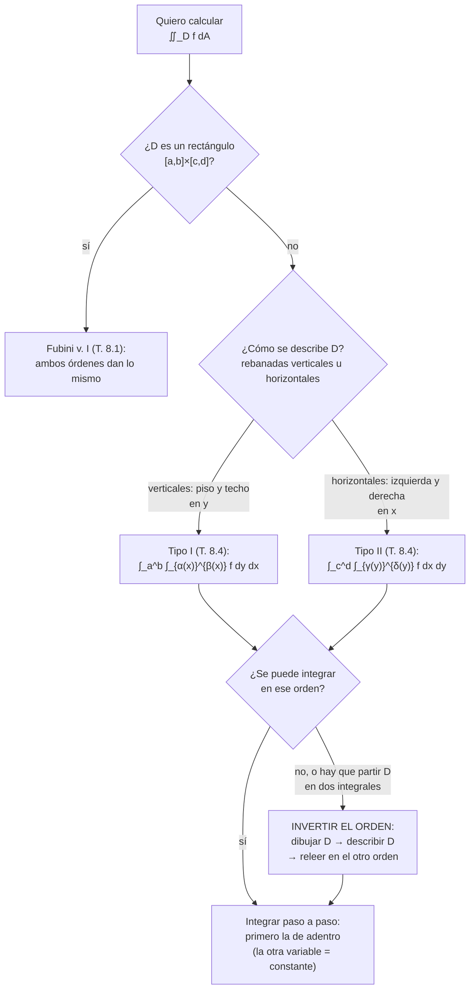
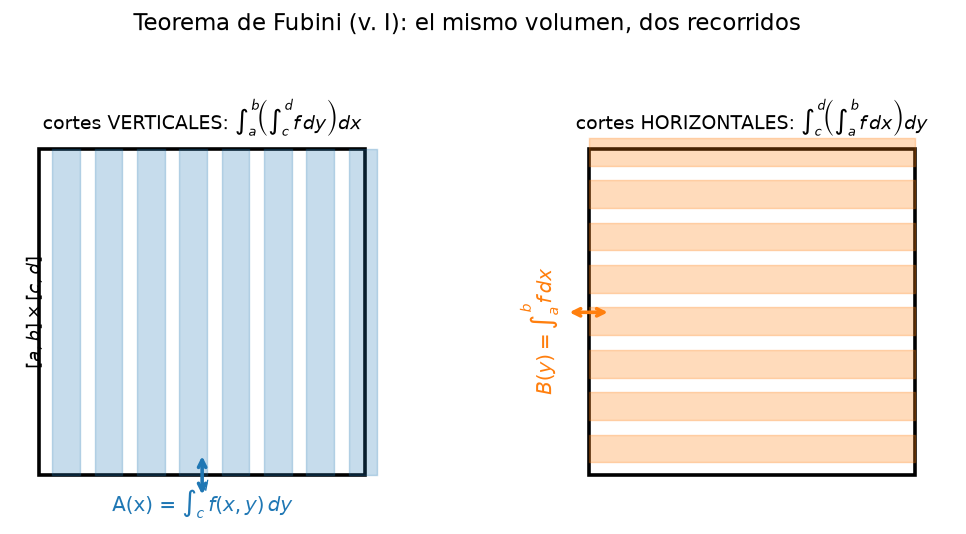
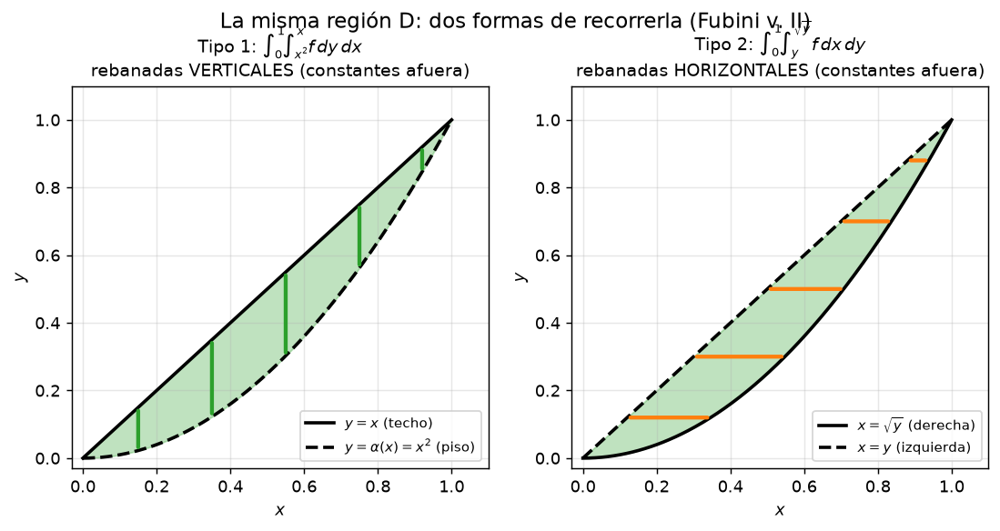
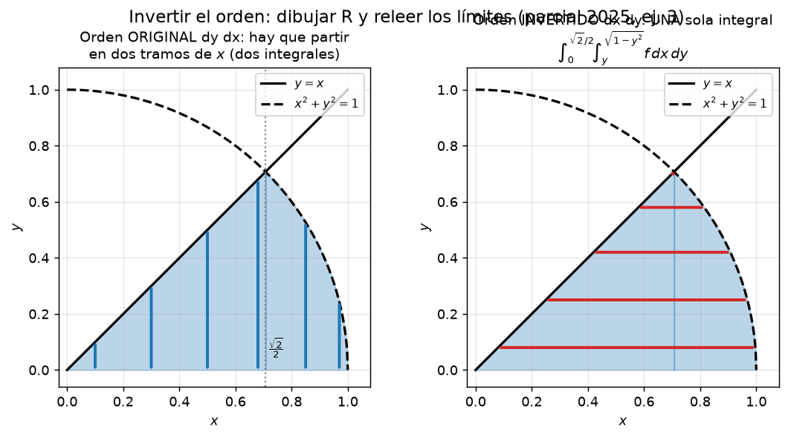

# Clase 45 — Integrales dobles, Teorema de Fubini e inversión del orden

> **Bloque 10 · Integrales múltiples · Dificultad: media · Tiempo estimado: 120 min**

Arrancamos el Bloque 10 con la pregunta que abre el capítulo 8 de las notas de Fiori: ¿cómo se **calcula** la integral de una función de dos variables? La definición por sumas de Riemann (o por sumas inferiores y superiores, con la medida de Jordan informal) sirve para *que exista* la integral y para interpretarla como **volumen bajo el gráfico**, pero no para *computarla*. El **Teorema de Fubini** es el puente: convierte una integral doble en **dos integrales iteradas** de una variable. Cuando el dominio deja de ser un rectángulo, hay que **describir la región** (tipos I y II) y armar los límites; y si el orden elegido no se puede integrar (o hay que partir la región en dos), se **invierte el orden de integración**.

---

## 🎯 Objetivos

1. Definir la **integral doble** $\iint_D f\,dA$ sobre un rectángulo $R=[a,b]\times[c,d]$ por sumas de Riemann e interpretarla como volumen (notas, cap. 8).
2. Enunciar el **Teorema de Fubini, Versión I** (notas, Teorema 8.1) y calcular integrando primero respecto de $y$ o de $x$.
3. Describir una región general como **tipo I** (entre curvas verticales: $\alpha(x)\leq y\leq\beta(x)$) y como **tipo II** (entre curvas horizontales: $\gamma(y)\leq x\leq\delta(y)$).
4. Enunciar el **Teorema de Fubini, Versión II** (notas, Teorema 8.4) y **armar los límites** de la integral iterada.
5. **Invertir el orden de integración** (dibujar la región → describirla → releerla en el otro orden).
6. Aplicar las **propiedades** de la integral doble: linealidad, aditividad, monotonicidad, $\left|\iint_D f\right|\leq \iint_D |f|$ y $\iint_D 1 = \operatorname{Área}(D)$.
7. Resolver ejercicios de **parcial/examen** (Parcial 2 2025-1S y Parcial 2 2021-1S).

---

## 🗺️ Mapa de la clase

---

## 🧱 Repaso / ideas previas

- **Integral definida de una variable (Bloque 2):** $\int_a^b f(x)\,dx=\lim \sum f(\xi_i)\,\Delta x$, y el **Teorema Fundamental** para calcularla: $\int_a^b f = F(b)-F(a)$ con $F'=f$. Todo lo de esta clase se reduce, al final, a dos aplicaciones seguidas del FTC.
- **La integral como "suma de secciones" (notas, §8).** Para $f$ continua en $[a,b]\times[c,d]$, fijar $x_0$ y calcular $\int_c^d f(x_0,y)\,dy$ da el **área de una rebanada**; "sumar" esas áreas para cada $x$ da el volumen. Esa es la idea geométrica de Fubini.
- **Continuidad ⇒ integrabilidad.** Si $f$ es continua en un rectángulo compacto (cerrado y acotado), entonces $f$ es integrable (criterio visto en el curso y usado en el Parcial 2 2021-1S, Verdadero/Falso #3). Todos los enunciados de Fubini que usamos piden $f$ **continua**.
- **Regiones del plano.** Antes de integrar hay que **dibujar**: intersectar las curvas que dan los límites, resolver los sistemas de ecuaciones y chequear con **un punto interior** que la descripción es la correcta.

---

## 📘 Teoría

### 1. Integral doble sobre un rectángulo

> **Definición 45.1 (notas, cap. 8).** Sea $f:R=[a,b]\times[c,d]\to\mathbb{R}$ acotada. Toma particiones $P_1$ de $[a,b]$ y $P_2$ de $[c,d]$, que inducen una partición de $R$ en rectángulos $R_{ij}$. Si el límite de las sumas de Riemann existe y es el mismo para toda sucesión de particiones con norma $\to0$,
> $$\iint_R f(x,y)\,dA=\lim_{\|P\|\to0}\ \sum_{i,j} f(\xi_{ij},\eta_{ij})\,\operatorname{Área}(R_{ij}),$$
> decimos que $f$ es **integrable** en $R$ y llamamos integral doble de $f$ sobre $R$ a ese límite.

**Interpretación geométrica.** Si $f\geq0$, $\iint_R f\,dA$ es el **volumen** del sólido $\{(x,y,z): (x,y)\in R,\ 0\leq z\leq f(x,y)\}$, por la misma lógica de "prismas chiquitos" que en una variable. Si $f$ cambia de signo, la integral doble es volumen con signo (positivo arriba del plano, negativo debajo), exactamente como $\int_a^b f$ en una variable.

### 2. Propiedades de la integral doble

Sean $f,g$ integrables en $D$ (por ejemplo, continuas en una región compacta) y $\lambda,\mu\in\mathbb{R}$:

| Propiedad | Fórmula |
|---|---|
| Linealidad | $\iint_D(\lambda f+\mu g)=\lambda\iint_D f+\mu\iint_D g$ |
| Aditividad en $D$ | Si $D=D_1\cup D_2$ con $D_1\cap D_2$ de área cero: $\iint_D f=\iint_{D_1}f+\iint_{D_2}f$ |
| Monotonicidad | $f\leq g$ en $D$ $\Rightarrow$ $\iint_D f\leq\iint_D g$ |
| Desigualdad triangular | $\left\|\iint_D f\right\|\leq \iint_D \|f\|$ |
| Acotación | $m\leq f\leq M$ en $D$ $\Rightarrow$ $m\,\operatorname{Área}(D)\leq\iint_D f\leq M\,\operatorname{Área}(D)$ |
| Área (notas, Observación 8.8) | $\iint_D 1\,dA=\operatorname{Área}(D)$ |

**Trampas de la propiedad de área (Parcial 2 2021-1S, V/F #3, resueltas oficialmente):**

- "$f$ **positiva** en $D$ $\Rightarrow$ $\iint_D f\geq \operatorname{Área}(D)$": **falso**. Contraejemplo oficial: $D=[0,1]^2$ y $f\equiv\tfrac12$: la integral es $\tfrac12<1=\operatorname{Área}(D)$. Hace falta $f\geq1$, no $f>0$.
- "$\left|\iint_D f\right|\geq \iint_D |f|$": **falso** (va al revés). Contraejemplo oficial: $D=[-1,1]\times[0,1]$, $f(x,y)=x$: $\iint_D f=0$ e $\iint_D|x|=1$.
- "$\iint_{U\cup V}f=\iint_U f+\iint_V f$ $\Rightarrow$ $U,V$ disjuntos": **falso**. Contraejemplo oficial: $U=V$ y $f\equiv0$.

### 3. Teorema de Fubini, Versión I (rectángulos)

> **Teorema 45.2 (Fubini v. I — notas, Teorema 8.1).** Si $f:[a,b]\times[c,d]\to\mathbb{R}$ es **continua**, entonces es integrable y
> $$\iint_D f(x,y)\,dA=\int_a^b\!\!\left(\int_c^d f(x,y)\,dy\right)dx=\int_c^d\!\!\left(\int_a^b f(x,y)\,dx\right)dy.$$

**Cómo leerlo.** La integral de **adentro** se hace respecto de una variable tratando a la otra como **constante**; la de **afuera** tiene siempre **límites constantes** (un intervalo). Geométricamente: primero calcular las áreas de las rebanadas verticales $A(x)=\int_c^d f(x,y)\,dy$ y después sumarlas (figura `b10_fubini.png`); o hacer lo mismo con rebanadas horizontales. El teorema garantiza que **ambos recorridos dan el mismo volumen**.

> **Ejemplo 45.3 (notas, Ejemplo 8.3).** Para $f(x,y)=x^2y^3$ en $D=[0,1]\times[1,2]$:
> $$\iint_D x^2y^3\,dA=\int_0^1\!\!\int_1^2 x^2y^3\,dy\,dx=\int_0^1 x^2\cdot\frac{2^4-1^4}{4}\,dx=\frac{15}{4}\cdot\frac{1}{3}=\frac{15}{12}=\frac54.$$
> En el otro orden da lo mismo (y es aún más corto: $\int_1^2 y^3\,dy\cdot\int_0^1x^2\,dx=\frac{15}{4}\cdot\frac13=\frac54$).

### 4. Regiones tipo I y tipo II: Fubini Versión II

Un rectángulo es aburrido; la mayoría de los dominios son **regiones** descritas entre curvas. Las notas (Teorema 8.4, con su "enunciado poco formal" y la figura de las dos funciones) dan las dos formas canónicas de recorrerlas:

> **Teorema 45.4 (Fubini v. II — notas, Teorema 8.4).** Sea $D$ una región que se puede escribir de las dos maneras siguientes y $f$ continua en $D$. Entonces:
> $$\iint_D f\,dA=\int_a^b\!\!\int_{\alpha(x)}^{\beta(x)} f(x,y)\,dy\,dx\qquad\text{(tipo I: rebanadas VERTICALES)}$$
> $$\iint_D f\,dA=\int_c^d\!\!\int_{\gamma(y)}^{\delta(y)} f(x,y)\,dx\,dy\qquad\text{(tipo II: rebanadas HORIZONTALES)}$$

- **Tipo I:** $D=\{(x,y): a\leq x\leq b,\ \alpha(x)\leq y\leq\beta(x)\}$. Para cada $x$ fijo, $y$ va del **piso** $\alpha(x)$ al **techo** $\beta(x)$; los límites de $y$ pueden ser funciones de $x$, los de $x$ **siempre** son constantes.
- **Tipo II:** $D=\{(x,y): c\leq y\leq d,\ \gamma(y)\leq x\leq\delta(y)\}$. Para cada $y$ fijo, $x$ va de la curva **izquierda** $\gamma(y)$ a la **derecha** $\delta(y)$.

**Receta para armar los límites (5 pasos):**

1. **Dibujar** $D$: graficar todas las curvas que aparecen en los límites e intersectarlas (resolver el sistema).
2. **Elegir el recorrido**: vertical (tipo I) u horizontal (tipo II). Proyectar $D$ sobre el eje correspondiente: ese es el intervalo de **constantes** de la integral de afuera.
3. Trazar un **segmento** vertical (fijando $x$) o horizontal (fijando $y$) dentro de $D$: entra por una curva y sale por otra; **despejar** esas curvas en función de la variable de la integral de adentro.
4. **Reemplazar**: $\displaystyle\int_{\text{const}}^{\text{const}}\!\!\int_{\text{piso}(x)}^{\text{techo}(x)} f\,dy\,dx$ o el análogo horizontal.
5. **Chequear** con un punto interior de $D$ que los límites lo contienen.

> ⚠️ **Observación 8.5 de las notas:** si $D$ **no** se puede describir de ninguna de las dos formas (porque el "piso" o el "techo" cambian de curva), se **parte** $D$ en subregiones más simples y la integral se vuelve **suma de integrales**. Ese es justamente el molestísimo caso que a veces se resuelve más fácil **invirtiendo el orden** (Ejercicio 5 de esta clase).

**Ejemplo clave (notas, Ejemplo 8.6).** Para $\iint_D e^{-x^2}$ con $D$ el triángulo $0\leq y\leq x\leq1$: si integramos primero en $x$ nos trabamos ($e^{-x^2}$ no tiene primitiva elemental), pero en el otro orden
$$\iint_D e^{-x^2}\,dA=\int_0^1\!\!\int_0^x e^{-x^2}\,dy\,dx=\int_0^1 x e^{-x^2}\,dx=\frac12\Bigl(1-\frac1e\Bigr).$$
La **misma región**, leída de las dos formas (notas, Ejercicio 8.7): $\iint_D f=\int_0^1\!\int_{x^2}^{x}f\,dy\,dx=\int_0^1\!\int_{y}^{\sqrt y}f\,dx\,dy$.

### 5. Inversión del orden de integración

Invertir el orden **no** es "escribir $dx\,dy$" y ya: hay que **cambiar la descripción de la región**. El método, siempre el mismo:

1. **Releer** la integral dada como descripción de $D$ (tipo I $\leftrightarrow$ tipo II): identificar qué curva es piso/techo (o izquierda/derecha) y el intervalo de constantes.
2. **Dibujar** $D$ con esas curvas (incluidas las intersecciones ya calculadas).
3. **Re-describir** $D$ en el otro tipo: proyectar sobre el *otro* eje, trazar el segmento correspondiente y despejar.
4. **Reescribir** la integral con los nuevos límites y, recién ahí, integrar.

**Cuándo conviene invertir:**

- Cuando la primitiva **no existe** en el orden dado (el $e^{-x^2}$ del Ejemplo 8.6).
- Cuando en el orden original hay que **partir la región en dos integrales** y en el otro no (o al revés): siempre es mejor una integral que dos.
- Cuando el integrando se simplifica con la variable de afuera.

---

## 🖼️ Figuras

**Cómo leer la figura:** el mismo rectángulo $[a,b]\times[c,d]$ recorrido de dos maneras. A la izquierda, cortes **verticales**: para cada $x$, el área de la rebanada es $A(x)=\int_c^d f(x,y)\,dy$ y afuera se integra en $x$. A la derecha, cortes **horizontales**: $B(y)=\int_a^b f(x,y)\,dx$ e integramos en $y$. Fubini v. I garantiza que ambos volúmenes son iguales; la elección del orden es **estrategia de cálculo**, no geometría.

**Cómo leer la figura:** la región $D$ entre $y=x^2$ (piso) y $y=x$ (techo). A la izquierda, **tipo I**: rebanadas verticales, $\int_0^1\int_{x^2}^{x}f\,dy\,dx$, con constantes en $x$. A la derecha, **tipo II**: rebanadas horizontales, la curva **izquierda** es $x=y$ y la **derecha** $x=\sqrt y$ (despejando de $y=x$ y $y=x^2$), $\int_0^1\int_{y}^{\sqrt y}f\,dx\,dy$. Las dos descripciones son de la **misma** región: sólo cambia quién afuera y quién adentro.

**Cómo leer la figura:** la región del **Ejercicio 3 del Parcial 2 2025-1S**. En el orden original ($dy\,dx$) el techo cambia en $x=\tfrac{\sqrt2}{2}$: de $0$ a $\tfrac{\sqrt2}{2}$ el techo es $y=x$; de $\tfrac{\sqrt2}{2}$ a $1$ es la circunferencia $y=\sqrt{1-x^2}$: hacen falta **dos** integrales. Leída en horizontal ($dx\,dy$), la curva **derecha** no cambia nunca: **una sola** integral $\int_0^{\sqrt2/2}\int_y^{\sqrt{1-y^2}}f\,dx\,dy$.

---

## ✏️ Ejercicios resueltos

### Ejercicio 1. Fubini v. I sobre un rectángulo: $\iint_R x^2y^3\,dA$, $R=[0,1]\times[1,2]$

**Paso 1 — elegir el orden.** $x^2$ se separa de $y^3$: da igual. Tomamos $dy\,dx$ (afuera constantes en $x$).

**Paso 2 — integral interna (en $y$, con $x$ constante).**
$$\int_1^2 x^2y^3\,dy=x^2\left[\frac{y^4}{4}\right]_1^2=x^2\cdot\frac{16-1}{4}=\frac{15}{4}x^2.$$

**Paso 3 — integral externa.**
$$\int_0^1\frac{15}{4}x^2\,dx=\frac{15}{4}\cdot\frac{1}{3}=\boxed{\dfrac54}.$$

**Paso 4 — chequeo en el otro orden (Fubini).**
$$\int_1^2\!\!\int_0^1 x^2y^3\,dx\,dy=\int_1^2 y^3\cdot\frac13\,dy=\frac13\cdot\frac{15}{4}=\frac54.\ \checkmark$$

### Ejercicio 2. Una región, dos descripciones: entre $y=x^2$ y $y=x$

Calcular $\iint_D x\,dA$ con $D=\{(x,y): 0\leq x\leq1,\ x^2\leq y\leq x\}$ (misma región de la figura `b10_regiones.png`).

**Paso 1 — dibujar e intersectar.** $x^2=x\Rightarrow x=0$ o $x=1$: los vértices son $(0,0)$ y $(1,1)$. Entre $0$ y $1$, $x^2\leq x$: el piso es la parábola y el techo la recta.

**Paso 2 — tipo I (vertical).** Constantes en $x$: $a=0$, $b=1$; piso $y=x^2$, techo $y=x$:
$$\iint_D x\,dA=\int_0^1\!\!\int_{x^2}^{x} x\,dy\,dx.$$

**Paso 3 — calcular.**
$$\int_0^1 x\bigl(x-x^2\bigr)\,dx=\int_0^1\bigl(x^2-x^3\bigr)\,dx=\left[\frac{x^3}{3}-\frac{x^4}{4}\right]_0^1=\frac13-\frac14=\boxed{\dfrac1{12}}.$$

**Paso 4 — tipo II (horizontal).** Despejamos $x$: de $y=x$ sale $x=y$ (izquierda) y de $y=x^2$ sale $x=\sqrt y$ (derecha, $x\geq0$). Constantes en $y$: de $0$ a $1$:
$$\iint_D x\,dA=\int_0^1\!\!\int_{y}^{\sqrt y} x\,dx\,dy=\int_0^1\frac{y-y^2}{2}\,dy=\frac12\left[\frac{y^2}{2}-\frac{y^3}{3}\right]_0^1=\frac12\cdot\frac16=\frac1{12}.\ \checkmark$$

> 💡 El mismo resultado por los dos caminos es la **comprobación experimental** de Fubini v. II: la región no cambió, sólo el recorrido.

### Ejercicio 3. Rescate: invertir para poder integrar $\iint_D e^{-x^2}\,dA$

Sea $D$ el triángulo de vértices $(0,0)$, $(1,0)$ y $(1,1)$, es decir $0\leq y\leq x\leq1$. Calcular $\iint_D e^{-x^2}\,dA$.

**Paso 1 — planteo en el orden "malo" ($dx\,dy$).** Tipo II: $y\in[0,1]$ e izquierda $x=y$, derecha $x=1$:
$$\int_0^1\!\!\int_y^1 e^{-x^2}\,dx\,dy.$$
El integrar primero en $x$ nos exige una primitiva de $e^{-x^2}$: **no existe** (en elementales). Sin inversión, no hay forma.

**Paso 2 — releer la región y describirla en vertical (tipo I).** Proyectando en $x$: $x\in[0,1]$; para cada $x$, $y$ va de $0$ a $x$:
$$\iint_D e^{-x^2}\,dA=\int_0^1\!\!\int_0^x e^{-x^2}\,dy\,dx.$$

**Paso 3 — integrar en $y$ (¡$e^{-x^2}$ es constante acá!).**
$$\int_0^x e^{-x^2}\,dy=e^{-x^2}\cdot x.$$

**Paso 4 — integrar en $x$ con cambio de variable.** Con $u=-x^2$, $du=-2x\,dx$:
$$\int_0^1 xe^{-x^2}\,dx=\left[-\frac12 e^{-x^2}\right]_0^1=-\frac1{2e}+\frac12=\boxed{\dfrac12\Bigl(1-\dfrac1e\Bigr)}\approx0{,}316.$$

> 💡 (notas, Ejemplo 8.6.) La inversión no "arregló" a $e^{-x^2}$: lo volvió **integrable respecto de $y$**, y el costo (un $x$ extra en el integrando) se paga con un cambio de variable de una variable.

---

## 🏛️ Ejercicios de parcial/examen

### Ejercicio 4 (Parcial 2 2025-1S, ej. 5). Describir la región y armar los límites

> Sea $R=\{(x,y): 0\leq x,\ 0\leq y,\ x^2+y^2\leq1,\ x^2-2x+y^2\geq0\}$. Escribir $\iint_R f(x,y)\,dA$ como integral iterada.

**Paso 1 — dibujar las curvas.** $x^2+y^2=1$ es la circunferencia de radio $1$ centrada en el origen; $x^2-2x+y^2=0$ es $(x-1)^2+y^2=1$, la circunferencia de radio $1$ centrada en $(1,0)$. Con $x\geq0$, $y\geq0$ trabajamos en el **primer cuadrante**.

**Paso 2 — intersección.** Igualando las dos ecuaciones: $x^2+y^2=1$ y $x^2+y^2=2x$ dan $2x=1$, es decir $x=\tfrac12$ y $y=\tfrac{\sqrt3}{2}$ (el punto $\bigl(\tfrac12,\tfrac{\sqrt3}{2}\bigr)$ cumple ambas).

**Paso 3 — tipo I (recorrido vertical).** Para un $x$ fijo: conviven "dentro del disco unitario" ($y\leq\sqrt{1-x^2}$) y "fuera del disco centrado en $(1,0)$" ($y\geq\sqrt{1-(x-1)^2}=\sqrt{2x-x^2}$). Las dos curvas se cruzan justo en $x=\tfrac12$, así que el techo ($\sqrt{1-x^2}$) está arriba del piso ($\sqrt{2x-x^2}$) exactamente para $0\leq x\leq\tfrac12$:
$$\iint_R f\,dA=\int_0^{1/2}\!\!\int_{\sqrt{2x-x^2}}^{\sqrt{1-x^2}} f(x,y)\,dy\,dx.$$

**Paso 4 — tipo II (por qué conviene invertir).** En horizontal hay que resolver $\min\{\sqrt{1-y^2},\,1-\sqrt{1-y^2}\}$, que cambia en $y=\tfrac{\sqrt3}{2}$: la descripción **parte la región en dos integrales**,
$$\int_0^{\sqrt3/2}\!\!\int_0^{1-\sqrt{1-y^2}} f\,dx\,dy\;+\;\int_{\sqrt3/2}^{1}\!\!\int_0^{\sqrt{1-y^2}} f\,dx\,dy.$$

> ✔ En el parcial, la solución oficial expresa esta misma región **en coordenadas polares** y elige la opción **(A)**: $\int_{\pi/3}^{\pi/2}\int_{2\cos\theta}^{1} r^2\,dr\,d\theta$. El planteo polares completo (y la cuenta final) está en la **clase 46**; verificá que los límites $\theta\in[\pi/3,\pi/2]$ y $r\in[2\cos\theta,1]$ describen **exactamente** este mismo $R$. ✔

### Ejercicio 5 (Parcial 2 2025-1S, Ejercicio 3, desarrollo). Invertir el orden y calcular

> Se sabe que
> $$\iint_R f(x,y)\,dA=\int_0^{\sqrt2/2}\!\!\int_0^{x} f(x,y)\,dy\,dx+\int_{\sqrt2/2}^{1}\!\!\int_0^{\sqrt{1-x^2}} f(x,y)\,dy\,dx.$$
> (b) Reescribir la integral en el orden $dx\,dy$ y calcular su valor para $f(x,y)=2xy$.

**Paso 1 — leer la región del orden original.** Primer término: $x$ de $0$ a $\tfrac{\sqrt2}{2}$, con $y$ de $0$ a $x$ (techo la recta). Segundo término: $x$ de $\tfrac{\sqrt2}{2}$ a $1$, con $y$ de $0$ a $\sqrt{1-x^2}$ (techo la circunferencia). El techo **cambia** en $x=\tfrac{\sqrt2}{2}$ (punto donde $x=\sqrt{1-x^2}$).

**Paso 2 — descripción única de $R$.** Ambos tramos son "de $0$ arriba" hasta la frontera $y=\min\{x,\sqrt{1-x^2}\}$, o sea
$$R=\{(x,y): 0\leq y,\ y\leq x,\ x^2+y^2\leq1\}.$$

**Paso 3 — releer en horizontal (tipo II).** Para cada $y$ fijo, $x$ entra por la recta $x=y$ y sale por la circunferencia $x=\sqrt{1-y^2}$. El valor máximo de $y$ es la intersección $y=x=\sqrt{1-y^2}$, es decir $y=\tfrac{\sqrt2}{2}$:
$$\iint_R f(x,y)\,dA=\int_0^{\sqrt2/2}\!\!\int_y^{\sqrt{1-y^2}} f(x,y)\,dx\,dy.$$
**Una sola integral**, sin partir. ✔ *(igual que la solución oficial)*

**Paso 4 — integrar con $f(x,y)=2xy$.** Primero en $x$ ($y$ constante):
$$\int_y^{\sqrt{1-y^2}} 2xy\,dx=y\Bigl[x^2\Bigr]_y^{\sqrt{1-y^2}}=y\bigl(1-y^2\bigr)-y\cdot y^2=y-2y^3.$$

**Paso 5 — integrar en $y$.**
$$\int_0^{\sqrt2/2}\bigl(y-2y^3\bigr)\,dy=\left[\frac{y^2}{2}-\frac{y^4}{2}\right]_0^{\sqrt2/2}=\frac{1/2}{2}-\frac{1/4}{2}=\frac14-\frac18=\boxed{\dfrac18}.$$

**Verificación con el orden original (dos integrales):**
$$\int_0^{\sqrt2/2}\!\!\int_0^{x}2xy\,dy\,dx=\int_0^{\sqrt2/2}x^3\,dx=\frac{1}{16},$$
$$\int_{\sqrt2/2}^{1}\!\!\int_0^{\sqrt{1-x^2}}2xy\,dy\,dx=\int_{\sqrt2/2}^{1}x\bigl(1-x^2\bigr)\,dx=\left[\frac{x^2}{2}-\frac{x^4}{4}\right]_{\sqrt2/2}^{1}=\frac14-\frac3{16}=\frac1{16}.$$
Sumando: $\tfrac1{16}+\tfrac1{16}=\tfrac18$. ✔ *(coincide con la solución oficial)*

### Ejercicio 6 (Parcial 2 2021-1S, múltiple opción #3, versión V1). Invertir el orden

> Si $\displaystyle\iint_D f=\int_0^4\!\!\int_{-\sqrt{4-y}}^{(y-4)/2} f(x,y)\,dx\,dy$ con $f$ continua, ¿cuál es la integral con el orden invertido?

**Paso 1 — identificar las curvas de los límites internos.**
- Límite **izquierdo** $x=-\sqrt{4-y}$ (rama izquierda de circunferencia): elevando, $x^2=4-y$, es decir $y=4-x^2$ con $x\leq0$.
- Límite **derecho** $x=\dfrac{y-4}{2}$ (recta): despejando, $y=2x+4$.

**Paso 2 — el recorrido original.** $y$ recorre $[0,4]$; para cada $y$, $x$ va de la circunferencia (izquierda) a la recta (derecha). La región está toda **a la izquierda del eje $y$**.

**Paso 3 — intersecciones.** $4-x^2=2x+4\Rightarrow x^2+2x=0\Rightarrow x=0$ o $x=-2$, con puntos $(0,4)$ y $(-2,0)$: son los vértices de $D$.

**Paso 4 — releer en vertical (tipo I).** Proyectando en $x$: $x\in[-2,0]$; para cada $x$, $y$ entra por la **recta** $y=2x+4$ (abajo) y sale por la **circunferencia** $y=4-x^2$ (arriba). Chequeo con el punto interior $(-1,2{,}5)$: $2(-1)+4=2\leq2{,}5\leq 4-1=3$. ✔
$$\iint_D f=\int_{-2}^{0}\!\!\int_{2x+4}^{4-x^2} f(x,y)\,dy\,dx.$$

**Respuesta: la opción (A).** ✔ *(verificada con la solución oficial: $D=\{(x,y):-2\leq x\leq0,\ 2x+4\leq y\leq4-x^2\}$)*

### Ejercicio 7 (Parcial 2 2021-1S, múltiple opción #3, versión V2). Otro cambio de orden

> Si $\displaystyle\iint_D f=\int_0^4\!\!\int_{(4-y)/2}^{\sqrt{4-y}} f(x,y)\,dx\,dy$, invertir el orden.

**Paso 1 — curvas.** Izquierda: $x=\dfrac{4-y}{2}\Leftrightarrow y=4-2x$ (recta). Derecha: $x=\sqrt{4-y}\Leftrightarrow y=4-x^2$ con $x\geq0$ (rama derecha de la circunferencia).

**Paso 2 — intersecciones.** $4-2x=4-x^2\Rightarrow x(x-2)=0$: puntos $(0,4)$ y $(2,0)$.

**Paso 3 — releer en vertical.** $x\in[0,2]$; para cada $x$, $y$ va de la recta $y=4-2x$ (piso) a la circunferencia $y=4-x^2$ (techo). (Chequeo: $(1,2{,}5)$ está en $[0,2]$ y $2\leq2{,}5\leq3$. ✔)
$$\iint_D f=\int_{0}^{2}\!\!\int_{4-2x}^{4-x^2} f(x,y)\,dy\,dx.$$

**Respuesta: la opción (A).** ✔ *(verificada con la solución oficial: $D=\{(x,y):0\leq x\leq2,\ 4-2x\leq y\leq4-x^2\}$)*

---

## ⚠️ Errores comunes

| Error | Corrección |
|---|---|
| Poner límites **con variable** en la integral de **afuera** | La integral externa va siempre entre **constantes**; si el límite de afuera tiene $x$ o $y$, falta releer la región |
| Escribir $\int\!\int f\,dy\,dx$ sin haber **dibujado** $D$ | Los límites salen del dibujo (piso/techo o izquierda/derecha), no de la memoria; chequeá con un punto interior |
| "Invertir el orden" cambiando sólo el orden de las $d$'s | Hay que **re-describir la región**: los límites se reescriben por completo ($dy\,dx\to dx\,dy$ con funciones distintas) |
| Confundir qué curva es piso y cuál techo | Chequear con un valor interno: en $x=\tfrac12$ del Ejercicio 4, $\sqrt{2x-x^2}\leq\sqrt{1-x^2}$ |
| Olvidar **partir** la región cuando cambia la curva | Si el "techo" cambia (Ejercicio 5), son **dos** integrales en ese orden; o invertí y quedás con una |
| Integrar la variable equivocada tratando **mal** la otra | En la integral interna, la otra variable es **constante**: $e^{-x^2}$ respecto de $y$ es constante |
| Decir "$f$ positiva $\Rightarrow \iint_D f\geq \operatorname{Área}(D)$" | Falso (Parcial 2 2021-1S, V/F #3): hace falta $f\geq1$; con $f\equiv\tfrac12$ falla |
| Creer que $\left\|\iint_D f\right\|\geq\iint_D\|f\|$ | Al revés: $\left\|\iint_D f\right\|\leq\iint_D\|f\|$ (contraejemplo oficial: $f(x,y)=x$ en $[-1,1]\times[0,1]$) |
| Al dividir la región, olvidar que las fronteras se **traslapan** | $D_1\cup D_2$ basta con que la intersección tenga **área cero** (los bordes compartidos no se cuentan doble) |

---

## 🔗 Conexiones

- **Bloque 2 (integrales definidas):** cada integral iterada es "una variable a la vez", con la otra como constante; el FTC sigue siendo la única herramienta de cálculo.
- **Clase 46 (cambio de variable y polares):** el mismo Fubini se aplica **después** del cambio: al pasar a $(r,\theta)$ la región se vuelve un rectángulo y se integra con la fórmula de Fubini (el Ejercicio 4 de esta clase es el caso).
- **Clase 47 (integrales triples):** Fubini se extiende a tres iteradas $\iiint f\,dz\,dy\,dx$; la "receta de los 5 pasos" se usa primero en la variable interna.
- **Clase 48 (impropias):** $\iint_{\mathbb{R}^2} e^{-(x^2+y^2)}$ se define como límite de integrales sobre discos; ahí Fubini en polares hace la cuenta pesada.
- **Parciales:** inversión del orden (2021-1S y 2025-1S) y descripción de regiones son el formato **múltiple opción** favorito de este bloque; en desarrollo aparecen como "reescriba y calcule".

---

## ✅ Autoevaluación

1. Enunciar el Teorema de Fubini, Versión I, e indicar qué papel juega la continuidad de $f$.
2. Calcular $\displaystyle\int_0^1\!\!\int_0^{x} e^{x}\,dy\,dx$ y verificar con el orden inverso (¿se puede?).
3. Describir $D=\{(x,y): 0\leq x\leq1,\ x\leq y\leq1\}$ como tipo I **y** como tipo II, y escribir $\iint_D f$ en ambos órdenes.
4. ¿Por qué $\displaystyle\int_0^1\!\!\int_{y}^{1} e^{-x^2}\,dx\,dy$ es "mala" y su versión invertida "buena"? Calcular la buena.
5. (Parcial 2 2021-1S, V/F) Verdadero o falso: si $f$ es continua y **positiva** en el rectángulo compacto $D$, entonces $\iint_D f\geq \operatorname{Área}(D)$. Justificar.
6. (Parcial 2 2021-1S, V/F) V o F: si $\iint_{U\cup V} f=\iint_U f+\iint_V f$ para un $f$ integrable, entonces $U$ y $V$ son disjuntos.
7. Invertir el orden de $\displaystyle\int_0^{1}\!\!\int_{x^3}^{x} f(x,y)\,dy\,dx$ (dibujar antes: $y=x^3$ y $y=x$ se cruzan en $0$ y en $1$).

### Respuestas

1. Teorema 45.2: si $f$ es continua en $[a,b]\times[c,d]$, entonces $\iint_D f=\int_a^b\!\int_c^d f\,dy\,dx=\int_c^d\!\int_a^b f\,dx\,dy$. La continuidad garantiza **integrabilidad** (y que las iteradas existan); sin ella, las dos iteradas pueden existir y dar distinto (o la integral doble ni existir).
2. Interna: $\int_0^x e^x\,dy=x e^x$. Externa: $\int_0^1 xe^x\,dx=[xe^x-e^x]_0^1=(e-e)-(0-1)=1$. Orden inverso (se puede, la región es el triángulo $0\leq y\leq x\leq1$): $\int_0^1\!\int_y^1 e^x\,dx\,dy=\int_0^1(e-e^y)\,dy=e-(e-1)=1$. ✔ (El problema clásico "imposible" es $e^{-x^2}$: ver Ejercicio 3.)
3. Tipo I: $D=\{(x,y):0\leq x\leq1,\ x\leq y\leq1\}$, luego $\int_0^1\!\int_x^1 f\,dy\,dx$. Tipo II: despejando $x=y$: $D=\{(x,y):0\leq y\leq1,\ 0\leq x\leq y\}$, luego $\int_0^1\!\int_0^y f\,dx\,dy$.
4. Porque $e^{-x^2}$ no tiene primitiva elemental: integrando primero en $x$ la integral se traba. Invertida: $\int_0^1\!\int_0^x e^{-x^2}\,dy\,dx=\int_0^1 xe^{-x^2}\,dx=\tfrac12(1-1/e)\approx0{,}316$.
5. **FALSO.** Contraejemplo oficial: $D=[0,1]^2$ y $f\equiv\tfrac12>0$: $\iint_D f=\tfrac12<1=\operatorname{Área}(D)$. (La conclusión es válida con $f\geq1$.)
6. **FALSO.** Contraejemplo oficial: $U=V$ (no disjuntos) y $f\equiv0$: ambos lados valen $0$. La aditividad exige intersección de **área cero**, no disjunción estricta.
7. Con $x\in[0,1]$: piso $y=x^3$, techo $y=x$. En horizontal: $y\in[0,1]$, de la recta $x=y$ a la curva $x=\sqrt[3]{y}$. Resultado: $\int_0^1\!\int_y^{y^{1/3}} f\,dx\,dy$.

---

> ⬅️ [Clase anterior](44_implicita_inversa_lagrange.md) · 🏠 [Índice](00_indice.md) · [Clase siguiente](46_cambio_variable_polares.md) ➡️
