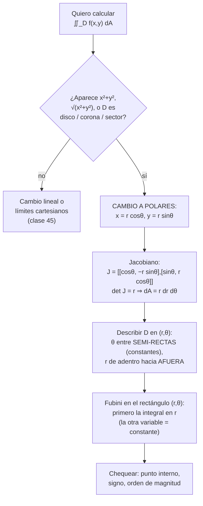
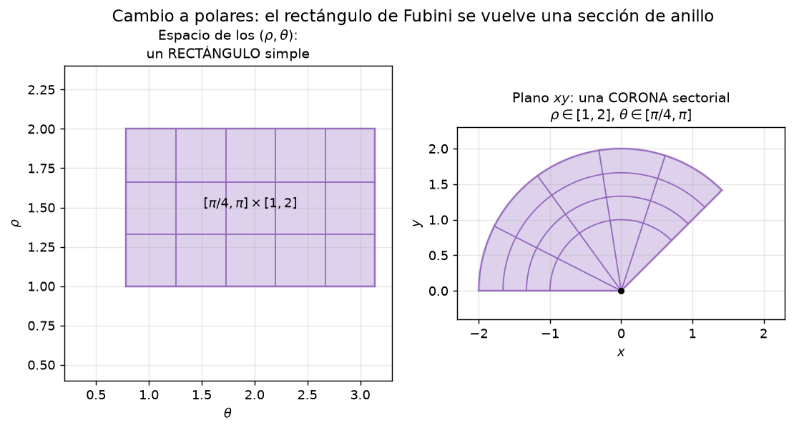
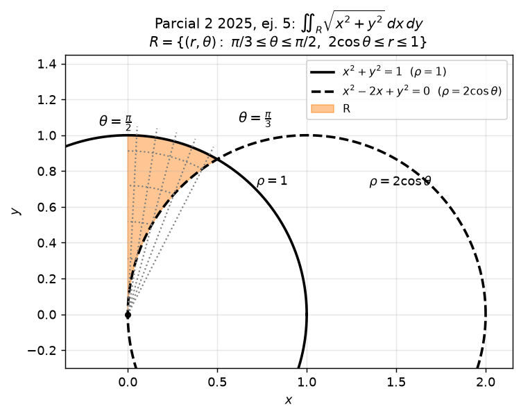

# Clase 46 — Cambio de variable y coordenadas polares en integrales dobles

> **Bloque 10 · Integrales múltiples · Dificultad: media-alta · Tiempo estimado: 130 min**

Si en la clase 45 aprendimos **cómo recorrer** una región (Fubini, tipos I y II, inversión del orden), ahora aprendemos a **cambiar de mapa**: el **Teorema de Cambio de Variable** (notas, Teorema 8.12) permite reescribir $\iint_D f\,dA$ como la integral de otra función sobre **otro dominio**, multiplicando por el **jacobiano** $|\det J_g|$. La aplicación estrella es el cambio a **coordenadas polares** $x=r\cos\theta$, $y=r\sin\theta$, con $dA=r\,dr\,d\theta$, que convierte discos, coronas y sectores en **rectángulos** de $(r,\theta)$ y a los $x^2+y^2$ en $r^2$.

---

## 🎯 Objetivos

1. Enunciar el **Teorema de Cambio de Variable** para integrales dobles (notas, Teorema 8.12) e identificar sus **tres elementos**: función, dominio y jacobiano.
2. Calcular la **matriz jacobiana** $J_g$ y usar $|\det J_g|$ como **factor de escala de áreas** (puente con la clase 44 y el Teorema de la Función Inversa).
3. Describir el cambio a **polares**: $x=r\cos\theta$, $y=r\sin\theta$, $\det J=r$ y $dA=r\,dr\,d\theta$ (las notas usan $\rho$ donde acá usamos $r$).
4. Describir **regiones en polares**: discos, coronas, sectores, coronas sectoriales y círculos con centro desplazado ($r=2a\cos\theta$).
5. **Armar los límites** en polares: $\theta$ entre constantes afuera, $r$ de **adentro hacia afuera**.
6. Decidir **cuándo conviene** polares y calcular la integral completa paso a paso.
7. Resolver el **Ejercicio 5 del Parcial 2 2025-1S** y verificar contra la solución oficial.

---

## 🗺️ Mapa de la clase

---

## 🧱 Repaso / ideas previas

- **Fubini (clase 45):** una integral doble se calcula como dos iteradas, con la variable de **afuera** entre constantes. Después del cambio de variable, el dominio nuevo vuelve a ser "recorrible" con Fubini.
- **Matriz jacobiana (clase 39) y TFInv (clase 44):** para $g:U\subseteq\mathbb{R}^2\to\mathbb{R}^2$, $J_g$ es la matriz de derivadas parciales y $\det J_g\neq0$ garantiza (localmente) que $g$ es invertible: las notas piden exactamente eso para que $g$ sea un **cambio de variable**.
- **Cambio de variable en una variable:** $\int_a^b f(x)\,dx=\int_{g^{-1}(a)}^{g^{-1}(b)} f(g(u))\,|g'(u)|\,du$: cambia la función, cambian los límites **y aparece una derivada**. En dos dimensiones esa derivada es el **determinante jacobiano**.
- **Polares (curso anterior / clase 6):** $x=r\cos\theta$, $y=r\sin\theta$, con $r=\sqrt{x^2+y^2}$ y $\theta$ el ángulo con el eje $x$; $r\geq0$ y $\theta$ definido módulo $2\pi$.

---

## 📘 Teoría

### 1. El Teorema de Cambio de Variable

> **Definición 46.1 (notas, Definición 8.11).** Sean $U,V\subseteq\mathbb{R}^2$ abiertos. Se dice que $g:U\to V$ es un **cambio de variable** (o **difeomorfismo**) si es **biyectiva**, **diferenciable** y $\det\bigl(J_g(u,v)\bigr)\neq0$ en todo $U$.

> **Teorema 46.2 (Cambio de Variable — notas, Teorema 8.12).** Sea $f:D\to\mathbb{R}$ continua y $g:U\to V$ un difeomorfismo con $D\subseteq V$. Entonces
> $$\boxed{\ \iint_D f(x,y)\,dx\,dy=\iint_{g^{-1}(D)} f\bigl(g(u,v)\bigr)\ \bigl|\det J_g(u,v)\bigr|\,du\,dv.\ }$$

**Los tres elementos (notas, §8.1).** Al hacer el cambio hay que cambiar **todo**:

1. **El jacobiano** $|\det J_g(u,v)|$ — el factor con el que se **escalan las áreas**. Para transformaciones lineales, $A(g(R))=A(R)\cdot|\det J_g|$ (las notas lo obtienen con el producto vectorial de los lados del paralelogramo); en general, $g$ se aproxima localmente por su diferencial, y la fórmula es la misma evaluada punto a punto.
2. **La función:** $f(x,y)$ se reescribe como $f(g(u,v))$, es decir, **componiendo**.
3. **El dominio:** se integra sobre $g^{-1}(D)$, **no** sobre $D$: hay que re-describir el dominio en las variables nuevas (igual que al invertir el orden, ¡pero con curvas nuevas!).

**Por qué el valor absoluto.** $\det J_g$ puede ser negativo (cambios de orientación), pero las áreas son positivas: siempre va $\bigl|\det J_g\bigr|$. Si $\det J_g=0$ en un punto, $g$ aplasta una dimensión ahí (colapsa área) y deja de ser difeomorfismo.

> **Ejemplo 46.3 (notas, Ejemplo 8.13 — cambio lineal).** Calcular $\iint_D e^{\frac{x-y}{x+y}}\,dx\,dy$ con $D=\{x\geq0,\ y\geq0,\ x+y\leq1\}$. Con $u=x+y$, $v=x-y$ (despejando: $x=\tfrac{u+v}{2}$, $y=\tfrac{u-v}{2}$):
> $$f(g(u,v))=e^{v/u},\qquad J_g(u,v)=\begin{pmatrix}1/2&1/2\\1/2&-1/2\end{pmatrix},\qquad \bigl|\det J_g\bigr|=\frac12.$$
> El dominio nuevo: $x\geq0\Leftrightarrow u\geq -v$; $y\geq0\Leftrightarrow u\geq v$; $x+y\leq1\Leftrightarrow u\leq1$. Es el triángulo $g^{-1}(D)=\{u\geq|v|,\ u\leq1\}$, recorrido como $u\in[0,1]$, $v\in[-u,u]$ (Fubini otra vez):
> $$\iint_D e^{\frac{x-y}{x+y}}\,dx\,dy=\int_0^1\!\!\int_{-u}^{u} e^{v/u}\cdot\frac12\,dv\,du.$$
> Notar que en la integral interna $u$ es constante: $\displaystyle\int_{-u}^{u}e^{v/u}\,dv=\Bigl[u\,e^{v/u}\Bigr]_{-u}^{u}=u\bigl(e-e^{-1}\bigr)$, y entonces
> $$\frac12\int_0^1 u\bigl(e-e^{-1}\bigr)\,du=\frac{e-e^{-1}}{2}\cdot\frac12=\boxed{\ \frac{e-e^{-1}}{4}=\frac{e^2-1}{4e}\approx0{,}588\ }.$$
> (En el dominio $|v|\leq u$ se tiene $|v/u|\leq1$: por eso $f$ es **acotada** en $D$, como observa Fiori, aunque es discontinua en el origen.)

### 2. Coordenadas polares: el cambio más usado

> **Cambio 46.4 (a polares — notas, §8.1.1).** $g:[0,\infty)\times[0,2\pi)\to\mathbb{R}^2$, $\ g(r,\theta)=(r\cos\theta,\ r\sin\theta)$, es decir
> $$x=r\cos\theta,\qquad y=r\sin\theta.$$

Su matriz jacobiana y determinante:
$$J_g(r,\theta)=\begin{pmatrix}\dfrac{\partial x}{\partial r} & \dfrac{\partial x}{\partial \theta}\\[6pt] \dfrac{\partial y}{\partial r} & \dfrac{\partial y}{\partial \theta}\end{pmatrix}=\begin{pmatrix}\cos\theta & -r\sin\theta\\ \sin\theta & r\cos\theta\end{pmatrix},$$
$$\det J_g=r\cos^2\theta+r\sin^2\theta=r\qquad\Longrightarrow\qquad \bigl|\det J_g\bigr|=r\ \ (r\geq0).$$

$$\boxed{\ dA=dx\,dy=r\,dr\,d\theta,\qquad x^2+y^2=r^2,\qquad \sqrt{x^2+y^2}=r.\ }$$

- El factor $r$ **no es opcional**: es el jacobiano. Olvidarlo es el error n.º 1 del bloque (ver Errores comunes).
- $\det J=r\neq0$ para $r>0$: por el **TFInv de la clase 44**, el cambio es un difeomorfismo local; en el origen ($r=0$) la matriz es singular, pero un punto tiene **área cero**: no afecta la integral.
- Geométricamente (notas, §8.1.1 y figura `b10_polares.png`): un **rectángulo** $[\alpha,\beta]\times[R_1,R_2]$ del espacio $(r,\theta)$ se transforma en una **corona sectorial** del plano; $\theta$ fijo da una semi-recta y $r$ fijo una circunferencia.

### 3. Regiones en polares: cómo armar los límites

| Región $D$ | Descripción en $(r,\theta)$ |
|---|---|
| Disco de radio $R$ centrado en el origen | $0\leq r\leq R$, $\ 0\leq\theta\leq2\pi$ |
| Corona $\{R_1\leq x^2+y^2\leq R_2^2\}$ | $R_1\leq r\leq R_2$, $\ 0\leq\theta\leq2\pi$ |
| Sector (cuña) de ángulo $[\alpha,\beta]$ y radio $R$ | $0\leq r\leq R$, $\ \alpha\leq\theta\leq\beta$ |
| Corona sectorial | $R_1\leq r\leq R_2$, $\ \alpha\leq\theta\leq\beta$ |
| Medio disco superior | $0\leq r\leq R$, $\ 0\leq\theta\leq\pi$ |
| Bajo una curva polar $r=h(\theta)$ | $0\leq r\leq h(\theta)$, $\ \alpha\leq\theta\leq\beta$ |
| Entre dos curvas polares $g(\theta)\leq r\leq h(\theta)$ | $g(\theta)\leq r\leq h(\theta)$, $\ \alpha\leq\theta\leq\beta$ |
| Círculo de centro $(a,0)$ y radio $a$ | $r=2a\cos\theta$, con $\theta\in[-\pi/2,\pi/2]$ |
| Círculo de centro $(0,a)$ y radio $a$ | $r=2a\sin\theta$, con $\theta\in[0,\pi]$ |

**Receta (misma lógica que la clase 45, ahora con radios):**

1. **Dibujar** $D$ y pasar a polares **todas** las curvas: $x^2+y^2=R^2\Rightarrow r=R$; $x^2-2ax+y^2=0\Rightarrow r=2a\cos\theta$; $x=c\Rightarrow r=c/\cos\theta$; $y=mx\Rightarrow\theta$ constante.
2. **$\theta$ afuera, entre constantes:** buscar las semi-rectas que "aprietan" a la región (intersecciones de las curvas: igualar $r$).
3. **$r$ adentro, de adentro hacia afuera:** para cada $\theta$, entrar por la curva interna (o por $r=0$ si el origen está en $D$) y salir por la externa.
4. **Chequear** con un punto interior: calcularle $(r,\theta)$ y ver que cae en los rangos.

> 💡 **Convención de las notas (Fiori):** ellas escriben $\rho$ en lugar de $r$: $x=\rho\cos\theta$, $y=\rho\sin\theta$, $dA=\rho\,d\rho\,d\theta$. Es la misma letra con otro nombre; en el parcial podés usar la que quieras.

### 4. ¿Cuándo conviene polares?

- Cuando el integrando depende de $x^2+y^2$, $\sqrt{x^2+y^2}$ o de $x/y$ (que se vuelve $\cos\theta/\sin\theta$... o $\cot\theta$): $f$ se simplifica muchísimo (notas, Ejemplo 8.15: $\frac{x^2}{x^2+y^2}\to\cos^2\theta$).
- Cuando $D$ es un **disco, corona, sector** o se describe bien con $r=h(\theta)$: el dominio se vuelve un rectángulo (o una "tira") en $(r,\theta)$.
- Cuando en cartesianas hay que **partir** la región en varias integrales y en polares queda una sola (o al revés: siempre compará los dos planteos).
- **Ejemplo estrella (notas, Ejemplo 8.14):** $e^{x^2+y^2}$ no tiene primitiva en $x$... pero $e^{r^2}\,r$ sí: la integral se vuelve trivial.
- **Ojo (notas, Ejemplo 8.15):** polares no siempre gana: si la región es un triángulo con arista vertical, hay que despejar $r=1/\cos\theta$ y a veces conviene cartesianas.

---

## 🖼️ Figuras

**Cómo leer la figura:** a la izquierda, el rectángulo $[\pi/4,\pi]\times[1,2]$ del espacio de las variables nuevas $(\theta,r)$; a la derecha, su imagen: la **corona sectorial** $1\leq r\leq2$, $\pi/4\leq\theta\leq\pi$ del plano. El rectángulo es "fácil" para Fubini (constantes afuera); el jacobiano $r$ es lo que corrige la distorsión de áreas entre los dos dibujos. Notar que las líneas de "constante $r$" son circunferencias y las de "constante $\theta$", semi-rectas.

**Cómo leer la figura:** la región $R$ (sombreada) del Ejercicio 5 del parcial: adentro del disco $x^2+y^2\leq1$ (línea sólida, $r=1$), afuera del disco $(x-1)^2+y^2\leq1$ (línea punteada, $r=2\cos\theta$) y en el primer cuadrante. Las **semi-rectas** $\theta=\pi/3$ (por la intersección de los dos círculos) y $\theta=\pi/2$ (el eje $y$) aprietan a la región: para cada $\theta$ de ese tramo, $r$ va desde $2\cos\theta$ (adentro) hasta $1$ (afuera).

---

## ✏️ Ejercicios resueltos

### Ejercicio 1. El clásico: $e^{x^2+y^2}$ sobre el disco de radio $1$ (notas, Ejemplo 8.14)

**Paso 1 — reconocer.** Integrando: $e^{x^2+y^2}$. Dominio: $D=\{x^2+y^2\leq1\}$. Ambas cosas piden **polares**: la función $e^{r^2}$ y el dominio $0\leq r\leq1$.

**Paso 2 — cambiar la función y el diferencial.** $x^2+y^2=r^2$ y $dA=r\,dr\,d\theta$ (¡no olvidar el $r$ del jacobiano!).

**Paso 3 — los límites.** Disco completo: $r\in[0,1]$ y $\theta\in[0,2\pi]$.
$$\iint_D e^{x^2+y^2}\,dA=\int_0^{2\pi}\!\!\int_0^1 e^{r^2}\,r\,dr\,d\theta.$$

**Paso 4 — integrar en $r$.** Con $u=r^2$, $du=2r\,dr$:
$$\int_0^1 e^{r^2}r\,dr=\left[\frac12 e^{r^2}\right]_0^1=\frac{e-1}{2}.$$

**Paso 5 — integrar en $\theta$.**
$$\int_0^{2\pi}\frac{e-1}{2}\,d\theta=\frac{e-1}{2}\cdot2\pi=\boxed{\ \pi(e-1)\approx5{,}41\ }.$$

> 💡 En cartesianas esta integral **no se puede resolver** (la primitiva de $e^{x^2}$ no es elemental). El cambio no es un truco estético: es la única vía.

### Ejercicio 2. Corona sectorial: $\iint_D (x^2+y^2)\,dA$ con $D=\{1\leq x^2+y^2\leq4,\ x\geq0,\ y\geq0\}$

**Paso 1 — dibujar.** Primer cuadrante, entre las circunferencias de radios $1$ y $2$: una **corona sectorial**.

**Paso 2 — límites.** En polares: $r$ de $1$ a $2$ (de adentro hacia afuera) y $\theta$ de $0$ a $\pi/2$ (todo el primer cuadrante).

**Paso 3 — integrando.** $x^2+y^2=r^2$ y $dA=r\,dr\,d\theta$, así que el integrando es $r^2\cdot r=r^3$.
$$\iint_D (x^2+y^2)\,dA=\int_0^{\pi/2}\!\!\int_1^2 r^3\,dr\,d\theta=\int_0^{\pi/2}\left[\frac{r^4}{4}\right]_1^2 d\theta=\int_0^{\pi/2}\frac{16-1}{4}\,d\theta=\frac{15}{4}\cdot\frac{\pi}{2}=\boxed{\dfrac{15\pi}{8}\approx5{,}89}.$$

**Chequeo de orden de magnitud:** el integrando $x^2+y^2$ vale entre $1$ y $4$ sobre $D$ (área $\pi$), así que la integral debe estar entre $\pi\approx3{,}14$ y $4\pi\approx12{,}6$: $5{,}89$ está en el medio. ✔

### Ejercicio 3. Círculo con centro desplazado (notas, Ejercicio 8.16)

Calcular $\iint_D \sqrt{x^2+y^2}\,dA$ con $D=\{y\geq0,\ x^2+y^2\geq1,\ x^2+y^2-2x\leq0\}$.

**Paso 1 — pasar las desigualdades a polares.**
- $y\geq0\Rightarrow 0\leq\theta\leq\pi$ (semiplano superior).
- $x^2+y^2\geq1\Rightarrow r\geq1$ (afuera del disco unitario).
- $x^2+y^2-2x\leq0\Rightarrow r^2\leq2r\cos\theta\Rightarrow r\leq2\cos\theta$ (adentro del disco de centro $(1,0)$ y radio $1$; pide $\cos\theta\geq0$).

**Paso 2 — intersección para acotar $\theta$.** Iguales los radios: $2\cos\theta=1\Rightarrow\cos\theta=\tfrac12\Rightarrow\theta=\tfrac\pi3$ (en el semiplano superior). Para $\theta>\pi/3$ se cumple $2\cos\theta<1$ y la tira $1\leq r\leq2\cos\theta$ queda **vacía**; además $\cos\theta\geq0$ obliga $\theta\leq\pi/2$.
$$\Rightarrow\quad 0\leq\theta\leq\frac\pi3,\qquad 1\leq r\leq2\cos\theta.$$

**Paso 3 — integrando.** $\sqrt{x^2+y^2}=r$, y con $dA=r\,dr\,d\theta$ queda $r\cdot r=r^2$:
$$\iint_D\sqrt{x^2+y^2}\,dA=\int_0^{\pi/3}\!\!\int_1^{2\cos\theta} r^2\,dr\,d\theta=\int_0^{\pi/3}\frac{8\cos^3\theta-1}{3}\,d\theta.$$

**Paso 4 — integral en $\theta$.** Con $\int\cos^3\theta\,d\theta=\sin\theta-\dfrac{\sin^3\theta}{3}$:
$$\int_0^{\pi/3}\cos^3\theta\,d\theta=\left(\frac{\sqrt3}{2}-\frac{3\sqrt3/8}{3}\right)-0=\frac{\sqrt3}{2}-\frac{\sqrt3}{8}=\frac{3\sqrt3}{8},\qquad \int_0^{\pi/3}1\,d\theta=\frac\pi3.$$
$$\Rightarrow\quad \frac13\left(8\cdot\frac{3\sqrt3}{8}-\frac\pi3\right)=\boxed{\ \sqrt3-\frac\pi9\approx1{,}38\ }.$$

> 💡 Las notas dejan este cálculo como ejercicio; el planteo (paso 1 y 2) es **justamente** lo que se evalúa en parcial.

### Ejercicio 4. $\iint_D x\,dA$ sobre el disco de centro $(1,0)$ y radio $1$

**Paso 1 — dominio en polares.** $(x-1)^2+y^2\leq1\Leftrightarrow x^2+y^2\leq2x\Leftrightarrow r^2\leq2r\cos\theta\Leftrightarrow r\leq2\cos\theta$, con $\theta\in[-\pi/2,\pi/2]$ (todo el círculo pasa por el origen, que es el "vértice" de la descripción).

**Paso 2 — armar.** $x=r\cos\theta$, $dA=r\,dr\,d\theta$:
$$\iint_D x\,dA=\int_{-\pi/2}^{\pi/2}\!\!\int_0^{2\cos\theta} r\cos\theta\cdot r\,dr\,d\theta=\int_{-\pi/2}^{\pi/2}\cos\theta\cdot\frac{8\cos^3\theta}{3}\,d\theta=\frac83\int_{-\pi/2}^{\pi/2}\cos^4\theta\,d\theta.$$

**Paso 3 — la integral trigonométrica.** Con $\cos^4\theta=\dfrac{3+4\cos2\theta+\cos4\theta}{8}$ y las integrales de $\cos2\theta,\cos4\theta$ sobre $[-\pi/2,\pi/2]$ valen $0$:
$$\frac83\cdot\frac{3}{8}\Bigl(\frac\pi2-\bigl(-\frac\pi2\bigr)\Bigr)=\frac83\cdot\frac{3\pi}{8}=\boxed{\pi}.$$

**Chequeo geométrico (¡muy recomendable en el parcial!).** El centro de masa de un disco de radio $1$ centrado en $(1,0)$ es $(\bar x,\bar y)=(1,0)$, y $\bar x=\dfrac{\iint_D x\,dA}{\operatorname{Área}(D)}$, así que $\iint_D x\,dA=\operatorname{Área}(D)\cdot\bar x=\pi\cdot1=\pi$. ✔

---

## 🏛️ Ejercicios de parcial/examen

### Ejercicio 5 (Parcial 2 2025-1S, ej. 5). Expresar una integral en coordenadas polares

> La integral $\displaystyle\iint_R \sqrt{x^2+y^2}\,dx\,dy$, donde $R=\{(x,y): 0\leq x,\ 0\leq y,\ x^2+y^2\leq1,\ x^2-2x+y^2\geq0\}$, puede expresarse en coordenadas polares como:
> (A) $\int_{\pi/3}^{\pi/2}\!\int_{2\cos\theta}^{1} r^2\,dr\,d\theta$ &emsp; (B) $\int_{0}^{\pi/3}\!\int_{1}^{2\cos\theta} r^2\,dr\,d\theta$ &emsp; (C) $\int_{0}^{\pi/3}\!\int_{2\cos\theta}^{1} r^2\,dr\,d\theta$ &emsp; (D) $\int_{\pi/3}^{\pi/2}\!\int_{1}^{2\cos\theta} r^2\,dr\,d\theta$

**Paso 1 — pasar las curvas a polares (ver figura `b10_disco_corona.png`).**
- $x^2+y^2\leq1\Rightarrow r\leq1$ (disco unitario).
- $x^2-2x+y^2\geq0\Rightarrow r^2-2r\cos\theta\geq0\Rightarrow r\geq2\cos\theta$ (adentro **no**: **fuera** del disco de centro $(1,0)$ y radio $1$).
- $0\leq x$, $0\leq y\Rightarrow$ primer cuadrante: $0\leq\theta\leq\dfrac\pi2$.

**Paso 2 — intersección de las dos circunferencias.** $r=1$ y $r=2\cos\theta$: $2\cos\theta=1\Rightarrow\theta=\dfrac\pi3$ (el punto es $\bigl(\tfrac12,\tfrac{\sqrt3}{2}\bigr)$).

**Paso 3 — acotar $\theta$.** Para $\theta<\pi/3$ se tiene $2\cos\theta>1$: no hay $r$ que cumpla $2\cos\theta\leq r\leq1$ (tira vacía). Con la restricción del cuadrante:
$$\frac\pi3\leq\theta\leq\frac\pi2.$$

**Paso 4 — acotar $r$, de adentro hacia afuera.** Fijado $\theta$, la región va desde la circunferencia chiquita $r=2\cos\theta$ hasta la grande $r=1$:
$$2\cos\theta\leq r\leq1.$$

**Paso 5 — el diferencial y el integrando.** $\sqrt{x^2+y^2}=r$ y $dA=r\,dr\,d\theta$, luego $r\cdot r=r^2$:
$$\iint_R\sqrt{x^2+y^2}\,dA=\int_{\pi/3}^{\pi/2}\!\!\int_{2\cos\theta}^{1} r^2\,dr\,d\theta.$$

**Respuesta: la opción (A).** ✔ *(verificada con la solución oficial, que describe $R=\{ \pi/3\leq\theta\leq\pi/2,\ 2\cos\theta\leq r\leq1\}$)*

**Paso 6 — además: el valor numérico (bonus, no lo pedía el enunciado).**
$$\int_{\pi/3}^{\pi/2}\frac{1-8\cos^3\theta}{3}\,d\theta=\frac13\left[\theta\Big|_{\pi/3}^{\pi/2}-8\left(\sin\theta-\frac{\sin^3\theta}{3}\right)\Big|_{\pi/3}^{\pi/2}\right]=\frac13\left[\frac\pi6-8\left(\frac23-\frac{3\sqrt3}{8}\right)\right]=\frac{\pi}{18}-\frac{16}{9}+\sqrt3\approx0{,}129.$$

> 💡 **Compará con las opciones trampa:** (C) tiene los límites de $r$ **al revés** ($2\cos\theta\leq1$ es el orden correcto) y (B)/(D) toman $\theta\in[0,\pi/3]$, donde $2\cos\theta>1$ y la integral daría **cero** (o negativa). Siempre chequeá que **piso $\leq$ techo** en algún $\theta$ del rango.

---

## ⚠️ Errores comunes

| Error | Corrección |
|---|---|
| **Olvidar el jacobiano** $r$: escribir $dA=dr\,d\theta$ | Siempre $dA=r\,dr\,d\theta$ (en cilíndricas $\rho\,d\rho\,d\theta\,dz$; en esféricas $r^2\sin\varphi$) |
| Cambiar la función y los límites pero **no** el diferencial (o al revés) | El cambio es de **los tres elementos a la vez**: función, dominio y jacobiano (notas, §8.1) |
| Dejar $r$ con límites **constantes** cuando la frontera es $r=2\cos\theta$ | El "techo" o el "piso" en $r$ puede depender de $\theta$ (Ejercicios 3 y 5) |
| Acotar mal $\theta$: usar $0$ a $2\pi$ en regiones parciales | Trazá las semi-rectas de **intersección**: en el Ejercicio 5, $\theta\in[\pi/3,\pi/2]$, no $[0,\pi/2]$ |
| Poner $r\leq2\cos\theta$ cuando pedían $r\geq2\cos\theta$ | Leer la desigualdad original: $x^2+y^2\geq2x$ es **afuera** del disco $(1,0)$ |
| Integrar en el "orden incorrecto" de $(r,\theta)$ sin poder | Con límites constantes da igual (Fubini); con $r=h(\theta)$, **$\theta$ va afuera** |
| Usar $r$ negativo o $\theta$ fuera del rango | $r\geq0$ y un solo tramo de $\theta$ por región (o partir la integral) |
| Creer que polares siempre gana | Notas, Ejemplo 8.15: con aristas verticales a veces conviene cartesianas; compará los planteos |

---

## 🔗 Conexiones

- **Clase 44 (TFInv y Lagrange):** el cambio a polares es un difeomorfismo con $\det J=r\neq0$; el TFInv es lo que garantiza que $(r,\theta)$ "no pierde puntos" (salvo el origen, de área cero).
- **Clase 45 (Fubini):** una vez en $(r,\theta)$, la región es un rectángulo (o tira) y se aplica Fubini tal cual; los límites de afuera son constantes.
- **Clase 47 (cilíndricas y esféricas):** mismo teorema en $\mathbb{R}^3$: cilíndricas = polares en el plano + $z$ (jacobiano $\rho$); esféricas con jacobiano $r^2\sin\varphi$. La receta de los 4 pasos es idéntica.
- **Clase 48 (impropias):** $\iint_{\mathbb{R}^2}e^{-(x^2+y^2)}$ sólo se calcula con polares y discos crecientes: $\int_0^{2\pi}\int_0^R e^{-r^2}r\,dr\,d\theta=\pi(1-e^{-R^2})\to\pi$.
- **Parciales:** el formato "expresar en polares" (opción múltiple) es recurrente; el **Ejercicio 8.16 de las notas** es literalmente un parcial disfrazado (misma familia que el Ejercicio 3 de esta clase).

---

## ✅ Autoevaluación

1. Enunciar el Teorema de Cambio de Variable y listar sus **tres elementos**.
2. Calcular el jacobiano de $g(r,\theta)=(r\cos\theta,r\sin\theta)$ y concluir la fórmula $dA=r\,dr\,d\theta$.
3. Describir en polares: (a) el disco de radio $3$; (b) la corona $1\leq x^2+y^2\leq4$; (c) el sector $0\leq\theta\leq\pi/6$, $0\leq r\leq2$.
4. Pasar a polares $(x-3)^2+y^2\leq9$ y dar el rango de $\theta$.
5. Calcular $\iint_D e^{-(x^2+y^2)}\,dA$ con $D$ el disco de radio $2$.
6. (V/F) Si se cambia a polares, la integral $\iint_D f\,dA$ siempre se multiplica por un $r$ **extra** además de reemplazar $x^2+y^2$ por $r^2$.
7. Decidir sin calcular del todo: ¿polares o cartesianas para $\iint_D \sqrt{4-x^2-y^2}\,dA$ con $D=\{x^2+y^2\leq4,\ y\geq0\}$? Plantear la integral elegida.

### Respuestas

1. Teorema 46.2 (notas, Teorema 8.12): $\iint_D f(x,y)\,dx\,dy=\iint_{g^{-1}(D)}f(g(u,v))\,|\det J_g(u,v)|\,du\,dv$, con $g$ difeomorfismo. Los tres elementos: **función** ($f\circ g$), **dominio** ($g^{-1}(D)$) y **jacobiano** ($|\det J_g|$).
2. $J_g=\begin{pmatrix}\cos\theta&-r\sin\theta\\ \sin\theta&r\cos\theta\end{pmatrix}$, $\det J=r(\cos^2\theta+\sin^2\theta)=r$, luego $dA=|\det J|\,dr\,d\theta=r\,dr\,d\theta$.
3. (a) $0\leq r\leq3$, $0\leq\theta\leq2\pi$; (b) $1\leq r\leq2$, $0\leq\theta\leq2\pi$; (c) $0\leq r\leq2$, $0\leq\theta\leq\pi/6$.
4. $(x-3)^2+y^2\leq9\Leftrightarrow x^2+y^2\leq6x\Leftrightarrow r\leq6\cos\theta$, con $\theta\in[-\pi/2,\pi/2]$ (círculo de centro $(3,0)$ y radio $3$).
5. $e^{-(x^2+y^2)}=e^{-r^2}$ y $dA=r\,dr\,d\theta$: $\int_0^{2\pi}\!\int_0^2 e^{-r^2}r\,dr\,d\theta=2\pi\cdot\tfrac12(1-e^{-4})=\pi(1-e^{-4})\approx3{,}08$.
6. **VERDADERO** (con $r>0$): el $r$ del jacobiano es **siempre** obligatorio, además de reescribir la función; es exactamente por eso que $e^{r^2}r$ sí tiene primitiva.
7. **Polares:** la función es $\sqrt{4-r^2}$ y el dominio es medio disco: $0\leq\theta\leq\pi$, $0\leq r\leq2$, integral $\int_0^{\pi}\!\int_0^2\sqrt{4-r^2}\,r\,dr\,d\theta$. (Resultado: $\pi\cdot\tfrac83=\tfrac{8\pi}{3}$, usando $u=4-r^2$.)

---

> ⬅️ [Clase anterior](45_integrales_dobles_fubini.md) · 🏠 [Índice](00_indice.md) · [Clase siguiente](47_integrales_triples_cilindricas_esfericas.md) ➡️
