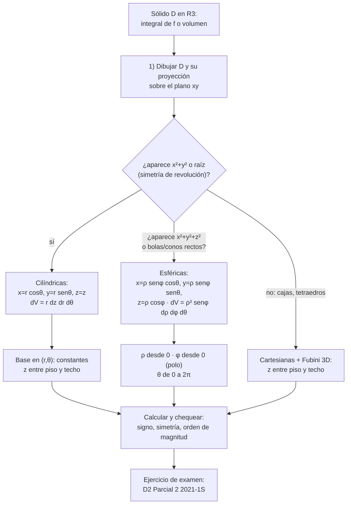
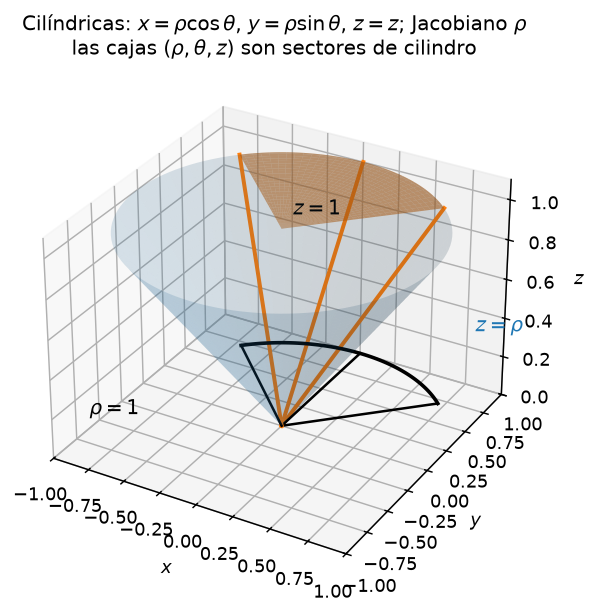
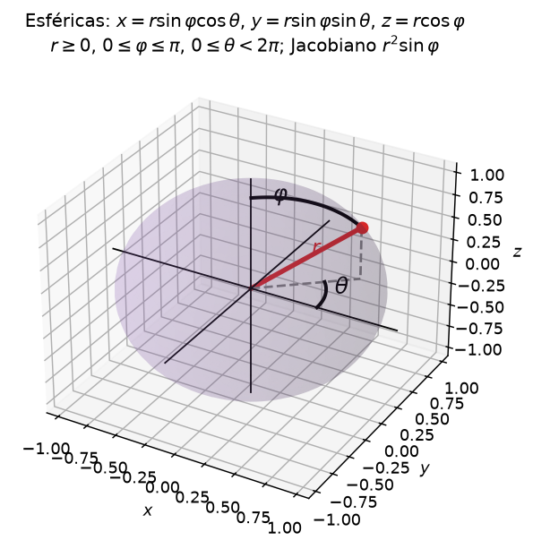

# Clase 47 — Integrales triples; coordenadas cilíndricas y esféricas

> **Bloque 10 · Integrales múltiples · Dificultad: media-alta · Tiempo estimado: 130 min**

Subimos de $\mathbb{R}^2$ a $\mathbb{R}^3$: definimos la **integral triple**, enunciamos el **Teorema de Fubini en tres variables** (cómo "recorrer" un sólido por capas, de adentro hacia afuera) y estudiamos los dos cambios de variable estrella del capítulo 8 de las notas: **coordenadas cilíndricas** (polares en el piso + altura $z$) y **coordenadas esféricas** (radio + dos ángulos). Cerramos con el **ejercicio D2 del Parcial 2 2021-1S** (16 puntos de examen real): enunciar el teorema de cambio de variable para triples, describir la región en las dos representaciones y calcular $\iiint_D yz$.

---

## 🎯 Objetivos

1. Definir la **integral triple** y calcular volúmenes de sólidos como $\iiint_D 1\,dV$.
2. Aplicar **Fubini en 3D**: describir un sólido entre su "piso" y su "techo" y plantear las seis iteraciones posibles.
3. Cambiar a **coordenadas cilíndricas** ($x=r\cos\theta$, $y=r\sin\theta$, $z=z$) usando $dV = r\,dz\,dr\,d\theta$.
4. Cambiar a **coordenadas esféricas** ($x=\rho\sin\varphi\cos\theta$, $y=\rho\sin\varphi\sin\theta$, $z=\rho\cos\varphi$) usando $dV = \rho^2\sin\varphi\,d\rho\,d\varphi\,d\theta$.
5. Elegir bien el sistema de coordenadas según la geometría del sólido, y detectar cuándo una **simetría** deja la integral en $0$.
6. Resolver paso a paso el **D2 del Parcial 2 2021-1S** (cilíndricas sobre una cuña de cono).

---

## 🗺️ Mapa de la clase

---

## 🧱 Repaso / ideas previas

- **Fubini en $\mathbb{R}^2$ (clase 45; notas, Teoremas 8.1 y 8.4):** una integral doble de función continua se calcula con **cualquiera de las dos iteradas**, y los límites de la variable de **afuera** son constantes. La Versión II dice cómo recorrer una región tipo I (rebanadas verticales) o tipo II (horizontales).
- **Cambio de variable (clase 46):** $\iint_D f\,dA = \iint_{g^{-1}(D)} f(g(u,v))\,|\det J_g|\,du\,dv$. En polares $|\det J_g| = r$: **sin ese factor medís "cajas nuevas", no áreas**.
- **Jacobiano (clase 39) y Teorema de la Función Inversa (clase 44):** $|\det J_g|$ es el **factor de escala** local del cambio; $g$ es un difeomorfismo fuera de un conjunto de medida cero (el eje $z$, el origen), lo cual no molesta.
- **Notas, capítulo 8:** $\S\,8.1$ (integrales triples y cambios de variable), Ejemplo 8.18 (cono en cilíndricas), Ejemplo 8.20 (esfera sólida en esféricas).

---

## 📘 Teoría

### 1. Integral triple y Fubini en 3D

> **Definición 47.1 (notas, cap. 8).** Sea $f$ acotada en un sólido $D\subseteq\mathbb{R}^3$. Se particiona $D$ en **cubos** de lado $\delta$, se forman las sumas inferiores y superiores con volúmenes $|R_{ijk}|$, y si el límite de las sumas de Riemann existe y no depende de la partición,
> $$\iiint_D f(x,y,z)\,dV=\lim_{\delta\to0}\ \sum_{i,j,k} f(\xi_{ijk},\eta_{ijk},\zeta_{ijk})\,|R_{ijk}|,$$
> se dice que $f$ es **integrable** en $D$ y a ese límite se lo llama integral triple de $f$ sobre $D$.

**Interpretación.** Si $f\geq0$, la integral triple es el **volumen** del sólido bajo el gráfico; si $f\equiv1$,
$$\iiint_D 1\,dV=\operatorname{Vol}(D).$$

> **Teorema 47.2 (Fubini en 3D — extensión directa del Teorema 8.1).** Si $f$ es **continua** en la caja $B=[a,b]\times[c,d]\times[e,g]$, entonces es integrable y vale cualquiera de las seis iteraciones, por ejemplo
> $$\iiint_B f\,dV=\int_a^b\!\!\int_c^d\!\!\int_e^g f(x,y,z)\,dz\,dy\,dx.$$

Para un sólido $D$ situado **entre dos superficies** $z=u(x,y)$ (piso) y $z=v(x,y)$ (techo) cuya proyección sobre el plano $xy$ es la región $B$, la fórmula práctica es

$$\iiint_D f\,dV=\iint_B\left(\int_{u(x,y)}^{v(x,y)} f(x,y,z)\,dz\right)dA.$$

**Protocolo (igual que en la clase 45, pero en tres dimensiones):**

1. **Dibujar** $D$ y su **proyección** $B$ sobre el plano de trabajo ($xy$, $xz$ o $yz$).
2. Recorrer $B$ como una integral doble (tipo I o tipo II) y, para cada punto de $B$, levantar $z$ **desde el piso hasta el techo**.
3. De **afuera hacia adentro**: los límites de la variable exterior son **constantes**; los interiores pueden depender de las anteriores.
4. Si el sólido se describe mejor "desde el eje $x$" o "desde el eje $y$", **permutar** el orden: Fubini garantiza el mismo valor.

> **Ejemplo (notas, Ejemplo 8.17).** El tetraedro $x,y,z\geq0$, $x+y+z\leq1$ tiene volumen
> $$\int_0^1\!\!\int_0^{1-x}\!\!\int_0^{1-x-y} dz\,dy\,dx=\int_0^1\!\!\int_0^{1-x}(1-x-y)\,dy\,dx=\int_0^1\frac{(1-x)^2}{2}dx=\frac16.$$
> Seis ordenamientos distintos (elegir $dx$, $dy$ o $dz$ afuera) dan siempre $1/6$: es la mejor comprobación de que los límites están bien puestos.

### 2. Coordenadas cilíndricas

La idea es la más simple posible: **hacer polares en el piso $z=0$ y conservar la altura**.

$$x=r\cos\theta,\qquad y=r\sin\theta,\qquad z=z,\qquad r\in[0,\infty),\ \theta\in[0,2\pi),\ z\in\mathbb{R}.$$

Como función de cambio, $g(r,\theta,z)=(r\cos\theta,\,r\sin\theta,\,z)$ y

$$J_g(r,\theta,z)=\begin{pmatrix}\cos\theta & -r\sin\theta & 0\\ \sin\theta & r\cos\theta & 0\\ 0&0&1\end{pmatrix},\qquad \det J_g=r(\cos^2\theta+\sin^2\theta)=r.$$

$$\boxed{\ dV=|\det J_g|\,dr\,d\theta\,dz = r\,dr\,d\theta\,dz\quad\text{(en el orden más usado: } dV = r\,dz\,dr\,d\theta).\ }$$

**Geometría.** Una "caja" $(r,\theta,z)$ (radio entre $r_1$ y $r_2$, ángulo entre $\theta_1$ y $\theta_2$, altura entre $z_1$ y $z_2$) es un **sector de cilindro sólido**: por eso las notas dicen que el cambio manda prismas a cilindros.

**Cuándo usarlas:** sólidos de **revolución alrededor del eje $z$**, regiones donde aparece $x^2+y^2$ o $\sqrt{x^2+y^2}$ (cilindros, conos, paraboloides), integrandos con $x^2+y^2$ o con $z$ "separable".

| Sólido típico | Recorrido en cilíndricas |
|---|---|
| Cilindro de radio $a$, altura $z\in[z_1,z_2]$ | $0\le r\le a$, $0\le\theta\le2\pi$, $z_1\le z\le z_2$ |
| Entre cono $z=\sqrt{x^2+y^2}$ y plano $z=1$ | $0\le r\le1$, $0\le\theta\le2\pi$, $r\le z\le1$ |
| Entre paraboloides $z=x^2+y^2$ y $z=4-x^2-y^2$ | $0\le r\le2$, $0\le\theta\le2\pi$, $r^2\le z\le4-r^2$ |

### 3. Coordenadas esféricas

Acá no hay "piso": se le piden al punto su **distancia al origen** y **dos ángulos** para la dirección.

$$x=\rho\sin\varphi\cos\theta,\qquad y=\rho\sin\varphi\sin\theta,\qquad z=\rho\cos\varphi,$$

$$\rho\in[0,\infty),\qquad \varphi\in[0,\pi],\qquad \theta\in[0,2\pi).$$

- $\rho=\sqrt{x^2+y^2+z^2}$ (radio);
- $\varphi$ = ángulo que forma el vector posición con el **eje $z$ positivo** (colatitud): $\varphi=0$ es el polo norte, $\varphi=\pi/2$ el plano $xy$, $\varphi=\pi$ el polo sur;
- $\theta$ = ángulo de la **proyección** sobre el plano $xy$ con el eje $x$ (el mismo $\theta$ de polares y de las cilíndricas).

Después de calcular la matriz Jacobiana (Ejercicio 8.19 de las notas):

$$\boxed{\ dV=|\det J_g|\,d\rho\,d\varphi\,d\theta=\rho^2\sin\varphi\,d\rho\,d\varphi\,d\theta\ }$$

Como $\varphi\in[0,\pi]$ se tiene $\sin\varphi\geq0$: **el valor absoluto es trivial**, no hay que poner $|\sin\varphi|$.

**Cuándo usarlas:** bolas y casquetes ($x^2+y^2+z^2\le a^2$), conos rectos ($z=c\sqrt{x^2+y^2}$), integrandos con $\rho^2$ o $z=\rho\cos\varphi$.

| Sólido típico | Recorrido en esféricas |
|---|---|
| Bola de radio $a$ | $0\le\rho\le a$, $0\le\varphi\le\pi$, $0\le\theta\le2\pi$ |
| Media bola superior | $0\le\rho\le a$, $0\le\varphi\le\pi/2$, $0\le\theta\le2\pi$ |
| Interior del cono $z=\sqrt{x^2+y^2}$ (copa superior) | $\tan\varphi=1$ $\Rightarrow$ $0\le\varphi\le\pi/4$ |
| Primer octante de la bola | $0\le\rho\le a$, $0\le\varphi\le\pi/2$, $0\le\theta\le\pi/2$ |

> ⚠️ **Notación (muy importante para el examen).** Las **notas del curso** escriben $x=\rho\cos\theta$, $y=\rho\sin\theta$ en cilíndricas y $x=r\sin\varphi\cos\theta$… en esféricas; el **Parcial 2 2021-1S** usa la terna $(\rho,\theta,z)$ para cilíndricas. En esta clase usamos $r$ para el radio **cilíndrico** y $\rho$ para el radio **esférico** (convención de los libros de física). **La geometría es idéntica: sólo cambia la letra.** Leé siempre qué notación usa el enunciado y usá la de él. (En Uruguay se escribe *sen*; en el LaTeX de este curso usamos `\sin`, que es lo mismo.)

### 4. ¿Cuál elijo? (chequeo de 10 segundos)

| Dato del sólido | Coordenadas | Jacobiano |
|---|---|---|
| $x^2+y^2$, raíces, revolución alrededor de $z$ | cilíndricas | $r$ |
| $x^2+y^2+z^2$, bolas, conos rectos | esféricas | $\rho^2\sin\varphi$ |
| caja, tetraedro, planos | cartesianas | $1$ |

Antes de integrar: **¿el integrando se anula por simetría?** Si $D$ es simétrico respecto del plano $z=0$ e $f$ es **impar** en $z$ (por ejemplo $f=z$), entonces $\iiint_D f=0$ sin calcular nada.

---

## 🖼️ Figuras

**Cómo leer la figura:** el sólido es el interior del cono $\sqrt{x^2+y^2}\le z\le1$ (notas, Ejemplo 8.18). La **rebanada naranja** es la "caja" de cilíndricas recortada en la cuña $\pi/4\le\theta\le3\pi/4$: para cada $(r,\theta)$ la altura $z$ corre **desde el cono $z=r$ hasta el plano $z=1$**, y el borde exterior es el cilindro $r=1$. Eso es exactamente lo que traduce la fórmula $dV = r\,dz\,dr\,d\theta$: primero la columna vertical ($dz$), después el sector en el piso ($r\,dr\,d\theta$). (Como las notas, la figura escribe $\rho$ donde esta clase escribe $r$.)

**Cómo leer la figura:** el punto rojo está a distancia $r$ (en esta clase: $\rho$) del origen; $\varphi$ es el ángulo que baja **desde el eje $z$** hasta el vector, y $\theta$ es el ángulo de su proyección en el piso con el eje $x$. $\varphi$ vive entre $0$ y $\pi$ (por eso la bola se recorre una sola vez) y $\theta$ entre $0$ y $2\pi$. El jacobiano $\rho^2\sin\varphi$ es chico cerca de los polos ($\sin\varphi\approx0$): las "cajas" esféricas se aplastan ahí, y eso se paga con el factor.

---

## ✏️ Ejercicios resueltos

### Ejercicio 1. Volumen del cono entre $z=\sqrt{x^2+y^2}$ y $z=1$ (notas, Ejemplo 8.18)

**Paso 1 — dibujar.** Cono de vértice en el origen y eje $z$, cortado arriba por el plano $z=1$: un cono de altura $1$ y radio de base $1$.

**Paso 2 — elegir coordenadas.** Aparece $\sqrt{x^2+y^2}$ y hay simetría de revolución → **cilíndricas**.

**Paso 3 — límites.** Piso $z=0$… cuidado: el sólido va **desde el cono hacia arriba**, o sea $r\le z\le1$. La proyección sobre el piso es el disco $0\le r\le1$:

$$0\le\theta\le2\pi,\qquad 0\le r\le1,\qquad r\le z\le1.$$

**Paso 4 — integrar.**
$$\operatorname{Vol}(D)=\int_0^{2\pi}\!\!\int_0^1\!\!\int_r^1 r\,dz\,dr\,d\theta=\int_0^{2\pi}\!\!\int_0^1 r(1-r)\,dr\,d\theta=2\pi\left[\frac{r^2}{2}-\frac{r^3}{3}\right]_0^1=2\pi\cdot\frac16=\frac{\pi}{3}.$$

**Chequeo geométrico.** Volumen del cono $=\tfrac13\pi R^2H=\tfrac13\pi\cdot1\cdot1=\tfrac\pi3$. ✔

> 💡 Fijate dónde apareció el jacobiano: el $r$ **fuera** de la integral en $z$ (la constante sale afuera). Si lo olvidás, la integral da $2\pi\int_0^1(1-r)dr=\pi$: mal, y ni siquiera coincide con la fórmula del cono.

### Ejercicio 2. Integral triple en esféricas: $\iiint_B z^2\,dV$ con $B$ la bola de radio $1$

**Paso 1 — coordenadas.** La bola $x^2+y^2+z^2\le1$ y el integrando $z^2=(\rho\cos\varphi)^2$ → **esféricas**.

**Paso 2 — límites.** Radio de $0$ a $1$, todos los ángulos:
$$0\le\rho\le1,\qquad 0\le\varphi\le\pi,\qquad 0\le\theta\le2\pi.$$

**Paso 3 — armar.** $z^2=\rho^2\cos^2\varphi$ y $dV=\rho^2\sin\varphi\,d\rho\,d\varphi\,d\theta$, así que el integrando completo es $\rho^4\cos^2\varphi\sin\varphi$.

**Paso 4 — separar** (los tres límites son constantes):
$$\iiint_B z^2\,dV=\left(\int_0^1\rho^4\,d\rho\right)\left(\int_0^\pi\cos^2\varphi\sin\varphi\,d\varphi\right)\left(\int_0^{2\pi}d\theta\right)=\frac15\cdot\frac23\cdot2\pi=\frac{4\pi}{15}.$$
(Para el medio: $u=\cos\varphi$, $du=-\sin\varphi\,d\varphi$ $\Rightarrow$ $\int_0^\pi\cos^2\varphi\sin\varphi\,d\varphi=\int_{-1}^{1}u^2\,du=\tfrac23$.)

**Chequeo por simetría.** Por simetría de la bola, $\iiint x^2=\iiint y^2=\iiint z^2$; y
$$\iiint_B (x^2+y^2+z^2)\,dV=\int_0^{2\pi}\!\!d\theta\int_0^\pi\!\sin\varphi\,d\varphi\int_0^1\!\rho^4\,d\rho=2\pi\cdot2\cdot\frac15=\frac{4\pi}{5}.$$
Dividiendo entre $3$: $\frac{4\pi}{15}$. ✔

> 💡 De paso: $\iiint_B z\,dV=0$, porque $z$ es **impar** respecto del plano $z=0$ y la bola es simétrica. Ese "$0$ en un renglón" ahorra minutos en el examen.

### Ejercicio 3. Cilíndricas con integrando: $\iiint_D (x^2+y^2)\,dV$, $D=\{0\le z\le4-x^2-y^2\}$

**Paso 1 — dibujar.** Paraboloide techo $z=4-x^2-y^2$ (invertido, con vértice en $(0,0,4)$) y piso $z=0$: un "domo".

**Paso 2 — límites.** En cilíndricas el techo es $z=4-r^2$; el domo se corta con $z=0$ en $r=2$:
$$0\le\theta\le2\pi,\qquad 0\le r\le2,\qquad 0\le z\le4-r^2.$$

**Paso 3 — integrar.** $x^2+y^2=r^2$ y $dV = r\,dz\,dr\,d\theta$:
$$\iiint_D (x^2+y^2)\,dV=\int_0^{2\pi}\!\!\int_0^2\!\!\int_0^{4-r^2} r^2\cdot r\,dz\,dr\,d\theta=2\pi\int_0^2 r^3(4-r^2)\,dr.$$

**Paso 4 — cuenta.** $\displaystyle\int_0^2 (4r^3-r^5)\,dr=\left[r^4-\frac{r^6}{6}\right]_0^2=16-\frac{64}{6}=\frac{16}{3}$, y entonces
$$\iiint_D (x^2+y^2)\,dV=2\pi\cdot\frac{16}{3}=\frac{32\pi}{3}.$$

**Chequeo por cotas.** El volumen del domo es $\int_0^{2\pi}\!\int_0^2 r(4-r^2)\,dr\,d\theta=2\pi\bigl[2r^2-\tfrac{r^4}{4}\bigr]_0^2=8\pi$; como $0\le x^2+y^2\le4$ en $D$, la integral debe estar entre $0$ y $4\cdot8\pi=32\pi$. $\tfrac{32\pi}{3}\approx33{,}5$ cumple. ✔

---

## 🏛️ Ejercicios de parcial/examen

### Ejercicio 4 (Parcial 2 2021-1S, ejercicio D2). Cilíndricas sobre una cuña del cono [16 puntos]

> **(a)** Enuncie el Teorema de Cambio de Variable para integrales triples. *[3 pts]*
> **(b)** Sea $D = \{(x,y,z)\in\mathbb{R}^3 : y \geq |x|,\ 0\leq z\leq \sqrt{x^2+y^2}\leq 1\}$, y $g$ el cambio de variable a coordenadas cilíndricas que asocia a la terna $(\rho,\theta,z)$ la terna $(x,y,z)$. Realice un bosquejo aproximado de $D$ y de $g^{-1}(D)$. *[6 pts]*
> **(c)** Sea $f(x,y,z)=yz$. Calcule $\iiint_D f$. *[9 pts]*

**Paso 1 — ítem (a), el teorema.** Sean $g:U\subseteq\mathbb{R}^3\to\mathbb{R}^3$ de clase $C^1$, biyectiva, con $\det J_g\neq0$, y $D=g(U)$; si $f$ es continua en $D$, entonces

$$\iiint_D f(x,y,z)\,dx\,dy\,dz=\iiint_{g^{-1}(D)} f\bigl(g(\rho,\theta,z)\bigr)\,\bigl|\det J_g(\rho,\theta,z)\bigr|\,d\rho\,d\theta\,dz.$$

Es decir: **(1)** componer la función con el cambio, **(2)** cambiar el dominio por $g^{-1}(D)$, **(3)** multiplicar por el **jacobiano**.

**Paso 2 — ítem (b), traducir las condiciones a cilíndricas.** El enunciado usa $(\rho,\theta,z)$ con $x=\rho\cos\theta$, $y=\rho\sin\theta$ (la $r$ de esta clase, escrita $\rho$).

- $\sqrt{x^2+y^2}=\rho$, entonces $\sqrt{x^2+y^2}\le1\Rightarrow 0\le\rho\le1$;
- $0\le z\le\sqrt{x^2+y^2}\Rightarrow 0\le z\le\rho$;
- $y\ge|x|\Rightarrow \rho\sin\theta\ge\rho|\cos\theta|\Rightarrow \sin\theta\ge|\cos\theta|$ (para $\rho>0$) $\Rightarrow \dfrac{\pi}{4}\le\theta\le\dfrac{3\pi}{4}$.

$$\boxed{\ g^{-1}(D)=\{(\rho,\theta,z):\ 0\le\rho\le1,\ \tfrac{\pi}{4}\le\theta\le\tfrac{3\pi}{4},\ 0\le z\le\rho\}\ }$$

**Paso 3 — las dos representaciones de $g^{-1}(D)$.** También se puede "dar vuelta" el par $(\rho,z)$:

$$g^{-1}(D)=\Bigl\{(\rho,\theta,z):\ \tfrac{\pi}{4}\le\theta\le\tfrac{3\pi}{4},\ 0\le z\le1,\ z\le\rho\le1\Bigr\}.$$

**Paso 4 — bosquejos (en el examen, dos dibujos).**

- $D$ (en el espacio): vive en la **cuña** entre los planos $y=x$ e $y=-x$ (donde $y\ge|x|$), **adentro** del cilindro de radio $1$, **entre** el plano $z=0$ y la superficie del cono $z=\sqrt{x^2+y^2}$. Sus fronteras son: un trozo de cono, los planos $z=0$, $y=x$, $y=-x$ y un trozo de cilindro. Es un compacto "adentro de un cilindro sólido".
- $g^{-1}(D)$ (en el espacio de parámetros): la **mitad de un prisma** de caras paralelas a los planos coordenados: un rectángulo $\theta\in[\pi/4,3\pi/4]\times z\in[0,1]$ "levantado" en $\rho\in[z,1]$. El cambio manda ese prisma a la cuña cilíndrica: es lo que esperamos de las cilíndricas. (Mirá la figura de cilíndricas de esta clase: la rebanada en $\pi/4\le\theta\le3\pi/4$ es la misma cuña, con el cono y el cilindro como frontera.)

**Paso 5 — ítem (c), la integral.** $f(g(\rho,\theta,z))=\rho\sin\theta\cdot z$ y $|\det J_g|=\rho$, así que el integrando completo es $\rho^2 z\sin\theta$:

$$\iiint_D yz\,dV=\int_0^1\!\!\int_{\pi/4}^{3\pi/4}\!\!\int_0^\rho \rho^2 z\sin\theta\,dz\,d\theta\,d\rho.$$

- Integrar en $z$: $\displaystyle\int_0^\rho z\,dz=\frac{\rho^2}{2}$, y queda $\displaystyle\int_0^1\!\!\int_{\pi/4}^{3\pi/4}\frac{\rho^4}{2}\sin\theta\,d\theta\,d\rho$.
- Integrar en $\theta$: $\displaystyle\int_{\pi/4}^{3\pi/4}\sin\theta\,d\theta=-\cos\theta\,\Big|_{\pi/4}^{3\pi/4}=\frac{\sqrt2}{2}+\frac{\sqrt2}{2}=\sqrt2$.
- Integrar en $\rho$: $\displaystyle\int_0^1\frac{\rho^4}{2}\,d\rho=\frac{1}{10}$.

$$\boxed{\ \iiint_D yz\,dV=\sqrt2\cdot\frac{1}{10}=\frac{\sqrt2}{10}\approx0{,}1414\ }$$

**Paso 6 — chequeo con la otra representación.** Usando $\pi/4\le\theta\le3\pi/4$, $0\le z\le1$, $z\le\rho\le1$:

$$\iiint_D yz\,dV=\left(\int_{\pi/4}^{3\pi/4}\sin\theta\,d\theta\right)\int_0^1 z\left(\int_z^1\rho^2\,d\rho\right)dz=\sqrt2\int_0^1\frac{z(1-z^3)}{3}\,dz=\frac{\sqrt2}{3}\left(\frac12-\frac15\right)=\frac{\sqrt2}{10}.$$

Los dos caminos dan lo mismo. ✔ *(verificado contra la solución oficial del parcial: $\frac{\sqrt2}{10}$.)*

**Chequeo de signo.** En $D$ se tiene $y\ge|x|\ge0$ y $z\ge0$, así que $yz\ge0$: el resultado **tiene que** ser positivo. ✔ (Si te da negativo, revisá $\theta$ o el jacobiano.)

> 💡 **Lo que se lleva este ejercicio:** (1) el teorema de cambio de variable se enuncia **igual** al de $\mathbb{R}^2$, sólo cambia la dimensión; (2) la clave del planteo son **tres** condiciones en $(\rho,\theta,z)$: radio, ángulo y altura; (3) el jacobiano $\rho$ (la $r$ del curso) **multiplica** al integrando: $\rho\sin\theta\cdot z\cdot\rho=\rho^2 z\sin\theta$.

---

## ⚠️ Errores comunes

| Error | Corrección |
|---|---|
| Cambiar a cilíndricas/esféricas y **olvidar el jacobiano** | Sin $r$ (o sin $\rho^2\sin\varphi$) medís volúmenes de "cajas nuevas": **siempre** $f(g(\cdot))\cdot|\det J_g|$ |
| Confundir $\varphi$ con $\theta$ | En el curso $\varphi$ es la que **baja desde el eje $z$** y $\theta$ la del piso; $\theta$ coincide con la de polares |
| Poner $\varphi\in[0,2\pi)$ | Doblaríamos cada punto: basta $\varphi\in[0,\pi]$ (por eso $\sin\varphi\ge0$ y no hace falta valor absoluto) |
| Cono $z=\sqrt{x^2+y^2}$ en esféricas $\Rightarrow \varphi=\pi/4$... y escribir $3\pi/4$ | $z=+\sqrt{x^2+y^2}$ es $\varphi=\pi/4$ (copa **superior**); $\varphi=3\pi/4$ es el cono **invertido** |
| Los límites de $\rho$ o $z$ "salen del aire" | **Dibujar** y ver desde qué superficie hasta cuál se recorre; si el cono corta el techo, los límites **dependen** de los ángulos |
| Cambiar el orden de las iteradas y **no cambiar los límites** | Los límites y el orden van juntos: el orden se cambia sólo si la región se reescribe bien |
| Asumir que Fubini vale "para cualquier función" | Necesita **continuidad** (o integrabilidad) en el dominio; en impropias hace falta **convergencia absoluta** (clase 48) |
| No mirar la **simetría** antes de integrar | Si $D$ es simétrico e $f$ es impar en $z$ (p. ej. $f=z$, $f=xyz$): la integral es $0$ y ni hay que calcular |
| Llevarse la notación de las notas al parcial | Notas: $\rho$ (cilíndricas) y $r$ (esféricas); Parcial 2 2021-1S: $(\rho,\theta,z)$; esta clase: $r$ y $\rho$. **Usá la del enunciado** |

---

## 🔗 Conexiones

- **Clase 45 (Fubini):** el Teorema 47.2 es la misma idea en $\mathbb{R}^3$: recorrer el dominio por capas, límites constantes afuera, y las seis iteraciones dan lo mismo.
- **Clase 46 (cambio de variable y polares):** las cilíndricas **son** polares en el piso más la $z$: por eso el jacobiano es exactamente el mismo $r$. El esquema (dibujar $g^{-1}(D)$, componer, multiplicar por $|\det J_g|$) no cambia.
- **Clases 39 y 44 (Jacobiana y TFInv):** el cambio a coordenadas es un difeomorfismo fuera del eje $z$ (cilíndricas) o del origen y del eje polar (esféricas); esos conjuntos tienen **medida cero** y no afectan la integral.
- **Clase 48 (impropias múltiples y simulacro):** cuando la bola es de radio infinito, la integral triple se define como **límite** de bolas crecientes (agotamiento) y hay que pedir convergencia; el simulacro del curso cierra con exámenes 2018–2022.
- **Notas, cap. 8 ($\S\,8.1$):** Ejemplos 8.17–8.20 (tetraedro, cono, cilíndricas, esfera sólida). **Aplicaciones:** volúmenes, masas y centros de masa, momentos de inercia, y cualquier problema con simetría axial o esférica (gravitación, electrostática, distribuciones de temperatura).

---

## ✅ Autoevaluación

1. Escribir el cambio a coordenadas cilíndricas, su jacobiano y el elemento de volumen $dV$.
2. Calcular el volumen del sólido $\sqrt{x^2+y^2}\le z\le2$ (cono cortado por $z=2$) usando cilíndricas.
3. ¿Cuáles son los rangos de $(\rho,\varphi,\theta)$ en esféricas? ¿Por qué $\varphi$ llega hasta $\pi$ y no hasta $2\pi$?
4. Calcular $\iiint_B 1\,dV$ con $B$ la bola de radio $1$, usando esféricas (¿da la fórmula conocida?).
5. Describir en **esféricas** el cono $z=3\sqrt{x^2+y^2}$ (copa superior): ¿qué valor tiene $\varphi$?
6. Describir en **cilíndricas** la región $D=\{(x,y,z): 1\le x^2+y^2\le4,\ 0\le z\le5\}$.
7. (V/F) En esféricas, $\rho^2\sin\varphi$ puede ser negativo, así que conviene poner valor absoluto.
8. ¿Qué conviene usar para $x^2+y^2+z^2\le a^2$ con $z\ge0$: cilíndricas o esféricas? Justificar en un renglón.

### Respuestas

1. $x=r\cos\theta$, $y=r\sin\theta$, $z=z$; $\det J_g=r$, luego $dV = r\,dz\,dr\,d\theta$ (cualquier orden, con los límites correspondientes).
2. $0\le\theta\le2\pi$, $0\le r\le2$, $r\le z\le2$: $\int_0^{2\pi}\!\int_0^2 r(2-r)\,dr\,d\theta=2\pi\bigl[r^2-\tfrac{r^3}{3}\bigr]_0^2=2\pi\cdot\tfrac43=\dfrac{8\pi}{3}$ (igual que $\tfrac13\pi R^2H=\tfrac13\pi\cdot4\cdot2$). ✔
3. $\rho\in[0,\infty)$, $\varphi\in[0,\pi]$, $\theta\in[0,2\pi)$. $\varphi\in[0,\pi]$ ya recorre **todas** las direcciones desde el polo norte hasta el sur sin repetir puntos; si pasara de $\pi$ cada punto se escribiría dos veces.
4. $\int_0^{2\pi}\!\int_0^\pi\!\int_0^1 \rho^2\sin\varphi\,d\rho\,d\varphi\,d\theta=2\pi\cdot2\cdot\tfrac13=\dfrac{4\pi}{3}$. ✔ (La fórmula del volumen de la bola.)
5. $\rho\cos\varphi=3\rho\sin\varphi\Rightarrow\tan\varphi=\tfrac13\Rightarrow\varphi=\arctan(1/3)\approx18{,}4^\circ$.
6. $1\le r\le2$, $0\le\theta\le2\pi$, $0\le z\le5$ (un anillo de cilindros: en esféricas se puede, pero los límites de $\rho$ dependen de $\varphi$ y se vuelve muy engorroso).
7. **FALSO:** con $\varphi\in[0,\pi]$ se cumple $\sin\varphi\ge0$, así que $\rho^2\sin\varphi\ge0$ siempre; el valor absoluto es redundante (sólo haría falta si uno se saliera del rango).
8. **Esféricas:** la bola es $\rho\le a$ con ángulos constantes; en cilíndricas el techo $z=\sqrt{a^2-r^2}$ obliga a una raíz en los límites.

---

> ⬅️ [Clase anterior](46_cambio_variable_polares.md) · 🏠 [Índice](00_indice.md) · [Clase siguiente](48_impropias_multiples_simulacro.md) ➡️
