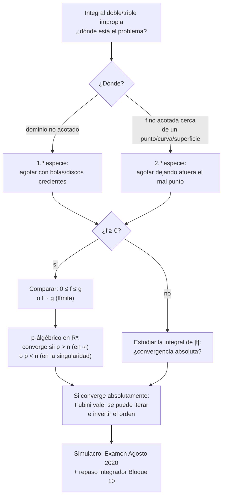
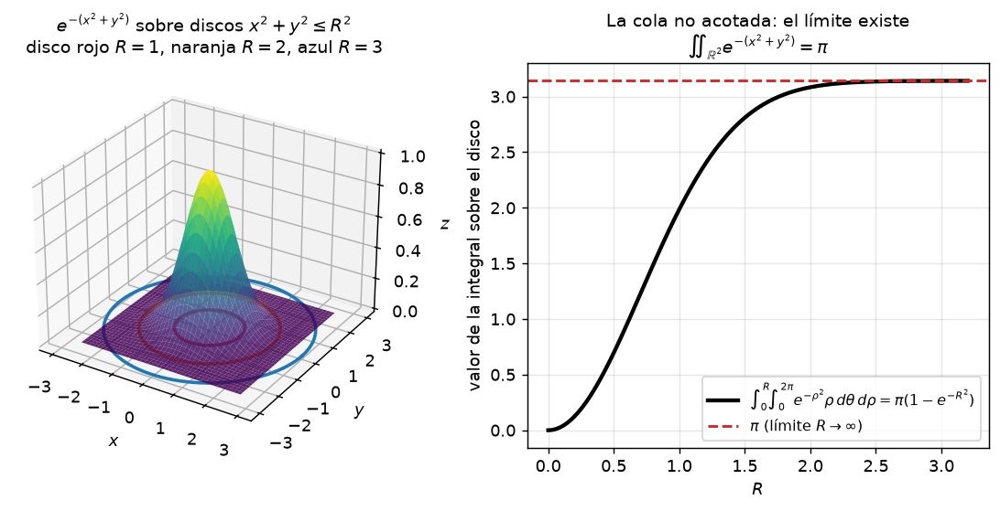
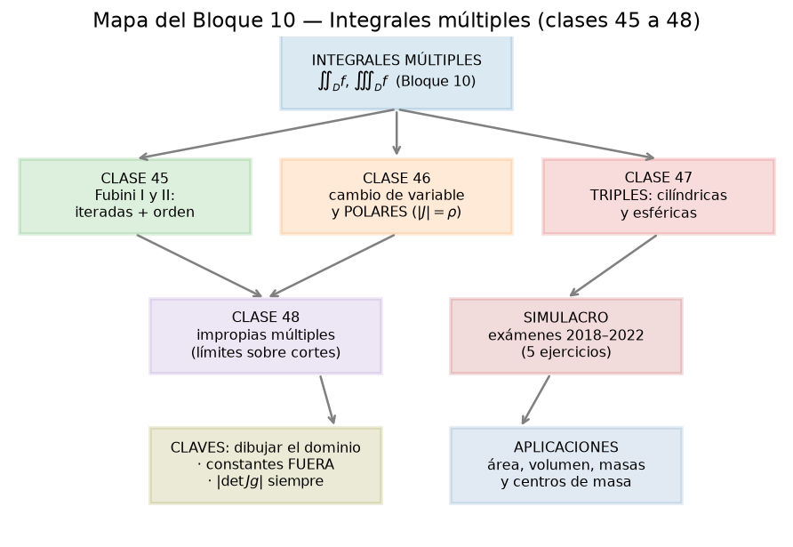

# Clase 48 — Integrales impropias múltiples y simulacro de examen final

> **Bloque 10 · Integrales múltiples · Dificultad: alta · Tiempo estimado: 160 min**

**Última clase del curso.** Cerramos en dos tiempos. **(1)** Extienden a $\mathbb{R}^2$ y $\mathbb{R}^3$ las **integrales impropias** que ya manejamos en una variable (clases 26–29): definición por **agotamiento**, criterios de **comparación** y el $p$-álgébrico con su exponente crítico **dimensional**, más la advertencia clásica: para iterar sin miedo hace falta **convergencia absoluta** (Fubini "falla" si no). **(2)** **Simulacro de examen final** con el **Examen de Agosto de 2020** (IMERL, 100 puntos, seis ejercicios) resuelto paso a paso, con foco en la integral impropia (ej. 3) y en la **integral triple** del ej. 6, y con un **repaso integrador del Bloque 10** para el día D.

---

## 🎯 Objetivos

1. Definir la **integral impropia múltiple** por agotamiento (1.ª especie: dominio no acotado; 2.ª especie: función no acotada cerca de una parte chica de la frontera).
2. Aplicar **comparación por desigualdad** y **por límite**, y enunciar el $p$-álgébrico en $\mathbb{R}^n$: $\iiint_{\|x\|\ge1}\|x\|^{-p}$ converge **sii $p>n$**; cerca de la singularidad, **sii $p<n$**.
3. Entender por qué **Fubini exige convergencia absoluta** en impropias y usar el contraejemplo de los iterados distintos.
4. Repasar **integradoramente el Bloque 10** (Fubini, polares, cilíndricas/esféricas, impropias) con un protocolo de examen.
5. Resolver paso a paso un **examen final real (Agosto 2020)** y verificar las respuestas con la solución oficial.

---

## 🗺️ Mapa de la clase

---

## 🧱 Repaso / ideas previas

- **Impropias en una variable (clases 26–29):** 1.ª especie $\int_a^\infty f=\lim_{b\to\infty}\int_a^b f$; 2.ª especie $\int_a^b f$ con singularidad en un extremo; comparación por desigualdad y por límite; $p$-álgébrico ($\alpha>1$ en el infinito, $\alpha<1$ en la singularidad); serie-integral y $\Gamma(s)$.
- **Fubini (clase 45)** y **cambio de variable (clases 46–47):** sirven para **funciones integrables**; la letra chica que vamos a agregar es *integrable respecto a qué*.
- **Notas, cap. 4:** las notas del curso tratan las impropias en **una sola variable**. La extensión a varias variables es análoga: se define con **límites** sobre regiones que crecen (o que se agrandan dejando afuera el punto malo) y los criterios se aplican "por coordenadas" o en coordenadas polares.
- **Idea de agotamiento (clase 32, topología):** $\mathbb{R}^2=\bigcup_R B_R$ con bolas crecientes; cada $B_R$ es un compacto y sobre él la integral es **propia**.

---

## 📘 Teoría

### 1. Definición: agotamiento

> **Definición 48.1 (integral impropia múltiple).** Sea $D\subseteq\mathbb{R}^n$ (no acotado y/o con una frontera "fe") y $f$ continua en $D$. Sean $D_1\subseteq D_2\subseteq\cdots$ subconjuntos **acotados y regulares** con $\bigcup_k D_k=D$ (un **agotamiento** de $D$: discos crecientes, bolas, cajas, o $D$ menos una bolita alrededor del punto singular). Decimos que $f$ es **integrable impropia** en $D$ si existe
> $$\lim_{k\to\infty}\iint_{D_k} f\qquad(\text{resp. } \iiint_{D_k} f)$$
> finito, y a ese límite lo llamamos $\iint_D f$ (resp. $\iiint_D f$).

**Las dos caras (misma palabra, distinto problema):**

| Especie | Problema | Ejemplo |
|---|---|---|
| **1.ª especie** | $D$ **no acotado** | $\iint_{\mathbb{R}^2} e^{-(x^2+y^2)}\,dA$ |
| **2.ª especie** | $f$ **no acotada** cerca de un punto, curva o superficie de $D$ | $\iint_{\|x\|<1} \frac{dA}{\|x\|^p}$ (blow-up en el origen) |
| mixta | las dos cosas a la vez | $\int_0^\infty\!\!\int_0^\infty$ con singularidad en $0$ |

**Signo.** Si $f\geq0$, la familia $\bigl(\iint_{D_k} f\bigr)_k$ es **creciente** (monotonía de la integral doble): el límite existe en $[0,+\infty]$ para **cualquier** agotamiento, y no depende de él. Si $f$ **cambia de signo**, la cosa se pone fina: para que el valor no dependa del agotamiento (y para poder usar Fubini y cambiar el orden) se pide lo siguiente.

> **Definición 48.2 (convergencia absoluta).** $f$ es **absolutamente integrable** en $D$ si $\iint_D |f|<\infty$ (resp. $\iiint_D|f|<\infty$). En ese caso la integral de $f$ existe, no depende del agotamiento y se puede iterar/invertir el orden.

### 2. Criterios de clasificación (el kit del examen)

| Situación | Criterio | Conclusión |
|---|---|---|
| $0\le f\le g$ en $D$ | comparación por desigualdad | si $\iint g<\infty$ $\Rightarrow$ $\iint f<\infty$ |
| $0\le g\le f$ en $D$ | al revés | si $\iint g=\infty$ $\Rightarrow$ $\iint f=\infty$ |
| $f,g>0$ y $f\sim g$ cuando $\|x\|\to\infty$ (o hacia la singularidad) | comparación por límite | mismo comportamiento |
| $\|x\|\ge1$ en $\mathbb{R}^n$ y $f\asymp\|x\|^{-p}$ | $p$-álgébrico en $\mathbb{R}^n$ | converge **sii $p>n$** |
| cerca de la singularidad, $f\asymp\|x\|^{-p}$ | $p$-álgébrico local | converge **sii $p<n$** |
| $0\le f(x,y)=a(x)b(y)$ separable | producto de impropias | converge **sii** convergen **ambas** |

**El exponente crítico es la dimensión.** En coordenadas polares/cilíndricas/esféricas el elemento de volumen aporta potencias: en $\mathbb{R}^2$, $dA=r\,dr\,d\theta$ y $\|x\|^{-p}\,dA\asymp r^{1-p}\,dr$ (converge sii $p>2$); en $\mathbb{R}^3$, $dV\asymp r^2\,dr$ y converge sii $p>3$.

$$\iint_{\mathbb{R}^2}\frac{dA}{(1+x^2+y^2)^{a}}\ \text{converge}\iff 2a>2\iff a>1;\qquad \iint_{\mathbb{R}^2}\frac{dA}{x^2+y^2}=\infty\ \ (p=2,\ \text{no es }>2).$$

> 💡 **Truco rápido en $\mathbb{R}^2$:** "grados" en $x$ y $y$: en $\dfrac{1}{(x^2+y^2)^{a}}$ el denominador es de grado $2a$; hace falta grado $>2$ (la dimensión). En $\mathbb{R}^3$, grado $>3$.

### 3. Fubini para impropias: hace falta convergencia absoluta

> **Teorema 48.3 (Fubini en el caso impropio).** Si $f\geq0$ y **una** de las iteradas existe y es finita, entonces la integral doble existe y **cualquier** iteración da ese valor. Si $f$ cambia de signo, alcanza con exigir $\iint_D|f|<\infty$: entonces valen Fubini, la inversión del orden y el cambio de variable.

**Contraejemplo clásico (por qué no se puede ignorar).** $f(x,y)=\dfrac{x-y}{(x+y)^3}$ en $D=(0,1]^2$.

- Iterada "primero $y$": $\displaystyle\int_0^1\!\!\int_0^1\frac{x-y}{(x+y)^3}\,dy\,dx$. Con $u=x+y$: $\displaystyle\int_0^1\frac{(2x-u)\,du}{u^3}=\Bigl[-\frac{x}{u^2}+\frac1u\Bigr]_{u=x}^{x+1}=\frac{1}{(1+x)^2}$, y $\displaystyle\int_0^1\frac{dx}{(1+x)^2}=1-\frac12=\frac12$.
- Iterada "primero $x$": por la antisimetría $f(y,x)=-f(x,y)$, da $-\dfrac12$.
- **Doble propiamente:** sobre el corte $[\varepsilon,1]^2$ (dominio simétrico) $\iint f=0$ por esa misma antisimetría; el límite $\varepsilon\to0^+$ existe y vale $0$.
- **Absolutamente no converge:** cerca del origen $|f|\asymp\frac{1}{r\,|\cos\theta+\sin\theta|^3}$ y $\iint \frac{r\,dr\,d\theta}{r\,(\cdots)^3}\asymp\int_0\frac{dr}{r}=\infty$.

Conclusión: los dos iterados dan $\pm\frac12$ y el "doble" da $0$: **no hay una integral doble bien definida** y cada iterada es un artefacto. Ése es el precio de no exigir $\iint|f|<\infty$.

### 4. Repaso integrador del Bloque 10 (clases 45–48)

| Clase | Herramienta | Clave del éxito |
|---|---|---|
| 45 | Integral doble, **Fubini I y II**, inversión del orden | Dibujar $D$: piso/techo o rebanadas; **constantes afuera** |
| 46 | **Cambio de variable** y **polares** | Dibujar $g^{-1}(D)$; $x=r\cos\theta$, $y=r\sin\theta$; **$dA = r\,dr\,d\theta$** |
| 47 | **Triples**: cilíndricas y esféricas | $dV=r\,dz\,dr\,d\theta$ o $dV=\rho^2\sin\varphi\,d\rho\,d\varphi\,d\theta$; $\varphi\in[0,\pi]$ |
| 48 | **Impropias múltiples** | Agotamiento + comparación; **convergencia absoluta** para iterar |

**Protocolo de examen (6 pasos, todos los ejercicios de integrales múltiples):**

1. **Dibujar** el dominio (y $g^{-1}(D)$ si hay cambio).
2. **Elegir coordenadas:** ¿aparece $x^2+y^2$? ¿$x^2+y^2+z^2$? ¿revolución? ¿casi caja?
3. **Plantear límites** de afuera hacia adentro (exteriores constantes).
4. **Poner el jacobiano** ($r$, $r^2\sin\varphi$, o el que corresponda) — nunca después, siempre en el mismo paso del cambio.
5. **Chequear antes de integrar:** signo del integrando, simetrías (¿da $0$?), orden de magnitud (en impropias: ¿converge?).
6. **Calcular y verificar** con un caso conocido (volumen de cono/esfera, cotas, la otra representación).

---

## 🖼️ Figuras

**Cómo leer la figura:** a la izquierda, $z=e^{-(x^2+y^2)}$ sobre $\mathbb{R}^2$ con los discos de agotamiento $R=1$ (rojo), $R=2$ (naranja) y $R=3$ (azul) en el piso: cada $\iint_{x^2+y^2\le R^2}$ es una integral **propia**, y la impropia es su **límite** cuando $R\to\infty$. A la derecha, ese valor $\pi(1-e^{-R^2})$ acercándose a su techo $\pi$: la cola infinita aporta cada vez menos y la suma total **existe**. Ése es exactamente el esquema de agotamiento de la Definición 48.1.

**Cómo leer la figura:** todo el Bloque 10 en una sola lámina: Fubini (45), cambio de variable y polares (46), triples con cilíndricas y esféricas (47) e impropias múltiples (48), más el **simulacro con exámenes 2018–2022**. Las "claves" de la lámina son las mismas del protocolo de arriba: dibujar el dominio, constantes afuera, $|\det J_g|$ siempre. Usala como chequeo el día del examen.

---

## ✏️ Ejercicios resueltos

### Ejercicio 1. Un par que se decide en un renglón: $\iint_{\mathbb{R}^2}\frac{dA}{(1+x^2+y^2)^{2}}$ vs. $\iint_{\mathbb{R}^2}\frac{dA}{1+x^2+y^2}$

**Paso 1 — dominio y simetría.** Ambas son 1.ª especie (dominio $\mathbb{R}^2$ no acotado), el integrando es positivo y **radial** → polares: $\iint = \int_0^{2\pi}\!\!\int_0^\infty(\cdots)\,r\,dr\,d\theta$ (¡el $r$ del jacobiano!).

**Paso 2 — la de $a=2$.**
$$\int_0^{2\pi}\!\!\int_0^\infty \frac{r\,dr\,d\theta}{(1+r^2)^2}=2\pi\left[-\frac{1}{2(1+r^2)}\right]_0^\infty=2\pi\left(0+\frac12\right)=\pi.$$

**Paso 3 — la de $a=1$.**
$$\int_0^{2\pi}\!\!\int_0^\infty \frac{r\,dr}{1+r^2}=2\pi\left[\frac{\ln(1+r^2)}{2}\right]_0^\infty=+\infty\quad\Rightarrow\quad\textbf{diverge}.$$

**Clasificación general.** Por el $p$-álgébrico de $\mathbb{R}^2$ ($\asymp r^{-2a}$, hace falta $2a>2$): converge **sii $a>1$**. El primer caso ($a=2$) converge a $\pi$; el segundo ($a=1$) es justamente el caso límite. ✔

> ⚠️ Fijate que **sin el $r$ del jacobiano** el primer integral "daría" $2\pi\int_0^\infty(1+r^2)^{-2}dr=\frac{\pi}{2}$: un número distinto y **falso**. El jacobiano no es cosmética.

### Ejercicio 2. Improperia separable: $\iint_D \frac{dA}{x^{2}y^{2}}$ con $D=[1,\infty)\times[1,\infty)$

**Paso 1 — separar.** $f(x,y)=\frac{1}{x^2}\cdot\frac{1}{y^2}\ge0$ y el dominio es un producto: por Fubini (todo converge o no, y las funciones son positivas) la doble es **producto de dos impropias**.

**Paso 2 — cada factor.** $\displaystyle\int_1^\infty\frac{dx}{x^2}=\Bigl[-\frac1x\Bigr]_1^\infty=1>-\infty$ (converge, $p=2>1$) y lo mismo para $y$.

**Paso 3 — concluir.** Ambas convergen, luego
$$\iint_D\frac{dA}{x^2y^2}=1\cdot1=1.$$

**Clasificación en general.** $\displaystyle\iint_{[1,\infty)^2}\frac{dA}{x^{a}y^{b}}$ converge **sii $a>1$ y $b>1$**, con valor $\dfrac{1}{(a-1)(b-1)}$. ⚠️ Si **un solo** factor diverge ($a\le1$ o $b\le1$), diverge todo: no alcanza con que "uno de los dos converja".

### Ejercicio 3. La gaussiana en $\mathbb{R}^2$: $\iint_{\mathbb{R}^2} e^{-(x^2+y^2)}\,dA=\pi$

**Paso 1 — por qué no se puede en una variable.** $e^{-x^2}$ no tiene primitiva elemental; pero en dos variables la simetría circular lo arregla.

**Paso 2 — polares (con jacobiano).** $x^2+y^2=r^2$:
$$\iint_{\mathbb{R}^2} e^{-(x^2+y^2)}\,dA=\lim_{R\to\infty}\int_0^{2\pi}\!\!\int_0^R e^{-r^2}\,r\,dr\,d\theta .$$

**Paso 3 — la integral radial.** Con $u=r^2$, $du=2r\,dr$: $\displaystyle\int_0^R e^{-r^2}r\,dr=\frac{1-e^{-R^2}}{2}$.

**Paso 4 — límite.** $\displaystyle\lim_{R\to\infty}2\pi\cdot\frac{1-e^{-R^2}}{2}=\pi(1-0)=\boxed{\pi}$.

**Chequeo.** Es el valor de la figura de esta clase ($\pi(1-e^{-R^2})\to\pi$), y en $\mathbb{R}^3$ el mismo cálculo da $\pi^{3/2}$ (la normalizada de la gaussiana es $\frac{1}{\pi}$ en el plano). ✔

---

## 🏛️ Ejercicios de parcial/examen

### 🏁 Simulacro: Examen — Agosto de 2020 (IMERL, 100 puntos, 4 horas)

> Seis ejercicios, sin calculadora ni material de consulta. Resolvé los seis **en el tiempo del examen** (4 horas) y **después** mirá esta resolución. Las respuestas se contrastan con la solución oficial del examen.

#### Simulacro Ejercicio 1 (10 pts.). Raíces quintas

> Los $z\in\mathbb{C}$ que verifican $z^5=1+\sqrt3\,i$ son…

**Paso 1 — módulo y argumento del lado derecho.** $|1+\sqrt3\,i|=\sqrt{1+3}=2$ y $\arg(1+\sqrt3\,i)=\frac{\pi}{3}$ (está en el primer cuadrante, $\tan=\sqrt3$).

**Paso 2 — pasar a polar.** Si $z=\rho e^{i\varphi}$: $\rho^5=2$ y $5\varphi=\frac{\pi}{3}+2k\pi$.

**Paso 3 — raíces.**
$$\rho=2^{1/5},\qquad \varphi=\frac{\pi}{15}+\frac{2k\pi}{5},\quad k=0,1,2,3,4\ \ (\text{5 raíces distintas}).$$

**Respuesta oficial:** $\{z=\rho e^{i\varphi}:\ \rho=2^{1/5},\ \varphi=\frac{\pi}{15}+\frac{2}{5}k\pi,\ k\in\mathbb{Z}\}$. ✔

#### Simulacro Ejercicio 2 (20 pts.). Ecuación diferencial con solución particular conocida

> $y''-y=-\dfrac{\sin(\log x)}{x^2}-\dfrac{\cos(\log x)}{x^2}-\sin(\log x)$, sabiendo que $y_p(x)=e^x+e^{-x}+\sin(\log x)$ es solución.

**Paso 1 — homogénea.** $y''-y=0\Rightarrow$ polinomio característico $\lambda^2-1=0\Rightarrow\lambda=\pm1$:
$$y_H(x)=c_1e^{x}+c_2e^{-x}.$$

**Paso 2 — general = homogénea + particular.** $y=y_H+y_p=(c_1+1)e^x+(c_2+1)e^{-x}+\sin(\log x)$.

**Paso 3 — reescribir.** $c_1+1$ y $c_2+1$ son constantes arbitrarias: $b_1=c_1+1$, $b_2=c_2+1$. **Respuesta oficial:**
$$y(x)=b_1e^{x}+b_2e^{-x}+\sin(\log x),\qquad b_1,b_2\in\mathbb{R}.\ ✔$$

> 💡 No hace falta ni reemplazar la particular en la ecuación: la letra ya la garantiza. El único truco es **no contar dos veces** los $e^{\pm x}$.

#### Simulacro Ejercicio 3 (15 pts.). ⭐ Integral impropia mixta

> Clasificar, justificando: $\displaystyle\int_0^\infty \frac{e^{-\sqrt x}}{\sqrt x}\,dx$.

**Paso 1 — detectar las dos enfermedades.** En $x=0$ el integrando se va a $\infty$ (**2.ª especie**) y en $+\infty$ también hay un tramo infinito (**1.ª especie**): es **mixta** → hay que **partirla** en un punto sano, por ejemplo en $1$:

$$\int_0^\infty \frac{e^{-\sqrt x}}{\sqrt x}\,dx=\underbrace{\int_0^1 \frac{e^{-\sqrt x}}{\sqrt x}\,dx}_{\text{singular en }0}+\underbrace{\int_1^\infty \frac{e^{-\sqrt x}}{\sqrt x}\,dx}_{\text{no acotada arriba}}.$$

**Paso 2 — primitiva.** $u=\sqrt x$, $du=\frac{dx}{2\sqrt x}$:
$$\int \frac{e^{-\sqrt x}}{\sqrt x}\,dx=2\int e^{-u}\,du=-2e^{-\sqrt x}+C.$$

**Paso 3 — los dos tramos.**
$$\int_0^1=\lim_{c\to0^+}\Bigl[-2e^{-\sqrt x}\Bigr]_c^1=2e^{-\sqrt c}-2e^{-1}\xrightarrow[c\to0^+]{}2-\frac2e,$$
$$\int_1^\infty=\lim_{a\to+\infty}\Bigl[-2e^{-\sqrt x}\Bigr]_1^a=0-\bigl(-2e^{-1}\bigr)=\frac2e.$$

**Paso 4 — concluir.** Los dos tramos **convergen**, y como la partición es finita la integral completa converge:
$$\int_0^\infty \frac{e^{-\sqrt x}}{\sqrt x}\,dx=\Bigl(2-\frac2e\Bigr)+\frac2e=\boxed{2}.$$

✔ *(resultado de la solución oficial del examen.)*

> 💡 Si hubieras mirado **sólo** $\infty$ (donde $e^{-\sqrt x}$ mata cualquier cosa) te habías perdido la explosión en $0$: en las mixtas, **partir es lo primero** (protocolo de la clase 29, que sigue vigiendo acá).

#### Simulacro Ejercicio 4 (20 pts.). Derivada direccional y no diferenciabilidad

> $f(x,y)=\dfrac{x^2y}{x^4+y^2}$ si $(x,y)\neq(0,0)$, $f(0,0)=0$.

**(1) Derivadas direccionales en $(0,0)$, con $v=(v_1,v_2)$, $v_2\neq0$:**
$$\frac{\partial f}{\partial v}(0,0)=\lim_{h\to0}\frac{f(hv_1,hv_2)}{h}=\lim_{h\to0}\frac{h^3v_1^2v_2}{h\,(h^4v_1^4+h^2v_2^2)}=\lim_{h\to0}\frac{v_1^2v_2}{h^2v_1^4+v_2^2}=\frac{v_1^2}{v_2}.$$

**(2) ¿Es diferenciable? No: ni siquiera es continua.** Por el camino $y=0$: $f(x,0)=0\to0$. Por el camino $y=x^2$: $f(x,x^2)=\frac{x^4}{x^4+x^4}=\frac12\not\to0$. Como el límite en el origen **no existe** (y $f(0,0)=0$), $f$ no es continua en $(0,0)$ y por lo tanto **no es diferenciable** allí.

✔ *(igual que la solución oficial: derivadas direccionales con $v_1^2/v_2$ y no diferenciabilidad por discontinuidad.)*

#### Simulacro Ejercicio 5 (15 pts.). Límite con Taylor

> Calcular $\displaystyle\lim_{(x,y)\to(0,0)}\frac{xy-\sin x\,\sin y}{x^2+y^2}$.

**Paso 1 — desarrollo de Taylor de $\sin x\,\sin y$ en $(0,0)$** (hasta orden 2; notas, Teorema 6.31): $f(0,0)=0$, $f_x=f_y(0,0)=0$, $f_{xx}=f_{yy}(0,0)=0$ y $f_{xy}(0,0)=\cos0\cos0=1$. Entonces
$$\sin x\,\sin y=xy+r(x,y),\qquad r(x,y)=o\bigl(x^2+y^2\bigr).$$

**Paso 2 — sustituir.**
$$\frac{xy-\sin x\sin y}{x^2+y^2}=\frac{-r(x,y)}{x^2+y^2}\xrightarrow[(x,y)\to(0,0)]{}0,$$

**Respuesta: $0$.** ✔

*(Chequeo rápido: $\sin x\sin y=xy-\frac{xy^3+x^3y}{6}+\cdots$, o sea el numerador es de grado **4** sobre un denominador de grado **2**: $\asymp$ grado 2 $\to0$.)*

#### Simulacro Ejercicio 6 (20 pts.). ⭐ Integración múltiple: volumen del tetraedro

> Demostrar, usando integración múltiple, que el sólido limitado por $\dfrac{x}{a}+\dfrac{y}{b}+\dfrac{z}{c}=1$ y por los planos de coordenadas ($a,b,c>0$) tiene volumen $\dfrac{abc}{6}$.

**Paso 1 — dibujar y ver los cortes.** El plano corta los ejes en $(a,0,0)$, $(0,b,0)$, $(0,0,c)$: es un **tetraedro** en el primer octante. Despejando $z$: techo $z=c\bigl(1-\frac{x}{a}-\frac{y}{b}\bigr)$, piso $z=0$.

**Paso 2 — proyectar sobre el piso.** La base $B$ es el triángulo $x\ge0$, $y\ge0$, $\frac{x}{a}+\frac{y}{b}\le1$: para cada $x\in[0,a]$ va de $y=0$ a $y=b\bigl(1-\frac{x}{a}\bigr)$.

**Paso 3 — plantear (afuera constantes).**
$$\operatorname{Vol}=\int_0^a\!\!\int_0^{b(1-\frac{x}{a})}\!\!\int_0^{c(1-\frac{x}{a}-\frac{y}{b})} dz\,dy\,dx.$$

**Paso 4 — integrar en $z$.** Da el techo: $\int(\cdots)dz=c\bigl(1-\frac{x}{a}-\frac{y}{b}\bigr)$.

**Paso 5 — integrar en $y$.** Con $t=1-\frac{x}{a}$ fijo, $\displaystyle\int_0^{bt}c\Bigl(t-\frac{y}{b}\Bigr)dy=c\Bigl[ty-\frac{y^2}{2b}\Bigr]_0^{bt}=\frac{cb\,t^2}{2}$.

**Paso 6 — integrar en $x$.**
$$\operatorname{Vol}=\frac{cb}{2}\int_0^a\Bigl(1-\frac{x}{a}\Bigr)^2dx=\frac{cb}{2}\cdot\frac{a}{3}=\boxed{\frac{abc}{6}}.$$

✔ *(la solución oficial hace exactamente este orden y las otras cinco iteraciones dan lo mismo: Fubini en 3D.)*

**Chequeo con la clase 44:** el tetraedro es la pirámide de base $ab/2$ y altura $c$: $\tfrac13\cdot\tfrac{ab}{2}\cdot c=\tfrac{abc}{6}$. ✔

#### Extra (Examen 19-12-2022, múltiple opción #6). Doble en polares sobre un disco cortado

> $f(x,y)=y$ y $D=\{x^2+y^2\le2x,\ y\ge x\}$. Calcular $\iint_D f$.

**Paso 1 — dibujar.** $x^2+y^2\le2x\Leftrightarrow(x-1)^2+y^2\le1$: disco de centro $(1,0)$ y radio $1$; $y\ge x$ recorta la mitad **arriba-izquierda** de la recta $y=x$.

**Paso 2 — polares.** $r^2\le2r\cos\theta\Rightarrow 0\le r\le2\cos\theta$ (hace falta $\cos\theta\ge0$); $r\sen\theta\ge r\cos\theta\Rightarrow\tan\theta\ge1\Rightarrow\theta\ge\frac\pi4$. Uniendo: $\frac\pi4\le\theta\le\frac\pi2$.

**Paso 3 — integral con jacobiano $r$.**
$$\iint_D y\,dA=\int_{\pi/4}^{\pi/2}\!\!\int_0^{2\cos\theta} r^2\sin\theta\,dr\,d\theta=\int_{\pi/4}^{\pi/2}\frac{8\cos^3\theta}{3}\sin\theta\,d\theta=\Bigl[-\frac{2\cos^4\theta}{3}\Bigr]_{\pi/4}^{\pi/2}=\frac16.$$

**Respuesta: (E) $\iint_D f=\dfrac16$.** ✔ *(respuesta oficial del examen de diciembre 2022; el enunciado usa $\rho$ para el radio polar.)*

---

## ⚠️ Errores comunes

| Error | Corrección |
|---|---|
| Definir $\iint_D f$ como "el límite sobre **un** agotamiento" sin más | Si $f$ cambia de signo, el límite **puede depender** del agotamiento: exigí **$\iint\|f\|<\infty$** |
| Iterar/invertir el orden de una impropia condicionalmente convergente | Fubini para impropias pide $f\ge0$ (con una iterada finita) o convergencia **absoluta** (ver contraejemplo $\frac{x-y}{(x+y)^3}$) |
| Usar el $p$-álgébrico de **una** variable | En $\mathbb{R}^n$ el crítico es $p=n$: en el infinito converge sii $p>n$, en la singularidad sii $p<n$ |
| Decidir que $\iint_{\mathbb{R}^2}\frac{dA}{x^2+y^2}$ converge "porque $\frac{1}{x^2}$ converge en una variable" | $p=2$ **no es** $>2$: en el plano $1/r^2$ **diverge** (el jacobiano $r$ deja $dr/r$) |
| Cambiar a polares en una impropia y **olvidar el $r$** | La gaussiana sin jacobiano da $\pi/2$ en vez de $\pi$: el resultado es falso |
| En una impropia **mixta**, estudiar sólo el tramo de $\infty$ | **Partir** en un punto sano y estudiar **ambos** (Ej. 3 del simulacro) |
| "La integral vale $\infty$, por eso converge/diverge" | Divergir es que **el límite no existe finito**; $+\infty$ es un caso de divergencia |
| Comparar mal la potencia: mirar sólo $x$ y olvidar $y$ | Contar el **grado total**: $(x^2+y^2)^{a}$ es de grado $2a$ y hay que pedir $2a>2$ |
| Confundir "ambos iterados dan un número" con "la doble existe" | Cada iterado por separado no prueba nada: los del contraejemplo dan $\pm\frac12$ y la doble ni existe |

---

## 🔗 Conexiones

- **Clases 26–29 (impropias en una variable):** los criterios de comparación, el $p$-álgébrico y el protocolo de "¿dónde es impropia?" son **los mismos**, sólo cambia la dimensión y el exponente crítico ($\alpha=1$ en $\mathbb{R}$, $p=n$ en $\mathbb{R}^n$). La clase 29 (simulacro del primer parcial) es la hermana menor de ésta.
- **Clase 45 (Fubini):** el Teorema 48.3 es la letra chica que faltaba: Fubini vale para **funciones integrables**; en el caso impropio eso se garantiza con $f\ge0$ + una iterada finita, o con convergencia absoluta.
- **Clase 46–47 (polares, cilíndricas, esféricas):** el cambio de variable **también** sirve en impropias, pero recién cuando $\iint|f|<\infty$; el jacobiano sigue siendo obligatorio.
- **Clase 28 (serie-integral y $\Gamma$):** $\int_0^\infty e^{-t}t^{s-1}dt=\Gamma(s)$ y la gaussiana $\int_{-\infty}^\infty e^{-x^2}dx=\sqrt\pi$ (de donde sale el $\pi$ de la Ejercicio 3) son las "herrinas" de bolsillo para clasificar.
- **Aplicaciones:** probabilidades en $\mathbb{R}^n$ (densidades gaussianas, que **necesitan** normalizar con integrales impropias), campos en física (potencial gravitatorio/electrostático) y señales en ingeniería.

---

## ✅ Autoevaluación

1. Definir integral impropia múltiple por **agotamiento** y explicar las especies 1.ª y 2.ª.
2. Clasificar $\displaystyle\iint_{\mathbb{R}^2}\frac{dA}{x^2+y^2}$ y $\displaystyle\iint_{\mathbb{R}^2}\frac{dA}{(x^2+y^2)^{3/2}}$ (justificar en un renglón cada una).
3. Clasificar $\displaystyle\iint_{[1,\infty)\times[1,\infty)}\frac{dA}{x^2 y}$.
4. Calcular $\displaystyle\iint_{\mathbb{R}^2} e^{-(x^2+y^2)}\,dA$ con polares, mostrando el jacobiano.
5. (V/F) Si $\int_0^1\!\!\int_0^1$ en los dos órdenes dan valores finitos, entonces la integral doble impropia converge.
6. ¿Por qué $\|x\|^{-p}$ en $\mathbb{R}^3$ exige $p>3$ en el infinito y $p<3$ cerca del origen?
7. Resumir en **tres acciones** el protocolo ante una integral impropia doble en el examen.

### Respuestas

1. Ver Definición 48.1: límite de integrales **propias** sobre agotamiento $D_1\subseteq D_2\subseteq\cdots$ con $\bigcup D_k=D$; 1.ª especie = $D$ no acotado, 2.ª especie = $f$ no acotada cerca de una parte chica de la frontera.
2. En polares: $\int_0^{2\pi}\!\int_0^\infty\frac{r\,dr\,d\theta}{r^2}=2\pi\int_0^\infty\frac{dr}{r}=\infty$ → **diverge** ($p=2$, no es $>2$). Y $\iint\frac{dA}{(x^2+y^2)^{3/2}}=2\pi\int_0^\infty\frac{dr}{r^{2}}<\infty$ ($p=3>2$) → **converge**.
3. El factor en $y$ es de $p=1$, que **no** es $>1$: $\int_1^\infty\frac{dy}{y}=\infty$ → **diverge** (aunque el factor en $x$ converja).
4. Con $u=r^2$: $2\pi\int_0^\infty e^{-r^2}r\,dr=2\pi\Bigl[-\tfrac12 e^{-r^2}\Bigr]_0^\infty=2\pi\cdot\tfrac12=\pi$ → $\boxed{\pi}$ (el agotamiento $R\to\infty$ está en el Ejercicio 3).
5. **FALSO:** es el contraejemplo de la Sección 3, $\frac{x-y}{(x+y)^3}$ sobre $(0,1]^2$: los iterados dan $\frac12$ y $-\frac12$ y la doble ni está bien definida (no converge absolutamente).
6. Por el cambio a esféricas $dV\asymp r^2\,dr$: $\int^\infty r^{2-p}\,dr$ converge sii $2-p<-1\iff p>3$; $\int_0 r^{2-p}\,dr$ converge sii $2-p>-1\iff p<3$.
7. (i) **Dónde es impropia** y, si es mixta, **partir**; (ii) **comparar** con la potencia-$p$ de $\mathbb{R}^n$ (o integrar directo si es radial) **con el jacobiano puesto**; (iii) si $f$ cambia de signo, chequear **$\iint|f|<\infty$** antes de iterar o invertir el orden.

---

🏁 **Fin del curso.** Con esta clase cerramos las **48 clases**: de los números reales y los límites (clase 1) hasta las integrales impropias múltiples y el simulacro final. Repasá con el **mapa del Bloque 10**, hacé los exámenes de 2018–2022 **en tiempo real** y llevá al examen el protocolo de 6 pasos: dibujar, coordenadas, límites, jacobiano, chequeo y cuenta. ¡Éxitos en el final!

---

> ⬅️ [Clase anterior](47_integrales_triples_cilindricas_esfericas.md) · 🏠 [Índice](00_indice.md)
